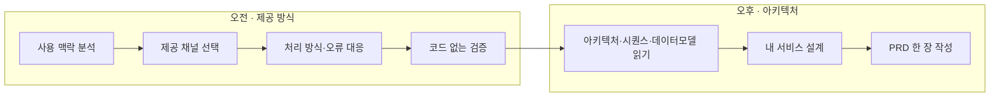
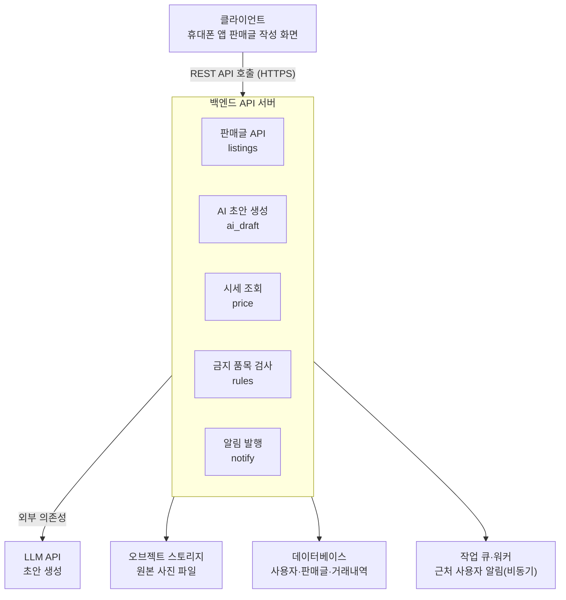
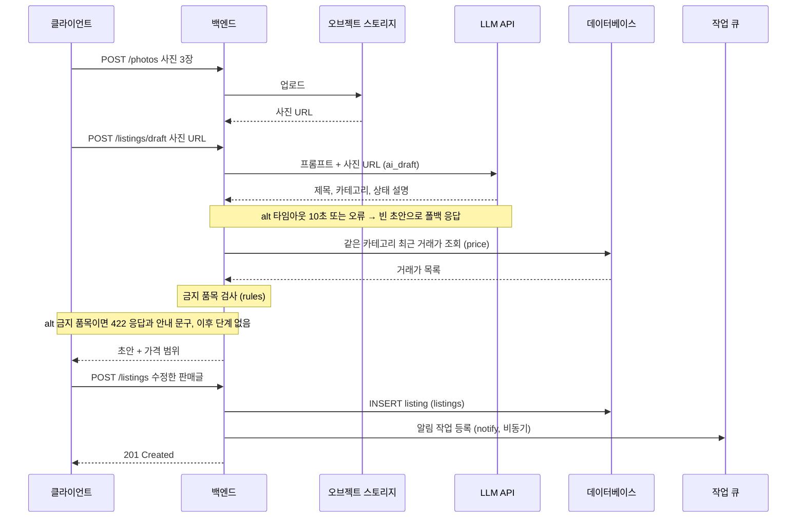

# N045 · AI 기능을 서비스로 설계하기

> AI 기능 하나를 동작하게 만드는 것과, 그 기능을 "계속 쓰이는 서비스"로 만드는 것은 다른 문제입니다. 이번 강의는 사용 맥락 분석부터 제공 채널 선택, 처리 방식과 오류 대응, 코드 없는 검증, 아키텍처·시퀀스·데이터 모델 설계를 거쳐 PRD 한 장을 완성하기까지, AI 기능을 실제 서비스로 옮기는 전체 과정을 다룹니다.

## 목차
1. [왜 "기능"과 "서비스"는 다른가](#ch1)
2. [사용 맥락부터 분석하기](#ch2)
3. [다섯 가지 제공 채널 고르기](#ch3)
4. [처리 방식과 오류 대응 정하기](#ch4)
5. [코드 없이 먼저 검증하기](#ch5)
6. [아키텍처를 정하지 않으면 생기는 일](#ch6)
7. [내 서비스 설계하기: 시퀀스 → 아키텍처 → 데이터 모델](#ch7)
8. [PRD 한 장으로 정리하기](#ch8)
9. [핵심 한 문장 요약](#summary)
- [부록 A · 실전 맛보기](#app-a)
- [부록 B · 트러블슈팅](#app-b)
- [부록 C · AI 프롬프트 모음집](#app-c)
- [부록 D · 용어 사전](#app-d)
- [부록 E · 개념 비교표 모음](#app-e)
- [부록 F · 학습 로드맵](#app-f)
- [부록 G · 복습 퀴즈](#app-g)

---

<a id="ch1"></a>
## 1. 왜 "기능"과 "서비스"는 다른가

AI 기능 하나를 만드는 것과, 그 기능을 다른 사람이 계속 찾아 쓰는 서비스로 만드는 것은 다른 문제입니다.

> 📌 **요약 — 음식점 비유**: "AI 기능 만들기: 맛있는 음식 한 가지를 개발합니다. AI 서비스 만들기: 손님이 음식을 주문하고, 주방에서 조리하고, 결제하고, 문제가 생기면 해결하는 전체 과정을 설계합니다. 음식이 맛있어도 주문하기 어렵거나, 가격이 지나치게 비싸거나, 문제가 생겼을 때 해결할 방법이 없다면 손님은 다시 오지 않습니다."

이 차이를 실제로 겪어 본 적이 있을 것입니다.

> ⚠️ **주의 — 실제로 자주 생기는 네 가지 문제**: "주소를 공유해도 며칠 뒤에는 접속하는 사람이 없고, 사내에서 쓰려고 하면 '회사 문서를 외부 LLM에 보내도 되나요?'라는 질문에서 막히고, 외부에 공개했더니 모르는 사람이 내 API 키 비용으로 기능을 호출하기도 합니다. 몇 주 뒤 기능을 고치려고 하면 어느 파일을 고쳐야 할지 모르는 일도 생깁니다. 앞의 문제들은 제공 방식에서, 마지막 문제는 아키텍처에서 생깁니다."

| 겪는 문제 | 생기는 원인 |
|---|---|
| 며칠 지나면 아무도 접속하지 않는다 | 제공 방식(채널)이 사용 맥락과 안 맞는다 |
| "외부 LLM에 회사 문서를 보내도 되나요?"에서 막힌다 | 제공 방식을 정할 때 보안·권한을 고려하지 않았다 |
| 모르는 사람이 내 API 키 비용으로 기능을 호출한다 | 제공 방식과 아키텍처 둘 다에서 비롯되는 문제 |
| 몇 주 뒤 어느 파일을 고쳐야 할지 모른다 | 아키텍처(모듈 구조)를 정하지 않았다 |

### 오늘의 학습 목표

> 🧪 **예제 — 오늘 하루 일정(verbatim)**: "1. 사용 맥락을 분석하고, 기성 AI 도구부터 웹앱까지 다섯 가지 제공 채널 가운데 맞는 것을 고를 수 있습니다. 2. LLM 처리 시간에 맞춰 동기 처리, 비동기 처리, 스케줄 실행 가운데 처리 방식을 고르고, AI 오류 대응 장치를 정할 수 있습니다. 3. 오즈의 마법사 테스트와 기성 AI 도구 프로토타입으로 코드 없이 사용성 테스트를 할 수 있습니다. 4. 아키텍처 다이어그램, 시퀀스 다이어그램, 데이터 모델로 웹앱의 구조를 읽고, 내 서비스의 아키텍처를 설계할 수 있습니다. 5. 접근 제어, 데이터 처리, 비용, 파일럿 계획, 아키텍처를 담은 PRD 한 장을 쓸 수 있습니다."



```
[텍스트 다이어그램]
오전: 사용 맥락 분석 → 제공 채널 선택 → 처리 방식·오류 대응 → 코드 없는 검증
오후: 아키텍처·시퀀스·데이터모델 읽기 → 내 서비스 설계 → PRD 한 장 작성
(배포·설치는 이번 강의에서 다루지 않습니다)
```

**핵심 키워드**: AI 기능 ≠ AI 서비스 / 제공 방식(채널) / 아키텍처 / PRD(Product Requirements Document)

---

<a id="ch2"></a>
## 2. 사용 맥락부터 분석하기

채널을 정하기 전에 먼저 할 일은 **사용 맥락(context of use)** 분석입니다. 사용자가 언제, 어떤 기기와 도구를 쓰고 있을 때 이 기능이 필요한지를 먼저 봐야, 채널을 고를 때 짐작이 아니라 근거가 생깁니다.

### 2-1. 사용 맥락 표 5항목

이 강의를 관통하는 메인 예제는 "강의 필기를 넣으면 복습 노트와 퀴즈를 만들어 주는 기능"입니다.

> 🧪 **예제 — 강의 복습 노트 사용 맥락(verbatim)**:

| 항목 | 강의 복습 노트와 퀴즈의 예 |
|---|---|
| 대상 사용자 | 이 과정의 수강생. 하루 7시간 강의를 듣고 노트 앱에 필기한다 |
| 필요한 시점 | 강의 직후(정리), 다음 날 아침 강의 전(복습) |
| 사용 중인 기기와 도구 | 강의 직후에는 노트북의 노트 앱, 다음 날 아침에는 휴대폰 |
| 결과를 받은 뒤의 다음 작업 | 복습 노트를 노트 앱에 저장하고, 다음 날 퀴즈를 푼다 |
| 현재 방식 | 필기를 다시 읽으며 30분쯤 걸려 정리하고, 대부분 미룬다 |

실제 사용자에게 확인하지 못한 칸은 "가정"이라고 표시해 두고, 인터뷰와 데스크 리서치로 가정을 하나씩 줄여 나갑니다.

### 2-2. 가정 → 인터뷰 → 리서치

| 구분 | 의미 | 예시 |
|---|---|---|
| 가정 | 아직 검증되지 않음 | 수강생은 휴대폰으로 퀴즈를 풀 것이다. |
| 인터뷰 | 실제 사용자의 경험에서 확인 | 인터뷰한 수강생 3명 중 2명이 휴대폰으로 복습했다. |
| 리서치 | 공개된 자료에서 반복 확인 | 서로 다른 두 서비스의 리뷰에서 저장·동기화 불편이 확인됐다. |

> ⚠️ **주의 — 한 사람의 말만으로 바꾸지 않는다**: "찾은 내용은 출처 링크와 함께 사용 맥락 표의 해당 칸에 옮기고, '가정' 표시를 '리서치'로 바꿉니다. 한 사람의 글만으로는 바꾸지 않고, 비슷한 내용이 두 곳 이상에서 나올 때 바꿉니다."

### 2-3. 좋은 인터뷰 질문, 나쁜 인터뷰 질문

> ⚠️ **주의 — "쓰시겠어요?"는 묻지 않는다**: "좋지 않은 질문: '이런 AI 기능이 있으면 사용하시겠어요?' '복습을 자동으로 해 주면 좋겠죠?' 이러한 질문에는 상대방이 긍정적으로 대답할 가능성이 높습니다. 하지만 실제로 사용할지는 알 수 없습니다. 더 좋은 질문: '어제 강의가 끝난 뒤 필기를 어떻게 정리하셨나요?' '정리한 자료는 어디에 저장하셨나요?' '복습할 때 어떤 기기를 사용하셨나요?' '정리하는 데 얼마나 걸렸나요?' '마지막으로 복습을 미룬 이유는 무엇이었나요?'"

> 🧪 **예제 — 10분 인터뷰 절차**: "1. 대상 사용자에 가장 가까운 사람 한 명에게 10분을 요청합니다. 2. 기능을 설명하지 않고, 이 작업을 마지막으로 한 순간을 묻습니다. 예: '어제 강의 끝나고 필기는 어떻게 정리했어요? 다시 본 적 있어요?' 3. 그때의 장소, 사용한 기기와 도구, 결과를 어디에 두었는지, 걸린 시간을 차례로 묻고 표에 옮겨 적습니다. 4. '이런 기능이 있으면 쓰시겠어요?'는 묻지 않습니다. 대부분 긍정으로 답해서 판단 근거가 되지 않습니다."

데스크 리서치는 실제 사용자를 충분히 만날 수 없을 때, 이미 공개된 자료에서 사용자의 행동과 불편을 찾는 방법입니다.

> 🧪 **예제 — 데스크 리서치 4단계**: "1. 비슷한 문제를 푸는 서비스를 두세 개 찾습니다. 2. 앱 스토어나 서비스 후기에서 별점 2-3점짜리 리뷰를 20개쯤 읽습니다. 별점 1점은 결제나 오류 불만이 많고, 2-3점에 '이건 좋은데 이게 불편하다'는 구체적인 사용 맥락이 많습니다. 3. 커뮤니티의 질문 글을 검색합니다. 4. 찾은 내용은 출처 링크와 함께 표에 옮깁니다."

> 🧪 **예제 — 브런치 콘텐츠 제작자라면**: 같은 분석표를 "자신의 경험과 글을 콘텐츠로 만들고 싶은 사람"에게 적용하면 이렇게 됩니다. 대상 사용자는 브런치 작가 본인, 사용 중인 기기와 도구는 노트북·브런치·문서 도구, 결과를 받은 뒤의 다음 작업은 "글의 스타일을 검토하고 이야기로 발전시키는 것", 현재 방식은 "직접 읽고 수정하며 콘텐츠 방향을 결정"하는 것입니다. 이 표를 채운 뒤에는 대상 사용자와 가까운 사람 한 명을 인터뷰하고, 공개된 후기와 커뮤니티 글을 확인해 가정을 줄이는 것이 다음 단계입니다.

---

<a id="ch3"></a>
## 3. 다섯 가지 제공 채널 고르기

사용 맥락을 분석했다면, 이제 어떤 통로로 기능을 제공할지 정할 차례입니다.

### 3-1. 다섯 가지 채널

| 제공 방식 | 적합한 상황 | 장단점 |
|---|---|---|
| 기성 AI 도구 (Claude 프로젝트, GPTs 등) | 개인이 빠르게 실험할 때 | 개발이 거의 필요 없지만 맞춤화에 한계 |
| 업무용 AI 도구 / 메신저 봇 | 조직 내부 또는 단체방에서 업무를 지원할 때 | 기존 업무와 연계하기 좋지만 권한·보안 검토 필요 |
| 자동화 워크플로 | 정해진 여러 작업을 연결할 때 | 반복 업무에 효율적이나 예외 처리 설계 필요 |
| 간단한 사용자 인터페이스 | 특정 업무를 쉽게 수행하게 할 때 | 사용하기 쉽지만 기능 확장에 제약이 있을 수 있음 |
| 독립형 웹앱 | 여러 사용자에게 독립적인 서비스를 제공할 때 | 자유도가 높지만 개발·운영·보안 부담이 큼 |

> 💡 **팁 — 두 채널 이름이 섞여 쓰이는 이유**: 원문에서 두 번째 채널이 "메신저 봇"으로도, "업무용 AI 도구"로도 표현됩니다. 둘 다 "조직이나 단체방 안에서 쓰는, 기성 AI 도구보다 한 단계 더 통합된 채널"을 가리키는 같은 자리이니 상황에 맞게 읽으면 됩니다.

> 🧪 **예제 — 기성 AI 도구 vs 웹앱(verbatim)**: "기성 AI 도구는 Claude 프로젝트나 GPTs처럼 이미 있는 AI 서비스 안에 시스템 프롬프트, 참고 문서, 출력 형식을 설정해 공유하는 방식입니다. 코드가 없으니 몇 시간이면 배포할 수 있지만, 사용자가 모두 그 도구의 계정을 가지고 있어야 하고 화면, 데이터 저장, 접근 범위는 그 도구가 정한 대로 따릅니다. 웹앱은 화면, 인증, 데이터, 과금을 모두 직접 정할 수 있는 대신 개발, 배포, 운영을 모두 맡아야 합니다."

### 3-2. 세 가지 사용자층, 같은 기능이지만 다른 채널

> 📌 **요약 — 강의 복습 기능을 세 가지로 풀면(verbatim)**: "LLM이 하는 일은 셋 다 '필기나 강의 내용으로 복습 노트와 퀴즈를 만든다'로 같지만 표의 나머지 행은 모두 다릅니다. 혼자 복습하는 수강생이라면 개발할 것이 없고, 기성 AI 도구 프로젝트 하나로 충분합니다. 스터디는 모두 같은 단체 대화방에 있으니 메신저 봇이 맞고, 매일 정해진 시각에 그날 퀴즈를 올리는 스케줄 실행이 '함께 푼다'는 목적에 맞습니다. 대신 각자의 필기가 LLM 제공사로 전송된다는 것을 스터디원에게 알리고 동의를 받아야 하고, 봇 운영자 한 명의 API 키로 비용이 나가므로 월 한도와 분담 방법을 정해야 합니다. 외부 학습자에게 공개하면 타인이 올린 강의 녹화와 자료를 저장하는 서비스가 되므로 회원 인증, 보존 기간, 저작권 고지, 과금이 모두 필요하고, 그래서 웹앱이 됩니다. 2시간짜리 녹화를 처리해야 하니 처리 방식도 비동기가 됩니다."

| 구분 | 개인 수강생 | 5명 스터디 | 외부 학습자 |
|---|---|---|---|
| 목적 | 혼자 복습 | 함께 학습 | 다수에게 서비스 제공 |
| 제공 채널 후보 | 기성 AI 도구 | 메신저 봇 또는 공유 도구 | 독립형 웹앱 |
| 주요 요구 | 간편한 사용과 저장 | 공동 이용과 정기 공유 | 회원 관리와 개인별 기록 |
| 처리 방식 | 즉시 생성 | 정해진 시간에 자동 실행 가능 | 긴 녹화는 비동기 처리 고려 |
| 주요 위험 | 자료 유실 | 자료 전송 동의와 공동 비용 | 보안, 저작권, 과금, 운영 |

### 3-3. 웹앱으로 넘어가는 전환 조건

> ⚠️ **주의 — 전환 조건은 보통 네 가지 중 하나**: "기존 AI 도구의 계정이 없는 사용자도 이용해야 할 때 / 사용량과 비용을 직접 통제해야 할 때 / 메신저나 사내 시스템과 자동으로 연동해야 할 때 / 사용자별 데이터 저장이나 접근 권한을 세밀하게 관리해야 할 때" 가운데 하나라도 해당되면 웹앱 전환을 검토합니다.

---

<a id="ch4"></a>
## 4. 처리 방식과 오류 대응 정하기

채널을 정했다면, 이번에는 LLM이 응답하는 데 걸리는 시간에 맞춰 처리 방식을 고르고, LLM이 틀렸을 때를 대비한 오류 대응 장치를 정합니다.

### 4-1. 동기 / 비동기 / 스케줄 세 가지 처리 방식

> 🧪 **예제 — 음식 주문 비유(verbatim)**:
> "① 동기 처리 — 끝날 때까지 기다리기. 음료처럼 금방 나오는 주문입니다. 주문한 뒤 결과가 나올 때까지 기다렸다가 바로 받습니다. AI 예시: 짧은 글 요약, 간단한 번역, 한두 문장의 질문과 답변"
> "② 비동기 처리 — 접수하고 나중에 결과 받기. 시간이 오래 걸리는 요리를 주문하고 접수 번호를 받습니다. 다른 일을 하다가 완성되면 알림을 받습니다. AI 예시: 긴 녹음 요약, 여러 문서 분석, 대량 콘텐츠 생성"
> "③ 스케줄 실행 — 정해진 시간에 자동으로 처리하기. 매주 월요일 오전에 단체 도시락을 준비하도록 예약하는 것과 같습니다. AI 예시: 매일 아침 뉴스레터 생성, 매주 시장 분석 보고서 작성"

| 구분 | 동기 처리 | 비동기 처리 | 스케줄 실행 |
|---|---|---|---|
| 실행 시점 | 사용자가 요청할 때 | 사용자가 요청할 때 | 정해진 시간·주기에 자동 실행 |
| 사용자 대기 | 결과가 나올 때까지 기다림 | 접수 후 다른 일을 할 수 있음 | 실행 전까지 기다릴 필요 없음 |
| 결과 전달 | 즉시 응답 | 상태 조회 또는 완료 알림 | 예약된 실행 결과를 전달 |
| 적합한 작업 | 짧고 간단한 작업 | 오래 걸리는 작업 | 반복적이고 정기적인 작업 |
| 주요 고려 사항 | 시간 초과, 연결 끊김 | 작업 상태, 재시도, 알림 | 실행 주기, 중복 실행, 실패 감지 |

> 💡 **팁**: 스케줄 실행과 비동기 처리는 서로 배타적인 개념이 아닙니다. 정해진 시간에 작업을 시작한 뒤, 실제 분석은 비동기로 진행할 수도 있습니다. (예: 매일 아침 7시 30분 뉴스레터 생성, 매주 월요일 오전 8시 주간보고서 작성)

### 4-2. LLM은 그럴듯한 오류를 낸다

> ⚠️ **주의 — 오류는 없앨 수 없다(verbatim)**: "LLM은 그럴듯한 오류를 냅니다. 필기에 없는 설명을 개념 정의에 덧붙이거나, 퀴즈의 정답을 틀리게 적는 식입니다. 이런 오류는 없앨 수 없으므로, 오류가 사용자에게 그대로 전달되지 않게 제공 방식 안에 대응 장치를 둡니다."

### 4-3. 오류 대응 장치 5가지

| 장치 | 정의 |
|---|---|
| **출처 표시** | 결과에 근거(원문 몇 번째 줄, 인용 등)를 함께 표시해 검증 가능하게 한다 |
| **폴백(Fallback)** | "AI가 정상적으로 답하지 못할 때 안전한 대체 응답이나 다른 처리 경로를 제공합니다. 예: '자료에서 답을 확인하지 못했습니다. 원문을 확인해 주세요.'" |
| **HITL (Human-in-the-Loop)** | "AI 결과를 사람에게 보여 주고 승인받은 뒤 외부에 전달하거나 실행합니다. 예: 스터디 운영자가 퀴즈의 정답을 확인한 뒤 단체방에 게시합니다." |
| **에스컬레이션(Escalation)** | "자동으로 해결하기 어려운 문제를 담당자나 전문가에게 전달합니다. 예: 정답이 모호하거나 근거가 충돌하는 문제는 강사에게 검토를 요청합니다." |
| **피드백** | 사용자가 결과의 문제를 바로 알릴 수 있는 경로를 둔다 |

> 📌 **요약 — 오류 대응표 예시**:

| 오류 유형 | 영향도 | 대응 장치 | 사용자에게 보이는 문구 |
|---|---|---|---|
| 원고에 없는 내용을 추가함 | 중간 | 출처 표시, 폴백 | "원문에서 근거를 찾지 못한 내용은 분석 결과에서 제외했습니다." |
| 분석 중 API 호출 실패 | 중간 | 제한된 재시도, 폴백 | "분석 중 문제가 발생했습니다. 잠시 후 다시 시도해 주세요." |
| 파일이 너무 크거나 형식이 맞지 않음 | 중간 | 입력 검증 | "현재 파일 형식을 지원하지 않습니다. PDF 또는 DOCX 파일을 업로드해 주세요." |
| 결과의 핵심 해석이 불확실함 | 높음일 수 있음 | 사람의 검토, 에스컬레이션 | "일부 해석의 근거가 충분하지 않아 확인이 필요합니다." |

> ⚠️ **주의 — 문구는 "다음에 할 일"을 알려줘야 한다**: "사용자에게 보여 주는 문구는 단순히 오류가 발생했다는 사실만 전달하는 것이 아니라, 현재 상태와 다음에 할 일을 함께 알려 주는 것이 좋습니다." '오류가 발생했습니다'보다 '담당자를 녹음에서 찾지 못했어요. 직접 입력해 주세요'처럼 쓰는 것이 좋습니다.

---

<a id="ch5"></a>
## 5. 코드 없이 먼저 검증하기

처리 방식까지 정했다면, 코드를 작성하기 전에 실제로 써 볼 사람이 이 흐름을 어떻게 받아들이는지 먼저 확인합니다.

> 🧪 **예제 — 식당 비유(verbatim)**: "새로운 식당을 연다고 생각해 보겠습니다. 인테리어와 주방을 완성하고 메뉴를 모두 개발한 다음에야 손님에게 음식을 제공한다면, 손님들이 메뉴를 이해하지 못하거나 주문 방식이 불편하다는 사실을 뒤늦게 발견할 수 있습니다. 반대로 정식 개점 전에 몇 명에게 임시 메뉴판을 보여 주고 음식을 제공하면, 적은 비용으로 문제를 발견할 수 있습니다."

### 5-1. 오즈의 마법사 테스트

**오즈의 마법사 테스트(Wizard of Oz prototyping)**: "시스템이 하는 일을 사람이 뒤에서 대신 수행하는 방법입니다." AI 모델 없이도, 한 사람이 진행자가 되어 참여자의 요청에 직접 응답을 작성해 주면서 채널과 출력 형식을 검증합니다.

> 🧪 **예제 — 10초 안에 나오는 실제 대화(verbatim)**:
> "진행자: 방금 오전 강의가 끝났고 점심을 먹으러 가는 길이에요. 오늘 배운 내용을 복습해 두고 싶어요.
> 참여자: (노트 앱의 필기를 복사해 붙여 넣는다) 이거 정리해 줘
> 복습봇: 오늘 필기에서 핵심 개념 4개를 찾았어요. ① HTTP 요청: 클라이언트가 서버에 보내는 메시지 (필기 3번째 줄) ② 상태 코드: … / 퀴즈 1. 서버가 요청을 처리하지 못했을 때 돌려주는 상태 코드 범위는? ① 2xx ② 3xx ③ 4xx ④ 5xx · 정답: ④
> 참여자: 아, 정답이 바로 보여서 풀기 전에 봐 버렸어요.
> 참여자: 이거 내일 아침에 다시 보려면 어디서 찾아요? 단톡방이면 금방 묻힐 것 같은데."

이 대화에서 드러난 문제 세 가지와 그 해결은 아래 [부록 B](#app-b)에 트러블슈팅 표로 정리했습니다.

> 🧪 **예제 — 진행 절차(verbatim)**: "1. 짝과 역할을 나눕니다. 한 사람은 테스트 참여자, 한 사람은 진행자입니다. 15분씩 바꿔 두 번 합니다. 2. 진행자는 상황 하나만 알려 줍니다. 기능 사용법은 설명하지 않습니다. 3. 참여자는 정한 채널로 실제처럼 요청합니다. 4. 진행자는 정한 출력 형식대로 직접 응답을 작성해 돌려주고, 테스트 노트를 채웁니다. 테스트 중에는 참여자를 돕지 않습니다."

> 📌 **요약 — 말보다 행동을 본다(verbatim)**: "노트는 참여자가 말한 것보다 한 행동을 먼저 봅니다. '좋네요'라고 하면서 결과의 절반을 지우고 다시 쓰는 참여자도 있습니다. 결과를 그대로 공유했다면 출력 형식이 맞은 것이고, 수정한 뒤 공유했다면 수정한 부분이 출력 형식이나 오류 대응으로 돌아갈 항목입니다. 처음에 무엇을 할지 몰라 멈췄다면 제공 채널이나 첫 안내 문구를 바꿀 지점입니다. 두 참여자에게서 같은 문제가 나오면 바꾸고, 한 사람에게서만 나왔다면 기록해 두었다가 파일럿에서 다시 확인합니다."

### 5-2. 기성 AI 도구 프로토타입

오즈의 마법사 테스트로 바꾼 채널을, 이번엔 실제 AI 도구(Claude 프로젝트, GPTs 등)의 프로젝트 지침(시스템 프롬프트)으로 옮겨 실제 AI 응답 품질까지 확인합니다. [부록 A](#app-a)에 완성된 시스템 프롬프트 예시가 있습니다.

> ⚠️ **주의 — 개인정보가 들어간 필기는 넣지 않는다**: "참여자에게는 프로젝트를 공유하거나, 진행자의 노트북에서 프로젝트를 연 채로 넘겨줍니다. 참여자가 실제 오늘 오전 강의의 필기를 넣게 하면 실제 데이터로 응답 품질까지 볼 수 있습니다. 다른 사람의 이름이나 연락처가 들어간 필기는 넣지 않습니다."

### 5-3. 두 검증법 비교

| 구분 | 오즈의 마법사 테스트 | 기성 AI 도구 프로토타입 |
|---|---|---|
| 응답 담당 | 사람이 직접 작성 | AI가 생성 |
| 주된 검증 대상 | 채널, 사용 흐름, 출력 형식 | 사용 흐름과 AI 결과 품질 |
| AI 모델 필요 | 없어도 됨 | 필요 |
| 대표적인 한계 | AI 자동화 성능을 알기 어려움 | 도구 자체의 기능 한계가 있음 |

> 💡 **팁 — 지침으로 풀리는 문제, 안 풀리는 문제**: "지침으로 해결 가능한 문제: 정답 노출 시점, 출력 순서, 근거 표시, 첫 안내 문구 / 채널을 바꿔야 할 수 있는 문제: 결과 보관, 검색, 사용자별 데이터 관리 / 추가 개발이 필요할 수 있는 문제: 틀린 문제 저장, 학습 이력 관리, 반복 학습 기능. 모든 문제를 프롬프트 수정으로 해결할 수 있는 것은 아닙니다. 이것을 구분하는 것이 서비스 기획자의 중요한 역할입니다."

---

<a id="ch6"></a>
## 6. 아키텍처를 정하지 않으면 생기는 일

오후 파트의 메인 예제는 사진을 올리면 AI가 판매글 초안을 생성하는 **중고거래 앱**입니다. 외부 사용자 대상이라 다섯 채널 가운데 웹앱(휴대폰 앱)을 고른 경우입니다.

### 6-1. 코딩 에이전트가 빈틈을 채울 때

요청에 없는 항목은 코딩 에이전트가 그럴듯한 기본값으로 채우는데, 그 기본값이 꼭 안전한 선택은 아닙니다.

> ⚠️ **주의 — 다섯 가지 함정(verbatim)**:

| 요청에 없던 항목 | 에이전트가 고르기 쉬운 방법 | 나중에 드러나는 문제 |
|---|---|---|
| API 키 위치 | 클라이언트 코드에 하드코딩 | 브라우저 개발자 도구로 키가 노출되어 타인이 내 비용으로 호출한다 |
| 데이터 저장소 | 서버 메모리나 브라우저 로컬 스토리지 | 서버 재시작이나 기기 변경 시 데이터가 사라진다 |
| 데이터 소유자 | 정하지 않음 | 다른 사용자의 데이터를 조회하거나 수정할 수 있다 |
| 외부 API 실패 처리 | 처리하지 않음 | LLM 응답이 늦거나 실패하면 화면이 멈추거나 빈 데이터가 저장된다 |
| 모듈 분리 | 한 파일에 모두 작성 | 기능 하나를 수정하다 관계없는 기능이 함께 깨진다 |

> 📌 **요약**: "어느 것도 처음 화면이 뜰 때는 드러나지 않고, 사용자가 늘거나 재배포하거나 기능을 수정할 때 드러납니다."

이 다섯 가지 함정을 막으려면, 웹앱의 구조를 **아키텍처 다이어그램·시퀀스 다이어그램·데이터 모델** 세 문서로 미리 정해 둬야 합니다.

### 6-2. 세 문서 = 식당의 세 가지 그림

> 🧪 **예제 — 식당 비유(verbatim)**: "① 아키텍처 다이어그램 = 식당의 배치도 — 손님, 주문대, 주방, 식재료 창고, 배달 담당자가 어떻게 연결되어 있는지 보여 줍니다. ② 시퀀스 다이어그램 = 주문 처리 순서 — 손님이 주문하고, 주방이 음식을 만들고, 직원이 전달하는 과정을 순서대로 보여 줍니다. ③ 데이터 모델 = 식재료 관리대장 — 어떤 물건을 누가 관리하고, 어디에 보관하며, 언제까지 보관할지 정합니다."

| 구성 요소 | 역할 | 쉬운 비유 |
|---|---|---|
| 클라이언트 | 사용자가 보고 조작하는 화면 | 주문대 |
| 백엔드 | 요청을 처리하고 권한과 업무 규칙을 확인 | 주방 관리자 |
| LLM API | 입력 자료를 바탕으로 AI 결과 생성 | 전문 요리사 |
| 데이터베이스 | 판매글, 사용자 정보 등 구조화된 데이터 저장 | 관리대장 |
| 오브젝트 스토리지 | 사진처럼 파일 형태의 데이터 저장 | 창고 |
| 작업 큐·워커 | 나중에 실행할 작업을 접수하고 처리 | 대기표와 담당 직원 |

### 6-3. 중고거래 앱 아키텍처 다이어그램



```
[텍스트 다이어그램 · 아키텍처]
클라이언트(휴대폰 앱 판매글 작성화면)
   └→ REST API 호출(HTTPS) →
백엔드 API 서버 [판매글API(listings) | AI초안생성(ai_draft) | 시세조회(price) | 금지품목검사(rules) | 알림발행(notify)]
   └→ 외부 의존성 →
   ├ LLM API (사진 입력받아 제목·카테고리·상태설명 초안 생성)
   ├ 오브젝트 스토리지 (원본 사진 파일, 백엔드는 사진 URL만 다룬다)
   ├ 데이터베이스 (사용자, 판매글, 거래 내역)
   └ 작업 큐와 워커 (근처 사용자 알림을 요청과 분리해 처리, 비동기)
```

> ⚠️ **주의 — 가장 먼저 확인하는 것은 시크릿 위치(verbatim)**: "LLM API 키와 스토리지 접근 키는 백엔드에만 있어야 합니다. 클라이언트 코드는 사용자의 기기로 내려가므로 그 안에 넣은 키는 누구나 추출할 수 있습니다. 바이브코딩으로 만든 앱을 문서화해 보면 키가 클라이언트 쪽에 있는 경우가 꽤 많습니다."

> 📌 **요약 — 백엔드를 모듈로 나누는 이유**: "판매글 API, AI 초안 생성, 시세 조회처럼 책임 하나에 모듈 하나를 두면 시세 조회 로직을 수정할 때 price 모듈만 보면 됩니다. 작업 큐와 워커만 점선인 것은 사용자의 요청과 분리되어 비동기로 실행되기 때문입니다."

### 6-4. 시퀀스 다이어그램: "AI 초안 생성"부터 등록까지



```
[텍스트 다이어그램 · 시퀀스 — 요청 →, 응답 ⇢, 비동기 메시지 ~>]
클라이언트 → 백엔드: POST /photos 사진 3장
백엔드 → 오브젝트스토리지: 업로드 ⇢ 사진 URL
클라이언트 → 백엔드: POST /listings/draft 사진 URL
백엔드 → LLM API: 프롬프트+사진URL(ai_draft) ⇢ 제목/카테고리/상태설명
  [alt] 타임아웃 10초 또는 오류 → 빈 초안으로 폴백 응답
백엔드 → 데이터베이스: 같은 카테고리 최근 거래가 조회(price) ⇢ 거래가 목록
백엔드: 금지 품목 검사(rules)
  [alt] 금지 품목이면 422 응답과 안내 문구, 이후 단계 없음
백엔드 ⇢ 클라이언트: 초안 + 가격 범위
클라이언트 → 백엔드: POST /listings 수정한 판매글
백엔드 → 데이터베이스: INSERT listing(listings)
백엔드 ~> 작업큐: 알림 작업 등록(notify)
백엔드 ⇢ 클라이언트: 201 Created
```

> 📌 **요약 — 시퀀스를 그리면 보이는 것**: "LLM API 호출은 몇 초가 걸리고 호출마다 비용이 발생하므로, 사용자가 버튼을 여러 번 누르면 비용도 그만큼 늘어납니다. 그래서 첫 번째 alt 상자처럼 타임아웃과 실패 시의 폴백 응답을 정해 두고, 클라이언트에서는 요청 중에 버튼을 비활성화합니다. 금지 품목에 걸리면 두 번째 alt 상자처럼 422 응답과 안내 문구를 돌려주고 이후 호출은 일어나지 않습니다. 근처 사용자 알림은 수백 명에게 보내야 할 수 있어서, 등록 요청 안에서 처리하면 판매자가 응답을 오래 기다리게 됩니다. 그래서 작업 큐에 등록만 하고 바로 201 Created를 돌려줍니다."

### 6-5. 데이터 모델: 무엇을 저장하고, 소유자는 누구이며, 언제 삭제하는가

| 엔티티 | 생성 시점 | 소유자 | 저장소 | 보존 기간 |
|---|---|---|---|---|
| 사진 | 사진 업로드 | 판매자 | 오브젝트 스토리지 | 판매글 삭제 시 함께 삭제 |
| 판매글 | 등록 | 판매자 | 데이터베이스 | 판매자가 삭제할 때까지, 거래 완료 후 보관 |
| AI 초안 (저장 안 함) | AI 초안 생성 | 판매자 | 클라이언트 메모리 | 등록하면 판매글이 되고 초안은 폐기 |
| 거래 내역 | 거래 완료 | 판매자, 구매자 | 데이터베이스 | 정해 둔 보관 기간 |
| 알림 작업 | 등록 직후 | 서비스 | 작업 큐 | 처리 완료 시 삭제 |

> ⚠️ **주의 — 소유자 칸이 비면 생기는 일**: "소유자 칸은 인가(authorization)로 이어집니다. 판매글의 소유자가 판매자라면, 판매글 수정이나 삭제 요청이 올 때마다 백엔드는 요청한 사용자가 그 판매글의 소유자인지 검사해야 합니다. 보존 기간 칸을 정하지 않으면 탈퇴한 사용자의 사진이 스토리지에 계속 남고 저장 비용도 계속 발생합니다. 거래 내역처럼 소유자가 둘인 엔티티는 한 사람의 삭제 요청만으로 바로 지우면 안 되는 경우도 있어서, 표를 채우다 보면 이런 판단이 필요한 곳이 드러납니다."

---

<a id="ch7"></a>
## 7. 내 서비스 설계하기: 시퀀스 → 아키텍처 → 데이터 모델

이제 읽는 쪽에서 그리는 쪽으로 넘어갑니다. 오전에 정한 내 서비스를, 코드를 쓰지 않고 세 문서로 직접 설계합니다. 첫 채널로 기성 AI 도구나 메신저 봇을 골랐다면, 전환 조건이 충족되어 웹앱으로 옮긴다고 가정하고 설계합니다. 이 결과가 다음 장 PRD의 아키텍처 항목이 됩니다.

### 7-1. 왜 시퀀스 다이어그램부터인가

세 문서 가운데 시퀀스 다이어그램을 가장 먼저 그립니다.

| 문서 | 답해야 할 질문 |
|---|---|
| 시퀀스 다이어그램 | 요청부터 결과까지 어떤 순서로 처리되는가? |
| 아키텍처 다이어그램 | 어떤 시스템 구성 요소가 필요한가? |
| 데이터 모델 | 어떤 데이터를 저장하고 누가 관리하는가? |

> 📌 **요약**: 사용자 동작 하나에서 출발하므로 오전에 정한 사용 맥락과 처리 방식을 그대로 이어서 그릴 수 있고, 그리고 나면 필요한 구성 요소와 저장할 데이터가 함께 드러나기 때문입니다.

### 7-2. 설계 순서 4단계

> 🧪 **예제 — 직접 확인할 곳(verbatim)**:
> "1. 시퀀스 다이어그램: 내 서비스에서 가장 중요한 사용자 동작 하나를 고릅니다. 강의 복습 노트라면 '필기를 붙여 넣고 퀴즈 만들기'입니다. 빈 양식 맨 위에 그 동작에 관련된 구성 요소(클라이언트, 백엔드, LLM API, 데이터베이스 등)를 적고, 요청과 응답을 시간 순서대로 화살표로 그립니다. 처리 방식과 오류 대응을 alt 상자로 넣습니다.
> 2. 아키텍처 다이어그램: 시퀀스 다이어그램에 나온 구성 요소를 모아 옮겨 그립니다. 백엔드는 화살표마다 하는 일을 보고 모듈로 나누고, 시크릿이 놓일 위치를 표시합니다.
> 3. 데이터 모델: 시퀀스 다이어그램에서 데이터베이스나 스토리지로 가는 화살표를 찾아, 그 화살표가 저장하는 것을 엔티티로 적습니다. 엔티티마다 소유자와 보존 기간을 정합니다. 화면에만 보이고 저장하지 않기로 한 것도 '저장 안 함'으로 적습니다.
> 4. 점검: 다섯 항목(API 키 위치, 데이터 저장소, 데이터 소유자, 외부 API 실패 처리, 모듈 분리)을 내 설계에서 모두 정했는지 확인합니다. 정하지 않은 항목은 코딩 에이전트가 대신 정하게 되는 항목입니다."

> 💡 **팁 — alt 상자**: "alt는 쉽게 말해 '이 조건이면 A, 다른 조건이면 B'라는 분기입니다." 처리방식·오류 대응처럼 조건에 따라 흐름이 갈리는 지점마다 alt 상자로 표시해 두면, 코딩 에이전트에게 설계를 넘길 때 예외 처리를 빠뜨리지 않습니다.

### 7-3. 다 그렸으면 코딩 에이전트에게 "질문만" 받는다

세 문서를 완성했다면, 코딩 에이전트에게 설계를 대신 결정하게 하지 않고 **빠진 항목을 질문으로만** 받습니다. [부록 C](#app-c)에 이 설계 리뷰 요청 프롬프트가 있습니다.

> ⚠️ **주의**: "이렇게 요청하면 코딩 에이전트가 임의로 선택한 구조를 나중에 뒤늦게 발견하는 위험을 줄일 수 있습니다. 다만 설계 문서를 받았다고 끝나는 것은 아닙니다. 특히 인증·권한·비밀정보 관리처럼 보안에 영향을 주는 항목은 실제 구현에서도 확인해야 합니다."

> 🧪 **예제 — ASP·My-Story-Maker 같은 1인 서비스도 마찬가지**: "ASP나 My-Story-Maker 같은 서비스를 개발할 때도 동일하게 적용할 수 있습니다. 처음에는 간단한 AI 기능으로 시작하더라도 사용자의 자료를 저장하거나 여러 사람이 함께 사용하는 단계로 넘어가면 데이터 소유권과 접근 권한이 중요해지기 때문입니다."

---

<a id="ch8"></a>
## 8. PRD 한 장으로 정리하기

지금까지 정한 것들을 한 문서에 모읍니다.

> 📌 **요약 — PRD란(verbatim)**: "PRD(Product Requirements Document)는 어떤 서비스를 왜, 누구를 위해, 어떻게 만들 것인지 정리한 제품 요구사항 문서입니다. 좋은 PRD는 모든 기술적 세부 사항을 담는 문서가 아닙니다. 개발을 시작하기 전에 반드시 합의해야 하는 결정과 검증할 가설을 명확히 하는 문서입니다."

### 8-1. PRD에 들어갈 7개 항목

1. 서비스 목적
2. 대상 사용자와 사용 맥락
3. 제공 채널과 처리 방식
4. 접근 제어와 데이터 처리
5. 오류 대응과 비용
6. 아키텍처
7. 파일럿 계획

> 🧪 **예제 — ASP(AI Story Partner) 1인 창업에 적용하면**:

| 설계 항목 | ASP 적용 예시 |
|---|---|
| 서비스 목적 | 고객의 업무와 아이디어를 분석해 AI 활용 방안을 제안 |
| 초기 사용자 | AI 도입을 고민하는 소기업 대표 또는 실무자 |
| 제공 채널 | 기존 AI 도구로 검증한 뒤 필요하면 웹앱으로 확장 |
| 처리 방식 | 간단한 진단은 동기 처리, 여러 문서의 종합 분석은 비동기 처리 검토 |
| 오류 대응 | 결과 검증, 재시도, 호출 제한, 사람의 최종 확인 |
| 데이터 보호 | 고객 자료의 민감도 확인, 접근 권한 관리, 외부 전송 정책 명시 |
| 핵심 데이터 | 고객, 진단 요청, 입력 자료, 분석 결과, 검토 상태 |
| 검증 방법 | 소수 고객에게 프로토타입을 제공하고 사용성과 유용성을 확인 |

> 💡 **팁**: "처음부터 모든 기능을 자동화할 필요는 없습니다. 초기에는 사람이 결과를 검토하는 방식으로 고객의 요구를 파악하고, 반복되는 업무부터 점진적으로 자동화하는 것이 현실적입니다."

### 8-2. 오늘 배운 것 종합 정리

> 📌 **요약(verbatim)**: "제공 방식. 제공 채널은 기능이 아니라 사용 맥락이 정합니다. 사용자가 이미 쓰는 도구 안에서 끝나는 채널을 찾고, 개발 부담이 작은 기성 AI 도구로 먼저 검증한 뒤 전환 조건이 생기면 옮깁니다. LLM 처리 시간에 맞춰 동기, 비동기, 스케줄 실행 가운데 처리 방식을 고르고, 오류의 영향도가 클수록 출처 표시, 휴먼 인 더 루프, 에스컬레이션 같은 대응 장치를 더 넣었습니다.
> 검증. 오즈의 마법사 테스트와 기성 AI 도구 프로토타입으로 코드 없이 사용성 테스트를 했고, 참여자의 말보다 행동을 기준으로 바꿀 항목을 정했습니다.
> 아키텍처. 웹앱은 아키텍처 다이어그램, 시퀀스 다이어그램, 데이터 모델로 문서화합니다. 오전에 정한 내 서비스를 시퀀스 다이어그램부터 설계했고, 시퀀스에서 드러난 구성 요소와 저장 대상으로 아키텍처 다이어그램과 데이터 모델을 채웠습니다. 코딩 에이전트에게는 설계를 대신 정하게 하지 않고 빠진 항목을 질문으로 받았습니다.
> PRD. 접근 제어, 데이터 처리, 비용, 파일럿 계획, 아키텍처를 한 문서에 모았습니다. 이 과정의 뒤에서 배우는 배포와 운영 기술은 이 문서의 요구사항을 구현하는 방법입니다."

---

<a id="summary"></a>
## 9. 핵심 한 문장 요약

> **AI 기능을 서비스로 만드는 일은 "기능 하나를 잘 만드는 것"이 아니라 "사용 맥락에 맞는 채널을 고르고, LLM의 느린 응답과 그럴듯한 오류에 대비하고, 아키텍처·시퀀스·데이터 모델로 구조를 문서화한 뒤, 그 결정들을 PRD 한 장에 모으는 것"입니다. 배포와 운영 기술은 이 PRD를 구현하는 수단일 뿐, 그 전에 무엇을 만들지 정하는 것이 먼저입니다.**

---

<a id="app-a"></a>
## 부록 A · 실전 맛보기

### A-1. 완성된 시스템 프롬프트 — 강의 필기 복습 도우미

기성 AI 도구의 "프로젝트 지침"에 그대로 붙여 넣을 수 있는 완성형 예시입니다.

```
너는 강의 필기로 복습 자료를 만드는 도우미다.
사용자는 강의를 듣는 수강생이고, 강의가 끝난 직후 필기를 붙여 넣거나 사진으로 올린다.

[출력 형식]
1. 핵심 개념: 필기에 나온 개념 3~5개. 개념마다 한 줄 정의와 근거(필기 몇 번째 줄인지, 또는 원문 인용)
2. 헷갈리기 쉬운 점: 1~2개
3. 퀴즈: 객관식 3문항, 서술형 1문항. 정답과 해설은 쓰지 않는다
사용자가 "정답"이라고 보내면 그때 정답과 해설을 보낸다. 해설에도 필기 근거를 붙인다.

[규칙]
- 필기에 없는 내용은 개념, 퀴즈로 만들지 않는다.
- 필기만으로 정의를 쓸 수 없으면 "필기에 정의가 없어요. 강의 자료를 확인해 주세요"라고 쓴다.
- 개념을 3개 찾지 못하면 찾은 개수만 쓰고 그 사실을 알린다.
- 사진에서 읽을 수 없는 부분은 추측하지 않고 "읽지 못한 부분"으로 표시한다.

[첫 메시지]
강의가 끝나면 필기를 붙여 넣거나 사진으로 올려 주세요. 핵심 개념과 퀴즈를 만들어 드릴게요. 정답은 "정답"이라고 보내면 알려 드려요.
```

### A-2. 사용 맥락 분석 워크시트 (빈 양식)

| 항목 | 내용 | 정보의 근거 (가정 / 인터뷰 / 리서치) |
|---|---|---|
| 대상 사용자 | | |
| 필요한 시점 | | |
| 사용 중인 기기와 도구 | | |
| 결과를 받은 뒤의 다음 작업 | | |
| 현재 방식과 소요 시간 | | |

### A-3. 오류 대응표 워크시트 (빈 양식)

| 오류 유형 | 영향도 (낮음/중간/높음) | 대응 장치 | 사용자에게 보이는 문구 |
|---|---|---|---|
| | | | |
| | | | |
| | | | |

### A-4. 시퀀스 다이어그램 빈 양식

```
구성 요소1   구성 요소2   구성 요소3   구성 요소4   구성 요소5
   │            │            │            │            │
   │— 요청 ─────▶            │            │            │
   │            │─ 처리 ─────▶            │            │
   │            │◀── 응답 ───│            │            │
   ┌─[alt] 실패하면: 어느 호출에서? 사용자는 어떤 응답을 받나? ─┐
   │            │            │            │            │
```
맨 위 칸에 구성 요소 이름을 적고, 호출을 위에서 아래로 시간 순서대로 화살표로 그립니다. 화살표 위에는 호출 내용과 처리 모듈(파일이나 함수)을 적습니다.

---

<a id="app-b"></a>
## 부록 B · 트러블슈팅

### B-1. 오즈의 마법사 테스트에서 드러난 문제

| 증상(관찰) | 원인 | 해결(바뀐 설계) |
|---|---|---|
| 퀴즈의 정답이 바로 보여서 참여자가 풀기 전에 봐버림 | 출력 형식이 학습자의 문제 풀이 흐름을 고려하지 않음(정답이 문제와 분리 안 됨) | "정답"이라고 보낼 때만 정답/해설 제공하도록 출력 형식 수정 |
| 다음 날 결과를 어디서 다시 찾는지 몰라 멈춤 | 단체 대화방은 대화가 계속 쌓여 결과를 장기 보관·재탐색하는 용도에 안 맞음 | 대화 기록이 기능별로 남는 기성 AI 도구 프로젝트로 채널 자체를 변경 |
| 틀린 퀴즈만 따로 다시 받고 싶다는 요청 | 지침(프롬프트) 수정으로 해결 불가능한 "기능" 요구 | 지침으로 해결 안 됨. 웹앱 전환 조건 후보로 PRD에 기록 |

### B-2. 기성 AI 도구 프로토타입에서 드러난 문제

| 관찰 | 원인 | 바꾼 지침 |
|---|---|---|
| 개념 정의에 필기에 없는 설명이 붙었고, 출처가 "일반 지식"으로 적혔다 | 근거가 없을 때의 규칙이 정의에만 있고 해설에는 없었다 | "해설과 보기도 필기에 나온 내용으로만 만든다"를 추가 |
| 객관식 오답 보기가 너무 뻔해서 바로 정답을 골랐다 | 오답 보기를 만드는 규칙이 없었다 | "오답 보기는 필기에 나온 다른 개념으로 만든다"를 추가 |
| 다음 날 같은 퀴즈를 다시 풀고 싶다고 했다 | 기성 AI 도구는 틀린 문제를 따로 저장하지 않는다 | 지침으로 해결할 수 없음. 웹앱 전환 조건 후보로 PRD에 기록 |

### B-3. 웹앱 아키텍처를 미리 설계하지 않으면

| 증상(나중에 드러남) | 원인 | 미리 할 일 |
|---|---|---|
| API 키를 앱 코드에 넣어 외부에 노출 | API 키 위치를 정하지 않음 | 시크릿은 반드시 백엔드에만 두도록 설계 단계에서 명시 |
| 서버를 재시작하면 데이터가 사라짐 | 데이터 저장소를 정하지 않음 | 데이터베이스·스토리지 등 영속 저장소를 아키텍처에 명시 |
| 다른 사용자가 내 데이터를 조회·수정 | 데이터 소유자를 정하지 않음 | 데이터 모델에 엔티티별 소유자를 반드시 기록 |
| AI API가 실패했을 때 화면이 멈춤 | 외부 API 실패 처리를 정하지 않음 | 시퀀스 다이어그램에 alt 상자로 실패 흐름을 표시 |
| 기능 하나 수정하다 다른 기능이 함께 깨짐 | 모듈을 분리하지 않음 | 책임 하나당 모듈 하나로 아키텍처 다이어그램에 명시 |

### B-4. 인터뷰 질문: 흔한 실수

| 증상 | 원인 | 해결 |
|---|---|---|
| 인터뷰 대상 전원이 "쓰겠다"고 긍정적으로 답했는데, 실제 사용률은 낮음 | "이런 기능이 있으면 쓰시겠어요?"처럼 의향을 묻는 질문을 사용 | 최근 실제로 한 행동을 묻는 질문으로 교체 (예: "어제 필기를 어떻게 정리하셨나요?") |

---

<a id="app-c"></a>
## 부록 C · AI 프롬프트 모음집

### C-1. 사용자 인터뷰 질문 만들기 (사용 맥락 분석용)

```
<기능을 한 문장으로>를 <대상 사용자>가 쓴다고 하자.
이 사용자가 이 작업을 할 때의 기기와 도구, 결과를 받은 뒤의 다음 작업, 현재 방식과 걸리는 시간을 확인할 인터뷰 질문을 다섯 개 만들어 줘.
"이 기능을 쓰겠느냐"처럼 의견을 묻는 질문은 빼고, 최근에 실제로 한 행동을 묻는 질문으로 만들어 줘.
답은 지어내지 마.
```

### C-2. 프로토타입용 시스템 프롬프트 만들기 (코드 없는 검증용)

```
<기능을 한 문장으로>를 기성 AI 도구의 프로젝트로 먼저 테스트하려고 해. 프로젝트에 넣을 시스템 프롬프트를 써 줘.
- 대상 사용자: <사용 맥락에서 정한 사용자>
- 출력 형식: <항목, 순서, 길이, 값이 없을 때의 표기>
- 오류 대응 규칙: <정한 장치. 예: 결정 사항마다 근거 문장을 붙인다, 담당자가 없으면 추측하지 말고 '찾지 못함'으로 쓴다>
처음 사용하는 사람에게 무엇을 입력하면 되는지 안내하는 첫 메시지도 함께 써 줘.
```

### C-3. 설계 리뷰 요청 (아키텍처·시퀀스·데이터모델 완성 후)

```
아래는 내가 설계한 서비스의 시퀀스 다이어그램, 아키텍처 다이어그램, 데이터 모델이야. 설계를 고치거나 대신 정하지 말고,
빠졌거나 정하지 않은 항목을 질문 형태로 다섯 개 이내로 알려 줘. 특히 API 키 위치, 데이터 저장소와 소유자, 외부 API가 실패했을 때의 흐름을 봐 줘.
<세 문서 내용을 붙여 넣는다. 사진으로 찍었다면 이미지를 첨부한다>
```

### C-4. 웹앱 개발 전 아키텍처 설계 요청 (코딩 에이전트에게 설계 문서를 먼저 받을 때)

```
아직 코드를 작성하지 말고, 다음 기능을 구현하기 위한 설계 문서를 먼저 작성해 주세요.

1. 서비스 개요
대상 사용자: [사용자]
핵심 기능: [기능]
제공 채널: [웹앱 또는 모바일 앱]

2. 아키텍처 다이어그램
클라이언트, 백엔드, 데이터베이스, 파일 저장소, 외부 API를 구분합니다.
백엔드 모듈별 책임과 호출 관계를 표시합니다.
API 키 등 비밀정보가 클라이언트에 노출되지 않도록 설계합니다.

3. 시퀀스 다이어그램
정상 처리 흐름을 작성합니다.
타임아웃, 외부 API 실패, 중복 요청, 잘못된 입력의 처리 흐름을 포함합니다.
오래 걸리는 작업은 동기 처리와 비동기 처리 중 적절한 방식을 선택하고 이유를 설명합니다.

4. 데이터 모델
각 데이터에 대해 다음 항목을 정리합니다.
생성 시점 / 소유자 / 저장 위치 / 보존 기간과 삭제 조건

5. 보안과 운영
사용자별 조회·수정·삭제 권한 검증
API 키와 비밀정보 관리
오류 응답과 로그 처리
비용과 중복 호출 관리
데이터 백업 및 복구 필요성

6. 최종 검토
설계상 가정과 아직 결정되지 않은 사항을 구분합니다.
각 결정의 이유와 대안을 설명합니다.
초보 개발자도 이해할 수 있도록 용어를 설명합니다.
설계 검토가 끝나기 전에는 코드를 작성하지 않습니다.
```

> 💡 **팁**: "이렇게 요청하면 코딩 에이전트가 임의로 선택한 구조를 나중에 뒤늦게 발견하는 위험을 줄일 수 있습니다. 다만 설계 문서를 받았다고 끝나는 것은 아닙니다. 특히 인증·권한·비밀정보 관리처럼 보안에 영향을 주는 항목은 실제 구현에서도 확인해야 합니다."

---

<a id="app-d"></a>
## 부록 D · 용어 사전

### 영문 알파벳순

- **Asynchronous (비동기 처리)**: 작업을 맡긴 뒤 다른 일을 할 수 있고, 완료되면 결과를 확인한다.
- **Context of use (사용 맥락)**: 사용자가 언제 어떤 기기와 도구를 쓰고 있을 때 이 기능이 필요한지를 분석하는 것.
- **Desk research (데스크 리서치)**: 실제 사용자를 충분히 만날 수 없을 때, 이미 공개된 자료에서 사용자의 행동과 불편을 찾는 조사.
- **Escalation (에스컬레이션)**: 자동으로 해결하기 어려운 문제를 담당자나 전문가에게 전달하는 오류 대응 장치.
- **Fallback (폴백 응답)**: AI가 정상적으로 답하지 못할 때 안전한 대체 응답이나 다른 처리 경로를 제공하는 것.
- **HITL / Human-in-the-Loop (휴먼 인 더 루프)**: AI 결과를 사람에게 보여 주고 승인받은 뒤 외부에 전달하거나 실행하는 오류 대응 장치.
- **MVP**: 저장 기능 등 일부를 의도적으로 제외한 최소 버전. (이 강의에서는 "MVP에서 저장 기능을 제외하기로 했다면, 그 이유와 향후 추가 조건을 기록"하는 식으로 쓰임)
- **PRD (Product Requirements Document, 제품 요구사항 문서)**: 어떤 서비스를 왜, 누구를 위해, 어떻게 만들 것인지 정리한 문서.
- **Queue (작업 큐)**: 처리할 작업을 차례로 보관하는 대기 목록.
- **Response Schema (응답 스키마)**: 문제, 선택지, 정답, 해설, 출처 등을 각각 별도의 필드로 구분해 정의한 출력 형식.
- **Scheduled (스케줄 실행)**: 미리 정한 시간이나 주기에 따라 자동으로 실행하는 처리 방식.
- **Synchronous (동기 처리)**: 사용자가 요청하면 처리가 끝날 때까지 기다렸다가 결과를 받는 처리 방식.
- **Wizard of Oz prototyping (오즈의 마법사 테스트)**: 시스템이 하는 일을 사람이 뒤에서 대신 수행하는 코드 없는 검증 방법.
- **Worker (워커)**: 작업 큐에서 작업을 가져와 실제로 실행하는 프로그램.

### 한글 가나다순

- **데스크 리서치**: 공개된 자료(리뷰, 커뮤니티 글 등)에서 사용자의 행동과 불편을 찾는 조사.
- **동기 처리**: 요청 후 처리가 끝날 때까지 기다렸다가 결과를 받는 방식.
- **비동기 처리**: 작업을 접수한 뒤 다른 일을 하다가 완료되면 결과를 확인하는 방식.
- **사용 맥락**: 사용자가 언제, 어떤 기기와 도구로 이 기능을 필요로 하는지에 대한 분석.
- **스케줄 실행**: 정해진 시간이나 주기에 자동으로 처리를 실행하는 방식.
- **시크릿**: API 키 등 노출되면 안 되는 비밀 정보. 반드시 백엔드에만 두어야 한다.
- **에스컬레이션**: 자동 처리가 어려운 문제를 사람(담당자)에게 넘기는 오류 대응.
- **오즈의 마법사 테스트**: AI 대신 사람이 응답을 작성해 채널과 출력 형식을 검증하는 방법.
- **인가(authorization)**: 요청한 사용자가 그 데이터의 소유자인지 검사하는 절차.
- **작업 큐**: 나중에 처리할 작업을 순서대로 쌓아 두는 대기 목록, 워커가 꺼내 실행한다.
- **제공 채널**: 기성 AI 도구부터 독립형 웹앱까지, AI 기능을 사용자에게 전달하는 통로.
- **폴백 응답**: AI 처리가 실패했을 때 제공하는 안전한 대체 응답.
- **휴먼 인 더 루프(HITL)**: AI 결과를 사람이 승인한 뒤에 실행·전달하는 안전장치.

---

<a id="app-e"></a>
## 부록 E · 개념 비교표 모음

### E-1. 오즈의 마법사 테스트 vs 기성 AI 도구 프로토타입

| 구분 | 오즈의 마법사 테스트 | 기성 AI 도구 프로토타입 |
|---|---|---|
| 응답 담당 | 사람이 직접 작성 | AI가 생성 |
| 주된 검증 대상 | 채널, 사용 흐름, 출력 형식 | 사용 흐름과 AI 결과 품질 |
| AI 모델 필요 | 없어도 됨 | 필요 |
| 대표적인 한계 | AI 자동화 성능을 알기 어려움 | 도구 자체의 기능 한계가 있음 |

### E-2. 동기 처리 vs 비동기 처리 vs 스케줄 실행

| 구분 | 동기 처리 | 비동기 처리 | 스케줄 실행 |
|---|---|---|---|
| 실행 시점 | 사용자가 요청할 때 | 사용자가 요청할 때 | 정해진 시간·주기에 자동 실행 |
| 사용자 대기 | 결과가 나올 때까지 기다림 | 접수 후 다른 일을 할 수 있음 | 실행 전까지 기다릴 필요 없음 |
| 적합한 작업 | 짧고 간단한 작업 | 오래 걸리는 작업 | 반복적이고 정기적인 작업 |

### E-3. 가정 vs 인터뷰 vs 리서치

| 구분 | 의미 | 예시 |
|---|---|---|
| 가정 | 아직 검증되지 않음 | 수강생은 휴대폰으로 퀴즈를 풀 것이다. |
| 인터뷰 | 실제 사용자의 경험에서 확인 | 인터뷰한 수강생 3명 중 2명이 휴대폰으로 복습했다. |
| 리서치 | 공개된 자료에서 반복 확인 | 서로 다른 두 서비스의 리뷰에서 저장·동기화 불편이 확인됐다. |

### E-4. 아키텍처 다이어그램 vs 시퀀스 다이어그램 vs 데이터 모델

| 문서 | 답해야 할 질문 |
|---|---|
| 시퀀스 다이어그램 | 요청부터 결과까지 어떤 순서로 처리되는가? |
| 아키텍처 다이어그램 | 어떤 시스템 구성 요소가 필요한가? |
| 데이터 모델 | 어떤 데이터를 저장하고 누가 관리하는가? |

### E-5. 다섯 가지 제공 채널

| 제공 방식 | 적합한 상황 | 장단점 |
|---|---|---|
| 기성 AI 도구 | 개인이 빠르게 실험할 때 | 개발이 거의 필요 없지만 맞춤화에 한계 |
| 업무용 AI 도구 / 메신저 봇 | 조직·단체방에서 업무를 지원할 때 | 연계는 좋지만 권한·보안 검토 필요 |
| 자동화 워크플로 | 정해진 여러 작업을 연결할 때 | 효율적이나 예외 처리 설계 필요 |
| 간단한 사용자 인터페이스 | 특정 업무를 쉽게 수행하게 할 때 | 쉽지만 기능 확장에 제약 |
| 독립형 웹앱 | 여러 사용자에게 독립 서비스 제공 | 자유도는 높지만 운영 부담이 큼 |

### E-6. 개인 수강생 vs 5명 스터디 vs 외부 학습자

| 구분 | 개인 수강생 | 5명 스터디 | 외부 학습자 |
|---|---|---|---|
| 제공 채널 후보 | 기성 AI 도구 | 메신저 봇 또는 공유 도구 | 독립형 웹앱 |
| 주요 요구 | 간편한 사용과 저장 | 공동 이용과 정기 공유 | 회원 관리와 개인별 기록 |
| 주요 위험 | 자료 유실 | 자료 전송 동의와 공동 비용 | 보안, 저작권, 과금, 운영 |

### E-7. 지침으로 해결 vs 채널 변경 vs 추가 개발

| 구분 | 의미 | 예시 |
|---|---|---|
| 지침(프롬프트)으로 해결 가능 | 시스템 프롬프트 수정만으로 충분 | 정답 노출 시점, 출력 순서, 근거 표시 |
| 채널을 바꿔야 할 수 있음 | 현재 채널의 구조적 한계 | 결과 보관, 검색, 사용자별 데이터 관리 |
| 추가 개발이 필요할 수 있음 | 기성 도구가 애초에 지원하지 않는 기능 | 틀린 문제 저장, 학습 이력 관리 |

---

<a id="app-f"></a>
## 부록 F · 학습 로드맵

### 이 강의로 할 수 있게 된 것
- 채널을 정하기 전에 사용 맥락(누가·언제·어떤 기기·다음 작업·현재 방식)을 표로 분석할 수 있다.
- 다섯 가지 제공 채널의 장단점과 전환 조건을 구분해 상황에 맞는 채널을 고를 수 있다.
- LLM 응답 시간에 맞춰 동기·비동기·스케줄 처리 방식을 고르고, 오류 대응 장치(출처표시·HITL·폴백·에스컬레이션·피드백)를 설계할 수 있다.
- 오즈의 마법사 테스트와 기성 AI 도구 프로토타입으로, 코드를 짜기 전에 사용성을 검증할 수 있다.
- 아키텍처·시퀀스·데이터 모델 세 문서로 웹앱 구조를 읽고, 직접 설계할 수 있다.
- 접근 제어·데이터 처리·비용·파일럿 계획·아키텍처를 담은 PRD 한 장을 쓸 수 있다.

### 다음에 배우면 좋은 것
- 설계한 아키텍처를 실제로 배포·운영하는 기술 (이번 강의에서는 다루지 않음 — "이후 배울 배포와 운영 기술은 이 PRD를 구현하는 수단")
- 코딩 에이전트에게 설계 문서를 넘겨 실제 코드로 구현하는 과정
- 파일럿 단계에서 수집한 사용자 피드백으로 PRD를 다시 검증·수정하는 반복 주기
- 데이터 보안·개인정보 처리 관련 심화 (접근 제어, 암호화, 로그 관리 등)

---

<a id="app-g"></a>
## 부록 G · 복습 퀴즈

<details>
<summary><strong>Q1. [객관식] 스터디원 5명이 "강의 자료를 질문하면 해당 슬라이드 번호와 함께 답해 주는 기능"을 원합니다. 5명 모두 같은 AI 도구의 유료 계정이 있고, 강의 자료는 PDF 20개입니다. 가장 먼저 시도할 제공 채널로 알맞은 것은?</strong></summary>

① 회원가입과 관리자 화면이 있는 웹앱을 개발한다
② 기성 AI 도구의 프로젝트에 강의 자료와 응답 규칙(슬라이드 번호 필수)을 설정해 5명에게 공유한다
③ 강의 플랫폼 화면에 브라우저 확장 프로그램으로 질문 버튼을 추가한다
④ 모든 기수의 수강생이 쓸 메신저 봇을 개발한다

**정답: ②** — 5명 모두 이미 같은 유료 AI 도구 계정을 갖고 있으므로, 새 개발 없이 기성 AI 도구 프로젝트로 먼저 검증하는 것이 전환 조건(계정 없는 사용자, 비용 통제, 외부 연동 필요)에 해당하지 않는 한 가장 빠른 선택입니다.
</details>

<details>
<summary><strong>Q2. [객관식] 외부 사용자가 1시간짜리 강의 녹음을 업로드하면 요약을 생성하는 웹앱입니다. 처리에는 3~5분이 걸립니다. 처리 방식으로 가장 알맞은 것은?</strong></summary>

① 처리가 끝날 때까지 로딩 화면을 띄우고 동기로 응답한다
② 업로드 직후 접수 응답을 주고 작업 큐에서 처리한 뒤, 처리 상태를 보여 주고 완료되면 메일로 알린다
③ 매일 오전 8시에 그동안 업로드된 녹음을 배치로 처리한다
④ 처리 시간을 줄이기 위해 녹음의 앞 10분만 요약한다

**정답: ②** — 3~5분은 사용자를 붙잡아 둘 만큼 짧지 않으므로 동기 처리는 부적합하고, 정기 실행이 필요한 것도 아니므로 비동기 처리(접수→작업큐→완료 알림)가 맞습니다.
</details>

<details>
<summary><strong>Q3. [객관식] 중고거래 앱의 시퀀스 다이어그램에서, 근처 사용자 알림을 등록 요청 안에서 보내지 않고 작업 큐에 등록한 이유로 가장 알맞은 것은?</strong></summary>

① 알림 데이터는 저장할 필요가 없어서
② 알림 대상이 많으면 등록 요청의 응답 시간이 그만큼 길어지므로, 등록은 바로 응답하고 알림은 워커가 비동기로 처리하게 하려고
③ 알림 문구를 LLM이 생성해야 해서
④ 알림 기능을 첫 버전에서 제외하려고

**정답: ②** — 알림 대상이 수백 명일 수 있어 등록 요청 안에서 처리하면 판매자가 오래 기다리게 됩니다. 그래서 등록은 바로 201 Created로 응답하고, 알림은 작업 큐와 워커가 비동기로 처리합니다.
</details>

<details>
<summary><strong>Q4. [이해 점검] 테스트 노트에서 가장 예상과 달랐던 관찰은 무엇인가요? 그 관찰 때문에 바꾸기로 한 것이 제공 채널, 처리 방식, 출력 형식, 오류 대응 가운데 어디에 해당하는지 적어 보세요.</strong></summary>

**예시 접근**: 강의의 오즈의 마법사 테스트 사례에서는 "다음 날 결과를 어디서 찾는지 모르겠다"는 관찰이 가장 구조적인 문제였습니다. 이는 출력 형식이 아니라 **제공 채널**의 문제입니다 — 대화가 계속 쌓이는 단체 대화방은 결과를 장기 보관·재탐색하는 용도에 맞지 않기 때문에, 대화 기록이 기능별로 남는 기성 AI 도구 프로젝트로 채널 자체를 바꿨습니다.
</details>

<details>
<summary><strong>Q5. [이해 점검] 중고거래 앱에서 LLM API가 한 시간 동안 장애를 겪었다고 해 봅시다. 시퀀스 다이어그램과 데이터 모델을 근거로, 사용자에게 영향을 주는 기능과 영향을 주지 않는 기능을 나눠 적어 보세요.</summary>

**예시 답안(해설서 원문)**: "영향을 받는 기능: AI 판매글 초안 생성처럼 LLM API를 직접 호출하는 기능입니다. API 장애에 대비한 폴백이 없다면 사용자는 초안을 받지 못할 수 있습니다. 영향을 받지 않을 수 있는 기능: 기존 판매글 조회, 이미 작성된 판매글 수정·삭제, 데이터베이스에 직접 저장하는 기능 등은 LLM에 의존하지 않도록 설계했다면 계속 작동할 수 있습니다. 주의할 점: 실제 영향 범위는 시스템 설계에 따라 다릅니다. 예를 들어 판매글 등록 과정에서 LLM 호출을 필수로 요구하면 등록 기능도 영향을 받습니다."
</details>

<details>
<summary><strong>Q6. [이해 점검] 시퀀스 다이어그램을 먼저 그리는 것이, 아키텍처 다이어그램부터 그리는 것보다 나은 이유는 무엇인가요?</strong></summary>

**예시 답안(해설서 원문)**: "시퀀스 다이어그램을 그리면서 LLM API뿐 아니라 오류 로그와 학습 이력의 저장 여부, 외부 API가 실패했을 때의 대체 흐름도 검토할 필요가 있음을 발견했습니다. 이런 사항을 정하지 않은 채 코딩 에이전트에게 개발을 요청했다면, 에이전트가 임시 저장소를 선택하거나 오류 처리를 생략할 수 있습니다. 또한 사용자별 데이터 소유권을 정하지 않으면 다른 사용자가 데이터에 접근하는 문제도 발생할 수 있습니다. 따라서 API 키 위치, 저장소, 데이터 소유자, 외부 API 실패 처리, 모듈 분리를 미리 결정하고 설계 리뷰를 통해 누락된 항목을 확인해야 합니다."
</details>

<details>
<summary><strong>Q7. [회고] 오늘 쓴 PRD와 시퀀스 다이어그램을 떠올리며, 처음 생각에서 가장 많이 바뀐 것은 무엇이었나요?</strong></summary>

**예시 답안(해설서 원문)**: "처음에는 AI 기능을 구현하는 데 집중해 사용자가 버튼을 누르면 AI가 결과를 생성해 보여 주는 정도로 생각했습니다. 하지만 오늘 PRD와 시퀀스 다이어그램을 작성하면서 AI 기능의 구현보다 사용자가 이용하는 전체 과정과 예외 상황을 설계하는 것이 중요하다는 점을 배웠습니다. 예를 들어 AI 응답이 늦거나 외부 API 호출이 실패했을 때의 안내, 데이터 저장 여부와 소유권, API 키의 보안까지 미리 결정해야 합니다. 또한 사용자가 실제로 어떻게 행동하는지 코드 없이 검증한 뒤 설계를 수정할 수 있다는 점도 새롭게 이해했습니다. 따라서 앞으로는 코딩 에이전트에게 바로 개발을 요청하기보다 사용 맥락과 처리 순서를 먼저 정리하고, 프로토타입으로 검증한 뒤 PRD와 아키텍처를 확정하겠습니다."
</details>

---

<p class="footer-note">N045 · AI 기능을 서비스로 설계하기 · 학습서·해설서 통합 정리 · 비개발자용 요약본</p>
