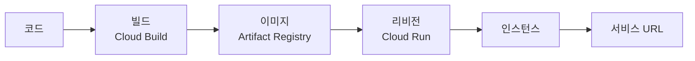
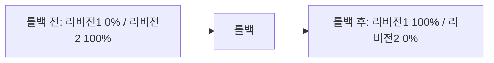
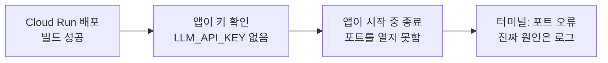

# N046 · AI 서비스 인 프로덕션

> 로컬에서 돌아가는 AI 에이전트를 남이 쓸 수 있는 서비스로 올리는 첫 걸음입니다. 이번 강의는 Google Cloud 준비, Cloud Run 첫 배포, 리비전·롤백·트래픽 분할, 로컬 실행과 .env, 키 없이 올라간 배포의 실패, Secret Manager로 키를 안전하게 연결하기까지를 다룹니다. 응답시간과 비용 제어는 다음 실습으로 이어집니다.

## 목차
- [1. 왜 "로컬에서 돌아간다"로는 부족한가](#ch1)
- [2. 왜 Cloud Run인가: Vercel과의 차이](#ch2)
- [3. Google Cloud가 하는 일: 계정에서 gcloud까지](#ch3)
- [4. 배포 명령 하나가 하는 일](#ch4)
- [5. 같은 일을 혼자: 리비전, 롤백, 트래픽 분할](#ch5)
- [6. 배포 전에 로컬에서 먼저 돌려 보기](#ch6)
- [7. 키 없이 올라간 첫 배포와 Secret Manager](#ch7)
- [8. 코딩 에이전트에게 맡길 때의 판단 기준](#ch8)
- [9. 핵심 한 문장 요약](#summary)
- [부록 A · 실전 맛보기](#app-a)
- [부록 B · 트러블슈팅](#app-b)
- [부록 C · AI 프롬프트 모음집](#app-c)
- [부록 D · 용어 사전](#app-d)
- [부록 E · 개념 비교표 모음](#app-e)
- [부록 F · 학습 로드맵](#app-f)
- [부록 G · 복습 퀴즈](#app-g)

---

<a id="ch1"></a>
## 1. 왜 "로컬에서 돌아간다"로는 부족한가

에이전트를 FastAPI 하나로 묶은 "AI 친구 에이전트 서비스"를 만들었다고 합시다. 사용자가 성격과 말투를 정한 캐릭터가 대화를 기억하고, 날씨나 공휴일을 찾아 답하고, 부탁한 약속을 저장했다가 먼저 말을 거는 서비스입니다. 동료가 "나도 써 보게 주소 좀 줘"라고 하는데, 내 컴퓨터에서만 돌아가는 서비스에는 줄 주소가 없습니다. 컴퓨터를 끄면 서비스도 멈춥니다.

> 📌 **요약 — 가게 비유**: 로컬 실행은 내 방에서만 운영하는 가게입니다. 내 컴퓨터에서 프로그램을 실행해야 서비스를 쓸 수 있고, 컴퓨터를 끄면 서비스도 멈춥니다. 클라우드 배포는 인터넷에 문을 연 가게입니다. 내 컴퓨터가 꺼져 있어도 클라우드 환경에서 서비스가 운영됩니다. 쉽게 말해, 배포는 내가 만든 프로그램을 다른 사람도 쓸 수 있도록 인터넷에 올리는 과정입니다.

그런데 AI 서비스는 일반 웹앱보다 신경 쓸 것이 더 있습니다.

- **LLM API 키를 숨겨야 합니다.** 키가 밖으로 새면 남이 내 비용으로 모델을 호출합니다.
- **메시지 하나에 LLM을 여러 번 부를 수 있습니다.** 그래서 응답이 느려질 수 있습니다.
- **호출할 때마다 비용이 듭니다.** 사용량 제어가 필요합니다.

> 🧪 **예제 — 오늘의 범위**: 오늘은 Google Cloud 준비 → Cloud Run에 첫 공개 주소 만들기 → 로컬 실행 → Secret Manager에 API 키 연결까지를 다룹니다. 응답시간과 비용 제어는 다음 실습으로 넘어갑니다. 해설서는 이 과정을 접근성(남이 쓸 수 있는가), 보안(키는 안전한가), 운영 효율(비용·장애를 다룰 수 있는가)의 세 요소로 정리합니다.

| 용어 | 쉽게 말하면 | 이 서비스에서 |
|---|---|---|
| FastAPI | 웹 서비스를 만드는 도구 | 에이전트의 기능을 웹으로 제공 |
| Google Cloud | 인터넷상의 컴퓨터와 여러 서비스를 빌려 쓰는 플랫폼 | 서비스 운영 기반 |
| Cloud Run | 웹 프로그램을 실행해 주는 클라우드 서비스 | 공개 주소로 서비스 제공 |
| Secret Manager | 중요한 비밀 정보를 보관하는 금고 | LLM API 키를 안전하게 보관 |

> 💡 **팁 — 시작 질문**: Vercel로 배포해 본 서비스를 떠올려 보세요. 배포 버튼을 누른 뒤 공개 주소가 생기기까지 Vercel 안에서 어떤 일이 일어났다고 생각하나요? 아는 만큼, 짐작하는 만큼 적어 두고, 오늘 마지막에 다시 읽어 비교합니다(부록 G 문제 6).


<a id="ch2"></a>
## 2. 왜 Cloud Run인가: Vercel과의 차이

둘 다 서버리스입니다. 요청이 많으면 서버가 자동으로 늘고(오토스케일링), 요청이 없으면 0개까지 줄어듭니다(스케일 투 제로). 차이는 **런타임과 의존성을 누가 정하느냐**입니다.

> 📌 **요약 — 식당 비유**: Vercel은 준비된 주방을 이용하는 식당입니다. 플랫폼이 정해 놓은 주방과 조리 도구를 쓰고, 메뉴에 해당하는 코드만 올리면 플랫폼이 상당 부분을 알아서 준비합니다. 편리하지만 도구와 조리 환경에 제약이 있습니다. Cloud Run은 필요한 도구를 직접 챙기는 식당입니다. 코드뿐 아니라 실행 환경과 도구까지 컨테이너라는 상자에 담아 올립니다. 환경을 세밀하게 구성할 수 있지만 빠짐없이 준비하고 관리해야 합니다.

| 비교 항목 | Vercel | Cloud Run |
|---|---|---|
| 기본 접근 방식 | 플랫폼이 빌드·실행 환경을 상당 부분 관리 | 컨테이너 이미지에 실행 환경을 구성 |
| 실행 환경 선택 | 플랫폼이 지원하는 범위 안에서 선택 | 이미지에 포함할 환경을 더 세밀하게 제어 |
| 시스템 패키지 | 플랫폼의 실행 조건과 지원 범위에 영향받음 | 필요한 패키지를 이미지에 포함 가능 |
| 실행 시간 | 배포 유형과 요금제별 제한 적용 (무료 플랜 함수 최대 5분) | 요청 타임아웃 설정 가능 (기본 5분, 최대 60분) |
| 관리 편의성 | 간편한 배포와 자동화에 강점 | 컨테이너 구성과 운영 설정에 대한 이해 필요 |
| 적합한 활용 예 | 프론트엔드, 지원되는 웹 함수 | 사용자 정의 실행 환경이 필요한 백엔드·AI 에이전트 |

> ⚠️ **주의 — 숫자는 시점이 있습니다**: 5분/60분 같은 제한은 강의 자료의 2026년 10월 기준입니다. 실제 제한은 제품 설정과 실행 유형에 따라 다를 수 있으니 배포 시점의 공식 설정을 확인하세요.

### 서버리스를 이루는 다섯 개념

| 개념 | 뜻 | 왜 중요한가 |
|---|---|---|
| 서버리스 | 서버 운영을 플랫폼이 대신 관리 | 서버 관리 부담을 줄임 |
| 컨테이너 이미지 | 실행에 필요한 구성 요소를 묶은 패키지 | 환경 차이로 생기는 오류를 줄임 |
| 오토스케일링 | 요청량에 따라 실행 인스턴스 수를 조절 | 이용자 증가에 대응 |
| 스케일 투 제로 | 요청이 없을 때 인스턴스를 0개까지 줄임 | 유휴 인스턴스 비용 절감 |
| 요청 타임아웃 | 요청 하나를 처리할 수 있는 최대 시간 | 오래 걸리는 AI 작업이 중간에 끊기는 것을 방지 |

> 💡 **팁 — 인스턴스와 동시성**: 인스턴스는 프로그램을 실행하는 실제 단위로, 식당으로 치면 일하는 주방 한 팀입니다. 동시성은 인스턴스 하나가 동시에 처리하도록 허용하는 요청 수(기본 80)로, 주방 한 팀이 동시에 받는 주문 수입니다. 아무 설정이 없으면 인스턴스는 최대 100개까지 늘어납니다.

> 🧪 **예제 — AI 에이전트가 오래 걸리는 이유**: 사용자가 "최근 뉴스 20개를 조사하고, 서로 비교한 뒤 보고서를 작성해 줘"라고 요청하면 에이전트는 자료 수집과 분석(검색·문서 읽기·LLM 호출) → 결과 생성(비교·검증·보고서 작성) → 사용자에게 전달의 순서로 일합니다. 이런 요청은 일반 웹 요청보다 길어서 타임아웃과 실행 환경 제어가 중요해집니다.


<a id="ch3"></a>
## 3. Google Cloud가 하는 일: 계정에서 gcloud까지

직접 서버를 운영하려면 컴퓨터를 구매하고, 설치하고, 고장과 네트워크를 직접 관리해야 합니다. Google Cloud는 필요한 컴퓨팅 자원을 빌려 쓰고 쓴 만큼 비용을 내는 방식입니다. 고성능 컴퓨터를 사서 서버실을 만들 필요가 없습니다.


```
[Google 계정 누가 로그인?] → [결제 계정 어디서 비용 지불?] → [프로젝트 작업 공간] → [API 사용 설정 + 리전]
```

*그림 1 · Google Cloud 구조*

> 📌 **요약 — 건물 비유**: Google 계정은 건물에 들어오는 사람의 신분증, 결제 계정은 건물에서 쓴 비용을 지불하는 수단, 프로젝트는 여러 작업을 수행하는 사무실입니다. Cloud Run과 Secret Manager 같은 서비스는 사무실 안에서 쓰는 도구입니다.

### 서비스 여섯 가지

| 서비스 | 하는 일 | 비유 |
|---|---|---|
| Cloud Run | 컨테이너 이미지를 받아 실행하고 공개 주소를 붙인다 | 가게 운영 |
| Cloud Build | 코드를 받아 컨테이너 이미지를 만든다 | 제품 조립 |
| Artifact Registry | 만들어진 이미지를 보관한다 | 완제품 창고 |
| Secret Manager | 시크릿(API 키처럼 밖에 드러나면 안 되는 값)을 보관한다. 콘솔에서는 "보안 비밀"로 표시 | 잠금 금고 |
| IAM | 누가 무엇을 할 수 있는지 권한을 정한다 | 출입 권한 관리 |
| Cloud Logging | 서비스가 남긴 로그를 모아 보여 준다 | 업무 일지 |

### 프로젝트 이름·ID·번호

프로젝트에는 세 가지 이름이 있고, **명령에는 프로젝트 ID**를 씁니다. ID는 전 세계에서 유일하고 만든 뒤에는 바꿀 수 없으며, 소문자·숫자·하이픈 6~30자입니다.

| 구분 | 예 | 특징 |
|---|---|---|
| 프로젝트 이름 | friend-agent-course | 나중에 바꿀 수 있는 표시 이름 |
| 프로젝트 ID | friend-agent-course-471203 | 유일, 변경 불가, 명령에 사용 |
| 프로젝트 번호 | 123456789012 | 자동 부여되는 숫자 |

> ⚠️ **주의**: 이름이 같아 보여도 `gcloud config set project`에 넣을 값은 이름이 아니라 ID입니다(부록 G 문제 1).

### 무료 체험과 결제 계정

- 무료 체험은 **90일 동안 쓸 수 있는 300달러 크레딧**입니다.
- 기간이 끝나거나 크레딧을 다 써도, 직접 유료로 전환하지 않으면 자동 결제되지 않습니다. 서비스는 멈추고 30일 안에 전환하지 않으면 삭제됩니다.
- 이전에 Google Cloud·Maps·Firebase에 돈을 낸 계정이나 무료 체험 이력이 있는 계정은 받을 수 없습니다.
- 카드 등록 시 0~1달러가 임시 승인되지만 실제 결제는 아닙니다.
- 리전은 Cloud Run 요금이 가장 낮은 등급인 `us-central1`을 씁니다.

시작은 https://cloud.google.com/free 에서 "무료로 시작하기" → 로그인 → 국가 대한민국·약관 동의 → 결제 정보 → "무료 체험 시작" 순서입니다. 새 프로젝트는 콘솔 상단 프로젝트 선택 → 새 프로젝트 → 이름 입력 → ID 확인 → 결제 계정이 무료 체험으로 선택됐는지 확인 → 만들기입니다.

### 콘솔 바로가기 주소

| 화면 | 주소 (<프로젝트 ID>를 내 ID로) |
|---|---|
| Cloud Run 서비스 목록 | https://console.cloud.google.com/run?project=<프로젝트 ID> |
| Cloud Build 빌드 기록 | https://console.cloud.google.com/cloud-build/builds?project=<프로젝트 ID> |
| Artifact Registry 저장소 | https://console.cloud.google.com/artifacts?project=<프로젝트 ID> |
| Secret Manager 시크릿 | https://console.cloud.google.com/security/secret-manager?project=<프로젝트 ID> |
| 사용 설정된 API 목록 | https://console.cloud.google.com/apis/dashboard?project=<프로젝트 ID> |
| 결제 개요 | https://console.cloud.google.com/billing |

### gcloud 설치·로그인·기본 설정

gcloud는 터미널로 Google Cloud를 다루는 프로그램입니다. 설치 뒤 `gcloud --version`으로 확인하고, 아래처럼 로그인과 기본값을 정합니다. 회사 컴퓨터라 설치가 막히면 브라우저 터미널인 Cloud Shell을 쓸 수 있습니다(gcloud가 내장돼 있지만 실습 저장소는 다시 내려받아야 합니다).

```
gcloud init
# 프로젝트를 고르지 못했거나 바꾸고 싶을 때
gcloud config set project <프로젝트 ID>
# Cloud Run 명령의 기본 리전
gcloud config set run/region us-central1
# 확인: 로그인된 계정(* 표시), 현재 프로젝트, 기본 리전
gcloud auth list
gcloud config list
```

그다음 이 실습에서 쓸 API 네 가지를 켭니다. 켜지 않으면 명령이 거절됩니다.

```
gcloud services enable run.googleapis.com cloudbuild.googleapis.com artifactregistry.googleapis.com secretmanager.googleapis.com
# 켜진 API 목록에서 네 서비스를 찾는다
gcloud services list --enabled
```

> 💡 **팁 — 터미널과 콘솔은 같은 프로젝트를 봅니다**: gcloud, 콘솔, Cloud Shell은 모두 같은 프로젝트를 가리킵니다. 터미널에서 만든 것이 콘솔에 보이지 않으면 프로젝트 ID와 리전부터 확인하세요.


<a id="ch4"></a>
## 4. 배포 명령 하나가 하는 일

```
gcloud run deploy hello --source . --region us-central1 --allow-unauthenticated
```

| 부분 | 뜻 |
|---|---|
| hello | Cloud Run 서비스 이름 |
| --source . | 현재 폴더의 소스를 사용해 빌드하고 배포 |
| --region us-central1 | 미국 중부 리전에 배포 |
| --allow-unauthenticated | 로그인하지 않은 사용자도 서비스를 호출할 수 있음 |



```
[코드] → [빌드 Cloud Build] → [이미지 Artifact Registry] → [리비전 Cloud Run] → [인스턴스 → 서비스 URL]
```

*그림 2 · 배포 명령 한 줄 뒤의 다섯 단계*

> 📌 **요약 — 리비전과 인스턴스**: 리비전은 요리법이 적힌 레시피이고, 인스턴스는 그 레시피로 실제 요리를 만드는 주방입니다. 리비전은 특정 이미지와 설정을 기록한 배포 버전이며, 배포할 때마다 하나씩 남습니다. 도구(buildpacks)는 폴더의 파일을 보고 무엇을 설치할지 자동으로 정해 이미지를 만듭니다.

### 연습용 hello 앱: 파일 네 개

| 파일 | 하는 일 |
|---|---|
| main.py | / 에서 화면 한 장, /health 에서 {"status":"ok"}를 돌려준다 |
| requirements.txt | 설치할 라이브러리 목록. buildpacks가 보고 의존성을 설치한다 |
| Procfile | 시작 명령. 컨테이너가 켜질 때 이 명령으로 앱을 실행한다 |
| .python-version | 쓸 Python 버전(3.13). 2026년 10월 기준 Cloud Run 소스 배포의 기본 빌드 환경이 지원하는 3.13 이상 |

`$PORT`는 Cloud Run이 넣어 주는 포트 번호(기본 8080)이고, 앱은 그 포트를 listen(포트를 열고 요청을 기다림)해야 합니다. 코드 전문은 부록 A에 있습니다.

### 배포 후 5단계를 콘솔에서 확인하기

1. **Cloud Build > 기록**: 빌드가 성공했는가 (비어 있으면 리전을 us-central1로)
2. **Artifact Registry > cloud-run-source-deploy > hello**: 이미지가 생겼는가
3. **Cloud Run > hello > 리비전**: `hello-00001-xxx`, 트래픽 100%
4. **측정항목 > 컨테이너 인스턴스 수**: 기간을 1시간으로 두고 인스턴스가 떴는지
5. **로그**: `GET 200 /health` 요청 기록

> ⚠️ **주의 — 첫 배포의 질문**: 처음 배포할 때 이미지 저장소(cloud-run-source-deploy)를 만들지 묻는 질문이 나오면 `Y`로 답합니다. 콜드 스타트(꺼져 있던 인스턴스를 새로 켜느라 첫 응답이 늦어지는 현상)로 첫 접속이 느릴 수 있습니다.

> 🧪 **예제 — 화면이 안 나올 때의 점검 순서**: 서비스 URL을 열어도 화면이 안 나오면: Cloud Build 기록에서 빌드 성공 확인 → Artifact Registry에서 이미지 확인 → Cloud Run 리비전 탭에서 배포 버전·트래픽 확인 → 측정항목에서 인스턴스 실행 확인 → 로그에서 요청·오류 확인 → `/health` 접속과 접근 권한 확인. 이렇게 빌드 문제, 앱 실행 문제, 요청 처리 문제를 단계적으로 가릅니다.


<a id="ch5"></a>
## 5. 같은 일을 혼자: 리비전, 롤백, 트래픽 분할

따라 할 때는 쉬워 보였던 단계도 혼자 하면 어디서 확인해야 할지 망설이게 됩니다. 그 망설인 자리가 다음에 다시 볼 곳입니다. 아래 다섯 단계를 직접 해 봅니다.

1. `my-hello/main.py`의 화면 문구를 "두 번째 배포입니다"로 바꿉니다.
2. 같은 배포 명령으로 다시 배포하고, 브라우저에서 문구가 바뀌었는지 봅니다.
3. 리비전 목록을 보고 리비전이 몇 개인지, 지금 트래픽을 받는 리비전이 어느 것인지 적습니다.
4. 트래픽 100%를 첫 리비전으로 전환해 화면이 처음 문구로 돌아가는지 봅니다.
5. 다시 최신 리비전이 트래픽을 받게 돌려놓습니다.



```
[리비전 1 첫 배포 트래픽 0%] → [롤백 후] → [리비전 1 = 100% 리비전 2 = 0%]
```

*그림 3 · 롤백은 트래픽 대상을 바꾸는 것*

> 📌 **요약 — 롤백의 정체**: 롤백은 코드를 삭제하거나 리비전을 지우는 것이 아니라, 사용자 요청이 전달되는 대상을 바꾸는 것입니다. 리비전 2는 그대로 남아 있습니다.

> ⚠️ **주의 — 고정해 두지 마세요**: 트래픽을 특정 리비전에 고정해 두면 다음에 배포한 새 리비전이 트래픽을 받지 않습니다. 확인이 끝나면 반드시 5단계(`--to-latest`)로 돌려놓습니다.

### 트래픽 50:50 (카나리 배포)

두 리비전에 50%씩 나누면 새 버전을 일부 사용자에게만 먼저 보여 줄 수 있습니다. 열 번 요청했다고 정확히 다섯 번씩 나오는 것은 아닙니다. 기존 버전이 6번, 새 버전이 4번 나와도 정상일 수 있습니다. 명령은 부록 A에 있습니다.

> 🧪 **예제 — 설정만 바꿔도 새 리비전**: 코드는 그대로 두고 요청 타임아웃 설정만 바꿔도 새 리비전이 하나 생깁니다. 리비전에는 이미지뿐 아니라 설정도 함께 기록되기 때문입니다. 다만 새 리비전이 생겼다고 트래픽이 자동으로 모두 옮겨 간다고 단정하면 안 됩니다. 트래픽 할당 상태를 따로 확인하세요(부록 G 문제 3).


<a id="ch6"></a>
## 6. 배포 전에 로컬에서 먼저 돌려 보기

> 📌 **요약 — 가게를 열기 전 리허설**: 식당을 새로 열었다면 손님을 받기 전에 주방에서 음식을 직접 만들어 보고, 주문이 들어왔을 때 제대로 나오는지 확인해야 합니다. 1단계 로컬에서는 화면이 열리는가, 캐릭터를 저장할 수 있는가, AI가 답하는가를 봅니다. 2단계 Cloud Run에서는 서버에서도 같은 기능이 작동하는가를 봅니다.

가상환경은 프로젝트마다 따로 마련하는 작업 도구 상자입니다. 프로젝트 A에 설치한 패키지가 프로젝트 B에 영향을 주는 일을 줄여 줍니다. `.env` 파일은 비밀번호를 보관하는 개인 금고입니다.

```
# 저장소 루트에서 실행한다
python -m venv .venv
source .venv/bin/activate            # Windows: .venv\Scripts\activate
pip install -r requirements.txt
cp .env.example .env                 # Windows: copy .env.example .env
```

`.env`에서 `LLM_PROVIDER=fake`를 `openai`로 바꾸고(받은 키가 Gemini 키라면 `gemini`), `LLM_API_KEY=` 뒤에 키를 붙여 넣고 저장합니다. 키는 편집기로 직접 넣습니다. 에이전트 대화창에 붙여 넣으면 키가 대화 기록에 남습니다.

```
uvicorn app.main:app --port 8080
# 브라우저에서 http://localhost:8080 을 연다. 끝낼 때는 터미널에서 Ctrl+C
```

> ⚠️ **주의 — 앱이 바로 꺼질 때**: `LLM_API_KEY`가 없다는 줄이 보이면 `.env` 저장 여부, 키 앞뒤 따옴표·공백, 파일명이 `.env.txt`가 아닌지를 확인합니다. 해설서는 ".env를 파이썬이 자동으로 읽는 것은 아니다"도 짚습니다. 앱이 `.env`를 실제로 읽도록 구성됐는지 봐야 합니다.

### .env는 어디까지 가는가

| 파일 | 역할 |
|---|---|
| .gitignore | Git이 추적하지 않을 파일을 지정 |
| .gcloudignore | `gcloud run deploy --source .`로 소스를 올릴 때 제외할 파일을 지정 |
| .env | 로컬에서 쓰는 환경설정과 비밀값을 보관 |

```
git status                        # .env 가 보이지 않아야 한다
grep -n "^.env$" .gitignore .gcloudignore
```

> ⚠️ **주의 — 이 두 파일은 키를 전달하지 않습니다**: `.gitignore`와 `.gcloudignore`는 .env를 빼고 올리는 기능일 뿐, 키를 서버에 전달하는 기능이 아닙니다. 그래서 같은 폴더에서 배포해도 서버에는 키가 없습니다(부록 G 문제 4).


<a id="ch7"></a>
## 7. 키 없이 올라간 첫 배포와 Secret Manager

일부러 키 없이 에이전트 서비스를 배포해 봅니다.

```
gcloud run deploy friend-agent --source . --region us-central1 --allow-unauthenticated
```

배포는 실패합니다. 그런데 터미널은 포트 이야기를 합니다. 진짜 원인은 포트가 아닙니다.

> 📌 **요약 — 포트 오류 비유**: 식당 주방에 손님 받을 준비가 되었는지 확인했더니, 조리사가 필수 재료를 받지 못해 아예 출근을 포기한 상황입니다. 겉으로는 식당 문이 열리지 않은 것이지만 진짜 원인은 문이 아니라 재료가 없다는 것입니다.



```
[Cloud Run 배포 (빌드는 성공)] → [앱이 키 확인 LLM_API_KEY 없음] → [앱이 시작 중 종료 포트를 못 엶] → [터미널엔 포트 오류 (원인은 로그에)]
```

*그림 4 · 터미널 메시지는 결과, 로그는 원인*

### 원인은 로그에서 찾는다

Cloud Run > friend-agent > 로그에서 심각도를 오류(Error), 기간을 지난 1시간으로 두고, "LLM_API_KEY가 없어 앱을 시작하지 않는다"는 줄을 펼칩니다. 메시지만 보고 포트 설정을 고치면 불필요한 변경이 생기고 문제는 풀리지 않습니다.

### 키를 금고에 넣고 이름으로 연결하기

> 📌 **요약 — 금고 비유**: 일반 환경변수 방식은 금고의 비밀번호를 작업 지시서에 적어 놓는 것과 비슷합니다. Secret Manager 방식은 비밀번호를 금고에 보관하고, 필요한 프로그램에 금고를 열 권한만 주는 것입니다.

1. 콘솔에서 시크릿 `llm-api-key`를 만듭니다. 값은 .env와 같은 키를 붙여 넣고, 나머지는 기본값으로 둡니다. 버전 1이 "사용 설정됨(Enabled)"인지 확인합니다.
2. 프로젝트 번호를 확인하고, `llm-api-key` 하나에 대해서만 읽기 권한(`roles/secretmanager.secretAccessor`)을 줍니다.
3. `LLM_API_KEY`가 시크릿의 최신 버전을 참조하도록 서비스를 바꿉니다. 명령은 부록 A에 있습니다.
4. 콘솔 > 리비전 > 컨테이너 탭 > 변수 및 보안 비밀에서 `LLM_API_KEY` 옆에 `llm-api-key`와 `latest`가 보이는지 확인합니다.

> ⚠️ **주의 — 키 값을 환경변수로 직접 넣지 마세요**: `--update-env-vars LLM_API_KEY=<키 값>`으로 넣으면 키 값이 리비전 설정에 그대로 기록되어, 프로젝트를 볼 수 있는 사람이 콘솔에서 읽을 수 있고 키를 바꿔도 이전 리비전에 남습니다(부록 G 문제 5).

> 💡 **팁 — 키 교체와 한계**: 키를 바꾸려면 같은 시크릿에 새 버전을 추가하고, 연결 명령을 다시 실행해 새 리비전을 띄워야 새 키가 적용됩니다(실행 중인 인스턴스는 시작 때 읽은 값을 계속 씁니다). 새 키로 응답을 확인한 뒤 예전 버전을 사용 중지합니다. 또 기본 서비스 계정은 다른 서비스도 공유하므로 같은 계정의 다른 서비스도 이 시크릿을 읽을 수 있습니다. 해설서는 서비스별 런타임 서비스 계정을 분리하라고 권합니다.

### 연습용 hello 정리하기

```
# 1. Cloud Run 서비스 삭제
gcloud run services delete hello --region us-central1
# 2. Artifact Registry 에서 hello 이미지(패키지)만 삭제. 저장소 cloud-run-source-deploy 는 남긴다
gcloud artifacts packages delete hello --repository cloud-run-source-deploy --location us-central1
# 3. 확인: 저장소에 friend-agent 만 남았는지
gcloud artifacts packages list --repository cloud-run-source-deploy --location us-central1
```

> ⚠️ **주의 — 저장소 자체는 지우지 않습니다**: 저장소를 지우면 friend-agent 이미지까지 사라집니다. 삭제 전에 대상 이름(hello)과 리전(us-central1)을 다시 확인하세요. Artifact Registry 무료 저장 공간은 월 0.5GB입니다.


<a id="ch8"></a>
## 8. 코딩 에이전트에게 맡길 때의 판단 기준

명령을 에이전트가 써 주더라도 실행 결과의 책임이 자동으로 사라지지는 않습니다. 템플릿 저장소에는 프로젝트 규칙 파일과 권한 설정이 들어 있고, 그 기준은 세 묶음으로 나뉩니다.

| 묶음 | 예 | 원칙 |
|---|---|---|
| 실행하지 않을 명령 | 키 파일 생성, Editor 역할 부여 | 키 파일은 유출되면 누구든 그 계정으로 행동할 수 있고, Editor는 오류와 상관없는 권한까지 줍니다 |
| 대상을 확인하고 판단할 명령 | `--allow-unauthenticated` | 연습용 앱은 문제없지만, 요청마다 LLM 비용이 드는 서비스라면 인스턴스 수와 사용 한도를 함께 걸어야 합니다(다음 실습) |
| 실행할 명령 | 읽기·확인 명령, 범위가 한정된 변경 | 실행 전 명령이 무엇을 만들고 바꾸고 지우고 공개하는지 읽습니다 |

> 📌 **요약 — 최소 권한 원칙**: 권한 오류가 나면 오류 메시지에 나온 작업에 필요한 역할 하나만 줍니다. 작업에 꼭 필요한 권한만 주는 원칙을 최소 권한 원칙(principle of least privilege)이라고 합니다.

### 에이전트 안전 3요소

- **변경 범위**: 어떤 프로젝트와 서비스에 영향을 주는가?
- **변경 결과**: 무엇을 생성·수정·삭제하거나 외부에 공개하는가?
- **검증 방법**: 실행 후 정상 작동을 어떻게 확인할 것인가?

### 올바른 문제 해결 순서

1. 오류 메시지를 확인한다
2. Cloud Logging에서 프로그램이 실제로 종료된 이유를 찾는다
3. 로그에 근거해 원인을 판단한다
4. 수정할 대상과 변경 내용을 정한다
5. 명령 실행 후 콘솔에서 결과를 확인한다

> 💡 **팁 — 프롬프트에는 "근거"와 "아직 고치지 마"를 같이**: 원인을 물을 때 "로그를 근거로"와 "아직 아무것도 고치지 마"를 함께 쓰면, 에이전트가 짐작으로 설정을 바꾸지 못합니다. 영향이 큰 작업은 실행 계획을 먼저 보여 주고 사람이 승인하게 하는 HITL 방식과 같은 생각입니다. 프롬프트 모음은 부록 C에 있습니다.

### 내 프로젝트에 적용하기 (해설서)

| 프로젝트 | 로컬에서 먼저 확인 | 서버에서 따로 설정 |
|---|---|---|
| MSM (My-Story-Maker) | 원문 입력, 문체 분석, 글 다듬기 | LLM API 키, 서비스 환경변수 |
| ASP (AI Story Partner) | AI 컨설팅 요청, 답변 생성 | 운영용 API 키, 권한 및 배포 설정 |
| 뉴스레터 에이전트 | 수집·선별·요약·검증 파이프라인 | API 키, 예약 실행 설정, 로그 |

배포 성공 여부와 서비스 품질은 별도로 검증해야 합니다. 예를 들어 MSM이라면 원문의 말투와 개성이 유지되는가, AI가 원문에 없는 사실을 더하지 않는가, 사용자가 수정 결과를 이해하고 조정할 수 있는가를 따로 봅니다.

> 🧪 **예제 — 배포 후 문제 대응 다섯 단계 (MSM)**: ① 증상 확인: 글 분석 기능이 작동하지 않음 → ② 로그 확인: API 키를 찾지 못했다는 오류 → ③ 원인 구분: 포트 오류처럼 보여도 실제로는 키 누락일 수 있음 → ④ 안전하게 수정: Secret Manager의 키와 서비스를 연결하고 권한을 확인(비밀 값은 대화창이나 코드에 붙이지 않음) → ⑤ 재배포·검증: 새 리비전을 만들고 실제 글 분석까지 확인.


<a id="summary"></a>
## 9. 핵심 한 문장 요약

> 📌 **요약**: 클라우드 배포는 코드를 공개하는 버튼 하나의 문제가 아니라, 실행 환경과 비밀 정보를 안전하게 준비하고, 버전을 관리하며, 로그를 근거로 문제를 해결하고 결과를 검증하는 운영 과정입니다.

반드시 기억할 여섯 가지입니다.

1. 프로젝트 이름이 아니라 프로젝트 ID를 쓰는 명령이 많습니다.
2. 배포 명령 하나 뒤에서도 빌드, 이미지 저장, 리비전 생성 등 여러 단계가 진행됩니다.
3. `.gitignore`와 `.gcloudignore`는 키를 서버에 전달하는 기능이 아닙니다.
4. 터미널에 보이는 오류 문구가 실제 원인과 다를 수 있으므로 로그를 확인해야 합니다.
5. AI 에이전트가 명령을 실행하기 전에는 변경 대상과 영향을 확인해야 합니다.
6. 배포 성공 메시지와 실제 서비스 정상 작동은 별개입니다.


<a id="app-a"></a>
## 부록 A · 실전 맛보기

### A-1. hello 앱 (my-hello/)

```
# main.py
from fastapi import FastAPI
from fastapi.responses import HTMLResponse
app = FastAPI()

@app.get("/", response_class=HTMLResponse)
def home():
    return "<h1>안녕하세요, 첫 배포입니다</h1>"

@app.get("/health")
def health():
    return {"status": "ok"}
```

```
# requirements.txt
fastapi>=0.115
uvicorn>=0.30

# Procfile
web: uvicorn main:app --host 0.0.0.0 --port $PORT

# .python-version
3.13
```

학습서 PDF는 코드의 공백이 빠져 추출되어, 위 코드는 해설서와 대조해 복원한 것입니다.

### A-2. 재배포·리비전·롤백·트래픽 분할

```
gcloud run deploy hello --source . --region us-central1 --allow-unauthenticated
# 리비전 목록: 이름, 트래픽 비율, 만든 시각
gcloud run revisions list --service hello --region us-central1
# 트래픽 100%를 첫 리비전으로 (이름은 리비전 목록에서 복사)
gcloud run services update-traffic hello --region us-central1 --to-revisions <첫 리비전 이름>=100
# 다시 최신 리비전이 트래픽을 받게
gcloud run services update-traffic hello --region us-central1 --to-latest
# 두 리비전에 50%씩
gcloud run services update-traffic hello --region us-central1 --to-revisions <첫 리비전 이름>=50,<둘째 리비전 이름>=50
# 열 번 요청해서 문구 세기 (macOS 터미널)
for i in $(seq 1 10); do curl -s <공개 주소>; echo; done
# Windows PowerShell
1..10 | ForEach-Object { (Invoke-WebRequest -UseBasicParsing <공개 주소>).Content }
```

### A-3. Secret Manager 연결

```
# 1. 프로젝트 번호 확인
gcloud projects describe <PROJECT_ID> --format="value(projectNumber)"
# 2. llm-api-key 하나에 대해서만 읽기 권한 주기
gcloud secrets add-iam-policy-binding llm-api-key --member="serviceAccount:<프로젝트 번호>-compute@developer.gserviceaccount.com" --role="roles/secretmanager.secretAccessor"
# 3. LLM_API_KEY 가 시크릿의 최신 버전을 참조하게 하기
gcloud run services update friend-agent --region us-central1 --update-secrets LLM_API_KEY=llm-api-key:latest
# 받은 키가 Gemini 키라면 3번 끝에 --update-env-vars LLM_PROVIDER=gemini 를 붙인다
```

> 💡 **팁 — 기본 서비스 계정은 공유됩니다**: 위 2번의 서비스 계정은 기본값(`<프로젝트 번호>-compute@developer.gserviceaccount.com`)입니다. 해설서는 실제 런타임 서비스 계정을 먼저 확인하라고 권합니다.

### A-4. gcloud 설치

```
# macOS: Homebrew
brew install --cask gcloud-cli
# macOS: 압축 파일 (칩에 맞는 파일을 홈 폴더에 받은 뒤)
cd ~
tar -xf google-cloud-cli-darwin-arm.tar.gz     # Intel 칩이면 x86_64
./google-cloud-sdk/install.sh                   # 질문에는 모두 Y. 끝나면 터미널을 새로 연다

# Windows PowerShell
(New-Object Net.WebClient).DownloadFile("https://dl.google.com/dl/cloudsdk/channels/rapid/GoogleCloudSDKInstaller.exe", "$env:Temp\GoogleCloudSDKInstaller.exe")
& $env:Temp\GoogleCloudSDKInstaller.exe
```

macOS에서 칩 종류는 `uname -m`으로 확인합니다(arm64면 arm, x86_64면 x86_64).


<a id="app-b"></a>
## 부록 B · 트러블슈팅

| 증상 | 원인 | 해결 |
|---|---|---|
| 무료 체험 가입에서 카드가 거절된다 | 해외 결제가 막혀 있음 | 카드사 앱에서 해외 결제 허용 확인, 다른 카드로 재시도 |
| 무료 체험 크레딧이 보이지 않는다 | 예전에 Google Cloud·Firebase·Maps에 돈을 낸 적이 있는 계정 | 강사에게 알리고 다른 개인 계정을 쓴다 |
| 회사·학교 계정으로 콘솔에 들어갈 수 없다 | 관리자가 막아 둠 | 개인 Google 계정으로 바꾼다 |
| gcloud를 찾을 수 없다 | PATH가 반영되지 않음 | 터미널을 새로 연다. macOS는 install.sh의 PATH 질문에 Y, Windows는 설치 뒤 PowerShell을 새로 연다 |
| PowerShell에서 "스크립트를 실행할 수 없으므로" | 실행 정책 | cmd에서 같은 명령 실행. 계속 쓰려면 실행 정책 변경(강사와 확인) |
| gcloud init에서 브라우저가 안 열린다 | 자동 열기 실패 | 터미널에 나온 주소를 복사해 브라우저에 직접 붙여 넣는다 |
| 회사 컴퓨터라 설치가 막힌다 | 설치 권한 없음 | Cloud Shell을 쓴다 |
| API를 켜는데 결제 계정 오류 | 프로젝트에 결제 계정이 연결되지 않음 | 콘솔 결제 메뉴에서 무료 체험 결제 계정 연결 확인 |
| 앱이 바로 꺼지고 LLM_API_KEY가 없다는 줄 | .env 미저장, 따옴표·공백, 파일명이 .env.txt, 앱이 .env를 안 읽음 | 저장 여부·키 앞뒤 공백·파일명을 확인 |
| 배포가 실패하고 터미널은 포트 얘기만 한다 | 키 누락으로 앱이 시작 중 종료됨 | Cloud Run 로그(심각도 오류)에서 실제 원인을 읽는다 |
| 새 리비전이 생겼는데 화면이 그대로 | 트래픽이 특정 리비전에 고정됨 | `--to-latest`로 최신 리비전에 트래픽을 돌려놓는다 |
| 키를 바꿨는데 예전 키로 동작 | 실행 중 인스턴스는 시작 때 읽은 값을 유지 | 연결 명령을 다시 실행해 새 리비전을 띄운다 |


<a id="app-c"></a>
## 부록 C · AI 프롬프트 모음집

모든 프롬프트는 "실행 전에 보여 달라"와 "키는 읽거나 출력하지 마"를 기본으로 삼습니다. 승인할 때는 오른쪽 기준을 직접 대조하세요.

| 상황 | 프롬프트 | 승인 기준 |
|---|---|---|
| gcloud 설치 확인 | 내 컴퓨터에 gcloud CLI가 설치되어 있는지 확인하고 버전을 알려 줘. 설치되어 있지 않으면 직접 설치하지 말고, 내 운영체제와 칩 종류를 확인해서 맞는 설치 방법을 알려 줘. | 설치를 임의로 하지 않았는가 |
| API 사용 설정 | 지금 gcloud에 설정된 프로젝트에서 Cloud Run, Cloud Build, Artifact Registry, Secret Manager API를 사용 설정해 줘. 실행하기 전에 대상 프로젝트 ID를 먼저 보여 주고, 끝나면 네 API가 켜져 있는지 목록으로 확인해 줘. | 보여 준 프로젝트 ID가 방금 만든 것과 같은가 |
| 설정 확인 | 지금 폴더가 실습 저장소인지 확인하고, gcloud에 설정된 계정, 프로젝트, Cloud Run 기본 리전을 알려 줘. 확인만 하고 아무것도 바꾸지 마. | 읽기 전용인가 |
| hello 앱 만들기 | 실습 저장소 폴더와 같은 위치에 my-hello 폴더를 만들고, Cloud Run에 소스 배포할 연습용 FastAPI 앱을 만들어 줘. main.py: / 에서 "안녕하세요, 첫 배포입니다"라는 HTML 한 줄, /health 에서 {"status": "ok"}. requirements.txt: fastapi, uvicorn. Procfile: uvicorn 으로 main:app 을 0.0.0.0 과 PORT 환경변수의 포트에서 실행. .python-version: 3.13. 파일 네 개만 만들고, 다 만들면 각 파일이 하는 일을 한 줄씩 설명해 줘. | 파일이 네 개뿐인가, 포트가 8080 고정이 아닌가 |
| hello 배포 | my-hello/ 폴더의 앱을 Cloud Run에 소스 배포해 줘. 서비스 이름은 hello, 리전은 us-central1, 로그인 없이 누구나 접속할 수 있게 해 줘. 명령을 실행하기 전에 그 명령이 무엇을 하는지 한 줄씩 설명해 줘. | 이름·리전·공개 설정이 같은가 |
| 롤백 | hello 서비스의 리비전 목록을 보여 주고, 지금 트래픽을 받는 리비전이 어느 것인지 알려 줘. 그다음 트래픽 100%를 첫 번째 리비전으로 전환하는 명령을 실행 전에 먼저 보여 줘. 내가 확인하면 실행해 줘. | 서비스 이름 hello, 리비전 이름이 목록의 첫 리비전 |
| 트래픽 50:50 | hello 서비스의 리비전 두 개에 트래픽을 50%씩 나눠 줘. 실행하기 전에 두 리비전 이름과 비율을 먼저 보여 줘. 끝나면 서비스 URL에 열 번 요청해서 각 문구가 몇 번 나왔는지 세어 줘. | 두 리비전 이름과 비율 |
| 가상환경·.env | 저장소 루트에 가상환경을 만들고 requirements.txt 를 설치해 줘. 그다음 .env.example 을 .env 로 복사만 해 줘. 키는 내가 직접 넣을 거니까 .env 내용은 읽거나 출력하지 마. | .env 내용을 읽지 않았는가 |
| 키 없이 배포 | 저장소 루트의 에이전트 서비스를 Cloud Run에 소스 배포해 줘. 서비스 이름은 friend-agent, 리전은 us-central1, 로그인 없이 누구나 접속할 수 있게 해 줘. 키는 아직 연결하지 말고 이대로 배포해서 결과를 보여 줘. | 서비스 이름·리전 |
| 실패 원인 찾기 | friend-agent 배포가 실패했어. 실패한 리비전의 Cloud Run 로그를 읽고, 로그에 적힌 내용을 근거로 원인을 설명해 줘. 아직 아무것도 고치지 마. | 근거가 로그인가, 수정을 하지 않았는가 |
| 권한 주고 시크릿 연결 | Secret Manager에 llm-api-key라는 시크릿을 만들어 두었어. 키 값은 읽거나 출력하지 마. friend-agent의 런타임 서비스 계정에 llm-api-key 하나에 대해서만 읽기 권한을 주고, LLM_API_KEY 환경변수가 llm-api-key의 최신 버전을 참조하도록 서비스 설정을 바꿔 줘. 명령마다 무엇을 바꾸는지 먼저 설명해 줘. | 역할이 secretAccessor인가, 대상이 프로젝트 전체가 아닌 시크릿 하나인가 |
| hello 삭제 | us-central1의 hello Cloud Run 서비스를 삭제하고, Artifact Registry 저장소 cloud-run-source-deploy 안의 hello 패키지만 삭제해 줘. 저장소 자체와 friend-agent 서비스, friend-agent 이미지는 건드리지 마. 삭제 명령을 실행하기 전에 지우는 대상의 이름과 리전을 다시 보여 주고, 끝나면 저장소에 남은 패키지 목록을 보여 줘. | 삭제 대상이 hello뿐인가 |

습관화 질문 네 가지: 이 기능은 어떤 프로젝트와 서비스에 배포되는가? API 키는 어디에 저장되고, 어떤 계정이 읽을 수 있는가? 배포가 실패하면 어디서 원인을 확인하는가? 문제가 생기면 이전 버전으로 되돌릴 수 있는가?


<a id="app-d"></a>
## 부록 D · 용어 사전

### 영문 알파벳순

| 용어 | 뜻 |
|---|---|
| API 사용 설정 (enable API) | 서비스를 쓰려면 프로젝트에서 먼저 켜야 하는 단계. 안 켜면 명령이 거절됨 |
| Artifact Registry | 만들어진 이미지를 보관하는 저장소(cloud-run-source-deploy) |
| buildpacks | 폴더 파일을 보고 무엇을 설치할지 자동으로 정해 이미지를 만드는 도구 |
| Cloud Build | 코드를 받아 컨테이너 이미지를 만드는 서비스 |
| Cloud Logging | 서비스가 남긴 로그를 모아 보여 주는 서비스 |
| Cloud Run | 컨테이너 이미지를 받아 실행하고 공개 주소를 붙이는 서비스 |
| Cloud Shell | 설치 없이 쓰는 브라우저 터미널(gcloud 내장) |
| .env / .env.example | 로컬 설정·비밀값 파일 / 빈칸 템플릿 |
| gcloud CLI | 터미널로 Google Cloud를 다루는 프로그램 |
| .gitignore / .gcloudignore | Git 추적 제외 목록 / 소스 배포 시 업로드 제외 목록 |
| HITL | 사람이 승인하는 AI 에이전트 설계. 영향 큰 작업은 계획을 보여 주고 승인 |
| IAM | 누가 무엇을 할 수 있는지 권한을 정하는 서비스 |
| listen | 포트를 열고 요청이 들어오기를 기다리는 것 |
| LLM_API_KEY / LLM_PROVIDER | LLM 제공사가 발급한 호출 권한 키 / 어떤 제공사를 쓸지 지정(fake·openai·gemini) |
| Procfile | 컨테이너가 켜질 때 실행할 시작 명령 파일 |
| Secret Manager | 시크릿(API 키처럼 밖에 드러나면 안 되는 값)을 보관하는 서비스 |
| uvicorn | FastAPI 앱을 실행하는 서버 프로그램 |

### 한글 가나다순

| 용어 | 뜻 |
|---|---|
| 가상환경 (.venv) | 프로젝트별 패키지를 분리하는 작업 도구 상자 |
| 결제 계정 | 카드가 연결되어 요금이 나가는 계정. 프로젝트마다 하나 연결 |
| 동시성 (concurrency) | 인스턴스 하나가 동시에 처리하는 요청 수(기본 80) |
| 롤백 (rollback) | 문제가 생긴 새 버전 대신 이전 버전으로 되돌리는 것(트래픽 전환) |
| 리전 (region) | 서비스가 실제 실행되는 데이터센터 위치(이 과정은 us-central1) |
| 리비전 (revision) | 배포할 때마다 남는 버전(이미지 + 환경변수·요청 타임아웃·인스턴스 수 등 설정) |
| 서비스 URL | 배포하면 Cloud Run이 붙여 주는 공개 주소 |
| 서비스 계정 | 사람 대신 프로그램이 쓰는 Google Cloud 계정. 런타임 서비스 계정은 서비스 실행 중 쓰는 계정 |
| 서버리스 | 서버 관리를 플랫폼이 맡는 방식 |
| 스케일 투 제로 | 요청이 없으면 실행 중인 서버를 0개로 줄여 실행 요금이 안 나가게 하는 것 |
| 오토스케일링 | 요청량에 맞춰 서버 개수를 늘리고 줄이는 것 |
| 요청 타임아웃 | 요청 하나를 처리할 수 있는 최대 시간(콘솔의 "요청 제한 시간") |
| 인스턴스 | 리비전의 이미지와 설정으로 지금 실행되며 요청을 처리하는 컨테이너 |
| 최소 권한 원칙 | 작업에 꼭 필요한 권한만 주는 원칙 |
| 카나리 배포 | 새 버전을 일부 사용자에게만 먼저 보여 주고 문제가 없으면 비율을 늘리는 방식 |
| 컨테이너 이미지 | 코드·런타임·의존성·시스템 패키지를 하나로 묶은 실행 패키지 |
| 콜드 스타트 | 꺼져 있던 인스턴스를 새로 켜느라 첫 응답이 늦어지는 현상 |
| 트래픽 분할 | 리비전 사이에 요청 비율을 나눠 보내는 것 |
| 프로젝트 | 서비스·이미지·시크릿을 만드는 작업 공간 |
| 헬스 체크 엔드포인트 | 서비스가 살아 있는지 알려 주는 주소(/health) |


<a id="app-e"></a>
## 부록 E · 개념 비교표 모음

### E-1. 로컬 vs 클라우드 배포

| 구분 | 로컬 실행 | 클라우드 배포 |
|---|---|---|
| 비유 | 내 방에서만 운영하는 가게 | 인터넷에 문을 연 가게 |
| 컴퓨터를 끄면 | 서비스도 멈춤 | 계속 운영됨 |
| 남이 쓸 수 있나 | 주소를 줄 수 없음 | 공개 주소로 접속 가능 |

### E-2. 리비전 vs 인스턴스

| 구분 | 리비전 | 인스턴스 |
|---|---|---|
| 비유 | 요리법이 적힌 레시피 | 그 레시피로 요리하는 주방 |
| 성격 | 이미지와 설정을 기록한 버전 | 실제 실행 중인 컨테이너 |
| 생기는 때 | 배포하거나 설정을 바꿀 때 | 요청이 있을 때 늘고 없으면 0개 |

### E-3. 환경변수 직접 입력 vs Secret Manager

| 구분 | --update-env-vars | Secret Manager 참조 |
|---|---|---|
| 비유 | 금고 비밀번호를 작업 지시서에 적어 둠 | 비밀번호는 금고에, 프로그램에는 열 권한만 |
| 키 값의 위치 | 리비전 설정에 그대로 기록 | 콘솔에는 시크릿 이름과 버전만 보임 |
| 키를 바꾸면 | 이전 리비전에 예전 키가 남음 | 새 버전 추가 후 새 리비전을 띄움 |

### E-4. .gitignore vs .gcloudignore vs .env

| 파일 | 영향 범위 | 키를 서버에 전달하나 |
|---|---|---|
| .gitignore | Git 추적 | 아니오 |
| .gcloudignore | gcloud 소스 업로드 | 아니오(빼고 올림) |
| .env | 로컬 실행 설정 | 아니오(서버에는 별도 전달 필요) |

### E-5. 프로젝트 이름 vs ID vs 번호

| 구분 | 바꿀 수 있나 | 명령에 쓰나 |
|---|---|---|
| 이름 | 예 | 아니오 |
| ID | 아니오 | 예 |
| 번호 | 자동 부여 | 서비스 계정 주소 등에 사용 |


<a id="app-f"></a>
## 부록 F · 학습 로드맵

| 이 강의로 할 수 있게 된 것 | 다음에 배우면 좋을 것 |
|---|---|
| Google Cloud 프로젝트를 만들고 gcloud를 연결한다 | 서비스별 런타임 서비스 계정 분리 |
| `gcloud run deploy --source .`로 공개 주소를 만든다 | Dockerfile로 이미지를 직접 정의하기 |
| 리비전을 목록으로 보고 롤백·트래픽 분할을 한다 | 점진적 트래픽 이동과 자동 롤백 기준 |
| 로그를 근거로 배포 실패 원인을 찾는다 | 알림·모니터링 설정 |
| Secret Manager로 키를 안전하게 연결·교체한다 | 키 교체 자동화 |
| 에이전트에게 맡길 명령을 안전 3요소로 승인한다 | 응답시간 제어(요청 타임아웃·인스턴스 수)와 비용 제어(LLM 사용 한도) |

다음 실습의 주제는 이 강의에서 이월된 두 가지, 즉 **응답시간과 비용 제어**입니다. `--allow-unauthenticated`를 켠 서비스에 인스턴스 수와 LLM 사용 한도를 걸어 두는 일을 다룹니다.


<a id="app-g"></a>
## 부록 G · 복습 퀴즈

<details>
<summary>문제 1. (객관식) 프로젝트 이름이 `friend-agent-course`, ID가 `friend-agent-course-471203`일 때 `gcloud config set project`에 넣을 값은?</summary>

정답: friend-agent-course-471203. 프로젝트 이름이 아니라 프로젝트 ID를 입력해야 합니다.

</details>

<details>
<summary>문제 2. (주관식) hello 앱을 배포했는데 서비스 URL을 열어도 화면이 나오지 않습니다. 콘솔의 어느 화면을 어떤 순서로 열어 원인을 찾겠습니까?</summary>

모범답안: Cloud Build 기록에서 빌드 성공 여부 → 실패면 로그에서 Python 버전·라이브러리·설정 파일 오류 → 성공이면 Artifact Registry에서 이미지 생성 확인 → Cloud Run hello의 리비전 탭에서 배포 버전과 트래픽 → 측정항목에서 인스턴스 실행 → 로그에서 요청·오류 → `/health` 접속과 접근 권한. 빌드 문제, 앱 실행 문제, 요청 처리 문제를 단계적으로 구분합니다.

</details>

<details>
<summary>문제 3. (객관식) 에이전트 서비스를 한 번 배포한 뒤 코드는 그대로 두고 요청 타임아웃만 바꿨습니다. Cloud Run에서 무엇이 달라질까요? ① 아무것도 안 달라진다 ② 새 리비전이 하나 생긴다 ③ 새 서비스 URL이 생긴다 ④ 인스턴스가 항상 켜진다</summary>

정답: ②. 리비전에는 이미지뿐 아니라 설정도 함께 기록되기 때문입니다. 다만 새 리비전이 생겼다고 트래픽이 자동으로 모두 이동한다고 단정하면 안 됩니다. 트래픽 할당을 따로 확인합니다.

</details>

<details>
<summary>문제 4. (객관식) 로컬 `.env`에 키를 넣고 잘 돌아가는 것을 확인한 뒤 같은 폴더에서 `gcloud run deploy --source .`로 배포했습니다. 서버의 앱은 키를 어떻게 얻을까요? ① .env가 같이 올라가 그대로 읽는다 ② .gcloudignore가 .env를 빼고 올리므로 서버에는 키가 없다 ③ Cloud Run이 .env를 자동 복사한다 ④ git status에 안 보이므로 GitHub에서 가져온다</summary>

정답: ②. 서버에는 로컬 키가 자동 전달되지 않으니 키를 별도로 설정해야 합니다.

</details>

<details>
<summary>문제 5. (객관식) 동료가 "Secret Manager는 번거로우니 `--update-env-vars LLM_API_KEY=<키 값>`을 쓰자"고 합니다. 이때 생기는 일은? ① 앱이 키를 못 읽어 실패 ② 키 값이 리비전 설정에 그대로 기록되어 콘솔에서 읽히고, 바꿔도 이전 리비전에 남는다 ③ 자동 암호화되어 이름만 보인다 ④ Secret Manager와 차이 없음</summary>

정답: ②.

</details>

<details>
<summary>문제 6. (주관식·회고) 섹션 1에서 Vercel 배포 버튼을 누른 뒤 일어나는 일을 짐작해 적었습니다. 오늘 콘솔에서 직접 찾은 단계와 비교해 맞았던 부분과 새로 알게 된 부분을 적어 보세요.</summary>

예시 답안: 처음에는 배포 버튼을 누르면 코드가 서버에 올라가고 곧바로 공개되는 것으로 생각했습니다. 실제로는 코드를 빌드하고 컨테이너 이미지를 저장한 뒤 리비전을 만들고 인스턴스를 실행해 서비스 URL을 제공하는 여러 단계가 있었습니다. 큰 흐름은 맞았지만, 단계마다 Cloud Build 기록·리비전·로그에서 상태와 오류를 따로 확인할 수 있다는 점은 새로 알았습니다. 또 API 키가 배포 파일에 없으면 서버에서 따로 안전하게 연결해야 하고, 배포 성공과 실제 정상 작동은 별개라는 점도 배웠습니다.

</details>

<details>
<summary>문제 7. (주관식) 첫 배포의 터미널 메시지는 포트를 이야기했지만 실제 원인은 LLM API 키였습니다. 메시지만 보고 고쳤다면 어떤 일이 생겼을지, 직접 고칠 때와 에이전트에게 맡길 때 각각 어떻게 막을 수 있는지 설명하세요.</summary>

모범답안: 포트 설정이 원인이라고 단정하면 불필요한 변경만 생기고 문제는 풀리지 않습니다. 직접 고칠 때는 실패한 리비전 로그를 확인해 로그에 적힌 오류를 근거로 원인을 찾습니다. 에이전트에게는 로그를 근거로 원인을 설명하게 하고 확인 전에는 아무것도 수정하지 말라고 요청하며, 해결책을 적용하기 전에 변경 명령과 대상을 확인하고 승인합니다.

</details>

---

## 출처

- Configure secrets for services: https://docs.cloud.google.com/run/docs/configuring/services/secrets
- gcloud run services update: https://docs.cloud.google.com/sdk/gcloud/reference/run/services/update
- 실습 템플릿 저장소: https://github.com/88chacha/friend-agent-template
- 무료 체험: https://cloud.google.com/free

*이 노트는 N046 학습서·해설서(2026년 10월 기준)를 비개발자용으로 다시 정리한 것입니다.*
