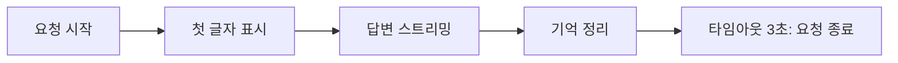
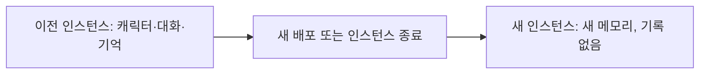
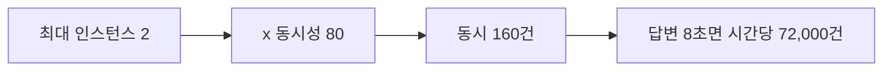
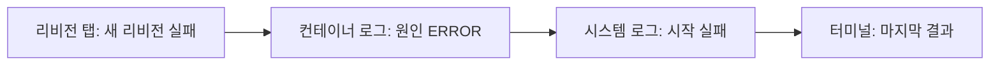

# N047 · Cloud Run에서 AI서비스 운영하기

> 공개한 AI 서비스가 "계속 잘 돌아가게" 만드는 운영 강의입니다. N046에서 배포한 friend-agent에 요청 타임아웃과 인스턴스 수를 걸어 보고, 최대 인스턴스로는 막지 못하는 비용과 서버 메모리에 둔 데이터가 사라지는 이유를 이해합니다. 로그 세 종류를 읽어 장애를 근거로 진단하는 법과, 사용자가 자기 키를 넣는 BYOK 구조까지 다룹니다.

## 목차
- [1. 공개한 뒤에는 질문이 바뀝니다](#ch1)
- [2. 시작 상태 맞추기](#ch2)
- [3. 스트리밍과 요청 타임아웃](#ch3)
- [4. 인스턴스 수 제한과 사라지는 데이터](#ch4)
- [5. 최대 인스턴스로 막지 못하는 비용](#ch5)
- [6. 로그의 세 종류와 근거로 진단하기](#ch6)
- [7. 서로 써 보기와 추가 과제](#ch7)
- [8. 오늘 배운 것: 걱정을 설정으로 나누기](#ch8)
- [9. 핵심 한 문장 요약](#summary)
- [부록 A · 실전 맛보기](#app-a)
- [부록 B · 트러블슈팅](#app-b)
- [부록 C · AI 프롬프트 모음집](#app-c)
- [부록 D · 용어 사전](#app-d)
- [부록 E · 개념 비교표 모음](#app-e)
- [부록 F · 학습 로드맵](#app-f)
- [부록 G · 복습 퀴즈](#app-g)

---

<a id="ch1"></a>
## 1. 공개한 뒤에는 질문이 바뀝니다

에이전트 서비스가 공개 주소에서 돌아가기 시작하면 질문이 "올라갔나?"에서 "계속 잘 돌아가나?"로 바뀝니다. 답이 길어지면 중간에 끊기지는 않을까, 누가 주소를 퍼뜨려 요청이 몰리면 요금은 얼마나 나올까, 새 버전을 올렸더니 어제까지 대화하던 캐릭터가 사라졌다면 어디를 봐야 할까. 이런 질문은 서비스가 사용자를 만나는 순간부터 매일 생깁니다.

일반 웹앱과 달리 AI 서비스는 답이 느리고, 요청마다 LLM 제공사(OpenAI, Google처럼 LLM API를 제공하는 회사)에 돈을 내며, 같은 요청에도 처리 시간이 들쭉날쭉합니다. 그래서 같은 Cloud Run 위에서도 **요청 타임아웃, 인스턴스 수, 사용 한도**를 AI 서비스에 맞게 따로 정해야 합니다.

> 📌 **요약 — 작은 식당 비유**: AI 서비스를 작은 식당이라고 생각해 보겠습니다. 요청 제한 시간은 손님을 기다리게 할 수 있는 시간입니다. 식당에서 주문한 음식이 너무 늦게 나오면 손님이 떠나듯, 제한 시간이 너무 짧으면 답변이 끝나기 전에 요청이 종료될 수 있습니다. 인스턴스 수는 동시에 일할 수 있는 직원 수입니다. 무작정 늘리면 서버 운영비와 AI API 비용이 커질 수 있습니다. 로그는 식당에서 일어난 일을 기록한 장부입니다. 어떤 요청이 들어왔는지, 오류가 났는지, 얼마나 걸렸는지 보면 원인을 찾는 데 도움이 됩니다.

| 운영 설정 | 식당에서는 | AI 서비스에서는 |
|---|---|---|
| 요청 타임아웃(요청 제한 시간) | 손님을 기다리게 할 수 있는 시간 | 요청 하나를 처리할 수 있는 최대 시간 |
| 인스턴스 수 | 동시에 일하는 직원 수 | 서비스를 실행하는 서버 실행 단위의 개수 |
| 로그 | 식당에서 일어난 일의 장부 | 요청·오류·처리 시간의 기록 |

### 주소를 단체 대화방에 올린 그날 밤

공개 AI 캐릭터 서비스에서 사용자가 "오늘 기분이 우울한데 위로해 줘."라고 보내면, 요청은 Cloud Run(요청 접수·서버 실행·처리 시간 관리)을 거쳐 LLM API(답변 생성·API 사용 비용 발생)를 부르고, 답변이 돌아오면 로그(성공 여부·처리 시간·오류 기록)가 남습니다. 이 흐름에서 세 가지 문제가 생길 수 있습니다.

| 문제 | 무슨 일 | 이 강의의 해결 도구 |
|---|---|---|
| A | AI 답변이 길어져 요청 제한 시간을 초과한다 | 요청 타임아웃 (3절) |
| B | 단체 대화방에 주소가 퍼져 요청이 급증하고 비용이 늘어난다 | 최대 인스턴스, LLM 사용 한도 (5절) |
| C | 새 버전을 배포한 뒤 캐릭터 설정이나 대화 기록이 사라진다 | 외부 데이터 저장소 (4절) |

> 💡 **팁 — 시작 질문**: 내가 만든 AI 서비스의 공개 주소를 단체 대화방에 올렸다고 상상해 보세요. 그날 밤 생길 수 있는 걱정거리를 세 가지 적어 두세요. 마지막 8절에서 그 걱정을 "오늘 건 설정이 막아 주는 것 / 아직 못 막는 것"으로 나눠 다시 봅니다. 해설서의 참고 예시는 서비스 안정성(요청이 몰려 느려지거나 시간 초과), 비용 증가(반복 요청·긴 답변), 데이터 문제(재시작·새 버전 배포로 대화·캐릭터 설정이 사라짐)입니다.

> 🧪 **예제 — 오늘의 범위**: N046에서 배포한 `friend-agent`(시크릿 `llm-api-key` 연결)에 설정을 하나씩 걸어 보고, 무슨 일이 있었는지를 로그에서 찾아 읽는 방법을 익힙니다. 서비스 이름은 `friend-agent`, 리전은 `us-central1`입니다.


<a id="ch2"></a>
## 2. 시작 상태 맞추기

오늘 실습은 N046의 결과 위에서 시작합니다. 먼저 현재 상태를 읽기만 하는 명령 세 개로 확인합니다. 아무것도 만들거나 바꾸지 않고, 시크릿 값은 출력하지 않습니다.

```
# 1. gcloud 계정, 프로젝트, 기본 리전
gcloud config list
# 2. friend-agent 서비스와 서비스 URL
gcloud run services describe friend-agent --region us-central1 --format "value(status.url)"
# 3. 시크릿 llm-api-key 가 있는지 (값은 출력하지 않는다)
gcloud secrets describe llm-api-key --format "value(name)"
```

| 확인 대상 | 식당 비유 | 틀리면 |
|---|---|---|
| 프로젝트와 리전 | 어느 식당의 어느 지점에서 일하는지 | 엉뚱한 환경을 조회하거나 서비스를 못 찾는다 |
| Cloud Run 서비스 | 식당이 실제로 문을 열었는지 | `friend-agent`가 배포돼 있는지, 접속 주소가 있는지 |
| Secret Manager | 식당 직원만 아는 출입 비밀번호를 금고에 보관 | LLM API 키가 안전하게 보관돼 있는지 |

하나라도 없으면 템플릿 저장소의 "시작 상태 문서 A, B"(`docs/start-states.md`) 순서대로 준비합니다. Google Cloud 가입부터라면 30~50분이 걸립니다.

1. Google Cloud 무료 체험 가입, 프로젝트 만들기, gcloud 설치와 `gcloud init` (문서 A)
2. 기본 리전 `us-central1` 설정과 API 4개 사용 설정 (문서 A)
3. 템플릿 저장소로 내 공개 저장소를 만들고 내려받기 (문서 A)
4. 콘솔의 Secret Manager에서 시크릿 `llm-api-key` 만들기. 키 값은 콘솔에서 직접 넣는다 (문서 B)
5. 기본 서비스 계정에 그 시크릿 읽기 권한을 주고, 시크릿을 참조해 `friend-agent` 배포 (문서 B)

> ⚠️ **주의 — 에이전트에게 맡길 때**: "gcloud에 설정된 프로젝트와 리전, friend-agent 서비스의 서비스 URL, 시크릿 llm-api-key가 있는지 확인해 줘. 시크릿의 값은 읽거나 출력하지 마. 확인만 하고 아무것도 만들거나 바꾸지 마." 처럼 **읽기 전용**임을 못 박습니다.


<a id="ch3"></a>
## 3. 스트리밍과 요청 타임아웃

### 스트리밍은 피자를 한 조각씩 내놓는 것

식당에서 피자 한 판을 전부 만든 뒤 내놓을 수도 있고, 준비된 조각부터 내놓을 수도 있습니다. 스트리밍(streaming)은 두 번째 방식입니다. 답변을 생성하는 대로 조금씩 화면에 전달하므로 전체 시간이 같아도 사용자는 첫 글자를 일찍 봅니다.

그런데 에이전트 서비스는 답을 보낸 뒤에도 **기억 정리**를 같은 요청 안에서 마저 합니다. 요청 타임아웃이 짧으면 두 곳에서 끊길 수 있습니다.



```
[요청 시작 0초] → [첫 글자 표시 ~0.5초] → [답변 스트리밍 ~2.5초] → [기억 정리 ~3초] → [타임아웃 3초 요청 종료]
```

*그림 1 · 타임아웃 3초일 때의 요청 (원리 설명용 가상 시간표)*

> ⚠️ **주의 — 틀린 결과가 정상처럼 보입니다**: 답을 보내는 중에 끊기면 "내일 서울은 맑다가"에서 멈춰 뒤의 비소식이 잘려 맑은 날로 읽힐 수 있습니다. 기억 정리 중에 끊기면 답은 끝까지 보이는데 방금 말한 일정은 저장되지 않을 수 있습니다. 요청 타임아웃을 짧게 잡았을 때의 더 큰 문제는, 이렇게 틀리거나 빠진 결과가 정상처럼 보인다는 것입니다. (위 시간 분배는 원리를 설명하기 위한 가상 예시이며 실제 측정값은 서비스마다 다릅니다.)

### 타임아웃을 3초로 줄여 관찰하고 300초로 복원

```
gcloud run services update friend-agent --region us-central1 --timeout 3
# 확인한 뒤 기본값으로 되돌린다
gcloud run services update friend-agent --region us-central1 --timeout 300
```

3초로 줄인 상태에서 몇 번 말을 걸면 답이 문장 중간에서 멈추거나 "응답이 끝까지 오지 않았어요" 안내가 붙습니다(스트림 종료 이벤트가 오지 않으면 클라이언트가 안내를 붙입니다). 화면 오른쪽 "이번 턴" 패널의 걸린 시간도 3초 근처에서 끊깁니다. 안 끊기면 처음에 읽은 요청 전체 시간보다 더 짧게 줄입니다.

### 값은 측정으로 정한다: P50과 P99

측정항목(Metrics) 탭의 요청 지연 시간(Request latencies) 그래프에서 백분위수를 읽습니다. 요청 100건을 처리 시간 순서로 줄 세웠다고 생각하면 쉽습니다.

| 지표 | 뜻 | 쓰임 |
|---|---|---|
| P50 | 요청의 약 절반이 이 값 이하의 시간에 끝남 | 일반적인 응답 속도 파악 |
| P95 | 약 95%가 이 값 이하 | 느린 요청까지 고려 |
| P99 | 약 99%가 이 값 이하 | 매우 느린 요청의 영향 파악 |

1. 콘솔 상단에서 프로젝트를 확인하고 검색창에 `Cloud Run`을 입력해 서비스 목록을 엽니다.
2. `friend-agent` → 측정항목(Metrics) 탭.
3. 기간을 1시간이나 6시간으로 줄여 방금 보낸 요청이 보이게 합니다.
4. 요청 지연 시간 그래프에서 백분위수를 50번째, 99번째로 바꿔 값을 읽습니다(선 위에 마우스를 올리면 시각별 값).
5. 두 값을 앞서 정한 요청 타임아웃과 비교합니다.

> 💡 **팁 — P99는 최댓값이 아닙니다**: P50만 보면 대부분 빨라 보여도 일부 요청이 매우 오래 걸리는 문제를 놓칩니다. 그래서 P50과 P99를 함께 봅니다. 다만 P99는 가장 느린 요청의 시간이 아니며, 실제 최댓값은 P99보다 클 수 있습니다. 측정된 요청이 적거나 최근 요청이 그래프에 덜 반영됐다면 신중히 해석합니다.

> 🧪 **예제 — 타임아웃을 늘리면 AI가 빨라질까**: 아닙니다. Cloud Run의 요청 타임아웃과 LLM API의 처리 시간은 서로 다른 개념입니다. 요청 시간에는 답을 보내는 시간뿐 아니라 그 뒤의 기억 정리까지 들어가므로, 측정한 요청 전체 시간보다 넉넉하게 잡습니다. LLM 제공사 API가 느려지는 날에는 이 값이 몇 배로 늘 수도 있습니다. 기본값 300초가 모든 AI 서비스의 최적값이라는 뜻도 아닙니다. 답변 생성과 기억 저장을 분리하거나 작업 큐를 쓰는 것은 필수 실습이 아닌 향후 개선 방향입니다.


<a id="ch4"></a>
## 4. 인스턴스 수 제한과 사라지는 데이터

```
gcloud run services update friend-agent --region us-central1 --min-instances 0 --max-instances 2
```

| 설정 | 뜻 | 트레이드오프 |
|---|---|---|
| 최소 인스턴스(min) | 요청이 없어도 켜 두는 수. 0이면 요청이 없을 때 0개까지 줄어듦 | 0: 유휴 비용 절감, 첫 요청이 늦을 수 있음 / 1: 시작 지연 감소, 유지 비용 발생 |
| 최대 인스턴스(max) | 요청이 몰려도 켜지는 수의 상한 | 너무 낮으면 요청이 대기하거나 거절될 수 있음 |
| 콜드 스타트 | 실행 환경을 새로 준비하느라 첫 응답이 늦어지는 현상 | 직원이 모두 퇴근한 식당에 손님이 오면 직원을 다시 부르는 과정 |

설정한 뒤 10분쯤 서비스를 쓰지 않다가 다시 말을 걸어 보세요. 첫 답이 늦게 시작되는 것이 콜드 스타트이고, 측정항목 탭의 컨테이너 인스턴스 수(Container instance count) 그래프에서 0으로 내려갔다가 1로 올라오는 구간을 찾을 수 있습니다(기간 1시간. 선이 실행 중과 유휴로 나뉘면 둘을 합친 값이 인스턴스 수). 설정이 들어갔는지는 리비전 탭에서 맨 위 리비전을 눌러 오른쪽 패널에서 확인합니다.

> ⚠️ **주의 — 값이 반드시 0으로 보이진 않습니다**: 트래픽, 다른 설정, 관측 시점에 따라 인스턴스 수가 0으로 내려가는 모습이 안 나타날 수 있습니다. 콜드 스타트는 단순히 화면이 늦게 뜨는 현상이 아니라, 요청을 처리할 실행 환경이 준비되는 데 시간이 필요한 상황입니다.

### 왜 캐릭터와 대화가 사라졌을까

이번 강의에서 가장 중요한 부분입니다. 타임아웃과 인스턴스 수를 바꿀 때마다 새 리비전이 배포됐고, 배포 뒤 화면을 다시 열면 만들어 둔 캐릭터와 대화가 사라지고 캐릭터 만들기 화면이 다시 나왔을 것입니다.



```
[이전 리비전의 인스턴스 캐릭터·대화·기억] → [새 배포 또는 인스턴스 종료] → [새 인스턴스 새 메모리, 기록 없음]
```

*그림 2 · 서버 메모리에 둔 데이터가 사라지는 과정*

템플릿은 캐릭터·대화·기억을 **인스턴스 메모리**에 저장하기 때문입니다. 새 리비전은 새 인스턴스로 실행되고, 요청이 없어 인스턴스가 0개로 줄면 그 안의 메모리도 함께 지워집니다. 최대 인스턴스가 2라면 또 다른 문제가 생깁니다. 같은 사람의 요청이 서로 다른 인스턴스로 가면 한쪽에는 대화 기록이 있고 다른 쪽에는 없습니다.

> 📌 **요약 — 인스턴스 수와 데이터 저장 위치는 별개**: 인스턴스를 1개만 써도 그 인스턴스가 교체되면 메모리 속 데이터가 사라질 수 있습니다. 반대로 인스턴스가 2개 이상이어도 외부 데이터베이스를 쓰면 여러 인스턴스가 같은 데이터를 조회·갱신할 수 있습니다. 컨테이너는 언제든 꺼지고 새로 켜질 수 있다는 전제로 쓰는 실행 단위이므로, 남겨야 하는 데이터는 컨테이너 밖의 데이터베이스에 둡니다.

| 방법 | 장점 | 단점 |
|---|---|---|
| 최소 인스턴스 0 | 유휴 인스턴스 비용을 줄일 수 있음 | 첫 요청이 늦게 시작될 수 있음 |
| 최소 인스턴스 1 | 시작 지연을 줄이는 데 도움 | 인스턴스 유지 비용 발생 |
| 컨테이너 이미지 최적화 | 시작에 필요한 작업을 줄일 수 있음 | 이미지와 초기화 과정을 개선해야 함 (이미지를 직접 만들 때 다룸) |

> 💡 **팁 — 수업용이면 0으로**: 수업용 서비스처럼 사용 빈도가 낮으면 최소 0으로 시작해 몇 초의 첫 응답 지연을 받아들이는 편이 합리적입니다. 고객이 언제든 접속하는 서비스라면 첫 응답 속도와 비용을 함께 비교합니다. 최소 1이라고 모든 지연이 사라지는 것은 아닙니다(외부 LLM API 응답 지연은 별도).


<a id="ch5"></a>
## 5. 최대 인스턴스로 막지 못하는 비용

"최대 인스턴스를 2로 막았으니 비용 걱정은 없다"는 흔한 오해입니다. 식당에 직원이 두 명 있다고 합시다. 최대 인스턴스 2개는 일할 수 있는 직원이 최대 두 명이라는 뜻이고, 동시성 80은 직원 한 명이 동시에 최대 80개의 주문을 처리할 수 있게 허용한다는 뜻입니다. LLM API 사용 한도는 식당이 쓸 수 있는 한 달 식재료 예산과 비슷합니다.



```
[최대 인스턴스 2] → [× 동시성 80] → [= 동시 160건] → [답변 8초면 시간당 7만 2천 건]
```

*그림 3 · 동시 처리 상한은 총 호출량 상한이 아니다*

```
요청 하나의 처리 시간이 8초라면(단순화한 계산)
160 x (3,600 ÷ 8) = 72,000   → 시간당 처리 가능한 요청
```

즉 최대 인스턴스가 2개여도 요청이 계속 들어오면 한 시간에 7만 건이 넘는 요청을 처리할 수 있는 규모가 됩니다. 학습서의 예시 원가로는 시간당 100달러를 넘습니다. **최대 인스턴스는 동시에 일하는 규모를 제한할 뿐, 시간이 지나며 누적되는 LLM API 호출 총량은 제한하지 않습니다.** 총액을 막는 것은 LLM 제공사 쪽 월 사용 한도입니다. 한도에 닿으면 제공사가 호출을 거부해 서비스는 답을 못 하지만 비용은 정한 금액을 넘지 않습니다.

| 설정 | 막는 것 | 막지 못하는 것 |
|---|---|---|
| Cloud Run 최대 인스턴스 | 한 번에 처리하는 요청 수(처리 규모) | 시간이 흐르며 쌓이는 호출 수, LLM API 누적 비용 |
| LLM 제공사 월 사용 한도 | 한 달 LLM API 비용 총액 | Cloud Run 쪽 요금 |
| Google Cloud 예산 알림 | 없음 (알려 주기만 함) | 지출 자체 |

> ⚠️ **주의 — 예산 알림은 비용 상한이 아닙니다**: 예산의 50%에서 알림을 받게 할 수 있지만, 알림은 메일을 보낼 뿐 서비스 사용을 자동으로 멈추지 않습니다. 또 모든 제공사가 같은 방식으로 한도를 강제하지는 않으니 제공사 계정과 요금제에서 확인해야 합니다. 이 과정에서 쓰는 키가 회사가 나눠 준 키라면 한도·알림은 회사 계정에 걸려 있어 수강생 화면에서는 보거나 바꿀 수 없고, 한도에 닿으면 같은 키를 쓰는 다른 수강생의 서비스도 함께 멈춥니다. 내 키로 운영할 때는 제공사 대시보드의 결제·사용량 메뉴에서 월 한도를 작게 걸고 한도 절반쯤에서 알림이 오게 하는 것이 배포 전 첫 작업이며, 결제 정보가 있는 화면이므로 명령이나 에이전트가 아니라 직접 설정합니다.

### 요청 100건당 비용 읽기

Cloud Run은 요청을 처리하는 동안의 CPU·메모리와 요청 수로 요금을 받고, LLM 제공사는 주고받은 토큰 수로 요금을 받습니다. 에이전트 서비스는 LLM API의 답을 기다리는 동안에도 요청이 열려 있어서 LLM이 느릴수록 Cloud Run 요금도 늘고, 메시지 하나에 LLM API를 **세 번**(도구 선택 → 답변 생성 → 대화 기억 정리) 호출합니다.

1. `friend-agent` 측정항목 탭을 엽니다.
2. 실습한 시간대로 기간을 설정합니다.
3. 요청 수와 요청 지연 시간 그래프를 봅니다.
4. 요청 지연 시간 P50을 읽습니다.
5. 비용 계산 화면에 처리 시간과 LLM 제공사의 실제 토큰 단가를 넣습니다(토큰 수는 세 번의 호출을 합친 값).
6. 요청 100건당 비용을 계산합니다.

학습서 예시 값으로는 요청 100건당 Cloud Run 비용이 2센트 정도이고 LLM API 호출 비용은 그보다 열 배 넘게 큽니다. Cloud Run 무료 사용량만으로 한 달 2만 건 넘게 처리할 수 있어, 수업 정도의 사용량이라면 실제로 돈이 나가는 곳은 LLM 제공사입니다. 다만 이는 예시 조건의 값이며 실제 비용은 모델·토큰 수·응답 길이·처리 시간·요금 정책에 따라 달라지고, 무료 사용량이 있어도 모든 사용량이 항상 무료는 아닙니다.

### BYOK: 사용자가 자기 키를 넣는 구조

지금은 운영자의 키 하나로 모든 사용자의 요청을 처리합니다. 사용자가 늘면 LLM 비용도 운영자가 모두 내고, 한도에 닿으면 모든 사용자가 함께 멈춥니다. 그래서 사용자가 화면에서 자기 LLM API 키를 넣고 서비스가 그 키로 호출하는 구조를 **BYOK(Bring Your Own Key)**라 부릅니다. 비용은 사용자 계정으로 나가고 한도도 사용자가 정하지만, 남의 키를 받아 다루게 됩니다.

| 구조 | 키가 있는 곳 | 맞는 서비스 | 대가 |
|---|---|---|---|
| 브라우저에 두고 요청마다 보내기 | 사용자 브라우저. 서버는 처리하는 동안만 메모리에서 쓰고 저장하지 않음 | 사용자가 화면을 열어 둔 동안에만 LLM API를 부르는 서비스 | 기기를 바꾸면 다시 넣어야 하고, 사용자가 없을 때 서버가 먼저 LLM을 부를 수 없음 |
| 서버에 암호화해 저장하기 | 서버 데이터베이스. 암호화 키는 Secret Manager | 화면을 닫은 동안에도 서버가 LLM을 불러야 하는 서비스 | 로그인·암호화·키 삭제 기능이 필요하고, DB와 암호화 키가 함께 새면 사용자 키도 드러남 |

이 에이전트 서비스는 부탁받은 약속을 저장했다가 먼저 말을 거는 기능이 있어서, 화면을 닫은 동안에도 알림을 보내려면 두 번째 구조가 필요합니다. 화면을 열었을 때만 대화한다면 첫 번째 구조로 충분하고 훨씬 쉽습니다. 운영자 키가 완전히 사라지는 것도 아닙니다. 처음 써 보는 사용자에게 몇 번은 운영자 키로 답해 주거나 서비스가 스스로 하는 일에는 운영자 키를 계속 쓰며, 그 한도는 운영자가 관리합니다.

| 비교 | 운영자 키 | BYOK |
|---|---|---|
| LLM API 비용 | 주로 운영자 부담 | 사용자의 키와 계정에 청구 |
| 사용자의 준비 | 별도 키 불필요 | 키 발급과 입력 필요 |
| 운영자 부담 | API 비용·사용량 관리 | 키 보안과 사용자 안내 |
| 사용 편의성 | 상대적으로 높음 | 상대적으로 낮을 수 있음 |

> ⚠️ **주의 — 키 보안 공통 원칙**: ① 요청 로그·오류 메시지·"이번 턴" 패널에 키가 들어가지 않게 합니다. ② 넣은 뒤에는 키 전체를 다시 보여 주지 않고 끝 네 자리 정도만 보여 줍니다. ③ 키가 틀렸거나 사용자 한도에 닿아 제공사가 거부하면 이유를 알기 쉽게 안내하되, 운영자 키로 몰래 대신 부르지 않습니다. ④ 키 지우기 버튼을 둡니다. 서버에 저장한다면 암호화·접근 권한·삭제 정책도 함께 설계합니다. sessionStorage에 둔다고 완전히 안전한 것은 아니므로 입력값 검증, XSS 방어, HTTPS, 민감한 로그 차단이 필요합니다. 코딩 에이전트에게 "사용자가 키를 넣게 해 줘"라고만 하면 키를 DB에 그대로 저장하거나 요청 로그에 남기는 코드가 나올 수 있으니, 키를 어디에 두고 어디에 남기지 않을지 먼저 정하고 요청합니다.


<a id="ch6"></a>
## 6. 로그의 세 종류와 근거로 진단하기

"AI가 느려요. 고쳐 주세요."만으로는 에이전트가 짐작으로 고치기 시작해 멀쩡한 곳을 바꾸기도 합니다. 좋은 요청은 이렇습니다. "오늘 오후 2시부터 2시 10분 사이에 friend-agent 서비스에서 응답 시간이 5초를 넘은 요청이 있습니다. 해당 시간대의 요청 로그와 관련 컨테이너 로그를 확인하고, 원인으로 판단한 근거를 먼저 보여 주세요. 아직 코드는 수정하지 마세요."

> 📌 **요약 — 병원 응급실 비유**: AI 서비스를 병원 응급실이라고 생각하면 세 로그의 차이가 쉽습니다. 요청 로그는 접수 기록(환자가 언제 왔고 얼마나 기다렸고 어떤 결과를 받았는지), 컨테이너 로그는 의료진의 진료 기록(어떤 처치를 했고 무엇이 잘못됐는지), 시스템 로그는 병원 시설 관리 기록(전원이 꺼졌는지, 장비가 작동하지 않았는지)입니다. 환자가 오래 기다렸다는 사실만으로는 원인을 알 수 없고, 세 기록을 함께 봐야 원인을 찾습니다. 학교 사고에 비유하면 학생 이야기뿐 아니라 출석 기록, CCTV, 교사의 관찰 기록을 함께 보는 것과 같습니다.

| 로그 | 누가 남기나 | 예 |
|---|---|---|
| 요청 로그 | Cloud Run이 요청마다 자동 기록 | `/api/chat` 요청, 상태 코드 200, 지연 시간 2.4s |
| 컨테이너 로그 | 앱이 직접 출력(JSON 한 줄 + severity) | LLM_PROVIDER에 지원하지 않는 값이 설정되어 앱이 시작되지 않음 |
| 시스템 로그 | 플랫폼이 인스턴스를 켜고 끄며 남김 | 컨테이너가 정상 시작되지 않아 인스턴스 실행에 실패함 |

빌드 로그는 이 세 가지와 달리 Cloud Build 기록에 따로 있습니다. 에이전트 서비스는 대화 내용 같은 원문을 로그에 남기지 않고 "기억 정리"처럼 무슨 일이 있었는지와 개수만 남깁니다. 로그 한 줄에서 먼저 볼 것은 **시각, 심각도, 리비전, 메시지** 네 가지이고, 줄을 펼치면 나머지 필드가 보입니다. 배포 직후에는 이전·새 리비전의 로그가 함께 쌓이므로 리비전 칸이 중요합니다. 원칙은 "사용자에게 보인 현상으로 시작하고, 그 현상을 설명하는 내부 로그를 찾아간다"입니다.

| 증상 | 먼저 확인할 로그 |
|---|---|
| 답변이 너무 늦음 | 요청 로그의 지연 시간 |
| 서버가 오류를 반환함 | 요청 로그의 HTTP 상태 코드와 관련 컨테이너 로그 |
| 앱이 시작되지 않음 | 컨테이너 로그와 시스템 로그 |
| 배포 자체가 실패함 | 리비전 상태, 컨테이너 로그, 시스템 로그, 터미널 메시지 |
| 빌드가 실패함 | Cloud Build 기록 |

### 로그 탐색기 쿼리

로그 탐색기(`https://console.cloud.google.com/logs/query?project=<프로젝트 ID>`)의 입력 칸에 조건을 한 줄에 하나씩 적으면 줄 사이는 모두 AND로 묶입니다. 먼저 내 서비스로 범위를 좁힌 뒤 조건을 더합니다. `:`는 "이 말이 들어 있다", `=`는 "정확히 같다"입니다.

| 찾는 것 | 쿼리 |
|---|---|
| 내 서비스의 로그만 | `resource.type="cloud_run_revision"` 과 `resource.labels.service_name="friend-agent"` |
| 오류 이상만 | `severity>=ERROR` |
| 서버 오류 응답 | `httpRequest.status>=500` |
| 3초보다 오래 걸린 요청 | `httpRequest.latency>"3s"` |
| 특정 리비전 | `resource.labels.revision_name="friend-agent-00007-xyz"` |
| 메시지에 특정 말이 든 줄 | `jsonPayload.message:"기억 정리"` |

```
# 최근 로그 20줄을 콘솔과 비슷한 형식으로
gcloud run services logs read friend-agent --region us-central1 --limit 20
# 조건을 걸어 읽기: 지난 1시간 동안 friend-agent 의 오류 이상
gcloud logging read 'resource.type="cloud_run_revision" AND resource.labels.service_name="friend-agent" AND severity>=ERROR' --freshness 1h --limit 20
```

연습으로 세 가지 줄을 찾아봅니다. ① 서비스 URL 뒤에 `/nope`을 붙여 열고 `httpRequest.status=404`로 찾기. ② `httpRequest.latency>"3s"`로 느린 요청을 찾아 3절에서 측정한 시간과 비교하기. ③ 타임아웃 3초 때 보낸 요청은 504 같은 오류 상태 코드로 남으므로 `httpRequest.status>=500`으로 찾아 상태 코드와 걸린 시간 읽기. `httpRequest` 아래에 `status: 404`와 지연 시간(`latency`)이 보이면 쿼리가 제대로 걸린 것입니다.

### 일부러 실패시킨 배포의 타임라인

```
# 1. LLM_PROVIDER 를 없는 값으로 바꿔 새 리비전을 만든다 (실패한다)
gcloud run services update friend-agent --region us-central1 --update-env-vars LLM_PROVIDER=unknown
# 2. 로그와 리비전 탭으로 타임라인을 적은 뒤, 원래대로 되돌린다
gcloud run services update friend-agent --region us-central1 --remove-env-vars LLM_PROVIDER
# 원래 gemini 나 claude 를 쓰고 있었다면 대신: --update-env-vars LLM_PROVIDER=<원래 값>
```

에이전트 서비스는 `LLM_PROVIDER`가 `openai`, `gemini`, `claude`, `fake`가 아니면 오류 로그를 남기고 시작하지 않습니다. 1번 명령은 실패로 끝나지만 실패한 리비전은 트래픽을 받지 않으므로 서비스 URL은 이전 리비전으로 계속 답합니다(실제 동작은 트래픽 할당과 배포 상태로 확인). 의도적 실패는 **실습용 서비스에서만** 합니다.



```
[리비전 탭 새 리비전 실패] → [컨테이너 로그 ERROR: 값을 알 수 없음] → [시스템 로그 시작 실패 기록] → [터미널 마지막 결과만]
```

*그림 4 · 터미널 메시지는 결과, 원인은 앞선 컨테이너 로그*

| 시각 | 어디서 봤나 | 로그 종류 | 심각도 | 내용 |
|---|---|---|---|---|
| (로그 맨 앞 시각 그대로) | 리비전 탭 | 해당 없음 | - | 새 리비전이 생겼고 상태가 실패로 표시됨 |
|  | 로그 탭 | 컨테이너 로그 | ERROR | LLM_PROVIDER 값 'unknown'을 알 수 없어 앱 종료 |
|  | 로그 탭 | 시스템 로그 |  | 컨테이너 시작 실패 기록 |
|  | 로그 탭 | 요청 로그 |  | 같은 시각 대화 요청을 어느 리비전이 처리했나 |
|  | 터미널 | - | - | 배포 명령이 마지막에 출력한 메시지 |

> 💡 **팁 — 원인 기록표는 구체적으로**: 원인 기록표의 열은 터미널 메시지 / 근거가 된 로그 줄 / 원인 / 조치입니다. "설정 문제였음"처럼 줄이지 말고, 다음에 같은 메시지를 본 사람이 기록만 읽고 같은 줄을 찾을 수 있게 씁니다(예: 원인 "환경변수 LLM_PROVIDER에 지원하지 않는 값", 조치 "환경변수를 지워 기본값으로 되돌림").

### 에이전트에게 근거를 건네는 법

건넬 것은 네 가지입니다. 무엇을 했고 무엇이 보였는지(증상), 언제였는지(시간 범위), 어느 서비스와 리비전인지, 내가 이미 찾은 로그 줄이 무엇인지. 로그 줄을 붙여 넣기 전에는 API 키·토큰·사용자 이름이나 연락처가 없는지 봅니다. 로그 읽기 명령은 아무것도 바꾸지 않아 승인해도 되지만, 범위가 넓으면 엉뚱한 결론을 내므로 시간 범위와 서비스를 꼭 넣습니다. 에이전트가 근거로 든 로그 줄은 로그 탐색기에서 같은 시각·메시지로 다시 찾아 확인하고, 다르거나 못 찾으면 그 줄을 어디서 읽었는지 다시 묻습니다.

> ⚠️ **주의 — 콜드 스타트를 단정하지 마세요**: 첫 응답만 유독 늦었다고 콜드 스타트로 단정하면 안 됩니다. 요청 로그의 지연 시간, 컨테이너 인스턴스 수와 시작 관련 시스템 로그, LLM API 응답 시간, 앱 내부 처리 시간을 함께 봅니다.


<a id="ch7"></a>
## 7. 서로 써 보기와 추가 과제

옆 사람과 서비스 URL을 바꿔 들어가 봅니다. 상대 서비스에서 캐릭터를 만들고 몇 마디 나눈 뒤 내 서비스의 로그 탭을 엽니다. 내가 보내지 않은 요청이 찍혀 있고 측정항목의 요청 수도 늘어 있습니다.

> 📌 **요약 — 주소는 식당 주소, 키는 내 결제 수단**: 서비스 URL은 식당 주소입니다. 주소를 알면 누구나 방문하고, 다른 사람이 주문해도 식재료 비용은 식당 주인이 부담할 수 있습니다. 서비스 URL을 공개했다고 해서 다른 사람의 사용 비용을 그 사람이 내주는 것이 아닙니다. 그래서 공개 서비스는 누가 얼마나 쓸 수 있는지, 비용이 어디까지 발생할 수 있는지를 함께 관리해야 합니다. 5절에서 건 인스턴스 수와 회사 계정의 사용 한도가 지켜 주는 것이 바로 이 상황입니다.

1. Logs 탭을 엽니다.
2. 검색 칸에 `/api/chat`을 입력합니다.
3. 옆 사람이 들어온 시각 근처의 `POST /api/chat` 줄에서 지연 시간을 읽습니다.
4. Metrics 탭의 요청 수(Request count) 그래프에서 같은 시각의 증가를 확인합니다.

써 본 뒤에는 상대에게 첫 답이 늦었는지, 답이 끊긴 적은 없는지 한 줄씩 알려 줍니다. 들은 내용은 내 로그에서 확인합니다. 늦었다는 시각의 요청 로그 지연 시간을 읽으면 콜드 스타트였는지 LLM API 응답이 늦었는지 가늠할 수 있습니다. 서비스는 대화를 인스턴스 메모리에 저장하므로 상대가 만든 캐릭터와 내 캐릭터가 같은 사용자 칸에 섞일 수 있는데, 이는 로그인이 없는 지금 구조의 한계입니다. 여러 사람이 쓰는 서비스라면 사용자를 구분해 데이터베이스에 저장해야 합니다.

### 최대 인스턴스와 동시성을 건물에 비유하면

최대 인스턴스는 건물의 최대 개수, 동시성은 건물 하나가 동시에 처리하는 요청 수입니다. 동시성 80에 최대 3이면 설정상 240개 동시 요청에 해당하지만 실제 처리량과 지연은 앱 구조, CPU 사용량, 외부 API 응답 시간, 플랫폼 동작에 따라 달라집니다.

| 설정 | 예상 동작 | 주의 |
|---|---|---|
| 동시성 80, 최대 3 | 인스턴스 하나가 여러 요청 처리, 인스턴스는 적게 늘어남 | 하나에 몰려 지연될 수 있음 |
| 동시성 1, 최대 20 | 요청 하나당 인스턴스 하나 수준, 많이 늘어남 | 인스턴스 수가 늘어 비용이 커질 수 있음 |
| 동시성 1, 최대 3 | 인스턴스 수를 낮게 제한 | 요청이 몰리면 대기하거나 일부 거절될 수 있음 |

> 💡 **팁 — 직접 측정해서 판단**: 동시성을 낮추면 반드시 빨라지는 것도, 높이면 반드시 비용이 줄어드는 것도 아닙니다.

### 추가 과제 4종

| 과제 | 난이도 | 내용 |
|---|---|---|
| 1. 문구를 바꿔 다시 배포하고 롤백하기 | 기본 | 오늘 한 배포와 트래픽 전환을 혼자 다시 해 본다 |
| 2. 부하 테스트로 동시성과 최대 인스턴스 확인 | 중간 | 동시 요청 50개를 보내 설정마다 인스턴스 수와 응답을 비교 |
| 3. 내가 만든 앱을 Cloud Run에 올리기 | 중간 | 다른 앱을 배포하고, 실패하면 로그로 원인 찾기 |
| 4. BYOK 구조로 바꾸기 | 도전 | 사용자가 자기 LLM API 키를 넣어 쓰게 만들기 |

**과제 1**은 화면 문구나 기본 캐릭터를 바꿔 소스 배포하고, 이전 리비전으로 롤백했다가 최신으로 돌아오는 것입니다. `update-traffic`은 코드를 다시 빌드하는 명령이 아니라 사용자 요청을 보낼 리비전을 조정하는 명령입니다. 확인할 것은 새 리비전이 정상 생성됐는지, 트래픽이 의도한 리비전으로 100% 가는지, 요청 로그에 어느 리비전이 기록되는지입니다. 운영에서는 이전 리비전이 남아 있다는 사실만으로 롤백이 안전하다고 볼 수 없고, 정상 상태인지와 DB·설정 변경이 호환되는지도 확인해야 합니다.

**과제 2**는 에이전트 서비스 자체에 부하를 주면 요청마다 LLM이 호출돼 회사 키의 비용과 요청 한도를 써 버리므로, LLM을 부르지 않는 테스트용 서비스 `load-test`를 따로 만들어 합니다. 템플릿의 `hello/` 앱에 2초 기다렸다 응답하는 `/slow`를 추가해 LLM 응답을 기다리는 에이전트와 비슷한 상황을 만듭니다(곧바로 끝나는 주소로 하면 인스턴스 하나가 다 처리해 늘어나는 모습을 볼 수 없습니다). 스크립트와 실행 순서는 부록 A에 있습니다.

**과제 3**은 이전에 만든 FastAPI·Streamlit 앱을 소스 배포하는 것입니다. 배포 전에 시작 명령이 `PORT` 환경변수를 쓰는지, 시크릿이 코드에 들어 있지 않은지, 필요한 라이브러리가 `requirements.txt`에 다 있는지 먼저 확인합니다. 실패하면 6절처럼 타임라인을 만들고 근거 로그 줄을 붙여 원인을 묻습니다.

**과제 4**는 첫 번째 BYOK 구조(브라우저 `sessionStorage`에 두고 요청마다 `X-User-LLM-Key` 헤더로 전달)로 바꾸는 것입니다. 키가 지나가는 곳을 하나씩 따라가 저장소나 로그에 쓰는 코드가 있으면 승인 전에 빼 달라고 하고, 배포 후에는 로그 탭 검색 칸에 내 키의 앞부분을 넣어 아무 줄도 나오지 않는지 확인한 뒤 검색 칸을 비웁니다. 키를 지웠을 때 운영자 키로 조용히 전환하면 사용자의 의도와 비용 부담이 헷갈리므로, 키가 없으면 명확히 안내합니다.

> 🧪 **예제 — 실제 서비스로 발전시키려면**: 사용자 식별과 인증 / 사용자별 데이터 접근 권한 / 데이터베이스를 이용한 대화 기록 저장 / 요청 횟수와 비용 제한 / 개인정보와 대화 원문의 안전한 처리.


<a id="ch8"></a>
## 8. 오늘 배운 것: 걱정을 설정으로 나누기

1절에서 적은 걱정을 "오늘 건 설정이 막아 주는 것"과 "아직 막지 못하는 것"으로 나눠 봅니다.

| 걱정되는 문제 | 도움이 되는 설정 | 아직 막지 못하는 것 |
|---|---|---|
| ① 다른 사람이 많이 써서 비용이 폭증 | 최대 인스턴스로 Cloud Run 규모 제한, LLM 제공사 사용 한도로 API 사용 제한 | 최대 인스턴스만으로 LLM 비용은 못 막음. 요청별 호출 수·토큰 관리, 인증·사용자별 이용 제한은 따로 설계 |
| ② 요청이 몰리거나 늦어져 서비스가 느림 | 타임아웃·최대 인스턴스·동시성으로 처리 방식과 확장 조절, 로그·측정항목으로 지연과 오류 확인 | 타임아웃이 느린 요청을 빠르게 하진 않음. 최대 인스턴스를 제한하면 요청이 대기하거나 거절될 수 있음. 부하 테스트와 성능 개선 필요 |
| ③ 대화가 사라지거나 다른 사용자와 섞임 | 로그로 오류와 리비전 변경 시점, 인스턴스 교체·배포 여부를 추적 | 로그는 데이터를 복구하거나 사용자별로 분리해 주지 않음. 대화 기록을 DB에 저장하고 로그인·사용자 식별·접근 권한 구현 필요 |

> 📌 **요약 — 세 단 정리**: 시간과 개수: 요청은 답을 보낸 뒤 기억 정리까지 같은 요청 안에서 끝나므로 요청 타임아웃은 측정한 요청 전체 시간보다 넉넉하게 잡습니다. 최대 인스턴스는 한 번에 처리하는 양만 막고, 최소 0은 요금 대신 콜드 스타트를 받아들이는 선택입니다. 데이터와 비용: 인스턴스 안의 대화는 배포나 교체 때 사라지고, 비용의 대부분은 Cloud Run이 아니라 LLM API 호출에서 나오며 총액은 제공사 한도가 막습니다. 예산 알림은 알려 주기만 합니다. 로그 읽기: 세 로그를 심각도·상태 코드·지연 시간·리비전으로 거르고 시간순으로 모으면 일을 재구성할 수 있습니다. 터미널 메시지는 결과이고 원인은 앞선 컨테이너 로그에 있습니다.

### 내 프로젝트에 적용하기 (해설서)

| 프로젝트 | 예상 문제 | 운영 대응 |
|---|---|---|
| MSM — 글 분석 | 긴 글을 분석하다 시간 초과 | 입력 길이와 요청 제한 시간 점검 |
| MSM — AI 인터뷰 | 여러 질문을 처리하며 응답 지연 | 처리 시간과 오류 로그 확인 |
| MSM — 웹소설 변환 | 생성 시간이 길고 토큰 사용량 증가 | 생성 길이 제한과 비용 관리 |
| MSM — 스토리 보관함 | 배포 후 기존 자료가 보이지 않음 | 외부 DB 저장 및 배포 전후 확인 |
| MSM — 공개 서비스 | 요청 급증 또는 반복 호출 | 인스턴스 제한·사용량 제한·비용 알림 검토 |
| 뉴스레터 에이전트 | 단계(collect → select → research → verify → publish) 중 어디서 실패했는지 모름 | 단계별·건수별 기록, 한 건당 LLM 호출 수·토큰 관리, 배포 후 결과 형식 검증 |

MSM의 원본 글·정리된 글·웹소설·웹툰 산출물과 대화·기억은 서버 메모리에만 두지 않고 외부 데이터베이스(이미지는 지속성 있는 저장소)에 둡니다. 로그에는 원문 전체 대신 작업 단계·처리 시간·문서 ID 같은 최소한의 정보만 남깁니다.


<a id="summary"></a>
## 9. 핵심 한 문장 요약

> 📌 **요약**: AI 서비스를 안전하게 운영하려면 비용·성능·데이터 문제를 구분하고, 각 문제를 막아 주는 설정과 별도로 구현해야 할 기능을 정확히 알아야 합니다. 설정 하나가 모든 문제를 해결해 주지는 않습니다.

1. 요청 타임아웃은 답변 시간이 아니라 후속 작업까지 포함한 실제 처리 시간을 측정해 느린 요청까지 고려해 정합니다.
2. 최대 인스턴스는 처리 규모를 제한할 뿐 LLM 비용 총액을 막지 못합니다. 총액은 제공사 한도, 예산 알림은 알림일 뿐입니다.
3. 인스턴스 수와 데이터 저장 위치는 별개입니다. 남겨야 하는 데이터는 외부 DB에 둡니다.
4. 사용자 키(BYOK)는 로그·화면·오류 메시지 어디에도 남기지 않습니다.
5. 로그 3종을 구분해 읽고, 에이전트에는 증상·시간 범위·서비스와 리비전·찾은 로그 줄을 근거로 건네고 "아직 고치지 마"를 함께 요청합니다.


<a id="app-a"></a>
## 부록 A · 실전 맛보기

### A-1. 운영 설정 명령 모음 (friend-agent)

```
# 요청 타임아웃: 3초로 줄여 관찰 → 300초로 복원
gcloud run services update friend-agent --region us-central1 --timeout 3
gcloud run services update friend-agent --region us-central1 --timeout 300

# 인스턴스 수: 최소 0, 최대 2
gcloud run services update friend-agent --region us-central1 --min-instances 0 --max-instances 2

# 일부러 실패시키기 → 되돌리기 (실습용 서비스에서만)
gcloud run services update friend-agent --region us-central1 --update-env-vars LLM_PROVIDER=unknown
gcloud run services update friend-agent --region us-central1 --remove-env-vars LLM_PROVIDER
```

### A-2. 부하 테스트 (과제 2)

먼저 `hello/main.py`에 2초 기다렸다 응답하는 `/slow`를 추가하고(`async` 함수와 `asyncio.sleep`), `hello/` 폴더를 `load-test` 서비스로 `us-central1`에 최대 인스턴스 3으로 배포합니다. 서비스 URL 끝에 `/slow`를 붙여 열면 2초쯤 뒤 `{"status":"ok"}`가 보여야 합니다. 아래 `load_test.py`는 표준 라이브러리만 씁니다(원본 PDF에서 추출 중 들여쓰기가 소실되어 문법에 맞게 복원한 것이니, 원본과 한 번 대조하세요).

```
"""서비스 URL에 동시 요청을 보내고 응답 코드와 응답 시간을 요약한다.
사용법: python load_test.py <서비스 URL>/slow 50
"""
import sys
import time
import urllib.error
import urllib.request
from concurrent.futures import ThreadPoolExecutor

url = sys.argv[1]
total = int(sys.argv[2]) if len(sys.argv) > 2 else 50

def send(_):
    start = time.time()
    try:
        with urllib.request.urlopen(url, timeout=120) as response:
            code = str(response.status)
    except urllib.error.HTTPError as error:
        code = str(error.code)
    except Exception:
        code = "연결 실패"
    return code, time.time() - start

with ThreadPoolExecutor(max_workers=total) as pool:
    results = list(pool.map(send, range(total)))

counts = {}
for code, _ in results:
    counts[code] = counts.get(code, 0) + 1
times = sorted(seconds for _, seconds in results)
print(f"보낸 요청: {total}개")
print("응답 코드별 개수:", counts)
print(f"응답 시간: p50 {times[len(times)//2]:.1f}초, p95 {times[int(len(times)*0.95)-1]:.1f}초, 최대 {times[-1]:.1f}초")
```

```
# 설정 A. 동시성 80(기본값), 최대 인스턴스 3
gcloud run services update load-test --region us-central1 --concurrency 80 --max-instances 3
python load_test.py <서비스 URL>/slow 50        # macOS에서 python 이 없으면 python3
# 설정 B. 동시성 1, 최대 인스턴스 20
gcloud run services update load-test --region us-central1 --concurrency 1 --max-instances 20
python load_test.py <서비스 URL>/slow 50
# 설정 C. 동시성 1, 최대 인스턴스 3
gcloud run services update load-test --region us-central1 --concurrency 1 --max-instances 3
python load_test.py <서비스 URL>/slow 50
# 끝나면 테스트용 서비스를 지운다
gcloud run services delete load-test --region us-central1
```

| 설정 | 200 개수 | 200이 아닌 응답 | p50 | 최대 | 최대 인스턴스 수(그래프) |
|---|---|---|---|---|---|
| A. 동시성 80, 최대 3 |  |  |  |  |  |
| B. 동시성 1, 최대 20 |  |  |  |  |  |
| C. 동시성 1, 최대 3 |  |  |  |  |  |

> 💡 **팁 — 새 리비전을 기다리세요**: 설정을 바꾼 직후에는 새 리비전으로 넘어가는 데 몇십 초가 걸립니다. 리비전 탭에서 새 리비전이 트래픽 100%를 받는 것을 확인한 뒤 스크립트를 실행합니다. 설정 C에서 200이 아닌 응답(429 등)이 나오거나 응답 시간이 크게 늘었다면, 최대 인스턴스가 비용을 막는 대신 처리하지 못한 요청을 기다리게 하거나 거절한다는 뜻입니다. 에이전트 서비스는 LLM 응답을 기다리는 동안 CPU를 거의 쓰지 않으니, 그렇다면 동시성은 높게 둘지 낮게 둘지 측정 결과를 근거로 정해 보세요.

### A-3. 롤백 (과제 1)

```
gcloud run revisions list --service friend-agent --region us-central1
gcloud run deploy friend-agent --source . --region us-central1
# 이전 리비전으로 롤백했다가 최신으로 되돌리기 (리비전 이름은 목록에서 복사)
gcloud run services update-traffic friend-agent --region us-central1 --to-revisions <이전 리비전 이름>=100
gcloud run services update-traffic friend-agent --region us-central1 --to-latest
```


<a id="app-b"></a>
## 부록 B · 트러블슈팅

| 증상 | 원인 | 해결 |
|---|---|---|
| 타임아웃을 3초로 줄여도 안 끊긴다 | 처음에 읽은 요청 전체 시간보다 3초가 더 길었음 | 요청 전체 시간보다 더 짧게 줄여 다시 시도 |
| 답이 문장 중간에서 멈춘다 | 요청 타임아웃이 답변 스트리밍 중에 걸림 | 측정한 요청 전체 시간보다 넉넉하게 복원(기본 300초) |
| 답은 끝까지 오는데 방금 말한 일정이 저장 안 됨 | 기억 정리 중에 타임아웃으로 요청이 끊김 | 기억 정리까지 포함해 요청 타임아웃을 정함 |
| 배포 뒤 캐릭터·대화가 사라진다 | 대화를 인스턴스 메모리에 저장. 새 리비전이 새 인스턴스로 실행됨 | 외부 데이터베이스에 저장 |
| 같은 사람인데 대화 기록이 있다 없다 한다 | 최대 인스턴스 2로 요청이 서로 다른 인스턴스로 감 | 인스턴스 메모리가 아닌 공통 DB 사용 |
| 첫 답만 유독 늦다 | 콜드 스타트일 수 있음(단정 금지) | 요청 로그 지연 시간, 인스턴스 수, 시작 시스템 로그, LLM 응답 시간을 함께 확인 |
| 최대 인스턴스를 걸었는데 비용이 계속 는다 | 최대 인스턴스는 총 호출량을 안 막음 | LLM 제공사 월 사용 한도를 건다(제공사 대시보드에서 직접) |
| 예산 알림을 걸었는데 서비스가 안 멈춘다 | 예산 알림은 메일만 보냄 | 제공사 사용 한도 + 필요하면 서비스 정지는 별도 구현 |
| 로그가 너무 많아 원인을 못 찾는다 | 서비스·시간 범위를 안 좁힘 | `resource.labels.service_name`과 시간 범위, `severity>=ERROR`부터 |
| 배포가 실패하고 터미널엔 마지막 결과만 있다 | 원인은 앞선 컨테이너 로그에 있음 | 리비전 탭 → 컨테이너 로그 → 시스템 로그 → 요청 로그 → 터미널 순으로 타임라인 작성 |
| 에이전트가 짐작으로 설정을 바꿨다 | 증상·시간·서비스·근거 로그 없이 "고쳐 줘"라고 함 | "로그를 근거로 설명해 줘, 아직 고치지 마"와 4요소를 함께 건넴 |
| 로그에 사용자 키가 보인다 | 요청 본문 전체를 로그에 남김 | 키는 로그·오류·화면에서 제외, 로그 탭에서 키 앞부분 검색해 0건 확인 |


<a id="app-c"></a>
## 부록 C · AI 프롬프트 모음집

원칙: 읽기만 시킬 때는 "확인만 하고 아무것도 바꾸지 마", 바꿀 때는 "다른 설정은 바꾸지 마", 원인을 물을 때는 "근거를 보이고 아직 고치지 마"를 붙입니다.

| 상황 | 프롬프트 |
|---|---|
| 시작 상태 확인 | gcloud에 설정된 프로젝트와 리전, friend-agent 서비스의 서비스 URL, 시크릿 llm-api-key 가 있는지 확인해 줘. 시크릿의 값은 읽거나 출력하지 마. 확인만 하고 아무것도 만들거나 바꾸지 마. |
| 타임아웃 줄이기 | friend-agent 서비스의 요청 타임아웃을 3초로 줄여서 다시 배포해 줘. 다른 설정은 바꾸지 마. |
| 인스턴스 설정 | friend-agent 서비스의 최소 인스턴스는 0, 최대 인스턴스는 2로 설정해서 다시 배포해 줘. 다른 설정은 바꾸지 마. |
| 일부러 실패 배포 | 로그 읽기 연습을 하려고 해. friend-agent 서비스의 환경변수 LLM_PROVIDER 를 unknown 으로 바꿔서 배포해 줘. 실패할 거라는 걸 알고 하는 거니까 고치려고 하지 말고, 터미널에 나온 메시지만 그대로 보여 줘. |
| 로그로 원인 묻기 | friend-agent 서비스에서 오늘 14시 00분부터 14시 10분 사이에 배포가 실패했어. 실패한 리비전은 friend-agent-00007-xyz 야. gcloud logging read 로 그 시간대의 이 서비스 로그만 읽고, 원인이라고 판단한 근거가 되는 로그 줄을 시각과 함께 그대로 보여 줘. 아직 아무것도 고치지 마. |
| 부하 테스트 서비스 | hello/main.py 에 2초 기다렸다가 {"status": "ok"} 를 돌려주는 GET /slow 주소를 추가해 줘. 기다리는 동안 다른 요청을 막지 않도록 async 함수와 asyncio.sleep 으로 만들어 줘. 그다음 hello/ 폴더를 load-test 라는 이름의 Cloud Run 서비스로 us-central1 에 소스 배포해 줘. 로그인 없이 호출할 수 있게 하고, 최대 인스턴스는 3으로 해 줘. |
| 내 앱 배포(과제 3) | 이 폴더의 앱을 Cloud Run에 소스 배포하려고 해. 배포 전에 세 가지를 먼저 확인해서 알려 줘. 1. 시작 명령이 PORT 환경변수의 포트를 리슨하는가 2. API 키 같은 시크릿이 코드나 커밋된 파일에 들어 있지 않은가 (키 값은 출력하지 마) 3. 필요한 라이브러리가 requirements.txt 에 모두 적혀 있는가. 문제가 없으면 서비스 이름 my-app, 리전 us-central1 로 배포해 줘. 실패하면 고치지 말고 로그를 근거로 원인부터 설명해 줘. |
| BYOK(과제 4) | 사용자가 화면에서 자기 LLM API 키를 넣고 그 키로 대화하게 바꾸고 싶어. 구조는 이렇게 정했어. - 키는 브라우저의 sessionStorage 에만 두고, /api/chat 요청마다 X-User-LLM-Key 헤더로 보낸다. - 서버는 그 요청을 처리하는 동안만 키를 쓰고, 저장소, 로그, 오류 메시지, 이번 턴 패널 어디에도 남기지 않는다. - 헤더가 없으면 운영자 키를 쓰지 말고, 키를 넣으라는 안내를 돌려준다. - 화면에는 키 입력 칸, 넣은 키의 끝 네 자리, 키 지우기 버튼을 둔다. - 키가 틀렸거나 한도에 닿아 LLM 제공사가 거부하면 그 이유를 화면에 안내한다. 코드를 고치기 전에 바꿀 파일과 각 파일에서 바꿀 내용을 먼저 설명해 줘. |
| (추가) 느린 요청 진단 | 오늘 오후 2시부터 2시 10분 사이에 friend-agent 서비스에서 응답 시간이 5초를 넘은 요청이 있습니다. 해당 시간대의 요청 로그와 관련 컨테이너 로그를 확인하고, 원인으로 판단한 근거를 먼저 보여 주세요. 아직 코드는 수정하지 마세요. |
| (추가) 로그 범위 한정 | friend-agent 서비스에서 지난 1시간 동안 severity 가 ERROR 이상인 로그만 읽고, 리비전별로 몇 건인지 센 뒤 가장 많은 오류 메시지 세 개를 시각과 함께 보여 줘. 읽기만 하고 아무것도 바꾸지 마. |

에이전트에게 로그 줄을 붙여 넣기 전에는 API 키·토큰·사용자의 이름이나 연락처가 없는지 확인하세요. 에이전트가 근거로 든 줄은 로그 탐색기에서 같은 시각·메시지로 다시 찾아 확인합니다.


<a id="app-d"></a>
## 부록 D · 용어 사전

### 영문 알파벳순

| 용어 | 뜻 |
|---|---|
| BYOK (Bring Your Own Key) | 사용자가 자기 LLM API 키를 넣고, 서비스가 그 키로 호출하는 구조 |
| cold start (콜드 스타트) | 실행 환경을 새로 준비하느라 첫 응답이 늦어지는 현상 |
| concurrency (동시성) | 인스턴스 하나가 동시에 처리하는 요청 수 (기본 80) |
| gcloud logging read | 조건을 걸어 로그를 터미널로 읽는 명령 |
| guardrail (가드레일) | 모델의 입력과 출력을 검사해 위험한 내용을 걸러 내는 처리 |
| httpRequest.status / latency | 요청 로그의 응답 코드와 지연 시간 필드 |
| jsonPayload | 컨테이너 로그(JSON 한 줄)의 내용 필드 |
| Logs Explorer (로그 탐색기) | 조건으로 로그를 거르는 콘솔 도구 |
| max instances / min instances | 켜지는 인스턴스의 상한 / 요청이 없어도 켜 두는 수 |
| P50 / P95 / P99 | 요청의 50%/95%/99%가 그 시간 이하에 끝났음을 뜻하는 백분위수 |
| request timeout | 요청 하나를 처리할 수 있는 최대 시간 (콘솔 "요청 제한 시간", 기본 300초) |
| revision | 특정 배포 버전. 설정 변경 때도 새로 생성됨 |
| secret | API 키처럼 드러나면 안 되는 값 (콘솔 "보안 비밀") |
| severity | 로그의 심각도 (ERROR 등) |
| sessionStorage | 브라우저 탭에 임시로 값을 두는 저장소 (완전히 안전하진 않음) |
| streaming | 답변을 생성하는 대로 조금씩 전달하는 방식 |

### 한글 가나다순

| 용어 | 뜻 |
|---|---|
| 동시성 | 인스턴스 하나가 동시에 처리하는 요청 수 |
| 로그 3종 | 요청 로그(접수 기록)·컨테이너 로그(진료 기록)·시스템 로그(시설 기록) |
| 백분위수 | 요청을 처리 시간 순으로 줄 세웠을 때 몇 %가 그 시간 안에 끝났는가 |
| 부하 테스트 | 요청을 한꺼번에 보내 설정에 따른 인스턴스 증가와 처리 실패를 보는 시험 |
| 서버 메모리 | 실행 중인 인스턴스 내부의 임시 저장 공간 (교체되면 사라짐) |
| 스트림 종료 이벤트 | 서버가 스트리밍을 마칠 때 보내는 신호 |
| 예산 알림 | 예산에 닿으면 메일로 알려 줄 뿐 지출을 멈추지 않음 |
| 외부 데이터베이스 | 실행 환경과 분리된 영구 저장소 |
| 월 사용 한도 | LLM 제공사 계정에서 걸어 한 달 API 비용 총액을 막는 설정 |
| 이번 턴 패널 | 화면 오른쪽에서 메시지 하나의 걸린 시간을 보여 주는 패널 |
| 인스턴스 | 서비스를 실행하는 서버 실행 단위 |
| 첫 글자 시간 / 답변 전체 시간 / 요청 전체 시간 | 첫 응답이 도착할 때까지 / 답변이 완성될 때까지 / 후속 작업까지 포함해 요청이 끝날 때까지(타임아웃 설정의 기준) |


<a id="app-e"></a>
## 부록 E · 개념 비교표 모음

### E-1. 요청 타임아웃 vs LLM API 처리 시간

| 구분 | 요청 타임아웃 | LLM API 처리 시간 |
|---|---|---|
| 누가 정하나 | Cloud Run 서비스 설정 | 모델·토큰 수·제공사 상태 |
| 늘리면 | 더 오래 기다릴 뿐 | (정하는 값이 아님) |
| 빨라지나 | 아니오 | - |

### E-2. 최소 인스턴스 0 vs 1

| 구분 | 0 | 1 |
|---|---|---|
| 유휴 비용 | 없음 | 계속 발생 |
| 첫 요청 | 콜드 스타트로 늦을 수 있음 | 지연이 줄지만 LLM 응답 지연은 남음 |
| 어울리는 서비스 | 수업용 등 사용 빈도가 낮음 | 고객이 언제든 접속하는 서비스 |

### E-3. 세 가지 한도·상한

| 설정 | 막는 것 | 막지 못하는 것 |
|---|---|---|
| 최대 인스턴스 | 처리 규모 | 누적 호출 총량 |
| LLM 제공사 월 한도 | LLM 비용 총액 | Cloud Run 요금 |
| 예산 알림 | 없음(알림) | 지출 자체 |

### E-4. 운영자 키 vs BYOK

| 구분 | 운영자 키 | BYOK |
|---|---|---|
| 비용 부담 | 운영자 | 사용자 |
| 한도 관리 | 운영자에게 집중 | 각 사용자 계정 |
| 운영자 부담 | 비용·사용량 | 키 보안·안내 |

### E-5. 인스턴스 메모리 vs 외부 데이터베이스

| 구분 | 인스턴스 메모리 | 외부 데이터베이스 |
|---|---|---|
| 배포·교체 시 | 사라짐 | 유지 |
| 여러 인스턴스 | 인스턴스마다 따로 | 모두 같은 데이터 조회·갱신 |
| 쓰임 | 임시 작업 값 | 캐릭터·대화·기억 같은 남겨야 하는 데이터 |


<a id="app-f"></a>
## 부록 F · 학습 로드맵

| 이 강의로 할 수 있게 된 것 | 다음에 배우면 좋을 것 |
|---|---|
| 요청 타임아웃을 측정(P50·P99)으로 정한다 | 답변 생성과 기억 저장 분리, 작업 큐 |
| 최소·최대 인스턴스와 콜드 스타트 트레이드오프를 판단한다 | 컨테이너 이미지 최적화(시작 시간 단축) |
| 최대 인스턴스·제공사 한도·예산 알림을 구분한다 | 요청별 호출 수·토큰 사용량 제한 |
| 세 로그를 읽고 일을 시간순으로 재구성한다 | 알림·모니터링 자동화 |
| 에이전트에 근거를 건네 안전하게 진단시킨다 | 사용자 인증과 사용자별 데이터 분리 |
| BYOK 구조 두 가지의 장단점을 비교한다 | 외부 데이터베이스로 대화·기억 저장 |

이 강의에서 드러난 남은 숙제는 **데이터를 서버 메모리가 아닌 데이터베이스에 두는 것**과 **사용자를 구분하는 로그인**입니다. 이 둘이 있어야 서로 써 보기에서 보인 "캐릭터가 섞이는" 한계도 풀립니다.


<a id="app-g"></a>
## 부록 G · 복습 퀴즈

<details>
<summary>문제 1. (주관식·시작 질문) 내가 만든 AI 서비스의 공개 주소를 단체 대화방에 올렸다고 상상해 보세요. 그날 밤 생길 수 있는 걱정거리를 세 가지 적어 보세요.</summary>

참고 예시: ① 서비스 안정성 — 사용자가 몰려 답변이 느려지거나 시간 초과. ② 비용 증가 — 반복 요청이나 긴 답변으로 LLM API 비용이 예상보다 많이 발생. ③ 데이터·배포 문제 — 서버가 재시작되거나 새 버전이 배포되며 저장하지 않은 대화·캐릭터 설정이 사라짐. (본인의 생각으로 먼저 쓰세요.)

</details>

<details>
<summary>문제 2. (객관식) 에이전트 서비스의 요청 타임아웃만 바꿔 다시 배포했더니 방금까지 대화하던 캐릭터가 사라지고 캐릭터 만들기 화면이 나왔습니다. ① 타임아웃을 바꾸면 Cloud Run이 저장된 데이터를 일부러 지운다 ② 새 리비전은 새 인스턴스에서 실행되고, 캐릭터와 대화는 이전 인스턴스의 메모리에만 있었다 ③ 브라우저가 캐시를 지웠다 ④ 최대 인스턴스가 2라서 데이터를 2개까지만 보관한다</summary>

정답: ②. (PDF에 정답 표시가 없어 본문 설명에 따라 정리했습니다.)

</details>

<details>
<summary>문제 3. (객관식) 최대 인스턴스 2를 설정했습니다. 옳은 설명은? ① 동시에 처리되는 요청이 최대 2건으로 제한된다 ② 한 달 LLM API 비용이 일정 금액을 넘지 않게 막아 준다 ③ 켜지는 인스턴스가 2개를 넘지 않지만 인스턴스마다 여러 요청을 동시에 처리하므로 LLM API 호출 총량을 제한하지는 않는다 ④ 인스턴스가 항상 2개 켜져 있어 콜드 스타트가 없어진다</summary>

정답: ③. (PDF 정답 표시 없음, 본문 설명 기준) 동시 160건 × 시간 → 한 시간에 7만 건 이상이 될 수 있고 총액은 제공사 한도가 막습니다.

</details>

<details>
<summary>문제 4. (객관식) 사용자가 화면에 자기 LLM API 키를 넣는 기능을 만들고 있습니다. 디버깅하려고 요청 본문 전체를 로그에 남기게 했다면? ① 문제없다 ② 요청 본문의 사용자 키가 로그에 그대로 남아 로그를 볼 수 있는 사람이 그 키로 사용자 계정의 LLM API를 호출할 수 있다 ③ Cloud Run이 키를 자동으로 가려 준다 ④ 로그가 커져 요금이 늘어나는 것만 문제다</summary>

정답: ②. (PDF 정답 표시 없음, 본문 설명 기준)

</details>

<details>
<summary>문제 5. (객관식) 사용자가 "어제 저녁에 답이 너무 늦게 왔어요"라고 알려 왔습니다. 가장 먼저 찾아볼 로그는? ① Cloud Build 기록의 빌드 로그 ② 어제 저녁 시간대의 요청 로그를 지연 시간 조건(`httpRequest.latency>"5s"` 같은)으로 거른 결과 ③ 시스템 로그의 인스턴스 종료 기록만 ④ 심각도가 ERROR인 컨테이너 로그만</summary>

정답: ②. 요청 로그에서 실제로 얼마나 오래 걸렸는지 알 수 있습니다. 컨테이너 로그는 내부 작업의 원인 추적용이고, 정상 응답 코드 200으로도 응답이 느릴 수 있어 ERROR만 보면 놓칩니다. 빌드 기록은 빌드 문제를 보는 곳입니다.

</details>

<details>
<summary>문제 6. (주관식) 일부러 실패시킨 배포에서 터미널 메시지만 보고 원인을 짐작했다면 어떤 오해를 할 수 있었을지, 실제 원인은 어느 로그 줄에서 확인됐는지 설명해 보세요.</summary>

모범답안: 터미널의 마지막 메시지는 배포가 실패했다는 결과만 알려 주므로 배포 명령이나 Cloud Run 플랫폼에 문제가 있다고 오해할 수 있습니다. 실제 원인은 앱이 시작되는 과정의 설정 오류로, LLM_PROVIDER에 지원하지 않는 unknown 값이 설정된 것입니다. 컨테이너 로그의 ERROR 메시지에서 확인하고, 그 로그의 시각과 리비전을 시스템 로그·리비전 상태와 비교해 실패 과정이 일치하는지 검증합니다. 터미널 메시지는 결과를, 컨테이너 로그는 직접 원인을, 시스템 로그는 플랫폼에서 나타난 결과를 보여 줍니다. 정확한 메시지와 시각은 직접 확인한 로그를 기준으로 씁니다.

</details>

<details>
<summary>문제 7. (주관식·회고) 1절에서 적은 걱정 세 가지를, 오늘 건 설정 가운데 각각을 막아 주는 것과 아직 막지 못하는 것으로 나눠 적어 보세요.</summary>

모범답안: 8절의 표를 보세요. 비용 폭증은 최대 인스턴스와 제공사 사용 한도가 돕지만 최대 인스턴스만으로는 LLM 비용을 못 막고 인증·사용자별 제한이 따로 필요합니다. 지연은 타임아웃·인스턴스·동시성·로그로 조절·확인하지만 빠르게 만들어 주진 못합니다. 데이터 유실은 로그로 추적만 할 뿐 복구·분리는 DB와 로그인이 필요합니다.

</details>

---

## 출처

- 실습 템플릿 저장소 시작 상태 문서: https://github.com/88chacha/friend-agent-template/blob/main/docs/start-states.md
- Cloud Run 콘솔: https://console.cloud.google.com/run?project=<프로젝트 ID>
- 로그 탐색기: https://console.cloud.google.com/logs/query?project=<프로젝트 ID>

*이 노트는 N047 학습서·해설서(2026년 10월 기준)를 비개발자용으로 다시 정리한 것입니다.*
