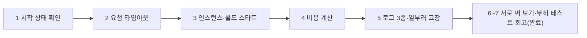

# [제출 보고서] N047 「Cloud Run에서 AI서비스 운영하기」 실습 과제 수행 결과

**수신**: N047 강의 강사님 · **발신**: 수강생 전대진(DJ)
**실습일**: 2026-10-20 ~ 2026-10-21
**과제 대상**: N046에서 배포한 AI 친구 에이전트 서비스(`friend-agent`)에 운영 설정을 하나씩 걸어 보고, 그 결과를 로그에서 읽는 실습
**평가 방법**: 맨 아래 "평가 체크리스트"를 보고 항목별로 점수와 한 줄 의견을 남겨 주세요.

> 이 문서는 제가 직접 해 본 실습의 **수행 기록과 증거**입니다. 서비스 주소는 요청마다 제 LLM 키로 비용이 나가는 공개 서비스라서 일부러 싣지 않았습니다. 대신 화면에서 읽은 값과 로그를 적었습니다.

---

## 1. 한 장 요약

| 단계 | 한 일 | 확인한 핵심 |
|---|---|---|
| 1 | 시작 상태 확인 | 프로젝트·리전 설정, 서비스 주소, 시크릿이 모두 정상 |
| 2 | 요청 타임아웃 | 평소 요청 전체 4.1초 → 3초로 줄이면 **답이 문장 중간에서 잘리는데 상태 코드는 200** |
| 3 | 인스턴스 수, 콜드 스타트, 데이터 소멸 | 쉬었다 오면 첫 요청이 느리고(콜드 스타트), **서버 메모리의 대화·약속이 사라짐** |
| 4 | 비용 | 최대 인스턴스 2 × 동시성 80 = 동시 160건. **최대 인스턴스는 비용 상한이 아님** |
| 5 | 로그 3종 읽기 | 일부러 설정을 고장 내 원인을 로그로 찾음. 실패 중에도 서비스는 이전 리비전으로 응답 |
| 6 | 서로 써 보기, 추가 과제 | 휴대폰(모바일 데이터)으로 실제 사용 → 로그의 remote IP로 "다른 기기" 요청 구분. 부하 테스트 3종 비교로 **최대 인스턴스 숫자보다 순간 스케일업 속도가 먼저 한계에 부딪힌다**는 것을 발견 |
| 7 | 회고 | 걱정 3가지(비용·지연·데이터 소멸)를 "설정이 막는 것/못 막는 것"으로 정리 완료(아래 6장) |



**진행 방식**: AI 코딩 도우미(Claude)가 단계별로 명령과 확인 방법을 안내했고, 명령은 제가 PowerShell에서 직접 실행했습니다. 결과 화면과 로그는 제가 읽고 해석했습니다.

---

## 2. 실습 환경 (시작 상태)

| 항목 | 값 |
|---|---|
| 클라우드 | Google Cloud Run, 리전 `us-central1` |
| 서비스 | `friend-agent` (FastAPI 기반 AI 친구 캐릭터 서비스) |
| 공개 여부 | 로그인 없이 누구나 접속 가능 (`--allow-unauthenticated`) |
| 최대 인스턴스 / 최소 인스턴스 | 2 / 0 |
| 동시성 | 80 (인스턴스 하나가 동시에 처리하는 요청 수) |
| 요청 타임아웃 | 300초(기본값) |
| LLM | `LLM_PROVIDER=openai`. 키는 Secret Manager 시크릿으로 연결(값은 서비스 설정에 적히지 않음) |
| 저장소 | 서버 메모리(재배포하면 사라짐). 화면 왼쪽 아래에도 그렇게 표시됨 |

---

## 3. 단계별 수행 내용

### 3-1. 시작 상태 확인 (읽기 전용 명령 3개)

```
gcloud config list
gcloud run services describe friend-agent --region us-central1 --format "value(status.url)"
gcloud secrets describe llm-api-key --format "value(name)"
```

프로젝트와 리전이 설정돼 있고, 서비스 주소가 나오고, 시크릿 이름이 확인됐습니다. 시크릿은 **이름만** 출력됩니다(값은 나오지 않음).

### 3-2. 요청 타임아웃

**먼저 정상 상태의 시간을 쟀습니다.** 화면 오른쪽 "이번 턴" 패널의 걸린 시간입니다.

| 질문 | 도구 선택 | 첫 글자 | 답 전체 | **요청 전체**(기억 정리 포함) |
|---|---|---|---|---|
| 날씨(처음) | 1.4초 | 2.5초 | 3.0초 | **4.1초** |
| 날씨(복원 직후) | 1.1초 | 2.5초 | 2.9초 | 3.6초 |
| 약속 보기 | 1.0초 | 1.5초 | 1.7초 | 2.8초 |

타임아웃이 봐야 하는 값은 "답 전체"가 아니라 답을 보낸 뒤 기억 정리까지 포함한 **요청 전체**입니다.

**타임아웃을 3초로 줄이고 관찰했습니다.**

```
gcloud run services update friend-agent --region us-central1 --timeout 3
```

관찰한 것:

- 답이 문장 중간에서 멈췄습니다(예: "…내일은 구름 조금 있고,"에서 끝남).
- 답 아래에 "⚠ 응답이 끝까지 오지 않았어요. 답이 잘렸거나 기억이 저장되지 않았을 수 있어요." 안내가 **3번** 붙었습니다.
- 서버 로그에서 `severity>=WARNING`으로 찾으니 `Truncated response body. Usually implies that the request timed out or the application exited before the response was finished.` 경고가 **3개**(16:32:46, 16:34:10, 16:34:37)였습니다. 화면의 안내 3번과 1:1로 대응했습니다.
- 요청 로그의 **상태 코드는 모두 200**이었습니다. 스트리밍은 첫 글자를 보내는 순간 이미 200을 보내기 때문에, 그 뒤에 끊겨도 5xx가 되지 않습니다. 그래서 **상태 코드만 보는 모니터링으로는 이 잘림을 잡을 수 없습니다.**
- 요청 로그의 지연 시간은 2.95초, 2.953초 근처와 3.998초, 3.999초가 섞여 있었습니다. 저는 3초만 설정했는데 약 4초 값이 있었던 이유는 **확정하지 못했습니다.**

확인 뒤 300초로 복원했습니다.

```
gcloud run services update friend-agent --region us-central1 --timeout 300
```

**배운 점**: 타임아웃은 평소 시간이 아니라 **콜드 스타트를 포함한 가장 느린 요청**을 기준으로 정합니다. 늘린다고 LLM이 빨라지지는 않습니다.

### 3-3. 인스턴스 수, 콜드 스타트, 데이터 소멸

현재 설정을 읽었습니다.

```
gcloud run services describe friend-agent --region us-central1 --format="yaml(spec.template.spec.containerConcurrency,spec.template.metadata.annotations)"
```

결과: `autoscaling.knative.dev/maxScale: '2'`, `containerConcurrency: 80`.

**콜드 스타트 관찰**: 약 10분 이상 쉬었다가 다시 말을 걸었습니다.

| 구분 | 도구 선택 | 요청 전체 |
|---|---|---|
| 평소 같은 단계 | 1.0~1.4초 | 2.8~4.1초 |
| 쉰 뒤 첫 요청 | **4.8초** | **6.9초** |

서버 쪽 증거를 로그 탐색기에서 찾았습니다(`textPayload:"Starting new instance"`).

| 시각 | Reason | 뜻 |
|---|---|---|
| 16:31:35 | DEPLOYMENT_ROLLOUT | 설정 변경(새 리비전) 때문에 켬 |
| 16:31:45 | AUTOSCALING | 새 리비전의 첫 요청용 |
| 17:06:46 | **AUTOSCALING** (바로 앞에 배포 없음) | **쉬다가 0개로 줄었다 요청 때문에 켜짐 = 콜드 스타트** |

요청이 아주 간단해도 콜드 스타트는 늦습니다. 없는 주소(`/nope`)를 열어 404를 만들어 로그에서 `httpRequest.status=404`로 찾았더니, **첫 요청 7.836초, 8초 뒤 요청 2ms**였습니다.

**데이터 소멸**: 같은 쉬고 난 뒤 장면에서 패널에 "최근 대화 0개 메시지"가 보였고(직전에는 7개), "기억과 약속" 화면에는 제가 저장한 8시 달리기와 10시 아이펠 수업 약속이 **사라지고** AI가 잘못 만든 가짜 약속(09:00 "약속") 1개만 남아 있었습니다. 화면의 대화는 브라우저가 그려 둔 것이고, 서버의 기억은 인스턴스가 바뀌면서 지워졌습니다.

**배운 점**: 인스턴스 수와 데이터 저장 위치는 별개의 문제입니다. 설정을 바꾸지 않아도 **요청이 없어 0개로 줄기만 해도** 서버 메모리의 데이터가 사라집니다. 남겨야 하는 데이터는 외부 데이터베이스에 둬야 합니다.

### 3-4. 비용

**동시에 처리할 수 있는 요청 수**

```
최대 인스턴스 × 동시성 = 2 × 80 = 160건
```

**한 시간에 처리 가능한 요청 수** = 160 × (3,600 ÷ 요청 하나 걸리는 시간)

| 요청 하나 걸리는 시간 | 시간당 처리 가능 건수 |
|---|---|
| 8초(강의 예시) | 72,000건 |
| 3.5초(제가 잰 평소 값) | 약 164,000건 |

건당 LLM 비용을 0.0015달러로 **가정**하면 72,000건은 약 108달러/시간입니다(실제 비용이 아니라 계산용 가정입니다).

| 설정 | 막는 것 | 막지 못하는 것 |
|---|---|---|
| Cloud Run 최대 인스턴스 | 한 번에 처리하는 요청 수 | 시간이 흐르며 쌓이는 호출 수, LLM 누적 비용 |
| LLM 제공사 월 사용 한도 | 한 달 LLM 비용 총액 | Cloud Run 쪽 요금 |
| Google Cloud 예산 알림 | 없음(알려 주기만 함) | 지출 자체 |

확인 문제의 정답은 "켜지는 인스턴스가 2개를 넘지 않지만, 인스턴스마다 여러 요청을 동시에 처리하므로 LLM 호출 총량을 제한하지는 않는다"였습니다.

### 3-5. 로그 3종 읽기와 일부러 고장 내기

로그에는 세 종류가 섞여 있습니다.

| 로그 | 병원 응급실 비유 | 예 |
|---|---|---|
| 요청 로그 | 접수 기록 | `POST /api/chat` 200, 2.9초 |
| 컨테이너 로그 | 진료 기록 | `LLM_PROVIDER 값 'unknown'을 알 수 없어…` |
| 시스템 로그 | 시설 기록 | `Container called exit(1).` |

**일부러 고장 냈습니다.** 이미 정상 동작 중인 서비스의 `LLM_PROVIDER`를 없는 값으로 바꿨습니다.

```
gcloud run services update friend-agent --region us-central1 --update-env-vars LLM_PROVIDER=unknown
```

예상대로 새 리비전(`friend-agent-00007-t5g`)이 실패했고 터미널에는 "PORT=8080 포트를 열지 못했다"고만 나왔습니다. 로그 탐색기에서 이 리비전의 로그 5줄을 시간순으로 읽었습니다.

| 시각 | 로그 종류 | 심각도 | 내용 |
|---|---|---|---|
| 19:23:58 | 시스템 | 정보 | 새 인스턴스 시작(배포) |
| 19:24:02 | **컨테이너** | **ERROR** | `LLM_PROVIDER 값 'unknown'을 알 수 없어 앱을…` (**진짜 원인**) |
| 19:24:02 | 시스템 | 경고 | `Container called exit(1).` |
| 19:24:02 | 시스템 | 오류 | `Default STARTUP TCP probe failed` |
| 19:24:02 | 시스템 | 오류 | `Cloud Run ReplaceService` 실패 |

**실패하는 동안에도 서비스는 살아 있었습니다.** 실패한 리비전은 트래픽을 받지 않아서 이전 리비전이 응답했습니다(주소 확인: HTTP 200, 응답 0.35초).

복구는 제거가 아니라 **원래 값으로 다시 설정**했습니다(처음에 명시적으로 `openai`를 넣어 두었기 때문입니다).

```
gcloud run services update friend-agent --region us-central1 --update-env-vars LLM_PROVIDER=openai
```

새 리비전 `friend-agent-00008-5jk`가 트래픽 100%를 받는 것을 확인했습니다.

**배운 점**: 터미널 메시지는 결과이고 원인은 컨테이너 로그에 있습니다. 같은 "포트를 열지 못했다"는 메시지가 N046에서는 키 누락일 때, 이번에는 잘못된 설정값일 때 똑같이 나왔습니다. **메시지만으로는 원인을 구분할 수 없습니다.**

### 3-6. 서로 써 보기와 부하 테스트 (6단계, 추가 과제 2)

**서로 써 보기**: 휴대폰의 와이파이를 끄고 데이터(LTE/5G)로 바꿔 서비스 주소에 접속해 메시지를 몇 번 주고받았습니다. 집 와이파이를 그대로 쓰면 PC와 같은 인터넷 주소로 찍혀 구분이 안 되기 때문입니다. 이어서 로그를 조회했습니다.

```
gcloud logging read 'resource.type=cloud_run_revision AND resource.labels.service_name=friend-agent AND httpRequest.requestMethod:*' --freshness=30m --limit=30 --format='table(timestamp, httpRequest.remoteIp, httpRequest.requestMethod, httpRequest.requestUrl, httpRequest.status)'
```

결과: 최근 30건 중 28건이 같은 IPv6 주소(휴대폰 모바일 데이터)에서 왔고, 1건만 다른 IPv4 주소(PC·집 와이파이)였습니다. 휴대폰 쪽 요청은 페이지 로드 → 캐릭터 미리보기 여러 번 → 설정 변경 → `/api/chat` 2회 → 기억 조회까지, 실제 사용 흐름 그대로 로그에 남아 있었습니다.

**배운 점**: "내 요청"과 "다른 기기의 요청"은 remote IP로 구분할 수 있지만, 같은 와이파이를 쓰는 사용자끼리는 이 방법으로 구분되지 않습니다. 진짜 사용자 구분은 로그인·세션 식별이 따로 있어야 합니다.

**부하 테스트(추가 과제 2)**: 에이전트 서비스에 직접 부하를 주면 요청마다 LLM이 호출되어 비용이 나가므로, LLM을 부르지 않는 별도 서비스 `load-test`를 만들었습니다. 템플릿 `hello/main.py`에 2초 기다렸다 응답하는 `/slow`를 추가하고(`async`+`asyncio.sleep`), `us-central1`에 로그인 없이 배포했습니다. 표준 라이브러리만 쓰는 `load_test.py`로 동시 요청 50개를 보내며 설정을 3가지로 바꿨습니다.

| 설정 | 200 개수 | 200이 아닌 응답 | p50 | 최대 |
|---|---|---|---|---|
| A. 동시성 80(기본값), 최대 인스턴스 3 | 50 | 0 | 4.6초 | 6.0초 |
| B. 동시성 1, 최대 인스턴스 20 | 15 | 35(500) | 10.4초 | 12.3초 |
| C. 동시성 1, 최대 인스턴스 3 | 15 | 35(500) | 10.6초 | 12.3초 |

B와 C의 결과가 **거의 똑같았습니다**(최대 인스턴스가 20이든 3이든 차이 없음). 실패한 요청의 로그를 보니 원인이 명확했습니다.

```
gcloud logging read 'resource.type=cloud_run_revision AND resource.labels.service_name=load-test AND httpRequest.status>=500' --freshness=15m --limit=10 --format='table(timestamp, severity, httpRequest.status, httpRequest.latency, textPayload)'
```

```
ERROR  500  지연 0초  The request was aborted because there was no available instance.
```

**발견(강의 자료에 없던 내용)**: 지연 시간이 0초라는 건 기다리지도 않고 **즉시 거절**됐다는 뜻입니다. 즉 50개가 한꺼번에 몰리는 순간적인 트래픽 폭주에서는, **최대 인스턴스 숫자(3이든 20이든)보다 "새 인스턴스를 얼마나 빨리 띄울 수 있는가(스케일업 속도)"가 먼저 한계**에 부딪힙니다. 설정 A가 전부 성공한 건 최대 인스턴스가 더 적은(3) 대신, 동시성 80으로 기존 인스턴스가 요청을 쌓아서 처리했기 때문입니다. 테스트가 끝난 뒤 `load-test` 서비스는 삭제했습니다.

```
gcloud run services delete load-test --region us-central1 --quiet
```

### 3-7. 회고 (7단계)

처음 가졌던 걱정 3가지를 오늘 실습으로 확인한 "설정이 막아주는 것"과 "설정으로는 못 막는 것"으로 정리했습니다.

| 걱정 | 설정이 막아주는 것 | 설정으로는 못 막는 것 |
|---|---|---|
| ① 다른 사람이 많이 써서 비용이 폭증 | 최대 인스턴스 2 → 동시 처리 규모 제한 | 총 호출 횟수. 3-6에서 최대 인스턴스를 3→20으로 늘려도 "거절되는 요청"만 달라졌을 뿐, 비용을 좌우하는 총 호출량은 못 막음. 사용자별 이용 한도는 별도 설계 필요 |
| ② 요청이 몰리거나 늦어져 서비스가 느림 | 타임아웃 300초(무한 대기 방지), 동시성·최대 인스턴스로 확장 방식 조절 | 순간적인 트래픽 폭주에서는 최대 인스턴스와 상관없이 스케일업 속도가 먼저 한계(3-6의 `no available instance`, 지연 0초). 콜드 스타트 지연(평소 1.0~1.4초 → 4.8초)도 설정으로는 못 없앰 |
| ③ 대화가 사라지거나 다른 사용자와 섞임 | 로그로 "언제 무슨 일이 있었는지" 사후 추적 가능(3-6의 remote IP 구분) | 사라진 대화는 로그로 복구 안 됨(3-3에서 실측). remote IP 구분은 같은 와이파이에서는 한계가 있음. 대화는 DB, 사용자 구분은 로그인으로 따로 구현 필요 |

**한 줄 결론**: Cloud Run 설정들은 "규모·속도를 조절하는 손잡이"이지 "문제를 완전히 막는 안전장치"가 아니었습니다. 비용 한도·데이터 보존·사용자 분리는 설정이 아니라 별도 설계(결제 한도, 외부 DB, 인증)로 풀어야 한다는 것을 직접 겪었습니다.

---

## 4. 이 실습에서 얻은 핵심 다섯 가지

1. **타임아웃은 가장 느린 요청(콜드 스타트 포함)을 기준으로 정한다.** 너무 짧으면 틀린 결과가 정상(200)처럼 보인다.
2. **최대 인스턴스는 규모만 막고 비용 총액은 못 막는다.** 총액은 LLM 제공사의 월 한도로 막는다.
3. **서버 메모리의 데이터는 배포·교체·쉬는 동안에도 사라진다.** 남길 데이터는 외부 데이터베이스에 둔다.
4. **로그 세 종류를 구분해 읽는다.** 사용자에게 보인 현상에서 시작해 그 현상을 설명하는 내부 로그를 찾아간다.
5. **에이전트에게 맡길 때는 "로그를 근거로 설명하고 아직 고치지 마"라고 요청한다.** 변경 범위·결과·검증 방법을 확인한 뒤 승인한다.

---

## 5. 발견한 한계와 풀지 못한 것

- **타임아웃 3초 설정인데 약 4초 지연이 로그에 있었던 이유**는 확정하지 못했습니다.
- **AI 도구 선택 오류**: 쉬고 난 뒤 "내일 약속을 알려줘"에 AI가 약속 조회가 아니라 약속 저장(`create_reminder`, 확신도 100%)을 골라 **가짜 약속을 저장하고 자연스럽게 답했습니다.** 서버 메모리가 비어 있던 것이 원인일 가능성이 있지만 단정하지는 못합니다. 운영 설정으로는 막을 수 없는 앱 설계의 문제입니다.
- **공개 서비스의 비용 위험**: 주소를 아는 누구나 쓸 수 있고 요청마다 제 키로 비용이 납니다. 이 실습 서비스는 정리 방법을 정해야 합니다.
- 같은 서비스를 여러 사람이 쓰면 **로그인이 없어 사용자의 캐릭터가 섞일 수 있습니다**(외부 DB와 로그인이 필요한 영역).

---

## 6. 6~7단계 실습 결과

| 단계 | 상태 | 핵심 결과 |
|---|---|---|
| 6 서로 써 보기, 추가 과제 | **완료**(2026-10-21) | 휴대폰(모바일 데이터)으로 실사용 → 로그의 remote IP로 "다른 기기" 구분(3-6). 부하 테스트 3종 비교 결과, **최대 인스턴스 숫자보다 순간 스케일업 속도가 먼저 한계**에 부딪힘을 발견 |
| 7 회고 | **완료**(2026-10-21) | 걱정 3가지를 "설정이 막는 것/못 막는 것"으로 정리(3-7) |

자세한 과정과 로그 증거는 3-6, 3-7절을 참고해 주세요.

---

## 7. 직접 따라 해 보려면

본인 프로젝트와 서비스에서만 하세요. 키 값은 대화나 문서에 붙여 넣지 마세요.

| 단계 | 확인 방법 |
|---|---|
| 타임아웃 | `--timeout 3`로 줄여 말을 걸고, 로그 탐색기에서 `severity>=WARNING`으로 `Truncated response body` 경고 찾기. 끝나면 `--timeout 300`으로 복원 |
| 콜드 스타트 | 10분 이상 쉬었다 다시 말을 걸고, 로그에서 `textPayload:"Starting new instance"`의 `Reason` 확인 |
| 로그 3종 | `httpRequest.status=404`(요청), 컨테이너 ERROR 줄, `Container called exit(1)`(시스템) |
| 일부러 고장 | `LLM_PROVIDER=unknown` → 로그에서 원인 확인 → **원래 값으로 복원** |

---

## 8. 평가 체크리스트 (1~5점, 한 줄 의견)

| 번호 | 확인할 것 | 근거가 있는 곳 | 점수 | 의견 |
|---|---|---|---|---|
| 1 | 시작 상태를 읽기 전용 명령으로 확인했는가 | 3-1 | | |
| 2 | 타임아웃을 정상 시간(요청 전체)을 먼저 잰 뒤 줄이고 복원했는가 | 3-2 | | |
| 3 | 잘림이 상태 코드 200으로 남는다는 것을 로그로 확인했는가 | 3-2 | | |
| 4 | 콜드 스타트를 시간 차이와 로그(`Reason`)로 입증했는가 | 3-3 | | |
| 5 | 서버 메모리 데이터가 사라지는 것을 화면 증거로 보였는가 | 3-3 | | |
| 6 | 최대 인스턴스가 비용 상한이 아님을 계산으로 설명했는가 | 3-4 | | |
| 7 | 로그 3종을 구분하고 타임라인으로 원인을 재구성했는가 | 3-5 | | |
| 8 | 고장 낸 서비스를 안전하게 복구하고 상태를 확인했는가 | 3-5 | | |
| 9 | 키·공개 서비스 같은 위험을 인지하고 다루었는가 | 2장, 5장 | | |
| 10 | 풀지 못한 것을 숨기지 않고 적었는가 | 5장 | | |

**전체 의견**:

---

## 9. 첨부할 증거 화면 (Notion에 직접 붙여 넣기)

- 정상 상태의 "이번 턴" 패널(요청 전체 4.1초)
- 타임아웃 3초에서 잘린 답과 "응답이 끝까지 오지 않았어요" 안내
- 로그 탐색기의 `Truncated response body` 경고 3개
- 쉬고 난 뒤 6.9초 패널과 "기억과 약속" 화면(가짜 약속 1개)
- `Starting new instance` 로그 8줄(AUTOSCALING 단독 줄 표시)
- `/nope` 404 로그(7.836초와 2ms)
- 일부러 고장 낸 리비전의 로그 5줄(컨테이너 ERROR 줄 표시)
- 휴대폰 요청 로그 30건(28건 같은 IPv6, 1건만 다른 IPv4)
- 부하 테스트 설정 A·B·C 결과(200/500 개수, p50·최대)
- 부하 테스트 500 오류 로그(`no available instance`, 지연 0초)

*이 문서에는 API 키 값과 서비스 주소가 없습니다.*
