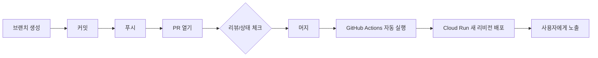
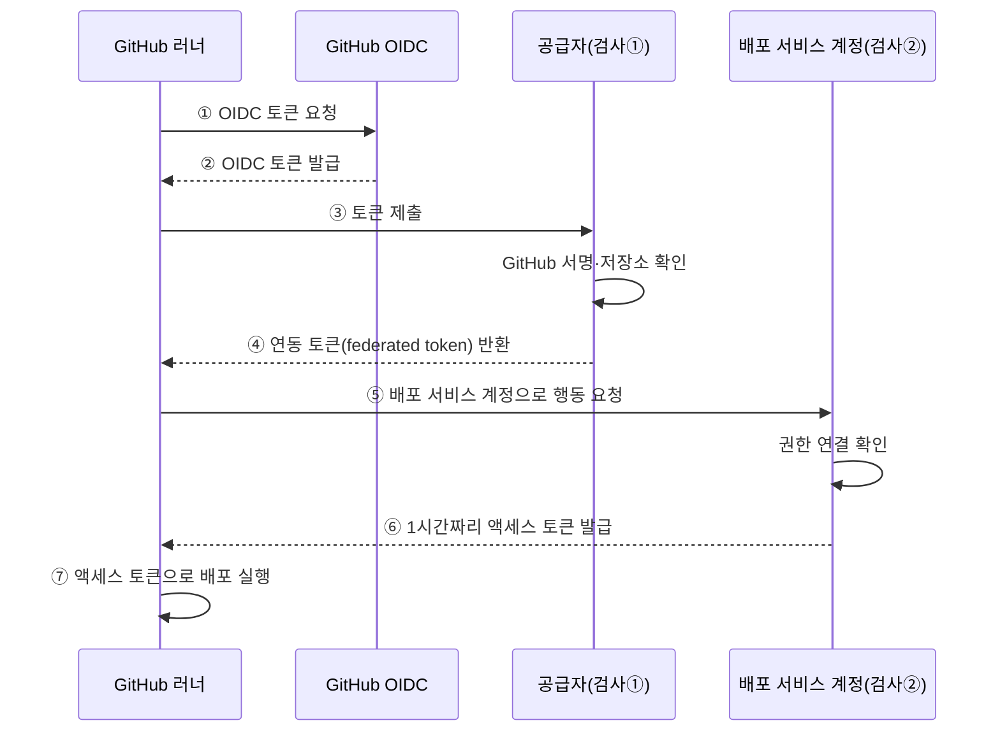

# N048 · GitHub Actions로 자동 배포하기

> 버전 1.0 · 2026-10-22

## 목차

- [핵심 한 문장 요약](#핵심-한-문장-요약)
- [1. CI와 CD, 무엇이 자동화되는가](#1-ci와-cd-무엇이-자동화되는가)
- [2. 시작 전 상태 확인](#2-시작-전-상태-확인)
- [3. main에 바로 고치지 않는 이유 — 브랜치·PR·머지](#3-main에-바로-고치지-않는-이유--브랜치pr머지)
- [4. GitHub Actions가 Google Cloud에 배포할 권한 얻기](#4-github-actions가-google-cloud에-배포할-권한-얻기)
- [5. 워크플로 파일 넣기 — 실제 배포](#5-워크플로-파일-넣기--실제-배포)
- [6. "머지만 하면 나간다"는 것의 무게](#6-머지만-하면-나간다는-것의-무게)
- [7. 과제 고르기](#7-과제-고르기)
- [8. 오늘 배운 것 (회고)](#8-오늘-배운-것-회고)
- [맺음말](#맺음말)
- [부록 A · 실전 코드 모음](#부록-a--실전-코드-모음)
- [부록 B · 트러블슈팅 표](#부록-b--트러블슈팅-표)
- [부록 C · AI 프롬프트 모음집](#부록-c--ai-프롬프트-모음집)
- [부록 D · 용어 사전](#부록-d--용어-사전)
- [부록 E · 개념 비교표 모음](#부록-e--개념-비교표-모음)
- [부록 F · 학습 로드맵](#부록-f--학습-로드맵)
- [부록 G · 복습 퀴즈](#부록-g--복습-퀴즈)

## 핵심 한 문장 요약

> 브랜치 → PR → 머지라는 정해진 문을 통과한 코드만, 키 파일 없이 발급받는 임시 통행증(Workload Identity Federation)으로 자동 배포되게 만드는 것 — 그리고 "자동으로 나갔다"는 사실이 "제대로 나갔다"는 뜻은 아니라는 것을 아는 것.

이번 강의는 실습용 서비스(FastAPI로 만든 AI 친구 에이전트 "friend-agent")를 Google Cloud Run에 **사람이 배포 명령을 치지 않아도 main 브랜치에 머지되는 순간 자동으로 배포**되게 만드는 과정을 끝까지 직접 해 보는 강의다. 단순히 "자동화가 편하다"는 이야기가 아니라, ① 키 파일 없이 권한을 주는 방법, ② 자동 배포가 실제로 막아주는 사고와 그대로 통과시키는 사고가 다르다는 것, 이 두 가지를 실제 사고 2건을 재현해 보면서 몸으로 확인하는 데 핵심이 있다.

> 💡 **팁** — 이전 실습에서 Vercel에 저장소를 연결하면 푸시 후 몇 분 뒤 자동으로 새 버전이 떴던 경험을 떠올려 보자. 이번 강의는 그 "몇 분 동안 무슨 일이 있었는지", "Vercel이 내 코드를 가져갈 수 있었던 권한은 어디서 왔는지"를 직접 만들어 보며 답하는 강의다.

---

## 1. CI와 CD, 무엇이 자동화되는가

**CI(Continuous Integration, 지속적 통합)**는 여러 사람이 각자 고친 코드를 자주, 작은 단위로 main 브랜치에 합치고, 합치기 전마다 같은 검사를 자동으로 돌려 문제를 작을 때 찾는 방식이다. 원문은 이렇게 설명한다.

> "여러 사람이 각자 고친 코드를 한참 모았다가 한 번에 합치면, 무엇 때문에 깨졌는지 찾기 어려울 만큼 문제가 커져 있습니다. 그래서 변경을 작게 나눠 자주 합치고, 합치기 전마다 같은 테스트를 자동으로 돌려 문제를 작을 때 찾는 방식이 CI입니다."

**CD**는 두 가지 뜻으로 쓰인다.

- **지속적 전달(Continuous Delivery)**: main에 합쳐진 코드를 언제든 배포할 수 있는 상태로 만들어 두되, 실제 배포 버튼은 사람이 누른다.
- **지속적 배포(Continuous Deployment)**: 사람의 결정 없이 main에 합쳐지는 즉시 사용자에게 나간다. **이번 강의에서 만드는 것이 바로 이 방식이다.**

| 비유 | 의미 |
|---|---|
| CI | 제품을 출고하기 전에 품질 검사를 하는 것 |
| CD | 품질 검사를 통과한 제품을 매장에 진열하는 것 |

> ⚠️ **주의** — AI 서비스는 코드보다 작은 변경이 자주 일어난다. "지시문 한 줄, 모델 이름, 도구 설명, 확신도 기준 같은 값이 바뀌면 답이 달라지는데, 이런 변경은 화면만 봐서는 무엇이 달라졌는지 알아차리기 어렵습니다." 그래서 AI 서비스일수록 작은 변경도 같은 절차(브랜치 → PR → 테스트 → 머지)를 거치게 하는 것이 중요하다.

### 워크플로 용어 한눈에 보기

GitHub Actions는 저장소에 특정 이벤트(main에 커밋, PR 열림, 정해진 시각, 실행 버튼)가 생기면 `.github/workflows/` 폴더 안의 설정 파일대로 자동 실행되는 서비스다. 비슷한 역할을 하는 다른 도구로 GitLab CI/CD, Jenkins, Google Cloud Build, AWS CodePipeline이 있는데, 이미 GitHub를 쓰고 있고, 공개 저장소는 무료이며, Google이 Cloud Run 배포용 공식 액션을 제공한다는 점 때문에 이번 실습은 GitHub Actions를 쓴다.

| 말 | 가리키는 것 | 워크플로 파일에서 |
|---|---|---|
| 워크플로 | 실행할 일 전체를 적은 파일 하나 | `.github/workflows/deploy.yml` |
| 트리거 | 워크플로를 시작하게 하는 이벤트 | `on:` 아래 (예: main에 push) |
| 작업(job) | 같은 컴퓨터에서 이어서 실행되는 단계 묶음 | `jobs:` 아래 이름 (예: deploy) |
| 단계(step) | 작업 안에서 위에서 아래로 하나씩 실행되는 일 | `steps:` 아래 항목 |
| 러너 | 작업을 실행하는 컴퓨터. 실행마다 새로 준비되고 끝나면 지워진다 | `runs-on: ubuntu-latest` |
| 액션 | 다른 사람이 만들어 공개한 단계 묶음. 가져다 쓴다 | `uses: google-github-actions/deploy-cloudrun@v3` |
| 변수와 시크릿 | 워크플로가 읽는 값. 저장소 설정에 넣는다 | `${{ vars.GCP_PROJECT_ID }}` |
| 워크플로 실행 | 워크플로가 한 번 돈 기록과 단계별 로그 | 저장소의 Actions 탭 |

> 💡 **팁** — 액션 이름 뒤의 `@v3` 는 버전이다. 같은 액션이라도 버전에 따라 받는 값과 동작이 달라질 수 있어서, 이번 강의에서는 템플릿에 적힌 버전을 바꾸지 않는 것을 원칙으로 둔다.

---

## 2. 시작 전 상태 확인

이 실습은 "에이전트 서비스가 이미 Cloud Run에 배포돼 있고, LLM API 키를 Secret Manager의 시크릿 `llm-api-key`로 읽고 있는 상태"에서 시작한다. Google Cloud 가입이나 gcloud 설치부터 하면 40분 안팎 걸리므로 수업 전에 준비해 두는 것이 좋다.

> 🧪 **예제** — [해설서 비유] 시작 상태 확인은 "자동차를 수리하기 전에 시동이 걸리는지, 연료가 있는지, 문제가 어디에 있는지 확인하는 것"과 같다.

| 필요한 상태 | 확인 방법 | 없으면 |
|---|---|---|
| gcloud 로그인, 프로젝트, 기본 리전 us-central1 | `gcloud config list` | 시작 상태 문서 A |
| 템플릿으로 만든 내 공개 저장소를 내려받은 폴더 | `git remote -v` 에 내 저장소 주소가 보임 | 시작 상태 문서 A |
| friend-agent 서비스가 시크릿 `llm-api-key`를 참조해 배포됨 | 서비스 URL과 시크릿 이름이 나오는 명령(부록 A) | 시작 상태 문서 B |

확인 명령 전체는 [부록 A](#부록-a--실전-코드-모음)에 그대로 실어 둔다. 서비스 URL을 열어 캐릭터 만들기·대화 화면이 보이면 준비가 끝난 것이다.

지금까지 해 온 **수동 배포**의 문제점은 이렇다: 배포한 사람만 무엇이 언제 배포됐는지 알고, 로컬의 커밋 안 된 변경이 섞여도 알기 어려우며, 배포 전 확인을 빠뜨려도 막을 장치가 없고, 담당자가 자리에 없으면 긴급 수정도 배포할 수 없다. 이번 강의는 이 네 가지를 자동화로 해결해 나간다.

---

## 3. main에 바로 고치지 않는 이유 — 브랜치·PR·머지

배포 워크플로가 들어가는 순간부터는 **main의 커밋이 곧바로 사용자에게 나간다.** 그래서 지금부터는 코드를 직접 main에 커밋하지 않고, 반드시 "브랜치 → 커밋 → 푸시 → PR → (리뷰) → 머지" 순서를 거친다.

> 🧪 **예제** — [해설서 비유] 학교 신문을 만든다고 생각해 보자. 인쇄 중인 최종 신문을 직접 수정하는 대신, 초안을 따로 만들어 내용을 검토한 뒤 최종본에 반영하는 것이 안전하다.

### 변경이 사용자에게 닿기까지 — 흐름 한눈에 보기



```
브랜치 생성 → 커밋 → 푸시 → PR 열기 → (리뷰·상태 체크) → 머지
   → GitHub Actions 자동 실행 → Cloud Run 새 리비전 배포 → 사용자에게 노출
```

실습은 두 단계로 진행한다.

1. **README 한 줄 수정 PR 실습**: 브랜치를 만들고 README.md 한 줄을 고쳐 커밋 → 푸시 → PR 생성 → 내용 확인 후 머지. 명령 전체는 부록 A 참고.
2. **연습용 워크플로 `hello.yml` 실습**: Google Cloud 권한이 전혀 없이도 도는 연습용 워크플로를 PR로 올려 실행 로그 읽는 법을 익힌다. 트리거는 `pull_request`(PR이 열리거나 커밋이 추가될 때)와 `workflow_dispatch`(Actions 탭에서 수동 실행) 두 가지다.

실행 로그를 읽으면 다음을 알 수 있다: 러너는 실행마다 새로 준비되는 컴퓨터라서 코드를 받기 전에는 `.`/`..` 외에 아무 파일도 없다(`actions/checkout`이 커밋을 받아 온 뒤에야 파일이 생긴다). `.env`는 `.gitignore`에 적혀 있어 커밋되지 않으므로 러너에도 없다.

> ⚠️ **주의** — PR 화면에 뜨는 CI 결과(상태 체크, status check)는 **결과만 보여줄 뿐 머지를 막지는 않는다.** 하나의 단계를 일부러 실패(`exit 1`)하게 만들어 실행해 봐도 PR의 Merge 버튼은 그대로 눌린다. 실패한 PR이 머지되는 것을 막으려면 **브랜치 보호 규칙과 "필수 상태 체크" 설정을 별도로 해야 한다** — 이 강의 범위 밖의 다음 단계다.

일부러 실패하는 단계를 추가했다가 되돌리는 연습에서는 `git revert --no-edit HEAD`로 되돌린다. revert는 "기존 커밋의 변경을 취소하는 새 커밋을 만드는 것"이며 과거 기록을 지우지 않는다는 점이 git reset과 다르다.

---

## 4. GitHub Actions가 Google Cloud에 배포할 권한 얻기

이 강의의 가장 중요한 개념 네 가지는 **서비스 계정(Service Account)**, **WIF(Workload Identity Federation)**, **최소 권한 원칙**, **서비스 계정 가장(Impersonation)**이다.

> 🧪 **예제** — [해설서 비유] 학교 건물에 비유해 보자. GitHub Actions 러너는 학교에 방문한 외부 작업자, Google Cloud는 학교 건물, 서비스 계정은 특정 업무를 할 수 있는 출입증, WIF는 방문자의 신분증을 확인하는 출입 관리 시스템, IAM 권한은 출입증으로 들어가서 할 수 있는 업무의 범위다.

핵심 아이디어는 이렇다.

> "내 Google Cloud 프로젝트에 'GitHub Actions가 발급한 토큰 가운데 내 레포에서 온 것만 받는다'는 공급자를 만들고, 그렇게 들어온 신원에게 배포 서비스 계정을 쓸 권한을 주는 것입니다. 서비스 계정 키 파일처럼 오래 남는 값은 GitHub에도 Google Cloud에도 저장하지 않습니다."

### 배포 한 번의 흐름 — 인증 시퀀스



```
러너 --①OIDC 토큰 요청--> GitHub
러너 <--②OIDC 토큰 발급-- GitHub
러너 --③토큰 제출--> 공급자(검사①: GitHub 서명·저장소 확인)
러너 <--④연동 토큰 반환-- 공급자
러너 --⑤배포 서비스 계정으로 행동 요청--> 배포 서비스 계정(검사②: 권한 연결 확인)
러너 <--⑥1시간짜리 액세스 토큰-- 배포 서비스 계정
러너 --⑦액세스 토큰으로 배포 실행
```

검사가 두 번인 이유: "공급자 조건은 토큰이 Google Cloud 안으로 들어올 수 있는지를 정하고, 권한 연결은 들어온 신원이 어느 서비스 계정을 쓸 수 있는지를 정합니다."

### 서비스 계정을 3개로 나누는 이유 — 최소 권한 원칙

| 계정 | 쓰이는 시간 | 필요한 권한 |
|---|---|---|
| **런타임 계정** `friend-agent-runtime` | 요청 처리 내내 | `llm-api-key` 읽기 권한만 |
| **빌드 계정** `friend-agent-builder` | 빌드하는 순간만 | 빌드 역할(`roles/run.builder`)만 |
| **배포 계정** `github-deployer` | 머지 시 몇 분만 | 소스 배포, API 사용, 런타임/빌드 계정 지정 권한만 |

> ⚠️ **주의** — "하나로 합치면 인터넷에서 요청을 받는 서비스가 배포 권한까지 갖게 되고, 워크플로 파일에 한 줄만 추가해도 LLM API 키를 꺼낼 수 있게 됩니다." 빌드 계정을 따로 두지 않으면 조직 없이 만든 프로젝트의 **Compute Engine 기본 서비스 계정**(Editor 역할이 붙어 있는 경우가 많음)으로 빌드하게 되어, 배포 계정이 사실상 Editor 권한을 갖는 것과 같아진다.

### 실행 전 반드시 점검할 것 — 안전 가드레일

> ⚠️ **주의** — 이 다섯 가지는 코딩 에이전트에게 권한 설정을 맡길 때 반드시 실행 전에 확인해야 한다. Claude Code를 쓴다면 `.claude/settings.json`에 "키 파일 생성 금지", "권한 부여·서비스 계정 생성은 매번 확인"으로 반영해 두는 것이 좋다.

| 확인할 것 | 걸리면 |
|---|---|
| 서비스 계정 키 파일(JSON)을 만드는가 (`keys create`) | **실행하지 않는다.** 키 파일은 만료 기한이 없어 새어 나가면 계속 쓰일 수 있다. WIF로 하라고 다시 요청한다 |
| Owner, Editor 같은 기본 역할을 주는가 | **실행하지 않는다.** 역할 표와 대조한다 |
| 권한을 주는 대상이 프로젝트 전체인가, 하나인가 | `serviceAccountUser`는 런타임·빌드 계정 두 개에만, 시크릿 읽기는 `llm-api-key` 하나에만 준다 |
| 템플릿과 다른 버전의 액션을 쓰는가 | **실행하지 않는다.** 템플릿의 버전을 유지한다 |
| 무언가를 삭제하는가 | 지우는 대상의 이름을 확인하고 판단한다 |

이 단계에서 만드는 것은 총 6가지: ① 런타임·빌드 서비스 계정과 각 권한, ② 배포 서비스 계정과 권한 4개, ③ 풀(`github`), ④ 풀 안의 공급자(`friend-agent-repo`)와 저장소 조건, ⑤ 배포 계정에 대한 권한 연결, ⑥ GitHub 저장소 변수 5개(`GCP_PROJECT_ID`, `WIF_PROVIDER`, `DEPLOY_SA`, `RUNTIME_SA`, `BUILD_SA`). 전체 명령은 [부록 A](#부록-a--실전-코드-모음)에 그대로 실었다.

> ⚠️ **주의** — 공급자 조건에 저장소 이름이 아니라 **계정 이름까지만** 적으면 그 계정의 모든 저장소가 배포 서비스 계정을 쓸 수 있게 된다. 반드시 `assertion.repository=='<내 계정>/<내 저장소>'`처럼 저장소 단위로 좁혀야 한다.

마지막으로, 풀·공급자·권한 연결 같은 IAM 변경은 실제 적용까지 최대 5분쯤 걸린다. 이를 **IAM 변경 전파(propagation) 지연**이라고 부르며, 인증 단계가 바로 실패해도 당황하지 말고 몇 분 기다렸다가 재시도하는 것이 첫 대응이다.

---

## 5. 워크플로 파일 넣기 — 실제 배포

템플릿은 `starter/workflows/deploy.yml`(실행되지 않는 보관용)에 미리 준비돼 있다. 이를 `.github/workflows/deploy.yml`로 **내용 수정 없이 그대로 복사**하면 GitHub Actions가 인식해 실행한다. 저장소별로 달라지는 값은 모두 4단계에서 만든 변수로 읽으므로 파일 자체를 고칠 필요가 없다.

### 머지 전에 PR에서 꼭 확인할 5가지

| 볼 곳 | 확인할 것 |
|---|---|
| `on` | main에 대한 `push`만 적혀 있는가 |
| `permissions` | `contents: read`와 `id-token: write` 두 줄뿐인가 |
| `uses` | `actions/checkout@v7`, `google-github-actions/auth@v3`, `google-github-actions/deploy-cloudrun@v3`인가 |
| `service`, `region` | `friend-agent`, `us-central1`인가 |
| `flags` | 런타임 계정(`RUNTIME_SA`)과 빌드 계정(`BUILD_SA`)을 지정하는가 |

> 💡 **팁** — `env_vars`의 `COMMIT_SHA=${{ github.sha }}`는 지금 배포를 만든 커밋의 고유 해시값을 서비스 환경변수로 넣는 줄이다. 서비스의 `/version` 엔드포인트가 이 값을 그대로 돌려주므로, 지금 돌고 있는 버전이 어느 커밋인지 브라우저에서 바로 확인할 수 있다.

머지하면 네 단계(Checkout → Auth → Deploy → 배포 주소 확인)가 순서대로 돈다.

| 단계 | 의미 |
|---|---|
| Checkout | 코드 받기 |
| Auth | WIF로 Google Cloud 인증 |
| Deploy | 소스 빌드 + 이미지 저장 + Cloud Run 새 리비전 생성 |
| 배포 주소 확인 | 배포된 URL 출력 |

### 배포 성공 후 반드시 확인할 4곳

1. Cloud Run > friend-agent > **리비전 탭** — 새 리비전이 트래픽 100%를 받는지
2. 새 리비전 **보안 탭** — 서비스 계정이 `friend-agent-runtime`인지
3. Cloud Build > **기록** — 최근 빌드 실행 계정이 `friend-agent-builder`인지
4. 브라우저에서 `<서비스 URL>/version` — `commit` 값이 GitHub 최신 커밋 SHA와 같은지, 그리고 화면에서 실제로 대화해 LLM 응답이 정상인지

배포가 정상 확인되면 기본 서비스 계정(`<프로젝트 번호>-compute@developer.gserviceaccount.com`)에 남아 있던 `llm-api-key` 읽기 권한을 회수(revoke)한다. 더 이상 쓰이지 않는 넓은 권한을 남겨 두지 않기 위해서다. 명령은 부록 A 참고.

자주 겪는 문제 두 가지는 [부록 B](#부록-b--트러블슈팅-표)에 원인→해결로 정리했다.

---

## 6. "머지만 하면 나간다"는 것의 무게

> 🧪 **예제** — [해설서 비유] 자동 배포를 자동문에 비유해 보자. 자동문을 설치하면 사람이 매번 문을 열지 않아도 방문객이 들어올 수 있다. 하지만 문이 자동으로 열린다고 해서 문이 제대로 설치되었다는 뜻은 아니다. 문이 아예 열리지 않으면 방문객은 들어갈 수 없다. 문은 열리지만 엉뚱한 방향으로 열리면 방문객은 잘못된 곳으로 들어갈 수 있다.

이 강의의 클라이맥스는 실제로 준비된 "사고 패치" 두 개를 일부러 머지해 보면서, **자동 배포가 막아주는 문제**와 **그대로 통과시키는 문제**가 어떻게 다른지 몸으로 확인하는 것이다.

### 사고 1 — 시작하지 않는 변경 (환경변수 이름 오류)

`starter/incidents/rename-key.patch`는 환경변수 이름을 `LLM_API_KEY` → `OPENAI_API_KEY`로 바꾼다. "그럴듯한 정리"처럼 보이고, 로컬 `.env`의 이름도 함께 바꾸면 **로컬에서는 멀쩡히 돌아간다.** 하지만 Cloud Run에는 `LLM_API_KEY`라는 이름으로 시크릿이 연결돼 있어서, 새 버전은 키를 찾지 못해 시작하자마자 종료된다.

Cloud Run은 새 리비전이 **스타트업 프로브**(새 인스턴스가 요청을 받을 준비가 됐는지 확인하는 검사)를 통과해야 트래픽을 넘겨주므로, 통과하지 못한 새 리비전은 트래픽 0%로 남고 **이전 리비전이 계속 요청을 처리한다.** 그래서 사용자 입장에서는 아무 이상이 없어 보이지만, GitHub Actions 쪽은 실패(빨간색)로 끝난다. 원인은 Cloud Run 로그 탭에서 찾는다.

복구는 **Revert**로 한다. 머지된 PR 화면 하단의 Revert 버튼을 누르면 그 PR이 바꾼 줄만 반대로 되돌리는 새 PR이 자동으로 만들어진다.

> ⚠️ **주의** — main에 직접 푸시해서 되돌리는 방법은 쓰지 않는다. 에이전트에게 맡길 때도 `git revert`로 되돌림 커밋을 만들어 PR로 올리게 한다 — main 직접 푸시를 제안하면 받아들이지 않는다.

### 사고 2 — 시작은 되지만 틀린 변경 (시간대 오류)

`starter/incidents/reminder-timezone.patch`는 약속 저장 전 시각에서 시간대 정보를 제거하는 한 줄이다("저장 형식을 단순하게"라는 주석까지 있어 리뷰에서 지나치기 쉽다). 이번에는 배포가 **성공(초록)**한다.

하지만 서비스에서 "내일 아침 8시에 물 마시라고 알려 줘"라고 요청하면, 캐릭터는 "아침 8시"라고 대답하면서도 **실제 저장은 다음 날 17:00으로 된다.** 같은 코드를 로컬(한국 시간)에서 돌리면 08:00으로 정상 저장되는데, 시간대 정보 없는 시각은 "그 코드가 도는 컴퓨터의 시간대"로 읽히기 때문이다. Cloud Run 서버는 세계 표준시(UTC)를 쓰므로, 한국 시간 08:00을 UTC 08:00으로 잘못 저장하고, 화면에 한국 시간으로 바꿔 보여줄 때 9시간이 더해져 17:00이 된다.

| 사용자 요청(한국시간) | 시간대 제거 후 해석 | 화면 표시(한국시간 변환) |
|---|---|---|
| 08:00 | UTC 08:00으로 잘못 저장 | 17:00 KST |

> ⚠️ **주의** — 지금은 약속이 메모리에만 저장돼 있어 새 리비전이 뜨면 잘못된 약속도 함께 사라진다. 만약 데이터베이스에 저장하는 서비스였다면, 코드를 되돌려도 **이미 잘못 저장된 데이터는 그대로 남아 따로 찾아 고쳐야 한다.**

### 두 사고 비교

| 구분 | 사고 1: 환경변수 이름 오류 | 사고 2: 시간대 오류 |
|---|---|---|
| Actions 결과 | 배포 실패 | 배포 성공 |
| 앱 시작 | 시작하지 못함 | 정상 시작 |
| 사용자 영향 | 기존 리비전이 계속 응답 | 잘못된 약속 시간이 그대로 노출 |
| 원인 확인 | Cloud Run 로그의 시작 오류 | 실제 요청 결과와 저장 화면 |
| 복구 방법 | Revert PR | Revert PR + 결과 재검증 |
| 핵심 교훈 | 시작 실패는 배포 과정에서 발견될 수 있다 | 정상 실행만으로 업무 정확성을 보장할 수 없다 |

> 📌 **요약** — 자동 배포는 "앱이 켜지는지"는 검사해 주지만 "결과가 맞는지"는 검사해 주지 않는다. 두 번째 사고를 머지 전에 잡으려면 코드 리뷰에서 시간대 처리를 살피고, 입력한 시각과 저장된 시각이 같은지 확인하는 자동 테스트, 그리고 UTC 환경에서의 실행 테스트가 필요하다.

---

## 7. 과제 고르기

| 과제 | 단계 | 하는 일 |
|---|---|---|
| 1. 기능 하나 넣고 자동 배포로 적용하기 | 기본 | 작은 기능을 만들어 머지하고, 사람이 배포 명령을 치지 않아도 사용자 화면에 나오는지 확인한다 |
| 2. 다른 저장소에서 배포 시도하기 | 중간 | 내 저장소가 아닌 곳에서 같은 워크플로를 돌려 Google Cloud가 거절하는지 본다 |
| 3. 누가 배포했는지 감사 로그로 추적하기 | 중간 | 배포 기록에서 배포 서비스 계정과 그 뒤의 저장소 신원을 찾는다 |
| 4. 다른 CD 방법 조사하기 | 조사 | GitHub Actions 말고 어떤 방법으로 자동 배포를 만들 수 있는지 비교한다 |

> 💡 **팁** — 추천 순서: "과제 1을 먼저 완료한 뒤, 과제 3으로 배포 기록을 확인하고, 과제 2로 보안 차단을 검증한 다음, 과제 4에서 대안을 비교하는 순서입니다."

과제 2는 Google Cloud 설정을 그대로 둔 채 연습용 저장소를 하나 더 만들어 같은 워크플로·변수를 넣고 실행해 보는 것이다. 예상 결과는 인증 단계(`google-github-actions/auth`)에서 "공급자의 속성 조건 때문에 거절되었다"는 로그와 함께 실패하는 것 — [해설서 비유] "건물에 출입증이 있어도 되는 것이 아니라 출입증에 등록된 소속까지 확인하는 보안 시스템"과 같다. 확인 후에는 연습용 저장소 이름을 다시 확인하고 삭제한다.

과제 3의 감사 로그 쿼리와 과제 4의 비교 대상 목록은 [부록 A](#부록-a--실전-코드-모음)와 [부록 E](#부록-e--개념-비교표-모음)에 정리했다.

---

## 8. 오늘 배운 것 (회고)

> 🧪 **예제** — [해설서 비유 — 식당] GitHub 저장소는 요리법과 재료가 보관된 주방, 워크플로 파일은 요리 순서가 적힌 조리 지침서, 러너는 지침서를 받아 실제 작업하는 임시 조리 공간, 권한 설정은 주방에 들어올 수 있는 사람과 사용할 수 있는 도구를 제한하는 출입 통제, Cloud Run은 완성된 요리를 손님에게 제공하는 식당, `/version`은 어떤 조리법 버전으로 요리를 만들었는지 확인하는 표식이다.

**자동 배포 구조.** 워크플로 파일은 트리거(`on`), 러너(`runs-on`), 단계(`steps`), 권한(`permissions`)을 정한다.

**권한을 나누는 방식.** 키 파일 대신 Workload Identity Federation으로, 내 저장소에서 온 OIDC 토큰일 때만 배포 서비스 계정을 가장할 수 있게 했다. 배포 서비스 계정과 런타임 서비스 계정을 나눠 각각 필요한 역할만 주고, 기본 서비스 계정에 남아 있던 키 읽기 권한은 회수했다.

**실패에서 배운 것.** 시작하지 않는 변경은 배포 단계에서 멈추고 이전 리비전이 계속 요청을 처리했지만, main에 남은 코드는 Revert PR로 되돌려야 했다. 시작은 되지만 틀린 변경은 로컬에서도, 배포 단계에서도 걸리지 않고 사용자에게 그대로 나갔다.

1절의 "Vercel은 몇 분 동안 무엇을 했을까" 질문으로 돌아가 보면, 실제로는 트리거·러너·단계·권한을 정해진 순서로 수행하는 과정이었고, 권한 역시 단순한 "GitHub 접근 권한"이 아니라 WIF와 비슷한 방식으로 "허용된 저장소의 작업만" 서비스 계정을 가장하게 하는 구조였을 가능성이 높다. 가장 중요하게 새로 알게 되는 사실은 **"자동 배포가 성공했다고 해서 기능까지 정확하다는 보장은 없다"**는 것이다.

---

## 맺음말

> 📌 **요약** — GitHub Actions로 만든 자동 배포는 두 가지를 동시에 해결한다. 하나는 "누가, 어떤 권한으로, 언제 배포했는지"를 키 파일 없이 기록에 남기는 것(WIF + 역할 분리)이고, 다른 하나는 "머지 한 번으로 바로 나간다"는 긴장감을 PR 리뷰·상태 체크·Revert라는 안전장치로 감싸는 것이다. 다만 이 모든 장치는 "앱이 켜지는지"만 확인할 뿐 "결과가 맞는지"는 확인하지 못한다 — 그 빈틈을 메우는 것이 다음 단계(자동 테스트, 모니터링·알림)의 몫이다.

---

## 부록 A · 실전 코드 모음

### A-1. 시작 상태 확인 명령

```bash
gcloud config list
git remote -v
gcloud run services describe friend-agent --region us-central1 --format "value(status.url)"
gcloud secrets describe llm-api-key --format "value(name)"
```

### A-2. README 수정 → PR 실습

```bash
# 최신 main에서 시작한다
git switch main
git pull
# 1. 브랜치 만들기
git switch -c readme-owner-note
# README.md 맨 아래에 한 줄을 추가한 뒤
# 2. 커밋
git add README.md
git commit -m "README에 저장소 설명 한 줄 추가"
# 3. 푸시: 내 브랜치를 GitHub에 올린다
git push -u origin readme-owner-note
# 4. PR 열기: main 에 합쳐 달라는 요청
gh pr create --base main --title "README에 저장소 설명 한 줄 추가" --body "README.md 맨 아래에 저장소 설명을 한 줄 추가한다"
```

확인 후 머지:

```bash
gh pr view --web
gh pr merge --merge --delete-branch
git switch main
git pull
```

### A-3. 연습용 워크플로 `hello.yml`

```yaml
name: hello
on:
  pull_request:
  workflow_dispatch:
permissions:
  contents: read
jobs:
  hello:
    runs-on: ubuntu-latest
    steps:
      - name: 러너 정보 보기
        run: |
          echo "시작한 이벤트: ${{ github.event_name }}"
          echo "브랜치: ${{ github.head_ref || github.ref_name }}"
          uname -a
          python3 --version
          echo "코드를 내려받기 전 파일 목록:"
          ls -a
      - name: 저장소 코드 내려받기
        uses: actions/checkout@v7
      - name: 내려받은 파일 보기
        run: |
          ls
          if [ -f .env ]; then echo ".env 있음"; else echo ".env 없음"; fi
```

PR로 올리고 실행 로그 보기:

```bash
git switch main
git pull
git switch -c add-hello-workflow
# .github/workflows/hello.yml 을 위 내용으로 만든 뒤
git add .github/workflows/hello.yml
git commit -m "연습용 hello 워크플로 추가"
git push -u origin add-hello-workflow
gh pr create --base main --title "연습용 hello 워크플로 추가" --body "러너 정보와 내려받은 파일을 출력하는 워크플로"
gh run watch
```

실패 단계 실습(러너 정보 보기의 `run` 맨 아래에 `exit 1` 추가 후):

```bash
git commit -am "hello 워크플로 실패 확인"
git push
gh run watch
git revert --no-edit HEAD
git push
gh run watch
```

실행 버튼으로 수동 실행:

```bash
gh pr merge --merge --delete-branch
git switch main
git pull
gh workflow run hello.yml
gh run watch
```

### A-4. 서비스 계정 3개 생성 (최소 권한 원칙)

```bash
# 내 값으로 바꿀 세 줄
PROJECT_ID=<PROJECT_ID>
PROJECT_NUMBER=$(gcloud projects describe $PROJECT_ID --format='value(projectNumber)')
REPO=<GitHub 계정>/<저장소 이름>

# 런타임 서비스 계정과, 그 계정의 시크릿 하나 읽기 권한
gcloud iam service-accounts create friend-agent-runtime --project $PROJECT_ID --display-name "friend-agent 실행용"
gcloud secrets add-iam-policy-binding llm-api-key --project $PROJECT_ID --member "serviceAccount:friend-agent-runtime@$PROJECT_ID.iam.gserviceaccount.com" --role roles/secretmanager.secretAccessor

# 빌드 서비스 계정과, 빌드한 이미지를 배포하는 역할
gcloud iam service-accounts create friend-agent-builder --project $PROJECT_ID --display-name "friend-agent 빌드용"
gcloud projects add-iam-policy-binding $PROJECT_ID --member "serviceAccount:friend-agent-builder@$PROJECT_ID.iam.gserviceaccount.com" --role roles/run.builder

# 배포 서비스 계정과 역할
gcloud iam service-accounts create github-deployer --project $PROJECT_ID --display-name "GitHub Actions 배포용"
DEPLOYER=github-deployer@$PROJECT_ID.iam.gserviceaccount.com
gcloud projects add-iam-policy-binding $PROJECT_ID --member "serviceAccount:$DEPLOYER" --role roles/run.sourceDeveloper
gcloud projects add-iam-policy-binding $PROJECT_ID --member "serviceAccount:$DEPLOYER" --role roles/serviceusage.serviceUsageConsumer

# 배포 서비스 계정이 런타임 서비스 계정을 지정할 수 있게
gcloud iam service-accounts add-iam-policy-binding friend-agent-runtime@$PROJECT_ID.iam.gserviceaccount.com --project $PROJECT_ID --member "serviceAccount:$DEPLOYER" --role roles/iam.serviceAccountUser

# 배포 서비스 계정이 빌드 서비스 계정으로 빌드를 실행할 수 있게
gcloud iam service-accounts add-iam-policy-binding friend-agent-builder@$PROJECT_ID.iam.gserviceaccount.com --project $PROJECT_ID --member "serviceAccount:$DEPLOYER" --role roles/iam.serviceAccountUser
```

### A-5. 풀 · 공급자 · 권한 연결 (WIF 생성)

```bash
# 풀 만들기
gcloud iam workload-identity-pools create github --project $PROJECT_ID --location global --display-name "GitHub Actions"

# 공급자 만들기: 내 저장소에서 온 토큰만 받는 규칙
gcloud iam workload-identity-pools providers create-oidc friend-agent-repo --project $PROJECT_ID --location global --workload-identity-pool github --display-name "friend-agent 저장소" --issuer-uri "https://token.actions.githubusercontent.com" --attribute-mapping "google.subject=assertion.sub,attribute.repository=assertion.repository,attribute.repository_owner=assertion.repository_owner" --attribute-condition "assertion.repository=='$REPO'"

# 내 저장소의 워크플로가 배포 서비스 계정을 가장할 수 있게
gcloud iam service-accounts add-iam-policy-binding $DEPLOYER --project $PROJECT_ID --role roles/iam.workloadIdentityUser --member "principalSet://iam.googleapis.com/projects/$PROJECT_NUMBER/locations/global/workloadIdentityPools/github/attribute.repository/$REPO"
```

### A-6. GitHub 저장소 변수 5개 등록

```bash
WIF_PROVIDER=$(gcloud iam workload-identity-pools providers describe friend-agent-repo --project $PROJECT_ID --location global --workload-identity-pool github --format 'value(name)')
gh variable set GCP_PROJECT_ID --body "$PROJECT_ID"
gh variable set WIF_PROVIDER --body "$WIF_PROVIDER"
gh variable set DEPLOY_SA --body "$DEPLOYER"
gh variable set RUNTIME_SA --body "friend-agent-runtime@$PROJECT_ID.iam.gserviceaccount.com"
gh variable set BUILD_SA --body "friend-agent-builder@$PROJECT_ID.iam.gserviceaccount.com"
gh variable list
```

### A-7. 실제 배포 워크플로 적용

```bash
git switch main
git pull
git switch -c add-deploy-workflow
mkdir -p .github/workflows
cp starter/workflows/deploy.yml .github/workflows/deploy.yml
git add .github/workflows/deploy.yml
git commit -m "main 머지 시 Cloud Run 자동 배포"
git push -u origin add-deploy-workflow
gh pr create --base main --title "main 머지 시 Cloud Run 자동 배포" --body "starter/workflows/deploy.yml 을 그대로 복사한다"
```

머지 후 실행 확인:

```bash
gh pr merge --merge --delete-branch
gh run watch
```

### A-8. 기본 서비스 계정의 시크릿 읽기 권한 회수

```bash
gcloud secrets remove-iam-policy-binding llm-api-key --project $PROJECT_ID --member "serviceAccount:$PROJECT_NUMBER-compute@developer.gserviceaccount.com" --role roles/secretmanager.secretAccessor
gcloud secrets get-iam-policy llm-api-key --project $PROJECT_ID
```

### A-9. 사고 재현 — 환경변수 이름 오류

```bash
git switch main
git pull
git switch -c rename-key
git apply starter/incidents/rename-key.patch
git commit -am "LLM API 키 환경변수 이름을 OPENAI_API_KEY 로 변경"
git push -u origin rename-key
gh pr create --base main --title "LLM API 키 환경변수 이름 변경" --body "starter/incidents/rename-key.patch"
gh pr merge --merge --delete-branch
gh run watch
```

### A-10. 사고 재현 — 시간대 오류

```bash
git switch main
git pull
git switch -c reminder-timezone
git apply starter/incidents/reminder-timezone.patch
git commit -am "약속 시각 저장 형식 단순화"
git push -u origin reminder-timezone
gh pr create --base main --title "약속 시각 저장 형식 단순화" --body "starter/incidents/reminder-timezone.patch"
gh pr merge --merge --delete-branch
gh run watch
```

### A-11. 과제 3 — 감사 로그로 배포자 추적

Google Cloud 콘솔 > 로깅(Logging) > 로그 탐색기에서:

```
protoPayload.serviceName="run.googleapis.com"
logName:"cloudaudit.googleapis.com%2Factivity"
```

가장 최근 배포 시각 기록을 펼쳐 `authenticationInfo` 아래 `principalEmail`이 `github-deployer@…`인지, 같은 기록에서 `serviceAccountDelegationInfo`를 펼쳐 내 저장소 이름과 `refs/heads/main`이 들어있는지 확인한다. "사람이 배포하면 내 계정이 남고, 자동 배포하면 배포 서비스 계정과 저장소가 남습니다."

---

## 부록 B · 트러블슈팅 표

| 증상 | 원인 | 해결 |
|---|---|---|
| 인증(Auth) 단계에서 "Permission" 또는 "unauthorized" | IAM 변경 전파 지연이 아직 안 끝났거나, 저장소 이름이 다르게 들어감 | 몇 분 기다렸다가 실행 화면의 **Re-run jobs** 버튼으로 재실행 |
| 배포(Deploy) 단계에서 "Your account does not have permission to check details of build service account" 경고 후 실패 | 배포 계정이 빌드 계정을 쓸 권한(A-4 마지막 명령)이 빠졌거나, 저장소 변수 `BUILD_SA`가 없음 | 해당 권한·변수 추가. **기본 서비스 계정에 권한을 주는 방식으로 해결하지 않는다** — 기본 서비스 계정에는 Editor가 붙어 있을 수 있기 때문 |
| 배포는 성공했는데 `/version`의 `commit`이 최신 커밋 SHA와 다름 | 최신 커밋의 실행이 아직 안 끝났거나 실패했을 가능성, 또는 새 리비전이 트래픽을 못 받고 있음 | GitHub Actions 탭에서 최신 커밋 실행 성공 여부 + Cloud Run 리비전 트래픽 분배 확인 |
| 배포는 성공(초록)했는데 기능 결과가 이상함(예: 시간이 틀림) | 자동 배포는 "앱이 켜지는지"만 확인하고 "결과가 맞는지"는 확인하지 않음 | 코드 리뷰로 로직 재검토, 입력-저장 결과를 비교하는 자동 테스트 추가, UTC 환경 실행 테스트 |
| 배포가 실패(빨간색)인데 서비스는 정상 작동 중 | 새 리비전이 스타트업 프로브를 통과하지 못해 트래픽 0%로 남고, 이전 리비전이 계속 요청 처리 | Cloud Run 리비전 탭에서 트래픽 분배 확인 → 로그 탭에서 시작 실패 원인 확인 → Revert PR |
| 다른 저장소에서 같은 워크플로를 돌렸더니 인증 단계에서 거절 | 의도된 동작 — 공급자 속성 조건이 특정 저장소로 좁혀져 있음 | 정상. 연습용 저장소는 확인 후 삭제 |

---

## 부록 C · AI 프롬프트 모음집

**시작 상태 확인**
> "docs/start-states.md 를 읽고, '자동 배포' 실습을 시작하는 데 필요한 상태가 갖춰져 있는지 확인만 해 줘. 아무것도 만들거나 바꾸지 말고, 갖춰진 항목과 빠진 항목을 표로 알려 줘. 빠진 항목은 문서의 어느 단계로 만들면 되는지도 적어 줘."

**README 수정 PR**
> "main을 최신으로 받은 뒤 readme-owner-note 브랜치를 만들어 줘. README.md 맨 아래에 \"이 저장소는 <내 이름>이 Cloud Run 배포 실습용으로 만들었다.\" 한 줄을 추가해 줘. 커밋하고 GitHub에 푸시한 다음, main 으로 가는 PR을 만들어 줘. 머지는 하지 마. 명령을 실행하기 전에 그 명령이 무엇을 하는지 한 줄씩 설명해 줘."

**PR 머지**
> "방금 만든 PR을 브라우저로 열어 줘. 내가 바뀐 줄을 확인하고 말하면, 그때 머지하고 작업 브랜치를 지운 다음 로컬 환경의 main 을 최신으로 맞춰 줘."

**연습용 hello.yml 생성**
> "main을 최신으로 받은 뒤 add-hello-workflow 브랜치를 만들고, 교안에 있는 내용 그대로 .github/workflows/hello.yml 을 만들어 줘. 액션 버전(actions/checkout@v7)과 트리거, permissions 는 바꾸지 마. 시크릿이나 Google Cloud 관련 단계는 넣지 마. 커밋하고 푸시한 다음 main 으로 가는 PR을 만들어 줘. 머지는 하지 마."

**실패 단계 추가 후 되돌리기**
> "add-hello-workflow 브랜치의 .github/workflows/hello.yml 에서 '러너 정보 보기' 단계의 run 맨 아래에 exit 1 한 줄만 추가해서 커밋하고 푸시해 줘. 실행이 끝나면 어느 단계가 실패했고 그 뒤 단계는 어떻게 됐는지 로그를 근거로 알려 줘. 내가 확인하면 그 커밋을 git revert 로 되돌려 푸시해 줘."

**서비스 계정 생성**
> "docs/wif-setup.md 의 0~2단계를 순서대로 진행해 줘. 프로젝트 ID는 <PROJECT_ID>, 저장소는 <GitHub 계정>/<저장소 이름> 이야. 명령 하나를 실행하기 전마다 무엇을 만들고 누구에게 어떤 역할을 주는지 설명하고 내 확인을 받아 줘. 문서에 없는 역할은 주지 말고, 서비스 계정 키 파일은 만들지 마. 시크릿 값은 읽거나 출력하지 마."

**풀·공급자 생성**
> "docs/wif-setup.md 의 3~4단계를 진행해 줘. 공급자의 속성 조건에는 내 저장소 이름 하나만 들어가야 해. 명령을 실행하기 전에 공급자 규칙과 권한 연결에 들어간 저장소 이름을 나에게 먼저 보여 줘."

**저장소 변수 등록**
> "docs/wif-setup.md 의 7단계대로 GitHub 저장소 변수 다섯 개(GCP_PROJECT_ID, WIF_PROVIDER, DEPLOY_SA, RUNTIME_SA, BUILD_SA)를 넣고, 마지막에 변수 목록을 보여 줘."

**배포 워크플로 적용**
> "add-deploy-workflow 브랜치를 만들고, starter/workflows/deploy.yml 을 .github/workflows/deploy.yml 로 복사해서 커밋해 줘. 파일 내용은 바꾸지 마. 특히 액션 버전(@v7, @v3)과 서비스 이름, 리전은 그대로 둬. 푸시하고 main 으로 가는 PR을 만들어 줘. 머지는 내가 확인한 뒤에 할게."

**머지 및 실행 모니터링**
> "add-deploy-workflow PR을 머지하고, 시작된 GitHub Actions 실행이 끝날 때까지 단계별 진행 상황을 보여 줘. 실패하면 실패한 단계의 로그를 근거로 원인을 설명해 줘. 아직 고치지는 마."

**기본 서비스 계정 권한 회수**
> "시크릿 llm-api-key 에서 기본 서비스 계정(<프로젝트 번호>-compute@developer.gserviceaccount.com)의 읽기 권한만 지워 줘. friend-agent-runtime 의 권한은 건드리지 마. 실행 전에 지우는 대상 계정과 역할을 다시 보여 주고, 끝나면 남은 권한 목록을 보여 줘."

**사고 패치 적용 후 모니터링**
> "rename-key 브랜치를 만들어 starter/incidents/rename-key.patch 를 적용하고 커밋해 줘. 패치 외에는 아무것도 바꾸지 마. 푸시하고 main 으로 가는 PR을 만들어 머지한 뒤, 시작된 배포 실행을 끝까지 보여 줘. 실패하면 Cloud Run 로그를 근거로 원인을 설명해 줘. 고치지는 마."

**Revert PR 만들기**
> "\"LLM API 키 환경변수 이름 변경\" PR을 되돌리는 PR을 만들어 줘. 그 PR이 바꾼 줄만 반대로 되돌리고 다른 것은 바꾸지 마. PR을 만든 뒤 바뀐 줄을 보여 주고, 내가 확인하면 머지해 줘."

**권한 설정 종합판 (해설서 전용)**
> "Google Cloud와 GitHub Actions의 배포 권한을 설정해 주세요.
> 1. 제공된 docs/wif-setup.md 의 절차와 역할만 사용하세요.
> 2. 서비스 계정 키 파일은 절대 만들지 마세요.
> 3. Owner, Editor 등 문서에 없는 광범위한 권한을 추가하지 마세요.
> 4. 시크릿의 실제 값은 읽거나 출력하지 마세요.
> 5. 명령을 실행하기 전에 무엇을 만들고 누구에게 어떤 권한을 주는지 설명하고 제 승인을 받으세요.
> 6. WIF 공급자 조건과 권한 연결에 지정된 GitHub 저장소가 모두 정확한지 실행 전에 보여 주세요.
> 7. 설정 후 서비스 계정별 역할, 공급자 저장소 조건, GitHub 저장소 변수 다섯 개를 확인해 결과를 보고하세요.
> 오류가 발생해도 권한을 임의로 확대하지 말고, 오류 메시지와 현재 설정을 먼저 확인해 주세요."

**과제 1 — 기능 추가**
> "현재 애플리케이션에 작은 화면 기능 하나를 추가해 주세요. 목표: 사용자가 입력창에 무엇을 입력할지 쉽게 이해하도록 추천 문장 3개를 표시합니다. 요구사항 1. 추천 문장은 입력창 바로 위에 표시합니다. 2. 문장은 짧고 이해하기 쉬운 한국어로 작성합니다. 3. 추천 문장을 클릭하면 해당 문장이 입력창에 들어가도록 합니다. 4. 기존 기능과 화면 디자인은 가능한 한 유지합니다. 5. 기존 환경 변수, 시크릿 이름, 배포 설정은 변경하지 않습니다. 6. 변경 내용을 테스트하고, 수정한 파일과 테스트 결과를 설명해 주세요. 작업은 별도의 Git 브랜치에서 진행하고, main 브랜치에 직접 커밋하지 마세요."

---

## 부록 D · 용어 사전

### 영문 알파벳순

| 용어 | 정의 |
|---|---|
| Action | 다른 사람이 만들어 공개한 재사용 가능한 단계 묶음 (`uses: ...@버전`) |
| Audit log (감사 로그) | Google Cloud가 서비스 생성·변경 작업을 자동으로 남기는 기록 |
| Basic role (기본 역할) | Owner나 Editor처럼 프로젝트 전체에 넓은 권한을 주는 역할 |
| CD (Continuous Delivery / Deployment) | 지속적 전달(배포 준비까지 자동화, 실제 배포는 사람 승인) / 지속적 배포(사람 결정 없이 자동 반영) |
| CI (Continuous Integration) | 코드를 자주 작은 단위로 합치고 합치기 전마다 자동 검사하는 방식 |
| Commit SHA | 커밋마다 붙는 고유한 해시값 (예: a1b2c3d) |
| Federated token (연동 토큰) | 공급자 검사를 통과하면 Google Cloud 안에서 쓰도록 발급되는 토큰 |
| Impersonation (서비스 계정 가장) | 다른 서비스 계정에 부여된 권한을 일정 시간 빌려 쓰는 방식 |
| Job (작업) | 같은 컴퓨터에서 이어서 실행되는 단계 묶음 (`jobs:` 아래) |
| OIDC 토큰 | GitHub이 "이 토큰은 어느 저장소의 어느 워크플로에서 나왔다"고 서명한 신원 토큰 |
| Principle of Least Privilege (최소 권한 원칙) | 필요한 일에 필요한 권한만 주는 원칙 |
| Propagation delay (IAM 변경 전파 지연) | 풀·공급자·권한연결 같은 IAM 변경이 실제 적용까지 최대 5분쯤 걸리는 지연 |
| Revert | 기존 커밋의 변경을 취소하는 새 커밋을 만드는 것 (과거 기록을 지우지 않음) |
| Revision (리비전) | Cloud Run에 배포될 때마다 생기는 버전 단위 |
| Revoke (권한 회수) | 이미 준 권한을 다시 지우는 것 |
| Runner (러너) | 작업을 실행하는 컴퓨터. 실행마다 새로 준비되고 끝나면 지워짐 |
| Service Account (서비스 계정) | 사람이 아니라 프로그램이 쓰는 Google Cloud 계정 |
| Startup probe (스타트업 프로브) | 새 인스턴스가 요청을 받을 준비가 됐는지 Cloud Run이 확인하는 검사 |
| Status check (상태 체크) | PR 화면에 표시되는 CI 결과. 실패해도 머지를 자동으로 막지는 않음 |
| Step (단계) | 작업 안에서 위→아래로 하나씩 실행되는 일 (`steps:` 아래) |
| Traffic (트래픽) | 서비스로 들어오는 요청의 흐름 (리비전 간 분배 가능) |
| Trigger (트리거) | 워크플로를 시작시키는 이벤트 (`on:` 아래) |
| Variables (변수) | 워크플로가 읽는 비밀이 아닌 설정값 |
| WIF (Workload Identity Federation) | Google Cloud 바깥의 프로그램이 키 파일 없이 서비스 계정 권한을 쓰게 하는 기능 |
| Workflow (워크플로) | 실행할 일 전체를 적은 파일 하나 (`.github/workflows/`) |
| Workflow run (워크플로 실행) | 워크플로가 한 번 돈 기록과 단계별 로그 |
| Workload Identity Pool (풀) | 바깥 신원을 받는 묶음 (자체 권한 없음) |
| Workload Identity Pool Provider (공급자) | 풀 안에서 토큰을 받아들일 조건을 규정하는 설정 |

### 한글 가나다순

| 용어 | 정의 |
|---|---|
| 감사 로그 (Audit log) | Google Cloud가 서비스 생성·변경 작업을 자동으로 남기는 기록 |
| 공급자 (Workload Identity Pool Provider) | 풀 안에서 토큰을 받아들일 조건을 규정하는 설정 |
| 권한 회수 (Revoke) | 이미 준 권한을 다시 지우는 것 |
| 기본 역할 (Basic role) | Owner나 Editor처럼 프로젝트 전체에 넓은 권한을 주는 역할 |
| 단계 (Step) | 작업 안에서 위→아래로 하나씩 실행되는 일 |
| 러너 (Runner) | 작업을 실행하는 컴퓨터. 실행마다 새로 준비되고 끝나면 지워짐 |
| 리비전 (Revision) | Cloud Run에 배포될 때마다 생기는 버전 단위 |
| 변수 (Variables) | 워크플로가 읽는 비밀이 아닌 설정값 |
| 상태 체크 (Status check) | PR 화면에 표시되는 CI 결과. 실패해도 머지를 자동으로 막지는 않음 |
| 서비스 계정 (Service Account) | 사람이 아니라 프로그램이 쓰는 Google Cloud 계정 |
| 서비스 계정 가장 (Impersonation) | 다른 서비스 계정에 부여된 권한을 일정 시간 빌려 쓰는 방식 |
| 스타트업 프로브 (Startup probe) | 새 인스턴스가 요청을 받을 준비가 됐는지 Cloud Run이 확인하는 검사 |
| 연동 토큰 (Federated token) | 공급자 검사를 통과하면 Google Cloud 안에서 쓰도록 발급되는 토큰 |
| 워크플로 (Workflow) | 실행할 일 전체를 적은 파일 하나 |
| 워크플로 실행 (Workflow run) | 워크플로가 한 번 돈 기록과 단계별 로그 |
| 작업 (Job) | 같은 컴퓨터에서 이어서 실행되는 단계 묶음 |
| 최소 권한 원칙 (Principle of Least Privilege) | 필요한 일에 필요한 권한만 주는 원칙 |
| 트래픽 (Traffic) | 서비스로 들어오는 요청의 흐름 |
| 트리거 (Trigger) | 워크플로를 시작시키는 이벤트 |
| 풀 (Workload Identity Pool) | 바깥 신원을 받는 묶음 (자체 권한 없음) |
| IAM 변경 전파 지연 (Propagation delay) | 풀·공급자·권한연결 같은 IAM 변경이 실제 적용까지 최대 5분쯤 걸리는 지연 |

---

## 부록 E · 개념 비교표 모음

**① CI vs 지속적 전달 vs 지속적 배포**

| 구분 | 자동화되는 것 | 실제 배포 버튼 |
|---|---|---|
| CI | 코드 합치기 전 검사 | 해당 없음 |
| 지속적 전달(Delivery) | 배포 가능한 상태까지 준비 | 사람이 누름 |
| 지속적 배포(Deployment) | 배포까지 전부 | 없음 (자동) |

**② 풀 vs 공급자 vs 권한 연결**

| 구분 | 역할 | 비유 |
|---|---|---|
| 풀(Pool) | 바깥 신원을 받는 묶음, 자체 권한 없음 | 출입 관리 시스템 전체 |
| 공급자(Provider) | "GitHub에서 온 토큰 + 내 저장소"만 받는 조건 | 신분증 검사 규칙 |
| 권한 연결 | 들어온 신원이 어느 서비스 계정을 쓸 수 있는지 지정 | 발급 가능한 출입증 종류 |

**③ 런타임 SA vs 빌드 SA vs 배포 SA**

| 구분 | 쓰이는 시간 | 필요한 권한 |
|---|---|---|
| 런타임(`friend-agent-runtime`) | 요청 처리 내내 | 시크릿 읽기 |
| 빌드(`friend-agent-builder`) | 빌드하는 순간만 | 빌드 역할 |
| 배포(`github-deployer`) | 머지 시 몇 분만 | 소스 배포 + 계정 지정 |

**④ 상태 체크 실패 vs 스타트업 프로브 실패**

| 구분 | 어디서 확인 | 머지를 막는가 | 사용자 영향 |
|---|---|---|---|
| 상태 체크 실패 (예: hello.yml exit 1) | PR 화면 | **막지 않음** (별도 설정 필요) | 없음 (아직 배포 전) |
| 스타트업 프로브 실패 (예: 사고 1) | Cloud Run 리비전 탭 | 해당 없음 (이미 머지된 뒤) | 없음 — 이전 리비전이 계속 서빙 |

**⑤ 사고 1 vs 사고 2**

| 구분 | 사고 1 (환경변수 이름) | 사고 2 (시간대) |
|---|---|---|
| 배포 결과 | 실패 | 성공 |
| 걸러진 곳 | Cloud Run 스타트업 프로브 | 걸러지지 않음 |
| 사용자 노출 | 안 됨 | 됨 |

---

## 부록 F · 학습 로드맵

**이 강의로 할 수 있게 된 것**

- 워크플로 파일(트리거·러너·단계·권한)을 읽고 쓸 수 있다
- 키 파일 없이 WIF로 GitHub Actions에 Google Cloud 배포 권한을 주는 구조를 설명할 수 있다
- 서비스 계정을 역할별로 나눠 최소 권한 원칙을 적용할 수 있다
- PR·머지·Revert로 안전하게 변경을 적용하고 되돌릴 수 있다
- 배포 실패(스타트업 프로브)와 배포는 성공했지만 결과가 틀린 경우를 구분해 원인을 추적할 수 있다

**다음에 배우면 좋은 것**

- **브랜치 보호 규칙 + 필수 상태 체크**: 상태 체크 실패 시 머지 버튼 자체를 막는 설정
- **자동 테스트**: 사고 2(시간대 오류) 같은 "성공했지만 틀린" 문제를 머지 전에 잡는 테스트 작성법
- **모니터링·알림**: 배포 후 오류율·응답 지연 등을 자동으로 감시해 담당자에게 알리는 구조
- **다른 CD 방법 비교**: Cloud Build 저장소 연결, Cloud Deploy, GitLab CI/CD, Argo CD(GitOps) 등 대안과의 장단점

---

## 부록 G · 복습 퀴즈

<details>
<summary>Q1. "main에 합쳐진 코드는 자동으로 배포할 준비까지 해 두고, 실제로 사용자에게 내보내는 것은 담당자가 승인 버튼을 눌러 정한다." 이 방식을 가장 잘 부르는 이름은?</summary>

① 지속적 통합(CI) ② 지속적 전달(Continuous Delivery) ③ 지속적 배포(Continuous Deployment) ④ 수동 배포

**정답: ②** 코드가 배포할 준비를 마치더라도 실제 사용자에게 내보내는 시점은 담당자가 결정한다. 지속적 배포는 조건 충족 시 실제 배포까지 자동으로 진행한다는 점이 다르다.
</details>

<details>
<summary>Q2. 작업 브랜치에서 git push 까지 끝냈지만 PR은 아직 열지 않았습니다. 이 변경은 지금 어디에 있을까요?</summary>

① 로컬에만 ② GitHub 작업 브랜치에 올라갔지만 main엔 미반영 ③ main에 합쳐짐 ④ 아무것도 안 올라감

**정답: ②**
</details>

<details>
<summary>Q3. `hello` 실행 로그의 마지막 줄에 `.env 없음`이 나왔습니다. 로컬 환경에는 분명히 `.env` 파일이 있는데 러너에 없는 이유로 가장 알맞은 것은?</summary>

① GitHub이 보안 때문에 자동 삭제 ② 러너는 커밋만 내려받고 `.env`는 `.gitignore`에 있어 커밋 안 됨 ③ `ls`가 점 파일을 안 보여줌 ④ `permissions`가 `contents: read`라 숨김 파일을 못 읽음

**정답: ②**
</details>

<details>
<summary>Q4. 공급자 규칙을 내 저장소 하나가 아니라 내 GitHub 계정 전체로 걸었다면 어떤 일이 생길까요?</summary>

① 차이 없음 ② 그 계정의 모든 저장소가 배포 서비스 계정 가장 가능 ③ 공급자가 안 만들어짐 ④ GitHub 모든 저장소가 배포 가능

**정답: ②**
</details>

<details>
<summary>Q5. 자동 배포가 끝난 뒤 `/version`의 commit 값이 GitHub 저장소의 최신 커밋 SHA와 다릅니다. 가장 먼저 확인할 곳은 어디일까요?</summary>

① Secret Manager의 `llm-api-key` 버전 ② GitHub Actions 탭에서 최신 커밋 실행 성공 여부 + Cloud Run 리비전 트래픽 여부 ③ 로컬 `.env` 파일 ④ 캐릭터 설정

**정답: ②**
</details>

<details>
<summary>Q6 (주관식). 서비스 계정을 github-deployer와 friend-agent-runtime 두 개로 나눴습니다. 하나로 합쳐 배포도 하고 실행도 하게 했다면 무엇이 달라질지 적어 보세요.</summary>

**모범답안**: github-deployer는 GitHub Actions가 배포할 때 사용하는 계정이고, friend-agent-runtime은 Cloud Run 서비스가 실행되는 동안 사용하는 계정이다. 두 계정을 하나로 합치면 실행 중인 서비스가 배포 권한까지 갖게 될 수 있고, 서비스에 문제가 생겼을 때 피해 범위가 커진다. 계정을 분리하면 배포 업무와 서비스 실행 업무의 권한을 각각 제한할 수 있어 보안성이 높아진다.
</details>

<details>
<summary>Q7 (주관식). 두 사고(환경변수 이름 오류·시간대 오류) 모두 PR 화면에서 바뀐 줄을 보고 머지했습니다. 하나는 사용자에게 나가지 않았고 하나는 나갔습니다. 왜 이렇게 갈렸을까요?</summary>

**모범답안**: 첫 번째 변경은 코드가 `OPENAI_API_KEY`를 찾지만 Cloud Run에는 `LLM_API_KEY`라는 이름으로 시크릿이 연결돼 있어 앱이 시작하지 못했다. Cloud Run의 시작 준비 검사(스타트업 프로브)를 통과하지 못해 새 리비전이 트래픽을 받지 못했고, 기존 정상 리비전이 계속 요청을 처리했다. 반면 두 번째 변경은 앱 자체는 정상적으로 시작했지만 시간대 정보를 제거하면서 한국 시간과 UTC 사이의 차이가 잘못 처리됐다. 배포 시스템은 앱이 실행되는 것을 확인했지만 약속 시간이 올바른지까지는 확인하지 못해 오류가 사용자에게 전달됐다. 두 번째 변경을 머지 전에 발견하려면 코드 리뷰에서 시간대 처리 방식을 확인하고, 한국 시간 08:00을 입력했을 때 저장 결과도 의도한 시각인지 검증하는 자동 테스트를 추가했어야 한다.
</details>
