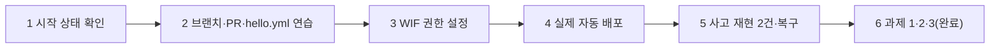

# [제출 보고서] N048 「GitHub Actions로 자동 배포하기」 실습 과제 수행 결과

**수신**: N048 강의 강사님 · **발신**: 수강생 전대진(DJ)
**실습일**: 2026-10-22
**과제 대상**: N046·N047에서 운영해 온 AI 친구 에이전트 서비스(`friend-agent`)에, 키 파일 없이 GitHub Actions가 자동으로 배포하는 파이프라인을 처음부터 끝까지 구축하고, 사고 패치 2건을 실제로 머지해 "자동 배포가 막아주는 문제"와 "그대로 통과시키는 문제"를 직접 재현하는 실습
**평가 방법**: 맨 아래 "평가 체크리스트"를 보고 항목별로 점수와 한 줄 의견을 남겨 주세요.

> 이 문서는 제가 직접 해 본 실습의 **수행 기록과 증거**입니다. 서비스 주소는 요청마다 제 LLM 키로 비용이 나가는 공개 서비스라서 일부러 싣지 않았습니다(N046·N047 보고서와 같은 이유). 대신 리비전 이름·커밋 해시·PR 번호·로그 내용을 그대로 적었습니다.

---

## 1. 한 장 요약

| 단계 | 한 일 | 확인한 핵심 |
|---|---|---|
| 1 | 시작 상태 확인 | gcloud 로그인·프로젝트·리전, 저장소, 서비스, 시크릿 모두 정상. `gh` 토큰에 `workflow` 스코프 있음을 먼저 확인 |
| 2 | 브랜치·PR·연습(hello.yml) | README PR(#1) 완료. 연습용 `hello.yml`(#2)로 PR 트리거 성공 → `exit 1`로 일부러 실패 → 뒤 단계 건너뜀 확인 → `git revert` → 재성공 → `workflow_dispatch` 수동 실행까지 전부 확인 |
| 3 | WIF 권한 설정 | 서비스 계정 2개(`friend-agent-runtime`·`github-deployer`)·풀·공급자·권한 연결·저장소 변수 4개를 전부 키 파일 없이 구성. 키 0개·Owner/Editor 없음을 직접 조회로 확인 |
| 4 | 실제 자동 배포 | 첫 시도는 "배포 계정이 빌드용 기본 서비스 계정을 대신 행동할 권한이 없다"는 오류로 실패 — 문서(`docs/wif-setup.md`)에 없던 함정을 발견하고 권한을 추가해 해결(#3). 새 리비전이 트래픽 100%·전용 런타임 계정으로 뜸 |
| 5 | 사고 재현 2건 | 환경변수 이름 오류(#4) — 배포 실패, 이전 리비전이 계속 서빙 → revert(#5)로 복구. 시간대 오류(#6) — 배포는 성공했지만 실제 호출 결과 저장 시각이 9시간 어긋남을 확인 → revert(#7) 후 재확인까지 완료 |
| 6 | 과제 1·2·3 | 과제 1(#8) 화면에 배포 커밋 배지 추가. 과제 2 다른 저장소에서 같은 설정으로 시도 → 인증 단계에서 정확히 거절됨 확인. 과제 3 감사 로그로 사람 배포와 자동 배포 기록을 대조 |



**진행 방식**: AI 코딩 도우미(Claude)가 N047처럼 강의 순서 그대로 단계별 명령과 확인 방법을 안내했고, 실제 `gcloud`·`git`·`gh` 명령 실행과 GitHub 저장소 조작(PR 생성·머지)까지 도우미가 직접 수행했습니다. 각 단계의 결과 화면과 로그는 제가 함께 확인했습니다.

---

## 2. 실습 환경 (시작 상태)

| 항목 | 값 |
|---|---|
| 클라우드 | Google Cloud Run, 리전 `us-central1`, 프로젝트 `<프로젝트 ID>` |
| 서비스 | `friend-agent` (N046·N047에서 쓰던 그 서비스) |
| 저장소 | `github.com/JEON-DAEJIN/friend-agent` (공개) |
| 시작 시점 상태 | `.github/workflows/` 폴더 없음(초기 커밋뿐) — 자동 배포가 전혀 설정 안 된 상태에서 출발 |
| 이 저장소의 실제 WIF 문서 | `docs/wif-setup.md`가 강의 PDF보다 단순한 2계정(런타임·배포) 버전이라, PDF 대신 저장소 문서를 기준으로 진행 |
| `gh` 토큰 스코프 | `gist, read:org, repo, workflow` — 워크플로 파일을 푸시할 수 있는 `workflow` 스코프 보유 확인 |

---

## 3. 단계별 수행 내용

### 3-1. 시작 상태 확인

```
gcloud config list
git remote -v
gcloud run services describe friend-agent --region us-central1 --format "value(status.url)"
gcloud secrets describe llm-api-key --format "value(name)"
gh auth status
```

프로젝트·리전·저장소·서비스 URL·시크릿 이름·`gh` 권한이 모두 정상 확인돼, 2단계(시작 상태 맞추기)는 이미 갖춰져 있었습니다.

### 3-2. 브랜치·PR·연습(hello.yml)

README 한 줄 추가 PR(#1)을 올려 브랜치 → 커밋 → 푸시 → PR → 머지 흐름을 먼저 연습했습니다. 이어서 연습용 `hello.yml`(#2, 트리거 `pull_request`+`workflow_dispatch`)을 PR로 올리자 실행 로그에서 **러너가 코드를 받기 전엔 파일이 `.`/`..`뿐**이고, `actions/checkout` 이후에야 파일이 생기며, `.env`는 `.gitignore`에 있어 러너에 없다는 것(".env 없음")을 직접 확인했습니다.

이어서 "러너 정보 보기" 단계 끝에 `exit 1`을 추가해 일부러 실패시켰더니, **뒤 두 단계(저장소 코드 내려받기·내려받은 파일 보기)가 전부 `skipped`로 건너뛰어지는 것**을 실행 로그 JSON으로 확인했습니다. `git revert --no-edit HEAD`로 되돌리자 다시 성공했고, 머지 후 `gh workflow run hello.yml`로 수동 실행(`workflow_dispatch`)까지 성공을 확인했습니다.

### 3-3. WIF 권한 설정과 실행 전 점검

`docs/wif-setup.md`를 기준으로 아래를 전부 키 파일 없이 만들었습니다.

1. 실행용 계정 `friend-agent-runtime` + `llm-api-key` 읽기 권한
2. 배포용 계정 `github-deployer` + 프로젝트 역할 2개(`run.sourceDeveloper`, `serviceusage.serviceUsageConsumer`) + 런타임 계정 하나에 한정한 `iam.serviceAccountUser`
3. 풀 `github` + 공급자 `friend-agent-repo`(속성 조건을 `JEON-DAEJIN/friend-agent` 저장소 하나로 좁힘)
4. 내 저장소 워크플로가 배포 계정으로 행동할 수 있게 하는 권한 연결
5. 저장소 변수 4개(`GCP_PROJECT_ID`, `WIF_PROVIDER`, `DEPLOY_SA`, `RUNTIME_SA`)

실행 후 점검한 것: 두 서비스 계정 모두 **키 0개**, `github-deployer`의 프로젝트 역할이 **딱 2개뿐**(Owner/Editor 없음) — 명령으로 직접 조회해 확인했습니다.

### 3-4. 워크플로 파일 넣기 — 실제 자동 배포 (#3)

`starter/workflows/deploy.yml`을 그대로 `.github/workflows/deploy.yml`로 복사해 PR(#3)을 올리고 머지했습니다. **첫 배포 시도는 실패**했습니다.

```
failed to deploy: ... PERMISSION_DENIED: ... caller does not have permission to
act as service account projects/.../serviceAccounts/105458256592853571522.
This command is authenticated as github-deployer@...
```

조사해보니 이 번호(`105458256592853571522`)는 빌드에 쓰이는 **기본 Compute Engine 서비스 계정**이었습니다. `docs/wif-setup.md` 6단계는 "이 계정에 `run.builder` 역할을 준다"까지만 안내했는데, 실제로는 **배포 계정(`github-deployer`) 자신이 그 계정을 "대신 행동"할 권한**이 따로 필요했습니다 — 문서에 없던 함정이었습니다. 아래 권한을 추가로 주자 재시도에서 성공했습니다.

```
gcloud iam service-accounts add-iam-policy-binding \
  $PROJECT_NUMBER-compute@developer.gserviceaccount.com --project $PROJECT_ID \
  --member "serviceAccount:github-deployer@$PROJECT_ID.iam.gserviceaccount.com" \
  --role roles/iam.serviceAccountUser
```

성공한 첫 자동 배포는 리비전 `friend-agent-00009-l9t`, 커밋 `66184bf8...`로 트래픽 100%를 받았고, 서비스 계정도 처음으로 전용 `friend-agent-runtime`으로 바뀐 것을 확인했습니다. 이후 기본 서비스 계정에 남아 있던 `llm-api-key` 읽기 권한도 회수했습니다.

### 3-5. 사고 1 — 환경변수 이름 오류 (#4 → #5 복구)

`starter/incidents/rename-key.patch`(`LLM_API_KEY` → `OPENAI_API_KEY`)를 PR(#4)로 머지했습니다. 결과:

- GitHub Actions의 `deploy` 작업이 **실패**로 끝남(로그: "The user-provided container failed to start and listen on the port ... PORT=8080").
- 새 리비전(`friend-agent-00010-rcb`)은 상태 `False`, 트래픽 **0%**로 남음.
- 이전 리비전(`friend-agent-00009-l9t`)이 계속 **100%** 트래픽을 받아 서비스는 멀쩡히 응답(`/version` 정상).

→ **사용자는 아무 이상도 못 느꼈습니다.** `git revert -m 1`로 되돌림 PR(#5)을 머지하자 다음 배포가 성공(초록)했고, `/version`의 commit이 되돌린 커밋으로 바뀐 것을 확인했습니다.

### 3-6. 사고 2 — 시간대 오류 (#6 → #7 복구)

`starter/incidents/reminder-timezone.patch`(약속 저장 전 시간대 정보 제거)를 PR(#6)로 머지했습니다. 이번엔 **배포가 성공(초록)**했습니다. 실제로 서비스에 요청을 보내 확인했습니다.

```
POST /api/chat {"message":"내일 아침 8시에 물 마시라고 알려 줘"}
→ tool 응답: due_at: "2026-10-23T08:00:00+09:00" (의도한 값)
→ 실제 저장: due_at: "2026-10-23T17:00:00+09:00"
→ GET /api/reminders: due_label "10월 23일(금) 17:00"
```

캐릭터는 "내일 아침 8시"라고 답했지만 실제 저장은 **17:00**이었습니다. **배포는 성공했지만 결과는 틀렸고, 이 틀림은 자동 배포 파이프라인이 전혀 걸러주지 못했습니다.** `git revert -m 1`로 되돌림 PR(#7)을 머지하고 같은 요청을 다시 보내, `due_at`이 `08:00`으로 정상 저장되는 것까지 재확인했습니다.

### 3-7. 과제 1 — 기능 추가 (#8)

화면 좌측 하단에 `/version`의 커밋 SHA 앞 7자리를 보여주는 작은 배지(`빌드 d920a2b`)를 추가했습니다. 브랜치 생성 → 커밋 → PR(#8) → 머지 → 자동 배포(리비전 `friend-agent-00014-2q6`) → 브라우저에서 실제 화면에 배지가 뜨는 것까지 확인했습니다. 기존 환경변수·시크릿·배포 설정은 건드리지 않았습니다.

### 3-8. 과제 2 — 다른 저장소에서 배포 시도

연습용 비공개 저장소(`n048-other-repo-practice`)를 하나 만들어 **같은** `deploy.yml`과 **같은** 저장소 변수 4개를 그대로 넣고 `main`에 push했습니다. 결과:

```
google-github-actions/auth failed with: failed to generate Google Cloud
federated token ...: {"error":"unauthorized_client","error_description":
"The given credential is rejected by the attribute condition."}
```

`auth` 단계에서 바로 거절됐고, 배포 단계는 아예 실행되지 않았습니다(`skipped`). Cloud Run의 리비전·트래픽도 전혀 변동이 없었습니다(`friend-agent-00013-4zj`, 100% 그대로). 확인 후 연습용 저장소는 삭제했습니다.

### 3-9. 과제 3 — 감사 로그로 배포자 추적

`gcloud logging read`로 `protoPayload.serviceName="run.googleapis.com"` 감사 로그를 조회해 두 기록을 대조했습니다.

| 구분 | `principalEmail` | `serviceAccountDelegationInfo` |
|---|---|---|
| 2026-10-20 · 사람이 수동 배포(N046) | `<내 이메일>` | 없음 |
| 2026-10-22 · GitHub Actions 자동 배포(오늘) | `github-deployer@<프로젝트 ID>.iam.gserviceaccount.com` | `repo:JEON-DAEJIN/friend-agent`, `ref:refs/heads/main` |

사람이 배포하면 제 계정만 남고, 자동 배포는 배포 서비스 계정과 **어느 저장소·브랜치에서 왔는지**까지 로그에 그대로 남는다는 것을 직접 확인했습니다.

---

## 4. 이 실습에서 얻은 핵심 다섯 가지

1. **WIF는 검사가 두 번이다.** 공급자 조건(어느 저장소에서 왔는가)과 권한 연결(어느 서비스 계정을 쓸 수 있는가)이 각각 따로 걸린다. 공급자 조건을 저장소 하나로 좁히지 않으면 그 계정의 모든 저장소가 배포 권한을 가장할 수 있다(과제 2로 실측).
2. **"역할을 주는 것"과 "그 역할을 쓸 권한을 주는 것"은 다르다.** 빌드 계정에 `run.builder`를 줘도, 배포 계정 자신이 그 계정을 대신 행동할 `serviceAccountUser`가 없으면 배포가 실패한다 — 문서에도 없던, 실행해서야 드러난 함정이었다.
3. **자동 배포는 "시작되는지"는 걸러주지만 "결과가 맞는지"는 걸러주지 못한다.** 환경변수 이름 오류는 스타트업 단계에서 걸려 사용자에게 전혀 노출되지 않았지만, 시간대 오류는 정상 시작했다는 이유로 그대로 통과해 실제 저장 시각이 9시간 어긋난 채 나갔다.
4. **"머지만 하면 나간다"는 것은 되돌리는 것도 머지 한 번으로 된다는 뜻이다.** `git revert`로 만든 되돌림 PR을 머지하는 것만으로 두 사고 모두 몇 분 안에 복구됐다.
5. **감사 로그는 "누가"뿐 아니라 "어디서"까지 남긴다.** 사람 배포는 계정만 남지만, WIF 기반 자동 배포는 저장소·브랜치 단위의 신원 정보(delegation info)까지 로그에 남아 추적성이 오히려 더 높다.

---

## 5. 발견한 한계와 풀지 못한 것

- **과제 4(다른 CD 방법 조사)는 아직 하지 못했습니다.** Cloud Build 연결, Cloud Deploy, GitLab CI/CD, Argo CD 비교표는 다음 과제로 남겨 두었습니다.
- **방법론 문서(매뉴얼)를 만들지 여부는 아직 판단하지 못했습니다.** WIF·최소 권한 원칙은 다음에 다른 서비스를 클라우드에 연결할 때도 재사용할 만한 원리로 보이지만, 아직 별도 문서로 뽑아내지는 않았습니다.
- **연습용 저장소를 지우는 과정에서 작은 삽질이 있었습니다.** `gh` 토큰에 `delete_repo` 스코프가 없어 `gh auth refresh`로 추가하려 했는데, 백그라운드로 두 번 시도한 디바이스 코드 인증이 둘 다 완료되지 않았습니다(코드 만료·타임아웃). 결국 GitHub 웹 화면에서 직접 삭제하고 API 호출(404)로 삭제를 재확인했습니다.
- **빌드 계정에 추가로 준 `serviceAccountUser` 권한이 이 프로젝트의 2024년 이후 기본 설정 변화 때문인지, 아니면 이 저장소 문서(`docs/wif-setup.md`)가 원래 빠뜨린 것인지는 확정하지 못했습니다.** 둘 중 어느 쪽이든, 소스 배포를 쓰는 사람은 겪을 가능성이 있는 문제로 보입니다.

---

## 6. 직접 따라 해 보려면

본인 프로젝트와 저장소에서만 하세요. 키 값·시크릿·서비스 계정 키 파일은 대화나 문서에 붙여 넣지 마세요.

| 단계 | 확인 방법 |
|---|---|
| WIF 설정 확인 | IAM 콘솔에서 두 서비스 계정 모두 **Keys 탭에 키가 없는지**, `github-deployer`의 역할이 **딱 지정한 것만** 있는지 확인 |
| 첫 배포 실패 시 | 로그에 `does not have permission to act as service account`가 보이면, 그 계정 번호를 찾아 배포 계정에 `iam.serviceAccountUser`를 **그 계정 하나에만** 추가 |
| 사고 재현 | 실제 서비스가 아니라 연습/테스트 환경에서, 작은 패치 하나를 PR로 올려 배포 실패와 "성공했지만 틀린 응답"을 각각 만들어 비교 |
| 감사 로그 | `protoPayload.authenticationInfo.principalEmail`과 `serviceAccountDelegationInfo`로 배포자를 구분 |
| 다른 저장소 거절 확인 | 연습용 저장소를 만들 때는 반드시 비공개로, 확인 후 이름을 재확인하고 삭제 |

---

## 7. 평가 체크리스트 (1~5점, 한 줄 의견)

| 번호 | 확인할 것 | 근거가 있는 곳 | 점수 | 의견 |
|---|---|---|---|---|
| 1 | 키 파일 없이 WIF로 배포 권한을 설정했는가 | 3-3 | | |
| 2 | 공급자 조건을 저장소 하나로 좁혔는가 | 3-3, 3-8 | | |
| 3 | 문서에 없던 권한 함정을 스스로 찾아 해결했는가 | 3-4 | | |
| 4 | 배포 실패 사고와 "성공했지만 틀린" 사고를 구분해 재현했는가 | 3-5, 3-6 | | |
| 5 | 되돌리기(revert)로 안전하게 복구하고 재확인했는가 | 3-5, 3-6 | | |
| 6 | 다른 저장소에서 배포가 거절되는 것을 직접 확인했는가 | 3-8 | | |
| 7 | 감사 로그로 사람 배포와 자동 배포를 구분했는가 | 3-9 | | |
| 8 | 풀지 못한 것을 숨기지 않고 적었는가 | 5장 | | |

**전체 의견**:

---

## 8. 첨부할 증거 화면 (Notion에 직접 붙여 넣기)

- `hello.yml` 실행 로그 — 코드 받기 전 파일 목록, `.env 없음`
- `hello.yml`에 `exit 1` 추가 후 뒤 단계가 `skipped`로 표시된 로그
- 서비스 계정 2개의 Keys 탭(키 없음), `github-deployer`의 IAM 역할 화면
- 첫 배포 실패 로그(`does not have permission to act as service account`) → 권한 추가 → 재시도 성공 로그
- 사고 1: `deploy` 작업 실패 화면 + Cloud Run 리비전 탭(새 리비전 0%, 이전 리비전 100%)
- 사고 2: `/api/chat` 응답의 `due_at`(08:00 의도) vs `/api/reminders` 화면(17:00 표시) 스크린샷
- 과제 1: 화면 좌측 하단 "빌드 d920a2b" 배지 스크린샷
- 과제 2: 연습용 저장소의 `auth` 실패 로그("rejected by the attribute condition")
- 과제 3: 로그 탐색기의 두 `principalEmail` 비교 화면

*이 문서에는 API 키 값과 서비스 주소가 없습니다.*
