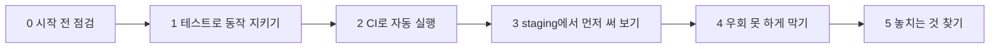

# AI 서비스에 품질 게이트를 붙이는 법 — N049 방법론을 실제로 적용하기

> 버전 1.0 · 2026-10-23

> 이 문서는 N049(CI 테스트와 staging 환경 만들기) 강의가 가르친 순서를, 실습용 서비스 `friend-agent`에 처음부터 끝까지 적용해 본 기록이다. N045·N046·N047 방법론 문서와 같은 형식으로, "이 단계에서 무엇을 왜 하는지"는 일반 원리로, "실제로 어떻게 됐는지"는 friend-agent 예시로 함께 보여 준다. 마지막 부록에는 **아직 이 방법을 적용하지 않은** 다른 프로젝트에 나중에 적용할 계획을 "계획"이라고 분명히 밝히고 따로 적었다.

## 목차

- [1. 한 장 요약](#1-한-장-요약)
- [2. 0단계 — 시작 전에 점검하기](#2-0단계--시작-전에-점검하기)
- [3. 1단계 — 정해진 동작을 테스트로 지키기](#3-1단계--정해진-동작을-테스트로-지키기)
- [4. 2단계 — 서버와 같은 환경에서 자동으로 돌리기(CI)](#4-2단계--서버와-같은-환경에서-자동으로-돌리기ci)
- [5. 3단계 — 사용자에게 나가기 전에 먼저 써 보기(staging)](#5-3단계--사용자에게-나가기-전에-먼저-써-보기staging)
- [6. 4단계 — 검사를 우회하지 못하게 막기](#6-4단계--검사를-우회하지-못하게-막기)
- [7. 5단계 — 게이트가 놓치는 것 찾기](#7-5단계--게이트가-놓치는-것-찾기)
- [부록 A · 실제 명령 런북](#부록-a--실제-명령-런북)
- [부록 B · 다른 프로젝트에 적용하면(계획)](#부록-b--다른-프로젝트에-적용하면계획)
- [부록 C · 용어 사전](#부록-c--용어-사전)

---

## 1. 한 장 요약

### 전체 흐름



```arrow
시작 전 점검 → 테스트로 동작 지키기 → CI로 자동 실행 → staging에서 먼저 써 보기 → 우회 못 하게 막기 → 게이트가 놓치는 것 찾기
```

### 단계별 요약표

| 단계 | 한 일 | 일반 원리 | friend-agent에서 실제로 |
|---|---|---|---|
| 0 | 시작 전 점검 | 계정·플랜·키 출처를 먼저 확인하고, 교안 명령은 그대로 재현 | 비공개 저장소, 수업에서 받은 키, `BUILD_SA` 차이를 점검에서 발견 |
| 1 | 테스트로 동작 지키기 | 사용자가 기대하는 결과를 확인하고, 일부러 깨뜨려 본다 | E07(08:00), E08(부탁 없으면 저장 안 함) 테스트 |
| 2 | CI로 자동 실행 | 서버와 같은 환경에서 PR마다 자동으로 돌린다 | 시간대 버그가 로컬 통과, CI 실패(17:00) |
| 3 | staging | 같은 코드·다른 설정으로 먼저 써 본다 | `friend-agent-staging`, `ENV=staging`, 환경별 시크릿 |
| 4 | 우회 막기 | PR 필수와 필수 체크를 함께 걸고, 승인은 사람이 직접 | `GH006` 거절, `BLOCKED`, 직접 누르는 production 승인 |
| 5 | 놓치는 것 찾기 | CI가 모르는 화면·말투는 사람이 본다 | 버튼 숨김 변경: CI 통과, staging에서 발견, Revert |

> 📌 **요약** — 자동 배포는 맞는지 확인하지 않는다. 기계가 반복해서 보는 CI(기능), 사람이 직접 써 보는 staging(품질·화면), 두 검사를 우회하지 못하게 하는 브랜치 보호와 직접 누르는 배포 승인이 **세 겹의 품질 게이트**다.

---

## 2. 0단계 — 시작 전에 점검하기

### 일반 원리

게이트를 만들기 전에 "내가 쓸 수 있는 기능이 무엇인지"부터 확인한다. 계획이 맞아도 계정·플랜·키의 제약 때문에 중간에 막히는 일이 많다. 점검은 읽기만 하는 확인이라 비용이 거의 없다.

- **기능은 플랜에 달려 있다.** 환경 승인자와 브랜치 보호는 비공개 저장소에서는 유료 기능이다.
- **키는 누구 것인지가 중요하다.** 남이 준 키로는 내 계정에서 한도를 걸 수 없다.
- **교안 명령은 그대로 재현한다.** 같은 일을 다른 명령으로 해서 통과했다고 믿지 않는다.

### friend-agent에서 실제로

- 저장소가 **비공개**여서 production 승인자 설정이 `HTTP 422 ... billing plan supports the required reviewers`로 거절됐다. 공개로 전환하기 전에 저장소 전체와 커밋 기록 25개를 검사해 키 패턴이 0건이고 `.env`가 한 번도 커밋되지 않았음을 확인했다.
- 수업에서 받은 키라서 staging 전용 키와 낮은 한도를 만들 수 없었다. OpenAI 대시보드에서 내 조직의 크레딧이 `$0.00`이고 두 프로젝트의 월 사용액이 `$0`임을 보고 알았다.
- 교재가 말한 저장소 변수 5개 중 `BUILD_SA`가 없었지만 템플릿이 쓰지 않는 변수라 그대로 진행했다.
- 내가 `python -m pytest`로 돌려서 CI의 `No module named 'app'` 문제가 로컬에서 가려졌다.

### 체크리스트

- [ ] 저장소가 공개인가, 비공개라면 승인자·브랜치 보호가 되는 플랜인가
- [ ] 쓰려는 LLM 키는 내 계정에서 발급한 것인가, 남이 준 것인가
- [ ] 공개로 바꿀 거라면 키 패턴·`.env` 커밋 이력을 먼저 검사했는가
- [ ] 교안 명령(`pytest -q` 등)을 다른 방식으로 바꾸지 않고 그대로 실행해 보았는가
- [ ] 교재와 템플릿이 다른 곳(변수 개수 등)을 기록해 두었는가

---

## 3. 1단계 — 정해진 동작을 테스트로 지키기

### 일반 원리

테스트는 "이 입력에는 이 결과가 나와야 한다"를 코드로 적어 두고 기계가 매번 같은 방식으로 확인하게 하는 것이다. 좋은 테스트의 조건은 세 가지다.

- **사용자 기준으로 확인한다.** 시간대 정보가 붙어 있는지(형식)가 아니라 사용자가 08:00을 보는지(동작)를 본다.
- **실제 AI를 부르지 않는다.** 비용이 들고 느리고 답이 달라서 판정할 수 없으니, 정해진 규칙으로만 답하는 페이크 LLM으로 돌린다. 그래서 테스트는 코드가 정한 동작만 보고, 답의 품질은 사람이 본다.
- **일부러 깨뜨려 본다.** 지키려는 동작을 깨뜨렸을 때 실제로 실패하는지까지 봐야 그 테스트를 믿을 수 있다.

### friend-agent에서 실제로

- 템플릿 테스트 10개(`pytest -q` → `10 passed`)에 E07 테스트를 더해 `11 passed`. 시간대를 빼는 패치를 넣어도 한국 시간 로컬에서는 `11 passed`였다(버그가 숨음).
- 기존 테스트 `test_reminder_is_saved_with_timezone`은 시간대 정보 유무만 봐서 패치 후에도 통과했다. 새 테스트는 사용자가 보는 `08:00`을 확인해 같은 버그를 잡았다.
- E08 테스트(기본 과제): "이번 주 금요일에 자격증 시험 있어"는 부탁하는 말이 없으니 약속을 저장하지 않는다. `ASK_PATTERN`에 `있어`를 임시로 끼워 넣자 `assert 'create_reminder' not in ['create_reminder']`로 실패했고, 되돌리자 통과했다.

### 체크리스트

- [ ] 각 테스트 이름이 확인하는 동작을 말하고, `assert`가 사용자가 보는 결과를 보는가
- [ ] 테스트 위 주석에 예시 번호(E07 등)와 기대 동작이 적혀 있는가
- [ ] 판정 방법이 `코드`인 예시만 테스트로 옮겼는가(말투 같은 `AI 판단`은 제외)
- [ ] 새 테스트를 일부러 깨뜨려 실패하는지, 되돌리면 통과하는지 확인했는가
- [ ] 공유 상태(메모리 저장소)를 쓰면 절대값이 아니라 전후 변화로 비교했는가

---

## 4. 2단계 — 서버와 같은 환경에서 자동으로 돌리기(CI)

### 일반 원리

**CI**는 PR이 열리거나 새 커밋이 올라올 때마다 정해진 환경에서 테스트를 자동으로 돌린다. 핵심은 환경이다.

- **환경에 따라 갈리는 버그**(시간대, 경로, 의존성 버전)는 개발자 컴퓨터에서 안 보이고 서버와 같은 환경에서 보인다. 러너를 서버와 같게(Ubuntu·UTC) 둔다.
- **CI는 알려 주는 것이고 막는 것은 아니다.** 실패해도 머지 버튼이 눌리는 상태(`UNSTABLE`)다. 막으려면 4단계의 보호 규칙이 필요하다.

### friend-agent에서 실제로

- `starter/workflows/ci.yml`을 그대로 `.github/workflows/`에 넣은 첫 CI는 **실패**했다(`ModuleNotFoundError: No module named 'app'`). `pytest` 명령은 저장소 루트를 import 경로에 넣지 않기 때문이고, 로컬에서도 `pytest`만 치면 재현됐다. `ci.yml`은 두고 `pytest.ini`(`pythonpath = .`, `testpaths = tests`)를 추가해 해결했다.
- 시간대 변경 PR은 로컬에서 통과했는데 CI에서 `08:00` 기대, `17:00` 저장으로 실패했다. 17:00 − 08:00 = 9시간, 한국과 UTC의 차이다.
- 같은 PR의 머지 상태는 보호 전 `UNSTABLE`(머지 가능)이었다.

### 체크리스트

- [ ] CI 러너의 환경(OS·언어 버전·시간대)이 서버와 같은가
- [ ] 첫 실행 결과를 확인했는가(첫 CI가 환경 설정 문제로 실패할 수 있다)
- [ ] 로컬에서 통과한 변경을 일부러 올려 CI가 잡는지 확인했는가
- [ ] 확인용 PR은 머지하지 않고 닫았는가
- [ ] 실패 로그를 "테스트 이름 → `>` 줄(기대) → `E` 줄(실제)" 순서로 읽었는가

---

## 5. 3단계 — 사용자에게 나가기 전에 먼저 써 보기(staging)

### 일반 원리

CI는 예시로 적어 둔 동작만 확인한다. 적지 못한 문제는 사람이 써 봐야 보인다. 그런데 써 볼 서버가 실제 서버 하나뿐이면 확인하는 순간 이미 사용자에게 나간 뒤다. 그래서 같은 코드를 먼저 올리는 서버를 하나 더 둔다.

- **코드는 하나, 설정만 다르다.** 서버 이름·LLM 키·인스턴스 수·화면 표시를 환경변수와 시크릿으로 환경마다 따로 둔다.
- **환경 이름이 눈에 보이게 한다.** staging 화면에 "테스트 환경" 배너를 두면 어느 서버를 보는지 헷갈리지 않는다.
- **시크릿은 환경마다 이름을 따로, 권한은 최소로.** 서비스 계정에는 필요한 시크릿 하나씩만 읽게 한다(프로젝트 전체 권한 금지).

### friend-agent에서 실제로

- `friend-agent-staging`(최대 인스턴스 1, `ENV=staging`)을 처음 한 번 직접 만들고, 이후 자동 배포는 코드만 바꿔 넣었다.
- staging 시크릿 `llm-api-key-staging`은 수업 키를 값 출력 없이 복사해 만들었다(해시로 같은 값인지 확인). 시크릿 이름과 읽기 권한은 분리했지만 키와 한도는 production과 공유했다.
- `deploy-envs.yml`은 브랜치가 `main`이면 production, 아니면 staging 환경으로 실행하고 서비스 이름·`ENV`는 환경 변수에서 읽는다. production 환경에는 승인자를 걸었다.
- 결과: staging 머지 시 staging만 새 커밋(`d69c08b`)이 되고 production은 `187a4bf` 그대로. main 머지 후 승인하자 production이 같은 코드(트리 해시 동일)로 교체되고 `env`가 `local`에서 `production`으로 바뀌었다.

### 체크리스트

- [ ] 명령 실행 전에 서비스 이름이 `-staging`인지, 시크릿이 `-staging` 쪽인지 확인했는가
- [ ] 시크릿 읽기 권한을 `secrets add-iam-policy-binding`으로 시크릿 하나에만 주었는가
- [ ] staging 화면에 환경 표시(배너)가 있고 production에는 없는가
- [ ] 배포 후 `/version`의 커밋으로 staging만 바뀌고 production은 그대로인지 확인했는가
- [ ] 키·한도를 분리하지 못했다면 그 한계를 기록했는가

---

## 6. 4단계 — 검사를 우회하지 못하게 막기

### 일반 원리

게이트는 우회되면 의미가 없다. 우회 경로는 두 가지다.

- 실패한 상태 체크를 무시하고 머지하는 길
- PR을 거치지 않고 `git push`로 바로 올리는 길

**브랜치 보호**는 둘 다 막는다. "PR 필수"와 "필수 상태 체크"는 서로 다른 규칙이라 **함께** 걸어야 한다. 저장소 관리자에게도 적용(`enforce_admins`)해야 내가 나를 우회하지 못한다. 마지막 승인은 사람이 직접 누른다. 승인을 자동화나 에이전트에게 맡기면 게이트가 사라진다.

### friend-agent에서 실제로

- `main`과 `staging`에 PR 필수(승인 수 0), 필수 체크 `test`, `enforce_admins: true`를 걸었다.
- 직접 push 시도는 `GH006: Protected branch update failed`("Changes must be made through a pull request", 'Required status check "test" is expected')로 거절됐다.
- 같은 실패 PR의 머지 상태가 보호 전 `UNSTABLE`에서 보호 후 `BLOCKED`로 바뀌었다.
- production 배포는 `Review deployments`에서 내가 직접 승인했다. 처음 누른 승인은 반영되지 않아(실행이 10분 넘게 `waiting`) 다시 눌러야 했다.

### 체크리스트

- [ ] PR 필수와 필수 상태 체크를 둘 다 걸었는가
- [ ] 상태 체크 목록에 `test`가 나오려면 CI가 한 번은 돌아야 한다는 것을 알고 있는가
- [ ] 관리자에게도 규칙이 적용되는가
- [ ] 직접 push가 실제로 거절되는지 확인했는가
- [ ] 승인 전에 staging의 커밋과 승인 대기 중인 실행의 코드가 같은지 보았는가
- [ ] 승인 버튼이 반영됐는지(`pending_deployments` 비어 있음) 확인했는가

---

## 7. 5단계 — 게이트가 놓치는 것 찾기

### 일반 원리

테스트가 통과했다는 것은 "작성된 테스트가 확인하는 범위에서 문제가 없다"는 뜻이다. 화면 모양, 말투, 실제 LLM의 답은 테스트가 보지 않으면 CI를 통과한다. 그래서 일부러 망가뜨린 변경을 두 종류로 나눠 올려 본다.

- **CI가 막는 변경**: 환경과 무관하면 로컬에서도 잡히고, 환경에 따라 갈리면 CI에서만 잡힌다.
- **CI를 통과하는 변경**: staging에서 사람이 써 봐야 보인다. 발견하면 production으로 보내지 않고 **Revert PR**로 되돌린다.

### friend-agent에서 실제로

| 변경 | CI | 머지 | 잡은 곳 |
|---|---|---|---|
| A. 위기 표현을 "정확히 같음"으로 판정 | 실패(109 안내 없음) | `BLOCKED` | CI(로컬에서도 잡힘) |
| B. 날씨 키워드 `날씨 알려`로 좁힘 | 실패(도구 선택 `[]`) | `BLOCKED` | CI(로컬에서도 잡힘) |
| C. 약속 시각에서 시간대 제거 | 실패(17:00) | `BLOCKED` | CI(UTC 환경에서만) |
| D. 보내기 버튼 `display:none` | **통과** | 가능 | staging에서 사람이 발견 → Revert |

D를 되돌릴 때 머지 커밋이라 `git revert -m 1`이 필요했다. Revert PR을 머지하자 staging의 `display`가 `none`에서 `block`으로 돌아왔고 production은 한 번도 바뀌지 않았다.

### 체크리스트

- [ ] 일부러 망가뜨린 변경을 "CI가 막을 것"과 "CI를 통과할 것"으로 나눠 올려 보았는가
- [ ] 로그에서 실패한 테스트·기대값·실제값·바뀐 줄을 이어 원인을 한 문장으로 적었는가
- [ ] 통과한 문제 변경을 staging에서 사람이 확인하고 `main`으로 보내지 않았는가
- [ ] 되돌릴 때 머지 커밋은 `-m 1`을 썼는가
- [ ] 오늘 만들지 않은 게이트(화면 자동 테스트, 시간대 경계 테스트, 배포 후 모니터링)를 정리해 두었는가

---

## 부록 A · 실제 명령 런북

```bash
# 0. 시작 상태 확인(읽기 전용)
gcloud run services describe friend-agent --region us-central1 --format "value(status.url)"
gh variable list
ls .github/workflows/
gh run list --workflow deploy.yml --limit 1

# 1. 테스트 (교안 그대로 pytest -q)
pip install -r requirements-dev.txt
pytest -q

# 2. CI (starter/workflows/ci.yml 을 .github/workflows/ 로 복사해 PR)
# 로컬에서 pytest 만 쳐서 app 모듈 오류가 나면 루트에 pytest.ini (pythonpath = .)

# 3. staging 시크릿 (값 출력 없이 파이프 복사, 해시로 확인)
gcloud secrets versions access latest --secret llm-api-key | gcloud secrets create llm-api-key-staging --replication-policy=automatic --data-file=-
gcloud secrets add-iam-policy-binding llm-api-key-staging \
  --member "serviceAccount:friend-agent-runtime@<PROJECT_ID>.iam.gserviceaccount.com" \
  --role roles/secretmanager.secretAccessor

# 4. staging 서비스(처음 한 번)
gcloud run deploy friend-agent-staging --source . --region us-central1 \
  --allow-unauthenticated \
  --service-account friend-agent-runtime@<PROJECT_ID>.iam.gserviceaccount.com \
  --update-secrets LLM_API_KEY=llm-api-key-staging:latest \
  --set-env-vars ENV=staging --min-instances 0 --max-instances 1

# 5. GitHub 환경과 변수 (production 승인자는 공개 저장소 또는 유료 플랜에서만)
gh api -X PUT "repos/{owner}/{repo}/environments/staging"
gh variable set SERVICE --env staging --body friend-agent-staging
gh variable set ENV --env staging --body staging
gh variable set SERVICE --env production --body friend-agent
gh variable set ENV --env production --body production

# 6. 브랜치 보호 (main, staging 각각)
gh api -X PUT "repos/{owner}/{repo}/branches/main/protection" --input - <<'EOF'
{"required_status_checks":{"strict":false,"checks":[{"context":"test"}]},"enforce_admins":true,
 "required_pull_request_reviews":{"required_approving_review_count":0},"restrictions":null}
EOF

# 7. 상태 확인
gh pr view <번호> --json mergeable,mergeStateStatus
gh api repos/{owner}/{repo}/actions/runs/<실행 번호>/pending_deployments
git revert -m 1 --no-edit <머지 커밋>
```

---

## 부록 B · 다른 프로젝트에 적용하면(계획)

> ⚠️ **주의** — 아래는 **아직 하지 않은 계획**이다. 이 방법을 실제로 적용한 곳은 friend-agent 하나뿐이다. 다른 프로젝트의 코드 구조는 확인하지 않았으므로 구체적인 테스트 항목은 각 프로젝트를 열어 본 뒤 정한다.

공통 순서는 이렇다.

1. 지키고 싶은 동작을 "이런 입력에는 이렇게 나와야 한다" 예시로 먼저 적는다(`docs/examples.md` 방식).
2. 그중 판정 방법이 `코드`인 것만 페이크 LLM 테스트로 옮긴다.
3. CI를 붙이고, 환경에 따라 갈릴 수 있는 것(시간대 등)이 있는지 본다.
4. staging을 하나 두고, 사람이 볼 것(말투·화면·실제 LLM 답)을 체크 목록으로 만든다.
5. 승인과 브랜치 보호를 건다(플랜 조건 확인).

강의 해설서가 든 예를 참고하면 이런 식이다.

- **My-Story-Maker**: 입력한 글이 원문의 의미를 보존하는지 중 코드로 판정되는 부분(형식·필수 항목)을 테스트로, 자연스러움은 staging에서 사람이 확인.
- **Travel Creator**: 일정을 바꾼 뒤 시간과 순서가 올바른지를 테스트로, 실제 사용 편의성은 사람이 확인.
- **1인 컨설팅 에이전트**(가정): 입력 검증·데이터 저장·보고서 구조는 CI, 실제 고객 사례와 비슷한 자료로 보고서 품질은 staging, 고객에게 줘도 되는지는 production 승인.

---

## 부록 C · 용어 사전

| 용어 | 정의 |
|---|---|
| CI | 코드를 합칠 때마다 정해 둔 테스트를 자동으로 돌리는 방식 |
| 테스트 케이스 | 입력과 기대 동작을 한 쌍으로 적은 것 |
| 페이크 LLM | 정해진 규칙으로만 답하는 테스트용 LLM |
| 회귀 | 한 곳을 고치다 예전에 잘 되던 다른 기능이 깨지는 것 |
| 상태 체크 | PR 화면에 표시되는 CI 결과. 필수로 지정하지 않으면 머지를 막지 못함 |
| 브랜치 보호 | 정해진 절차(PR·필수 체크)를 거쳐야만 브랜치를 바꿀 수 있게 하는 규칙 |
| `enforce_admins` | 보호 규칙을 저장소 관리자에게도 적용하는 설정 |
| 환경(environment) | 같은 코드를 실행하는 장소의 구분(dev·staging·production) |
| staging | 사용자에게 내보내기 전에 같은 코드를 먼저 올려 써 보는 환경 |
| 품질 게이트 | 정해 둔 기준을 통과해야 다음 단계로 넘어가게 하는 지점 |
| Required reviewers | 환경 배포를 승인할 사람을 지정하는 규칙. 승인 전까지 배포 대기 |
| 최소 권한 원칙 | 필요한 대상에 필요한 권한만 주는 원칙 |
| `mergeStateStatus` | PR의 머지 상태. `CLEAN`(문제 없음), `UNSTABLE`(체크 실패지만 머지 가능), `BLOCKED`(머지 차단) |
| Revert PR | 머지된 변경을 취소하는 새 PR(과거 기록을 지우지 않음). 머지 커밋은 `-m 1` 필요 |
