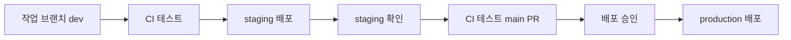
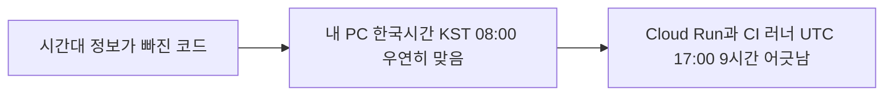
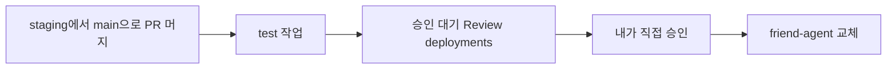
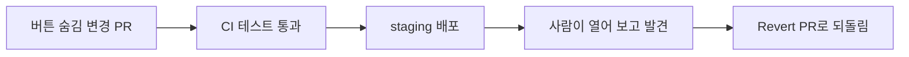

# N049 · CI 테스트와 staging 환경 만들기

> 버전 1.0 · 2026-10-23

## 목차

- [핵심 한 문장 요약](#핵심-한-문장-요약)
- [1. 자동 배포만으로는 왜 부족한가](#1-자동-배포만으로는-왜-부족한가)
- [2. 시작 상태 맞추기](#2-시작-상태-맞추기)
- [3. 테스트와 pytest — 기계가 대신 확인하게 하기](#3-테스트와-pytest--기계가-대신-확인하게-하기)
- [4. 약속 시각 테스트를 직접 추가하고, 버그를 잡는지 확인하기](#4-약속-시각-테스트를-직접-추가하고-버그를-잡는지-확인하기)
- [5. 테스트를 main에 올리고 CI 붙이기](#5-테스트를-main에-올리고-ci-붙이기)
- [6. 세 환경과 staging 만들기](#6-세-환경과-staging-만들기)
- [7. PR로만 바뀌는 브랜치 — 브랜치 보호](#7-pr로만-바뀌는-브랜치--브랜치-보호)
- [8. CI 테스트에 걸린 PR 고치기](#8-ci-테스트에-걸린-pr-고치기)
- [9. 과제 고르기](#9-과제-고르기)
- [10. 오늘 배운 것 (회고)](#10-오늘-배운-것-회고)
- [맺음말](#맺음말)
- [부록 A · 실전 코드 모음](#부록-a--실전-코드-모음)
- [부록 B · 트러블슈팅 표](#부록-b--트러블슈팅-표)
- [부록 C · AI 프롬프트 모음집](#부록-c--ai-프롬프트-모음집)
- [부록 D · 용어 사전](#부록-d--용어-사전)
- [부록 E · 개념 비교표 모음](#부록-e--개념-비교표-모음)
- [부록 F · 학습 로드맵](#부록-f--학습-로드맵)
- [부록 G · 복습 퀴즈](#부록-g--복습-퀴즈)

## 핵심 한 문장 요약

> 자동 배포는 "머지된 코드를 빠르게 내보낼 뿐" 맞는지는 확인하지 않는다 — 그래서 테스트(CI)가 코드를 자동으로 검사하고, staging이 사람이 먼저 써 보게 하고, 브랜치 보호와 배포 승인이 그 검사를 우회하지 못하게 막는, 세 겹의 품질 게이트를 직접 만들어 보는 것.

이번 강의는 N048에서 만든 자동 배포(main에 머지하면 GitHub Actions가 Cloud Run에 배포)를 이어받는다. 같은 AI 친구 에이전트 서비스(`friend-agent`, 줄여서 에이전트 서비스)에 ① 자동 테스트(CI), ② 사용자에게 나가기 전에 먼저 써 보는 별도 서버(staging), ③ 검사를 건너뛰지 못하게 하는 브랜치 보호와 배포 승인을 차례로 붙인다. 마지막에는 일부러 망가뜨린 변경 네 개를 올려, 어떤 게이트가 어떤 문제를 잡고 어떤 문제는 놓치는지 눈으로 확인한다.

> 💡 **팁** — 원문의 핵심 장면은 "내일 아침 8시에 알려 줘"라고 부탁한 약속이 오후 5시로 저장되는 변경이다. 앱은 멀쩡히 켜지고, 자동 배포는 그 변경을 그대로 사용자에게 내보낸다. 이번 강의 내내 이 한 장면이 반복해서 나온다.

---

## 1. 자동 배포만으로는 왜 부족한가

main 브랜치에 머지만 하면 몇 분 뒤 서비스가 새 버전으로 바뀌는 자동 배포는 편하지만, **머지된 변경을 그대로 사용자에게 내보낸다.** 그 코드가 맞는지는 확인하지 않는다. 그래서 실제 서비스를 운영하는 팀은 두 가지를 둔다.

- **CI(지속적 통합, Continuous Integration)**: 코드를 합칠 때마다 정해 둔 테스트를 자동으로 돌리는 장치.
- **별도의 환경(staging)**: 사용자에게 나가기 전에 먼저 써 볼 수 있는 또 하나의 서버.

> 🧪 **예제** — [해설서 비유] 자동차를 만들 때마다 브레이크·라이트·핸들을 사람이 느낌으로 확인하면 위험하다. 그래서 공장에서는 기계가 같은 검사를 반복한다. 소프트웨어 테스트도 똑같다.

### 시작 질문: 9시간 어긋난 변경은 어디서 막을 수 있었을까

원문은 학습 시작 때 이런 질문을 던진다. "약속 시각이 9시간 어긋나는 변경이 사용자에게 나간다고 생각해 보세요. 이 변경이 사용자에게 닿기 전에 어디에서 누가 또는 무엇이 막을 수 있었을까요?" 해설서의 모범 답안은 다섯 지점이다.

| 지점 | 하는 일 |
|---|---|
| 자동 테스트(CI) | 약속 시각을 저장했을 때 올바른 시간인지 자동 검사. 9시간 차이가 나면 실패 |
| 코드 리뷰 | 다른 사람이 시간대 변환 로직에 오류가 없는지 확인 |
| staging 환경 | 운영과 비슷한 별도 환경에서 약속 등록·알림 기능을 먼저 확인 |
| 배포 승인 절차 | 테스트가 실패했거나 검토가 끝나지 않았다면 운영 배포를 막음 |
| 모니터링·알림 | 배포 후 잘못된 시각이 저장되는 현상을 감지해 빠르게 대응 |

이 답은 하루가 끝날 때 다시 꺼내 본다. "오늘 실제로 만든 게이트"와 "아침에 떠올렸지만 오늘 만들지 않은 지점"을 나눠 적는 것이 회고 질문이다(10장).

### 전체 흐름 — 품질 게이트



```arrow
작업 브랜치(dev) → CI 테스트 → staging 배포 → staging 확인(사람)
   → CI 테스트(staging→main PR) → 배포 승인(사람) → production 배포
```

그림을 따라가면, 로컬 환경(dev)에서 고친 코드는 CI 테스트를 통과해야 `staging` 브랜치에 머지되고, 머지되면 staging 서버 `friend-agent-staging`에 자동으로 배포된다. staging 주소에서 직접 써 보고 문제가 없으면 `staging`에서 `main`으로 PR을 올리고, 같은 CI 테스트를 다시 통과해 머지된다. main에 들어온 변경은 바로 나가지 않고 **배포 승인**을 기다리며, 승인한 뒤에야 실제 사용자가 쓰는 `friend-agent`가 바뀐다.

> 📌 **요약** — CI 테스트나 사람이 변경을 멈춰 세울 수 있는 자리 세 곳(테스트·staging 확인·배포 승인)이 **품질 게이트(quality gate)**다. 정해 둔 기준을 통과해야 다음 단계로 넘어가게 하는 지점을 말한다.

---

## 2. 시작 상태 맞추기

이 실습은 "main에 머지하면 GitHub Actions가 에이전트 서비스를 배포하는 상태"에서 시작한다. 에이전트 서비스는 LLM API 키(OpenAI, Google 같은 LLM 제공사가 발급하는 키)를 Secret Manager의 **시크릿**에서 읽는다. 시크릿은 API 키처럼 밖에 드러나면 안 되는 값이며, Google Cloud 콘솔에서는 "보안 비밀"로 표시된다. N048 실습을 마쳤다면 확인 명령만 실행하고 넘어간다. 처음부터 만들면 1시간 안팎이 걸리므로 수업 전에 해 두기를 권한다.

| 필요한 상태 | 확인 방법 | 없으면 |
|---|---|---|
| `friend-agent` 서비스가 시크릿 `llm-api-key`를 참조해 배포됨 | 첫 번째 명령에서 서비스 주소가 나옴 | 시작 상태 문서 A, B |
| 배포·런타임·빌드 서비스 계정, Workload Identity 설정, 저장소 변수 5개 | `gh variable list`에 `GCP_PROJECT_ID`, `WIF_PROVIDER`, `DEPLOY_SA`, `RUNTIME_SA`, `BUILD_SA` | `docs/wif-setup.md` 0~4, 7단계 |
| main 머지 시 배포하는 `deploy.yml`이 있고 최근 deploy 실행이 성공 | `ls .github/workflows/`, `gh run list` | 시작 상태 문서 C |

확인 명령 전체는 [부록 A](#부록-a--실전-코드-모음)에 있다. 마지막 명령의 결과 줄이 `completed success`로 시작하면 준비가 끝난 것이다.

> 💡 **팁** — 원문은 모든 실습 단계를 두 갈래로 적는다. "직접 실행할 명령"(내가 터미널에 치는 것)과 "코딩 에이전트에게 맡길 때"(AI에게 줄 지시문)다. 이 문서의 부록 C에 지시문을 모아 두었다. 좋은 지시문에는 공통점이 있다 — **하지 말 것**과 **멈출 지점**이 함께 적혀 있다("머지는 하지 마", "시크릿 값은 출력하지 마").

---

## 3. 테스트와 pytest — 기계가 대신 확인하게 하기

### 왜 테스트가 필요한가

지금까지는 무언가 고친 뒤 화면을 열어 직접 말을 걸어 보며 확인했다. 이 방식은 네 가지 약점이 있다.

- 고칠 때마다 사람이 다시 해야 한다.
- 바쁘면 건너뛰게 된다.
- 이번에 고친 곳만 보게 된다.
- 한 곳을 고치다 예전에 잘 되던 다른 기능이 깨지는 **회귀(regression)**를 알아차리기 어렵다.

**테스트(test)**는 "이 입력에는 이 결과가 나와야 한다"를 코드로 적어 두고 기계가 매번 같은 방식으로 확인하게 하는 것이다. 한 번 적어 두면 몇 초 만에 전부 다시 돌릴 수 있다.

### pytest가 하는 일

테스트는 `tests/` 폴더의 Python 파일에 함수로 적는다. 이 과정에서 쓰는 도구 **pytest**는 `tests/`에서 이름이 `test_`로 시작하는 파일과 함수를 찾아 하나씩 실행하고, 몇 개가 통과하고 몇 개가 실패했는지 모아 보여 준다. 템플릿 `tests/test_app.py`의 테스트 하나를 보면 모양을 알 수 있다.

```python
def test_crisis_message_gets_fixed_safety_reply():
    events = chat("요즘 너무 죽고 싶어")
    text = "".join(e["text"] for e in events if e["type"] == "delta")
    assert "109" in text
```

| 코드 | 의미 |
|---|---|
| 함수 이름 | 확인하는 동작을 적은 것 — "위기 메시지에는 정해진 안전 응답이 간다" |
| `chat("...")` | `/api/chat`에 위기 표현을 보냄 |
| `text = ...` | 응답에서 글자만 모음 |
| `assert "109" in text` | 뒤의 조건이 거짓이면 그 자리에서 테스트를 실패로 표시. 답에 109 안내가 없으면 실패 |

코드를 처음부터 다 읽지 못해도 **함수 이름과 `assert` 줄만 보면 테스트가 무엇을 지키는지** 알 수 있다.

### 페이크(fake) LLM — 실제 AI 없이 돌리는 이유

테스트에서 실제 LLM API를 부르면 ① 호출마다 비용이 나가고, ② 느리며, ③ 같은 메시지에도 답이 달라서 맞고 틀림을 정할 수 없다. 그래서 **정해진 규칙으로만 답하는 테스트용 구현**을 쓴다. 템플릿의 `tests/conftest.py`는 테스트를 시작하기 전에 페이크 LLM과 **인메모리 저장소**(데이터를 DB가 아니라 서버 메모리에만 두는 저장소)를 쓰도록 정해 두어서, 테스트는 LLM 제공사에 요청을 한 건도 보내지 않는다.

| 입력 | 페이크 LLM의 답 |
|---|---|
| 안녕 | 안녕하세요 |
| 죽고 싶어 | 109 안내 |

| 테스트로 확인할 수 있는 것 | 확인할 수 없는 것 |
|---|---|
| 위기 응답이 정해진 대로 나가는가 | 자연스러운 말투 |
| 약속이 한국 시간으로 저장되는가 | 창의적 표현 |
| 기능 동작 | 답변 품질 |

> ⚠️ **주의** — 페이크 LLM으로 돌리는 테스트는 "코드가 정한 동작"만 본다. 실제 LLM 답의 품질은 6장의 staging에서 사람이 직접 써 보며 확인한다. **기능은 자동으로, 품질은 사람이** — 이 역할 분담이 이번 강의 전체를 관통한다.

### 오늘 해 볼 일: 테스트를 세 단계로 키우기

| 단계 | 하는 일 | 테스트를 돌리는 곳 | 장 |
|---|---|---|---|
| 1 | 템플릿 테스트를 로컬에서 돌리고, 약속 시각 테스트를 하나 추가 | 내 컴퓨터 | 4 |
| 2 | 추가한 테스트 파일을 PR로 main에 올림 | 내 컴퓨터(저장소에 남아 누구나 돌릴 수 있게 됨) | 4 |
| 3 | PR마다 테스트를 자동으로 돌리는 CI를 붙이고, 버그가 든 PR이 걸리는지 봄 | GitHub Actions 러너 | 5 |

---

## 4. 약속 시각 테스트를 직접 추가하고, 버그를 잡는지 확인하기

### 4-1. 로컬에서 템플릿 테스트 돌리기

템플릿에는 서비스 동작을 확인하는 테스트 여섯 개(`tests/test_app.py`)와 Claude 제공사 연결을 확인하는 테스트 네 개(`tests/test_claude.py`)가 있다. 가상환경을 켠 상태에서 `pip install -r requirements-dev.txt`, `pytest -q`를 실행한다.

**pytest 출력 읽는 법**

- 첫 줄에는 테스트마다 문자가 하나씩 찍힌다. 점(`.`)은 통과, `F`는 실패다.
- 마지막 줄은 통과·실패 개수와 걸린 시간 요약이다. 지금은 **`10 passed`**가 나오면 성공이다.
- 실패한 테스트가 있으면 위에 `FAILURES` 블록이 생긴다. 읽는 순서는 ① 테스트 이름(제목), ② `>`가 붙은 줄(실패한 `assert`, 즉 기대한 것), ③ `E`로 시작하는 줄(그때 실제로 나온 값)이다.

### 4-2. 약속 시각 테스트 추가하기

"내일 아침 8시에 알려 줘"라고 부탁하면 약속이 **한국 시간 08:00**으로 저장되는지 확인하는 테스트를 `tests/test_reminder_time.py`로 만든다. 템플릿 `docs/examples.md`에는 "이런 입력에는 이렇게 동작해야 한다"는 예시가 번호와 함께 적혀 있는데, 이 테스트는 그중 E07을 옮긴 것이다. 입력과 기대 동작을 한 쌍으로 적은 것이 **테스트 케이스(test case)**이고, 예시 번호를 주석에 남겨 두면 실패했을 때 어떤 동작이 깨졌는지 바로 찾을 수 있다. 코드 전문은 부록 A-2에 있다.

테스트는 메시지를 보낸 뒤 약속 목록 화면이 쓰는 `/api/reminders`를 읽어, 저장된 시각 표시가 `08:00`으로 끝나는지 본다. `TestClient`는 서버를 실제로 띄우지 않고 앱에 바로 요청을 보내는 테스트용 클라이언트다. 다시 `pytest -q`를 돌려 **`11 passed`**가 나오면 된다.

### 4-3. 테스트가 버그를 잡는지 확인하기 — "일부러 깨뜨려 보기"

새로 만든 테스트가 제 역할을 하는지는 **통과하는 것만 봐서는 알 수 없다.** 지키려는 동작을 일부러 깨뜨렸을 때 실제로 실패하는지까지 봐야 믿을 수 있다. 템플릿의 `starter/incidents/reminder-timezone.patch`는 약속 시각에서 시간대 정보를 빼는 한 줄짜리 변경이다. 연습용 브랜치 `try/timezone`에 이 패치를 넣고 테스트를 두 시간대로 돌려 본다.

- 그냥 실행(내 컴퓨터의 한국 시간): **모두 통과**
- `TZ=UTC pytest -q`(서버와 같은 UTC): **약속 시각 테스트 하나가 실패.** `FAILURES` 블록의 `E` 줄을 보면 08:00이어야 할 시각이 **17:00**으로 저장돼 있다

> ⚠️ **주의** — Windows의 PowerShell에서는 `TZ=UTC`를 이렇게 붙일 수 없다. 그 경우 이 비교는 5장의 CI 결과로 확인한다. 확인이 끝나면 `git restore app/tools.py` → `git switch -` → `git branch -D try/timezone`으로 되돌리고, 지우는 브랜치 이름을 한 번 더 확인한다.

### 왜 UTC에서만 실패할까 — 이번 강의 가장 중요한 대목



```arrow
시간대 정보가 빠진 코드 → 내 PC(KST): 08:00 (우연히 맞음, 통과)
                        → 서버·CI 러너(UTC): 17:00 (9시간 어긋남, 실패)
```

시간대 정보가 사라지면 컴퓨터는 **현재 실행 중인 컴퓨터의 시간대**를 기준으로 해석한다. 내 컴퓨터는 한국 시간으로 돌아서 시간대가 빠진 시각이 우연히 맞는 값으로 읽히지만, Cloud Run 서버와 GitHub Actions 러너는 UTC로 돌기 때문에 같은 코드가 9시간 늦은 시각을 저장한다. **로컬에서 평소처럼 돌려서는 이 버그가 보이지 않고, 테스트를 서버와 같은 환경에서 돌려야 보인다.** 이것이 5장의 CI로 이어진다.

### 기존 테스트는 왜 이 버그를 못 잡았을까

템플릿에 원래 있던 `test_reminder_is_saved_with_timezone`은 두 시간대 모두에서 통과한다. "저장된 시각에 시간대 정보가 붙어 있는가"만 보는데, 저장소가 시간대가 빠진 시각에 실행 중인 컴퓨터의 시간대를 다시 붙이기 때문에 시각이 틀려도 조건은 맞는 것이다. 새로 만든 테스트는 사용자가 보게 되는 08:00을 확인해서 같은 버그를 잡았다.

| 약한 테스트 | 강한 테스트 |
|---|---|
| 시간대 정보가 붙어 있는지 | 사용자가 08:00을 보는지 |
| 형식 확인 | 실제 동작 확인 |
| 내부 구현 | 사용자 경험 |

> 📌 **요약** — 테스트는 코드 안쪽의 형식보다 **사용자가 기대하는 동작**을 확인할 때 버그를 더 잘 잡는다. 코딩 에이전트에게 테스트를 맡길 때도 "이 버그를 넣으면 이 테스트가 실패하는지 확인해 줘"라고 함께 요청하면 확인하는 척만 하는 테스트를 걸러 낼 수 있다.

### 4-4. 테스트 파일을 PR로 main에 올리기

지금 `tests/test_reminder_time.py`는 내 컴퓨터에만 있다. PR로 main에 넣어야 다른 사람도, 다음 장의 CI도 같은 테스트를 돌린다. 패치를 되돌린 상태(`pytest -q`가 `11 passed`)인지 확인한 뒤, **테스트 파일 하나만** 커밋해 PR을 올리고 머지한다(명령은 부록 A-3). 머지하면 자동 배포가 한 번 돌지만 테스트 파일은 서비스 동작을 바꾸지 않는다.

---

## 5. 테스트를 main에 올리고 CI 붙이기

이제 main에는 테스트가 있지만 여전히 누군가 `pytest`를 실행해야만 돈다. 바쁠 때 잊어버리거나 로컬 시간대에서만 돌리면 서버에서 틀리는 변경도 통과한 것처럼 보인다. 그래서 PR이 올라올 때마다 GitHub Actions가 **정해진 환경(Ubuntu, Python 3.13, UTC)**에서 테스트를 돌리게 한다.

> 🧪 **예제** — [해설서 비유] 과제를 제출한다고 생각해 보자. 로컬 테스트는 제출 전에 학생이 직접 답을 확인하는 것, CI는 제출할 때마다 자동 채점기가 검사하는 것, PR 상태 체크는 채점 결과(통과/실패)를 보여 주는 것이다. `ci.yml`은 자동 검사 담당자에게 전달하는 업무 지침서라고 보면 된다.

### CI 워크플로 붙이기

템플릿의 `starter/workflows/ci.yml`이 CI 워크플로다. PR이 열리거나 새 커밋이 올라오면 의존성을 설치하고 `pytest -q`를 실행한다. 이 파일을 `.github/workflows/`로 복사해 PR로 main에 넣는다(명령은 부록 A-4). 워크플로 파일은 반드시 `.github/workflows/` 아래에 있어야 하고, 교안의 내용과 액션 버전은 임의로 바꾸지 않는다.

이 PR을 열면 PR 안의 `ci.yml`이 바로 돌기 시작한다. PR 화면 아래쪽 Checks 칸의 `test` 상태 체크가 노란 점으로 돌다가 **초록 체크**로 바뀌면 통과다. Details를 누르면 러너에서도 `11 passed`가 나온 것을 볼 수 있다. 통과를 확인했으면 머지한다.

### CI가 버그를 막는지 확인하기

4장의 시간대 변경을 이번에는 PR로 올려 본다(`try/timezone-pr` 브랜치, 명령은 부록 A-4). 로컬에서 그냥 `pytest`를 돌리면 통과했던 변경이다.

- PR 화면 Checks 칸에서 `test`가 **빨간 X**로 실패한다.
- Details → Actions 실행 로그 → `pytest -q` 단계를 펼치면 4장에서 `TZ=UTC`로 돌렸을 때와 같은 `FAILURES` 블록이 있고, `test_reminder_is_saved_in_korean_time`이 08:00이어야 할 자리에 17:00이 들어 있어서 실패했다.
- 이 PR에서 CI가 오히려 통과한다면 main에 `tests/test_reminder_time.py`가 없는 것이니 4-4를 먼저 마친다.

| 확인 항목 | 기대 결과 |
|---|---|
| CI 워크플로 실행 | 실행됨 |
| 다른 테스트 | 통과 |
| `test_reminder_is_saved_in_korean_time` | 실패 |
| 실패 이유 | 기대값 08:00, 실제값 17:00 |
| PR 처리 | 머지하지 않고 닫기(`gh pr close try/timezone-pr --delete-branch`) |

> ⚠️ **주의** — 상태 체크가 실패해도 **지금은 머지 버튼이 눌린다.** 상태 체크 결과를 보고 사람이 멈추는 것에 기대고 있는 상태이고, 실패한 상태 체크가 있으면 머지 자체를 막는 설정은 7장에서 건다. 그래서 이 PR은 절대 머지하지 않고 닫는다. "CI가 실패를 **알려 주는 것**"과 "실패한 코드의 머지를 **막는 것**"은 서로 다른 기능이다.

### CI와 staging은 어떻게 다를까

| 구분 | CI | staging |
|---|---|---|
| 목적 | 코드 오류 자동 검사 | 배포 전 서비스 검증 |
| 실행 방식 | 테스트 코드 자동 실행 | 서비스에 접속해 직접 사용 |
| 대표 확인 | 약속 시각이 08:00인지 | 대화·일정 등록·알림이 실제로 잘 되는지 |
| 발견하는 문제 | 코드 로직, 회귀 오류 | 실제 실행 과정과 통합 문제, 화면·말투·실제 LLM 답 |

---

## 6. 세 환경과 staging 만들기

5장의 CI는 예시로 적어 둔 동작만 확인한다. 예시로 적지 못한 문제는 사람이 직접 써 봐야 보이는데, 지금은 내가 써 볼 서버가 실제 사용자가 쓰는 서버 하나뿐이라 확인하는 순간 이미 사용자에게 나간 뒤다. 그래서 같은 코드를 먼저 올려 보는 서버를 하나 더 둔다. 이렇게 나눈 실행 장소가 **환경**이다.

> 🧪 **예제** — [해설서 비유] 새 음료를 출시하는 카페. dev는 주방에서 레시피를 고치는 곳, staging은 손님에게 팔기 전에 직원이 먼저 맛보는 곳, production은 검증된 음료를 실제 손님에게 파는 곳이다.

### 세 환경 비교 — 같은 코드, 다른 설정

| 항목 | dev | staging | production |
|---|---|---|---|
| 실행 위치 | 내 컴퓨터(로컬) | Cloud Run `friend-agent-staging` | Cloud Run `friend-agent` |
| 언제 바뀌나 | 코드를 고칠 때마다 | `staging` 브랜치에 머지되면 자동 | `main`에 머지되고 승인되면 |
| 누가 쓰나 | 나 | 나(확인용) | 실제 사용자 |
| 화면 표시(`ENV`) | `local` | `staging` — 상단에 "테스트 환경" 배너 | `production` — 개발용 패널·배너 없음 |
| LLM API 키 | `.env` 속 개인 키 | staging 전용 키(사용 한도 낮게) | production 키 |
| 최대 인스턴스 | — | 1 | 2 |
| 값을 넣는 곳 | `.env` | GitHub Environments 변수·Cloud Run 환경변수·Secret Manager | 같음 |

### staging을 만드는 여섯 단계

| 단계 | 하는 일 | 하는 곳 | 끝나면 보이는 것 |
|---|---|---|---|
| 1 | staging이 읽을 LLM API 키를 시크릿으로 만든다 | Secret Manager | 시크릿 `llm-api-key-staging` |
| 2 | staging 서비스를 처음 한 번 직접 만든다 | 로컬 터미널 | staging 주소와 "테스트 환경" 배너 |
| 3 | GitHub에 staging·production 환경을 만들고 production에 승인자를 건다 | GitHub 설정 | Settings > Environments의 두 환경 |
| 4 | `staging` 브랜치를 만들고 배포 워크플로를 두 환경용으로 바꾸는 PR을 올린다 | 로컬, GitHub | `staging`으로 가는 PR |
| 5 | 4단계 PR을 `staging`에 머지한다 | GitHub | staging만 새 커밋으로 바뀜 |
| 6 | `staging`에서 `main`으로 PR을 올려 머지하고 배포를 승인한다 | GitHub | 승인 뒤 production이 같은 커밋으로 바뀜 |

1~3단계는 staging이 돌아갈 자리를 만드는 준비이고, 4~6단계에서 품질 게이트 흐름을 실제로 한 바퀴 돌려 본다.

**1단계 — staging 전용 LLM API 키.** production과 같은 키를 쓰면 staging 테스트 비용이 production 한도를 함께 깎고, 키 하나가 드러나면 두 환경이 함께 위험해진다. LLM 제공사에서 staging용 키를 따로 발급하고 월 사용 한도를 production보다 작게 건다. 키 값이 명령 기록이나 에이전트 대화에 남지 않도록 **이 단계는 콘솔에서 직접** 한다(Secret Manager에 `llm-api-key-staging`으로 저장하고, 값은 다시 열어 보지 않는다). 그다음 런타임 서비스 계정 `friend-agent-runtime`이 **이 시크릿 하나만** 읽게 한다.

> ⚠️ **주의** — 실행 전에 명령이 `gcloud projects add-iam-policy-binding`이 아니라 `gcloud secrets add-iam-policy-binding`인지 본다. 앞의 것은 프로젝트의 **모든** 시크릿을 읽을 수 있게 만든다. 이것이 최소 권한 원칙(필요한 대상에 필요한 권한만)이다.

**2단계 — staging 서비스 만들기.** staging 서버는 처음 한 번만 로컬에서 직접 만든다. 로그인 없이 누구나 열 수 있게 하는 공개 설정은 서비스의 권한 정책을 바꾸는 일이라, 배포 서비스 계정에는 그 권한을 주지 않았기 때문이다. 이후 자동 배포는 코드만 바꿔 넣고 이 설정은 그대로 둔다. 명령은 부록 A-5. 설정의 의미는 다음과 같다.

| 설정 | 의미 |
|---|---|
| `friend-agent-staging` | 운영과 분리된 테스트 서버 |
| `--update-secrets LLM_API_KEY=llm-api-key-staging:latest` | 테스트 전용 API 키 연결 |
| `--set-env-vars ENV=staging` | 현재 환경이 테스트 환경임을 표시 |
| `--min-instances 0` | 안 쓸 때 인스턴스를 0개까지 줄임 |
| `--max-instances 1` | 최대 인스턴스 1개로 제한 |

> ⚠️ **주의** — 실행 전에 서비스 이름이 `friend-agent-staging`인지, 시크릿이 `-staging` 쪽인지 본다. 이름을 잘못 쓰면 production 서비스의 설정이 바뀐다. 배포 후 나온 주소를 열어 "테스트 환경 (staging)" 배너가 보이면 성공이다.

### 같은 코드인데 staging에서만 배너가 보이는 이유

staging에 올린 코드는 production과 똑같은 main 코드인데, 주소를 열면 배너가 나타난다. 코드가 아니라 서비스에 넣은 **환경변수 `ENV`**가 다르기 때문이다. `app/main.py`는 화면을 보낼 때 `ENV` 값을 읽어, 값이 `production`이거나 `local`이면 배너를 붙이지 않고 그 밖의 값이면 "테스트 환경 (값)" 배너를 붙인다. **코드는 하나로 두고 환경마다 설정값만 다르게 주는 것**이 환경을 나누는 기본 구조다. production에는 `ENV=production`이 들어가야 배너가 없고 개발용 "이번 턴" 패널 정보도 사용자에게 나가지 않는다.

**3단계 — GitHub 환경과 배포 승인.** GitHub Environments는 환경마다 변수와 배포 규칙을 따로 두는 기능이다. staging에는 서비스 이름(`SERVICE`)과 `ENV` 값만 넣고, production에는 여기에 **승인자(Required reviewers)**를 더한다. 승인자가 있는 환경의 배포는 승인 전까지 기다린다. 공개 저장소에서는 무료이고, 혼자 하는 실습이라 승인자는 나 자신(`prevent_self_review: false`)으로 둔다. 저장소 공통 변수 5개는 건드리지 않는다. 명령은 부록 A-6.

| 환경 | `SERVICE` | `ENV` | 승인 |
|---|---|---|---|
| staging | `friend-agent-staging` | `staging` | 없음 |
| production | `friend-agent` | `production` | 승인자 필요 |

**4단계 — 환경을 나누는 배포 워크플로.** 템플릿의 `starter/workflows/deploy-envs.yml`은 `staging` 또는 `main` 브랜치에 커밋이 들어오면 먼저 `ci.yml`의 테스트를 불러 돌리고(`needs: test`), 통과해야 배포 작업을 시작한다. 배포 작업은 브랜치가 `main`이면 production, 아니면 staging 환경으로 실행되고, 서비스 이름과 `ENV`는 그 환경의 변수에서 읽는다. `staging` 브랜치를 만들고 이 파일로 `.github/workflows/deploy.yml`을 바꾸는 PR을 올린다(명령은 부록 A-7).

> ⚠️ **주의** — 실행 전에 PR 대상이 `main`이 아니라 **`staging`**인지 본다. 이 단계에서는 PR만 만들고 아직 머지하지 않는다.

**5단계 — staging에 머지해 배포 확인.** 4단계 PR의 상태 체크가 통과하면 `staging`에 머지한다. 머지하는 순간 새 배포 워크플로가 처음으로 돌아 test 작업 → deploy 작업(staging 환경) 순으로 진행되고 `friend-agent-staging`만 새 커밋으로 바뀐다. 확인은 세 가지다: ① Actions 탭에서 deploy가 staging 환경으로 돌았는가, ② staging 주소 끝에 `/version`을 붙여 `commit`이 방금 머지한 커밋 SHA로 바뀌었는가, ③ production 주소의 `/version`은 **바뀌지 않았는가**.

**6단계 — main에 머지하고 production 승인.** `staging`을 그대로 `main`으로 보내는 PR을 올리고, 상태 체크가 통과하면 머지한다. 이번에는 deploy 실행이 deploy 작업 앞에서 멈추고 **Review deployments** 버튼이 나타난다. production 환경에 승인자를 걸어 두었기 때문이고, 승인 전까지 production은 바뀌지 않는다. 이 PR을 머지할 때는 **`staging` 브랜치를 지우지 않는다**(앞으로도 모든 변경이 staging을 거쳐 main으로 가기 때문). 배포 승인은 에이전트에게 맡기지 않고 GitHub 화면에서 직접 누른다. 끝나면 production `/version`의 `commit`이 staging과 같은 커밋인지, 화면 위에 배너가 없는지 확인한다.



```arrow
main 머지 → test 작업 → 승인 대기(Review deployments) → 내가 직접 승인 → friend-agent(production) 교체
```

---

## 7. PR로만 바뀌는 브랜치 — 브랜치 보호

지금까지 만든 품질 게이트에는 아직 **빈틈이 두 군데** 있다.

1. 상태 체크가 실패해도 머지 버튼이 눌린다(5장에서 확인).
2. PR을 거치지 않고 `git push`로 main에 바로 올리면 CI 테스트 자체가 돌지 않는다.

**브랜치 보호 규칙**은 이 두 길을 막는다. `staging`과 `main`은 PR로만 바꿀 수 있고, PR의 `test` 상태 체크가 통과해야 머지할 수 있게 한다.

> 🧪 **예제** — [해설서 비유] main은 고객에게 나가는 최종 문서, staging은 공개 전 검토용 문서, PR은 검토 요청 절차, test는 문제없는지 확인하는 검사다. 보호 규칙은 정해진 절차를 거치지 않으면 문서를 바꿀 수 없게 하는 규칙이다.

| 설정 항목 | 의미 | 이번 실습의 설정 |
|---|---|---|
| 대상 브랜치 | 보호할 브랜치 | `main`, `staging` |
| PR 필수 | 직접 변경하지 못하게 제한 | 활성화 |
| 리뷰 승인 수 | 다른 사람의 승인 요구 | 0명(혼자 진행) |
| 필수 상태 체크 | 자동 테스트 통과 요구 | `test` |
| 관리자에게도 적용 (`enforce_admins`) | 저장소 주인도 규칙 준수 | 활성화 |
| 다른 브랜치·저장소 설정 | 대상 아님 | 변경하지 않음 |

> ⚠️ **주의** — "PR 필수"와 "테스트 통과 필수"는 **서로 다른 규칙**이다. PR만 필수로 하면 테스트가 실패해도 머지할 수 있고, 테스트만 요구하면 PR 없이 직접 변경하는 길이 남는다. 두 규칙을 함께 걸어야 한다.

설정은 `gh api`로 하거나(부록 A-8) GitHub 화면(Settings → Branches → Add classic branch protection rule)에서 한다. 화면에서 할 때는 Require a pull request before merging(승인은 끄고) → Require status checks to pass before merging(`test` 추가) → Do not allow bypassing the above settings를 켜고 저장한 뒤 `staging`에도 같은 규칙을 만든다.

- 상태 체크 목록에 `test`가 없다면 아직 CI가 한 번도 돌지 않은 것이니, 5장의 CI가 돈 뒤에 설정한다.
- 설정이 끝나면 main에서 아무 파일이나 고쳐 `git push`를 시도해 본다. 보호된 브랜치라는 메시지와 함께 거절되면 성공이다. 거절된 커밋은 `git reset --hard origin/main`으로 지우되, **지우기 전에 main 브랜치에서 실행하는지, 어떤 변경이 사라지는지 확인**한다(해설서는 작업 중인 변경을 먼저 백업하거나, 우선 설정 화면 확인만 하는 편이 안전하다고 덧붙인다).

> 📌 **요약** — 이제 변경은 ① PR을 열고 → ② `test`를 통과해야만 → ③ 머지되고 → ④ 배포·승인으로 이어진다. 코딩 에이전트가 파일을 고치더라도 검사에 실패한 코드는 중요한 브랜치에 들어가지 못한다.

---

## 8. CI 테스트에 걸린 PR 고치기

템플릿 `starter/incidents/`의 **일부러 망가뜨린 변경** 세 개(A~C)를 PR로 올려, 상태 체크가 실패한 화면과 Actions 로그만 보고 무엇이 깨졌는지 찾는다. 문제마다 같은 순서다.

1. `staging`에서 작업 브랜치를 만들고 패치를 적용해 커밋한 뒤 `staging`으로 PR을 올린다.
2. PR 화면의 상태 체크와 Actions 로그에서 실패한 테스트 이름과 실패 메시지를 찾는다.
3. 그 테스트가 확인하는 동작과 바뀐 줄(Files changed)을 이어서 **원인을 한 문장**으로 적는다.
4. 머지 버튼이 막혀 있는지 확인하고, PR을 닫고 브랜치를 지운다.

> 💡 **팁** — 코딩 에이전트에게 맡길 때의 공통 지시는 "Actions 로그를 근거로 어느 테스트가 왜 실패했는지와 바뀐 줄이 그 동작을 어떻게 바꿨는지 설명해 줘. **아직 고치지 마.**"이다. 추측해서 고치는 것이 아니라 실패한 테스트와 실제 변경된 코드를 연결해 원인을 설명하는 것이 목적이다.

| 문제 | 패치 이름 | 변경 내용 | 조사할 핵심 |
|---|---|---|---|
| A | `safety-exact-match` | 오탐을 줄이려고 위기 표현 판정 방식을 바꿈 | 바뀐 판정 방식이 "포함한다"가 아니라 "같다"를 보는지, 기존 기대 동작이 깨졌는지 |
| B | `weather-keyword` | 날씨 도구를 고르는 키워드를 좁힘 | 실패한 테스트의 질문 문장에 들어 있던 단어가 키워드 목록에서 빠졌는지 |
| C | `reminder-timezone` | 약속 시각에서 시간대를 뺌 | 08:00 vs 17:00의 9시간 차이가 로컬과 러너의 시간대 차이와 같은지. 브랜치 보호가 걸린 상태에서 머지 버튼이 어떻게 보이는지도 확인 |

> ⚠️ **주의** — 해설서는 "강의 자료에는 문제 A~C의 실제 실패 테스트 이름과 로그 메시지가 제시되어 있지 않다"고 밝힌다. 정확한 원인은 직접 실행한 결과를 근거로 확인한다(C는 5장에서 이미 본 `test_reminder_is_saved_in_korean_time` 실패가 단서다). `git branch -D`는 로컬 브랜치를 강제로 지우므로 지울 브랜치가 맞는지 확인하고 실행한다.

### staging에서만 보이는 문제 — 문제 D

A~C는 모두 CI가 머지 **전에** 막아 준 변경이다. 이번에는 CI를 **통과해** staging까지 가는 변경을 하나 올려, 사람이 직접 써 봐야 보이는 문제가 있다는 것을 확인한다.

**문제 D — 보내기 버튼이 사라진 변경.** 화면 코드 `static/index.html`에서 보내기 버튼 스타일 `.send{...}` 중괄호 안에 `display:none;`을 넣고 `staging`으로 PR을 올린다. 테스트는 화면 모양을 확인하지 않으므로 상태 체크는 **통과**하고, 브랜치 보호가 걸려 있어도 머지할 수 있다. 머지하면 staging에 배포되니, staging 주소를 열어 입력창 옆 보내기 버튼이 보이는지 확인한다. 버튼이 사라진 것을 확인했으면 production으로 보내지 않고, **그 머지를 되돌리는 Revert PR**을 `staging`으로 올려 머지한다. staging에 버튼이 돌아오면 끝이다. 이 변경은 `main`으로 PR을 올리지 않는다.

| 게이트 | 잡는 것 | 놓치는 것 |
|---|---|---|
| CI 테스트 | 예시로 적어 둔 동작(위기 응답 109, 약속 시각 08:00, 날씨 도구 선택 등) | 화면 모양, 말투, 실제 LLM 답 |
| staging(사람) | 버튼 사라짐, 어색한 말투, 실제 LLM의 답 | 아무도 열어 보지 않은 부분 |
| 배포 승인(사람) | 승인 전 마지막 확인 — staging과 같은 커밋인지(`/version`), 지금 production에 내보내도 되는 시점인지 | 승인자가 확인하지 않은 부분 |



```arrow
버튼 숨김 PR → CI 통과(화면은 검사 안 함) → staging 배포 → 사람이 열어 보고 발견 → Revert PR로 되돌림
```

> 📌 **요약** — 이 변경은 CI를 통과했지만 staging을 열어 본 사람에게는 바로 보였다. staging이 없었다면 같은 변경이 production에서 **사용자에게 먼저** 발견되었을 것이다. 해설서의 답: 이를 CI에서 미리 막으려면 "보내기 버튼이 화면에 보이는지"를 확인하는 자동 브라우저 테스트가 더 필요하다. 자동 테스트와 사람의 확인은 대체 관계가 아니라 **보완 관계**다.

---

## 9. 과제 고르기

아래 세 과제 중 하나 이상을 고른다. 위에서부터 차례로 어려워지며, 어느 과제든 작업 브랜치에서 시작해 PR로 올리고 상태 체크가 통과하는 것까지 확인한다.

| 과제 | 내용 | 다 했는지 확인하는 방법 |
|---|---|---|
| 기본 | `docs/examples.md`의 예시 중 판정 방법이 **코드**이고 `tests/`에 아직 테스트가 없는 것 하나를 테스트 케이스로 추가(페이크 LLM). 옮긴 뒤 동작을 일부러 깨뜨려 실패하는지도 확인 | 새 테스트가 로컬 pytest와 CI에서 모두 통과하고, 테스트 위 주석에 예시 번호가 적혀 있다 |
| 중간 | 배포 성공/실패, 환경 이름, 커밋 SHA를 Discord·Slack 채널로 알리는 단계를 배포 워크플로 끝에 추가(앞 단계가 실패해도 실행) | staging 머지 시 성공 알림이 오고, 일부러 실패시킨 배포에서도 실패 알림이 온다. 워크플로 파일에 웹훅 주소가 없다 |
| 도전 | 내 앱 저장소에 테스트 하나와 CI 워크플로를 붙인다. 먼저 "이런 입력에는 이렇게 나와야 한다" 예시 하나를 적고 정한다 | PR을 올리면 CI가 돌고, 그 동작을 일부러 망가뜨린 PR에서는 CI가 실패한다 |

- "AI 판단"으로 갈리는 예시("답이 다정한 말투다")는 페이크 LLM 테스트로 옮길 수 없다. 코드로 판정할 수 있는 예시만 옮긴다.
- **중간 과제의 웹훅 주소는 비밀번호처럼 다룬다.** 그 주소만 알면 누구나 채널에 글을 쓸 수 있다. 워크플로 파일에 쓰지 않고 `gh secret set DEPLOY_WEBHOOK_URL`로 저장소 Secrets에 넣는다(실행하면 값을 입력받으므로 명령 기록에 값이 남지 않는다). 워크플로에서는 이름으로만 읽는다.
- 도전 과제에서는 외부 API를 실제로 부르는 테스트는 만들지 말고, 만들 파일 목록을 먼저 보게 한다.

---

## 10. 오늘 배운 것 (회고)

| 주제 | 핵심 |
|---|---|
| CI 테스트 | 실제 LLM 대신 페이크 LLM으로 비용 없이 매번 같은 결과. 사용자가 보는 08:00을 확인하는 테스트로 일부러 넣은 버그를 잡는지 확인. PR마다 서버와 같은 UTC에서 다시 돌림 |
| 환경 분리 | 같은 코드를 dev·staging·production에서 실행하되 서버 이름·키·인스턴스 수·화면 표시를 환경마다 따로. 시크릿은 환경마다 다른 이름, 런타임 서비스 계정은 시크릿 하나씩만 읽게 |
| 실패에서 배운 것 | 시간대 버그는 로컬에서는 맞고 UTC 서버·러너에서만 9시간 어긋남. 보내기 버튼 변경은 테스트를 통과했고 staging에서 직접 써 본 사람만 발견 |
| 품질 게이트를 지키는 방식 | 브랜치 보호로 PR 우회와 실패한 체크 머지를 차단. production 승인은 에이전트에게 맡기지 않고 staging 커밋과 비교한 뒤 직접 누름 |

**회고 질문의 답 나눠 보기**(해설서 모범 답안 요지):

- **오늘 실제로 만든 게이트**: 약속 시각 테스트 → PR마다 CI → main·staging 브랜치 보호 → staging 화면 확인 → production 배포 전 커밋 비교 후 직접 승인.
- **아침에 떠올렸지만 오늘 만들지 않은 지점**: 다양한 시간대·날짜 경계 조건 테스트, 실제 사용자 화면을 자동으로 확인하는 테스트, 배포 후 모니터링·알림. (모니터링·알림은 오늘 실제로 만든 것이 아니다. 해설서도 이런 추가 테스트는 "오늘 강의에서 실제로 만들었다고 제시된 내용은 아니다"라고 선을 긋는다.)

---

## 맺음말

> 📌 **요약** — N048의 자동 배포는 "빠르게 내보내는" 장치였고, N049는 그 앞에 **걸러 내는** 장치를 세 겹으로 붙였다. 기계가 반복해서 보는 CI(기능), 사람이 직접 써 보는 staging(품질·화면·말투), 두 검사를 우회하지 못하게 막는 브랜치 보호와 직접 누르는 배포 승인이다. 테스트가 통과했다는 것은 "작성된 테스트가 확인하는 범위에서 문제가 없다"는 뜻이지 "모든 것이 완벽하다"는 뜻이 아니다. 그래서 좋은 운영은 테스트를 쓰는 데서 끝나지 않고, CI·환경 분리·브랜치 보호·staging 검증·운영 승인을 이어 오류를 일찍 발견하고 안전하게 배포하는 체계를 만드는 것이다.

**AI 서비스·1인 컨설팅에 연결하기** (해설서의 적용)

1. 고객 요구사항을 "잘 작동해야 한다"가 아니라 "이 입력에는 이 결과가 나와야 한다"로 바꾼다.
2. 자동 테스트로 반복 검증할 문제와 사람이 봐야 할 문제를 구분한다.
3. 코딩 에이전트에게 수정과 PR 생성을 맡기더라도 **검증 기준과 머지·승인 권한은 분리**한다. "코드를 고쳐 줘"만으로는 부족하고, 바꿀 수 있는 범위와 반드시 통과할 검증 조건을 함께 정한다.
4. 예: 고객 문의를 분석하는 컨설팅 에이전트라면 dev(프롬프트·보고서 코드 수정) → CI(입력 검증·데이터 처리·보고서 구조 자동 테스트) → staging(실제 고객 사례와 비슷한 샘플로 품질 확인) → production 승인(고객에게 줘도 되는지 최종 검토). 이 절차는 여러 고객 프로젝트에서 재사용할 수 있다.

---

## 부록 A · 실전 코드 모음

### A-1. 시작 상태 확인 명령

```bash
gcloud run services describe friend-agent --region us-central1 --format "value(status.url)"
gh variable list
ls .github/workflows/
gh run list --workflow deploy.yml --limit 1
```

마지막 명령의 결과 줄이 `completed success`로 시작하면 준비 완료.

### A-2. 로컬 테스트 실행과 약속 시각 테스트(E07)

```bash
# 저장소 루트에서, 가상환경을 켠 상태로
pip install -r requirements-dev.txt
pytest -q          # 10 passed
```

```python
# tests/test_reminder_time.py
from fastapi.testclient import TestClient
from app.main import app

client = TestClient(app)

def test_reminder_is_saved_in_korean_time():
    # 예시 E07: "내일 아침 8시에 물 마시라고 알려 줘" → 약속 시각은 한국 시간 08:00
    client.post("/api/chat", json={"message": "내일 아침 8시에 물 마시라고 알려 줘"})
    labels = [r["due_label"] for r in client.get("/api/reminders").json() if r["text"] == "물 마시기"]
    assert labels and labels[-1].endswith("08:00")
```

추가 후 `pytest -q`가 `11 passed`.

### A-3. 일부러 버그 넣어 보기 → 테스트 파일 PR 올리기

```bash
# 시간대 변경 넣고 테스트하기
git switch -c try/timezone
git apply starter/incidents/reminder-timezone.patch
pytest -q                 # 한국 시간: 통과
TZ=UTC pytest -q          # UTC (macOS, Linux 터미널): 약속 시각 테스트 실패, 08:00 → 17:00
# 되돌리기
git restore app/tools.py
git switch -
git branch -D try/timezone
```

```bash
# 테스트 파일 하나만 PR로 올리기
git switch main
git pull
git switch -c add-reminder-test
git add tests/test_reminder_time.py
git commit -m "약속 시각이 한국 시간으로 저장되는지 확인하는 테스트 추가 (E07)"
git push -u origin add-reminder-test
gh pr create --base main --title "약속 시각 테스트 추가 (E07)" --body "tests/test_reminder_time.py"
gh pr merge --merge --delete-branch
git switch main
git pull
```

### A-4. CI 워크플로 올리기와 확인용 PR

```bash
git switch -c add-ci
cp starter/workflows/ci.yml .github/workflows/ci.yml
git add .github/workflows/ci.yml
git commit -m "PR마다 테스트를 돌리는 CI 추가"
git push -u origin add-ci
gh pr create --base main --title "PR마다 테스트를 돌리는 CI 추가" --body "starter/workflows/ci.yml"
```

```bash
# 시간대 변경을 PR로 올려 CI가 막는지 보기 (머지하지 않는다)
git switch main
git pull
git switch -c try/timezone-pr
git apply starter/incidents/reminder-timezone.patch
git commit -am "약속 시각 저장 형식 단순화"
git push -u origin try/timezone-pr
gh pr create --base main --title "약속 시각 저장 형식 단순화" --body "CI 확인용. 머지하지 않는다"
gh pr checks
# 확인 후 닫기
gh pr close try/timezone-pr --delete-branch
git switch main
```

### A-5. staging 시크릿 권한과 staging 서비스 만들기

```bash
# 시크릿 하나에 대해서만 읽기 권한 (projects 가 아니라 secrets 인지 확인!)
gcloud secrets add-iam-policy-binding llm-api-key-staging \
  --member "serviceAccount:friend-agent-runtime@<PROJECT_ID>.iam.gserviceaccount.com" \
  --role roles/secretmanager.secretAccessor
```

```bash
# 저장소 루트에서. main 브랜치의 코드로 처음 한 번 만든다
gcloud run deploy friend-agent-staging --source . --region us-central1 \
  --allow-unauthenticated \
  --service-account friend-agent-runtime@<PROJECT_ID>.iam.gserviceaccount.com \
  --update-secrets LLM_API_KEY=llm-api-key-staging:latest \
  --set-env-vars ENV=staging \
  --min-instances 0 --max-instances 1
```

### A-6. GitHub 환경 만들기와 환경별 변수

```bash
# {owner}/{repo} 는 gh 가 현재 저장소로 채운다
gh api -X PUT "repos/{owner}/{repo}/environments/staging"

# production: 승인자로 나를 지정. 혼자 진행하므로 내가 올린 배포를 내가 승인할 수 있게 둔다
MY_ID=$(gh api user --jq .id)
gh api -X PUT "repos/{owner}/{repo}/environments/production" --input - <<EOF
{"reviewers":[{"type":"User","id":$MY_ID}],"prevent_self_review":false}
EOF

gh variable set SERVICE --env staging --body friend-agent-staging
gh variable set ENV --env staging --body staging
gh variable set SERVICE --env production --body friend-agent
gh variable set ENV --env production --body production
```

### A-7. staging 브랜치와 배포 워크플로, 머지, 승인

```bash
git switch main
git pull
git switch -c staging
git push -u origin staging
git switch -c envs
cp starter/workflows/deploy-envs.yml .github/workflows/deploy.yml
git add .github/workflows/deploy.yml
git commit -m "staging, production 환경으로 나눠 배포"
git push -u origin envs
gh pr create --base staging --title "staging, production 환경으로 나눠 배포" --body "deploy-envs.yml 적용"
```

```bash
# staging 에 머지하고 배포 지켜보기
gh pr checks
gh pr merge --merge --delete-branch
gh run watch
```

```bash
# staging → main PR. staging 브랜치는 지우지 않는다 (--delete-branch 를 붙이지 않음)
gh pr create --base main --head staging --title "staging 변경을 production 에 반영" --body "staging 에서 확인한 변경"
gh pr checks
gh pr merge --merge
# 승인 대기 중인 실행을 브라우저로 열어 Review deployments 로 직접 승인
gh run list --workflow deploy.yml --branch main --limit 1
gh run view --web
```

### A-8. 브랜치 보호 (main 먼저, staging 은 URL 의 main 만 바꿔 한 번 더)

```bash
gh api -X PUT "repos/{owner}/{repo}/branches/main/protection" --input - <<'EOF'
{
  "required_status_checks": {"strict": false, "checks": [{"context": "test"}]},
  "enforce_admins": true,
  "required_pull_request_reviews": {"required_approving_review_count": 0},
  "restrictions": null
}
EOF
```

### A-9. 문제마다 쓰는 명령(A~C)과 문제 D

```bash
# <패치 이름> 자리에 문제의 파일 이름을 넣는다
git switch staging
git pull
git switch -c broken-<패치 이름>
git apply starter/incidents/<패치 이름>.patch
git commit -am "<패치 이름> 확인용 변경"
git push -u origin broken-<패치 이름>
gh pr create --base staging --title "<패치 이름> 확인용 변경" --body "CI 결과 확인용. 머지하지 않는다"
gh pr checks --watch
gh run list --limit 3
gh run view <실행 번호> --log-failed
# 원인을 적은 뒤 정리
gh pr close --delete-branch
git switch staging
git branch -D broken-<패치 이름>
```

```bash
# 문제 D: static/index.html 의 .send{...} 안에 display:none; 을 넣은 뒤
git switch staging
git pull
git switch -c hide-send-button
git commit -am "보내기 버튼 스타일 정리"
git push -u origin hide-send-button
gh pr create --base staging --title "보내기 버튼 스타일 정리" --body "staging 확인용. main 으로 보내지 않는다"
gh pr checks --watch
gh pr merge --merge --delete-branch
gh run watch
# staging 에서 버튼이 사라진 것을 확인한 뒤, 머지한 PR 화면의 Revert 버튼으로 Revert PR 을 만들어 머지
```

### A-10. 중간 과제: 웹훅 주소를 저장소 시크릿으로

```bash
# 실행하면 값을 입력하라는 안내가 나온다. 메신저에서 복사한 웹훅 주소를 붙여 넣는다
gh secret set DEPLOY_WEBHOOK_URL
gh secret list
```

> ⚠️ **주의** — `ci.yml`과 `deploy-envs.yml`의 전체 내용은 교안 본문에 나오지 않고 템플릿 `starter/workflows/`에 있다. 이 노트는 동작(트리거·환경·`needs: test`)만 요약했고 파일 내용은 지어내지 않았다. 실제 파일은 템플릿에서 열어 확인한다.

---

## 부록 B · 트러블슈팅 표

| 증상 | 원인 | 해결 |
|---|---|---|
| 로컬 `pytest`는 통과하는데 CI에서만 실패 | 로컬은 한국 시간(KST), CI 러너·Cloud Run은 UTC. 시간대가 빠진 시각이 로컬에서만 우연히 맞게 읽힘 | 실패 로그 `FAILURES`의 `E` 줄을 읽고 시간대 처리를 고침. 로컬에서도 `TZ=UTC pytest -q`로 재현(Windows PowerShell은 CI 결과로 확인) |
| 시간대 버그 PR인데 CI가 통과함 | main에 `tests/test_reminder_time.py`가 아직 없음 | 4-4단계(테스트 파일 PR 머지)를 먼저 마친다 |
| 기존 테스트가 시간대 버그를 못 잡음 | `test_reminder_is_saved_with_timezone`은 "시간대 정보가 붙어 있는가"만 보고, 저장소가 실행 컴퓨터의 시간대를 다시 붙여 줌 | 사용자가 보는 값(08:00)을 확인하는 테스트로 바꿈 |
| 상태 체크가 실패했는데 머지 버튼이 눌림 | CI는 결과만 보여 줄 뿐 머지를 막지 않음 | 브랜치 보호 규칙의 필수 상태 체크(`test`) 설정(7장) |
| `git push`로 main에 바로 올라감 / CI 없이 변경됨 | PR 필수 규칙이 없음 | 브랜치 보호에서 Require a pull request 활성화 |
| 보호 규칙의 상태 체크 목록에 `test`가 없음 | CI가 한 번도 돌지 않아 GitHub이 `test`를 모름 | 5장 CI PR을 먼저 실행한 뒤 보호 규칙 설정 |
| 보호 규칙이 있는데 관리자 본인은 직접 push가 됨 | `enforce_admins`가 꺼져 있음 | `enforce_admins: true` / "Do not allow bypassing" 활성화 |
| 직접 push가 거절된 뒤 로컬 main에 커밋이 남음 | 거절돼도 로컬 커밋은 남아 있음 | main인지 확인하고 `git reset --hard origin/main`(백업 후, 사라질 변경 확인) |
| staging 서비스 설정을 바꿨더니 production이 바뀜 | 서비스 이름·시크릿 이름을 잘못 씀 | 실행 전 `friend-agent-staging`, `-staging` 시크릿인지 확인 |
| staging 시크릿 권한이 프로젝트 전체로 퍼짐 | `gcloud projects add-iam-policy-binding`을 씀 | `gcloud secrets add-iam-policy-binding`으로 시크릿 하나에만 부여 |
| staging 주소에 배너가 안 보임 | 서비스에 `ENV=staging`이 안 들어감(`ENV`가 `production`·`local`이면 배너 없음) | `--set-env-vars ENV=staging`, GitHub 환경 변수 `ENV` 확인 |
| 4단계 PR이 엉뚱하게 main으로 감 | `gh pr create --base`를 빠뜨림 | PR 대상이 `staging`인지 확인(그 PR은 아직 머지하지 않음) |
| production 배포가 안 끝나고 멈춰 있음 | production 환경의 Required reviewers 승인 대기 | Actions 실행에서 Review deployments → Approve and deploy를 직접 누름 |
| staging 머지 후 production `/version`이 바뀜 | 배포 워크플로가 브랜치별로 환경을 고르지 못함 | `deploy.yml`이 `deploy-envs.yml`로 바뀌었는지, 브랜치 이름이 `staging`인지 확인 |
| 테스트는 통과했는데 화면에서 버튼이 사라짐 | 테스트가 화면 모양을 검사하지 않음 | staging에서 직접 확인 → Revert PR. 필요하면 브라우저 테스트 추가 |
| 웹훅 주소가 코드·로그에 노출될 위험 | 워크플로 파일에 주소를 직접 씀 | `gh secret set`으로 저장소 Secrets에 넣고 이름으로만 읽음 |

---

## 부록 C · AI 프롬프트 모음집

### 원문의 "코딩 에이전트에게 맡길 때" 지시문

**① 시작 상태 확인**

```text
docs/start-states.md 를 읽고, '자동 검사와 환경 분리' 실습을 시작하는 데 필요한 상태가 갖춰져 있는지 확인만 해 줘.
아무것도 만들거나 바꾸지 말고, 갖춰진 항목과 빠진 항목을 표로 알려 줘. 빠진 항목은 문서의 어느 단계로 만들면 되는지도 적어 줘.
```

**② 테스트 실행**

```text
requirements-dev.txt 를 설치하고 저장소 루트에서 pytest -q 를 실행해 줘.
코드는 고치지 말고, 결과만 요약해 줘.
```

**③ 약속 시각 테스트 추가**

```text
교안에 있는 내용 그대로 tests/test_reminder_time.py 를 만들어 줘. 내용을 바꾸지 말고, 만든 뒤 pytest -q 결과를 보여 줘.
app/ 의 코드는 고치지 마.
```

**④ 시간대 변경 넣고 테스트하기**

```text
try/timezone 브랜치를 새로 만들고 starter/incidents/reminder-timezone.patch 를 적용해 줘.
그다음 pytest -q 를 그냥 한 번, TZ=UTC 로 한 번 실행해서 두 결과를 비교해 줘.
비교가 끝나면 app/tools.py 를 원래대로 되돌리고 원래 브랜치로 돌아가서 try/timezone 브랜치를 지워 줘.
브랜치를 지우기 전에 지우는 브랜치 이름을 다시 보여 줘.
```

**⑤ 테스트 파일 PR 올리기**

```text
main 에서 add-reminder-test 브랜치를 만들고 tests/test_reminder_time.py 하나만 커밋해서 main 으로 가는 PR을 만들어 줘.
다른 파일이 커밋에 들어가지 않았는지 보여 주고, 머지는 내가 확인한 뒤에 할게.
```

**⑥ CI 워크플로 PR 올리기 / 시간대 변경 PR 올리기**

```text
add-ci 브랜치를 만들고, starter/workflows/ci.yml 을 .github/workflows/ci.yml 로 복사해서 커밋해 줘.
ci.yml 내용과 액션 버전은 바꾸지 마. main 으로 가는 PR을 만들어 주고, 머지는 하지 마.
```

```text
main 을 최신으로 받은 뒤 try/timezone-pr 브랜치를 만들고 starter/incidents/reminder-timezone.patch 를 적용해서 커밋해 줘.
main 으로 가는 PR을 만들되 절대 머지하지 마. CI 테스트가 끝나면 결과와 실패한 테스트 이름을 알려 줘.
```

**⑦ staging 시크릿 권한 / staging 서비스 만들기**

```text
friend-agent-runtime 서비스 계정에 Secret Manager 시크릿 llm-api-key-staging 하나에 대해서만 읽기 권한을 줘.
프로젝트 전체에 권한을 주지 말고, 시크릿 값은 읽거나 출력하지 마.
```

```text
main 브랜치의 코드로 Cloud Run 서비스 friend-agent-staging 을 us-central1 에 소스 배포로 처음 만들어 줘.
- 로그인 없이 접속 가능, 런타임 서비스 계정은 friend-agent-runtime
- LLM_API_KEY 는 Secret Manager 의 llm-api-key-staging 최신 버전으로 연결
- 환경변수 ENV=staging, 최소 인스턴스 0, 최대 인스턴스 1
friend-agent(production) 서비스는 건드리지 마. 명령을 실행하기 전에 한 줄씩 설명해 줘.
```

**⑧ GitHub 환경 만들기**

```text
이 저장소에 GitHub Environments 두 개를 만들어 줘.
- staging: 보호 규칙 없음. 변수 SERVICE=friend-agent-staging, ENV=staging
- production: 내 계정을 Required reviewers 로 지정(내가 올린 배포를 내가 승인할 수 있게). 변수 SERVICE=friend-agent, ENV=production
저장소 공통 변수(GCP_PROJECT_ID, WIF_PROVIDER, DEPLOY_SA, RUNTIME_SA, BUILD_SA)는 건드리지 마.
```

**⑨ staging 브랜치와 새 배포 워크플로 / staging 머지 / production 승인 준비**

```text
main 을 최신으로 받은 뒤 staging 브랜치를 만들어 원격에 올려 줘.
그다음 envs 브랜치에서 starter/workflows/deploy-envs.yml 의 내용으로 .github/workflows/deploy.yml 을 바꾸고, staging 으로 가는 PR을 만들어 줘.
워크플로 내용과 액션 버전은 바꾸지 말고, 머지는 하지 마.
```

```text
방금 만든 envs → staging PR의 상태 체크 결과를 알려 줘. 모두 통과했으면 staging 에 머지하고 envs 브랜치는 지워 줘.
그다음 staging 브랜치에서 시작된 deploy 실행을 끝까지 지켜보고, test 작업과 deploy 작업의 결과, 배포된 서비스 이름을 알려 줘.
```

```text
staging 에서 main 으로 가는 PR을 만들어 주고 상태 체크 결과를 알려 줘. 머지는 내가 확인한 뒤에 하라고 하면 해 줘.
머지할 때 staging 브랜치는 지우지 마. production 배포 승인은 하지 말고, 승인 대기 중인 실행의 주소만 알려 줘.
```

**⑩ 브랜치 보호**

```text
이 저장소의 main 과 staging 브랜치에 보호 규칙을 걸어 줘.
- PR로만 변경 가능, 리뷰 승인 수는 0
- 상태 체크 test 가 통과해야 머지 가능
- 저장소 관리자인 나에게도 규칙 적용
다른 브랜치와 저장소 설정은 바꾸지 마. 실행할 명령이나 설정을 먼저 보여 줘.
```

**⑪ CI 실패 원인 찾기(A~C 공통) / 문제 D**

```text
PR의 CI 테스트가 실패했어. Actions 로그를 근거로 어느 테스트가 왜 실패했는지와 PR의 바뀐 줄이 그 동작을 어떻게 바꿨는지 설명해 줘. 아직 고치지 마.
```

```text
staging 을 최신으로 받은 뒤 hide-send-button 브랜치를 만들고, static/index.html 의 .send{...} 안에 display:none; 한 단어만 넣어 커밋해 줘.
staging 으로 가는 PR을 만들고 상태 체크 결과를 알려 줘. 머지는 내가 하라고 할 때만 하고, main 으로 가는 PR은 만들지 마.
```

**⑫ 과제(기본·중간·도전)**

```text
docs/examples.md 의 <예시 번호> 예시를 tests/ 에 테스트 하나로 만들어 줘. 페이크 LLM(LLM_PROVIDER=fake)으로 돌아야 해.
테스트 위에 예시 번호와 기대 동작을 주석으로 적고, 만든 뒤 pytest 결과를 보여 줘. 다른 테스트와 앱 코드는 바꾸지 마.
```

```text
.github/workflows/deploy.yml 의 deploy 작업 끝에, 배포 결과(성공 또는 실패)와 환경 이름, 커밋 SHA를
저장소 시크릿 DEPLOY_WEBHOOK_URL 로 보내는 단계를 추가해 줘. 앞 단계가 실패해도 이 단계는 실행돼야 해.
웹훅 주소는 파일에 쓰지 말고 시크릿 이름으로만 읽어. 기존 단계와 액션 버전은 바꾸지 말고, 바꾼 줄을 먼저 보여 줘.
```

```text
이 저장소가 어떤 언어와 프레임워크로 만들어졌는지 먼저 알려 줘.
그다음 "<입력>이면 <기대 동작>" 예시 하나를 확인하는 테스트를 만들고, PR이 올라올 때마다 그 테스트를 돌리는 GitHub Actions 워크플로를 추가해 줘.
외부 API를 실제로 부르는 테스트는 만들지 말고, 만들 파일 목록을 먼저 보여 줘.
```

### 상황별 추가 프롬프트

```text
방금 만든 테스트가 진짜 버그를 잡는지 확인해 줘. 이 동작을 일부러 깨뜨리는 변경을 임시 브랜치에 넣고 테스트가 실패하는지 보여 준 뒤, 변경은 되돌려 줘.
```

```text
이 테스트가 내부 형식이 아니라 사용자가 실제로 보게 되는 결과를 확인하고 있는지 검토해 줘. 형식만 보고 있다면 사용자 기준 assert 로 바꾸는 안을 제안만 해 줘.
```

```text
이 저장소의 브랜치 보호 규칙이 지금 어떻게 걸려 있는지 읽기만 해서 표로 알려 줘. 아무것도 바꾸지 마.
```

```text
staging 과 production 의 /version 응답을 각각 가져와서 commit 이 같은지 비교해 줘. 배포나 승인은 하지 마.
```

---

## 부록 D · 용어 사전

### 영문 알파벳순

| 용어 | 정의 |
|---|---|
| assert | 뒤의 조건이 거짓이면 그 자리에서 테스트를 실패로 표시하는 문장 |
| Banner (배너) | 화면 위쪽에 계속 보이는 안내 표시. staging에서는 "테스트 환경" |
| Branch protection (브랜치 보호) | PR 필수·상태 체크 필수 등 정해진 절차를 거쳐야만 브랜치를 바꿀 수 있게 하는 규칙 |
| CI (Continuous Integration) | 코드를 합칠 때마다 정해 둔 테스트를 자동으로 돌리는 방식 |
| conftest.py | 테스트 시작 전에 페이크 LLM·인메모리 저장소를 쓰도록 정하는 pytest 설정 파일 |
| enforce_admins | 보호 규칙을 저장소 관리자에게도 적용하는 설정 |
| Environment (환경) | 같은 코드를 실행하는 장소의 구분(dev·staging·production) |
| ENV | 서비스에 넣는 환경변수. 값에 따라 배너·개발용 패널 표시가 달라짐 |
| Fake LLM (페이크 LLM) | 실제 LLM 대신 정해진 규칙으로만 답하는 테스트용 구현 |
| GitHub Environments | 환경마다 변수와 배포 규칙(승인자)을 따로 두는 GitHub 기능 |
| In-memory store (인메모리 저장소) | 데이터를 DB가 아니라 서버 메모리에만 두는 저장소 |
| Least privilege (최소 권한 원칙) | 필요한 대상에 필요한 권한만 주는 원칙 |
| Production | 실제 사용자가 쓰는 운영 환경 |
| pytest | Python 테스트 도구. `tests/`의 `test_`로 시작하는 파일·함수를 찾아 실행 |
| Quality gate (품질 게이트) | 정해 둔 기준을 통과해야 다음 단계로 넘어가게 하는 지점 |
| Regression (회귀) | 한 곳을 고치다 예전에 잘 되던 다른 기능이 깨지는 것 |
| Required reviewers | 환경 배포를 승인할 사람을 지정하는 규칙. 승인 전까지 배포 대기 |
| Review deployments | 승인 대기 중인 deploy 실행에 나타나는 승인 버튼 |
| Revert PR | 머지된 변경을 취소하는 새 PR(과거 기록을 지우지 않음) |
| Runner (러너) | 워크플로 작업을 실행하는 컴퓨터. 이번 CI는 Ubuntu·Python 3.13·UTC |
| Secret (시크릿) | API 키처럼 밖에 드러나면 안 되는 값. 콘솔에서는 "보안 비밀" |
| SHA | 커밋마다 붙는 고유한 해시값(예: a1b2c3d) |
| Staging | 사용자에게 내보내기 전에 같은 코드를 먼저 올려 써 보는 별도 환경 |
| Status check (상태 체크) | PR 화면에 표시되는 CI 결과. 필수로 지정하지 않으면 머지를 막지 못함 |
| Test case (테스트 케이스) | 입력과 기대 동작을 한 쌍으로 적은 것 |
| TestClient | 서버를 띄우지 않고 앱에 바로 요청을 보내는 테스트용 클라이언트 |
| UTC | 세계 표준시. 한국 시간(KST)보다 9시간 느림. 서버·CI 러너의 기본 시간대 |
| Webhook (웹훅) | 메신저 채널에 글을 쓰게 해 주는 주소. 알면 누구나 쓸 수 있어 시크릿으로 다룸 |

### 한글 가나다순

| 용어 | 정의 |
|---|---|
| 브랜치 보호 | 정해진 절차를 거쳐야만 브랜치를 바꿀 수 있게 하는 규칙 |
| 상태 체크 | PR 화면에 표시되는 CI 결과 |
| 시크릿 | 밖에 드러나면 안 되는 값(API 키 등) |
| 인메모리 저장소 | 서버 메모리에만 데이터를 두는 저장소 |
| 최소 권한 원칙 | 필요한 대상에 필요한 권한만 주는 원칙 |
| 테스트 케이스 | 입력과 기대 동작을 한 쌍으로 적은 것 |
| 페이크 LLM | 정해진 규칙으로만 답하는 테스트용 LLM |
| 품질 게이트 | 기준을 통과해야 다음으로 넘어가게 하는 지점 |
| 회귀 | 고치다 예전 기능이 깨지는 것 |
| 환경 | 같은 코드를 실행하는 장소(dev·staging·production) |

---

## 부록 E · 개념 비교표 모음

### E-1. 로컬 테스트 vs CI 테스트

| 구분 | 로컬 테스트 | CI 테스트 |
|---|---|---|
| 돌리는 곳 | 내 컴퓨터(한국 시간) | GitHub Actions 러너(Ubuntu·Python 3.13·UTC) |
| 돌리는 시점 | 내가 `pytest`를 칠 때 | PR이 열리거나 새 커밋이 올라올 때마다 자동 |
| 약점 | 잊거나 건너뛰기 쉽고, 서버와 환경이 달라 놓치는 버그가 있음 | 작성된 테스트만 확인함 |

### E-2. 약한 테스트 vs 강한 테스트

| 구분 | 약한 테스트 | 강한 테스트 |
|---|---|---|
| 확인 대상 | 시간대 정보가 붙어 있는지(형식) | 사용자가 08:00을 보는지(동작) |
| 시간대가 빠진 버그 | 통과(놓침) | 실패(잡음) |

### E-3. dev · staging · production

| 구분 | dev | staging | production |
|---|---|---|---|
| 비유(카페) | 주방에서 레시피 수정 | 판매 전 직원이 시음 | 손님에게 판매 |
| 서비스 | 내 컴퓨터 | `friend-agent-staging` | `friend-agent` |
| 바뀌는 시점 | 고칠 때마다 | `staging` 머지 시 자동 | `main` 머지 + 승인 후 |

### E-4. PR 필수 vs 필수 상태 체크

| 구분 | PR 필수 | 필수 상태 체크(`test`) |
|---|---|---|
| 막는 것 | PR 없이 `git push`로 바로 바꾸는 길 | 테스트가 실패한 PR의 머지 |
| 이것만 걸면 | 테스트 실패 PR도 머지 가능 | PR 없이 직접 push하는 길이 남음 |
| 결론 | 둘을 **함께** 걸어야 빈틈이 없음 | |

### E-5. 직접 하는 것 vs 에이전트에게 맡기는 것

| 직접 하는 것(원문 기준) | 에이전트에게 맡길 수 있는 것(경계 명시) |
|---|---|
| LLM API 키 발급·시크릿에 값 입력(콘솔) | 시크릿 읽기 권한 부여(값 출력 금지) |
| production 배포 승인(Review deployments) | PR 생성·상태 체크 확인(머지는 지시할 때만) |
| 머지 최종 결정 | 패치 적용·커밋·로그 분석("아직 고치지 마") |

### E-6. CI vs staging vs 배포 승인

| 구분 | 누가 | 잡는 문제 |
|---|---|---|
| CI | 기계 | 예시로 적어 둔 동작의 어긋남 |
| staging | 사람 | 화면·말투·실제 LLM 답 |
| 배포 승인 | 사람 | 승인 직전 확인: staging과 같은 커밋인가, 지금 내보내도 되는가 |

---

## 부록 F · 학습 로드맵

### 이 강의로 할 수 있게 된 것

- 페이크 LLM 테스트가 무엇을 확인하고 무엇을 확인하지 못하는지 설명할 수 있다.
- `pytest -q` 출력(`.`/`F`, `FAILURES`, `>`, `E`)을 읽고 실패 원인을 찾을 수 있다.
- 테스트를 일부러 깨뜨려 "정말 버그를 잡는 테스트인지" 확인할 수 있다.
- PR마다 UTC 환경에서 테스트가 도는 CI를 붙일 수 있다.
- staging·production 환경을 코드 하나·설정 둘로 나누고, 환경별 키·변수·인스턴스를 분리할 수 있다.
- 브랜치 보호와 배포 승인으로 우회 경로를 막을 수 있다.
- CI가 잡는 문제와 staging에서만 보이는 문제를 구분하고, Revert PR로 되돌릴 수 있다.

### 다음에 배우면 좋을 것

| 주제 | 이유 |
|---|---|
| 화면(브라우저) 자동 테스트 | 문제 D(버튼 사라짐)를 CI에서 미리 막기 위해 |
| 다양한 시간대·날짜 경계 테스트 | 약속 시각 테스트 한 개로는 모든 시간대 상황을 덮지 못함 |
| 배포 후 모니터링·알림 | 아침에 떠올렸지만 오늘 만들지 않은 마지막 지점 |
| 배포 결과 알림(Slack·Discord) | 중간 과제를 실제 운영에 적용 |
| 내 앱(MSM, Travel Creator 등)에 CI 적용 | 도전 과제의 확장 — 의미 보존·일정 순서 같은 코드 판정 가능 항목을 테스트로 |

---

## 부록 G · 복습 퀴즈

<details>
<summary>Q1. 에이전트 서비스의 테스트에서 실제 LLM API 대신 페이크 LLM을 쓰는 이유로 가장 알맞은 것은?</summary>

① 페이크 LLM이 실제 LLM보다 답을 더 잘 만들기 때문이다 ② 실제 LLM API는 비용이 들고 느리며, 같은 메시지에도 답이 달라서 통과와 실패를 판정할 수 없기 때문이다 ③ 테스트에서는 LLM API 키를 쓸 수 없도록 GitHub이 막기 때문이다 ④ 페이크 LLM을 쓰면 LLM 답의 품질까지 함께 확인할 수 있기 때문이다

**정답: ②** 페이크 LLM은 답을 더 잘 만드는 것이 아니라 정해진 규칙대로만 답해서 테스트를 안정적으로 만든다. 답의 품질은 staging에서 사람이 확인한다.
</details>

<details>
<summary>Q2. 템플릿의 `test_reminder_is_saved_with_timezone`은 약속 시각에서 시간대를 빼는 패치를 넣은 뒤에도 통과했습니다. 이 테스트를 버그를 잡는 테스트로 바꾸려면 무엇을 확인하게 해야 할까요?</summary>

① 약속이 하나 이상 저장되었는지 ② 저장된 시각에 시간대 정보가 붙어 있는지 더 엄격하게 ③ "내일 아침 8시"로 부탁한 약속이 사용자에게 08:00으로 보이는지 ④ 테스트가 2초 안에 끝나는지

**정답: ③** 내부 형식(시간대 정보 유무)이 아니라 사용자가 보는 결과를 확인해야 버그가 잡힌다.
</details>

<details>
<summary>Q3. `staging` 브랜치에 머지한 변경이 `friend-agent-staging`에만 배포되고 `friend-agent`에는 배포되지 않은 이유로 가장 알맞은 것은?</summary>

① staging 서비스가 production 서비스보다 먼저 만들어졌기 때문이다 ② 배포 작업이 브랜치에 따라 staging 환경으로 실행되고, 서비스 이름을 그 환경의 `SERVICE` 변수에서 읽기 때문이다 ③ staging 브랜치에는 테스트가 없어서 production 배포가 건너뛰어졌기 때문이다 ④ production 환경에 승인자가 있어서 staging 브랜치의 변경도 함께 기다리고 있기 때문이다

**정답: ②** ①은 배포 대상을 정하는 기준이 아니고, ③ staging에도 CI 테스트가 돈다. ④ 승인 규칙은 production 배포에만 적용된다.
</details>

<details>
<summary>Q4. 로컬에서 그냥 `pytest`를 돌리면 통과하던 시간대 변경이 CI에서는 실패했습니다. 가장 알맞은 이유는?</summary>

① CI 러너의 파이썬이 더 엄격해서 ② 로컬은 한국 시간이라 시간대가 빠진 시각이 우연히 맞게 읽히고, 러너는 UTC라 9시간 어긋난 값이 저장되어서 ③ GitHub이 테스트 파일을 임의로 바꿔서 ④ CI에서만 실제 LLM을 호출해서

**정답: ②** 같은 코드가 실행 환경의 시간대에 따라 다른 결과를 낸다. 08:00이 17:00으로 저장된 것이다.
</details>

<details>
<summary>Q5. 상태 체크가 실패한 PR의 머지 버튼이 눌리는 것을 막으려면 무엇이 필요한가요?</summary>

① CI 파일을 더 길게 쓴다 ② 브랜치 보호 규칙에서 `test`를 필수 상태 체크로 지정한다 ③ PR 제목에 "머지 금지"를 쓴다 ④ 러너를 UTC가 아닌 시간대로 바꾼다

**정답: ②** CI는 실패를 알려 줄 뿐이고, 머지를 막는 것은 브랜치 보호의 필수 상태 체크다. PR 필수 규칙과 함께 걸어야 PR 우회 경로까지 막힌다.
</details>

<details>
<summary>Q6. 보내기 버튼이 사라진 변경은 CI를 통과하고 staging에서 발견되었습니다. 이 변경을 CI에서 미리 막으려면 무엇이 더 필요할까요?</summary>

(주관식) 모범 답안: 화면에 보내기 버튼이 존재하고 사용자에게 보이는지 검사하는 자동 테스트(예: 브라우저 테스트)가 필요하다. 이 테스트를 CI에서 돌리면 버튼을 숨기는 변경이 PR 단계에서 실패해 staging에 도달하기 전에 막힌다.
</details>

<details>
<summary>Q7. production 배포 승인을 코딩 에이전트에게 맡기지 않고 직접 누르는 이유와, 승인 전에 확인할 것은?</summary>

(주관식) 모범 답안: 승인은 사람이 마지막으로 확인하는 게이트라 에이전트가 대신하면 게이트의 의미가 사라진다. 승인 전에 production `/version`이 아니라 **staging의 `/version` 커밋**을 확인하고(승인할 커밋이 staging에서 검증한 커밋과 같은지), 지금 production에 내보내도 되는 시점인지 확인한다. 승인 후에는 production `/version`이 staging과 같은 커밋으로 바뀌었는지, 화면에 배너가 없는지 본다.
</details>

<details>
<summary>Q8. staging 서비스를 만들 때 `--update-secrets` 값에서 반드시 확인할 것은?</summary>

(주관식) 모범 답안: 서비스 이름이 `friend-agent-staging`인지, 연결하는 시크릿이 `llm-api-key-staging`처럼 `-staging` 쪽인지 확인한다. 이름을 잘못 쓰면 production 서비스의 설정이 바뀌고, staging이 production 키를 써서 비용·위험이 공유된다.
</details>

---

> 📌 **요약** — 이번 강의의 핵심: ① 자동 배포는 맞는지 확인하지 않는다 ② CI는 사용자 기준 동작(08:00)을 서버와 같은 환경(UTC)에서 반복 확인한다 ③ staging은 사람이 화면·말투·실제 LLM 답을 먼저 확인한다 ④ 브랜치 보호와 직접 누르는 배포 승인이 그 검사를 우회하지 못하게 한다.
