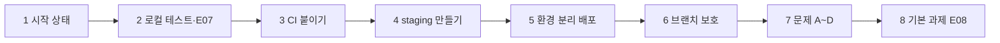

# [부록] N049 「CI 테스트와 staging 환경 만들기」 실습 과제 — 상세 수행 기록

> 이 문서는 N049 제출보고서(노션 정리 양식)의 **부록**입니다. 본문(`N049_실습과제_제출보고서`)은 한눈에 읽는 요약이고, 이 부록은 명령·로그·수치를 있는 그대로 남긴 상세 기록입니다(2026-10-23 작성, 본문 양식으로 대체되기 전의 원본 보고서).

**수신**: N049 강의 강사님 · **발신**: 수강생 전대진(DJ)
**실습일**: 2026-10-23
**과제 대상**: N048에서 자동 배포를 붙인 AI 친구 에이전트 서비스(`friend-agent`)에 ① 자동 테스트(CI), ② 사용자에게 나가기 전에 먼저 써 보는 staging 환경, ③ 검사를 우회하지 못하게 하는 브랜치 보호와 배포 승인을 차례로 붙이고, 일부러 망가뜨린 변경 4건(A~D)을 올려 "어떤 게이트가 어떤 문제를 잡고 어떤 문제는 놓치는지" 직접 확인하는 실습
**평가 방법**: 맨 아래 "평가 체크리스트"를 보고 항목별로 점수와 한 줄 의견을 남겨 주세요.

> 이 문서는 제가 직접 해 본 실습의 **수행 기록과 증거**입니다. 서비스 주소는 요청마다 수업에서 받은 LLM 키로 비용이 나가는 공개 서비스라서 일부러 싣지 않았습니다(N046~N048 보고서와 같은 이유). 대신 리비전 이름·커밋 해시·PR 번호·로그 내용을 그대로 적었습니다.

---

## 1. 한 장 요약

| 단계 | 한 일 | 확인한 핵심 |
|---|---|---|
| 1 | 시작 상태 확인 | 서비스·변수·deploy 실행 정상. 교재가 말한 저장소 변수 5개 중 `BUILD_SA`만 없었지만 이 템플릿이 쓰지 않는 변수라 그대로 진행 |
| 2 | 로컬 테스트와 약속 시각 테스트(E07) | `10 passed` → 추가 후 `11 passed`. 시간대 패치를 넣어도 한국 시간(로컬)에서는 `11 passed`로 **통과**(버그가 숨음) |
| 3 | CI 붙이기(#10) | 첫 CI는 `ModuleNotFoundError: No module named 'app'`으로 **실패** → `pytest.ini` 추가로 해결. 시간대 변경 PR(#11)은 CI에서 **실패**(08:00 기대, 17:00 저장) |
| 4 | staging 환경 만들기 | 수업 키를 별도 시크릿 `llm-api-key-staging`으로 복사, staging 서비스·GitHub 환경 생성. 비공개 저장소라서 승인자 설정이 **422로 거절**되어 저장소를 공개로 전환한 뒤 성공 |
| 5 | 환경 분리 배포(#12·#13) | staging 머지 → staging만 새 커밋, production 그대로. main 머지 → 승인 대기 → 승인 후 production이 같은 코드로 교체, `env`가 `local`에서 `production`으로 |
| 6 | 브랜치 보호 | `main`·`staging`에 PR 필수·필수 체크 `test`·관리자 적용. 직접 push가 `GH006`으로 거절됨 |
| 7 | 문제 A~D(#14~#18) | A·B·C는 CI가 잡고 머지가 `BLOCKED`. D(버튼 숨김)는 CI를 통과하고 staging에서 발견 → Revert PR로 복구 |
| 8 | 기본 과제 E08(#19) | "일정만 말하면 약속을 저장하지 않는다" 테스트 추가. 일부러 깨뜨리면 실패, CI 통과 |



**진행 방식**: AI 코딩 도우미(Claude)가 교재 순서대로 단계별 명령과 확인 방법을 안내하고, `gcloud`·`git`·`gh` 명령 실행과 PR 생성·머지, 로그 조회까지 도우미가 직접 수행했습니다. **LLM 제공사 대시보드 확인, Google Cloud 콘솔, 저장소 공개 전환, production 배포 승인 버튼은 제가 직접** 눌렀습니다. 키 값은 대화에 한 번도 나오지 않았습니다. 머지는 매번 제가 확인하고 지시한 뒤에만 했습니다.

---

## 2. 실습 환경 (시작 상태)

| 항목 | 값 |
|---|---|
| 클라우드 | Google Cloud Run, 리전 `us-central1`, 프로젝트 `<프로젝트 ID>` |
| 서비스 | `friend-agent`(production), 이번에 만든 `friend-agent-staging` |
| 저장소 | `github.com/JEON-DAEJIN/friend-agent`(시작 시 **비공개**, 4단계에서 공개로 전환) |
| 시작 시점 상태 | N048에서 만든 `deploy.yml`(main 머지 시 배포)과 저장소 변수 4개(`GCP_PROJECT_ID`, `WIF_PROVIDER`, `DEPLOY_SA`, `RUNTIME_SA`), 최근 deploy 실행 성공 |
| 테스트 | 템플릿 테스트 10개(`tests/test_app.py` 6개, `tests/test_claude.py` 4개), 실제 LLM 대신 페이크 LLM으로 실행 |

---

## 3. 단계별 수행 내용

### 3-1. 시작 상태 확인과 로컬 테스트

`gcloud run services describe`, `gh variable list`, `ls .github/workflows/`, `gh run list` 네 명령으로 서비스 주소·변수·워크플로·최근 실행(`completed success`)을 확인했습니다. 서비스가 `llm-api-key` 시크릿을 쓰는 것도 확인했습니다.

로컬에서 `pip install -r requirements-dev.txt` 후 테스트를 돌려 `10 passed`를 확인했습니다. 이때 저는 `python -m pytest`로 돌렸는데, 이것이 3-3의 CI 실패를 한동안 가린 원인이었습니다.

### 3-2. 약속 시각 테스트(E07)와 "일부러 깨뜨려 보기"

교재의 `tests/test_reminder_time.py`를 그대로 만들었습니다("내일 아침 8시에 물 마시라고 알려 줘" → 저장된 시각이 `08:00`으로 끝나는지). `11 passed`를 확인했습니다.

`starter/incidents/reminder-timezone.patch`(약속 시각에서 시간대 정보를 빼는 한 줄 변경)를 연습 브랜치 `try/timezone`에 넣고 돌리자, **한국 시간 환경에서는 여전히 `11 passed`**였습니다. 변경된 줄은 이렇습니다.

```
+    due = due.replace(tzinfo=None)  # 저장 형식을 단순하게: 시간대 정보는 빼고 날짜와 시각만 남긴다
```

Windows PowerShell에서는 `TZ=UTC`를 붙일 수 없어 UTC 쪽 확인은 CI로 넘겼습니다. 패치는 되돌리고 연습 브랜치도 지웠습니다. 테스트 파일은 PR #9로 `main`에 올렸습니다.

### 3-3. CI 붙이기 — 첫 실패와 해결 (#10·#11)

`starter/workflows/ci.yml`을 `.github/workflows/`에 복사해 PR #10을 올렸더니 **첫 실행이 실패**했습니다.

```
ModuleNotFoundError: No module named 'app'
ERROR tests/test_app.py / tests/test_claude.py / tests/test_reminder_time.py
3 errors in 0.59s
```

원인은 CI 러너에서 `pytest` 명령만 치면 저장소 루트가 import 경로에 들어가지 않는 것이었습니다. 로컬에서도 `pytest.exe`만 치면 같은 오류가 재현됐습니다(제가 `python -m pytest`로 돌려서 가려져 있었습니다). 템플릿에는 pytest 설정 파일이 없었습니다. 교재는 `ci.yml`을 바꾸지 말라고 해서 `ci.yml`은 그대로 두고, 루트에 `pytest.ini`를 추가해 같은 PR에 넣었습니다.

```
[pytest]
pythonpath = .
testpaths = tests
```

수정 후 로컬 `11 passed`, PR 체크 `test`·`hello` 통과로 PR #10을 머지했습니다.

이어서 같은 시간대 패치를 PR #11로 올렸습니다. 로컬에서 통과하던 변경인데 **CI의 `test`는 실패**했습니다.

```
>       assert labels and labels[-1].endswith("08:00")
E       AssertionError: assert (['10월 24일(토) 17:00', '10월 24일(토) 17:00'] and False)
FAILED tests/test_reminder_time.py::test_reminder_is_saved_in_korean_time
1 failed, 10 passed
```

이때 머지 상태는 `mergeable=MERGEABLE`, `state=UNSTABLE`이라 **실패했는데도 머지 버튼이 눌리는 상태**였습니다(아직 브랜치 보호 전). PR은 머지하지 않고 닫았습니다.

### 3-4. staging 만들기 — 키 문제와 공개 전환

**staging 전용 키를 만들지 못했습니다.** 교재는 LLM 제공사에서 staging용 키와 낮은 한도를 따로 만들라고 하지만, 제가 쓰는 키는 수업에서 받은 키였습니다. OpenAI 대시보드를 확인하니 제 조직(Personal)은 무료 체험에 크레딧 `$0.00`이었고 두 프로젝트의 월 사용액이 모두 `$0`이라, 그 키는 제 계정 것이 아님을 확인했습니다. 그래서 기존 시크릿 `llm-api-key` 값을 **값을 출력하지 않고** 별도 시크릿 `llm-api-key-staging`으로 복사했습니다(해시 비교로 값 동일 확인). 이름과 권한은 환경별로 분리했지만 **키와 사용 한도는 production과 공유**합니다. 첫 시도는 Windows에서 프로세스 치환이 지원되지 않아 시크릿이 만들어지지 않았고, 표준 입력 파이프로 다시 했습니다.

런타임 서비스 계정 `friend-agent-runtime`에는 `llm-api-key-staging` **하나에 대해서만** `secretmanager.secretAccessor`를 주고, 정책을 다시 읽어 그 계정 하나만 등록돼 있음을 확인했습니다.

`friend-agent-staging` 서비스를 `--allow-unauthenticated`, `ENV=staging`, 최소 0·최대 인스턴스 1로 만들었습니다(리비전 `00001-tn9`). staging 화면에는 "테스트 환경" 배너가 보이고 production에는 없습니다.

GitHub 환경은 `staging`(변수 `SERVICE=friend-agent-staging`, `ENV=staging`)과 `production`(`SERVICE=friend-agent`, `ENV=production`)을 만들었습니다. production에 승인자를 거는 단계에서 이렇게 거절됐습니다.

```
Failed to create the environment protection rule. Please ensure the billing plan
supports the required reviewers protection rule. (HTTP 422)
```

저장소가 **비공개**라서 승인자와 브랜치 보호(유료 플랜 기능)가 막힌 것이었습니다. 저장소 전체와 커밋 기록 25개를 검사해(OpenAI·Google·Supabase·Anthropic 키 패턴, 개인키, JWT, GitHub 토큰) 노출된 키가 0건이고 `.env`가 한 번도 커밋되지 않았음을 확인한 뒤, **제가 직접 공개로 전환**했습니다. 전환이 GitHub 쪽에 반영되기까지 한 번은 `PRIVATE`으로 보였고, 다시 확인하자 `PUBLIC`이었습니다. 그 뒤 승인자 `JEON-DAEJIN`(`prevent_self_review=false`)이 걸렸습니다.

### 3-5. 환경 분리 배포 (#12·#13)

`starter/workflows/deploy-envs.yml`로 `deploy.yml`을 바꾸는 PR #12를 `staging` 브랜치로 올려(대상이 `main`이 아님을 확인) 머지했습니다. `test` 작업 → `deploy` 작업(staging 환경) 순으로 성공했고 결과는 이렇습니다.

| | commit | revision | env |
|---|---|---|---|
| staging | `d69c08b`(방금 머지한 커밋) | `friend-agent-staging-00002-g9s` | `staging` |
| production | `187a4bf`(그대로) | `friend-agent-00016-2xg` | `local` |

새 워크플로가 시크릿을 따로 지정하지 않는데도 staging 서비스의 `LLM_API_KEY`는 `llm-api-key-staging` 연결을 유지했습니다.

`staging`을 `main`으로 보내는 PR #13을 머지하자(`staging` 브랜치는 지우지 않음) deploy 실행이 `waiting`에서 멈췄습니다. 승인은 도우미가 아니라 **제가 GitHub 화면에서 직접** 눌렀는데, **처음 누른 승인은 반영되지 않아** 실행이 10분 넘게 `waiting`이었습니다(`pending_deployments`에 production이 그대로 남아 있었음). 다시 눌렀더니 반영되어 배포가 시작됐습니다. 결과는 production 커밋 `fae6cc9`, 리비전 `friend-agent-00017-ckh`, **`env`가 `local`에서 `production`으로** 바뀌었고 배너는 없습니다. `fae6cc9`는 머지 커밋이라 staging의 `d69c08b`와 해시가 다르지만 코드 트리 해시가 같고 차이는 0줄이었습니다.

### 3-6. 브랜치 보호

`gh api`로 `main`과 `staging`에 같은 규칙을 걸었습니다. PR 필수(승인 수 0), 필수 상태 체크 `test`, `enforce_admins: true`입니다. 두 브랜치만 `protected=true`이고 다른 브랜치는 보호되지 않습니다.

`main`에 빈 커밋을 만들어 직접 push해 보니 이렇게 거절됐습니다.

```
remote: error: GH006: Protected branch update failed for refs/heads/main.
- Changes must be made through a pull request.
- Required status check "test" is expected.
```

거절된 빈 커밋을 로컬 `main`에서 지우려는 `git reset --hard origin/main`은 AI 도우미 환경의 안전 검사가 "되돌릴 수 없는 로컬 삭제"로 막아서, 이 커밋(`1f7dfd4`)은 **로컬 `main`에 아직 남아 있습니다**(원격에는 올라가지 않음).

### 3-7. 문제 A~C — CI가 잡은 변경 (#14~#16)

문제마다 `staging`에서 작업 브랜치를 만들고 패치를 적용해 `staging`으로 PR을 올렸습니다. 세 PR 모두 `mergeStateStatus=BLOCKED`였습니다. 원인은 로그의 실패 테스트·바뀐 줄로 찾았고, 고치지는 않았습니다.

| 문제 | 실패한 테스트와 로그 | 원인 한 문장 |
|---|---|---|
| A. `safety-exact-match` | `test_crisis_message_gets_fixed_safety_reply`, `assert '109' in '(가짜 응답) 그랬구나. 조금 더 얘기해 줄래?'` | 위기 표현 판정을 `any(k in text ...)`(포함)에서 `text.strip() in CRISIS_KEYWORDS`(정확히 같음)로 바꿔서, "요즘 너무 죽고 싶어"가 목록의 "죽고 싶"과 같지 않다고 판정돼 109 안내가 나가지 않았다 |
| B. `weather-keyword` | `test_weather_question_picks_weather_tool`, `assert [] == ['get_weather']` | 날씨 키워드 `"날씨"`를 `"날씨 알려"`로 좁혀서, "내일 서울 날씨 어때?"가 어떤 키워드에도 걸리지 않아 도구가 하나도 선택되지 않았다 |
| C. `reminder-timezone` | `test_reminder_is_saved_in_korean_time`, 08:00 기대·17:00 저장 | 저장 직전 `due.replace(tzinfo=None)`으로 시간대 정보를 지워서, UTC로 도는 CI 러너가 시간대 없는 값을 UTC로 읽어 9시간 어긋난 17:00이 저장됐다 |

A와 B는 환경과 무관한 실패라 로컬 `pytest`만 돌렸어도 잡혔습니다. **C만 로컬(한국 시간)에서는 통과**해서, CI처럼 서버와 같은 환경에서 돌려야 보이는 문제였습니다. 세 PR은 머지하지 않고 닫았고 브랜치도 지웠습니다.

### 3-8. 문제 D — CI를 통과해 staging에서 발견한 변경 (#17·#18)

`static/index.html` 95번째 줄 `.send{...}`에 `display:none;`을 넣은 PR #17을 `staging`으로 올렸습니다. **CI는 통과**했고(`test`·`hello` 통과, `CLEAN`) 보호 규칙이 걸려 있어도 머지됐습니다. 테스트가 화면 모양을 확인하지 않기 때문입니다.

머지 후 staging(`e264971`, 리비전 새 배포)에서 `.send` 버튼의 CSS `display`가 `none`이고 화면에 보이지 않음을 브라우저로 확인했습니다. production은 `fae6cc9` 그대로였고, 이 변경은 `main`으로 보내지 않았습니다.

되돌릴 때는 머지 커밋이라 부모가 둘이어서 `git revert -m 1`이 필요했습니다. Revert PR #18을 `staging`으로 올려 체크 통과 후 머지하자 staging이 `3b5d42a`로 바뀌고 `.send`의 `display`가 `none`에서 `block`으로 돌아왔습니다(production은 계속 `fae6cc9`).

### 3-9. 기본 과제 — 예시 하나를 테스트로 (E08, #19)

`docs/examples.md`에서 판정 방법이 `코드`이고 테스트가 없는 예시 중 **E08**("이번 주 금요일에 자격증 시험 있어" → 약속을 저장하지 않는다)을 골랐습니다. 약속은 "~라고 알려 줘" 같은 **부탁하는 말**(`ASK_PATTERN`)이 있을 때만 저장되는 규칙입니다. 테스트는 `create_reminder`가 도구 선택에 없고, 저장된 약속 개수가 전후로 같은지 확인합니다(메모리 저장소가 테스트 사이에 공유되므로 절대 개수가 아니라 변화를 비교).

| 확인 | 결과 |
|---|---|
| 로컬 `pytest` | `12 passed` |
| 일부러 깨뜨림(`ASK_PATTERN`에 `있어` 임시 추가) | `assert 'create_reminder' not in ['create_reminder']`로 **실패** |
| 되돌린 뒤 | `12 passed`, 변경 파일은 새 테스트 하나뿐 |
| CI | PR #19에서 `test` 통과(러너에서도 `12 passed`) |

PR #19를 `staging`에 머지하자 staging이 `44230b1`로 바뀌었고 production은 그대로입니다.

---

## 4. 이 실습에서 얻은 핵심 다섯 가지

1. **로컬에서 통과한 것이 서버에서 통과한다는 보장은 없다.** 시간대 변경은 한국 시간 로컬에서 `11 passed`였고 UTC 러너에서만 08:00이 17:00이 됐다. 테스트는 서버와 같은 환경에서도 돌려야 한다.
2. **CI는 "알려 주는 것"이고 "막는 것"은 브랜치 보호다.** 같은 실패 PR이 보호 전에는 `UNSTABLE`(머지 가능), 보호 후에는 `BLOCKED`였다. PR 필수와 필수 체크는 둘 다 걸어야 빈틈이 없다.
3. **CI를 통과해도 사람이 써 봐야 보이는 문제가 있다.** 버튼이 사라진 변경은 모든 체크를 통과했고 staging에서 열어 본 사람만 발견할 수 있었다. 그래서 gate가 세 겹(테스트·staging·승인)이다.
4. **교안의 명령은 교안 그대로 재현해야 한다.** 제가 `python -m pytest`로 돌려서 `pytest`만 칠 때의 `app` 모듈 문제가 CI에서야 드러났다.
5. **유료·계정 의존 기능은 시작 전에 확인해야 한다.** 비공개 저장소는 환경 승인자와 브랜치 보호를 쓸 수 없었고, 수업에서 받은 키로는 staging 전용 키와 한도를 분리할 수 없었다.

---

## 5. 발견한 한계와 풀지 못한 것

- **staging 전용 키와 낮은 사용 한도를 만들지 못했습니다.** 수업 키를 별도 시크릿으로 복사해 이름·권한만 환경별로 분리했고, 비용·한도는 production과 공유합니다. 제 OpenAI 계정(Personal)은 무료 체험에 크레딧 `$0.00`이었고, 그곳의 `friend-agent-staging` 프로젝트는 쓰이지 않는 빈 프로젝트로 남아 있습니다.
- **저장소를 비공개에서 공개로 바꿨습니다.** 승인자와 브랜치 보호를 쓰려면 필요했고, 전환 전에 키 패턴 검사로 노출 위험이 없음을 확인했습니다. 다만 공개 저장소의 Actions 로그에는 프로젝트 ID 같은 식별자가 보일 수 있습니다.
- **중간 과제(배포 결과 메신저 알림)와 도전 과제(내 앱에 CI 붙이기)는 하지 않았습니다.** 기본 과제만 수행했습니다.
- **배포 후 모니터링·알림은 만들지 않았습니다.** 시작 질문에서 막을 수 있는 지점으로 떠올렸지만 이 실습에서 만든 게이트는 아닙니다. 다양한 시간대·날짜 경계 테스트와 화면(브라우저) 자동 테스트도 만들지 않았습니다. 문제 D를 CI에서 막으려면 이런 테스트가 더 필요합니다.
- **UTC 재현을 로컬에서 직접 하지 못했습니다.** Windows PowerShell에서 `TZ=UTC`가 되지 않아 UTC 쪽 확인은 CI 결과로 대신했습니다.
- **문제 A·B의 실제 실패 로그는 교재·해설서에 제시되지 않았습니다.** 해설서도 "직접 실행한 결과를 근거로 확인해야 한다"고 적었고, 이 보고서의 3-7이 제가 실행해서 얻은 결과입니다.
- **처음 누른 production 승인이 반영되지 않았습니다.** 원인은 확인하지 못했고(확정 버튼까지 누르지 않았을 가능성), 다시 눌러 해결했습니다.
- **로컬 `main`에 거절된 빈 커밋 `1f7dfd4`가 남아 있습니다.** 안전 검사가 `git reset --hard`를 막았고, 원격에는 올라가지 않았습니다.
- **`BUILD_SA`는 교재가 말한 변수 5개에 있지만 이 템플릿에는 없고 어디서도 쓰지 않았습니다.** 교재와 템플릿 버전 차이로 보이나 확정하지는 못했습니다.

---

## 6. 직접 따라 해 보려면

본인 프로젝트와 저장소에서만 하세요. 키 값은 대화나 문서에 붙여 넣지 말고, 시크릿 복사처럼 값이 필요한 작업은 출력 없이 파이프로 옮기세요.

| 단계 | 확인 방법 |
|---|---|
| 교안 명령 재현 | `pytest -q` 등 교안의 명령을 **그대로** 실행해 보기. 다른 방식으로 돌려서 통과했다고 믿지 않기 |
| 테스트가 버그를 잡는지 | 지키려는 동작을 일부러 깨뜨려 실패하는지, 되돌리면 통과하는지까지 확인 |
| 환경에 따라 갈리는 버그 | 시간대 같은 문제는 CI 러너(UTC)에서 돌려 보기 |
| 승인자·브랜치 보호 | 저장소가 비공개면 유료 플랜이 필요함을 먼저 확인 |
| staging 만들기 | 명령 실행 전 서비스 이름이 `-staging`인지, 시크릿이 `-staging` 쪽인지 확인. 권한은 `projects`가 아니라 `secrets add-iam-policy-binding`으로 시크릿 하나에만 |
| 머지 상태 확인 | `gh pr view --json mergeStateStatus`로 `UNSTABLE`(머지 가능)과 `BLOCKED`(머지 차단) 구분 |
| 승인 전 | staging의 `/version` 커밋과 승인 대기 중인 실행의 코드가 같은지 확인 |

---

## 7. 평가 체크리스트 (1~5점, 한 줄 의견)

| 번호 | 확인할 것 | 근거가 있는 곳 | 점수 | 의견 |
|---|---|---|---|---|
| 1 | 사용자 기준 동작(08:00)을 확인하는 테스트를 만들고 버그를 잡는지 확인했는가 | 3-2, 3-3 | | |
| 2 | CI가 서버와 같은 환경(UTC)에서 로컬에서 놓친 버그를 잡는 것을 확인했는가 | 3-3 | | |
| 3 | 첫 CI 실패의 원인을 찾아 `ci.yml`을 바꾸지 않고 해결했는가 | 3-3 | | |
| 4 | 환경별로 시크릿 이름과 최소 권한을 분리해 staging을 만들었는가 | 3-4 | | |
| 5 | staging만 먼저 바뀌고 production은 승인 후 바뀌는 것을 `/version`으로 확인했는가 | 3-5 | | |
| 6 | 브랜치 보호로 직접 push와 실패한 체크의 머지를 막았는가 | 3-6, 3-7 | | |
| 7 | CI가 잡는 문제와 staging에서만 보이는 문제를 구분해 재현하고 Revert로 복구했는가 | 3-7, 3-8 | | |
| 8 | 예시 하나를 테스트로 옮기고 일부러 깨뜨려 확인했는가 | 3-9 | | |
| 9 | 풀지 못한 것과 교재와 달라진 점을 숨기지 않고 적었는가 | 5장 | | |

**전체 의견**:

---

## 8. 첨부할 증거 화면 (Notion에 직접 붙여 넣기)

- 첫 CI 실패 로그(`No module named 'app'`)와 `pytest.ini` 추가 후 통과 화면
- 시간대 변경 PR의 CI 실패 로그(08:00 기대, 17:00 저장)와 머지 버튼 상태 비교(보호 전 `UNSTABLE`, 보호 후 `BLOCKED`)
- staging 화면의 "테스트 환경" 배너, staging과 production의 `/version` 비교
- 비공개 저장소에서 승인자 설정이 거절된 422 메시지
- production 배포의 `Review deployments` 승인 대기 화면
- 브랜치 보호 규칙 화면과 직접 push 거절(`GH006`) 메시지
- 문제 D: CI 통과 화면 → staging에서 보내기 버튼이 사라진 화면 → Revert 후 돌아온 화면
- 기본 과제: E08 테스트 코드와 "일부러 깨뜨림" 실패 로그

*이 문서에는 API 키 값과 서비스 주소가 없습니다.*
