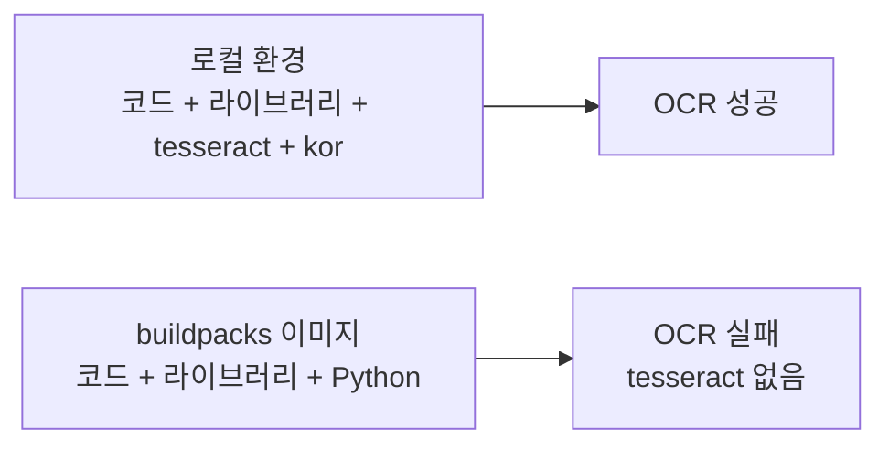
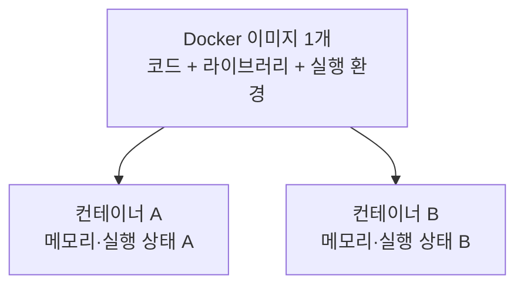
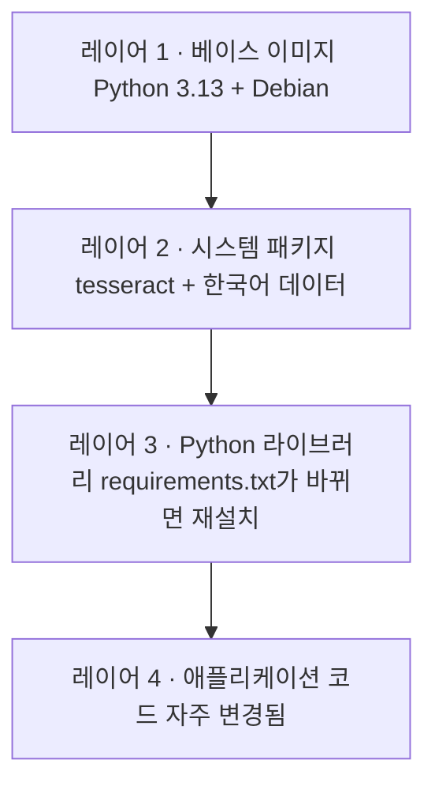
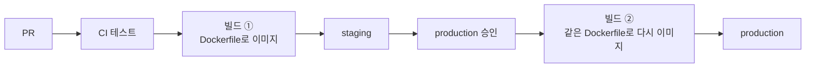

# N050 · Dockerfile로 실행 환경 정하기

> 버전 1.1 · 2026-10-26 (학습서 + 해설서 통합, 실습 결과 반영)

## 목차

- [핵심 한 문장 요약](#핵심-한-문장-요약)
- [1. 같은 코드인데 서버에서만 안 된다 — Dockerfile이 필요한 이유](#1-같은-코드인데-서버에서만-안-된다--dockerfile이-필요한-이유)
- [2. 시작 상태 맞추기 — OCR을 켜고 staging에서 실패 재현하기](#2-시작-상태-맞추기--ocr을-켜고-staging에서-실패-재현하기)
- [3. 이미지와 컨테이너의 차이](#3-이미지와-컨테이너의-차이)
- [4. Dockerfile에 적을 것](#4-dockerfile에-적을-것)
- [5. 이미지 빌드와 실행](#5-이미지-빌드와-실행)
- [6. Dockerfile을 기존 자동 배포로 올리기](#6-dockerfile을-기존-자동-배포로-올리기)
- [7. 과제 구성](#7-과제-구성)
- [8. 오늘 배운 것 (회고)](#8-오늘-배운-것-회고)
- [맺음말](#맺음말)
- [부록 A · 실전 코드 모음](#부록-a--실전-코드-모음)
- [부록 B · 트러블슈팅 표](#부록-b--트러블슈팅-표)
- [부록 C · AI 프롬프트 모음집](#부록-c--ai-프롬프트-모음집)
- [부록 D · 용어 사전](#부록-d--용어-사전)
- [부록 E · 개념 비교표 모음](#부록-e--개념-비교표-모음)
- [부록 F · 학습 로드맵](#부록-f--학습-로드맵)
- [부록 G · 복습 퀴즈](#부록-g--복습-퀴즈)

## 핵심 한 문장 요약

> 코드가 한 글자도 다르지 않은데 "내 컴퓨터에서는 되고 서버에서는 안 되는" 이유는 코드가 아니라 **실행 환경**이 달랐기 때문이다 — 그래서 베이스 이미지·시스템 패키지·시크릿 제외·포트·실행 사용자를 **Dockerfile 한 파일에 적어 저장소에 넣고**, 로컬 컨테이너에서 검증한 뒤 기존 자동 배포(staging → production)에 그대로 태운다.

이번 강의는 N049에서 만든 품질 게이트(CI·staging·브랜치 보호·배포 승인)가 붙은 AI 친구 에이전트 서비스(`friend-agent`, 줄여서 에이전트 서비스)에 새 기능 하나를 붙이면서 시작한다. 동아리 공지나 수업 일정표 **사진을 보내면 글자를 읽어 입력창에 넣어 주고**, 거기 적힌 일정을 약속으로 저장하게 하는 기능(OCR)이다. 이 기능의 코드는 이미 PR로 들어와 CI를 통과했고 staging과 production에 자동 배포돼 있다. 그런데 staging에서 켜 보면 사진을 읽지 못한다. 이 한 장면에서 출발해, 원인을 로그로 찾고, 이미지와 컨테이너를 구분하고, Dockerfile을 쓰고 검토하고, 로컬에서 빌드해 실행하고, 자동 배포에 올려 빌드 기록으로 확인한 뒤, 마지막에 "아직 남은 숙제"까지 짚는다.

> 💡 **팁** — 문서에서 "원문"은 학습서(32쪽), "해설서"는 해설서(54쪽)를 가리킨다. 두 책은 같은 강의의 두 버전이며 챕터 01~08이 1:1로 대응한다. 해설서의 쉬운 비유(식당 주방·붕어빵·밀키트)를 우선 살렸고, 원문의 명령·프롬프트·수치는 그대로 옮겼다. `[보충 비유]`라고 표시한 것만 이 노트에서 덧붙인 설명이다.

> 💡 **팁** — 버전 1.1은 v1.0(교안 정리)에 같은 날 friend-agent 저장소에서 실제로 해 본 결과를 `[실습 결과]` 표시로 덧붙인 판이다. 교안 수치(빌드 시간·레이어 크기·이미지 크기)는 지우지 않고 옆에 실측을 병기했다. 시각은 모두 KST(한국 시각)이고, 실습에서 하지 않은 것(예: `--clear-base-image` 누락 오류 재현, 며칠 간격 빌드 비교)은 하지 않았다고 적었다.

---

## 1. 같은 코드인데 서버에서만 안 된다 — Dockerfile이 필요한 이유

### 오늘의 사건

원문이 던지는 장면은 이렇다.

| 어디서 | 결과 |
|---|---|
| 로컬 환경(내 컴퓨터)에서 OCR 켜기 | 사진 속 글자를 잘 읽음 |
| CI 테스트 | 통과 |
| 자동 배포 | staging·production 모두 성공 |
| staging에서 OCR 켜고 같은 사진 보내기 | **"사진을 읽지 못했다"는 안내** |
| 기존 대화 기능 | 정상 |

코드는 한 글자도 다르지 않다. 기능의 기본값이 꺼짐이라 아직 아무도 쓰지 못했을 뿐, 배포는 이미 끝나 있었다. 이 네 가지 사실(로컬 성공 · 배포 성공 · 대화 기능 정상 · staging OCR만 실패)을 연결해 원인을 찾아가는 것이 이번 강의의 뼈대다.

> 🧪 **예제** — [해설서 비유] 식당에서 요리한다고 생각해 보자. **내 컴퓨터**는 요리사와 조리 도구, 재료가 모두 준비된 주방이다. **서버**는 똑같은 요리사가 있지만 필요한 조리 도구 하나가 없는 주방이다. **코드**는 요리사가 따라 하는 레시피다. 레시피가 똑같아도 도구가 없으면 요리를 완성할 수 없다.

### buildpacks와 Dockerfile — 자동으로 준비해 주는 서비스 vs 상세 작업 지시서

지금까지의 배포 방식(소스 배포)에서는 코드를 올리면 Cloud Run이 **buildpacks**(소스 코드를 보고 이미지를 자동으로 만드는 도구)로 실행 환경을 알아서 꾸려 이미지를 만들어 준다. buildpacks는 Python 버전과 라이브러리처럼 **코드에 적혀 있는 것**은 잘 챙긴다. 하지만 운영체제에 따로 설치해야 하는 **시스템 패키지**(apt 패키지처럼 운영체제에 설치하는 프로그램)는 코드만 보고 알 수 없다.

| 구분 | buildpacks | Dockerfile |
|---|---|---|
| 방식 | 소스 코드를 분석해 필요한 환경을 **자동 구성** | 기반 환경·설치할 패키지·실행 명령을 **직접 명시** |
| 비유(해설서) | 필요한 물건을 알아서 준비해 주는 서비스 | 준비할 물건과 순서를 직접 적어 놓은 상세 작업 지시서 |
| 약점 | 코드로 알 수 없는 운영체제 수준 의존성은 원하는 대로 안 될 수 있음 | 무엇을 넣을지 사람이 직접 판단해야 함 |

> 💡 **팁** — [보충 비유] 프랜차이즈 본사가 새 점포를 열 때 "주방 설비 목록 + 표준 조리 순서"를 문서로 내려보내면 어느 지점에서든 같은 맛이 나온다. 점주가 알아서 준비하게 두면 지점마다 빠지는 설비가 생긴다. Dockerfile은 이 설비 목록·표준서에 해당한다.

### 오늘의 학습 목표 다섯 가지

1. 로컬 환경에서는 되는데 서버에서는 안 되는 상황에서 **로그로 원인을 찾고**, buildpacks가 만든 이미지에 무엇이 들어 있고 무엇이 빠지는지 설명한다.
2. **이미지와 컨테이너의 차이**를 설명하고, Docker Desktop 화면에서 둘을 구분한다.
3. Dockerfile을 한 줄씩 읽고 **베이스 이미지**(Dockerfile이 출발점으로 삼는 이미지), **설치할 시스템 패키지**, **시크릿 제외**, **포트**, **실행 사용자**를 기준으로 검토한다.
4. 로컬에서 이미지를 빌드해 컨테이너로 실행하고, **API 키를 이미지에 넣지 않고 실행할 때 건네는 이유**를 설명한다.
5. Dockerfile이 있는 저장소를 환경별 자동 배포로 staging과 production에 올리고, **빌드 기록에서 Dockerfile이 쓰였는지** 확인한다.

### 시작 질문과 해설서의 예시 답안

원문의 시작 질문은 이것이다. "내 컴퓨터에서는 되는데 서버에서는 안 돼요"라는 말을 들어 본 적이 있는가? 같은 코드가 로컬 환경과 서버에서 다르게 동작한다면 두 곳 사이에 무엇이 다를 수 있을지, 떠오르는 대로 적어 보세요.

해설서의 예시 답안은 다음 다섯 지점으로 요약된다.

| 다를 수 있는 것 | 예 |
|---|---|
| Python 버전 | 로컬은 3.13인데 서버는 다른 버전 |
| 설치된 라이브러리 | requirements.txt에 빠진 것 |
| 운영체제 시스템 패키지 | 이번 사례의 tesseract |
| 환경변수·API 키 같은 설정값 | 로컬 `.env`에만 있는 값 |
| 포트 설정·실행 권한 | 서버가 정해 준 포트와 다른 포트로 기다림 |

그래서 코드만 비교할 것이 아니라 **로그를 확인하고 로컬과 서버의 실행 환경을 비교**해야 한다. 하루가 끝날 때(8장) 이 답을 다시 꺼내 "오늘 실제로 달랐던 것"과 비교해 본다.

### 문제를 세 가지로 나눠 보기

해설서는 AI 서비스를 운영할 때 오류의 성격을 세 가지로 구분하라고 반복해서 강조한다.

| 구분 | 질문 | 이번 사례 |
|---|---|---|
| 개발(코드) 문제 | 코드와 로직이 올바른가? | 로컬에서 잘 돌았으므로 아님 |
| 환경 문제 | 필요한 라이브러리·시스템 패키지가 설치돼 있는가? | **tesseract가 서버에 없음** |
| 배포 문제 | staging과 production에 동일한 실행 조건이 적용됐는가? | 테스트한 이미지와 실제 운영 이미지가 같은가(6·8장에서 다시 등장) |


```arrow
Dockerfile(만드는 방법) → 이미지(묶어 둔 패키지) → 컨테이너(실행 중인 것) → Cloud Run 서비스
```

> 📌 **요약** — Dockerfile은 AI 서비스의 코드뿐 아니라 **실행에 필요한 환경까지 명시**해, 내 컴퓨터에서 작동하던 서비스를 서버에서도 일관되게 실행하도록 돕는 설계도다.

> 🧪 **예제** — [실습 결과] 실습 시작 시점의 상태를 읽기 전용으로 확인했다. Cloud Run 서비스 `friend-agent`(production)와 `friend-agent-staging`(staging)의 주소가 모두 나왔고(리전 us-central1), GitHub 저장소 변수는 교재의 5개가 아니라 **4개**였다(이 템플릿은 `BUILD_SA`를 쓰지 않으며 N049에서 이미 확인한 사실이다). 워크플로는 `ci.yml`·`deploy.yml`·`hello.yml` 3개, 환경은 `production`·`staging`, `staging` 브랜치가 있었고, **두 서비스 모두 `OCR_ENABLED`가 없는 상태**였다. 바꾼 것은 없다.

> 🧪 **예제** — [실습 결과] 실습 PC(Windows 11)에는 tesseract 5.4가 이미 설치돼 있었지만 **영어(eng)와 osd만 있고 한국어(kor)는 없었으며 Path에도 등록돼 있지 않았다.** Docker는 설치돼 있지 않았다. 1장의 시작 질문에서 "다를 수 있는 것" 다섯 가지 가운데 이 실습에서 가장 크게 걸린 것은 **운영체제 시스템 패키지**였다(Python 버전 차이 가능성은 8-4절 참고). 8장에서 이 답을 다시 비교한다.

---

## 2. 시작 상태 맞추기 — OCR을 켜고 staging에서 실패 재현하기

### 2-1. 시작 상태

이 교안은 staging과 production이 나뉘어 있고, CI를 통과한 변경이 `staging` 브랜치에서는 staging에, `main`에서는 승인 뒤 production에 배포되는 상태에서 시작한다. 데이터베이스(Supabase)는 없어도 된다. 앞 실습(N049)에서 이 상태를 만들었다면 확인 명령만 실행하고 넘어간다. 처음부터 시작한다면 시작 상태 문서의 A~E와 템플릿 `docs/wif-setup.md`의 0~4단계, 7단계를 먼저 따라 한다. 처음부터 만들면 **1시간 30분 안팎**이 걸리므로 수업 전에 해 두기를 권한다.

| 필요한 상태 | 확인 방법 | 없으면 |
|---|---|---|
| `friend-agent` 서비스와 시크릿, 배포 권한 설정 | 서비스 주소가 나오고 `gh variable list`에 변수 5개 | 시작 상태 문서 A, B, `docs/wif-setup.md` |
| `.github/workflows/`의 `ci.yml`과 환경별 배포 `deploy.yml` | 두 파일이 있음 | 시작 상태 문서 D |
| GitHub 환경 `staging`, `production`과 `staging` 브랜치 | 아래 명령에 두 환경 이름과 staging 브랜치가 나옴 | 시작 상태 문서 D |
| `friend-agent-staging` 서비스 | 아래 명령에서 staging 주소가 나옴 | 시작 상태 문서 E |

확인 명령은 부록 A-1에 있다. staging 주소를 브라우저로 열었을 때 화면 위에 **테스트 환경임을 알리는 배너**가 보이면 준비가 끝난 것이다.

### 2-2. OCR이 무엇이고 왜 시스템 패키지가 필요한가

사진 속 글자를 읽는 기능을 **OCR**(광학 문자 인식, 이미지 속 글자를 텍스트로 바꾸는 기술)이라고 한다. 이 기능의 코드는 템플릿 저장소 `app/ocr.py`에 이미 들어 있고, 환경변수 `OCR_ENABLED`로 켜고 끈다. 기본값은 꺼짐이라 켜기 전에는 화면에 사진 버튼(📷)이 보이지 않는다.

사진을 받으면 `pytesseract`라는 Python 라이브러리로 글자를 읽는데, 이 라이브러리는 직접 글자를 읽지 않고 운영체제에 설치된 `tesseract`라는 프로그램을 불러 쓰는 **래퍼(wrapper) 라이브러리**다.

> 🧪 **예제** — [해설서 비유] `pytesseract`는 "통역을 요청하는 사람"이고 `tesseract`는 "실제로 글자를 읽는 도구"다. 통역을 부탁하는 사람만 있고 통역사가 없으면 번역이 안 된다.

그래서 OCR이 돌려면 세 가지가 모두 필요하다.

| 필요한 것 | 설치 방법 | 역할 |
|---|---|---|
| ① `pytesseract` | `requirements.txt` → pip | tesseract를 부르는 Python 라이브러리 |
| ② `tesseract` 프로그램 | **운영체제 시스템 패키지**(apt, brew 등) | 실제로 글자를 읽는 프로그램 |
| ③ `kor` 언어 데이터 | 시스템 패키지(`tesseract-ocr-kor` 등) | 한국어를 읽기 위한 글자 데이터 |

`requirements.txt`로 라이브러리를 설치하는 것만으로는 부족하다. ②와 ③을 운영체제에 따로 설치해야 하고, 이렇게 Python 라이브러리 밖에 있는 프로그램이나 파일을 해설서는 **시스템 의존성**이라고 부른다.

### 2-3. 로컬 환경에 tesseract 설치하고 OCR 켜기

먼저 내 컴퓨터에 tesseract를 설치한다.

- **macOS**: Homebrew로 프로그램과 언어 데이터를 함께 설치한다(`brew install tesseract tesseract-lang`). 설치 후 `tesseract --list-langs`에 `kor`가 있어야 한국어를 읽는다.
- **Windows**: tesseract 공식 안내가 권하는 **UB Mannheim 설치 파일**(`tesseract-ocr-w64-setup-…exe`)을 받아 실행한다. 설치 중 Choose Components 화면에서 Additional language data(download)를 펼쳐 **Korean**에 체크하고, 설치 폴더는 기본값(`C:\Program Files\Tesseract-OCR`)으로 둔다. 설치가 끝나면 "시스템 환경 변수 편집"에서 사용자 변수 Path에 그 폴더를 추가한 뒤, **열려 있던 터미널과 VS Code를 모두 닫았다가 다시 연다.** 새 터미널에서 `tesseract --version`과 `tesseract --list-langs`(`kor` 확인)로 점검한다.

> ⚠️ **주의** — 코딩 에이전트가 `sudo`로 root 권한(운영체제 전체를 바꿀 수 있는 최고 권한)을 요구하는 명령을 제안하면, 무엇을 바꾸는지 다시 묻고 판단한다. Homebrew 설치에는 보통 필요하지 않다. 언어 목록에 `kor`가 없으면 기능은 동작하지만 영어로만 읽고, 서비스 로그에 한국어 데이터가 없다는 경고가 남는다.

이제 `.env`에 `OCR_ENABLED=true` 한 줄을 넣고 서비스를 로컬에서 실행한다(부록 A-3). 입력창 왼쪽에 사진 버튼(📷)이 생기면 템플릿의 `data/samples/schedule.png`(산책 동아리 10월 일정 세 줄이 적힌 사진)를 고른다. 잠시 뒤 입력창에 **"사진에서 읽은 글이야"**로 시작하는 문장과 일정 세 줄이 들어온다. 읽은 글자가 틀렸으면 입력창에서 고친 뒤 보내고, 보내면 에이전트 서비스가 일정 가운데 하나를 약속으로 저장하며 오른쪽 "이번 턴" 패널에 약속 저장 도구가 선택된 것이 보인다.

### 2-4. staging에서 같은 기능 켜기 — `--update-env-vars`

이제 staging에서도 기능을 켠다. 코드는 이미 배포돼 있으므로 **staging 서비스의 환경변수만 하나 추가**하면 된다. 환경변수를 바꾸면 새 리비전이 만들어지고, 자동 배포 워크플로는 기존 환경변수를 지우지 않고 합치는 방식으로 배포하므로 이후 배포에서도 이 값이 유지된다. **production은 아직 건드리지 않는다.**

실행하기 전에 서비스 이름이 `friend-agent-staging`인지, 옵션이 기존 값을 지우는 `--set-env-vars`가 아니라 추가하는 `--update-env-vars`인지 확인한다.

| 옵션 | 동작 |
|---|---|
| `--update-env-vars` | 지정한 환경변수를 **추가하거나 해당 값만 갱신** |
| `--set-env-vars` | 지정한 환경변수 집합으로 **설정을 교체** — `ENV` 같은 기존 변수가 사라질 수 있음 |

> ⚠️ **주의** — 해설서가 짚은 구분: **OCR 기능을 켜는 것**과 **OCR이 실제로 작동하도록 실행 환경을 갖추는 것**은 서로 다른 작업이다. 이번 단계에서는 앞의 것만 했다.

배포가 끝나면 staging 주소를 열어 같은 사진을 보낸다. 이번에는 **"사진에서 글자를 읽지 못했어요: 사진에서 글자를 읽는 프로그램이 서버에 없습니다."**라는 안내가 뜬다.

### 2-5. 로그에서 원인 찾기

화면의 안내는 결과만 말해 준다. 화면만 보고 원인을 단정하지 않고, Cloud Run 로그에서 같은 시각에 남은 오류 줄을 찾는다.

1. Cloud Run에서 `friend-agent-staging` 서비스를 열고 로그(Logs) 탭으로 간다.
2. 심각도를 **오류(Error)**로 거르고, 사진을 보낸 시각 근처의 줄을 연다.
3. 같은 시각에 `POST /api/ocr` 요청이 **상태 코드 500**으로 남았는지도 확인한다.

핵심 기록은 세 가지다.

| 기록 | 내용 |
|---|---|
| 오류 메시지 | "tesseract 프로그램을 찾을 수 없습니다. 실행 환경에 tesseract 가 설치되어 있지 않습니다." |
| 요청 기록 | `POST /api/ocr` |
| 상태 코드 | 500 |

이 기록을 종합하면 **서비스가 시작하지 못한 것이 아니라**, 시작은 정상으로 했고 사진 요청이 들어온 순간 프로그램을 부르다 실패한 것이다. 앱은 시작할 때 tesseract가 있는지 검사하지 않기 때문에 서비스가 정상적으로 시작될 수 있었고, 그래서 **배포는 성공으로 끝났고 다른 기능은 그대로 쓸 수 있었다.** 실제 OCR 요청이 들어온 순간에야 문제가 드러난 것이다.

### 2-6. 로컬과 buildpacks 이미지에는 무엇이 들어 있나

| 항목 | 로컬 환경 | staging(buildpacks 이미지) |
|---|---|---|
| Python 코드 | 있음 | 있음 |
| Python 라이브러리 | 있음 | 있음(`requirements.txt`를 보고 준비) |
| Python 버전 | 있음 | 있음(`.python-version`을 보고 준비) |
| `tesseract` 프로그램 | 오늘 직접 설치함 | **설치되지 않음** |
| 한국어 언어 데이터 | 설치했다면 있음 | **없음** |
| OCR 기능 | 정상 작동 | **실패** |



```arrow
로컬(코드+라이브러리+tesseract+kor) → OCR 성공
buildpacks 이미지(코드+라이브러리+Python, tesseract 없음) → OCR 실패
```

로컬에서 tesseract를 설치한 기록은 로컬 환경에만 남았고 저장소로 들어가지 않았다. buildpacks는 저장소에 적힌 것만 보고 이미지를 만들기 때문에 tesseract는 저장소 어디에도 적혀 있지 않아 설치하지 않았다. Google Cloud의 Python buildpacks 문서에도 시스템 패키지를 추가로 설치하는 방법은 안내되어 있지 않다.

> 📌 **요약** — **핵심 원칙: 코드가 같다는 사실만으로 실행 환경까지 같다고 볼 수는 없다.** 로컬 컴퓨터에 프로그램을 설치해도 그 설치 기록이 GitHub 저장소에 자동으로 들어가지 않는다.

### 2-7. 왜 CI 테스트는 이 문제를 못 잡았을까

CI가 통과했다는 것은 **테스트에서 확인한 조건이 충족됐다**는 뜻이지 모든 운영 환경이 완벽하다는 뜻이 아니다. 이번 사례에는 두 가지 이유가 있다.

1. 템플릿의 OCR 테스트는 **기능이 꺼져 있을 때 요청을 거절하는지**만 확인한다. 실제로 사진을 읽는 데 필요한 시스템 프로그램까지는 검증하지 않는다.
2. 테스트가 도는 **GitHub 러너와 staging 이미지는 서로 다른 실행 환경**이다. 러너에서 통과했다고 staging 이미지에 tesseract가 있다는 뜻이 되지 않는다.

이 문제를 풀려면 실행 환경을 만드는 방법 자체를 적어 저장소에 넣어야 하고, 그 파일이 **Dockerfile**이다.

### 2-8. 실습 결과 — 로컬 성공, staging 500

> 🧪 **예제** — [실습 결과] **로컬 준비**: 한국어 데이터 `kor.traineddata`(1.6MB, tessdata_fast 버전)를 11:28경 받고, 이어서 사용자가 관리자 PowerShell로 tesseract 폴더에 복사하고 사용자 Path에 Tesseract 폴더를 등록했다(복사·Path 등록 시각은 기록하지 않았다). 새 터미널에서 `tesseract --list-langs`가 `eng`, `kor`, `osd`를 보여 주었고 `tesseract --version`은 5.4.0.20240606이었다. 교재는 로컬에 kor가 없어도 넘어가도록 허용했지만, 이번에는 "로컬이 한국어까지 되는 정상 환경"에서 시작하려고 설치했다.

> 🧪 **예제** — [실습 결과] **로컬 OCR**: `.env`를 코딩 에이전트의 접근 규칙이 막아 만들 수 없어서 `.env` 대신 환경변수(`LLM_PROVIDER=fake`, `OCR_ENABLED=true`, `ENV=local`, `STORAGE=memory`, `AUTH=none`)를 직접 넘겨 서버를 실행했다. LLM은 가짜(fake)라 키가 필요 없었다. `schedule.png`(1200×826)를 `/api/ocr`에 보내자 **HTTP 200, 153글자**가 돌아왔고 일정 세 줄이 모두 읽혔다. 결과 문자열의 sha1 앞 10자 `e61b2db05f`를 이후 비교의 기준값으로 삼았다.

> 🧪 **예제** — [실습 결과] **staging 실패 재현**: 11:34~11:35에 `gcloud run services update friend-agent-staging --region us-central1 --update-env-vars OCR_ENABLED=true`를 실행하자 새 리비전 `friend-agent-staging-00006-dst`가 트래픽 100%를 받았다. 환경변수 이름은 `ENV`, `LLM_API_KEY`, `COMMIT_SHA`, `OCR_ENABLED`로, 기존 값이 그대로 유지됐다. production은 건드리지 않았다. 루트 화면(200)과 `/version`은 정상이었는데 같은 사진을 보내자 **HTTP 500** `{"detail":"사진에서 글자를 읽는 프로그램이 서버에 없습니다."}`가 돌아왔다.

> 🧪 **예제** — [실습 결과] **로그에서 원인 찾기**: Cloud Run 로그의 **11:35:05(KST, UTC로는 02:35:05)**에 리비전 00006에서 ERROR 줄 "tesseract 프로그램을 찾을 수 없습니다. 실행 환경에 tesseract 가 설치되어 있지 않습니다."와 `POST /api/ocr` 500(응답 182 B, 소요 219 ms, 요청 주체 curl)이 남아 있었다. 2-5절의 세 가지 핵심 기록(오류 메시지·요청 기록·상태 코드)이 그대로 확인된 셈이다. 서비스는 정상으로 시작했고 사진 요청이 들어온 순간에야 실패했으므로 배포는 성공, 대화 기능은 정상이었다. (증거: 증거화면 폴더의 `03a`, `08a`)

<details>
<summary>객관식 퀴즈 — staging에서 OCR이 실패했는데 배포는 성공했고 다른 대화 기능도 정상이었습니다. 이유로 가장 알맞은 것은?</summary>

① Cloud Run이 tesseract 없이도 시작할 수 있도록 오류를 숨겨 주기 때문이다 ② 앱은 시작할 때 tesseract를 확인하지 않고, 사진 요청이 들어와 프로그램을 부를 때에야 없다는 것을 알게 되기 때문이다 ③ staging에서는 `OCR_ENABLED`가 꺼져 있어서 기능이 실행되지 않았기 때문이다 ④ buildpacks가 tesseract를 설치했지만 한국어 데이터만 빠졌기 때문이다

**정답: ②** ①은 Cloud Run이 오류를 숨긴 것이 아니라 요청 처리 중 오류가 난 것이다. ③은 staging에서 `OCR_ENABLED=true`로 켰기 때문에 OCR 요청이 실행됐다. ④는 한국어 데이터만 빠진 것이 아니라 tesseract 프로그램 자체를 찾지 못한 것이다.
</details>

---

## 3. 이미지와 컨테이너의 차이

Dockerfile을 쓰기 전에 Docker가 다루는 두 가지를 구분해 둔다.

- **이미지(image)**: 운영체제 기본 파일, 프로그램, 라이브러리, 코드, 시작 명령까지 **실행에 필요한 것을 모두 묶어 둔 파일**. 한 번 만들면 내용이 바뀌지 않는다.
- **컨테이너(container)**: 그 이미지를 **실행한 것**. 같은 이미지로 컨테이너를 여러 개 띄울 수 있고, 컨테이너마다 자기 메모리와 파일 변경을 따로 가진다.

> 🧪 **예제** — [해설서 비유] **이미지는 붕어빵 틀과 재료를 갖춘 준비물**, **컨테이너는 그 준비물로 실제로 만들어 낸 붕어빵**이다. 붕어빵 하나를 먹어 치워도 틀과 재료(이미지)는 그대로 남아 있고, 같은 준비물로 붕어빵을 몇 개든 만들 수 있다. Dockerfile은 이 준비물을 만드는 방법을 적은 문서다. 컨테이너 안에서 파일을 바꿔도 원본 이미지는 자동으로 바뀌지 않는다.



```arrow
이미지 1개(코드+라이브러리+실행 환경) → 컨테이너 A(메모리·상태 A)
이미지 1개(코드+라이브러리+실행 환경) → 컨테이너 B(메모리·상태 B)
```

### 3-1. Cloud Run 용어와의 대응

| Docker 개념 | 쉽게 이해하기 | Cloud Run에서 대응하는 개념 |
|---|---|---|
| 이미지 | 실행 준비물 패키지 | 배포할 컨테이너 이미지 |
| 컨테이너 | 이미지를 실행한 인스턴스 | 인스턴스 안에서 실행되는 컨테이너 |
| — | 이미지 + 환경변수·요청 타임아웃(request timeout, 요청 하나를 처리할 수 있는 최대 시간) 등 설정을 묶은 버전 | **리비전(Revision)** |
| — | 그 리비전으로 실행 중인 컨테이너 | **인스턴스(Instance)** |

이 구조로 N048·N049에서 겪은 현상이 설명된다. 에이전트 서비스는 대화 기록을 **컨테이너의 메모리**에 둔다. 새 리비전을 배포하면 새 컨테이너가 실행되고, 새 컨테이너는 이전 컨테이너의 메모리를 자동으로 이어받지 않는다. 그래서 새 리비전을 배포할 때마다 대화 기록이 사라졌다. 서비스가 재시작되거나 인스턴스가 교체돼도 유지돼야 하는 데이터는 Supabase 같은 **외부 데이터베이스(영속 저장소)**에 보관해야 한다.

이미지 안에 **키 같은 시크릿을 넣지 않는 이유**도 여기서 나온다. 이미지는 저장소에 올라가 여러 곳에서 내려받아 실행되는 파일이므로, 안에 든 값은 이미지를 받은 누구나 꺼내 볼 수 있다.

### 3-2. Docker Desktop 준비

이 장부터는 로컬 환경에서 Docker를 쓴다. **Docker Desktop**은 macOS와 Windows에서 컨테이너를 실행할 수 있게 해 주는 프로그램으로, 컨테이너가 쓰는 리눅스 환경을 컴퓨터 안에 띄우고 `docker` 명령과 이미지·컨테이너를 보는 화면을 함께 제공한다. 이미 설치돼 있다면 Docker Desktop을 켜고 `docker --version`과 `docker info`만 실행한다. 둘 다 오류 없이 결과가 나오면 준비 완료다. `docker info`가 **데몬**(daemon, 실제로 이미지를 만들고 컨테이너를 실행하는 프로그램)에 연결할 수 없다는 오류를 내면 Docker Desktop이 꺼져 있는 것이니 켠 뒤 다시 실행한다.

없을 때 설치하는 순서(원문):

1. Docker Desktop 내려받기 페이지에서 내 운영체제에 맞는 설치 파일을 받는다. macOS는 Apple Silicon(M 시리즈)과 Intel 칩 가운데 내 컴퓨터에 맞는 것을 고른다(Apple 메뉴 > 이 Mac에 관하여).
2. macOS는 `Docker.dmg`를 열어 Docker 아이콘을 응용 프로그램 폴더로 끌어넣고 실행한다. Windows는 설치 파일을 실행하며 설정 화면에서 **WSL 2**(Windows 안에서 리눅스를 실행하는 기능)를 사용하는 옵션을 켠 채 설치한다. 설치 중 함께 켜지거나 재시작을 요구할 수 있다.
3. 처음 실행하면 이용 약관에 동의하고 Docker Hub 계정으로 로그인한다. 계정이 없으면 무료로 만든다. 강의실처럼 여러 사람이 같은 인터넷 주소를 쓰면 **로그인하지 않은 이미지 내려받기가 횟수 제한에 금방 걸리기 때문**이다.
4. 화면 아래쪽에 엔진이 실행 중(Engine running)이라고 나오면 새 터미널에서 확인 명령을 실행한다.

> ⚠️ **주의** — 설치 중 막히는 곳은 운영체제마다 다르다. macOS는 칩에 맞지 않는 설치 파일을 받으면 실행되지 않고, Windows는 WSL 2가 켜지지 않았거나 BIOS에서 가상화 기능이 꺼져 있으면 엔진이 시작되지 않는다. 회사 컴퓨터에 설치한다면 Docker Desktop은 직원 250명 이상이거나 매출이 일정 규모를 넘는 회사에서 쓸 때 유료 구독이 필요하다. 개인 컴퓨터와 교육 목적으로는 무료다.

### 3-3. 공식 Python 이미지 실행해 보기 — 여기에도 tesseract는 없다

Docker가 공식으로 배포하는 Python 이미지(`python:3.13-slim-bookworm`, 이후 Dockerfile의 베이스 이미지로 쓸 것과 같다)를 내려받아 컨테이너로 실행한다(부록 A-5). 첫 줄은 Python 3.13 버전을 출력하고, 둘째 줄은 **"tesseract 없음"**을 출력한다. `--rm`은 실행이 끝나면 컨테이너를 자동으로 지우라는 옵션이고 이미지는 남아 다음 실행에서 재사용된다.

공식 Python 이미지에도 tesseract는 없다. Python이 설치된 이미지라고 해서 OCR에 필요한 모든 외부 프로그램까지 들어 있는 것은 아니므로, 이 이미지 **위에 설치하는 줄을 Dockerfile에 넣어야** 한다.

### 3-4. 컨테이너끼리 나누지 않는 것

컨테이너 하나 안에 파일을 만들고, 같은 이미지로 새 컨테이너를 띄워 그 파일이 보이는지 확인한다(부록 A-6). 첫 컨테이너(`note-a`)는 `--rm` 없이 실행해 끝난 뒤에도 남겨 둔다.

| 실행 단계 | 결과 |
|---|---|
| 첫 컨테이너 `note-a` 안에서 `/tmp/note.txt`에 "메모"를 쓰고 읽기 | `메모` |
| 같은 이미지로 새 컨테이너에서 같은 파일 읽기 | `파일 없음` |
| `docker rm note-a` | note-a 컨테이너가 삭제됨 |

두 컨테이너는 같은 이미지에서 시작했지만 한쪽에서 생긴 파일을 다른 쪽이 보지 못한다. `docker rm note-a` 전에 Docker Desktop을 열어 보면 **이미지(Images) 화면**에는 `python:3.13-slim-bookworm`이 한 줄, **컨테이너(Containers) 화면**에는 실행이 끝난 `note-a`가 보인다(`--rm`으로 실행한 컨테이너는 이미 지워져 목록에 없다). `docker rm note-a`는 **컨테이너를 지우는 명령**이지 이미지를 지우는 명령이 아니므로, 지우기 전에 대상이 컨테이너 `note-a`인지 확인한다.

> 💡 **팁** — 해설서의 단서: 이 실험은 컨테이너 내부의 임시 파일을 쓴 경우다. 볼륨이나 외부 저장소를 연결하면 여러 컨테이너가 같은 데이터를 공유하도록 구성할 수 있다.

<details>
<summary>객관식 퀴즈 — 같은 이미지로 컨테이너 두 개를 실행했고 첫 컨테이너 안에서 /tmp/note.txt를 만들었습니다. 둘째 컨테이너에서 읽으면?</summary>

① 같은 이미지에서 시작했으므로 파일이 보인다 ② 파일이 보이지 않는다. 파일은 첫 컨테이너 안에서만 생긴 변경이고 이미지는 바뀌지 않았다 ③ 첫 컨테이너가 실행 중일 때만 보인다 ④ 첫 컨테이너를 지우면 그때부터 보인다

**정답: ②** 파일은 첫 컨테이너의 파일 변경 사항이며 원본 이미지나 둘째 컨테이너에 자동으로 반영되지 않는다.
</details>

### 3-5. 포트로 컨테이너에 요청 보내기

지금까지 실행한 컨테이너는 명령 하나를 실행하고 바로 끝났다. 에이전트 서비스처럼 웹 서버를 담은 컨테이너는 켜진 채로 요청을 기다리는데, 바깥에서 요청을 보내려면 **포트**를 알아야 한다. 포트(port)는 한 컴퓨터에서 여러 프로그램이 네트워크를 함께 쓸 때 들어온 연결을 어느 프로그램에 줄지 정하는 번호다. 주소 `localhost`가 어느 컴퓨터인지를 가리킨다면 `:9000` 같은 포트는 **그 컴퓨터의 어느 프로그램인지**를 가리키고, 한 포트에서는 한 프로그램만 기다릴 수 있다.

컨테이너는 파일뿐 아니라 **네트워크도 따로** 가진다. 컨테이너 안의 프로그램이 8000번에서 기다려도 내 컴퓨터의 8000번과는 이어져 있지 않다. 둘을 잇는 것이 `docker run`의 **`-p 9000:8000`**이다.

| 표기 | 의미 |
|---|---|
| `-p 9000:8000`의 **앞 숫자 9000** | 내 컴퓨터의 포트 |
| `-p 9000:8000`의 **뒤 숫자 8000** | 컨테이너 안의 포트 |
| 동작 | 내 컴퓨터의 9000번으로 들어온 요청을 Docker가 컨테이너의 8000번으로 넘기고, 응답을 받아 그대로 돌려줌 |

공식 Python 이미지에 들어 있는 간단한 웹 서버(`python -m http.server 8000`)로 같은 이미지에서 컨테이너를 두 개 띄워 확인한다(부록 A-7). 결과는 다음과 같다.

| 확인 | 결과 |
|---|---|
| 브라우저로 `http://localhost:9000`, `http://localhost:9001` | 둘 다 컨테이너 안 폴더의 파일 목록이 보임 |
| 브라우저로 `http://localhost:8000` | 열리지 않음 — 컨테이너 안 8000번은 내 컴퓨터 8000번과 이어져 있지 않음 |
| `docker ps` | 같은 이미지로 띄운 컨테이너 두 줄, 포트 칸에 `9000->8000`, `9001->8000` |
| 세 번째 컨테이너를 `-p 9000:8000`으로 띄우기 | `port is already allocated` 오류 — 내 컴퓨터 9000번에서는 이미 `web-a`로 가는 연결이 기다리고 있음 |

컨테이너마다 네트워크가 따로라서 컨테이너 **안의** 포트는 모두 같은 번호를 써도 부딪히지 않는다. 그래서 안쪽 포트는 이미지가 한 번 정해 두고, 여러 개를 띄울 때는 **바깥 포트만** 바꾼다. 정리 명령 `docker rm -f web-a web-b web-c`는 해당 이름의 컨테이너를 강제로 종료하고 삭제하므로, 실행 전에 실습용 컨테이너 이름인지 확인한다.

### 3-6. Cloud Run과 PORT 환경변수

Cloud Run은 이 연결을 대신 해 준다. 요청을 보낼 컨테이너 안의 포트를 **`PORT` 환경변수**(기본값 8080)로 알려 준다. 그래서 에이전트 서비스는 **포트 번호를 코드에 박아 두지 않고** `PORT` 환경변수를 읽어 그 번호에서 기다리게 만든다(4장 체크리스트에서 이 점을 확인한다). 예를 들어 `docker run -p 9000:8080 friend-agent:local`로 띄웠다면 접속 주소는 **`http://localhost:9000`**이다. 앞의 9000은 내 컴퓨터 포트, 뒤의 8080은 컨테이너 내부 포트이기 때문이다.

<details>
<summary>객관식 퀴즈 — docker run -p 9000:8080 friend-agent:local 로 띄웠습니다. 브라우저에서 서비스를 열려면?</summary>

① `http://localhost:8080` ② `http://localhost:9000` ③ 두 주소 모두 열린다 ④ 컨테이너 안에서만 열 수 있다

**정답: ②** 앞의 9000은 내 컴퓨터의 포트, 뒤의 8080은 컨테이너 내부 포트다. 내 컴퓨터의 8080은 이어져 있지 않다.
</details>

### 3-7. 이 장이 AI 서비스 운영에서 주는 세 가지 원칙 (해설서)

1. **실행 환경의 재현성**: 같은 이미지를 사용해 일관된 실행 환경을 구성할 수 있다.
2. **데이터의 지속성**: 컨테이너의 메모리나 임시 파일에만 데이터를 보관하면 재시작이나 교체 시 사라질 수 있다.
3. **서비스 접근성**: 포트 연결을 이해해야 로컬에서 컨테이너 안의 웹 서비스에 접속할 수 있다.

### 3-8. 실습 결과 — Docker 설치와 세 가지 실험

> 🧪 **예제** — [실습 결과] **Docker Desktop 설치**: 실습 PC에는 Docker가 없어서 새로 설치했다. 설치 파일은 641,758,128바이트(약 612MB)였고 서명이 Docker Inc로 유효한 것을 확인한 뒤 설치했다. 설치 후 Docker Desktop 4.96.3, Docker 29.9.2(리눅스 컨테이너, WSL 2)가 동작했고 Personal 계정으로 로그인했다(WSL 2 Ubuntu와 가상화는 이미 켜져 있었다).

> 🧪 **예제** — [실습 결과] **공식 이미지**: `python:3.13-slim-bookworm`은 Python 3.13.17이었고 **tesseract는 없었다**(교안 3-3절과 같은 결과). 이 이미지는 디스크에서 183MB(압축 내용 46.8MB)였고 이미지 ID는 `e32be0e55814`였다. 이 이미지 ID와 digest(`sha256:e32be0e55814…`)는 뒤의 6장에서 staging·production 빌드의 베이스가 같은 이미지였는지 확인할 때 다시 쓰였다.

> 🧪 **예제** — [실습 결과] **컨테이너끼리 나누지 않는다**: `note-a`에서 `/tmp/note.txt`에 "메모"를 쓰고 읽은 뒤, 같은 이미지의 새 컨테이너에서 읽자 **"파일 없음"**이 나왔다. `docker ps -a`에는 `note-a`가 `Exited (0)`로 남아 있었고 `--rm`으로 실행한 컨테이너는 없었다. Docker Desktop에서는 Images 화면에 이미지 한 줄, Containers 화면에 컨테이너가 따로 보였다.

> 🧪 **예제** — [실습 결과] **포트**: `web-a`(9000→8000)와 `web-b`(9001→8000) 둘 다 HTTP 200이었고 `localhost:8000`은 연결에 실패했다. 이 실습은 브라우저 대신 curl로 상태 코드를 확인했다. 세 번째 컨테이너 `web-c`를 9000번으로 띄우자 `port is already allocated` 오류와 함께 종료 코드 125로 실패했다(의도한 실패). 정리는 `docker rm -f`로 했고 이미지는 남겼다.

> 📌 **요약** — Docker 이미지는 실행 환경을 담은 패키지이고 컨테이너는 그 패키지를 실행한 독립적인 인스턴스다. 둘의 차이를 이해해야 데이터·네트워크·배포를 올바르게 관리할 수 있다.

---

## 4. Dockerfile에 적을 것

2장에서 서버에 빠져 있던 것은 tesseract와 한국어 데이터였고, 3장에서 공식 Python 이미지에도 tesseract가 없다는 것을 확인했다. Dockerfile에는 이 둘을 포함해 **실행 환경을 처음부터 끝까지** 적는다. 어떤 베이스 이미지에서 출발할지, 어떤 시스템 패키지와 라이브러리를 설치할지, 코드를 어디에 둘지, 누구의 권한으로 어떤 명령으로 실행할지다.

> 🧪 **예제** — [해설서 비유] 새 식당을 여러 곳에 열어도 같은 음식을 만들 수 있도록 **조리법과 준비물 목록**을 적어 놓는 것과 같다. 어떤 Python 환경에서 시작할 것인가, 어떤 프로그램과 라이브러리를 설치할 것인가, 소스 코드를 어디에 둘 것인가, 어떤 사용자 권한으로 실행할 것인가, 컨테이너가 시작되면 어떤 명령을 실행할 것인가를 적는다.

Dockerfile은 코딩 에이전트에게 쓰게 하거나 템플릿의 예시 파일(`starter/Dockerfile`, `starter/dockerignore`)을 복사해 쓴다. 에이전트에게 맡길 때도 **무엇을 넣어야 하는지는 요청문에 직접 적는다.** 에이전트는 요청받은 대로 파일을 쓸 뿐, Python 버전을 고정할지, root 사용자로 실행할지 같은 판단을 대신 정해 주지 않는다.

### 4-1. 한 줄씩 읽기

아래는 템플릿 예시에서 설명 주석을 뺀 Dockerfile이다. 에이전트가 쓴 파일과 줄 순서나 표현이 조금 달라도 괜찮고, 표의 각 줄이 하는 일이 들어 있는지를 본다.

```dockerfile
FROM python:3.13-slim-bookworm
RUN apt-get update \
    && apt-get install -y --no-install-recommends tesseract-ocr tesseract-ocr-kor \
    && rm -rf /var/lib/apt/lists/*
WORKDIR /app
COPY requirements.txt .
RUN pip install --no-cache-dir -r requirements.txt
COPY . .
RUN useradd --create-home appuser
USER appuser
CMD ["sh", "-c", "uvicorn app.main:app --host 0.0.0.0 --port ${PORT:-8080}"]
```

| 줄 | 하는 일 |
|---|---|
| `FROM python:3.13-slim-bookworm` | 공식 Python 3.13 이미지(Debian bookworm 기반의 작은 버전)에서 시작. `python:3.13`은 버전, `slim`은 비교적 작은 이미지, `bookworm`은 Debian 운영체제 기반 |
| `RUN apt-get ... tesseract-ocr tesseract-ocr-kor` | 시스템 패키지 tesseract와 한국어 데이터 설치(`apt-get update`는 설치 가능한 패키지 목록 갱신). 마지막에 내려받은 패키지 목록(`rm -rf /var/lib/apt/lists/*`)을 지워 이미지 크기를 줄임. **이 줄이 2장 OCR 오류를 푸는 핵심** |
| `WORKDIR /app` | 이후 명령을 실행하고 파일을 둘 폴더. 파일 복사·명령 실행의 기준이 됨 |
| `COPY requirements.txt .` 과 `RUN pip install` | 라이브러리 목록만 **먼저** 복사해 설치 |
| `COPY . .` | 나머지 코드 복사. `.dockerignore`에 적힌 파일은 빠짐 |
| `RUN useradd` 과 `USER appuser` | **non-root 사용자**(root 권한이 없는 일반 사용자) `appuser`를 만들고 그 사용자로 실행 |
| `CMD [...]` | 컨테이너가 시작할 때 실행할 명령. `--host 0.0.0.0`은 컨테이너 바깥에서 들어오는 요청을 받도록 바인딩, `${PORT:-8080}`은 `PORT` 값이 있으면 그 값, 없으면 8080 |

> ⚠️ **주의** — `pytesseract`와 `tesseract-ocr`는 서로 다른 역할이다. 전자는 Python 라이브러리(`requirements.txt`), 후자는 운영체제 수준에서 설치하는 실제 OCR 프로그램(`apt-get`)이다. Dockerfile에 둘 다 있어야 한다.

root로 앱을 실행하면 보안 문제가 생겼을 때 공격자가 할 수 있는 일이 더 많아진다. 일반 사용자로 실행하면 이 위험을 줄이는 데 도움이 된다. `python:latest` 대신 구체적인 버전을 쓰면 빌드 시점에 따라 Python 버전이 달라질 위험을 줄일 수 있다.

### 4-2. 레이어와 레이어 캐시

이미지는 Dockerfile의 줄을 따라 쌓이는데, 줄 하나가 만든 파일 변경을 묶은 단위를 **레이어(layer)**라고 한다. 원문의 그림은 레이어마다 크기를 이렇게 보여 준다(2026년 10월 로컬 빌드 기준).

| Dockerfile 줄 | 의미 | 레이어 크기(교안) | 레이어 크기(실측, 이번 실습) |
|---|---|---|---|
| `FROM python:3.13-slim-bookworm` | 베이스 이미지 | 약 225MB | 공식 이미지 단독으로 디스크 183MB(3장 실측. 이미지 디스크 사용량이라 레이어 값과 단위가 다를 수 있음) |
| `RUN apt-get install … tesseract-ocr tesseract-ocr-kor` | 시스템 패키지 | 약 95MB | 94.9MB |
| `COPY requirements.txt .` + `RUN pip install -r requirements.txt` | 라이브러리 | 약 89MB | **120MB** |
| `COPY . .` | 에이전트 서비스 코드 | 약 0.2MB | 442kB(첫 빌드 기준. `.dockerignore` 수정 후 재빌드는 266kB) |
| `RUN useradd … / USER appuser` | non-root 사용자 | 거의 0 | 69.6kB |
| `CMD … --port ${PORT:-8080}` | 시작 명령 | 0 | 재지 않음 |

> 🧪 **예제** — [실습 결과] 위 실측 열을 더해 이미지 크기(460MB)와 맞추는 계산은 하지 않는다. `docker image ls`의 이미지 크기와 `docker history`의 레이어 크기를 더한 값은 이번에 일치하지 않았고(PDF 읽기까지 반영한 이미지 기준 레이어 합 약 361MB, 이미지 크기 473MB), **차이의 원인은 확인하지 못했다.** 442kB는 `.pyc` 17개가 들어 있던 첫 빌드 값이고 수정 후 재빌드는 266kB였는데, 줄어든 크기가 `.pyc` 제거와 맞아 보이나 직접 측정하지 않은 **추정**이다. `poppler-utils`를 더한 뒤 apt 레이어는 94.9MB에서 104MB로 늘었다.



```arrow
레이어 1 베이스 이미지(Python 3.13 + Debian) → 레이어 2 시스템 패키지(tesseract + kor) → 레이어 3 Python 라이브러리 → 레이어 4 애플리케이션 코드(자주 바뀜)
```

빌드할 때 Docker는 위에서부터 내려오며 **내용이 바뀌지 않은 줄은 이전 빌드에서 만든 레이어를 다시 쓰고, 처음 바뀐 줄부터 아래를 새로 만든다.** 이렇게 이전 레이어를 다시 쓰는 것이 **레이어 캐시**다. 시간이 오래 걸리는 시스템 패키지와 라이브러리 설치를 위에 두고, 자주 바뀌는 코드 복사를 아래에 둔 이유다. `requirements.txt`만 먼저 복사한 것도 같은 이유로, 코드 전체를 먼저 복사했다면 코드 한 줄만 고쳐도 라이브러리 설치를 매번 다시 했을 것이다. 이미지 크기는 베이스 이미지와 tesseract, 라이브러리가 대부분을 차지하고 코드는 1MB도 되지 않는다. 해설서의 단서: 이 레이어 그림은 개념도이며 실제 레이어 경계는 Docker 명령과 빌드 방식에 따라 달라질 수 있다.

### 4-3. `.dockerignore` — 무엇을 이미지에 넣지 않을까

`COPY . .`은 폴더 전체를 이미지에 넣으므로, 빼야 할 파일을 `.dockerignore`에 적는다. 원문과 해설서가 언급하는 항목은 이렇다.

| 항목 | 이유 |
|---|---|
| `.env` | API 키 등 민감한 환경변수가 들어 있을 수 있음 |
| `.venv` | 로컬 가상환경 파일은 이미지에 불필요 |
| `.git` | Git 이력과 내부 저장소 정보가 이미지에 들어가는 것을 막음 |
| `tests`, `docs` | 실행에 필요 없는 테스트 파일·문서 |
| `__pycache__`, `*.pyc` | 파이썬 캐시 |

> ⚠️ **주의** — `.dockerignore`는 민감한 파일이 이미지에 들어가는 위험을 줄이는 장치이지 **시크릿 관리 자체를 대신하지 않는다.**

### 4-4. 체크리스트로 검토하기 — 다섯 가지

에이전트가 쓴 파일이든 복사한 파일이든 아래 표의 다섯 가지를 확인한다. 한 줄이라도 걸리면 그 부분만 고쳐 달라고 다시 요청한다.

| 확인할 것 | 올바른 기준 | 고치지 않으면(이유) |
|---|---|---|
| 베이스 이미지와 Python 버전이 고정돼 있는가 | `python:3.13-slim-bookworm`처럼 구체적으로(`python:latest`가 아님) | 빌드할 때마다 다른 버전이 들어와 결과가 달라질 수 있음 |
| tesseract와 한국어 데이터를 설치하는 줄이 있는가 | `tesseract-ocr`, `tesseract-ocr-kor` 설치 | 2장에서 서버에 없던 것 — OCR 실패 |
| `.dockerignore`에 `.env`가 들어 있는가 | `.env` 포함 | 빠지면 `COPY . .`이 API 키가 든 파일을 이미지에 넣음 |
| 실행 명령이 `PORT` 환경변수를 쓰는가 | `${PORT:-8080}` | Cloud Run은 정해 준 포트로 요청을 보내므로 다른 포트를 **리슨**(listen, 포트를 열고 요청을 기다림)하면 시작에 실패함 |
| non-root 사용자로 실행하는가 | `USER appuser` 등 | 앱에 문제가 생겨도 컨테이너 안에서 할 수 있는 일을 줄임 |

`Procfile`과 `.python-version`은 buildpacks가 시작 명령과 Python 버전을 정할 때 쓰던 파일이다. 저장소에 Dockerfile이 생기면 배포할 때 Dockerfile로 빌드하므로 시작 명령은 `CMD` 줄이, Python 버전은 `FROM` 줄이 정한다. 두 파일은 지우지 않아도 되지만 Dockerfile과 값이 다르면 헷갈리니 같은 버전인지 한 번 확인한다.

### 4-5. 주관식 퀴즈와 해설서 모범 답안

문제: 에이전트가 쓴 Dockerfile이 `FROM python:latest`로 시작하고, 마지막 줄이 `CMD ["uvicorn", "app.main:app", "--host", "0.0.0.0", "--port", "8000"]`이며, `USER` 줄이 없다. 체크리스트로 검토한 결과를 적고, 각각 고치지 않으면 어떤 일이 생길지 설명하라.

| 문제 | 고치지 않으면 | 고치는 방법 |
|---|---|---|
| `FROM python:latest` | 빌드 시점에 따라 서로 다른 Python 환경이 쓰여 결과가 달라질 수 있음(재현성) | `FROM python:3.13-slim-bookworm`처럼 버전 고정 |
| 고정된 8000번 포트의 `CMD` | Cloud Run이 전달하는 `PORT`를 쓰지 않아 서버가 기대하는 포트와 앱이 기다리는 포트가 달라질 수 있음(배포 호환성) | `${PORT:-8080}` 사용 |
| `USER` 줄 없음 | 별도 사용자 지정이 없으면 root 권한으로 실행될 수 있음(보안) | `appuser` 같은 일반 사용자를 만들고 `USER appuser` |

결론: 베이스 이미지 버전 고정, `PORT` 환경변수 사용, non-root 실행은 각각 **재현성·배포 호환성·보안** 측면에서 중요하다.

> 💡 **팁** — 해설서의 마지막 단서: 코딩 에이전트에게 Dockerfile 작성을 맡길 수는 있지만, 어떤 Python 버전을 고정할지, 어떤 권한으로 실행할지, 어떤 파일을 제외할지에 대한 **판단은 여전히 사람의 몫**이다.

### 4-6. 실습 결과 — 다섯 기준 검토와 __pycache__ 함정

> 🧪 **예제** — [실습 결과] `staging`에서 `add-dockerfile` 브랜치를 만들고 템플릿의 `starter/Dockerfile`·`starter/dockerignore`를 복사한 뒤 다섯 기준으로 검토했다. 다섯 항목이 모두 통과했다. 베이스 이미지는 `python:3.13-slim-bookworm`으로 고정돼 있었고, `tesseract-ocr`와 `tesseract-ocr-kor` 설치 줄이 있었으며, `.dockerignore`에 `.env`가 있었고, `CMD`는 `${PORT:-8080}`을 썼고, `USER appuser`로 실행했다. `Procfile`과 `.python-version`(3.13)은 `FROM` 줄의 버전과 같았다. `.gcloudignore`는 이미 있었고 `.env`를 빼면서 Dockerfile은 빼지 않았다.

> 🧪 **예제** — [실습 결과] **교안이 미리 경고한 함정이 실제로 나왔다.** 이미지를 열어 보니 템플릿 `.dockerignore`의 `__pycache__/`와 `*.pyc` 줄이 저장소 맨 위 폴더에만 적용돼, `/app/app/__pycache__`에 **`.pyc` 파일 17개**가 이미지에 들어가 있었다. 모두 `cpython-314`로, 실습 PC의 `.venv`가 만든 캐시였다. 두 줄을 `**/__pycache__/`와 `**/*.pyc`로 고쳐 다시 빌드하자 이미지 안 `__pycache__`와 `.pyc`가 0개가 됐다. 사용자에게는 보이지 않는 문제라서 이미지 안을 `ls`와 `find`로 열어 보았을 때에야 발견했다. (증거: `05a`)

---

## 5. 이미지 빌드와 실행

서버에 올리기 전에 로컬 환경에서 Dockerfile로 이미지를 만들고 컨테이너로 실행해 본다. 이번에는 로컬에 설치한 tesseract가 아니라 **이미지 안에 설치된 tesseract**가 사진을 읽는다. 첫 빌드는 베이스 이미지와 시스템 패키지를 내려받느라 몇 분 걸린다(교안 수치. 실습 PC의 실측은 5-6절에 병기했다).

> 🧪 **예제** — [해설서 비유] **Dockerfile은 요리법, 이미지는 미리 준비한 밀키트, 컨테이너는 밀키트로 실제 요리를 만드는 과정**이다. 이번 장은 밀키트를 직접 만들고, 실제로 요리해 본 다음, 재료와 조리 도구가 제대로 들어 있는지 검사하는 시간이다.

### 5-1. 빌드와 실행 명령

```bash
docker build -t friend-agent:local .
docker run --rm -p 8080:8080 --env-file .env -e OCR_ENABLED=true friend-agent:local
```

| 명령·옵션 | 의미 |
|---|---|
| `docker build` | Docker 이미지를 빌드 |
| `-t friend-agent:local` | 이미지에 이름과 태그를 붙임 |
| `.` | 현재 폴더를 빌드 대상으로 지정 |
| `--rm` | 컨테이너가 종료되면 자동으로 삭제 |
| `-p 8080:8080` | 내 컴퓨터 8080 포트를 컨테이너 8080 포트에 연결 |
| `--env-file .env` | `.env` 파일의 값을 컨테이너 환경변수로 전달 |
| `-e OCR_ENABLED=true` | OCR 기능을 켜는 환경변수 추가 |

2장에서 로컬에 직접 띄운 서비스가 아직 8080 포트를 쓰고 있으면 컨테이너가 포트를 잡지 못하니 **먼저 끈다.** 컨테이너가 뜨면 `http://localhost:8080`에서 `schedule.png`를 다시 보낸다. 로컬 tesseract에 한국어 데이터가 없었던 사람도 이번에는 **한국어 일정이 그대로 읽힌다.** Docker Desktop 컨테이너 화면에는 `friend-agent:local`로 실행 중인 컨테이너와 포트 `8080:8080`이 보인다.

### 5-2. API 키는 이미지에 넣지 않고 실행할 때 건넨다

보안과 관련해 반드시 이해할 부분이다.

| 방식 | 명령 | 결과 |
|---|---|---|
| **권장: 실행할 때 전달** | `docker run --env-file .env friend-agent:local` | 키가 이미지 파일에 남지 않음 |
| **피할 것: 이미지에 복사** | Dockerfile의 `COPY .env .` | 이미지를 공유하거나 저장소에 올릴 때 비밀정보가 함께 나감 |

`--env-file .env`는 로컬 `.env` 파일에 적힌 값을 컨테이너 환경변수로 넘기는 옵션이고, `.env` 파일 자체는 `.dockerignore` 때문에 이미지에 들어가지 않는다. 이 방식이면 **같은 이미지를 키만 바꿔 다른 곳에서 실행**할 수 있고, 이미지가 밖으로 나가도 키는 따라가지 않는다.

> ⚠️ **주의** — `--env-file`은 값을 감싼 **따옴표를 지우지 않으므로** `.env` 값은 따옴표 없이 적어야 한다. 또한 이미지에서 키를 빼도 실행 중인 컨테이너의 환경이나 로그 등에 키가 노출될 가능성까지 없어지지는 않는다. 운영 서버에서는 Secret Manager 같은 비밀정보 관리 수단을 쓰는 것이 좋다.

<details>
<summary>객관식 퀴즈 — API 키를 --env-file .env 로 건넸습니다. Dockerfile에 COPY .env . 를 넣어 이미지 안에 키를 두는 방식과 비교한 설명으로 옳은 것은?</summary>

① 두 방식은 같다 ② 이미지에 넣는 편이 안전하다. 이미지는 바뀌지 않기 때문이다 ③ 실행할 때 건네면 키가 이미지 파일에 남지 않아, 이미지가 저장소에 올라가거나 다른 사람에게 전달돼도 키가 따라가지 않는다 ④ 실행할 때 건네면 키를 Secret Manager에 둘 필요가 없어진다

**정답: ③** ①은 컨테이너에서 키를 읽을 수는 있지만 저장 위치와 노출 위험이 다르다. ②는 이미지가 바뀌지 않는다는 사실이 이미지 속 비밀을 안전하게 만들어 주지 않는다. ④는 `--env-file`이 비밀정보 관리 시스템을 대체하지 않는다.
</details>

### 5-3. 이미지 안 들여다보기

빌드됐다고 끝이 아니다. 체크리스트에서 확인한 내용이 실제 이미지에도 들어맞는지 본다. 실행 중인 컨테이너는 그대로 두고 새 터미널에서 같은 이미지로 짧은 명령을 실행한다(명령 끝에 다른 명령을 붙이면 `CMD` 대신 그 명령이 실행된다). 명령은 부록 A-11.

| 확인 | 기대 결과 | 문제가 보이면 |
|---|---|---|
| `ls -a /app` | `app`, `static`, `requirements.txt`는 있고 **`.env`, `tests`, `docs`는 없어야 함** | `.env`가 보이면 `.dockerignore`를 고치고 다시 빌드한 뒤 **그 이미지는 다른 곳에 올리지 말고 지움**. 실제 키가 들어갔다면 키 교체도 검토(해설서) |
| `app` 안 `__pycache__` | 없어야 함 | `.dockerignore`의 캐시 줄이 저장소 맨 위 폴더에만 적용된 것. `.dockerignore`는 `.gitignore`와 달리 하위 폴더까지 저절로 보지 않아 `**/__pycache__/`처럼 앞에 `**/`를 붙임 |
| `whoami` | `appuser` (root가 아님) | `USER appuser` 줄 확인 |
| `docker image ls` | 약 **400MB대**(교안 수치. 이번 실측은 460MB, 5-6절) | 대부분은 베이스 이미지·tesseract·라이브러리 용량. 이미지가 크면 다운로드·배포가 느려지지만 크기만 무조건 줄이기보다 기능·보안·안정성을 함께 고려 |

### 5-4. 레이어 캐시를 직접 확인하기

4장에서 본 레이어 캐시를 직접 확인한다.

| 빌드 | 결과 |
|---|---|
| 첫 번째 빌드 | 이미지와 패키지를 내려받고 설치 — 몇 분(교안 수치. 실습 PC에서 첫 빌드 시간은 기록하지 않았고, 베이스 이미지를 받아 둔 뒤의 `--no-cache` 재빌드는 약 30초대였다. 7-2절) |
| 아무것도 바꾸지 않고 다시 빌드 | 단계마다 `CACHED`가 붙고 **몇 초** 만에 끝남(이 시험은 따로 기록하지 않음) |
| `README.md`에 빈 줄 하나 추가 후 빌드 | `apt-get`과 `pip install` 단계는 `CACHED`, **`COPY . .`부터 아래 단계만** 새로 실행(README 방식은 쓰지 않았고, `.dockerignore` 수정 뒤 재빌드에서 같은 모양을 확인함 — 5-6절) |

확인이 끝나면 README 변경은 되돌린다.

### 5-5. 왜 로컬에서 만든 이미지를 서버에 올리지 않을까

서버에서 쓸 이미지는 **배포 과정에서 같은 Dockerfile로 다시** 만든다. 이유는 두 가지다.

- **CPU 아키텍처 차이**: 로컬과 서버의 CPU 아키텍처(amd64, arm64처럼 CPU가 실행할 수 있는 명령 형식)가 다를 수 있다.
- **재현성과 추적 가능성**: 로컬에서 만든 이미지는 누가 언제 어떤 코드로 만들었는지 기록이 남지 않는다. 서버 배포 과정에서 코드·설정·빌드 과정을 관리하면 어떤 버전이 배포됐는지 확인하기 쉽다.

확인이 끝나면 컨테이너를 실행한 터미널에서 `Ctrl+C`로 멈춘다. `--rm`으로 실행했으므로 컨테이너도 함께 지워지지만 **이미지까지 자동으로 삭제되지는 않는다.**

### 5-6. 실습 결과 — 빌드·실행·이미지 점검

> 🧪 **예제** — [실습 결과] **첫 빌드와 크기**: `friend-agent:local` 이미지가 성공적으로 만들어졌고 크기는 **460MB**(content 108MB)였다. 5-3절의 "400MB대" 범위 안이지만 구체적인 수치는 460MB다. 레이어는 tesseract(apt) 94.9MB, 라이브러리(pip) 120MB, 코드 복사 442kB(첫 빌드 기준, `.dockerignore` 수정 후 재빌드는 266kB), useradd 69.6kB였다. 이 값들을 더해 460MB와 맞추는 계산은 하지 않는다(4-2절 참고). 교안 그림의 pip 레이어 89MB보다 크게 나왔는데, 패키지 버전 차이로 **추정**한다(원인 확인은 하지 않았다). 5장 도입부의 "몇 분"과 비교하면, 실습 PC에서 첫 빌드 시간은 기록하지 않았고 베이스 이미지를 받아 둔 뒤의 `--no-cache` 재빌드가 약 30초대였다(7-2절). 두 조건이 완전히 같지는 않다.

> 🧪 **예제** — [실습 결과] **컨테이너 실행**: `docker run -p 8080:8080`으로 띄우되 `--env-file .env` 대신 `-e`로 환경변수를 직접 건넸다. `.env`를 만들 수 없었고 LLM이 가짜라 키가 없었기 때문이며, 키를 이미지에 넣지 않는다는 원칙은 같다. 같은 사진이 **HTTP 200, 153글자, 해시 `e61b2db05f`**로, 로컬에서 직접 돌린 결과와 같았다. 이번에는 이미지 안의 tesseract가 읽은 것이다. 실행 전에 8080을 쓰던 실습 PC의 로컬 uvicorn을 끄는 일이 필요했는데, Windows의 가상환경 실행기는 자식 python을 따로 띄워서 부모 프로세스만 끝내면 포트가 비지 않았다. 실제로 포트를 점유한 프로세스를 다시 찾아 종료했다(부록 B).

> 🧪 **예제** — [실습 결과] **이미지 점검**: `/app`에 `app`, `static`, `requirements.txt`가 있고 `.env`·`tests`·`docs`는 없었으며, `whoami`는 `appuser`, 컨테이너 안 tesseract 언어는 `eng`·`kor`·`osd`였다. 앞의 4-6절 `__pycache__` 17개를 여기서 발견했다. 도구 사정으로 Git Bash가 `/app` 인자를 윈도 경로로 바꿔 `ls -a /app`이 한 번 실패했고, `MSYS_NO_PATHCONV=1`을 붙여 해결했다(Docker 문제가 아니다).

> 🧪 **예제** — [실습 결과] **재빌드의 레이어 캐시**: `.dockerignore`를 고친 뒤 다시 빌드하자 apt·WORKDIR·requirements 복사·pip 단계는 `CACHED`였고 `COPY . .`와 `useradd`만 새로 실행돼 전체가 약 0.5초였다. 크기는 460MB 그대로였고 새 이미지로 OCR 200을 다시 확인했다. 교안의 "바뀐 줄부터 아래만 새로 만든다"는 규칙이 그대로 확인된 것이다.

> 📌 **요약** — Dockerfile은 설계도, 이미지는 실행 패키지, 컨테이너는 실제 실행 환경이다. 이미지에 tesseract와 한국어 데이터를 넣으면 내 컴퓨터의 설치 상태에 대한 의존을 줄일 수 있다. 단 로컬 이미지가 실행된다고 운영 서버에서도 반드시 성공하는 것은 아니므로 서버 환경과 배포 과정을 따로 검증해야 한다.

---

## 6. Dockerfile을 기존 자동 배포로 올리기

시작 상태의 `deploy.yml`은 저장소 코드를 그대로 올리는 **소스 배포**를 쓴다. Cloud Run의 소스 배포는 올라온 코드에 Dockerfile이 있으면 **buildpacks 대신 그 Dockerfile로 이미지를 만든다.** 그래서 새로운 배포 시스템을 만들 필요가 없고, Dockerfile과 `.dockerignore`를 커밋해 CI를 거쳐 `staging` 브랜치로 PR을 보내면 된다.

| 방식 | 흐름 |
|---|---|
| 기존 | 소스 코드 → buildpacks → 이미지 → Cloud Run (Google이 실행 환경을 자동 구성) |
| 변경 | 소스 코드 + Dockerfile → Dockerfile 기반 빌드 → 이미지 → Cloud Run (우리가 정의한 Python·시스템 패키지·라이브러리로 이미지 생성) |

> 🧪 **예제** — [해설서 비유] 기존 방식은 식당에 필요한 재료를 이야기하면 주방에서 알아서 준비해 주는 방식이고, 변경 방식은 **재료 목록과 조리법을 직접 작성해 전달**하는 방식이다. 자동 배포 시스템을 새로 만드는 것이 아니라 기존 파이프라인의 **빌드 방식을 바꾸는 것**이다.

### 6-1. 한 군데만 고친다 — `--clear-base-image`

buildpacks로 배포한 서비스에는 Google이 관리하는 베이스 이미지를 자동으로 최신 보안 패치로 바꿔 주는 **자동 베이스 이미지 업데이트**가 켜져 있다. 이 기능은 Dockerfile로 만든 이미지에는 쓸 수 없어서, 그대로 배포하면 **`Missing required argument [--clear-base-image]`** 오류로 멈춘다. 이제 베이스 이미지는 Dockerfile의 `FROM` 줄이 정하므로, `.github/workflows/deploy.yml`의 `flags:` 줄 **끝에 `--clear-base-image`를 붙여** 이 기능을 끈다.

> ⚠️ **주의** — 기존 `flags:` 줄의 다른 옵션은 그대로 두고 끝에 `--clear-base-image` **하나만** 추가한다. 그 대신 베이스 이미지의 보안 패치는 `FROM` 줄을 바꾸고 다시 빌드할 때 들어온다. 해설서의 표현으로, Dockerfile을 도입하면 실행 환경을 더 명확하게 통제할 수 있지만 **보안 패치 관리 책임도 커진다.**

### 6-2. 올라가는 파일은 세 번 확인한다

| 단계 | 파일 | 하는 일 |
|---|---|---|
| ① Git 커밋 | 커밋 대상 목록 | 커밋에 `.env`가 들어가지 않았는지 |
| ② 소스 업로드 | `.gcloudignore` | 소스 배포가 코드를 올릴 때 적힌 파일을 뺌 |
| ③ 이미지 빌드 | `.dockerignore` | 빌드할 때 `COPY . .`이 적힌 파일을 다시 뺌 |

`.gcloudignore`와 `.dockerignore` 모두 `.env`를 빼고 있는지 커밋 전에 확인한다. 해설서의 단서: `.dockerignore`가 있다고 해서 Git 커밋에서 자동으로 제외되는 것은 아니다. 세 가지는 서로 다른 확인 사항이다.

### 6-3. staging으로 PR 보내기

수정 대상은 세 파일뿐이다.

| 파일 | 변경 목적 |
|---|---|
| `Dockerfile` | 실행 환경과 필요한 시스템 패키지 정의 |
| `.dockerignore` | 이미지에 포함하지 않을 파일 지정 |
| `.github/workflows/deploy.yml` | 기존 배포 설정에 `--clear-base-image` 추가 |

작업 브랜치(`add-dockerfile`)를 만들어 세 파일만 커밋하고 `staging` 브랜치로 PR을 만든다(명령은 부록 A-13). 실행 전에 **커밋 대상이 세 파일뿐인지, `deploy.yml`에서 바뀐 것이 `flags:` 줄 끝의 한 단어뿐인지, 강제 푸시 같은 옵션이 없는지** 본다. 실무에서는 `git status`와 `git diff --cached`로 변경 파일과 내용을 확인하는 습관이 중요하다. PR 화면에서 **상태 체크**(status check, CI 결과)가 통과한 것을 확인하고 머지하면 staging 배포 워크플로가 실행된다. 에이전트에게 맡길 때의 조건은 다음과 같이 명시한다.

- 지정된 세 파일만 수정·커밋한다.
- `.env`가 커밋 대상에 없는지 확인한다.
- `deploy.yml`에서는 `flags:` 줄 끝에 옵션 하나만 추가한다.
- 강제 푸시 등 위험한 명령을 쓰지 않는다.
- PR의 CI가 통과했는지 확인하고 결과를 보고한다(머지는 사람이 확인한 뒤에).

### 6-4. 빌드 기록에서 Dockerfile이 쓰였는지 확인하기

배포 워크플로가 끝나도 GitHub Actions 결과만 보고 끝내지 않는다. **Dockerfile을 커밋했더라도 실제 빌드에 쓰이지 않았다면 원하는 실행 환경이 만들어지지 않는다.** 빌드 로그는 배포 성공 여부를 넘어 의도한 방식으로 이미지가 만들어졌는지 보여 주는 증거다.

1. GitHub 저장소의 Actions 탭에서 방금 실행된 배포가 성공했는지 본다.
2. Google Cloud 콘솔의 **Cloud Build > 기록(History)**에서 가장 최근 빌드를 연다.
3. 빌드 로그에서 `FROM python:3.13-slim-bookworm`과 **tesseract-ocr를 설치하는 단계**를 찾는다.
4. Cloud Run > `friend-agent-staging` > 리비전 탭에서 새 리비전이 트래픽 100%를 받는지 본다.

staging 주소에서 같은 사진을 보내면 이번에는 **일정 세 줄이 입력창에 들어온다.** `OCR_ENABLED=true`는 2장에서 staging 서비스에 넣어 두었고 배포할 때 지워지지 않았기 때문이다. 로그 탭에도 tesseract 오류 대신 OCR에 성공했다는 정보 줄이 남는다. 확인할 사항은 일정 세 줄이 들어오는가, 로그에 성공 기록이 남는가, 예전 "tesseract 프로그램을 찾을 수 없습니다" 오류가 사라졌는가, 새 리비전이 정상 처리하는가다. 해설서의 단서: OCR이 성공했다고 모든 기능과 보안 설정이 검증된 것은 아니며 다른 기능은 별도로 테스트해야 한다.

### 6-5. production 배포

staging에서 확인했으면 production에 올린다. `staging`에서 `main`으로 PR을 보내 CI를 통과시키고, 머지한 뒤 **배포 승인 화면에서 승인**한다. production 서비스에는 아직 `OCR_ENABLED`가 없으므로 **배포가 끝난 뒤** 환경변수를 추가한다(`--update-env-vars OCR_ENABLED=true`, 부록 A-14). 실행 전에 서비스 이름(`friend-agent`)과 리전을 확인하고 기존 환경변수에 영향이 없는지 점검한다. production 변경은 사용자의 승인과 배포 정책에 따라 진행하는 것이 안전하다.

production 주소에서도 같은 사진을 보내 확인한다. **로컬 컨테이너, staging, production에서 같은 사진이 같은 결과로 읽히면** 실행 환경이 이미지 하나로 고정됐다는 뜻이다.

### 6-6. 오늘 바뀐 파이프라인 — 그리고 아직 안 바뀐 것

원문의 그림은 지금까지 만든 배포 파이프라인에서 오늘 바뀐 칸을 표시한다. **바뀐 것은 빌드 칸 두 개뿐**이다. buildpacks가 알아서 정하던 베이스 이미지·시스템 패키지·의존성을 이제 Dockerfile에 적어 두었으므로 어느 빌드에서든 같은 내용으로 이미지가 만들어진다.



```arrow
PR → CI 테스트 → 빌드①(Dockerfile로 이미지 생성) → staging → production 승인 → 빌드②(같은 Dockerfile로 이미지 다시 생성) → production
```

하지만 빌드 칸은 **여전히 두 번** 나온다. `staging` 브랜치에 머지할 때 한 번, `main` 브랜치에 머지할 때 한 번 소스를 올리고 Cloud Build가 그때마다 Dockerfile로 이미지를 새로 만들기 때문이다.

| 구분 | 의미 |
|---|---|
| Dockerfile의 일관성 | 어떤 방식으로 이미지를 만들지 명시 |
| 빌드 결과의 동일성 | 실제 이미지에 들어간 모든 구성요소까지 동일한지 |

`apt-get update && apt-get install`은 실행 시점의 패키지 저장소 최신 정보를 가져온다. staging과 production을 서로 다른 시간에 빌드하면, **같은 Dockerfile이어도 그사이 새로 나온 패키지 버전을 받아 두 이미지의 내용이 달라질 수 있다.** 이 문제의 해법(검증한 이미지를 그대로 승격, 버전 고정, 이미지 다이제스트 관리)은 이번 강의의 몫이 아니라 다음 단계로 남는다(8장).

> 💡 **팁** — [보충 비유] 신제품을 시제품으로 검수(staging)하고 통과했는데, 납품(production)할 때 공장에서 같은 설계도로 **다시 양산**하는 것과 같다. 설계도(Dockerfile)는 같아도 그사이 원자재(패키지) 로트가 바뀌었다면, 검수한 제품과 납품한 제품이 같다고 말할 수 없다. 검수한 바로 그 제품을 납품하려면 "한 번 만든 것을 두 곳에 보낸다"는 구조가 필요하다.

### 6-7. 실습 결과 — PR #20, staging 빌드 기록, production 배포

> 🧪 **예제** — [실습 결과] **PR #20(staging)**: `deploy.yml`의 `flags:` 줄 끝에 `--clear-base-image` **한 단어만** 더했다(diff +1/−1). 커밋 `d9d863d`는 `Dockerfile`, `.dockerignore`, `deploy.yml` 세 파일(+41/−1)이었고 `.env`는 없는 것을 확인했다. CI `test`는 19초, `hello`는 4초에 통과해 상태가 CLEAN이었고 사용자가 머지를 승인해 머지 커밋 `c92135c`가 만들어졌다. 한계: 이 옵션 없이 배포해 `Missing required argument [--clear-base-image]` 오류를 **직접 본 것은 아니다**(교재 안내대로 처음부터 추가했다).

> 🧪 **예제** — [실습 결과] **빌드 기록으로 Dockerfile 확인**: 배포 워크플로는 성공했다(deploy 2분 0초, 전체 2분 22초). Cloud Build `615ce1d8`은 SUCCESS였고 약 1분 14초가 걸렸다. 로그에는 `inflating: /workspace/Dockerfile`, `Step 1/11 FROM python:3.13-slim-bookworm`, `Step 2/11`의 `apt-get install … tesseract-ocr tesseract-ocr-kor`, `Setting up tesseract-ocr (5.3.0-2)`와 `tesseract-ocr-kor (1:4.1.0-2)`가 있었고 **buildpacks 언급은 0줄**이었다. 1~9단계는 Dockerfile 줄과 일치했고 10~11단계는 Cloud Build가 붙이는 LABEL이었다. 새 리비전 `friend-agent-staging-00007-94j`가 100%를 받았고 `/version`의 커밋이 `c92135c`로 바뀌었다. (증거: `04a`, `08b`~`08d`)

> 🧪 **예제** — [실습 결과] **staging 결과**: 같은 사진이 이번에는 **HTTP 200**이었고 로그에 ERROR가 없었다(`POST /api/ocr` 200). `OCR_ENABLED=true`는 배포 뒤에도 유지돼 다시 켤 필요가 없었다. 화면에서는 입력창 왼쪽에 사진 버튼(📷)이 생겼고 사용자가 직접 `schedule.png`를 골라 일정 세 줄이 입력창에 들어오는 것을 캡처했다. (증거: `03b`, `09a`, `09b`)

> 🧪 **예제** — [실습 결과] **production(PR #21)**: staging에서 main으로 보낸 PR #21의 순변경은 4파일(Dockerfile 관련 3개와 N049에서 만든 E08 테스트 1개)이었고 CI를 통과해 머지됐다. 배포는 **승인 대기**에서 멈췄고 사용자가 직접 승인했다. 13:45(KST)에 Cloud Build `4718e203`이 같은 Dockerfile 단계로 성공했고 buildpacks 언급은 역시 0줄이었다. 새 리비전 `friend-agent-00018-klq`가 100%를 받았다. production에서 OCR을 켜기 전 `/api/ocr`은 **404** `{"detail":"사진 글자 읽기가 꺼져 있습니다"}`였다. `gcloud run services update friend-agent --region us-central1 --update-env-vars OCR_ENABLED=true`로 리비전 `friend-agent-00019-nlc`가 만들어졌고 기존 환경변수 4개는 유지됐다. (증거: `04b`, `10b`, `10c`)

> 🧪 **예제** — [실습 결과] **세 곳 비교**: 같은 `schedule.png`가 로컬 컨테이너·staging·production에서 모두 HTTP 200, 153글자, 해시 `e61b2db05f`였다. 6-5절의 완료 기준("같은 사진이 같은 결과")이 충족됐다.

> 🧪 **예제** — [실습 결과] **staging 빌드와 production 빌드는 같은 이미지가 아니었다.** 두 빌드의 베이스 이미지 digest, pip 설치 패키지 30개의 버전, apt 설치 패키지 62개(tesseract-ocr 5.3.0-2와 kor 1:4.1.0-2 포함)는 모두 같았지만 **이미지 ID는 달랐고**(`a31820f7a6bf`와 `a3c0f9af949f`) LABEL의 `google.build_id`도 달랐다(`615ce1d8`과 `4718e203`). 두 빌드의 간격은 약 1시간 33분이었다. 6-6절에서 말한 "같은 Dockerfile이어도 이미지는 따로 만들어진다"가 실제로 확인된 것이다. 다만 패키지 버전까지 달라지는 장면은 간격이 짧아서 재현되지 않았다.

| 서비스 | 리비전 | 시점(KST) | 의미 |
|---|---|---|---|
| staging | 00006-dst | 11:34 | `OCR_ENABLED` 추가(buildpacks 이미지, 실패) |
| staging | 00007-94j | 12:14 | Dockerfile 빌드(PR #20), OCR 성공 |
| production | 00018-klq | 13:46 | Dockerfile 빌드(PR #21) |
| production | 00019-nlc | 13:48 | `OCR_ENABLED` 추가 |

<details>
<summary>객관식 퀴즈 — Dockerfile을 커밋했는데 staging 빌드 로그에 tesseract 설치 단계가 보이지 않고 OCR도 여전히 실패합니다. 가장 먼저 확인할 곳은?</summary>

① OpenAI 대시보드의 사용 한도 ② Dockerfile이 저장소 루트에 `Dockerfile`이라는 이름으로 있는지, 그리고 `.gcloudignore`가 Dockerfile을 빼고 있지 않은지 ③ Cloud Run의 최대 인스턴스 수 ④ staging 서비스의 요청 타임아웃

**정답: ②** Dockerfile이 저장소 루트에 없거나 이름이 다르면 소스 배포가 기대한 Dockerfile을 찾지 못할 수 있고, `.gcloudignore`가 Dockerfile을 제외하면 Google Cloud에 소스가 올라갈 때 그 파일이 전달되지 않을 수 있다. 빌드 로그에 설치 단계가 없다면 먼저 Dockerfile이 빌드 단계에 실제로 전달됐는지부터 의심하는 것이 합리적이다. 나머지는 이 현상의 첫 원인이 아니다.
</details>

---

## 7. 과제 구성

오늘 만든 이미지로 이미지와 컨테이너가 어떻게 움직이는지 직접 확인하고, 오늘 겪은 문제를 새 기능에 스스로 적용해 본다. 수업 시간에는 기본 과제를 하고 나머지는 골라서 한다. 해설서의 핵심 질문 세 가지는 이것이다.

1. 컨테이너를 삭제하고 다시 실행하면 이전 대화와 기억은 어떻게 될까?
2. 같은 Dockerfile로 이미지를 두 번 만들면 완전히 같은 이미지가 나올까?
3. OCR처럼 운영체제에 별도 프로그램이 필요한 기능을 새로 만들 때 어떤 순서로 개발하고 배포해야 할까?

| 과제 | 단계 | 하는 일 | 확인하는 것 |
|---|---|---|---|
| 1. 실행 중인 컨테이너 들여다보기 | 기본 | 컨테이너 안에 들어가 보고, 컨테이너를 지웠다 다시 띄워 대화가 남는지 본다 | 컨테이너는 실행할 때마다 이미지에서 새로 시작한다 |
| 2. 같은 Dockerfile로 두 번 빌드하기 | 중간 | 캐시 없이 이미지를 두 번 만들어 이미지 ID와 설치된 패키지를 비교한다 | Dockerfile이 같아도 따로 빌드한 이미지는 서로 다른 이미지다 |
| 3. 시스템 프로그램이 필요한 기능 하나 더 붙이기 | 도전 | 원하는 기능을 정해 필요한 시스템 프로그램을 Dockerfile에 직접 넣는다 | 오늘 배운 순서를 처음 보는 기능에 스스로 적용할 수 있다 |

### 7-1. 과제 1 — 실행 중인 컨테이너 들여다보기

5장에서 띄운 컨테이너를 이번에는 **이름을 붙여 뒤에서(`-d`)** 실행하고, 실행 중인 컨테이너 안에서 `docker exec`로 명령을 실행해 본다.

| 명령 | 확인하는 것 |
|---|---|
| `docker exec friend-agent-test whoami` | 현재 실행 사용자 |
| `docker exec friend-agent-test pwd` | 현재 작업 폴더 |
| `docker exec friend-agent-test ls` | 현재 폴더의 파일 목록 |

`docker exec`는 이미 실행 중인 컨테이너 안에서 추가 명령을 실행하는 기능이라, 컨테이너를 새로 만들지 않고도 내부 환경을 점검할 수 있다. 브라우저로 `http://localhost:8080`을 열어 캐릭터와 한두 마디 나눈 뒤 컨테이너를 지우고 같은 이미지로 다시 띄운다. **다시 띄운 컨테이너의 화면에는 방금 나눈 대화가 없다.** 지금 에이전트 서비스는 대화와 기억을 컨테이너 안의 메모리에 두고, 컨테이너는 실행할 때마다 이미지에서 새로 시작하기 때문이다. Cloud Run에서 새 리비전을 배포할 때마다 대화가 사라지는 것도 같은 이유다.

| 구분 | 설명 |
|---|---|
| 이미지 | 프로그램과 실행 환경을 담은 패키지 |
| 컨테이너 메모리 | 실행 중에 만들어진 임시 상태 |
| 영속 저장소 | 컨테이너가 종료돼도 데이터를 보존하는 데이터베이스·파일 저장소 |

> 📌 **요약** — 컨테이너는 실행 환경을 분리하지만 **데이터의 영속성을 자동으로 보장하지 않는다.** 사용자의 글과 인터뷰 기록을 보존해야 하는 서비스(예: MSM)는 Supabase 같은 외부 데이터베이스에 저장하고, 새 컨테이너가 시작될 때 필요한 정보를 다시 읽도록 설계해야 한다.

> 🧪 **예제** — [실습 결과] **과제 1**: `docker run -d --name friend-agent-test -p 8080:8080 …`(가짜 LLM)로 띄운 뒤 `docker exec`를 실행하자 `whoami`는 `appuser`, `pwd`는 `/app`이었고 `ls`는 `AGENTS.md CLAUDE.md Dockerfile Procfile README.md app data pytest.ini requirements-dev.txt requirements.txt static`을 보여 주었다(`.env`·`tests`·`docs`는 없음). 두 턴("안녕, 오늘 산책 갈 거야", "내 이름은 (이름)이야, 기억해 줘")을 보내자(실제로는 사용자 이름을 넣었다) `/api/messages`에 메시지가 **4개**(내 발언 2 + 가짜 응답 2) 쌓였다. 컨테이너를 지우고 같은 이미지로 다시 띄우자 컨테이너 ID는 `e6f131713f90`에서 `8ed3418b358a`로 바뀌었고 이미지 ID `90cbc2725f5f`는 그대로였으며 메시지는 **4개에서 0개**가 됐다. 교안은 브라우저에서 직접 대화하라고 하지만 이 실습은 API로 같은 효과를 확인했다(화면 캡처는 없다). (증거: `11a`)

> 🧪 **예제** — [실습 결과] **과제 1의 중간 사고**: Git Bash에서 `curl -d`로 한글이 든 JSON을 보내자 HTTP 400("There was an error parsing the body")이 나왔다. 컨테이너 로그에 400이 찍혔고 응답 본문에 파싱 오류가 있었으며, 인코딩 문제일 뿐 서버는 정상이었다. 파이썬으로 UTF-8 JSON을 보내 해결했다.

### 7-2. 과제 2 — 같은 Dockerfile로 두 번 빌드하기

Dockerfile 하나로 이미지를 만들면 언제 어디서 만들어도 같은 이미지가 나올까? 캐시를 쓰지 않고(`--no-cache`) 같은 Dockerfile로 이미지를 두 번 만든 뒤 두 이미지의 ID와 이미지 안에 설치된 Python 패키지 목록(`pip freeze`)을 비교한다. 이미지 ID는 이미지 내용으로 계산한 값이라 내용이 조금이라도 다르면 달라진다.

| 비교 결과 | 의미 |
|---|---|
| 이미지 ID가 다름 | 동일한 이미지가 아님(이번 실험의 결과) |
| 이미지 ID 다름 + `pip freeze` 같음 | Python 패키지는 같지만 이미지의 다른 내용은 다를 수 있음 |
| `pip freeze`까지 다름 | Python 의존성 구성에도 차이가 있음 |

몇 분 사이에 만들었다면 패키지 목록은 같게 나올 가능성이 높지만, 빌드 중에 만들어지는 파일과 시각이 달라 이미지 내용 전체는 같지 않다. 며칠 간격을 두고 빌드하면 그사이 새로 나온 패키지 버전이 들어가 목록까지 달라질 수 있다. 그래서 staging과 production에 같은 Dockerfile로 **따로 빌드해 배포**하면 두 환경은 같은 Dockerfile로 만든 **서로 다른 이미지**를 실행하게 된다. 확인한 이미지를 그대로 내보내는 방법은 다음 실습에서 다룬다.

> ⚠️ **주의** — 비교 명령의 `diff <(...)` 형식은 macOS·Linux의 Bash 계열 터미널에서 쓸 수 있다. **Windows의 일반 PowerShell에서는 그대로 작동하지 않을 수 있으므로** Git Bash 같은 Bash 환경을 쓰는 것이 편하다. `--no-cache`도 모든 외부 입력을 고정하지는 않아서, 빌드 중 최신 패키지를 내려받으면 시점에 따라 결과가 달라질 수 있다. 실험이 끝나면 `docker rmi friend-agent:try-a friend-agent:try-b`로 실습용 이미지를 지운다.

운영 서비스에서는 단순히 Dockerfile만 공유하는 것보다 ① 베이스 이미지와 의존성 버전 고정 ② 빌드 결과 기록과 이미지 다이제스트 관리 ③ staging에서 검증한 이미지를 production으로 그대로 승격하는 방법을 고려할 수 있다(해설서).

> 🧪 **예제** — [실습 결과] **과제 2**: `docker build --no-cache -t friend-agent:try-a .`는 13:54:28~13:54:59(약 31초), `try-b`는 13:55:03~13:55:33(약 30초)이 걸렸다. 교안의 "몇 분씩"과 비교하면 30초대였다. 단 이 두 빌드는 베이스 이미지를 이미 받아 둔 뒤의 `--no-cache` 재빌드라 교안의 첫 빌드와 조건이 완전히 같지는 않다. 이미지 ID는 try-a `8d665740853b…`, try-b `3a23685075fb…`로 **달랐고** 크기는 둘 다 460MB였다. 그런데 `pip freeze`(30줄)와 `dpkg -l`(deb 159개)은 **같았다.** 7-2절 표의 두 번째 줄("이미지 ID 다름 + `pip freeze` 같음")에 해당한다. `docker image inspect`로 본 레이어 10개 중 베이스 4개와 `COPY . .`는 같고 apt·WORKDIR·`COPY requirements.txt`·pip·useradd 5개가 달랐다. 레이어와 Dockerfile 줄의 대응은 `docker history`의 줄 수가 레이어 수와 같다는 점에서 **추정**한 것이고, 달라진 정확한 원인 파일은 확인하지 않았다. 실험 뒤 try-a·try-b 이미지를 삭제했다(`friend-agent:local`은 남김). (증거: `12a`)

> 🧪 **예제** — [실습 결과] 며칠 간격을 둔 빌드로 패키지 버전이 달라지는 장면은 **재현하지 않았다.** 이번 비교는 모두 몇 시간 이내여서 패키지는 같고 이미지 ID만 달랐다. staging과 production 빌드를 비교한 6-7절의 결과도 같은 모양이다.

### 7-3. 과제 3 — 시스템 프로그램이 필요한 기능 하나 더 붙이기

OCR은 Python 라이브러리만으로는 동작하지 않고 운영체제에 tesseract 프로그램이 필요했다. 이렇게 **시스템 프로그램이 필요한 기능**을 하나 골라 에이전트 서비스에 직접 붙여 본다. 무엇을 만들지는 자유이며, 원문의 예시는 다음과 같다(실제로 필요한 시스템 패키지는 선택한 라이브러리와 구현 방법에 따라 달라질 수 있다).

| 만들 기능 | 검토할 도구 |
|---|---|
| PDF 공지문에서 글자 읽기 | poppler |
| 아이폰 사진 형식(HEIC) 받기 | libheif |
| 음성 메모를 글로 옮기기 전 소리 파일 변환 | ffmpeg |
| 사진 속 QR 코드 읽기 | zbar |

**오늘 OCR에서 한 그대로 밟는 순서**는 이렇다.

1. 어떤 기능을 어느 화면에 붙일지, 그 기능에 필요한 **시스템 프로그램이 무엇인지** 정한다. 모르겠으면 코딩 에이전트에게 "이 기능에 Python 라이브러리 말고 운영체제에 따로 설치해야 하는 프로그램이 있는지" 묻는다.
2. 로컬에 그 프로그램을 설치하고, 코딩 에이전트에게 기능을 만들게 해 **로컬 환경에서 동작을 확인**한다.
3. **Dockerfile에 무엇을 더해야 할지 스스로 정하고** 고친다. 4장의 체크리스트로 다시 검토한다.
4. **로컬 컨테이너**에서 같은 입력으로 같은 결과가 나오는지 확인한다.
5. **staging으로 PR**을 올려 머지하고, staging 주소에서도 같은 결과가 나오는지 확인한다.

**다 했는지 확인하는 방법**: 같은 입력이 로컬 환경, 로컬 컨테이너, staging 세 곳에서 같은 결과를 내고, Dockerfile에서 바뀐 줄이 왜 필요한지 **한 문장으로 설명**할 수 있다. 가장 중요한 것은 기능이 작동하는지 확인하는 데 그치지 않고 Dockerfile에 추가한 각 줄이 왜 필요한지 설명하는 것이다.

### 7-4. 사람과 코딩 에이전트의 역할 나누기 (해설서)

| 작업 | 사용자의 역할 | 코딩 에이전트의 역할 |
|---|---|---|
| 기능 기획 | 기능과 화면 결정 | 구현 방법과 의존성 조사 지원 |
| 시스템 의존성 | 필요한 이유 검토 | 별도 설치 프로그램 확인 |
| 기능 구현 | 결과 확인 | 코드 작성 및 로컬 테스트 지원 |
| Dockerfile 변경 | 추가할 줄 결정 | 사용자가 결정한 내용을 반영 |
| 기존 기능 보호 | 변경 범위 승인 | 기존 기능과 워크플로 파일 보존 |
| 배포 검증 | PR과 배포 승인 | 테스트 및 검증 결과 보고 |

이렇게 역할을 나누면 에이전트가 기존 기능이나 배포 워크플로까지 임의로 바꾸는 위험을 줄일 수 있다. 특히 **"기존 기능과 워크플로 파일은 바꾸지 말 것"**이라는 제약을 요청문에 명시하는 것이 중요하다.

### 7-5. 주관식 기록 예시 — ffmpeg를 골랐다면 (해설서)

기록할 것은 과제 3에서 고른 기능, Dockerfile에 더한 줄, 그 줄이 없었다면 로컬·로컬 컨테이너·staging 가운데 어디에서 처음 문제가 드러났을지다. 해설서의 작성 예시(실제 과제에서는 직접 선택한 기능과 검증 결과를 기록한다):

| 항목 | 예시 |
|---|---|
| 선택한 기능 | 음성 메모를 텍스트 변환에 쓸 수 있도록 오디오 형식을 변환하는 기능 |
| 필요한 시스템 프로그램 | FFmpeg |
| Dockerfile에 추가한 줄 | `RUN apt-get update && apt-get install -y --no-install-recommends ffmpeg && rm -rf /var/lib/apt/lists/*` |
| 추가한 이유 | Python 코드가 FFmpeg 실행 프로그램을 호출하므로 컨테이너 안에도 설치돼 있어야 함 |
| 줄이 없을 때 예상 문제 | 로컬에 FFmpeg가 있으면 로컬에서는 작동하지만 이미지 안에는 없어 **로컬 컨테이너에서 처음 실패** |
| 검증 방법 | 같은 음성 파일을 로컬 환경·로컬 컨테이너·staging에 각각 넣어 변환 결과 비교 |

### 7-6. 과제 3 후보 비교 — 무엇을 고를까

> 🧪 **예제** — [실습 결과] 원문의 예시 네 가지를 비교하고 **PDF 공지문 읽기(poppler)를 골랐다.** 나머지 셋은 후보로만 비교했고 구현하지 않았다. 아래 표의 난이도·추천은 실습 당시의 상대적인 판단이며 수치로 잰 것이 아니다.

| 후보 기능 | 필요한 시스템 프로그램 | 난이도·특징 | 이번 선택 |
|---|---|---|---|
| PDF 공지문 읽기 | poppler(`pdftoppm`) | 이번에 고른 기능(고른 이유는 기록하지 않음) | **선택(1순위)** |
| 사진 속 QR 코드 읽기 | zbar | PDF 다음 2순위 | 구현하지 않음 |
| 아이폰 사진(HEIC) 받기 | libheif | `pillow-heif` 휠이 libheif를 포함해 시스템 패키지가 필요 없을 수 있음(**미확인**) | 비추천, 구현하지 않음 |
| 음성 메모를 글로 옮기기 전 소리 변환 | ffmpeg | 음성 변환(STT) API까지 얽혀 난이도가 높음(일반 지식, 미확인) | 비추천, 구현하지 않음 |

> 💡 **팁** — HEIC처럼 "시스템 프로그램이 필요할 것 같다"는 예상이 틀릴 수 있다. 어떤 라이브러리 배포판이 필요한 프로그램을 안에 담고 있으면 Dockerfile에 줄을 더하지 않아도 된다. 그래서 먼저 코딩 에이전트에게 의존성을 묻되, 확실하지 않다는 답은 **컨테이너에서 직접 돌려 확인**하는 것이 안전하다(이번 실습에서 HEIC는 이 확인까지 하지 않았다).

### 7-7. 과제 3 실습 결과 — PDF 공지문 읽기(poppler)

> 🧪 **예제** — [실습 결과] **로컬 준비**: `winget install oschwartz10612.Poppler`로 poppler를 설치했다(포터블 zip `Release-25.07.0-0.zip` 약 16.0MB, MIT 라이선스, **비공식 빌드**). winget이 `pdftoppm` 등의 별칭을 만들어 주어 Path를 따로 등록하지 않아도 됐다. Python 쪽은 `pdf2image` 1.17.0을 `.venv`에 설치했다. `pdf2image`는 래퍼이고 실제 변환은 poppler의 `pdftoppm`이 한다는 점에서 `pytesseract`·`tesseract`와 같은 관계다.

> 🧪 **예제** — [실습 결과] **변경 범위**: `origin/staging`(`c92135c`)에서 `add-pdf-ocr` 브랜치를 만들어 5파일을 바꿨다. `requirements.txt`(`pdf2image` 추가), `app/ocr.py`(`%PDF`로 PDF 판별, 앞 3쪽만, 200dpi, 시간 제한 30초, poppler가 없으면 로그에 ERROR "poppler 프로그램을 찾을 수 없습니다…"를 남기고 화면에는 "PDF를 읽는 프로그램이 서버에 없습니다."를, 깨진 PDF에는 "PDF 파일을 읽을 수 없습니다."를 안내), `static/index.html`(파일 선택에 PDF 허용, 버튼 안내를 "사진·PDF에서 글자 읽기"로), `tests/test_ocr_pdf.py`(새 테스트 3개), `Dockerfile`(apt 줄에 `poppler-utils` 추가). 입력창에 들어가는 문장("사진에서 읽은 글이야…")은 그대로 두었다. 시험용 PDF는 `schedule.png`를 Pillow로 만든 1쪽 PDF, 4쪽 PDF, 깨진 PDF(`%PDF-1.4 not a real pdf`)이며 **저장소에 커밋하지 않고** 임시 폴더에 두었다.

> 🧪 **예제** — [실습 결과] **로컬 환경과 테스트**: PDF 1쪽은 사진과 같은 **200, 153글자, `e61b2db05f`**였고 4쪽 PDF는 200, 461글자(`4ba6dbbc32`)로 **앞 3쪽만** 읽었다(153×3 + 줄바꿈 2). 깨진 PDF는 500 "PDF 파일을 읽을 수 없습니다."였다. 테스트는 기존 12개에 새 3개를 더해 **15 passed**였다(CI와 같게 poppler·tesseract가 없는 셸에서 실행). 3쪽 제한 값을 일부러 99로 깨뜨리면 `assert 99 == 3`으로 실패했고 되돌리면 다시 15 passed였다. **한계**: 새 테스트는 변환 함수를 가짜로 바꿔 쓰므로 poppler가 서버에 실제로 있는지는 검증하지 못한다. N049에서 본 CI의 한계와 같은 구멍이다.

> 🧪 **예제** — [실습 결과] **Dockerfile에 poppler 줄이 없을 때 — 로컬 컨테이너에서 처음 실패했다.** 줄을 더하기 전 이미지(460MB)에서 컨테이너 안에 `pdftoppm`이 없었고(tesseract는 있음) 사진은 200(`e61b2db05f`)인데 **PDF 1쪽만 500** "PDF를 읽는 프로그램이 서버에 없습니다."였다. 로그에는 ERROR "poppler 프로그램을 찾을 수 없습니다. 실행 환경에 poppler 가 설치되어 있지 않습니다."가 남았다. 로컬에서는 되던 PDF가 **로컬 컨테이너에서 처음** 실패한 것이다. 이 실습에서는 staging에 올리기 전에 컨테이너에서 잡았다. apt 줄을 `tesseract-ocr tesseract-ocr-kor poppler-utils`로 고친 뒤 이미지는 **473MB(+13MB)**가 됐고 컨테이너 안에 `/usr/bin/pdftoppm`(22.12.0)이 있었다. 사진·PDF 1쪽은 200/`e61b2db05f`, PDF 4쪽은 200/461/`4ba6dbbc32`로 로컬과 같았고 깨진 PDF는 500 안내였다. 로컬 poppler는 25.07.0(Windows), 컨테이너는 22.12.0(Debian)으로 버전이 달라도 결과는 같았다. (증거: `13a`)

> 🧪 **예제** — [실습 결과] **staging과 production**: 커밋 `13d9536`으로 PR #22를 올리자 CI `test` 22초·`hello` 6초에 통과했고(CLEAN) 사용자 확인 뒤 머지 커밋 `9c0a5b3`이 만들어졌다. Cloud Build `aa4d5d58`의 `Step 2/11`에 `poppler-utils`가 들어 있었고 `Setting up poppler-utils (22.12.0-2+deb12u3)`, buildpacks 언급 0줄이었다. staging 새 리비전 `friend-agent-staging-00008-lhs`에서 사진·PDF 1쪽·PDF 4쪽·깨진 PDF의 결과가 로컬과 같았고 로그에 poppler 오류는 없었다(`POST /api/ocr` 200×3, 500×1은 의도한 깨진 PDF). 이어 PR #23(머지 커밋 `21ee625`, 14:27)을 머지하고 사용자가 배포를 승인한 뒤 14:32~14:36에 production에 배포했고(Cloud Build `057dbfd2`, 새 리비전 `friend-agent-00020-clm` 100%) `OCR_ENABLED`는 00019에서 넣은 값이 새 리비전에도 **그대로 유지**돼 다시 켤 필요가 없었다. 이 두 번째 production 배포의 승인 화면은 캡처하지 않았다. (증거: `04c`, `04d`, `13b`, `14a`)

| 입력 | 로컬(Windows) | 로컬 컨테이너 | staging | production |
|---|---|---|---|---|
| 사진(PNG) | 200, 153글자, e61b2db05f | 같음 | 같음 | 같음 |
| PDF 1쪽 | 200, 153글자, e61b2db05f | 같음 | 같음 | 같음 |
| PDF 4쪽(앞 3쪽) | 200, 461글자, 4ba6dbbc32 | 같음 | 같음 | 같음 |
| 깨진 PDF | 500 "PDF 파일을 읽을 수 없습니다" | 같음 | 같음 | 같음 |

> 🧪 **예제** — [실습 결과] **완료 기준 확인**: 같은 입력이 로컬·로컬 컨테이너·staging 세 곳(production까지 네 곳)에서 같은 결과를 냈다. Dockerfile에서 바뀐 줄이 필요한 이유 한 문장은 이렇다. "PDF를 이미지로 바꾸는 `pdftoppm`이 운영체제 프로그램이라 `pip`로는 설치되지 않기 때문이다." 정리로 로컬 브랜치는 `main`·`staging`만 남기고 `add-pdf-ocr`을 지웠으며 원격의 `add-dockerfile`·`add-pdf-ocr`는 남겼다. staging 서비스·수업 키 처리와 QR·HEIC·ffmpeg 구현은 이번에 하지 않았다.

---

## 8. 오늘 배운 것 (회고)

### 8-1. 네 가지 요약

| 주제 | 핵심 |
|---|---|
| 실행 환경의 차이 | 같은 코드가 로컬에서는 되고 staging에서는 안 된 이유는 코드가 아니라 실행 환경. 로컬에 직접 설치한 tesseract는 저장소에 기록되지 않았고, 코드만 보고 이미지를 만드는 buildpacks는 그 프로그램을 알 수 없었음. 원인은 화면 안내가 아니라 **로그의 오류 줄**에서 찾음 |
| 이미지와 컨테이너 | 이미지는 실행에 필요한 것을 묶은 바뀌지 않는 파일, 컨테이너는 그 이미지를 실행한 것. 한 컨테이너에서 만든 파일을 다른 컨테이너가 보지 못함. Cloud Run의 리비전·인스턴스도 같은 구조로 설명됨 |
| Dockerfile 검토 | 베이스 이미지 고정, 필요한 시스템 패키지 설치, `.dockerignore`의 `.env`, `PORT` 환경변수, non-root 사용자의 **다섯 기준**으로 파일을 읽음. 로컬에서 이미지 안의 파일 목록과 실행 사용자로 기준을 확인. 키는 이미지에 넣지 않고 실행할 때 건넴 |
| 배포 흐름은 거의 그대로 | 워크플로에는 자동 베이스 이미지 업데이트를 끄는 옵션 하나만 더하고 Dockerfile을 커밋했는데, 소스 배포가 Dockerfile을 찾아 그 파일로 빌드함. 빌드 기록에서 `FROM` 줄과 tesseract 설치 단계를 찾아 확인 |

### 8-2. 회고 질문과 해설서 모범 답안

회고 질문: 1장에서 로컬 환경과 서버 사이에 무엇이 다를 수 있을지 적었다. 그 답을 다시 읽고 오늘 실제로 달랐던 것과 비교해 보라. 그리고 이제 Dockerfile이 생긴 저장소에서 같은 종류의 문제가 다시 생긴다면 어디부터 확인할지 적어 보라.

모범 답안(해설서)의 요지는 이렇다. 로컬에서는 직접 설치한 tesseract와 한국어 언어 데이터가 있어서 OCR이 작동했지만 staging에서는 실행 환경에 해당 프로그램이 없어 실패했다. 코드만으로 이미지를 만드는 buildpacks가 로컬에 설치된 시스템 프로그램까지 자동으로 포함하지 못한 것이 원인이었다. 같은 문제가 다시 생기면 **확인 순서**는 이렇다.

1. staging **로그**에서 오류 메시지를 확인한다.
2. Dockerfile에 필요한 **시스템 프로그램과 언어 데이터**가 설치돼 있는지 살핀다.
3. Dockerfile을 사용해 빌드했는지, **빌드 기록**에 해당 설치 단계가 있는지 확인한다.
4. **로컬 컨테이너**에서 재현한 뒤 staging에서도 같은 입력으로 테스트한다.

### 8-3. 아직 남은 숙제 세 가지 — 다음 강의로 이어지는 것

이제 에이전트 서비스의 실행 환경은 Dockerfile 한 파일에 적혀 있고, 로컬 컨테이너와 staging과 production에서 같은 사진을 같은 결과로 읽는다. 그래도 남은 것이 있다.

| 숙제 | 문제 | 앞으로의 방향 |
|---|---|---|
| ① 이미지 추적 | 서버용 이미지는 배포할 때마다 Cloud Build가 새로 만들고 이름이 자동으로 붙어, 지금 production에서 도는 이미지가 **어느 커밋으로 만든 것인지** 이름만 보고는 알기 어렵다 | 태그와 digest 관리 |
| ② 이미지 일관성 | staging에서 확인한 이미지와 production에 올라간 이미지는 같은 Dockerfile로 **따로 만든 별개의 이미지**다. 확인한 것과 나간 것이 같다고 말하려면 이미지를 **한 번만 만들어 두 환경에 보내야** 한다 | 검증한 이미지를 그대로 승격하는 빌드·배포 흐름 |
| ③ 저장 공간 | 이미지 크기가 400MB대(교안 수치, 실측 460MB·PDF 추가 후 473MB)여서 배포할 때마다 쌓이는 저장 공간을 아직 관리하지 않았다 | 불필요한 이미지·레이어 정리 |

특히 해설서는 이미지 크기를 줄이는 것만큼 중요한 것이 **검증한 결과물을 그대로 운영 환경에 배포하는 것**이며, 크기 최적화와 배포 추적은 별개의 과제로 나누어 접근하라고 권한다.

| 용어 | 뜻 |
|---|---|
| 태그(tag) | `friend-agent:v1.0`처럼 사람이 알아보기 쉬운 이름. 같은 태그가 나중에 다른 이미지로 바뀔 수 있음 |
| digest | 이미지 내용을 식별하는 고유한 해시값. digest를 기준으로 하면 특정 이미지 내용을 더 정확히 지정할 수 있음 |

오늘 이 부족한 점들을 **이미지, 레이어, 빌드 기록, 태그** 같은 이름으로 짚을 수 있게 됐으니 무엇을 정리해야 하는지도 구체적으로 정할 수 있다.

### 8-4. 실습 결과 — 회고 질문과 남은 숙제를 실측으로 확인하기

> 🧪 **예제** — [실습 결과] **1장의 시작 질문에 다시 답하기**: 실습 전에 떠올린 "다를 수 있는 것" 다섯 가지(Python 버전, 설치된 라이브러리, 운영체제 시스템 패키지, 환경변수·API 키, 포트·실행 권한) 가운데 가장 크게 달랐던 것은 **운영체제 시스템 패키지**(tesseract와 kor, 두 번째로는 PDF의 poppler)였다. `.python-version`과 `FROM` 줄은 3.13으로 같았다. 다만 이미지 안에서 발견한 `.pyc`가 `cpython-314`였으므로 실습 PC의 `.venv`는 3.14로 추정되고(직접 확인하지 않음), 로컬과 서버의 Python 버전은 이번에도 달랐을 가능성이 있다. 포트는 다섯 기준 검토를 통과했다. 환경변수는 `OCR_ENABLED`처럼 **기능을 켜는 값**이 서비스마다 따로 있다는 점이 눈에 띄었다(production은 켜기 전 404, staging은 켠 뒤 500). 두 번째 사례인 PDF에서는 로컬 컨테이너에서 재현한 뒤 컨테이너 로그의 ERROR 줄과 `command -v pdftoppm` 결과로 원인을 확인했다.

> 🧪 **예제** — [실습 결과] **숙제 ① 이미지 추적**: Cloud Build가 만든 이미지의 이름은 `…/cloud-run-source-deploy/friend-agent-staging:latest`처럼 자동으로 붙었고, 이름만으로는 어느 커밋에서 만든 이미지인지 알 수 없었다. 이미지 LABEL의 `google.build_id`는 빌드마다 달랐고 서비스의 `/version`은 커밋을 보여 주었으므로 단서가 될 만한 값은 있었지만, 이것들을 엮어 추적하는 일은 이번에 해 보지 않았다. 태그와 digest를 관리하는 일도 **하지 않았다**(다음 실습으로 남음).

> 🧪 **예제** — [실습 결과] **숙제 ② 이미지 일관성**: 같은 Dockerfile로 만든 이미지의 ID가 세 번 모두 달랐다. staging 빌드 대 production 빌드(PR #20·#21, 간격 약 1시간 33분), PDF 빌드의 staging 대 production(PR #22·#23, 간격 약 18분), 로컬 `--no-cache` 두 번(try-a·try-b)이다. 세 쌍 모두 pip·apt 패키지 목록은 같았다. 아래 표가 이미지 ID를 모은 것이다. 검증한 이미지를 그대로 승격하는 흐름은 **하지 않았다.**

| 이미지 | 이미지 ID | 비고 |
|---|---|---|
| staging 빌드 `615ce1d8` | a31820f7a6bf | PR #20 |
| production 빌드 `4718e203` | a3c0f9af949f | PR #21, 패키지는 staging과 같음 |
| staging 빌드 `aa4d5d58` | 7cd90c50e99a | PR #22 PDF 읽기(`poppler-utils` 추가) |
| production 빌드 `057dbfd2` | cb253b448e50 | PR #23, staging `aa4d5d58`과 패키지(pip 31·apt 67·베이스 digest) 같음, ID 다름 |
| 로컬 try-a | 8d665740853b | `--no-cache` |
| 로컬 try-b | 3a23685075fb | `--no-cache`, try-a와 pip·apt 목록 같고 ID 다름 |

> 🧪 **예제** — [실습 결과] **숙제 ③ 저장 공간**: 이미지는 460MB에서 `poppler-utils`를 더해 473MB(+13MB)가 됐다. 배포마다 쌓이는 이미지를 관리하거나 줄이는 일은 **하지 않았다.** 기능을 하나 더하면 이미지가 커진다는 것 정도만 숫자로 확인했다.

---

## 맺음말

> 📌 **요약** — N049가 "걸러 내는 게이트"를 붙인 강의였다면 N050은 **게이트가 확인하지 못하던 바닥, 즉 실행 환경을 코드로 적어 저장소에 넣은** 강의다. 로컬 성공·CI 통과·배포 성공이 모두 사실이어도 staging에서 실패할 수 있었던 이유는 tesseract라는 시스템 프로그램이 저장소 어디에도 적혀 있지 않았기 때문이다. Dockerfile은 베이스 이미지·시스템 패키지·라이브러리·코드·실행 사용자·시작 명령을 한 파일에 적고, 키는 이미지에 넣지 않고 실행할 때 건네며, 기존 자동 배포는 `--clear-base-image` 한 단어만 더해 그대로 쓴다. 남은 것은 "확인한 이미지"와 "나간 이미지"를 같게 만드는 일이다.

**AI 서비스·1인 컨설팅에 연결하기** (해설서의 적용)

1. **My-Story-Maker(MSM)**: 글 분석·문서 변환·전자책 생성 등에 필요한 프로그램과 라이브러리를 실행 환경에 포함한다. 사용자의 글과 인터뷰 기록은 컨테이너 메모리에 두지 않고 데이터베이스에 보존한다.
2. **Travel Creator**: 여행 일정표·이미지·문서를 처리하는 기능을 서버에 배포할 때 필요한 시스템 의존성을 점검한다.
3. **뉴스레터 에이전트**: 로컬에서 성공한 자동화가 서버에서도 같은 조건으로 실행되도록 실행 환경을 같게 유지하고 배포 결과를 추적한다.
4. **AI 컨설팅**: 코드 문제·환경 문제·배포 문제를 구분해 진단하고, 개발자가 쓰거나 코딩 에이전트가 쓴 Dockerfile을 검토해 **실행 환경 누락·보안 위험·배포 설정 문제**를 찾는다.

> ⚠️ **주의** — 위 네 항목은 해설서가 제안한 적용 방향이며 **실제로 한 일이 아니라 적용 계획**이다. 이번 실습에서 실제로 한 일은 friend-agent에서 OCR 실행 환경을 Dockerfile로 정하고 PDF 읽기 기능을 같은 방식으로 더한 것까지다. 네 항목은 아직 해당 서비스에서 실행하지 않았다.

> 💡 **팁** — 컨설턴트가 모든 오류를 직접 고칠 필요는 없다. 로그를 읽고 문제의 원인을 논리적으로 구분할 수 있으면 개발자와 훨씬 효과적으로 협업할 수 있다. 질문도 "코드가 맞는가?"에서 "**실행 환경이 제대로 구성됐는가?**"로 한 걸음 넓어진다.

**원문에 실린 참고 자료**(링크 대신 문서 이름으로 정리)

| 자료 | 무엇을 볼 수 있나 |
|---|---|
| What is an image? (Docker 공식) | 이미지가 무엇을 담고 있고 왜 바뀌지 않는지, 이미지와 레이어 개념 |
| What is a container? (Docker 공식) | 컨테이너가 서로 나뉘어 실행되는 방식(짧은 영상 포함, 자막 켜고 보기) |
| Docker Hub: python 공식 이미지 | 오늘 베이스 이미지로 쓴 `python:3.13-slim-bookworm` 같은 태그 목록과 차이 |
| Dockerfile reference | `FROM`, `RUN`, `COPY`, `USER`, `CMD` 등이 각각 어떻게 동작하는지 |
| Build context와 .dockerignore | 빌드할 때 어떤 파일이 Docker로 넘어가고 `.dockerignore`가 무엇을 빼는지 |
| Build cache | 바뀐 줄부터 아래만 다시 빌드되는 규칙과 줄 순서를 정하는 요령 |
| Deploy services from source code (Cloud Run) | 소스 배포에서 Dockerfile이 있으면 그 파일로 빌드한다는 내용 |
| Container runtime contract (Cloud Run) | 컨테이너가 `PORT` 환경변수의 포트로 요청을 받아야 하는 이유 |
| Tesseract 설치 안내 / UB Mannheim Tesseract 설치 파일 | 운영체제별 tesseract 설치 방법, Windows용 설치 파일 |

---

## 부록 A · 실전 코드 모음

> ⚠️ **주의** — 아래 명령은 원문 그대로다. `docker rm -f`, `gcloud run services update`, `gh pr merge` 같은 변경 명령은 실행 전에 **서비스 이름·컨테이너 이름·브랜치 대상**을 한 번 더 확인한다. Windows PowerShell에서는 줄 이음 `\`와 `diff <(...)`가 그대로 동작하지 않을 수 있어 Git Bash를 권한다.

### A-1. 시작 상태 확인 명령

```bash
gcloud run services describe friend-agent --region us-central1 --format "value(status.url)"
gh variable list
ls .github/workflows/
gh api repos/{owner}/{repo}/environments --jq ".environments[].name"
git ls-remote --heads origin staging
gcloud run services describe friend-agent-staging --region us-central1 --format "value(status.url)"
```

### A-2. tesseract 설치와 확인

```bash
# macOS (Homebrew)
brew install tesseract tesseract-lang
# 설치된 언어 목록에 kor 가 있어야 한국어를 읽는다
tesseract --list-langs
```

Windows는 UB Mannheim 설치 파일 실행 → Additional language data에서 Korean 체크 → 사용자 변수 Path에 `C:\Program Files\Tesseract-OCR` 추가 → 터미널·VS Code 재시작 후 아래로 확인.

```bash
tesseract --version
tesseract --list-langs
```

### A-3. 로컬에서 기능 켜고 실행

```bash
# .env 에 OCR_ENABLED=true 를 추가한 뒤, 저장소 루트에서
uvicorn app.main:app --port 8080
```

### A-4. staging 서비스에만 기능 켜기

```bash
gcloud run services update friend-agent-staging --region us-central1 --update-env-vars OCR_ENABLED=true
```

`--set-env-vars`가 아니라 `--update-env-vars`인지 꼭 확인한다.

### A-5. 공식 Python 이미지로 컨테이너 실행

```bash
# 처음 실행할 때 이미지를 내려받는다. --rm: 실행이 끝나면 컨테이너를 지운다
docker run --rm python:3.13-slim-bookworm python --version
docker run --rm python:3.13-slim-bookworm sh -c "command -v tesseract || echo 'tesseract 없음'"
```

### A-6. 컨테이너 두 개 비교

```bash
# 컨테이너 note-a 안에 파일을 만들고 읽는다
docker run --name note-a python:3.13-slim-bookworm sh -c "echo 메모 > /tmp/note.txt && cat /tmp/note.txt"
# 같은 이미지로 새 컨테이너를 띄워 같은 파일을 읽어 본다
docker run --rm python:3.13-slim-bookworm sh -c "cat /tmp/note.txt || echo '파일 없음'"
# Docker Desktop 화면을 확인한 뒤 note-a 를 지운다
docker rm note-a
```

### A-7. 포트를 이어 컨테이너 두 개 띄우기

```bash
# 컨테이너 안에서는 둘 다 8000번에서 기다리고, 바깥 포트만 9000과 9001로 나눈다
docker run -d --name web-a -p 9000:8000 python:3.13-slim-bookworm python -m http.server 8000
docker run -d --name web-b -p 9001:8000 python:3.13-slim-bookworm python -m http.server 8000
# 실행 중인 컨테이너와 이어진 포트 보기
docker ps
# 이미 쓰고 있는 바깥 포트로 하나 더 띄워 보기 (실패한다)
docker run -d --name web-c -p 9000:8000 python:3.13-slim-bookworm python -m http.server 8000
# 확인이 끝나면 세 컨테이너를 지운다
docker rm -f web-a web-b web-c
```

### A-8. 예시 파일을 제자리로 복사

```bash
# 저장소 루트에서. 작업 브랜치를 먼저 만든다
git switch -c add-dockerfile
cp starter/Dockerfile Dockerfile
cp starter/dockerignore .dockerignore
```

### A-9. Dockerfile (템플릿 예시에서 설명 주석을 뺀 것)

```dockerfile
FROM python:3.13-slim-bookworm
RUN apt-get update \
    && apt-get install -y --no-install-recommends tesseract-ocr tesseract-ocr-kor \
    && rm -rf /var/lib/apt/lists/*
WORKDIR /app
COPY requirements.txt .
RUN pip install --no-cache-dir -r requirements.txt
COPY . .
RUN useradd --create-home appuser
USER appuser
CMD ["sh", "-c", "uvicorn app.main:app --host 0.0.0.0 --port ${PORT:-8080}"]
```

### A-10. `.dockerignore` 예시 (원문·해설서가 언급한 항목을 모은 것)

```text
.env
.venv
.git
tests
docs
**/__pycache__/
*.pyc
```

템플릿의 `starter/dockerignore` 원본 내용은 PDF에 실려 있지 않다. 위는 본문에서 이유를 설명한 항목들을 정리한 예시이며, 실제 파일은 템플릿을 기준으로 하되 `.env`가 들어 있는지 반드시 확인한다.

### A-11. 이미지 빌드·실행과 이미지 안 확인

```bash
# 저장소 루트에서. -t: 이미지 이름과 태그
docker build -t friend-agent:local .
# -p: 로컬 8080 포트를 컨테이너 8080 포트에 연결  --env-file: 키를 실행할 때 전달
docker run --rm -p 8080:8080 --env-file .env -e OCR_ENABLED=true friend-agent:local

# /app 에 들어간 파일 목록. .env 가 없어야 한다
docker run --rm friend-agent:local ls -a /app
# 실행 사용자. root 가 아니라 appuser 여야 한다
docker run --rm friend-agent:local whoami
# 이미지 크기
docker image ls friend-agent:local
```

### A-12. 레이어 캐시 확인

```bash
# 아무것도 바꾸지 않고 같은 빌드 명령을 다시 실행 → 단계마다 CACHED, 몇 초
docker build -t friend-agent:local .
# README.md 에 빈 줄 하나를 더한 뒤 다시 빌드 → apt-get, pip install 은 CACHED, COPY . . 부터 새로 실행
docker build -t friend-agent:local .
# 확인이 끝나면 README 변경은 되돌린다
```

### A-13. 커밋하고 staging에 PR 보내기

```bash
# .github/workflows/deploy.yml 의 flags: 줄 끝에 --clear-base-image 를 붙인 뒤
git add Dockerfile .dockerignore .github/workflows/deploy.yml
git commit -m "Dockerfile로 실행 환경 정하기"
git push -u origin add-dockerfile
gh pr create --base staging --title "Dockerfile 추가" --body "tesseract와 한국어 데이터를 포함한 실행 환경"
# CI가 끝날 때까지 기다린 뒤 머지한다
gh pr checks --watch
gh pr merge --merge
```

커밋 전에 `git status`와 `git diff --cached`로 대상이 세 파일뿐인지, `.env`가 없는지 본다.

### A-14. production 배포와 기능 켜기

```bash
gh pr create --base main --head staging --title "Dockerfile로 실행 환경 정하기" --body "staging에서 OCR 확인"
gh pr checks --watch
gh pr merge --merge
# GitHub Actions 탭에서 production 배포를 승인하고, 배포가 끝난 뒤
gcloud run services update friend-agent --region us-central1 --update-env-vars OCR_ENABLED=true
```

### A-15. 과제 1 — 실행 중인 컨테이너 들여다보기

```bash
# 5장에서 만든 이미지를 이름을 붙여 뒤에서 실행한다
docker run -d --name friend-agent-test -p 8080:8080 --env-file .env friend-agent:local
# 실행 중인 컨테이너 안에서 명령 실행하기
docker exec friend-agent-test whoami
docker exec friend-agent-test pwd
docker exec friend-agent-test ls
# 브라우저로 http://localhost:8080 에서 대화를 나눈 뒤, 컨테이너를 지우고 다시 띄운다
docker rm -f friend-agent-test
docker run -d --name friend-agent-test -p 8080:8080 --env-file .env friend-agent:local
# 확인이 끝나면 정리
docker rm -f friend-agent-test
```

### A-16. 과제 2 — 같은 Dockerfile로 두 번 빌드하기

```bash
# 캐시 없이 두 번 빌드한다 (몇 분씩 걸린다)
docker build --no-cache -t friend-agent:try-a .
docker build --no-cache -t friend-agent:try-b .
# 두 이미지의 ID 비교
docker image inspect --format "{{.Id}}" friend-agent:try-a friend-agent:try-b
# 두 이미지 안의 Python 패키지 목록 비교 (macOS, Linux 터미널)
diff <(docker run --rm --entrypoint pip friend-agent:try-a freeze) <(docker run --rm --entrypoint pip friend-agent:try-b freeze) && echo "패키지 목록 같음"
# 확인이 끝나면 정리
docker rmi friend-agent:try-a friend-agent:try-b
```

실습 PC에서는 첫 빌드 시간을 기록하지 않았고, 베이스 이미지를 받아 둔 뒤의 `--no-cache` 재빌드가 각각 약 30초대였다(7-2절).

### A-17. 과제 3 — 시스템 프로그램을 설치하는 줄의 모양 (해설서의 ffmpeg 예시)

```dockerfile
RUN apt-get update \
    && apt-get install -y --no-install-recommends ffmpeg \
    && rm -rf /var/lib/apt/lists/*
```

> 💡 **팁** — OCR의 `tesseract-ocr tesseract-ocr-kor` 줄과 모양이 같다. 바뀌는 것은 패키지 이름뿐이다. 이름을 모르면 코딩 에이전트에게 "이 기능에 필요한 apt 패키지 이름이 뭐야?"를 먼저 묻고, 추가한 이유를 한 문장으로 적는다.

> 💡 **팁** — A-18부터는 원문 명령이 아니라 **이번 실습에서 한 작업을 바탕으로 정리한 명령**(v1.1에서 추가)이다. 정확한 문구와 옵션(`--rm` 등)은 실습 기록과 다를 수 있으니 이름과 경로를 포함해 내 환경에 맞게 확인한 뒤 쓴다.

### A-18. .env 없이 환경변수로 직접 넘겨 컨테이너 실행 (실습에서 --env-file 대신 쓴 방식)

```bash
# .env 를 만들 수 없을 때(접근 규칙 등). 가짜 LLM이라 키가 필요 없다
docker run --rm -p 8080:8080 \
  -e LLM_PROVIDER=fake -e OCR_ENABLED=true -e ENV=local -e STORAGE=memory -e AUTH=none \
  friend-agent:local
```

실습에서는 이 방식으로 환경변수를 직접 넘겼다. 키를 이미지에 넣지 않고 실행할 때 건넨다는 원칙은 `--env-file`과 같다.

### A-19. Windows에서 Git Bash로 컨테이너 안 경로를 줄 때

```bash
# Git Bash 가 /app 을 윈도 경로로 바꿔 버려 실패할 때 (Docker 문제가 아니다)
MSYS_NO_PATHCONV=1 docker run --rm friend-agent:local ls -a /app
# 이미지 안에 .pyc 가 몇 개 있는지 세어 보기
docker run --rm friend-agent:local sh -c "find /app -name '*.pyc' | wc -l"
```

두 번째 명령은 `__pycache__` 함정(4-6절)을 확인하는 방식의 예시이며 실습에서 쓴 정확한 명령 문구는 아니다. 이미지 안을 `ls`와 `find`로 열어 보았다는 사실만 확인된다.

### A-20. 과제 2 보충 — 이미지 안 패키지 목록·레이어 비교

```bash
# 이미지 안 Python 패키지 목록(30줄)과 deb 패키지 목록(159개)은 같았다
docker run --rm --entrypoint pip friend-agent:try-a freeze
docker run --rm --entrypoint dpkg friend-agent:try-a -l
# 레이어 목록. 줄 수가 레이어 수와 같다는 점을 근거로 레이어와 Dockerfile 줄을 대응시켰다(추정)
docker history friend-agent:try-a
```

### A-21. 과제 3 — PDF 읽기: 로컬 준비 (Windows)

```bash
# poppler 설치(비공식 빌드). pdftoppm 등의 별칭이 만들어져 Path 를 따로 등록하지 않아도 된다
winget install oschwartz10612.Poppler
# 새 터미널을 연 뒤, 저장소의 .venv 안에 Python 쪽 래퍼 설치(requirements.txt 에도 추가)
pip install pdf2image
```

### A-22. 과제 3 — Dockerfile apt 줄 한 줄 변경

```dockerfile
# 변경 전
RUN apt-get update \
    && apt-get install -y --no-install-recommends tesseract-ocr tesseract-ocr-kor \
    && rm -rf /var/lib/apt/lists/*

# 변경 후: 패키지 이름 poppler-utils 하나만 추가 (이미지 460MB → 473MB)
RUN apt-get update \
    && apt-get install -y --no-install-recommends tesseract-ocr tesseract-ocr-kor poppler-utils \
    && rm -rf /var/lib/apt/lists/*
```

줄을 더하기 전과 후에 컨테이너 안에서 같은 확인을 한다.

```bash
docker run --rm friend-agent:local sh -c "command -v pdftoppm || echo 'pdftoppm 없음'"
```

### A-23. 과제 3 — PDF 읽기 변경 요약 (app/ocr.py 동작 개요)

```text
(app/ocr.py의 PDF 처리 흐름을 말로 옮긴 개요이며 실제 코드가 아니다)
1. 올라온 파일이 `%PDF`로 시작하는지 본다.
   - 아니면 기존 사진 경로 그대로 OCR
   - 맞으면 PDF 경로로 간다
2. PDF 경로: pdf2image로 앞 3쪽만, 200dpi, 시간 제한 30초로 이미지로 바꾼다
   (이 변환을 운영체제의 poppler(pdftoppm)가 한다)
3. 바뀐 이미지를 쪽마다 기존 OCR로 읽어 줄바꿈으로 잇는다
   (4쪽 PDF에서 461글자 = 153 x 3 + 줄바꿈 2)
4. poppler가 없으면 로그에 ERROR "poppler 프로그램을 찾을 수 없습니다…"를 남기고
   화면에는 "PDF를 읽는 프로그램이 서버에 없습니다."를 보낸다
5. 깨진 PDF이면 "PDF 파일을 읽을 수 없습니다."를 보낸다
(입력창에 들어가는 문장 "사진에서 읽은 글이야…"는 그대로 둔다)
```

### A-24. 과제 3 — 테스트 실행

```bash
# 저장소 루트에서. 기존 12개 + 새 3개 = 15 passed (CI처럼 poppler·tesseract 없는 셸에서)
pytest -q
```

> ⚠️ **주의** — 이 테스트는 변환 함수를 가짜로 바꿔 쓰므로 통과해도 **poppler가 서버에 있다는 뜻은 아니다.** 실제 확인은 컨테이너와 staging의 몫이다.

### A-25. 같은 입력으로 여러 곳 비교하기 (실습의 비교 방식)

```text
같은 샘플(schedule.png, PDF 1쪽, PDF 4쪽, 깨진 PDF)을 /api/ocr 에 보내
상태 코드 / 글자 수 / 결과 해시 앞 10자 를 표로 비교한다.
로컬 / 로컬 컨테이너 / staging / production 네 곳이 같으면 "실행 환경이 같다"는 근거가 된다.
```

실제 전송 명령(curl 필드 이름 등)은 서비스 코드에 따라 다르므로 여기에 옮기지 않는다. 한글 JSON을 Git Bash의 `curl -d`로 보내면 400이 날 수 있으니 파이썬 등으로 UTF-8로 보낸다(부록 B).

[↑ 목차로](#목차)

---

## 부록 B · 트러블슈팅 표

| 증상 | 원인 | 해결 |
|---|---|---|
| 로컬에서는 OCR이 되는데 staging에서만 "사진에서 글자를 읽는 프로그램이 서버에 없습니다" / `POST /api/ocr` 500 | 서버 이미지에 tesseract가 없음(buildpacks는 코드에 적힌 것만 설치) | 로그의 오류 줄을 근거로 확인 → Dockerfile에 `tesseract-ocr`, `tesseract-ocr-kor` 설치 |
| CI는 통과했는데 OCR이 서버에서 실패 | 테스트는 "기능이 꺼져 있을 때 거절하는지"만 확인, 러너와 staging 이미지는 다른 환경 | CI 통과를 실행 환경 검증으로 보지 말고 staging에서 실제 사진으로 확인 |
| OCR은 되는데 한국어가 영어로만 읽히고 서비스 로그에 한국어 데이터 없음 경고 | `kor` 언어 데이터 미설치 | `tesseract --list-langs`에서 `kor` 확인, 없으면 한국어 데이터 설치(Windows는 설치 중 Korean 체크) |
| Windows에서 `tesseract --version`이 안 나옴 | 설치 폴더가 Path에 없거나 터미널을 재시작하지 않음 | `C:\Program Files\Tesseract-OCR`를 사용자 변수 Path에 넣고 터미널·VS Code를 모두 닫았다 다시 열기 |
| `docker info`가 데몬에 연결할 수 없다는 오류 | Docker Desktop이 꺼져 있음 | Docker Desktop을 켜고 엔진이 Engine running인지 확인 후 재실행 |
| Docker Desktop 엔진이 시작되지 않음 | Windows: WSL 2 미사용·BIOS 가상화 꺼짐 / macOS: 칩에 맞지 않는 설치 파일 | 공식 설치 안내의 시스템 요구 사항·문제 해결 확인, 칩 종류에 맞는 파일 다시 설치 |
| 이미지 내려받기가 횟수 제한에 걸림 | 강의실 같은 공용 인터넷 주소에서 로그인하지 않고 내려받음 | Docker Hub에 로그인(무료 계정) |
| `port is already allocated` | 내 컴퓨터의 같은 바깥 포트를 이미 다른 컨테이너·프로그램이 사용 중 | 바깥 포트만 바꿔 실행(`-p 9001:8000`), 또는 먼저 사용 중인 것을 끔 |
| 컨테이너가 8080 포트를 잡지 못함 | 2장에서 로컬에 띄운 uvicorn이 아직 8080을 사용 중 | 로컬 서비스를 먼저 종료한 뒤 컨테이너 실행 |
| `-p 9000:8080`으로 띄웠는데 `localhost:8080`이 안 열림 | 앞 숫자가 내 컴퓨터 포트 | `http://localhost:9000`으로 접속 |
| 컨테이너를 지우니 대화가 사라짐 / 새 리비전 배포 후 대화 사라짐 | 대화·기억이 컨테이너 메모리에만 있음. 컨테이너는 실행할 때마다 이미지에서 새로 시작 | 유지돼야 하는 데이터는 Supabase 같은 외부 DB(영속 저장소)에 저장 |
| `--env-file`로 넘긴 키가 인식되지 않음 | `.env` 값에 따옴표가 있음(`--env-file`은 따옴표를 지우지 않음) | `.env` 값을 따옴표 없이 적기 |
| 이미지 안 `ls -a /app`에 `.env`가 보임 | `.dockerignore`에 `.env`가 없음 | `.dockerignore` 수정 → 다시 빌드 → 그 이미지는 다른 곳에 올리지 말고 삭제, 실제 키가 들어갔다면 키 교체 검토 |
| `app` 안에 `__pycache__`가 보임 | `.dockerignore`의 캐시 줄이 저장소 맨 위 폴더에만 적용됨(`.dockerignore`는 하위 폴더를 자동으로 보지 않음) | `**/__pycache__/`처럼 앞에 `**/` 붙이기 |
| 코드 한 줄만 고쳤는데 라이브러리 설치부터 매번 다시 함 | 코드를 `requirements.txt`보다 먼저 복사하는 순서 | `COPY requirements.txt .` → `pip install` → `COPY . .` 순서 |
| 빌드가 처음에 몇 분씩 걸림 | 베이스 이미지·시스템 패키지를 처음 내려받는 정상 동작 | 다시 빌드하면 `CACHED`로 몇 초 — 레이어 캐시 |
| 배포가 `Missing required argument [--clear-base-image]`로 멈춤 | buildpacks용 자동 베이스 이미지 업데이트가 Dockerfile 이미지와 충돌 | `deploy.yml`의 `flags:` 줄 끝에 `--clear-base-image` 한 단어만 추가 |
| Dockerfile을 커밋했는데 빌드 로그에 tesseract 설치 단계가 없고 OCR도 실패 | Dockerfile이 빌드에 전달되지 않음(이름·위치 문제, 또는 `.gcloudignore`가 제외) | 저장소 루트에 `Dockerfile`이라는 이름인지, `.gcloudignore`가 빼고 있지 않은지 확인 |
| staging 환경변수를 바꿨더니 다른 변수(`ENV` 등)가 사라짐 | `--set-env-vars`로 설정을 교체함 | `--update-env-vars`로 추가·갱신 |
| production 배포 후 사진 버튼(📷)이 안 보임 | production에는 `OCR_ENABLED`가 아직 없음 | 배포가 끝난 뒤 `friend-agent`에 `--update-env-vars OCR_ENABLED=true` |
| `diff <(...)` 명령이 Windows PowerShell에서 안 됨 | 프로세스 치환은 Bash 계열 문법 | Git Bash 같은 Bash 환경에서 실행 |
| `Procfile`·`.python-version`과 Dockerfile의 Python 버전이 달라 헷갈림 | Dockerfile 도입 후에는 `FROM`·`CMD`가 버전·시작 명령을 정함 | 지우지 않아도 되지만 같은 버전인지 한 번 확인 |
| 서비스가 시작하자마자 실패(`PORT` 관련) | `CMD`가 고정 포트(예: 8000)를 리슨, Cloud Run은 `PORT`로 요청을 보냄 | `${PORT:-8080}`을 쓰도록 수정 |
| 같은 Dockerfile인데 staging과 production 이미지 내용이 다름 | 두 번 따로 빌드하면서 그사이 패키지 버전이 달라짐 | 베이스·패키지 버전 고정, 검증한 이미지 그대로 승격(다음 실습) |
| (실습) 빌드 시간이 교안의 "몇 분"과 다르게 나옴 | 교안 수치는 베이스 이미지 다운로드까지 포함한 처음 빌드 기준이고, 실습 PC의 30초대는 베이스 이미지를 받아 둔 뒤의 `--no-cache` 재빌드 값임(첫 빌드 시간은 기록하지 않음) | 이상이 아님. 빌드 시간은 환경과 캐시·다운로드 상태에 따라 달라짐(5-6·7-2절) |
| (실습) 같은 Dockerfile로 빌드한 두 이미지의 ID가 다른데 `pip freeze`·`dpkg -l`은 같음 | 이미지 ID는 내용 전체로 계산한 값이라 빌드 때 만들어지는 파일·시각이 다르면 달라짐. 이번 실측은 모두 몇 시간 이내라 패키지는 같았음 | 이상이 아니므로 정상. "같은 이미지"가 필요하면 한 번만 빌드해 두 환경에 보냄(다음 실습) |
| (실습) 로컬에서 되던 PDF가 로컬 컨테이너에서 500 "PDF를 읽는 프로그램이 서버에 없습니다." | Dockerfile에 `poppler-utils`가 없어 컨테이너 안에 `pdftoppm`이 없음. `pdf2image`는 래퍼일 뿐 실제 변환은 OS 프로그램이 함 | 컨테이너 로그의 ERROR "poppler 프로그램을 찾을 수 없습니다…"와 `command -v pdftoppm` 결과로 확인 → apt 줄에 `poppler-utils` 추가 |
| (실습) 이미지 안 `app/__pycache__`에 `.pyc` 17개(`cpython-314`) | 템플릿 `.dockerignore`의 `__pycache__/`·`*.pyc`가 맨 위 폴더에만 적용되어 실습 PC `.venv`의 캐시가 `COPY . .`로 들어감 | `**/__pycache__/`·`**/*.pyc`로 고치고 재빌드 → 0개 |
| (실습) Git Bash에서 `curl -d`로 한글 JSON을 보내니 HTTP 400 "There was an error parsing the body" | 한글 인코딩 문제. 서버는 정상(컨테이너 로그에 400, 응답 본문에 파싱 오류) | 파이썬 등으로 UTF-8 JSON 전송 |
| (실습) Git Bash에서 `docker run … ls -a /app`이 실패 | Git Bash가 `/app` 인자를 윈도 경로로 바꿈(Docker 문제 아님) | 앞에 `MSYS_NO_PATHCONV=1`을 붙임 |
| (실습) 8080 포트 점유 프로세스를 죽였는데도 포트가 안 비워짐 | Windows의 가상환경 실행기가 자식 python을 따로 띄워서, 부모 프로세스만 종료하면 자식이 포트를 계속 잡음 | 실제로 포트를 점유한 프로세스를 다시 찾아 종료 |
| (실습) `.env`를 만들 수 없어 `--env-file`을 쓸 수 없음 | 코딩 에이전트의 접근 규칙이 `.env` 접근을 막음 | `-e`로 환경변수를 직접 넘김(이번엔 가짜 LLM이라 키가 필요 없었음) |
| (실습) 로컬 `tesseract --list-langs`에 `kor`가 없음(`eng`·`osd`만, Path에도 없음) | 한국어 데이터가 설치돼 있지 않았음 | `kor.traineddata`(tessdata_fast, 1.6MB)를 받아 tesseract 언어 데이터 폴더에 복사(관리자 PowerShell)하고 사용자 Path에 Tesseract 폴더 등록 후 새 터미널에서 확인 |
| (실습) 새 PDF 테스트가 15개 모두 통과했는데 서버에는 poppler가 없을 수 있음 | 새 테스트는 변환 함수를 가짜로 바꿔 poppler 설치 여부를 검증하지 못함(N049 CI의 한계와 같은 구멍) | 로컬 컨테이너와 staging에서 실제 PDF로 확인 |
| (실습) 같은 사진이 production에서만 404 `{"detail":"사진 글자 읽기가 꺼져 있습니다"}` | 코드는 배포됐지만 production에 `OCR_ENABLED`가 아직 없음 | 배포가 끝난 뒤 `--update-env-vars OCR_ENABLED=true`(새 리비전 00019). 이후 배포(00020)에서도 값이 유지됨 |

[↑ 목차로](#목차)

---

## 부록 C · AI 프롬프트 모음집

### 원문의 "코딩 에이전트에게 맡길 때" 지시문

**① 시작 상태 확인**

```text
docs/start-states.md 를 읽고, 'Dockerfile' 실습을 시작하는 데 필요한 상태가 갖춰져 있는지 확인만 해 줘.
아무것도 만들거나 바꾸지 말고, 갖춰진 항목과 빠진 항목을 표로 알려 줘. 빠진 항목은 문서의 어느 단계로 만들면 되는지도 적어 줘.
```

**② tesseract 설치**

```text
내 컴퓨터에 tesseract 프로그램과 한국어 언어 데이터를 설치해 줘.
설치 명령을 실행하기 전에 무엇을 설치하는지 한 줄씩 설명해 줘.
설치가 끝나면 tesseract --list-langs 결과에 kor 가 있는지 확인해 줘.
```

**③ 로컬 환경에서 기능 켜기**

```text
.env 파일에 OCR_ENABLED=true 한 줄만 추가하고, 서비스를 로컬에서 8080 포트로 실행해 줘.
.env 의 다른 값은 읽거나 출력하지 말고 바꾸지도 마.
```

**④ staging 기능 켜기**

```text
us-central1 의 friend-agent-staging 서비스에 환경변수 OCR_ENABLED=true 하나만 추가해 줘.
production 서비스(friend-agent)와 다른 환경변수, 시크릿 설정은 바꾸지 마.
```

**⑤ 원인 찾기**

```text
friend-agent-staging 에서 OCR 기능이 실패했어. 최근 Cloud Run 로그의 오류 줄을 읽고,
로그에 적힌 내용을 근거로 원인을 설명해 줘. 아직 아무것도 고치지 마.
```

**⑥ 공식 Python 이미지 실행**

```text
Docker로 python:3.13-slim-bookworm 이미지를 실행해서 Python 버전을 보여 주고,
같은 이미지 안에 tesseract 프로그램이 있는지 확인해 줘. 컨테이너는 실행이 끝나면 지워지게 해 줘.
```

**⑦ 컨테이너 두 개 비교**

```text
python:3.13-slim-bookworm 이미지로 note-a 라는 컨테이너를 실행해서 /tmp/note.txt 에 "메모"를 쓰고 읽어 줘.
note-a 는 지우지 말고 남겨 둬. 그다음 같은 이미지로 새 컨테이너를 실행해서 같은 파일을 읽어 보고,
결과를 보여 준 뒤 실행이 끝나면 그 컨테이너는 지워 줘.
```

**⑧ 포트를 이어 컨테이너 두 개 띄우기**

```text
python:3.13-slim-bookworm 이미지로 python -m http.server 8000 을 실행하는 컨테이너 두 개를 띄워 줘.
web-a 는 내 컴퓨터의 9000번, web-b 는 9001번 포트에 이어 줘. 띄운 뒤 docker ps 결과를 보여 줘.
그다음 9000번 포트로 web-c 를 하나 더 띄워 보고 어떤 오류가 나는지 알려 줘. 확인이 끝나면 세 컨테이너를 지우고, 지우기 전에 이름을 다시 보여 줘.
```

**⑨ Dockerfile 쓰기**

```text
add-dockerfile 브랜치를 만들고, 저장소 루트에 에이전트 서비스용 Dockerfile 과 .dockerignore 를 만들어 줘.
- 베이스 이미지는 python:3.13-slim-bookworm 으로 고정
- 시스템 패키지 tesseract-ocr 과 한국어 데이터 tesseract-ocr-kor 설치, 설치 뒤 패키지 목록 캐시는 지우기
- requirements.txt 를 코드보다 먼저 복사해서 라이브러리 설치
- root 가 아닌 사용자(non-root 사용자)로 실행
- 시작 명령은 PORT 환경변수의 포트로 uvicorn app.main:app 실행(없으면 8080)
- .dockerignore 에 .env, .venv, .git, tests, docs 등 이미지에 필요 없는 파일
starter/Dockerfile 과 starter/dockerignore 를 참고해도 돼. 다 쓰면 줄마다 무엇을 하는지 설명해 줘.
```

**⑩ 이미지 빌드와 실행**

```text
저장소 루트의 Dockerfile 로 friend-agent:local 이미지를 빌드하고, 컨테이너로 실행해 줘.
로컬 8080 포트를 컨테이너 8080 포트에 연결하고, 환경변수는 .env 파일을 --env-file 로 넘기고 OCR_ENABLED=true 를 더해 줘.
.env 의 값은 읽거나 출력하지 마. 이미 로컬에서 8080 포트로 실행 중인 서비스가 있으면 먼저 알려 줘.
```

**⑪ 이미지 안 확인**

```text
friend-agent:local 이미지 안의 /app 파일 목록, 컨테이너를 실행하는 사용자 이름, 이미지 크기를 보여 줘.
.env 파일이 이미지 안에 들어 있는지 특히 확인해 줘. 파일 내용은 출력하지 마.
```

**⑫ staging에 PR 보내기**

```text
.github/workflows/deploy.yml 의 flags: 줄 끝에 --clear-base-image 하나만 붙여 줘. 다른 줄과 액션 버전은 바꾸지 마.
그다음 Dockerfile, .dockerignore, .github/workflows/deploy.yml 세 파일만 커밋해서 add-dockerfile 브랜치를 올리고, staging 브랜치로 PR 을 만들어 줘.
다른 파일은 커밋하지 마. 커밋하기 전에 .env 가 커밋 대상에 없는지 보여 줘.
PR의 상태 체크가 모두 통과하면 알려 줘. 머지는 내가 확인한 뒤에 할게.
```

**⑬ 빌드 기록 확인**

```text
friend-agent-staging 의 가장 최근 Cloud Build 빌드 로그에서 Dockerfile 로 빌드되었는지 확인해 줘.
FROM 줄과 tesseract 를 설치한 단계가 로그에 있는지 보여 주고, 새 리비전이 트래픽을 받는지도 알려 줘.
```

**⑭ production 배포**

```text
staging 에서 main 으로 PR 을 만들어 줘. CI가 통과하면 알려 주고, 머지와 배포 승인은 내가 할게.
production 배포가 끝났다고 내가 말하면 friend-agent 서비스에 OCR_ENABLED=true 하나만 추가해 줘. 다른 설정은 바꾸지 마.
```

**⑮ 과제 1**

```text
5장에서 만든 friend-agent:local 이미지로 friend-agent-test 라는 이름의 컨테이너를 8080 포트로 뒤에서 실행해 줘. .env 는 --env-file 로 넘기고 값은 출력하지 마.
그다음 docker exec 로 컨테이너 안의 실행 사용자, 현재 폴더, 파일 목록을 보여 줘.
내가 브라우저에서 대화를 나누고 말하면, 컨테이너를 지우고 같은 이미지로 다시 실행해 줘. 컨테이너를 지우기 전에 이름을 다시 보여 줘.
```

**⑯ 과제 2**

```text
저장소의 Dockerfile 로 캐시 없이 이미지를 두 번 만들어 friend-agent:try-a, friend-agent:try-b 로 태그를 붙여 줘.
두 이미지의 ID가 같은지, 이미지 안의 pip freeze 결과가 같은지 비교해서 표로 보여 줘. 끝나면 두 이미지를 지워 줘.
```

**⑰ 과제 3**

```text
에이전트 서비스에 <만들 기능과 화면에서 보일 위치>를 추가하고 싶어. 먼저 이 기능에 Python 라이브러리 말고 운영체제에 따로 설치해야 하는 프로그램이 있는지 알려 줘.
작업 브랜치에서 기능을 구현하고 로컬 환경에서 내가 확인할 수 있게 해 줘. Dockerfile 은 내가 무엇을 더할지 정한 뒤에 고쳐 줘.
기존 기능과 워크플로 파일은 바꾸지 마.
```

### 상황별 추가 프롬프트

**Dockerfile 검토 맡기기**

```text
저장소 루트의 Dockerfile 과 .dockerignore 를 읽고 아래 다섯 가지 기준으로 검토해 줘. 아직 아무것도 고치지 마.
(1) 베이스 이미지와 Python 버전이 고정돼 있는가 (2) tesseract 와 한국어 데이터를 설치하는 줄이 있는가
(3) .dockerignore 에 .env 가 들어 있는가 (4) 실행 명령이 PORT 환경변수를 쓰는가 (5) non-root 사용자로 실행하는가
기준마다 통과/실패와 근거가 된 줄을 표로 보여 줘.
```

**새 기능의 시스템 의존성 묻기**

```text
<기능 이름>을 만들려고 해. 이 기능에 Python 라이브러리 말고 운영체제에 따로 설치해야 하는 프로그램이 있는지,
있다면 Debian(bookworm) 기준 apt 패키지 이름이 무엇인지 알려 줘. 확실하지 않은 것은 확실하지 않다고 말해 줘.
```

**배포에서 Dockerfile이 쓰였는지 확인**

```text
가장 최근 staging 배포의 Cloud Build 로그를 읽고, buildpacks 가 아니라 Dockerfile 로 빌드됐는지 근거가 되는 로그 줄과 함께 알려 줘.
Dockerfile 이 쓰이지 않았다면 저장소 루트의 파일 이름과 .gcloudignore 설정부터 확인해 줘. 아직 아무것도 고치지 마.
```

**이미지에 비밀이 들어갔는지 점검**

```text
friend-agent:local 이미지에 .env 나 API 키가 들어 있는지 점검해 줘. 파일 목록과 환경변수 이름만 보여 주고 값은 출력하지 마.
들어 있다면 어느 Dockerfile 줄과 .dockerignore 설정이 원인인지 설명해 줘.
```

**두 이미지가 같은지 비교**

```text
staging 에 배포된 이미지와 production 에 배포된 이미지의 이름(태그·digest)을 각각 찾아서 같은 이미지인지 비교해 줘.
다르다면 각각 어느 커밋으로 빌드됐는지 알 수 있는 단서를 같이 찾아 줘. 아직 아무것도 바꾸지 마.
```

### 실습 결과 반영 — 실습에서 한 작업을 요청문으로 옮긴 것

> 💡 **팁** — 아래 문구는 실습 중 쓴 말을 그대로 옮긴 것이 아니라, 실제로 한 작업을 다음에 다시 시킬 수 있도록 요청문 형태로 정리한 것이다. 위의 ⑰ 과제 3 지시문과 "새 기능의 시스템 의존성 묻기"는 이미 실습의 핵심 요청이라 다시 적지 않았다.

**로컬 컨테이너에서 새 기능 확인하고 원인 찾기**

```text
friend-agent:local 이미지로 컨테이너를 띄우고 같은 PDF를 /api/ocr 에 보내 줘. 실패하면 컨테이너 로그의 ERROR 줄과
컨테이너 안 `command -v pdftoppm` 결과를 근거로 원인을 설명해 줘. 아직 Dockerfile 은 고치지 마.
```

**Dockerfile 변경 범위를 한 줄로 제한하기**

```text
Dockerfile 의 apt-get install 줄에 poppler-utils 하나만 더해 줘. 다른 줄은 바꾸지 마.
고친 뒤 이미지를 다시 빌드하고, 컨테이너 안에 pdftoppm 이 생겼는지와 이미지 크기가 얼마나 늘었는지 알려 줘.
```

**여러 곳에서 같은 결과가 나오는지 표로 비교하기**

```text
같은 샘플(사진, PDF 1쪽, PDF 4쪽, 깨진 PDF)을 로컬, 로컬 컨테이너, staging 에 각각 보내서
상태 코드, 글자 수, 결과 문자열 해시 앞 10자를 표로 비교해 줘. 샘플 파일은 저장소에 커밋하지 마.
```

**테스트의 약점 묻기**

```text
새로 만든 테스트가 poppler 가 서버에 실제로 설치돼 있는지까지 검증하는지, 아니면 변환 함수를 가짜로 바꿔서
통과하는지 알려 줘. 통과해도 확인하지 못하는 것이 무엇인지 정리해 줘.
```

**이미지 안에 의도하지 않은 파일이 들어갔는지 세어 보기**

```text
friend-agent:local 이미지 안의 app 폴더에 __pycache__ 나 .pyc 파일이 있는지 개수까지 세어 줘.
있다면 .dockerignore 의 어느 줄이 왜 적용되지 않았는지 설명해 줘. 아직 아무것도 고치지 마.
```

**staging 빌드와 production 빌드 비교**

```text
staging 과 production 의 해당 Cloud Build 로그에서 베이스 이미지 digest, pip 로 설치된 패키지 버전, apt 로 설치된 패키지 버전,
이미지 ID, LABEL 의 build_id 를 각각 찾아 표로 비교해 줘. 같은 것과 다른 것을 나눠서 알려 줘.
```

[↑ 목차로](#목차)

---

## 부록 D · 용어 사전

### 영문 알파벳순

| 용어 | 정의 |
|---|---|
| apt / apt-get | 리눅스(Debian 계열)에서 시스템 패키지를 설치하는 도구 |
| base image (베이스 이미지) | Dockerfile이 출발점으로 삼는 이미지. 예: `python:3.13-slim-bookworm` |
| build_id (`google.build_id`) | Cloud Build가 이미지에 붙이는 LABEL의 빌드 번호. 같은 Dockerfile이어도 빌드마다 다름 |
| buildpacks | 소스 코드를 보고 실행 환경과 이미지를 자동으로 만들어 주는 도구 |
| CACHED | 빌드 로그에서 이전 레이어를 다시 썼다는 표시 |
| CI (Continuous Integration) | 코드를 합칠 때마다 정해 둔 테스트를 자동으로 돌리는 방식 |
| CMD | 컨테이너가 시작될 때 실행할 기본 명령을 지정하는 Dockerfile 줄 |
| container (컨테이너) | 이미지를 실행한 것. 컨테이너마다 메모리·파일 변경·네트워크를 따로 가짐 |
| COPY | 파일을 이미지 안으로 복사하는 Dockerfile 줄 |
| CPU architecture | amd64, arm64처럼 CPU가 실행할 수 있는 명령 형식 |
| daemon (데몬) | 실제로 이미지를 만들고 컨테이너를 실행하는 프로그램 |
| digest | 이미지 내용을 식별하는 고유한 해시값 |
| Docker Desktop | macOS·Windows에서 컨테이너를 실행하게 해 주고 이미지·컨테이너 화면을 제공하는 프로그램 |
| Dockerfile | 이미지를 만드는 방법(베이스·패키지·코드·실행 사용자·시작 명령)을 적은 파일 |
| `.dockerignore` | 이미지 빌드 때 복사하지 않을 파일을 적는 파일 |
| `docker exec` | 실행 중인 컨테이너 안에서 추가 명령을 실행 |
| `docker history` | 이미지가 어떤 레이어로 쌓였는지 줄마다 보여 주는 명령 |
| dpi | 이미지 해상도 단위. 이번 실습에서 PDF를 200dpi 이미지로 바꿔 OCR에 넘김 |
| `dpkg -l` | 설치된 deb 패키지 목록을 보는 명령(과제 2에서 159개로 같았음) |
| `--env-file` | 파일에 적힌 값을 컨테이너 환경변수로 넘기는 `docker run` 옵션 |
| FROM | 베이스 이미지를 지정하는 Dockerfile 줄 |
| `.gcloudignore` | 소스 배포로 코드를 올릴 때 뺄 파일을 적는 파일 |
| image (이미지) | 실행에 필요한 것을 모두 묶어 둔, 바뀌지 않는 파일 |
| image ID (이미지 ID) | 이미지 내용으로 계산한 고유 값(예: `a31820f7a6bf`). 내용이 조금이라도 다르면 달라지며, 같은 Dockerfile로 따로 빌드해도 보통 달라짐 |
| instance (인스턴스) | Cloud Run에서 리비전으로 실행 중인 컨테이너 |
| kor | tesseract의 한국어 언어 데이터 |
| `kor.traineddata` | kor 언어 데이터 파일. 이번 실습에서 tessdata_fast 버전(1.6MB)을 받아 로컬 tesseract 폴더에 복사함 |
| layer (레이어) | Dockerfile 줄 하나가 만든 파일 변경을 묶은 단위 |
| layer cache (레이어 캐시) | 내용이 바뀌지 않은 줄의 이전 빌드 레이어를 다시 쓰는 것 |
| listen (리슨) | 포트를 열고 요청이 들어오기를 기다리는 것 |
| `MSYS_NO_PATHCONV=1` | Git Bash가 `/app` 같은 인자를 윈도 경로로 바꾸는 것을 막는 환경변수 |
| `--no-cache` | 이전 레이어를 쓰지 않고 처음부터 새로 빌드하는 `docker build` 옵션 |
| non-root user | root 권한이 없는 일반 사용자 |
| OCR | 광학 문자 인식. 이미지 속 글자를 텍스트로 바꾸는 기술 |
| pdf2image | PDF를 이미지로 바꿔 주는 Python 라이브러리(래퍼). 실제 변환은 poppler의 `pdftoppm`이 함 |
| `pdftoppm` | poppler에 들어 있는 프로그램. PDF의 쪽을 이미지로 바꿈. 운영체제 프로그램이라 `pip`로는 설치되지 않음 |
| `pip freeze` | 설치된 Python 패키지와 버전 목록을 출력(과제 2에서 30줄로 같았음) |
| poppler / `poppler-utils` | PDF 처리 도구 모음 / 그 Debian(apt) 패키지 이름 |
| port (포트) | 한 컴퓨터에서 들어온 연결을 어느 프로그램에 줄지 정하는 번호 |
| `PORT` | Cloud Run이 컨테이너 안에서 기다릴 포트를 알려 주는 환경변수(기본 8080) |
| `-p 9000:8000` | 내 컴퓨터 9000번 포트를 컨테이너 8000번 포트에 연결 |
| `pytesseract` | tesseract를 불러 쓰는 Python 래퍼 라이브러리 |
| `--rm` | 컨테이너가 끝나면 자동으로 삭제하는 옵션 |
| revision (리비전) | Cloud Run에서 이미지와 환경변수·타임아웃 등 설정을 묶은 버전 |
| root | 운영체제 전체를 바꿀 수 있는 최고 권한 사용자 |
| secret (시크릿) | API 키처럼 밖에 드러나면 안 되는 값 |
| status check (상태 체크) | PR 화면에 표시되는 CI 결과 |
| system package (시스템 패키지) | 운영체제에 따로 설치하는 프로그램(apt 패키지 등) |
| tag (태그) | `friend-agent:v1.0`처럼 사람이 알아보기 쉬운 이미지 이름표 |
| tesseract | 이미지에서 글자를 읽는 실제 OCR 프로그램 |
| USER | 이후 명령과 앱을 실행할 사용자를 지정하는 Dockerfile 줄 |
| winget | Windows의 패키지 설치 도구. 이번 실습에서 `winget install oschwartz10612.Poppler`로 poppler를 설치함 |
| WORKDIR | 이후 명령을 실행하고 파일을 둘 작업 폴더를 지정하는 Dockerfile 줄 |
| wrapper (래퍼) | 다른 프로그램을 대신 불러 주는 얇은 라이브러리 |
| WSL 2 | Windows 안에서 리눅스를 실행하는 기능(Docker Desktop이 사용) |

### 한글 가나다순

| 용어 | 정의 |
|---|---|
| 데몬 | 이미지를 만들고 컨테이너를 실행하는 백그라운드 프로그램(daemon) |
| 래퍼 | 다른 프로그램을 불러 쓰도록 연결해 주는 라이브러리(`pytesseract` 등) |
| 레이어 | Dockerfile 줄 하나가 만든 파일 변경 묶음 |
| 레이어 캐시 | 바뀌지 않은 줄의 이전 레이어를 다시 쓰는 것 |
| 리비전 | Cloud Run의 이미지+설정 묶음 버전 |
| 리슨 | 포트를 열고 요청을 기다림 |
| 베이스 이미지 | Dockerfile이 출발점으로 삼는 이미지 |
| 상태 체크 | PR 화면에 표시되는 CI 결과 |
| 소스 배포 | 코드를 올리면 Cloud Run이 이미지를 만들어 배포하는 방식 |
| 시스템 의존성 | Python 라이브러리 밖의, 운영체제에 설치해야 하는 프로그램·파일 |
| 시스템 패키지 | apt 패키지처럼 운영체제에 설치하는 프로그램 |
| 시크릿 | API 키처럼 밖에 드러나면 안 되는 값 |
| 영속 저장소 | 컨테이너가 끝나도 데이터를 보존하는 DB·파일 저장소 |
| 이미지 | 실행에 필요한 것을 묶어 둔, 바뀌지 않는 파일 |
| 이미지 ID | 이미지 내용으로 계산한 고유 값. 같은 Dockerfile로 따로 빌드하면 보통 달라짐 |
| 인스턴스 | 리비전으로 실행 중인 컨테이너 |
| 컨테이너 | 이미지를 실행한 것 |
| 태그 | 사람이 알아보기 쉬운 이미지 이름표 |
| 포트 | 연결을 어느 프로그램에 줄지 정하는 번호 |
| 해시값(digest) | 이미지 내용을 식별하는 고유 값 |

[↑ 목차로](#목차)

---

## 부록 E · 개념 비교표 모음

### E-1. buildpacks vs Dockerfile

| 구분 | buildpacks | Dockerfile |
|---|---|---|
| 비유 | 필요한 물건을 알아서 준비해 주는 서비스 | 준비할 물건과 순서를 적은 상세 작업 지시서 |
| 무엇을 보고 만드나 | 소스 코드(`.python-version`, `requirements.txt` 등) | 저장소에 적힌 Dockerfile |
| 시스템 패키지(tesseract) | 코드만으로 알 수 없어 설치하지 못함 | `RUN apt-get install`로 직접 지정 |
| Python 버전 결정 | `.python-version` | `FROM` 줄 |
| 시작 명령 결정 | `Procfile` | `CMD` 줄 |
| 베이스 이미지 보안 패치 | Google이 자동으로 최신 패치 | `FROM` 줄을 바꾸고 다시 빌드할 때(`--clear-base-image` 필요, 책임이 커짐) |

### E-2. 이미지 vs 컨테이너

| 구분 | 이미지 | 컨테이너 |
|---|---|---|
| 비유 | 붕어빵 틀과 재료를 갖춘 준비물 / 밀키트 | 그 준비물로 만든 붕어빵 / 밀키트로 만드는 요리 |
| 성격 | 한 번 만들면 바뀌지 않는 파일 | 실행 중인 것. 메모리·파일 변경·네트워크를 따로 가짐 |
| 개수 | 하나 | 같은 이미지로 여러 개 |
| Cloud Run 대응 | 배포할 이미지(리비전의 한 요소) | 인스턴스 안에서 실행되는 것 |
| 지우는 명령 | `docker rmi` | `docker rm` |
| Docker Desktop 화면 | Images | Containers |

### E-3. pytesseract vs tesseract vs kor

| 구분 | `pytesseract` | `tesseract` | `kor` |
|---|---|---|---|
| 정체 | Python 라이브러리(래퍼) | 운영체제에 설치하는 실제 OCR 프로그램 | 한국어 언어 데이터 |
| 비유 | 통역을 요청하는 사람 | 실제로 글자를 읽는 도구 | 한국어 사전 |
| 설치 방법 | `requirements.txt` → pip | apt·brew 같은 시스템 패키지 | `tesseract-ocr-kor` 등 시스템 패키지 |
| 빠지면 | 라이브러리 임포트 실패 | "tesseract 프로그램을 찾을 수 없습니다"(500) | 영어로만 읽고 경고 로그 |

### E-4. `.gitignore` · `.gcloudignore` · `.dockerignore`

| 구분 | 작동하는 때 | 막는 것 |
|---|---|---|
| Git 커밋 대상(`.gitignore` 등) | `git add`·커밋 | 저장소에 `.env`가 올라가는 것 |
| `.gcloudignore` | 소스 배포가 코드를 Google Cloud로 올릴 때 | 업로드되는 파일 |
| `.dockerignore` | 빌드 때 `COPY . .` | 이미지에 들어가는 파일(하위 폴더는 `**/`로 지정) |

세 가지는 서로 다른 단계라서 하나가 있다고 다른 것이 대신해 주지 않는다.

### E-5. `--update-env-vars` vs `--set-env-vars`

| 구분 | `--update-env-vars` | `--set-env-vars` |
|---|---|---|
| 동작 | 지정한 변수만 추가·갱신 | 환경변수 집합을 지정한 것으로 교체 |
| 기존 변수 | 유지 | 사라질 수 있음 |
| 이번 실습에서 | `OCR_ENABLED=true`를 켤 때 사용 | 쓰지 않음(`ENV` 같은 변수가 날아감) |

### E-6. `--env-file`로 전달 vs `COPY .env .`

| 구분 | 실행할 때 전달 | 이미지에 복사 |
|---|---|---|
| 키의 위치 | 컨테이너 환경변수(이미지 파일에는 없음) | 이미지 파일 안 |
| 이미지를 공유·업로드하면 | 키가 따라가지 않음 | 이미지를 받은 누구나 키를 꺼내 볼 수 있음 |
| 키 교체 | 실행 때 값만 바꿈 | 이미지를 다시 만들어야 함 |
| 한계 | 실행 중 환경·로그에는 노출 가능, 운영은 Secret Manager 권장 | 피해야 할 방식 |

### E-7. 태그 vs digest

| 구분 | 태그 | digest |
|---|---|---|
| 형태 | `friend-agent:v1.0` | 이미지 내용에서 계산한 해시값(예: `sha256:…`) |
| 성격 | 사람이 읽는 이름표 | 이미지 내용을 가리키는 고유 식별값 |
| 약점 | 나중에 다른 이미지로 바뀔 수 있음 | 사람이 읽기 어려움 |
| 쓰임 | 구분·버전 표시 | 배포 대상을 정확히 지정·추적 |

### E-8. 코드 문제 · 환경 문제 · 배포 문제

| 구분 | 질문 | 이번 사례 |
|---|---|---|
| 코드 문제 | 프로그램 로직이나 입력 처리에 오류가 있나 | 로컬에서 성공 → 아님 |
| 환경 문제 | 필요한 프로그램·라이브러리·설정이 빠졌나 | **tesseract 누락** |
| 배포 문제 | 테스트한 이미지와 실제 운영 이미지가 같은가 | 같은 Dockerfile로 두 번 따로 빌드 → 다음 숙제 |

### E-9. pdf2image vs pdftoppm vs poppler-utils (실습 결과 반영)

| 구분 | `pdf2image` | `pdftoppm` | `poppler-utils` |
|---|---|---|---|
| 정체 | Python 라이브러리(래퍼) | poppler에 들어 있는, PDF 쪽을 이미지로 바꾸는 프로그램 | `pdftoppm`이 들어 있는 Debian(apt) 패키지 이름 |
| 설치 방법 | `requirements.txt` → pip | 시스템 패키지(로컬은 winget, 컨테이너는 apt) | Dockerfile의 `apt-get install` 줄 |
| 빠지면 | 라이브러리 임포트 실패(일반적인 경우, 이번에 시험하지 않음) | PDF만 500 "PDF를 읽는 프로그램이 서버에 없습니다."(로그 ERROR "poppler 프로그램을 찾을 수 없습니다…") | 컨테이너 안에 `pdftoppm`이 없음 |
| 이번 실습 | 1.17.0 | 로컬 25.07.0(Windows), 컨테이너 22.12.0(Debian) | 이미지 460MB → 473MB(+13MB) |

`pytesseract`·`tesseract`·`kor`(E-3)와 같은 구조다. Python 라이브러리 하나가 운영체제 프로그램을 불러 쓰는 래퍼이면 Dockerfile에 그 프로그램을 설치하는 줄이 있어야 한다.

### E-10. 과제 3 후보 비교표 (실습 결과 반영)

| 후보 기능 | 필요한 시스템 프로그램 | 난이도·특징 | 추천 |
|---|---|---|---|
| PDF 공지문 읽기 | poppler(`pdftoppm`, apt 패키지 `poppler-utils`) | 이번에 고른 기능(고른 이유는 기록하지 않음) | 1순위 — 이번에 실제로 함 |
| 사진 속 QR 코드 읽기 | zbar | PDF 다음 2순위 | 구현하지 않음 |
| 아이폰 사진(HEIC) 받기 | libheif | `pillow-heif` 휠이 libheif를 포함해 시스템 패키지가 필요 없을 수 있음(미확인) | 비추천, 구현하지 않음 |
| 소리 파일 변환 후 음성 메모 글로 옮기기 | ffmpeg | 음성 변환(STT) API까지 얽혀 난이도가 높음(일반 지식, 미확인) | 비추천, 구현하지 않음 |

### E-11. 교재와 이번 실측 비교 (실습 결과 반영)

| 항목 | 교재(원문·해설서) | 이번 실측 |
|---|---|---|
| 첫 빌드 시간 | "몇 분 걸린다" | 첫 빌드 시간은 기록하지 않음. 베이스 이미지를 받아 둔 뒤의 `--no-cache` 재빌드는 약 30초대 |
| 레이어 크기 | 225 / 95 / 89 / 0.2MB | tesseract 94.9MB, pip 120MB, 코드 442kB(첫 빌드 기준, 수정 후 266kB). 이미지 크기 460MB와 레이어 합이 맞지 않는 이유는 미확인이라 합계는 계산하지 않음 |
| 이미지 크기 | 400MB대 | 460MB, poppler 추가 후 473MB |
| `--env-file .env` | 로컬 `.env`로 키 전달 | `.env`를 만들 수 없어 `-e`로 직접 전달(가짜 LLM이라 키 없음) |
| 로컬 tesseract 한국어 | 없어도 컨테이너는 읽힌다고 허용 | kor를 설치해 로컬이 한국어까지 되는 환경에서 시작 |
| 컨테이너 대화 확인 | 브라우저에서 직접 대화 | API로 대화·확인(화면 캡처 없음) |
| 저장소 변수 | 5개 | 4개(템플릿에 `BUILD_SA` 없음) |
| 포트 시연 | 브라우저로 9000/9001 열기 | curl로 200 확인 |
| 사진 → 입력창 화면 | 교안의 최종 성공 화면 | 사용자가 직접 📷로 `schedule.png`를 골라 캡처 |
| `--clear-base-image` | 없으면 배포가 `Missing required argument [--clear-base-image]`로 멈춤 | 처음부터 추가해서 그 오류를 직접 본 적은 없음 |
| 이미지 안 `__pycache__` | "보이면 `**/` 패턴으로" | 실제로 나옴(17개) → 수정 후 0개 |
| 이미지 ID 비교 과제 | 몇 분 간격이면 패키지 목록이 같을 가능성 | 같았음(pip 30, apt 159), ID는 다름. 며칠 간격은 재현하지 않음 |

### E-12. 같은 입력, 네 곳 비교 — 이미지 안에 줄이 없으면 어디서 처음 실패하나

| 구분 | 로컬(Windows) | 로컬 컨테이너(poppler 줄 없음) | 로컬 컨테이너(줄 추가) | staging | production |
|---|---|---|---|---|---|
| 사진 | 200 | 200 | 200 | 200 | 200 |
| PDF 1쪽 | 200 | **500** | 200 | 200 | 200 |
| PDF 4쪽 | 200(461글자) | 시험 기록 없음 | 200(461글자) | 200(461글자) | 200(461글자) |
| 깨진 PDF | 500 | 시험 기록 없음 | 500 | 500 | 500 |

OCR 때는 staging에서 처음 실패했고(buildpacks에 tesseract가 없었음), PDF 때는 로컬 컨테이너에서 처음 실패했다. 컨테이너에서 먼저 시험했기 때문에 이번에는 staging 전에 잡혔다.

### E-13. 같은 Dockerfile, 다른 이미지 ID

| 이미지 | 이미지 ID | 같은 것 | 다른 것 |
|---|---|---|---|
| staging 빌드 `615ce1d8` | a31820f7a6bf | 베이스 digest, pip 30개, apt 62개 | 이미지 ID, `google.build_id` |
| production 빌드 `4718e203` | a3c0f9af949f | (위와 같음, 간격 약 1시간 33분) | (위와 같음) |
| staging 빌드 `aa4d5d58` | 7cd90c50e99a | 베이스 digest, pip 31개, apt 67개 | 이미지 ID, `google.build_id` |
| production 빌드 `057dbfd2` | cb253b448e50 | (위와 같음, 간격 약 18분) | (위와 같음) |
| 로컬 try-a | 8d665740853b | pip 30줄, deb 159개 | 이미지 ID, 레이어 10개 중 5개 |
| 로컬 try-b | 3a23685075fb | (위와 같음) | (위와 같음) |

[↑ 목차로](#목차)

---

## 부록 F · 학습 로드맵

### 이 강의로 할 수 있게 된 것

- 로컬에서는 되고 staging에서는 안 되는 문제를 **로그의 오류 줄**을 근거로 설명하고, 코드·환경·배포 문제로 나눌 수 있다.
- buildpacks가 만든 이미지에 무엇이 들어 있고 무엇이 빠지는지, 왜 CI가 이 문제를 못 잡았는지 설명할 수 있다.
- 이미지와 컨테이너, 리비전과 인스턴스의 차이를 설명하고 Docker Desktop 화면에서 구분할 수 있다.
- `-p` 포트 연결과 `PORT` 환경변수의 관계를 설명하고 `localhost` 접속 주소를 맞게 고를 수 있다.
- Dockerfile을 한 줄씩 읽고 **다섯 가지 기준**(베이스 이미지 고정·시스템 패키지·`.dockerignore`의 `.env`·`PORT`·non-root)으로 검토할 수 있다.
- 이미지를 빌드해 컨테이너로 실행하고, 이미지 안의 파일 목록·실행 사용자·크기·레이어 캐시를 확인할 수 있다.
- API 키를 이미지에 넣지 않고 `--env-file`로 실행할 때 건네는 이유를 설명할 수 있다.
- 기존 자동 배포에 `--clear-base-image` 하나만 더해 Dockerfile 빌드로 전환하고, Cloud Build 기록에서 Dockerfile이 쓰였는지 확인할 수 있다.
- 시스템 프로그램이 필요한 새 기능을 로컬 → 로컬 컨테이너 → staging 순서로 검증하고, Dockerfile에 더한 줄의 이유를 한 문장으로 설명할 수 있다.
- (실습으로 확인) **새 기능의 시스템 의존성을 로컬 컨테이너에서 먼저 잡을 수 있다.** PDF 읽기는 로컬에서 되었지만 poppler 줄이 없는 이미지의 컨테이너에서 처음 실패했고, 그 원인을 컨테이너 로그와 `command -v pdftoppm`으로 확인했다.
- (실습으로 확인) 같은 입력을 로컬·로컬 컨테이너·staging·production에 보내 상태 코드·글자 수·해시로 결과를 표로 비교하고 "실행 환경이 같다"는 근거로 쓸 수 있다.
- (실습으로 확인) 빌드 로그에서 `FROM`·apt 설치 단계·`buildpacks` 언급 0줄을 확인해 Dockerfile 빌드였다는 증거를 댈 수 있다.
- (실습으로 확인) 같은 Dockerfile로 빌드해도 이미지 ID는 달라지며, 그때 `pip freeze`·`dpkg -l`·베이스 digest·LABEL을 비교해 무엇이 같고 무엇이 다른지 가릴 수 있다.
- (실습으로 확인) 이미지 안을 열어 보아 `.dockerignore`가 하위 폴더에 적용되지 않는 함정(`__pycache__` 17개)을 발견하고 `**/` 패턴으로 고칠 수 있다.

### 다음에 배우면 좋을 것

| 주제 | 이유 |
|---|---|
| 이미지 태그와 digest 관리 | production에서 도는 이미지가 어느 커밋으로 만든 것인지 추적하기 위해(남은 숙제 ①) |
| 검증한 이미지를 그대로 승격하는 빌드·배포 흐름 | staging에서 확인한 이미지와 production 이미지를 같게 만들기 위해(②) |
| 이미지·레이어 저장 공간 관리 | 400MB대 이미지가 배포마다 쌓이는 문제(③) |
| 베이스 이미지·패키지 버전 고정 | 같은 Dockerfile이어도 빌드 시점에 따라 달라지는 결과를 줄이기 위해 |
| 볼륨·외부 데이터베이스(Supabase) | 컨테이너가 교체돼도 대화·기억을 유지하기 위해 |
| Secret Manager 활용 | 운영에서 키를 안전하게 전달하기 위해 |
| 내 서비스(MSM, Travel Creator 등)에 Dockerfile 적용 | 문서 변환·이미지 처리 등 시스템 의존성 점검(적용 계획이며 아직 하지 않음) |
| 시스템 프로그램까지 검증하는 CI | 이번 PDF 테스트는 변환 함수를 가짜로 바꿔 poppler 설치 여부를 못 봤다(N049 CI의 한계와 같은 구멍) |
| 며칠 간격 빌드의 패키지 버전 차이 | 이번 비교는 모두 몇 시간 이내라 패키지는 같고 이미지 ID만 달랐다. 버전이 달라지는 장면은 재현하지 않았다 |
| 후보로만 비교한 기능(QR·HEIC·ffmpeg) | 구현하지 않았고, HEIC의 시스템 패키지 필요 여부는 미확인 |

[↑ 목차로](#목차)

---

## 부록 G · 복습 퀴즈

<details>
<summary>Q1. staging에서 OCR이 실패했는데 배포는 성공했고 다른 대화 기능도 정상이었던 이유로 가장 알맞은 것은?</summary>

① Cloud Run이 오류를 숨겨 주기 때문이다 ② 앱은 시작할 때 tesseract를 확인하지 않고, 사진 요청이 들어와 프로그램을 부를 때에야 없다는 것을 알게 되기 때문이다 ③ staging에서는 `OCR_ENABLED`가 꺼져 있었기 때문이다 ④ buildpacks가 tesseract를 설치했지만 한국어 데이터만 빠졌기 때문이다

**정답: ②** 서비스는 정상적으로 시작하고, 실제 OCR 요청이 들어온 순간에야 프로그램을 부르다 실패한다. 그래서 배포는 성공이고 다른 기능은 그대로 쓸 수 있다.
</details>

<details>
<summary>Q2. CI 테스트가 통과했는데도 staging에서 OCR이 실패한 이유로 알맞은 두 가지는?</summary>

(주관식) 모범 답안: ① 템플릿의 OCR 테스트는 기능이 꺼져 있을 때 요청을 거절하는지만 확인하고, 실제 사진을 읽는 데 필요한 시스템 프로그램까지는 검증하지 않는다. ② 테스트가 도는 GitHub 러너와 staging 이미지는 서로 다른 실행 환경이라, 러너에서 통과했다고 staging 이미지에 tesseract가 있다는 뜻이 아니다.
</details>

<details>
<summary>Q3. 같은 이미지로 컨테이너 두 개를 실행하고 첫 컨테이너에서 /tmp/note.txt를 만들었다면 둘째 컨테이너에서는?</summary>

① 파일이 보인다 ② 파일이 보이지 않는다 ③ 첫 컨테이너가 실행 중일 때만 보인다 ④ 첫 컨테이너를 지우면 보인다

**정답: ②** 파일은 첫 컨테이너 안에서만 생긴 변경이고 이미지는 바뀌지 않았다.
</details>

<details>
<summary>Q4. docker run -p 9000:8080 friend-agent:local 로 띄웠다면 브라우저로 열 주소는?</summary>

① `http://localhost:8080` ② `http://localhost:9000` ③ 둘 다 ④ 컨테이너 안에서만

**정답: ②** 앞 숫자(9000)는 내 컴퓨터 포트, 뒤 숫자(8080)는 컨테이너 안의 포트다.
</details>

<details>
<summary>Q5. Dockerfile에서 requirements.txt를 코드(COPY . .)보다 먼저 복사해 라이브러리를 설치하는 이유는?</summary>

(주관식) 모범 답안: 레이어 캐시 때문이다. Docker는 내용이 바뀌지 않은 줄의 이전 레이어를 다시 쓰고 처음 바뀐 줄부터 아래를 새로 만든다. 시간이 오래 걸리는 시스템 패키지·라이브러리 설치를 위에 두고 자주 바뀌는 코드 복사를 아래에 두면, 코드만 고쳤을 때 라이브러리 설치를 다시 하지 않아도 된다. 코드 전체를 먼저 복사하면 코드 한 줄만 고쳐도 설치가 매번 다시 실행된다.
</details>

<details>
<summary>Q6. 에이전트가 쓴 Dockerfile이 `FROM python:latest`로 시작하고 `--port 8000` 고정 CMD에 `USER` 줄이 없습니다. 각각 고치지 않으면?</summary>

(주관식) 모범 답안: `python:latest`는 빌드 시점에 따라 다른 Python이 들어와 결과가 달라질 수 있어 `python:3.13-slim-bookworm`처럼 고정한다(재현성). 고정 8000번 포트는 Cloud Run이 `PORT`로 알려 주는 포트와 달라 시작에 실패할 수 있어 `${PORT:-8080}`을 쓴다(배포 호환성). `USER` 줄이 없으면 root로 실행될 수 있어 `appuser`를 만들고 `USER appuser`로 실행한다(보안).
</details>

<details>
<summary>Q7. API 키를 --env-file .env 로 건네는 방식이 Dockerfile의 COPY .env . 보다 나은 이유는?</summary>

① 두 방식은 같다 ② 이미지에 넣는 편이 안전하다 ③ 실행할 때 건네면 키가 이미지 파일에 남지 않아 이미지가 저장소에 올라가거나 다른 사람에게 전달돼도 키가 따라가지 않는다 ④ Secret Manager가 필요 없어진다

**정답: ③** ②는 이미지가 바뀌지 않는다는 사실이 이미지 안의 비밀을 안전하게 만들어 주지 않고, ④는 `--env-file`이 비밀정보 관리 시스템을 대체하지 않는다.
</details>

<details>
<summary>Q8. 이미지 안 `ls -a /app` 결과에 `.env`가 보입니다. 어떻게 해야 하나요?</summary>

(주관식) 모범 답안: 그 이미지를 다른 곳에 올리지 말고 지운다. `.dockerignore`에 `.env`를 넣어 고친 뒤 다시 빌드한다. 실제 키가 이미지에 들어갔다면 키 교체도 검토한다.
</details>

<details>
<summary>Q9. 배포가 `Missing required argument [--clear-base-image]`로 멈췄습니다. 원인과 해결은?</summary>

(주관식) 모범 답안: buildpacks로 배포한 서비스에 켜져 있던 자동 베이스 이미지 업데이트는 Dockerfile로 만든 이미지에는 쓸 수 없다. `deploy.yml`의 `flags:` 줄 끝에 `--clear-base-image` 하나만 붙여 끈다. 대신 베이스 이미지 보안 패치는 `FROM` 줄을 바꾸고 다시 빌드할 때 들어온다.
</details>

<details>
<summary>Q10. Dockerfile을 커밋했는데 staging 빌드 로그에 tesseract 설치 단계가 없고 OCR도 계속 실패합니다. 가장 먼저 확인할 곳은?</summary>

① OpenAI 대시보드의 사용 한도 ② Dockerfile이 저장소 루트에 `Dockerfile`이라는 이름으로 있는지, `.gcloudignore`가 Dockerfile을 빼고 있지 않은지 ③ Cloud Run 최대 인스턴스 수 ④ staging 서비스의 요청 타임아웃

**정답: ②** Dockerfile이 빌드 단계에 실제로 전달됐는지부터 확인하는 것이 합리적이다.
</details>

<details>
<summary>Q11. staging과 production에서 같은 Dockerfile로 빌드했는데도 두 이미지가 같다고 말할 수 없는 이유는?</summary>

(주관식) 모범 답안: `staging`·`main` 브랜치에 머지할 때마다 Cloud Build가 Dockerfile로 이미지를 **각각 새로 만들기** 때문이다. `apt-get install`·`pip install`이 그사이 새로 나온 패키지 버전을 받으면 이미지 내용이 달라질 수 있다. 확인한 이미지를 그대로 내보내려면 이미지를 한 번만 만들어 두 환경에 보내야 한다.
</details>

<details>
<summary>Q12. 컨테이너를 지우고 같은 이미지로 다시 띄웠더니 대화가 사라졌습니다. 서비스를 어떻게 설계해야 하나요?</summary>

(주관식) 모범 답안: 대화·기억이 컨테이너 메모리에만 있어서 새 컨테이너가 이전 메모리를 이어받지 못한 것이다. 계속 보존해야 하는 데이터는 Supabase 같은 외부 데이터베이스(영속 저장소)에 저장하고, 새 컨테이너가 시작될 때 필요한 정보를 다시 읽도록 설계한다.
</details>

<details>
<summary>Q13. 오늘의 회고 — 과제 3에서 고른 기능과 Dockerfile에 더한 줄, 그 줄이 없었다면 어디에서 처음 문제가 드러났을지 적어 보세요.</summary>

(주관식) 모범 답안(작성 방법 예시): 선택한 기능 — 음성 메모 변환, 필요한 시스템 프로그램 — FFmpeg, 추가한 줄 — `apt-get install -y --no-install-recommends ffmpeg`, 추가한 이유 — Python 코드가 FFmpeg 실행 프로그램을 호출하므로 컨테이너 안에도 설치돼야 함, 줄이 없을 때 — 로컬에 FFmpeg가 있으면 로컬에서는 되지만 이미지 안에는 없어 **로컬 컨테이너에서 처음 실패**. 실제 과제에서는 직접 고른 기능과 검증 결과를 적는다.
</details>

<details>
<summary>Q14. (실습 결과) PDF 읽기를 붙였는데 Dockerfile에 poppler 줄이 없습니다. 로컬 환경에서는 PDF가 읽힙니다. 로컬·로컬 컨테이너·staging 가운데 어디에서 처음 실패하나요?</summary>

(주관식) 모범 답안: **로컬 컨테이너**다. 로컬에는 poppler(winget으로 설치)가 있어 통과하지만, 이미지 안에는 `pdftoppm`이 없어 컨테이너에서 PDF만 500 "PDF를 읽는 프로그램이 서버에 없습니다."가 난다. 로그에는 ERROR "poppler 프로그램을 찾을 수 없습니다…"가 남고 사진 OCR은 그대로 200이다. 해결은 apt 줄에 `poppler-utils`를 더하는 것이며, 이번 실습에서는 이 순서로 staging에 올리기 전에 컨테이너에서 잡았다.
</details>

<details>
<summary>Q15. (실습 결과) 같은 Dockerfile로 `--no-cache` 빌드를 두 번 했더니 이미지 ID가 서로 달랐습니다. 이미지 안에 설치된 패키지도 다르다고 볼 수 있나요?</summary>

① 달라진 것이 맞다 ② 아니다. `pip freeze`(30줄)와 `dpkg -l`(deb 159개)은 같았고 ID만 달랐다 ③ ID가 다르면 빌드가 실패한 것이다 ④ `--no-cache`는 이미지 ID를 고정한다

**정답: ②** 이미지 ID는 이미지 내용 전체로 계산해 빌드 때 만들어지는 파일이나 시각이 다르면 달라진다. 이번에는 두 빌드가 1분도 안 되는 간격이어서 패키지 목록은 같았다. 며칠 간격으로 빌드하면 패키지 버전까지 달라질 수 있지만 이번에는 재현하지 않았다.
</details>

<details>
<summary>Q16. (실습 결과) 새 PDF 테스트 3개가 모두 통과해 15 passed였습니다. 이것으로 서버 이미지에 poppler가 있다고 믿어도 되나요?</summary>

(주관식) 모범 답안: 아니다. 새 테스트는 PDF 변환 함수를 가짜로 바꿔 쓰기 때문에 poppler가 실제로 설치돼 있는지는 검증하지 못한다. poppler도 tesseract도 없는 셸(CI와 같은 조건)에서도 통과한다는 점이 그 증거다. 실제 확인은 로컬 컨테이너와 staging에서 진짜 PDF를 보내는 몫이다(N049에서 본 CI의 한계와 같은 구멍).
</details>

<details>
<summary>Q17. (실습 결과) production에 `OCR_ENABLED=true`를 켠 뒤 PDF 읽기 변경을 새로 배포했습니다(리비전 00019 → 00020). 배포 뒤 환경변수를 다시 켜야 하나요?</summary>

① 다시 켜야 한다 ② 다시 켤 필요가 없다. 00019에서 추가한 `OCR_ENABLED`가 새 리비전에도 그대로 유지됐다 ③ 배포하면 모든 환경변수가 지워진다 ④ `--set-env-vars`로 다시 지정해야 한다

**정답: ②** 교안 설명대로 자동 배포가 기존 환경변수를 지우지 않고 합치는 방식이라 값이 유지된 것으로 보인다(저장소 `deploy.yml`의 `env_vars` 설정 때문으로 보이나 이번에 직접 확인하지는 않았다). production은 이전 배포에서 한 번만 `--update-env-vars OCR_ENABLED=true`를 실행했으면 된다. ④처럼 `--set-env-vars`를 쓰면 `ENV` 같은 기존 변수가 사라질 수 있어 피한다.
</details>

---

> 📌 **요약** — v1.1 실습 반영: OCR은 staging에서 500(로그 11:35:05)이었다가 Dockerfile 빌드 뒤 200이 되었고, PDF 읽기는 poppler 줄이 없을 때 **로컬 컨테이너에서 처음 실패**했다. 같은 입력이 로컬·로컬 컨테이너·staging·production에서 같은 결과를 냈지만, 같은 Dockerfile로 따로 빌드한 이미지는 ID가 달랐다. 이미지 점검에서 `__pycache__` 17개 함정을 찾았다. 하지 않은 것: `--clear-base-image` 누락 오류 재현, 며칠 간격 빌드, 태그·digest 관리, 이미지 한 번 빌드해 승격, QR·HEIC·ffmpeg 구현.

> 📌 **요약** — 이번 강의의 핵심: ① 코드가 같아도 실행 환경이 다르면 실패하고, 원인은 화면이 아니라 로그에서 찾는다 ② 이미지는 바뀌지 않는 실행 패키지, 컨테이너는 그 이미지를 실행한 것이며 컨테이너 메모리는 영속 저장소가 아니다 ③ Dockerfile에는 베이스 이미지·시스템 패키지·`.env` 제외·`PORT`·non-root를 적고, 키는 이미지에 넣지 않고 실행할 때 건넨다 ④ 기존 자동 배포는 `--clear-base-image` 한 단어만 더해 Dockerfile 빌드로 바뀌고, 빌드 기록으로 확인한다 ⑤ 남은 숙제는 이미지 추적(태그·digest)·staging과 production의 동일 이미지·저장 공간 관리다.
