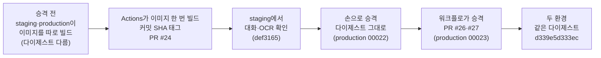

# [제출 보고서] N051 「한 번 만든 이미지로 배포하기」 실습 과제 수행 결과

**수신**: N051 강의 강사님 · **발신**: 수강생 전대진(DJ)
**실습일**: 2026-10-27
**과제 대상**: N049·N050에서 CI·staging·승인·Dockerfile을 붙인 AI 친구 에이전트 서비스(`friend-agent`)의 배포를 "배포할 때마다 소스로 이미지를 새로 빌드"하는 방식에서 "Actions에서 이미지를 한 번만 만들어 커밋 SHA 태그를 붙이고, staging에서 확인한 이미지를 그대로 production에 승격"하는 방식으로 바꾸는 실습. 이어서 정리 정책(드라이런), 로컬에서 만든 이미지 시험, 고장 난 Dockerfile 4종 진단, 장애 대응 훈련 재측정까지 했다.
**평가 방법**: 13번 "평가 체크리스트"를 보고 항목별로 점수와 한 줄 의견을 남겨 주세요.

> 📌 **요약** — 이 문서는 노션 「강의정리 양식」 구조(한눈에 → 절별 기록 → 사고 표 → 정리 → 궁금했던 것)로 쓴 **한눈에 읽는 보고서**이다. 명령·로그·수치를 있는 그대로 남긴 상세 기록은 같은 폴더의 부록 `N051_실습과제_제출보고서_부록_상세기록`에 있다. 프로젝트 ID·프로젝트 번호·계정 이메일은 공개 저장소에 올라가므로 `<프로젝트 ID>`·`<프로젝트 번호>`처럼 가렸고, 커밋 SHA와 다이제스트는 공개 저장소 값이라 그대로 적었다. 시각은 모두 한국 시각(KST)이다.

## 0. 한눈에



```ascii
승격 전(다이제스트 다름) → Actions 한 번 빌드(#24) → staging 확인 → 손으로 승격 → 워크플로 승격(#26·#27) → 같은 다이제스트
```

*그림: 오늘의 흐름. 이미지는 staging 브랜치 실행에서 한 번만 만들고, main 실행은 그 이미지를 읽어 그대로 production에 보낸다.*

배포한 것과 확인한 것이 같다고 말하려면 이미지를 한 번만 만들어야 한다. 그래서 이미지를 Actions 러너에서 커밋 SHA 태그로 만들어 올리고, production은 staging 리비전의 **다이제스트**를 읽어 그대로 받게 바꿨다.

- 저장소: friend-agent (N050에서 이어 사용, 공개 상태)
- 오늘 연 PR **5개**(#24~#28), 모두 머지
- 배포 워크플로 실행 **5번**(#18~#22): staging **3번**(#18·#20·#22), main **2번**(#19·#21, production 승인은 내가 직접 2번), 모두 success
- **같은 다이제스트 확인**: production 리비전 `friend-agent-00023-8ht`와 staging 리비전 `friend-agent-staging-00010-zx9`가 모두 `sha256:d339e5d333ec…`, `/version`의 commit이 모두 `8243335d…`
- main 실행의 배포 작업 시간: 새로 빌드한 #19 **1분 26초** → 승격한 #21 **46초**
- 장애 대응 훈련(질문 3개): 2장 **5분 이내(질문별 시간은 못 잼)** → 7장 **3분**(30초 + 1분 30초 + 1분)
- 고장 난 Dockerfile 4종(A~D) 모두 증상 → 원본 비교 → `git checkout` 복구까지 확인
- Artifact Registry 저장 공간: `cloud-run-source-deploy` **2,217.9MB**(이미지 40개, 무료 0.5GB 초과) · 오늘 만든 `friend-agent` **316.4MB**(4개)
- 정리 정책은 두 저장소에 `--dry-run`으로만 걸었고 오늘 삭제 후보는 **0개**(실제 결과는 내일 확인)

## 1. 시작 상태 점검 (교안 2장)

교안의 시작 상태 A~F를 조회 명령으로만 확인했다. 서비스 2개(`friend-agent`, `friend-agent-staging`), 저장소 변수 4개, GitHub 환경 `staging`·`production`, 워크플로 `ci.yml`·`deploy.yml`, `Dockerfile`·`.dockerignore`가 모두 있었다.

- **교재와 다르게 한 것**: 교안의 변수 표에는 `BUILD_SA`가 있는데 이 저장소에는 없고 템플릿 어디에서도 쓰이지 않는다. 이번 실습에 영향이 없다고 보고 만들지 않았다.
- 소스 배포 이미지의 기준선: `cloud-run-source-deploy`에 이미지 **40개**(`friend-agent` 26 · `friend-agent-staging` 12 · `load-test` 2), 태그는 이미지 이름(패키지)마다 가장 최근 한 개에만 붙은 `latest`뿐, 저장소 크기 **2,217.9MB**. 소스 배포 이미지에는 커밋이 적혀 있지 않았다.
- 두 환경의 `/version`: production 커밋 `21ee625`, staging 커밋 `9c0a5b3`(서로 다른 커밋).

## 2. 장애 대응 훈련 — 처음 (교안 2장)

production에서 "약속 알림이 이상하다"는 신고가 왔다고 가정하고 세 질문에 답했다. 이 단계는 내가 직접 화면을 열었고, 결과를 조회 명령으로 다시 확인했다.

| 질문 | 확인한 값 | 찾은 곳 |
|---|---|---|
| 1. 지금 production은 어느 커밋인가 | `21ee625`, 리비전 `friend-agent-00020-clm` | production `/version` |
| 2. 바로 전 정상 버전의 이미지는 | 리비전 `00019-nlc`의 이미지 `33ee47ea2f53` | 리비전 상세는 다이제스트뿐이라 이미지 목록과 **시각으로 맞춰** 찾아야 했다 |
| 3. staging에서 확인한 이미지와 같은가 | **다르다** (production `735e0e99525f`, staging `2bf4368fae93`) | staging 이미지는 같은 저장소의 별도 패키지 `friend-agent-staging`에 있어 화면에 보이지 않아 조회로 확인 |

- 5분 안에 세 질문의 답을 모두 확인했다고 기록한다. 다만 **직접 링크를 받아 화면을 찾는 시간이 빠졌고 질문별 시간은 재지 않았다.**
- 막힌 점: 2번은 이미지에 태그가 없어 만든 시각을 Actions 기록과 맞춰 짐작해야 했고, 3번은 환경마다 이미지를 따로 빌드해 대개 "다르다"가 된다.
- 리비전 `00018-klq`와 `00019-nlc`는 같은 이미지를 쓴다(설정만 바꾼 리비전). 이미지 수와 리비전 수가 일대일이 아니다.

## 3. Actions에서 이미지 만들기 (교안 3장, PR #24)

저장소 `friend-agent`를 만들고 배포 계정에 **저장소 하나에만** 쓰기 권한을 주고, 저장소 변수 `AR_REPO`를 등록했다. 그다음 `starter/workflows/deploy-image.yml`로 배포 워크플로를 바꾸는 PR을 올렸다.

- 명령 3개: `gcloud artifacts repositories create friend-agent …`, `… add-iam-policy-binding … --role roles/artifactregistry.writer`(프로젝트 전체가 아니라 `repositories` 대상), `gh variable set AR_REPO …`
- PR #24의 diff를 교안의 4기준(권한 · 태그에 `github.sha` · 빌드 단계 시크릿 없음 · 액션 버전 유지)으로 읽었고 모두 통과했다. 바뀐 것은 `source: .` → `image: ${{ env.IMAGE }}`, `docker build`·`push` 단계와 `setup-gcloud` 단계 추가, `flags:`의 `--clear-base-image` 제거이다.
- 머지 후 실행 #18(커밋 `def3165`)이 성공했고, Actions 로그의 `docker push` 마지막 줄 다이제스트가 `sha256:d9a9f3de8df079e2…`였다.
- 이 다이제스트가 Artifact Registry(태그 `def31657453804a041b56586b406808a30592f10`), 리비전 `friend-agent-staging-00009-vgg`의 이미지 주소, `/version`의 commit·revision과 모두 같은 값으로 이어졌다.
- 앱 화면 왼쪽 아래의 "빌드 `def3165`" 표시도 같은 커밋이었다.
- **교재와 다르게 한 것**: 교안은 `deploy-image.yml`을 그대로 쓰라고 하는데, 우리 저장소의 이전 `deploy.yml`에는 `--clear-base-image`가 있었다. 템플릿이 이 옵션을 빼서 그대로 따랐다(이미지로 배포하면 buildpacks 기본 이미지가 없기 때문으로 이해했다).
- staging에서 OCR과 대화를 확인했다. 일정표 사진의 글자가 입력창에 들어왔고, 보내기 후 하루가 "이미 지난 일정이라 저장할 수 없다"고 답했다(도구 결과 `이미 지난 시각입니다`). 앱이 설계대로 거절한 것이지 배포 문제가 아니다.

## 4. 연결표와 이미지 승격 (교안 4장, PR #25~#27)

main에 머지하면 새 이미지가 만들어지는지부터 확인했다.

| 환경 | 커밋 | 다이제스트(앞 12자리) | 리비전 |
|---|---|---|---|
| staging | `def3165…` | `d9a9f3de8df0` | `friend-agent-staging-00009-vgg` |
| production(PR #25 머지·승인 뒤) | `3201e13…` | `88f6f1871c11` | `friend-agent-00021-kxd` |
| production(손으로 승격한 뒤) | `def3165…` | `d9a9f3de8df0` | `friend-agent-00022-p9n` |

- **손 승격**: staging 리비전의 이미지를 `@sha256:` 주소 그대로 production에 배포했다. 실행 전에 서비스 이름·다이제스트 주소·`--update-env-vars`를 확인했고, 실행 후 환경변수 5개(`LLM_PROVIDER`·`LLM_API_KEY`·`COMMIT_SHA`·`ENV`·`OCR_ENABLED`)가 남아 있음을 확인했다. `COMMIT_SHA`도 `def31657…`로 함께 바꿨다.
- **워크플로 승격(PR #26·#27)**: `deploy.yml`을 세 군데만 고쳤다. ① 이미지 만들기 단계는 `if: github.ref_name != 'main'`, ② main에서만 staging 리비전의 다이제스트와 `COMMIT_SHA`를 읽는 단계 추가, ③ 배포 단계가 넘겨받은 값을 사용. 이 PC에는 `jq`가 없어 워크플로의 `jq` 식을 못 돌려서 같은 경로를 Python으로 실제 staging 데이터에 적용해 값이 나옴을 확인했다.
- **결과**: 실행 #21(main)에서 "이미지 만들기와 올리기 (staging)"는 **skipped**, "staging 이미지 찾기 (production 승격)"는 **success**였고 로그에 `staging 리비전 friend-agent-staging-00010-zx9 의 이미지를 승격한다`가 찍혔다. 배포 결과의 이미지가 `@sha256:d339e5d333ec…` 다이제스트 주소였다.
- production 리비전 `friend-agent-00023-8ht`와 staging 리비전 `friend-agent-staging-00010-zx9`가 둘 다 `d339e5d333ec`이고 `/version`의 commit이 둘 다 `8243335d…`였다. main의 머지 커밋은 `4ab996a`지만 `/version`은 이미지를 만든 staging 쪽 커밋을 보여 준다.
- 승인 전에 staging `/version`의 commit이 `8243335…`임을 직접 확인한 뒤 production을 승인했다.
- 다시 만들지 않은 효과: main 실행의 배포 작업이 새로 빌드한 #19에서 **1분 26초**, 승격한 #21에서 **46초**였다.

## 5. 로컬에서 만든 이미지 시험 (교안 4장 "직접 해 보고 싶다면")

시험용 저장소 `local-test`와 시험용 서비스 `local-test`를 따로 만들어 로컬 이미지를 올려 보고 지웠다.

- 이 PC는 Intel/AMD(`x86_64`)라 `docker image inspect`의 아키텍처가 **`amd64/linux`**로 나왔고 배포는 **성공**했다. 교안이 말한 Apple Silicon의 `linux/amd64` 오류는 재현하지 못했다.
- 그래도 `/version`이 `"commit":"local"`, `"env":"local"`로 **커밋 SHA가 없었다**(기록·무결성 문제는 그대로). 로그인 없이 호출하면 `403`이었다(공개되지 않음).
- 확인 후 서비스·저장소를 이름 `local-test`를 다시 확인하고 삭제했고, 로컬 이미지도 지웠다.
- 이어서 `AGENTS.md`의 "배포와 권한"에 "배포용 이미지는 GitHub Actions에서만 만든다. 로컬 환경에서 만든 이미지를 Artifact Registry에 올리거나 배포하지 않는다." 한 줄을 PR #28로 올려 머지했다. 이 시험은 규칙을 넣기 **전에** 했다.
- **교재와 다르게 한 것**: Docker Desktop이 꺼져 있어 직접 켰다. 이 시험 중 `docker push` 결과 마지막 줄 크기가 856으로 나왔는데(이미지 본체가 아니라 매니페스트 목록으로 보임), 원인까지는 확인하지 않았다.

## 6. 정리 정책 (교안 5장)

`docs/cleanup-policy.json`(삭제: 7일 초과, 유지: 최근 10개)을 만들어 `friend-agent`와 `cloud-run-source-deploy` 두 저장소에 **`--dry-run`**으로 걸었다. 조회로 두 저장소 모두 `cleanupPolicyDryRun: true`를 확인했다.

- 이미지 40개로 시뮬레이션한 삭제 대상: **지금 0개** → 내일(10-28) 6개 → 3일 뒤(10-30) 저장소 전체 기준 20개, 이미지 이름별 기준 16개.
- 오늘은 가장 오래된 이미지(10월 20일 06시 UTC)가 아직 7일이 안 돼 지울 것이 없다. 감사 로그를 조회했으나 아직 기록이 없었다.
- 롤백 기준 점검: production `8243335`·staging `1010a7d`·직전 `3201e13`·`def3165`가 모두 `friend-agent` 저장소의 최근 10개 안이다.
- **불확실한 것**: "최근 10개"를 저장소 전체로 세는지 이미지 이름(패키지)별로 세는지는 확인하지 못했다. 드라이런 결과(감사 로그)로 확인할 일이다.
- **풀지 못한 것**: 실제 삭제(`--no-dry-run`) 전환과 드라이런 결과 확인은 하루 뒤로 남겼다. 정책 파일은 작업 폴더의 `docs/cleanup-policy.json`에 git 미추적 파일로만 있고 PR로 올리지 않았다.

## 7. 고장 난 Dockerfile 4종 (교안 6장)

| 문제 | 증상(관찰) | 원인(원본과 비교) | 복구 후 |
|---|---|---|---|
| A. OCR만 실패 | 컨테이너는 정상 시작, 사진을 보내면 500 `사진에서 글자를 읽는 프로그램이 서버에 없습니다` | `RUN apt-get install … tesseract-ocr tesseract-ocr-kor` 줄 없음 | HTTP 200, 일정표 글자 반환 |
| B. 이미지 안의 파일 | `ls -a /app`에 `.env` 보임(서비스는 정상) | `.dockerignore`에서 `.env` 줄 없음(`**/` 패턴도 빠짐) | `.env` 사라지고 `.env.example`만 |
| C. 실행 사용자 | 서비스·`/health` 정상, `whoami`가 `root` | `RUN useradd … appuser`·`USER appuser` 줄 없음 | `whoami` = `appuser` |
| D. 접속 안 됨 | 컨테이너 `Up`, `localhost:8080` 응답 없음(`HTTP 000`), 로그가 `0.0.0.0:8000`을 리슨 | `CMD`가 `${PORT:-8080}` 대신 `--port 8000` 고정 | 8080과 `PORT=9000`에서 모두 200 |

- 문제 A는 내가 먼저 "운영체제 시스템 패키지이고 Dockerfile의 설치 명령에 있을 것 같다"고 짐작했고 맞았다. B~D는 짐작 없이 바로 원본과 비교했다(내 선택).
- **교재와 다르게 한 것**: 교안은 `cp starter/Dockerfile Dockerfile`로 되돌리라고 하는데, 이 저장소의 Dockerfile은 N050에서 PDF용 `poppler-utils`를 더한 버전이라 `starter/`로 되돌리면 그 기능이 사라진다. 그래서 `git checkout -- Dockerfile`·`.dockerignore`로 되돌렸다.
- Actions 이미지였다면 **드러나지 않았을 문제는 B**(로컬 폴더의 `.env`는 GitHub에 없음), **서비스가 정상으로 보여 지나쳤을 문제는 C**이다.
- 문제 A를 처음 시도했을 때 Docker Desktop이 꺼져 빌드가 실패했다. 그 사이 루트 Dockerfile이 고장 난 상태로 남았으나 데몬을 다시 켠 뒤 진행하고 `git checkout`으로 되돌렸다(`git status` 깨끗).

## 8. 장애 대응 훈련 — 다시 (교안 7장)

같은 세 질문을 production `/version`, 리비전 상세, Artifact Registry `friend-agent` 태그만 보고 답했다.

| 질문 | 2장 | 7장 |
|---|---|---|
| 1. 어느 커밋인가 | `/version`으로 답함, 이미지에 커밋 없음 | **30초** — 커밋 `8243335d…`, 이미지 태그와 같은 값 |
| 2. 되돌릴 수 있는가 | 태그가 없어 시각으로 짐작, 못 찾음 | **1분 30초** — 바로 전 리비전 `00022-p9n`의 다이제스트 `d9a9f3de8df0`를 목록에서 찾으니 태그 `def31657…`가 같은 줄에 있고 이미지가 남아 있음 |
| 3. staging과 같은가 | 대개 "다르다" | **1분** — production `d339e5d333ec`(`8243335`), 지금 staging `c87c9b5279f8`(`1010a7d`, PR #28만 머지돼 앞서 있음). 승격한 이미지는 같고 staging이 더 앞서 있다는 이유까지 목록에서 읽힘 |
| 합계 | 5분 이내 | 3분 |

- 7장 2번은 처음에 현재 리비전만 보고 막혔다가(이미지 주소가 잘려 보였음) 안내를 받은 뒤 1분 30초 만에 풀었다.
- **회고 — 가장 크게 달라진 질문**: 2번이다. 2장에서는 이미지에 태그가 없어 만든 시각을 Actions 기록과 맞춰 짐작해야 했고 답을 못 찾았다. 7장에서는 리비전 상세의 다이제스트를 Artifact Registry에서 찾으면 같은 줄에 커밋 SHA 태그가 붙어 있어 1분 30초 만에 바로 전 이미지와 그 이미지가 남아 있음을 확인했다.
- **회고 — 여전히 사람이 직접 해야 하는 일**: 승인하더라도 staging과 production의 이미지가 다를 수 있으므로(실제로 오늘 staging이 main보다 앞서 있었다) 승인 전에 두 환경의 다이제스트를 비교해 확인하는 것이다.

## 9. 사고·문제 표

| 번호 | 변경 | 결과 | 사용자에게 보였을 것 | 원인을 찾은 곳 | 처리 |
|---|---|---|---|---|---|
| 1 | staging·production이 이미지를 따로 빌드(승격 전) | 다이제스트가 다름(`d9a9f3de` ≠ `88f6f187`) | 없음 | Cloud Run 리비전의 이미지 주소 | 이미지 승격(손 → 워크플로) |
| 2 | 7장 2번에서 현재 리비전만 봄 | 이미지 주소가 잘려 바로 전 이미지를 못 찾음 | 없음 | 리비전 목록에서 바로 전 리비전을 열지 않음 | 00022를 열어 다이제스트 확인, 1분 30초 |
| 3 | PR #28을 staging에만 머지 | staging(`c87c9b52`)이 production(`d339e5d3`)보다 앞섬 | 없음 | Artifact Registry 태그 목록 | 정상. 다음 main 머지·승인 때 다시 같아짐 |
| 4 | Docker Desktop이 꺼진 채 문제 A·로컬 시험 시작 | `dockerDesktopLinuxEngine` 파이프 오류 | 없음 | 명령 오류 메시지 | Docker Desktop을 켠 뒤 재실행 |
| 5 | 문제 A에서 `cp`로 덮어쓴 뒤 빌드 실패 | 루트 Dockerfile이 고장 난 상태로 잠깐 남음 | 없음 | `git status`·`head Dockerfile` | 데몬 재시작 후 진행, 끝에 `git checkout`으로 복구 |
| 6 | Intel PC에서 로컬 이미지 배포 | 성공(교안의 실패 사례 재현 못함) | 없음 | `docker image inspect` = `amd64`, `/version` commit=`local` | 규칙의 근거를 둘째 이유(기록·무결성)로 확인 |
| 7 | 정리 정책 드라이런 | 오늘 삭제 대상 0개 | 없음 | 이미지 목록 계산 | 내일 감사 로그로 확인 |

1~3번은 모두 **이미지가 같은지 다른지를 다이제스트로 말할 수 있게 된 뒤**에 의미가 생기는 항목이다. 5번처럼 고장 난 파일을 덮어쓰는 실습은 끝난 뒤 `git status`로 원상태를 꼭 확인해야 한다.

## 10. 풀지 못한 것 · 교재와 달라진 것

**풀지 못한 것 / 하지 않은 것**
- 정리 정책의 **실제 삭제 전환과 드라이런 결과 확인**(하루 뒤, 내일). "최근 10개" 기준이 저장소 전체인지 이미지별인지도 그때 확인한다.
- 선택 과제 4종(손으로 롤백 훈련·태그 변경 금지·slim 크기 비교·배포 기록 자동화)은 하지 않았다.
- 로컬 이미지 시험에서 Apple Silicon 실패는 재현하지 못했다(이 PC는 `amd64`).
- 정리 정책 파일(`docs/cleanup-policy.json`)은 PR로 올리지 않았다.
- 새 리비전으로 바뀌는 순간 사용자가 오류를 보는지는 측정하지 않았다(교안의 남은 숙제).

**교재와 달라진 것**
- `BUILD_SA` 변수 없음(템플릿 미사용)
- 복구는 `cp starter/…`가 아니라 `git checkout`(poppler 보존)
- 7장 훈련은 2장과 달리 질문별 시간 비교가 불완전(2장은 합계만)
- 오늘 staging이 main보다 앞선 상태가 생겨 7장 3번이 교안 예상("승격 후 같다")과 다르게 "지금은 다르다, 이유는 PR #28"이 됨

## 11. 정리

- **이미지 이름**은 저장 위치·프로젝트·저장소·이미지 이름·태그이고, 태그는 옮겨 붙을 수 있고 다이제스트는 내용으로 정해진다. 찾아갈 때는 커밋 SHA 태그, 실제로 무엇이 도는지는 다이제스트로 본다.
- **연결표 다섯 칸**(커밋 → 태그 → 다이제스트 → 리비전 → `/version`)이 채워지면 "지금 도는 코드는 어느 커밋인가"에 화면 몇 개로 답한다.
- **이미지 승격**: main 머지에서 이미지를 다시 만들지 않고 staging 리비전의 다이제스트와 `COMMIT_SHA`를 읽어 그대로 보낸다. 승인의 뜻이 "새로 만들어 내보낸다"에서 "확인한 그 이미지를 내보낸다"로 바뀐다.
- **로컬에서 만든 이미지는 올리지 않는다**: CPU 아키텍처 문제와 함께, 이 PC에서도 확인한 기록·무결성(`/version`에 커밋 없음) 문제가 있다.
- **정리 정책**은 삭제+유지를 함께, 드라이런 먼저. 롤백에 필요한 이미지를 남긴다.
- **고장 난 Dockerfile**: 빌드 성공과 서비스 정상은 다르다. 증상 → 가설 → 확인 → 복구 → 재검증.

## 12. 궁금했던 것

아래 질문은 이번 실습의 사고 표에서 뽑은 것이다.

**Q. 태그가 있으면 이미지를 정확히 가리키는 것 아닌가? 왜 다이제스트가 따로 필요한가?**

- 태그는 같은 이름을 다른 이미지에 다시 붙일 수 있다. 다이제스트는 내용으로 정해져 옮겨 붙지 않는다. Cloud Run도 태그로 배포해도 배포 순간의 다이제스트로 바꿔 기록한다. 오늘 연결표에서 리비전의 이미지 주소가 `…@sha256:…`로만 보인 것이 그 예다.

**Q. main에 머지하는 커밋이 새로 생기는데 `/version`의 commit이 `4ab996a`가 아니라 `8243335`로 나오는 이유는?**

- 승격 워크플로는 main에서 이미지를 만들지 않고 staging 리비전의 `COMMIT_SHA`를 읽어 그대로 넣는다. `/version`은 이미지를 만든 staging 쪽 커밋을 보여 주므로 커밋에서 이미지까지의 연결이 끊기지 않는다.

**Q. Intel PC에서 로컬 이미지 배포가 성공했는데 왜 규칙이 필요한가?**

- 아키텍처 때문에 실패하지 않아도 로컬 이미지는 내 폴더의 파일로 만들어져 커밋과 연결되지 않는다. `/version`의 `commit`이 `local`이었고 PR 검토·CI·승인도 건너뛴다.

**Q. 정리 정책을 걸었는데 왜 오늘은 지워진 것이 없나?**

- 가장 오래된 이미지가 아직 7일이 안 됐고, 정책 반영과 감사 로그 확인에도 하루쯤 걸린다. 그래서 오늘은 드라이런으로 걸고 목록으로 계산한 뒤, 하루 뒤에 결과를 확인하는 것이 순서다.

## 13. 평가 체크리스트 (1~5점, 한 줄 의견)

| 번호 | 확인할 것 | 근거가 있는 절 | 점수 | 의견 |
| --- | --- | --- | --- | --- |
| 1 | 지금 구조에서 세 질문에 답해 보고 막히는 이유(태그 없음·환경마다 다른 이미지)를 찾았는가 | 2 | | |
| 2 | Actions에서 이미지를 만들어 커밋 SHA 태그로 올리고 커밋→이미지→리비전→`/version`을 연결표로 이었는가 | 3, 4 | | |
| 3 | staging 이미지를 다이제스트 그대로 production에 승격(손과 워크플로)하고 두 환경의 다이제스트가 같음을 확인했는가 | 4 | | |
| 4 | 로컬에서 만든 이미지를 시험해 보고 규칙으로 반영했는가 | 5 | | |
| 5 | 정리 정책을 삭제+유지로 설계하고 드라이런으로 걸어 롤백용 이미지가 남는지 점검했는가 | 6 | | |
| 6 | 고장 난 Dockerfile 4종을 증상으로 원인을 찾고 복구·재검증했는가 | 7 | | |
| 7 | 장애 대응 훈련을 두 번 해 비교하고 사람 몫을 적었는가 | 2, 8 | | |
| 8 | 풀지 못한 것과 교재와 달라진 점을 숨기지 않고 적었는가 | 10 | | |

**전체 의견**:

## 14. 첨부할 증거 화면 (Notion에 직접 붙여 넣기)

증거는 폴더 `강의정리\N051\증거화면\`의 15개 파일(PNG·WEBP)이다. 이 폴더는 git에 추적하지 않았다.

> ⚠️ **주의** — 01·02·13·15에는 프로젝트 ID가 화면(주소 표시줄·경로)에 보이고, 03·04·05·08~12에는 GitHub 계정 이름이 보인다. 공개 문서나 노션에 올리기 전에 프로젝트 ID 부분을 가릴지 정한다. 이 보고서 본문은 이미 가렸다.

| 절 | 장면 | 파일(번호) |
|---|---|---|
| 2 | 처음 훈련: 리비전 탭 · 소스 배포 이미지 목록(태그 없음) · Actions 실행 목록 | 01 · 02 · 03 |
| 3 | PR #24 체크 통과 · 실행 #18 staging 배포 중 · staging OCR 입력 · 대화와 약속 저장 거절 | 04 · 05 · 06 · 07 |
| 4 | 실행 #19(main, 승인) · #20(staging) · #21 승인 대기와 승격 성공 | 08 · 09 · 10 · 11 |
| 5 | PR #28 규칙 머지 후 배포 중(실행 #22) | 12 |
| 8 | 7장 훈련: 컨테이너 탭(현재 리비전) · 리비전 목록 · Artifact Registry 태그 목록 | 13 · 14 · 15 |

(교안 6장 고장 난 Dockerfile 4종의 화면 증거는 터미널 출력이라 부록 7절에 명령과 출력으로 남겼다.)
