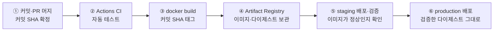
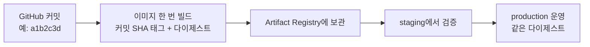
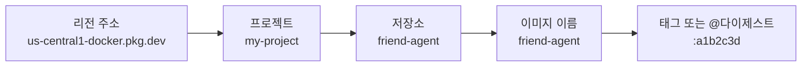
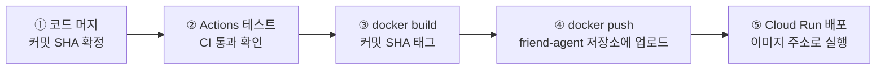
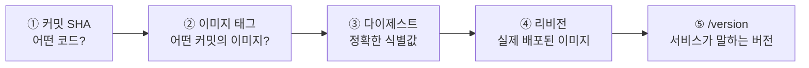
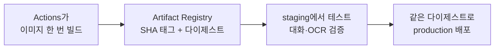
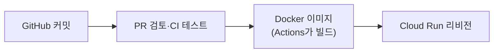

# N051 · 한 번 만든 이미지로 배포하기

> 버전 1.0 · 2026-10-27 (학습서 + 해설서 통합, 교안 기준 — 실습 결과는 아직 반영하지 않음)

## 목차

- [핵심 한 문장 요약](#핵심-한-문장-요약)
- [1. 한 번 만든 이미지로 배포하기 — 세 가지 질문](#1-한-번-만든-이미지로-배포하기--세-가지-질문)
- [2. 시작 상태 맞추기 — 다이제스트와 장애 대응 훈련](#2-시작-상태-맞추기--다이제스트와-장애-대응-훈련)
- [3. 바뀌는 흐름 — Actions에서 이미지 만들기](#3-바뀌는-흐름--actions에서-이미지-만들기)
- [4. 연결표 채우기와 이미지 승격](#4-연결표-채우기와-이미지-승격)
- [5. 정리 정책 정하기](#5-정리-정책-정하기)
- [6. 고장 난 Dockerfile 고치기](#6-고장-난-dockerfile-고치기)
- [7. 장애 대응 훈련 다시 하기](#7-장애-대응-훈련-다시-하기)
- [맺음말](#맺음말)
- [부록 A · 실전 코드 모음](#부록-a--실전-코드-모음)
- [부록 B · 트러블슈팅 표](#부록-b--트러블슈팅-표)
- [부록 C · AI 프롬프트 모음집](#부록-c--ai-프롬프트-모음집)
- [부록 D · 용어 사전](#부록-d--용어-사전)
- [부록 E · 개념 비교표 모음](#부록-e--개념-비교표-모음)
- [부록 F · 학습 로드맵](#부록-f--학습-로드맵)
- [부록 G · 복습 퀴즈](#부록-g--복습-퀴즈)

## 핵심 한 문장 요약

> 📌 **요약** — 자동 배포만으로는 부족하다. 운영 중 문제가 생겼을 때 **지금 도는 코드가 어느 커밋인지(추적성), 정상이던 버전으로 되돌릴 수 있는지(복구성), staging에서 확인한 이미지와 같은지(동일성)** 에 답할 수 있어야 한다 — 그래서 이미지를 GitHub Actions에서 **한 번만** 만들어 커밋 SHA 태그를 붙이고, staging에서 확인한 그 이미지를 **다이제스트 그대로** production에 보내며, 롤백에 필요한 이미지를 남기는 정리 규칙을 건다.

이번 강의는 N049·N050에서 만든 AI 친구 에이전트 서비스(`friend-agent`, 줄여서 에이전트 서비스)에서 시작한다. 이 서비스는 PR을 머지하면 CI(지속적 통합, Continuous Integration — 코드를 합칠 때마다 테스트를 자동으로 돌리는 것)를 거쳐 staging과 production에 자동 배포되고, 실행 환경은 저장소 루트의 Dockerfile이 정한다. 지금의 배포 단계는 코드를 Cloud Build로 보내고, Cloud Build가 그 Dockerfile로 이미지를 만든다. 그런데 사용자가 "약속 알림이 이상해요"라고 알려 오면 이 구조로는 세 가지 질문에 빨리 답하기 어렵다. 오늘은 그 이유를 하나씩 없앤다.

> 💡 **팁** — 문서에서 "원문"은 학습서(28쪽), "해설서"는 해설서(34쪽)를 가리킨다. 두 책은 같은 강의의 두 버전이며 챕터 01~07이 1:1로 대응한다. 해설서의 쉬운 비유(음식점·택배 상자·문서 보관실·출판)를 우선 살렸고, 원문의 명령·프롬프트·수치는 그대로 옮겼다. `[보충 비유]`·`[보충]`이라고 표시한 것만 이 노트에서 덧붙인 설명이다.

> 💡 **팁** — 버전 1.0은 교안(학습서·해설서)을 정리한 판이다. 실제로 friend-agent 저장소에서 해 본 결과는 아직 없으므로 지어서 채우지 않았다. 훈련 표의 "걸린 시간" 칸처럼 직접 해 봐야 아는 값은 빈칸으로 두었고, 실습을 마치면 N050처럼 `[실습 결과]`로 덧붙인 v1.1을 만든다(v1.0은 보존). 수치 중 "0.5GB·월 0.1달러"는 교안이 밝힌 2026년 10월 기준이다.

---

## 1. 한 번 만든 이미지로 배포하기 — 세 가지 질문

### 1-1. 출발점: 자동으로 배포되고 있다

오늘 실습이 시작되는 상태는 이렇다.

| 구성 | 지금 상태 |
|---|---|
| 코드 합치기 | PR을 머지하면 CI가 테스트를 돌린다 |
| 배포 | staging, production으로 자동 배포된다 (production은 승인을 거친다) |
| 실행 환경 | 저장소 루트의 `Dockerfile`이 정한다 |
| 이미지 만들기 | 배포 단계가 **코드를 Cloud Build로 보내면**, Cloud Build가 그 Dockerfile로 이미지를 만든다 |

배포가 자동으로 돌기 시작하면, 문제가 생긴 그 순간에 답해야 하는 질문이 생긴다.

### 1-2. 문제가 생기면 답해야 하는 세 가지

해설서는 이 질문들을 세 가지 이름으로 묶는다.

| 질문 | 이름 | 뜻 |
|---|---|---|
| 지금 production에서 도는 코드가 어느 커밋인가? | **추적성** | 운영 버전에서 변경 이력까지 거슬러 올라갈 수 있다 |
| 바로 전에 정상이던 버전으로 되돌릴 수 있는가? | **복구성** | 이전 이미지가 남아 있어 롤백(rollback — 문제가 생긴 새 버전 대신 이전 버전으로 되돌리는 것)할 수 있다 |
| 지금 production 이미지는 staging에서 확인한 바로 그 이미지인가? | **동일성** | 검증한 것과 내보낸 것이 같다 |

> 🧪 **예제** — 사용자가 "약속 알림이 이상해요"라고 신고했다. 추측("최근에 코드를 고쳤으니 그게 원인이겠지")이 아니라 증거로 조사하는 순서는 다음과 같다. ① Cloud Run 콘솔에서 production의 현재 리비전을 본다. ② 그 리비전이 쓰는 이미지와 다이제스트를 본다. ③ 이미지 태그나 빌드 기록으로 커밋 SHA를 추적한다. ④ `/version` 응답과 대조한다. ⑤ 직전 정상 버전의 이미지가 남아 있다면 되돌리는 방법을 검토한다. ⑥ staging과 production의 다이제스트를 비교한다.

### 1-3. 오늘 할 일

오늘은 이 세 질문에 답하기 어려운 이유를 하나씩 없앤다.

1. 이미지를 **GitHub Actions 안에서 직접** 만들고, **커밋 SHA**(커밋마다 붙는 고유한 해시값. 예: `a1b2c3d`)를 태그로 붙인다. 커밋에서 실행 중인 리비전까지 한 줄로 이어진다.
2. staging에서 확인한 이미지를 **다시 빌드하지 않고** 그대로 production에 보낸다.
3. 쌓이는 이미지를 정리하는 규칙을 걸되, 롤백에 필요한 이미지는 남긴다.
4. 마지막으로 고장 난 Dockerfile을 증상만 보고 고쳐 본다.

### 1-4. 쉬운 비유: 음식점과 제품 상자

해설서는 AI 에이전트 서비스를 **음식점**에 비유한다.

| 소프트웨어 | 음식점 비유 |
|---|---|
| 코드 | 요리 레시피 |
| Dockerfile | 재료를 준비하고 요리하는 방법을 적은 조리법 |
| Docker 이미지 | 레시피와 재료를 포함해 실행할 수 있도록 완성한 **제품 상자** |
| 컨테이너 | 이미지로 실제 실행한 프로그램 |
| Cloud Run | 완성된 제품을 실행해 사용자에게 제공하는 장소 |
| staging | 판매 전에 품질을 검사하는 **시험 매장** |
| production | 실제 고객이 이용하는 **정식 매장** |
| Artifact Registry | 완성된 이미지를 보관하는 **창고** |

시험 매장에서 확인한 제품을 정식 매장용으로 **다시 만들면** 재료나 조리 과정이 달라질 가능성이 있다. 그래서 이번 강의의 핵심은 검증을 마친 완성품 **자체**를 정식 매장으로 옮기는 것이다.

> 💡 **팁** — `[보충 비유]` 제조업의 **출하 검사**와 같다. 샘플로 검수를 통과시켜 놓고 출하할 때는 새로 생산한 물량을 내보내면, 검수 결과는 출하품에 대해 아무것도 보장하지 못한다. 그리고 제품에 **제조번호(로트번호)** 가 없으면 불량이 나왔을 때 어느 공정·어느 재료에서 났는지 거슬러 올라갈 수 없다. 커밋 SHA 태그가 곧 제조번호다.

### 1-5. 목표 흐름



```ascii
① 커밋·PR 머지 → ② Actions CI → ③ docker build → ④ Artifact Registry → ⑤ staging 검증 → ⑥ production
   (커밋 SHA 확정)   (자동 테스트)   (SHA 태그 지정)    (이미지·다이제스트)     (같은 이미지)    (같은 다이제스트로)
```

*그림: 오늘 만드는 배포 흐름. 이미지는 ③에서 한 번만 만들고, ⑤와 ⑥은 그 이미지를 그대로 쓴다.*

> ⚠️ **주의** — 해설서의 단서: 이 여섯 단계가 **반드시 하나의 워크플로 안에서 모두 자동으로** 실행된다는 뜻은 아니다. 실제 자동화 방식은 GitHub Actions 워크플로 설정에 따라 달라진다. 오늘 실습에서는 staging 브랜치 머지와 main 브랜치 머지가 각각 한 번씩 배포 워크플로를 돌린다.

### 1-6. 오늘의 학습 목표 (8개)

- [ ] 1. 이미지 이름의 구조를 읽고, 태그와 다이제스트(digest — 이미지 내용으로 계산한 고유 해시값)가 어떻게 다른지 설명할 수 있다.
- [ ] 2. 커밋 SHA를 태그로 쓰는 이유를 설명하고, `latest`만 쓸 때 생기는 문제를 짚을 수 있다.
- [ ] 3. GitHub Actions에서 이미지를 만들어 Artifact Registry에 올리고 그 이미지로 배포하는 워크플로를 실행 전 기준으로 검토할 수 있다.
- [ ] 4. 커밋, 이미지 태그, 다이제스트, 리비전, `/version` 응답을 콘솔과 명령으로 찾아 한 줄로 이을 수 있다.
- [ ] 5. staging에서 확인한 이미지를 다이제스트로 지정해 production에 배포하고, 두 환경의 다이제스트가 같은지 확인할 수 있다.
- [ ] 6. 로컬 환경(내 컴퓨터)에서 만든 이미지가 Cloud Run에서 실행되지 않는 이유를 설명하고 작업 규칙에 반영할 수 있다.
- [ ] 7. 정리 정책으로 저장 공간을 관리하되, 롤백에 필요한 이미지를 남기는 기준을 정할 수 있다.
- [ ] 8. 고장 난 Dockerfile을 증상과 기록만 보고 원인을 찾아 고칠 수 있다.

### 1-7. 이 책의 시작 질문

원문은 수업 첫 장면에서 주관식 질문 하나를 던진다.

> 🧪 **예제** — **[시작 질문]** production에서 문제가 생겼다는 신고가 들어왔습니다. 지금 production의 코드가 어느 커밋인지, 정상이던 버전으로 되돌릴 수 있는지, staging에서 확인한 이미지와 같은지 세 가지를 알아내려면 어디를 어떤 순서로 열어 보겠습니까? 아는 화면을 떠올려 적어 보세요.

정답이 하나인 질문은 아니다. 뒤의 2-3절 "장애 대응 훈련"에서 이 질문을 실제로 해 보고, 7장에서 같은 훈련을 한 번 더 해 걸린 시간을 비교한다.

### 반드시 기억할 것

- Dockerfile은 이미지를 만드는 방법을 정의하고, Docker 이미지는 실행에 필요한 내용을 담은 패키지다.
- 오늘의 목표는 **추적성·복구성·동일성** 세 질문에 몇 초 만에 답할 수 있는 구조를 만드는 것이다.
- 태그는 이름표이고, 다이제스트는 이미지 내용을 식별하는 고유한 값이다.
- staging에서 검증한 이미지를 다시 빌드하지 않고 production에 배포하면 두 환경의 동일성을 확보하기 쉽다.

> 📌 **요약** — 코드를 배포하는 것에서 한 걸음 더 나아가, **어떤 코드로 만든 이미지가 실제 운영 중인지 추적하고 검증된 동일한 이미지로 안전하게 배포·복구하는 법**을 배우는 과정이다.

---

## 2. 시작 상태 맞추기 — 다이제스트와 장애 대응 훈련

### 2-1. 시작 상태: 공사 전 현장 점검

집을 짓기 전에 전기·수도가 연결돼 있는지, 자재가 준비돼 있는지 보는 것과 같다. 이 교안의 실습은 아래 상태가 갖춰져 있어야 진행할 수 있다. 표의 마지막 줄인 루트의 `Dockerfile`까지 있어야 오늘 GitHub Actions에서 그 Dockerfile로 이미지를 만들 수 있다.

| 항목 | 필요한 상태 | 확인할 것 | 없으면 |
|---|---|---|---|
| A | Google Cloud 프로젝트, gcloud 로그인과 기본 리전, API 4개 | `gcloud config list`에 내 프로젝트와 `run/region = us-central1` | 시작 상태 문서의 A |
| B | `friend-agent` 서비스 (시크릿 `llm-api-key` 참조) | `gcloud run services list`에 `friend-agent` | 시작 상태 문서의 B |
| C, D | GitHub Actions 배포 권한(WIF)과 저장소 변수, CI(`ci.yml`)와 환경별 배포(`deploy.yml`), staging 브랜치, GitHub 환경 `staging`·`production` | `gh variable list`에 `GCP_PROJECT_ID`, `WIF_PROVIDER`, `DEPLOY_SA`, `RUNTIME_SA`, `BUILD_SA`. `.github/workflows`에 두 파일, 원격 `staging` 브랜치, 환경 두 개 | `docs/wif-setup.md` 0~4, 7단계 |
| E | `friend-agent-staging` 서비스 | `gcloud run services list`에 `friend-agent-staging` | 시작 상태 문서의 E |
| F | 저장소 루트의 `Dockerfile`, `.dockerignore` | 두 파일이 루트에 있음 | 시작 상태 문서의 F |

앞 실습을 이어서 하고 있다면 아래 확인 명령만 실행하고 넘어간다. 빠진 상태가 있으면 템플릿의 `docs/start-states.md`에서 "없으면" 칸의 항목을 표의 위 칸부터 차례로 실행한다. 처음부터 모두 맞추면 한두 시간이 걸리므로, 빠진 항목이 많다면 수업 전에 맞춰 두거나 강사에게 먼저 알린다.

```bash
gcloud config list
gcloud run services list --region us-central1
gh variable list
gh api repos/{owner}/{repo}/environments --jq '.environments[].name'
git branch -r
ls .github/workflows Dockerfile .dockerignore
```

> ⚠️ **주의** — 해설서의 강조: 준비 상태를 **확인**하는 것과 새로 **만들거나 바꾸는** 것은 별개다. 위 명령은 조회만 한다. 변수와 시크릿도 구별한다. 프로젝트 ID나 서비스 계정 이름은 변수로 둘 수 있지만, API 키처럼 밖에 드러나면 안 되는 값은 시크릿(Google Cloud 콘솔에서는 "보안 비밀")으로 관리한다.

### 2-2. 이미지를 구별하는 값, 다이제스트

오늘은 "다이제스트"라는 말이 계속 나온다. 다이제스트(digest)는 이미지를 올릴 때 이미지 **내용으로 자동으로 정해지는** `sha256:…` 모양의 값으로, 이미지 하나를 정확히 가리키는 데 쓴다.

이런 값이 따로 있는 이유는 사람이 붙이는 이름인 **태그**가 믿을 만하지 않기 때문이다. 태그는 언제든 다른 이미지로 옮겨 붙일 수 있어서, 어제의 `latest`와 오늘의 `latest`가 다른 이미지일 수 있다. 내용이 정하는 다이제스트는 옮겨 붙일 수 없으므로 "정확히 이 이미지"를 말해야 할 때는 다이제스트를 쓴다.

| 비유 | 태그 | 다이제스트 |
|---|---|---|
| 택배 상자 | 상자에 붙인 **이름표** ("정상제품", "10월 27일 제품") | 상자 내용물을 식별하는 고유한 **지문** |
| 바뀔 수 있나 | 다른 이미지로 옮겨 붙을 수 있다 | 이미지 내용으로 정해지므로 옮겨 붙을 수 없다 |
| 예 | `latest`, `a1b2c3d` | `sha256:0d01a69…` |

오늘 다이제스트를 확인하는 이유는 세 가지다.

1. 리비전이 **실제로 어떤 이미지로** 실행 중인지 알기 위해
2. staging과 production이 **같은 이미지**를 실행하는지 비교하기 위해
3. staging에서 확인한 바로 그 이미지를 production에 보낼 때 **그 이미지를 지정**하기 위해

Cloud Run은 리비전을 만들 때 태그로 받은 이미지도 **그 순간의 다이제스트로 바꿔 기록**한다. 그래서 리비전 상세의 다이제스트가 가장 정확한 답이다. 오늘은 아래 세 곳에서 다이제스트를 만난다. 값이 길기 때문에 비교할 때는 앞 12자리 정도만 맞춰 봐도 충분하다.

| 보이는 곳 | 모양 |
|---|---|
| Artifact Registry 이미지 목록의 다이제스트 칸 | `sha256:0d01a69ed26e…` |
| Cloud Run 리비전 상세의 이미지 주소 | `…/friend-agent@sha256:0d01a69ed26e…` 처럼 이름 뒤에 `@`와 함께 붙음 |
| 이미지를 올리는 `docker push`의 마지막 줄 | `<태그>: digest: sha256:0d01a69ed26e… size: …` |

해설서가 짚는 세 가지 오해 방지:

- 태그가 같다고 해서 이미지가 같은 것은 아니다.
- 태그가 바뀌어도, 이미 배포한 Cloud Run 리비전이 자동으로 새 이미지로 바뀌지는 않는다.
- 다이제스트가 같으면 해당 이미지의 내용이 같다.

### 2-3. 장애 대응 훈련: 어디를 열어 봐야 할까

시작 질문의 상황을 실제로 해 본다. production 에이전트 서비스에서 약속 알림이 이상하다는 신고가 들어왔다고 가정하고, **타이머를 5분으로 맞춘 뒤** 아래 세 질문에 답한다. 아직 아무것도 고치지 않은 지금 구조 그대로, 콘솔과 GitHub 화면만으로 답을 찾는다. 답을 찾지 못한 질문은 왜 찾지 못했는지를 적는다.

| 질문 | 내 답 | 찾은 곳, 또는 찾지 못한 이유 | 걸린 시간 |
|---|---|---|---|
| 1. 지금 production에서 도는 코드는 어느 커밋인가 | 　 | 　 | 　 |
| 2. 바로 전에 정상이던 버전은 어느 이미지이고, 그 이미지로 되돌릴 수 있는가 | 　 | 　 | 　 |
| 3. 지금 production 이미지는 staging에서 확인한 그 이미지와 같은가 | 　 | 　 | 　 |

훈련에서 열어 볼 화면은 다섯 곳이다.

| 열어 볼 곳 | 확인 목적 |
|---|---|
| Cloud Run → `friend-agent` → 리비전 탭 | 트래픽을 받는 리비전과 바로 전 리비전, 각 리비전 상세의 컨테이너 탭에 적힌 이미지 주소 |
| production 주소의 `/version` | `commit`과 `revision` 값 |
| Artifact Registry → `cloud-run-source-deploy` → `friend-agent` | 이미지마다 붙은 태그와 다이제스트, 만든 시각 |
| GitHub 저장소 → Actions 탭 | main의 deploy 실행 기록과 실행 시각 |
| Cloud Run → `friend-agent-staging` → 리비전 탭 | 트래픽을 받는 리비전의 이미지 다이제스트 |

> 📌 **요약** — 이 다섯 곳의 값을 **커밋 SHA → 이미지 다이제스트 → Cloud Run 리비전** 순서로 이을 수 있으면 장애 원인 추적과 복구가 쉬워진다. 지금 구조에서는 이 연결이 곳곳에서 끊겨 있다.

> ⚠️ **주의** — `/version`은 서비스가 커밋·리비전 정보를 돌려주도록 **직접 구현해 둬야** 있는 주소다. 이 서비스는 배포 워크플로가 커밋 SHA를 환경변수 `COMMIT_SHA`로 넣어 두므로 그 값을 돌려준다. 다만 `/version`만으로 실제 실행 이미지의 동일성이 증명되는 것은 아니므로, Cloud Run 리비전의 이미지 정보도 함께 본다.

### 2-4. 결과 해석: 지금 구조로 답하기 어려운 이유

| 질문 | 지금 구조에서 | 이유 |
|---|---|---|
| 1. 어느 커밋인가 | `/version`의 `commit`으로 **답할 수 있다** | 배포 워크플로가 커밋 SHA를 환경변수로 넣어 두었기 때문. 하지만 이 값은 지금 트래픽을 받는 리비전에 대해서만 알려 주고, **이미지 쪽에는 커밋이 적혀 있지 않다** |
| 2. 되돌릴 수 있는가 | **여기서 막히기 시작한다** | 바로 전 리비전의 이미지는 리비전 상세에서 다이제스트로만 보이고, Artifact Registry 목록의 이미지에는 태그가 거의 없다. 어느 이미지가 어느 커밋인지는 만든 시각을 Actions 실행 기록과 하나씩 맞춰 봐야 하고, 쌓인 이미지가 많을수록 오래 걸린다. 그 이미지가 아직 저장소에 남아 있는지도 따로 확인해야 한다 |
| 3. staging과 같은가 | 대개 **"다르다"** | 배포 워크플로가 staging에 머지할 때 한 번, main에 머지할 때 또 한 번 소스를 올려 이미지를 **따로** 만들기 때문. 같은 커밋으로 같은 Dockerfile을 써도 따로 빌드한 이미지는 서로 다른 이미지다 |

### 2-5. 다른 이미지가 위험한 이유

3번이 실제로 문제가 되는 경우를 에이전트 서비스의 코드로 살펴본다. 템플릿 `requirements.txt`에는 `anthropic>=1.15`, `fastapi>=0.115`처럼 라이브러리가 "**이 버전 이상**"으로 적혀 있다. 해설서의 표현대로 특정 버전으로 **고정**한 것이 아니라 최소 버전만 지정한 것이다. 이렇게 적으면 이미지를 빌드할 때마다 그 순간의 최신 버전을 내려받는다.

> 🧪 **예제** — 월요일에 staging에서 확인하고 수요일에 main에 머지했는데 그사이 라이브러리 새 버전이 나왔다면, 수요일에 다시 빌드한 production 이미지에만 새 버전이 들어간다. staging에서는 멀쩡하던 기능이 production에서만 깨지는 일이 이렇게 생기고, 이때 staging에서 한 확인은 production 이미지에 대해서는 아무것도 보장하지 않는다. Dockerfile의 베이스 이미지와 `apt-get install`로 받는 시스템 패키지도 같은 이유로 빌드할 때마다 달라질 수 있다.

그래서 확인한 것과 내보낸 것을 같게 만들려면, 이미지를 **한 번만 만들어 이름을 붙여 두고** 그 이미지를 staging과 production에 그대로 보내야 한다. 이 원칙이 **build once, deploy many**(한 번 빌드하고 여러 환경에 배포하기)다.



```ascii
커밋 a1b2c3d → 이미지 한 번 빌드 → Artifact Registry → staging 검증 → production
               (SHA 태그+다이제스트)   (보관)                         (같은 다이제스트로 배포)
```

*그림: build once, deploy many. 두 환경 모두 같은 다이제스트의 이미지를 쓴다.*

### 2-6. 오늘 해 볼 일: 질문별 해결 위치

| 훈련 질문 | 지금 막히는 이유 | 해결하는 섹션 |
|---|---|---|
| 1. 지금 production은 어느 커밋인가 | 이미지에 커밋이 적혀 있지 않음 | 3장: Actions에서 이미지를 만들고 커밋 SHA 태그를 붙임 |
| 2. 정상이던 버전으로 되돌릴 수 있는가 | 태그 없는 이미지를 시각으로 맞춰 찾아야 함. 지워졌을 수도 있음 | 4장: 커밋·이미지·리비전을 잇는 연결표 / 5장: 롤백할 이미지를 남기는 정리 정책 |
| 3. staging에서 확인한 이미지와 같은가 | 환경마다 이미지를 따로 빌드함 | 4장: staging 이미지를 그대로 production에 보내는 이미지 승격. 명령으로 해 보고 배포 워크플로로 옮김 |

6장에서는 고장 난 Dockerfile을 고치며 이미지를 다뤄 보고, 7장에서 같은 훈련을 한 번 더 해 걸린 시간을 비교한다.

### 2-7. 소스 배포로 쌓인 이미지 보기

훈련의 2번에서 막혔던 이미지 목록을 다시 연다. 시작 상태의 배포 단계는 코드를 Cloud Build로 보내 이미지를 만들고, 만들어진 이미지는 Artifact Registry의 `cloud-run-source-deploy` 저장소에 저장된다. 배포할 때마다 이미지가 하나씩 생기므로, 앞 실습을 이어서 했다면 여러 개가, 시작 상태를 방금 맞췄다면 한두 개만 있을 수 있다. 목록에서 볼 것은 세 가지다. **이미지가 몇 개인지, 각 이미지에 어떤 태그가 붙어 있는지, 저장소 전체 크기가 얼마인지.**

```bash
# 이미지 목록. 태그와 만든 시각이 함께 나온다
gcloud artifacts docker images list us-central1-docker.pkg.dev/<PROJECT_ID>/cloud-run-source-deploy --include-tags
# 저장소 정보(크기 포함)
gcloud artifacts repositories describe cloud-run-source-deploy --location us-central1
```

이미지가 한두 개뿐이어도 볼 것은 같다. 이미지는 배포한 횟수만큼 생기지만, 이름이나 태그에 커밋 SHA가 들어 있지 않아 "이 이미지가 어느 커밋인가"는 만든 시각과 Actions 실행 기록을 맞춰 보며 **짐작**해야 한다. 크기도 확인한다. tesseract와 한국어 데이터가 들어간 뒤로 이미지 하나가 커졌고, Artifact Registry 무료 저장 공간은 계정당 **월 0.5GB**(2026년 10월 기준)이며 그보다 많이 쓰면 GB당 월 0.1달러 정도의 요금이 붙는다.

> ⚠️ **주의** — 해설서의 구분: 저장소 **전체의 사용량**과 **개별 이미지의 크기**는 서로 다른 정보다. 저장소 크기나 요금은 콘솔과 실제 명령 결과로 확인한다. 위 명령은 조회만 하며, 코딩 에이전트에게 맡길 때도 "조회만 하고 아무것도 지우거나 바꾸지 마"라고 덧붙인다.

### 2-8. 이미지 이름의 구조

Artifact Registry에 저장하는 이미지는 모두 같은 형식의 이름을 쓴다. 슬래시로 나뉜 네 부분과 콜론 뒤의 태그로, 앞에서부터 **리전 주소, 프로젝트, 저장소, 이미지 이름, 태그**다.

| 구분 | 이미지 이름 | 저장소를 정한 쪽 | 태그 |
|---|---|---|---|
| 지금까지 (소스 배포) | `us-central1-docker.pkg.dev/<프로젝트 ID>/cloud-run-source-deploy/friend-agent` | 소스 배포가 자동으로 만듦 | 대부분 비어 있음. 다이제스트로만 구별 |
| 오늘부터 (Actions 빌드) | `us-central1-docker.pkg.dev/<프로젝트 ID>/friend-agent/friend-agent:<커밋 SHA>` | 내가 만듦 | 커밋 SHA |

해설서의 예시로 각 칸을 읽어 보자.

| 부분 | 의미 |
|---|---|
| `us-central1-docker.pkg.dev` | Artifact Registry 주소와 리전 |
| `my-project` | Google Cloud 프로젝트 ID |
| 첫 번째 `friend-agent` | 이미지 저장소 이름 |
| 두 번째 `friend-agent` | 이미지 이름 |
| `a1b2c3d` | 커밋 SHA를 이용한 태그 |

앞의 세 부분은 이미지가 **어디에 있는지**를 말하고, 네 번째가 이미지 이름이며, 콜론 뒤의 태그가 같은 이름의 이미지 여러 개를 구별한다. 이름 뒤에 태그 대신 `@sha256:…`을 붙이면 그 다이제스트의 이미지 **하나만** 정확히 가리킨다 — `…/friend-agent/friend-agent@sha256:…`.

이미지 이름은 이미지가 저장된 주소이자, 여러 도구가 같은 이미지를 가리킬 때 쓰는 이름이다. 오늘 실습에서는 아래 네 곳에서 이 이름을 만난다.

| 쓰이는 곳 | 이름으로 하는 일 | 오늘 만나는 자리 |
|---|---|---|
| 이미지 올리기 (`docker push`) | 이 이름의 저장소와 태그로 이미지를 올린다 | 3장 배포 워크플로의 이미지 만들기 단계 |
| 배포 (`--image`, 워크플로의 `image:`) | Cloud Run이 이 이름의 이미지를 받아 리비전을 만든다 | 3장 워크플로, 4장 이미지 승격 |
| 리비전 상세 | 리비전마다 어떤 이미지로 실행 중인지 이 이름과 다이제스트로 남는다 | 4장 연결표 |
| 정리 정책 | 어느 저장소의 어떤 태그를 남기고 지울지 이 이름을 기준으로 정한다 | 5장 저장 공간 관리 |

그래서 이름을 읽을 줄 알아야 워크플로 파일의 이미지 줄이 맞는지 검토하고, 리비전 상세를 보고 지금 production에서 무엇이 실행 중인지 답하고, 정리 정책이 롤백에 필요한 이미지를 지우지 않는지 판단할 수 있다. 이름에 커밋 SHA가 들어 있으면 이 네 곳 어디에서 이미지를 만나도 바로 GitHub의 커밋으로 거슬러 올라갈 수 있다. 소스 배포 이미지 목록에 태그가 거의 없었던 것도 이 때문이다.



```ascii
us-central1-docker.pkg.dev / my-project / friend-agent / friend-agent : a1b2c3d
└── 리전 주소 ───────────┘   └ 프로젝트 ┘  └ 저장소 ┘   └ 이미지 이름 ┘  └ 태그 ┘   (태그 대신 @sha256:… 도 가능)
```

*그림: 이미지 이름의 다섯 부분. 앞의 셋은 위치, 넷째는 이름, 끝은 태그 또는 다이제스트다.*

### 2-9. `latest`만 쓰면 안 되는 이유

가장 흔히 쓰는 태그는 `latest`다. 새 이미지를 올릴 때마다 `latest`가 새 이미지로 옮겨 가므로, 어제 배포한 `latest`와 오늘의 `latest`는 다른 이미지일 수 있고 이름만 봐서는 어떤 코드인지 알 수 없다. 해설서의 예: 월요일 `ai-friend:latest`, 화요일 `ai-friend:latest`는 이름이 같지만 가리키는 대상이 바뀔 수 있다. 반면 `ai-friend:a1b2c3d`, `ai-friend:e4f5g6h`는 서로 구분되고 어떤 코드 버전에서 만들었는지 추적하기 쉽다.

그래서 오늘부터는 **커밋 SHA를 태그**로 쓴다. 태그를 보면 GitHub에서 그 커밋을 바로 찾을 수 있고, 커밋마다 이미지가 하나씩 생긴다. 다만 두 가지를 기억한다.

- 같은 커밋 SHA 태그로 **다른 이미지를 다시 올리지 않는다**는 약속은 지켜야 한다. 태그가 있다고 해서 그 태그가 가리키는 이미지가 절대 바뀌지 않는 것은 아니며, 태그 덮어쓰기 방지 설정은 별도로 중요하다(6장 선택 과제 2).
- 실제로 어떤 내용이 실행 중인지 끝까지 확인할 때는 **다이제스트**를 본다.

> 💡 **팁** — 기억할 한 줄: **커밋 SHA 태그는 추적성**을 높이고, **다이제스트는 동일성**을 확인하게 해 준다.

### 퀴즈: latest 태그

> 🧪 **예제** — 어제 `friend-agent:latest`로 배포했고, 오늘 다른 코드로 이미지를 만들어 같은 `latest` 태그로 올렸다. 어제 배포한 리비전에 대한 설명으로 옳은 것은? → 정답과 풀이는 부록 G(문제 1)

### 반드시 기억할 것

1. 시작 상태를 확인한 뒤 **빠진 항목만** 준비한다.
2. 태그는 바뀔 수 있는 이름표이고, 다이제스트는 이미지 내용을 식별하는 값이다.
3. 커밋 SHA를 이미지 태그로 쓰면 코드와 이미지의 연결을 추적하기 쉽다.
4. Cloud Run 리비전의 이미지 다이제스트를 확인하면 실제 배포된 이미지를 정확히 식별할 수 있다.
5. staging과 production이 같은 이미지를 쓰도록 build once, deploy many를 적용한다.
6. 롤백에 필요한 이미지는 삭제하지 않도록 보존 정책을 세운다.

> 📌 **요약** — 배포 환경을 점검하고, **이미지 다이제스트를 기준으로 코드·이미지·리비전을 연결**해 장애 대응과 안전한 배포를 준비하는 장이다.

---

## 3. 바뀌는 흐름 — Actions에서 이미지 만들기

훈련의 1번 질문(어느 커밋인가)부터 푼다. 이 장에서는 이미지를 만드는 곳을 **Cloud Build에서 GitHub Actions 러너로** 옮기고, 이미지 이름에 커밋 SHA를 남긴다. "머지하면 배포된다"는 흐름은 그대로이고, 이미지를 누가 만들고 어느 저장소에 어떤 이름으로 두는지가 바뀐다.

### 3-1. 무엇이 바뀌나

| 구분 | 기존 방식 | 변경 후 |
|---|---|---|
| 이미지 제작 | Cloud Build | GitHub Actions 러너(`docker build`) |
| 이미지 저장소 | `cloud-run-source-deploy` (자동) | `friend-agent` (내가 만든 저장소) |
| 이미지 태그 | 거의 없음, 커밋을 식별하기 어려움 | 커밋 SHA |
| Cloud Run 배포 입력 | 소스 코드 (`source: .`) | 완성된 Docker 이미지 (`image:`) |
| 버전 추적 | 생성 시각과 실행 기록을 대조 | 이미지 태그로 커밋 추적 |

> 💡 **팁** — 해설서의 비유: 기존에는 **레시피(소스 코드)를 보내면 Cloud Build가 요리(이미지)를 만들어** 저장했다. 변경 후에는 **GitHub Actions가 완성된 도시락(이미지)을 직접 만들고 이름표를 붙여** 창고에 올린 뒤, Cloud Run에는 그 도시락의 주소를 건넨다. 이렇게 하면 이미지가 언제, 어떤 코드로 만들어졌는지 확인하기 쉬워진다.



```ascii
① 코드 머지 → ② Actions 테스트 → ③ docker build → ④ docker push → ⑤ Cloud Run 배포
 (SHA 확정)    (CI 통과)          (SHA 태그)       (friend-agent)    (--image 주소)
```

*그림: 이미지 기반 배포. 지금까지는 ③~④를 Cloud Build가 대신 했고 저장소·태그를 정할 수 없었다.*

### 3-2. 처음 한 번 준비할 것: 저장소와 쓰기 권한

Actions 러너가 만든 이미지를 올리려면 그 이미지를 받을 저장소가 있어야 하고, 배포 서비스 계정(배포 작업에만 쓰는 서비스 계정) `github-deployer`가 그 저장소에 이미지를 올릴 권한을 가져야 한다. 템플릿의 `docs/wif-setup.md` 5단계가 이 일을 한다. 권한은 프로젝트 전체가 아니라 **저장소 `friend-agent` 하나에만** 준다.

```bash
# 이미지를 받을 Docker 저장소
gcloud artifacts repositories create friend-agent --project <PROJECT_ID> --repository-format docker --location us-central1
# 배포 서비스 계정에 이 저장소 하나에만 쓰기 권한
gcloud artifacts repositories add-iam-policy-binding friend-agent --project <PROJECT_ID> --location us-central1 --member "serviceAccount:github-deployer@<PROJECT_ID>.iam.gserviceaccount.com" --role roles/artifactregistry.writer
# 워크플로가 읽을 저장소 주소
gh variable set AR_REPO --body "us-central1-docker.pkg.dev/<PROJECT_ID>/friend-agent"
```

권한 명령에서는 두 가지를 본다.

1. 명령이 `projects add-iam-policy-binding`이 아니라 **`repositories add-iam-policy-binding`** 인지 (대상이 저장소 하나인지)
2. 역할이 **`artifactregistry.writer`** 인지 (저장소 관리자 같은 넓은 역할이 아닌지)

에이전트가 오류를 피하려고 프로젝트 전체에 권한을 주자고 하면 **거절하고 오류 메시지를 먼저 보여 달라**고 한다. 이것이 **최소 권한 원칙**이다 — 프로젝트 전체 권한은 필요 이상으로 넓고, 저장소 단위 권한은 작업에 필요한 범위로 접근을 제한해 문제가 생기더라도 계정이 닿는 자원을 줄여 준다.

> 💡 **팁** — `AR_REPO`는 이미지 주소를 조립할 때 쓰는 설정값이고 API 키 같은 민감한 정보가 아니므로 일반 저장소 **변수**(`gh variable`)로 관리한다. 시크릿(`gh secret`)이 아니다.

### 3-3. 워크플로 바꾸기

템플릿의 `starter/workflows/deploy-image.yml`이 이미지 기반 배포 워크플로다. 시작 상태의 `.github/workflows/deploy.yml`과 비교하면 **테스트를 먼저 돌리고, staging과 production을 나누고, production은 승인을 거치는 구조는 같다.** 달라지는 것은 배포 작업 안의 단계다.

| 단계 | 역할 |
|---|---|
| 테스트 | 코드가 정상인지 확인 (그대로) |
| `setup-gcloud` | gcloud 명령 실행 환경 준비 |
| `docker build` | 이미지 제작 |
| `docker push` | Artifact Registry에 업로드 |
| `deploy-cloudrun` | `source: .` 대신 `image:`로 그 이미지를 넘겨 Cloud Run 배포 |

이미지 이름은 `${{ vars.AR_REPO }}/friend-agent:${{ github.sha }}`이다.

| 부분 | 의미 |
|---|---|
| `vars.AR_REPO` | 이미지 저장소 주소 |
| `friend-agent` | 이미지 이름 |
| `github.sha` | 이번 실행의 커밋 SHA |

배포할 때 `COMMIT_SHA` 환경변수에도 같은 값을 넣으므로 `/version` 응답에 커밋 SHA가 나온다. 불필요하게 다른 설정까지 바꾸지 않는 것이 중요하다.

```bash
git switch -c image-deploy
cp starter/workflows/deploy-image.yml .github/workflows/deploy.yml
git diff
git add .github/workflows/deploy.yml
git commit -m "Actions에서 만든 이미지로 배포"
git push -u origin image-deploy
gh pr create --base staging --title "Actions에서 만든 이미지로 배포" --body "이미지를 커밋 SHA 태그로 만들어 배포"
```

### 3-4. API 키를 빌드 단계에 넣으면 안 되는 이유

해설서는 `docker build --build-arg LLM_API_KEY=... .`처럼 빌드 단계에 키를 넘기는 변경을 경고한다. 빌드 인자로 넘겼다고 해서 무조건 이미지에 저장되는 것은 아니지만, 민감한 키가 **빌드 기록이나 이미지의 빌드 정보 등에 노출될 위험**을 높이므로 안전한 기본 방식으로 쓰지 않는다. 키는 서비스가 **실행될 때** Secret Manager 등을 통해 제공하도록 설계한다.

> ⚠️ **주의** — 기억할 원칙: **비밀 키는 이미지에 넣지 않고 실행 환경에서 안전하게 제공한다.** 이 서비스는 이미 시크릿 `llm-api-key`를 실행할 때 참조한다.

### 3-5. PR을 올리기 전에 diff 읽는 기준

PR을 올리기 전에 차이(diff)를 아래 기준으로 읽는다. 기준에 걸리는 변경이 있으면 머지하지 않고 고쳐 달라고 한다.

| 확인할 것 | 걸리면 |
|---|---|
| Artifact Registry에 올리는 권한만 추가했는가 (저장소 관리자 같은 넓은 역할이 아닌가) | 템플릿 역할 목록(`docs/wif-setup.md`)과 대조 |
| 이미지 태그에 커밋 SHA(`github.sha`)를 쓰는가 (`latest`만 쓰지 않는가) | 수정 요청 |
| 이미지 빌드 단계에 API 키 같은 시크릿을 넘기는가 | **거부.** 키는 실행할 때 Secret Manager에서 읽는다 |
| 액션 버전이 템플릿과 같은가 (`checkout@v7`, `auth@v3`, `setup-gcloud@v3`, `deploy-cloudrun@v3`) | **거부.** 템플릿 버전 유지 |

### 3-6. staging에서 확인하고 production으로

준비를 마쳤으면 확인한다. 해설서의 일곱 단계는 다음과 같다.

1. 이미지 배포 워크플로 변경을 `staging` 브랜치로 PR한다.
2. CI가 통과하면 staging에 머지한다.
3. GitHub Actions 로그에서 `docker build`·`docker push` 단계와 이미지 이름, 다이제스트를 확인한다. Dockerfile의 각 줄이 차례로 실행되고 마지막에 이미지 이름과 다이제스트가 찍힌다.
4. Artifact Registry에서 커밋 SHA 태그가 붙은 이미지를 확인한다(`friend-agent` 저장소에 한 개).
5. staging 서비스의 `/version`에서 `commit`이 방금 머지한 커밋 SHA와 같은지 확인한다. 같은 실행의 "배포 결과" 단계에도 배포 주소와 이미지 이름(끝이 커밋 SHA)이 나온다.
6. staging에서 대화와 OCR(광학 문자 인식 — 이미지 속 글자를 텍스트로 바꾸는 기술) 기능을 테스트한다.
7. staging에서 main으로 PR을 올려 머지하고 production 배포를 승인한다.

> ⚠️ **주의** — 승인 화면에서 실행을 열어 이번 이미지 태그를 다시 보면 **staging 때와 커밋 SHA가 다를 수 있다.** main에 머지하면서 새 커밋(머지 커밋)이 생기면 그 커밋으로 이미지를 **다시 만들기** 때문이다. 즉 이 장의 구조만으로는 staging에서 확인한 이미지와 production 이미지가 달라질 수 있다. staging에서 확인한 이미지를 다시 만들지 않고 그대로 올리는 방법은 4장에서 한다.

> ⚠️ **주의** — 이미지 기반 배포가 처음 실행될 때 배포 단계가 **권한 오류**로 멈출 수 있다. 그때는 오류 메시지에 나온 권한 이름을 확인하고, 그 작업에 필요한 **역할 하나만** 추가한다. 오류를 없애려고 `Owner`나 `Editor`를 주지 않는다.

### 퀴즈: 이미지 기반 배포 PR 검토

> 🧪 **예제** — 이미지 기반 배포로 바꾸는 PR을 검토하고 있다. 머지하기 전에 **반드시 고쳐 달라고 해야 하는** 변경은? → 정답과 풀이는 부록 G(문제 2)

### 반드시 기억할 것

- 이미지 제작 주체를 Cloud Build에서 GitHub Actions로 바꾼다.
- Artifact Registry에 `friend-agent` 저장소를 만들고 **필요한 쓰기 권한만** 부여한다.
- `docker build`로 이미지를 만들고 `docker push`로 저장소에 올린다.
- 커밋 SHA를 태그로 써서 코드와 이미지를 연결한다.
- Cloud Run에는 소스 코드가 아니라 **완성된 이미지 주소**를 전달한다.
- API 키는 빌드 단계에 넣지 않고 실행 환경에서 안전하게 제공한다.
- staging 검증 후 production으로 배포하되, 검증한 이미지 **자체**를 승격하는 방법은 별도로 익힌다(4장).

| 배운 내용 | 사업 운영에서의 효과 |
|---|---|
| 커밋 SHA 태그 | 장애가 발생한 코드 버전을 빠르게 확인 |
| 저장소 단위 권한 | 불필요한 권한을 줄여 보안 위험 완화 |
| 이미지 기반 배포 | 실제 배포되는 실행 결과물을 명확히 관리 |
| 시크릿 분리 | API 키가 소스 코드나 이미지에 노출될 위험 감소 |
| staging 검증 | 운영 배포 전 기능을 확인하는 절차 확립 |

> 📌 **요약** — GitHub Actions에서 **커밋 SHA가 붙은 Docker 이미지를 직접 만들고 배포**하도록 바꿔, 코드와 이미지의 추적성을 높이고 안전한 운영 배포의 기반을 마련하는 장이다.

---

## 4. 연결표 채우기와 이미지 승격

이제 훈련의 질문을 다시 꺼낸다. 3장에서 배포한 production이 정말 그 커밋으로 돌고 있는지 확인하고, 어떤 커밋이 어떤 이미지와 리비전으로 배포됐는지 잇는 추적 표인 **연결표**를 채운다.

### 4-1. 다섯 단계: 제조번호에서 판매처까지

해설서의 비유: 제품에 문제가 생겼는데 **제조번호가 없다면** 언제, 어떤 재료로 만들었는지 알아내기 어렵다. 소프트웨어도 같다. 다섯 단계는 각자 앞 단계의 값을 넘겨받아 기록한다.

| 단계 | 값 | 답하는 질문 |
|---|---|---|
| ① Git 커밋 SHA | Actions가 이 SHA로 태그를 붙인다 | 어떤 코드로 만들었는가? |
| ② Docker 이미지 태그 | `friend-agent:<커밋 SHA>` | 어떤 커밋으로 만든 이미지인가? |
| ③ 이미지 다이제스트 | Artifact Registry가 태그와 함께 저장 | 이미지의 정확한 식별값은? |
| ④ Cloud Run 리비전 | 배포할 때 이미지의 다이제스트로 **고정** | 어떤 이미지가 실제로 배포되었는가? |
| ⑤ `/version` 응답 | 서비스가 `COMMIT_SHA` 환경변수로 커밋 SHA를 돌려줌 | 서비스가 보고하는 커밋과 리비전은? |



```ascii
① 커밋 SHA → ② 이미지 태그 → ③ 다이제스트 → ④ 리비전 → ⑤ /version
 (어떤 코드)   (어느 커밋의 이미지)  (정확한 식별값)  (실제 배포)   (서비스의 보고)
```

*그림: 커밋에서 실행 중인 리비전까지 이어지는 다섯 단계.*

### 4-2. 연결표 채우기

다섯 단계의 값을 하나씩 찾아 아래 연결표를 채운다. staging과 production을 한 줄씩 채우고, 커밋 SHA와 다이제스트는 길어서 앞 12자리만 적어도 구별된다. 다만 해설서의 단서대로 **실제 배포 명령에서는 다이제스트 전체**를 써야 한다.

| 환경 | 커밋 | 이미지 태그 | 이미지 다이제스트(앞 12자리) | 리비전 이름 | `/version` 응답의 commit, revision |
|---|---|---|---|---|---|
| staging | 　 | 　 | 　 | 　 | 　 |
| production | 　 | 　 | 　 | 　 | 　 |
| production (승격 뒤) | 　 | 　 | 　 | 　 | 　 |

마지막 줄은 아래 이미지 승격까지 마친 뒤에 채운다. 실제 값은 각자의 Google Cloud 프로젝트와 GitHub 저장소에서 조회해야 하며, **임의의 값을 채우면 안 된다.**

| 확인할 정보 | 확인 방법 |
|---|---|
| main의 마지막 커밋 | `git log -1 --format=%H origin/main` |
| 이미지 태그와 다이제스트 | `gcloud artifacts docker images list us-central1-docker.pkg.dev/<PROJECT_ID>/friend-agent/friend-agent --include-tags` |
| Cloud Run 리비전 | `gcloud run revisions list --service friend-agent --region us-central1` |
| 리비전이 사용하는 이미지 | `gcloud run revisions describe <리비전 이름> --region us-central1` |
| 서비스가 보고하는 버전 | 브라우저로 서비스 주소 끝에 `/version`을 붙여 열기 |

리비전 상세 출력에서는 **이미지 줄**을 찾는다. 워크플로는 커밋 SHA 태그로 배포했지만 Cloud Run은 배포할 때 태그를 그 순간의 다이제스트로 바꿔 리비전에 기록하므로, 이미지 주소는 `…/friend-agent@sha256:…`처럼 다이제스트로만 보인다. 이 다이제스트를 Artifact Registry 목록에서 찾으면 같은 줄에 **커밋 SHA 태그**가 붙어 있고, 이렇게 **리비전에서 이미지로, 이미지에서 커밋으로 거슬러 올라간다.** 콘솔에서는 Cloud Run → `friend-agent` → 리비전 탭에서 리비전을 누르면 오른쪽 상세에 이미지 주소가 나온다.

다섯 칸이 모두 같은 커밋을 가리키면 "지금 production에서 도는 코드는 어떤 커밋인가"에 화면 몇 개로 답할 수 있다. 거꾸로도 쓴다. 사용자가 문제를 알려 오면 `/version`의 커밋 SHA에서 출발해 GitHub에서 그 커밋의 변경을 열고, 같은 태그의 이미지와 그 이미지를 쓰는 리비전을 찾아 **롤백할 대상**을 정한다.

### 4-3. `/version`과 이미지 태그가 서로 다를 때

> 🧪 **예제** — 해설서의 상황: `/version`의 `commit`은 `a1b2c3d`인데, 리비전 이미지의 태그는 `e4f5g6h`다. **곧바로 어느 한쪽이 틀렸다고 단정하면 안 된다.** 다음 순서로 확인한다. ① Cloud Run 리비전 상세에서 실제 이미지 다이제스트를 본다. ② Artifact Registry에서 그 다이제스트에 대응하는 태그를 찾는다. ③ `/version`의 `commit`이 그 이미지를 만든 당시의 커밋을 가리키는지 확인한다. ④ 배포 워크플로에서 이미지와 `COMMIT_SHA` 환경변수가 같은 버전을 가리키도록 전달됐는지 확인한다.

이미지만 새 버전으로 바꾸고 `COMMIT_SHA` 환경변수를 갱신하지 않았다면 `/version`은 실제 이미지와 다른 커밋을 표시할 수 있다. 4-5절에서 이 일이 실제로 일어나는 지점이 나온다.

### 4-4. 이미지 승격: 확인한 이미지를 그대로

연결표의 두 줄을 나란히 보면 staging과 production의 커밋 SHA와 다이제스트가 **다르게** 적혀 있을 것이다. staging에서 main으로 머지할 때 머지 커밋이 새로 생겼고, 워크플로가 그 커밋으로 이미지를 다시 만들었기 때문이다. 코드 내용은 같아도 production에서 도는 이미지는 staging에서 확인한 이미지가 아니다.

staging에서 확인한 이미지를 **다시 빌드하지 않고** 그대로 다음 환경에 배포하는 것을 **이미지 승격(image promotion)** 이라고 한다. 승격에는 태그 대신 **다이제스트**를 쓴다. 태그는 다른 이미지로 옮겨 붙을 수 있지만, 다이제스트는 이미지 내용으로 정해지므로 확인한 그 이미지 하나만 가리킨다.



```ascii
Actions 한 번 빌드 → Artifact Registry → staging 테스트 → production
(SHA 태그+다이제스트)   (보관)             (대화·OCR 확인)  (같은 다이제스트, 다시 빌드 안 함)
```

*그림: 이미지 승격 파이프라인. 확인한 다이제스트가 그대로 production에 간다.*

승격은 두 번에 나눠 해 본다. **먼저 명령 한 줄로 직접** 해서 무엇이 바뀌는지 보고, 이어서 같은 일을 **배포 워크플로가 하게** 옮긴다. 직접 할 때는 staging에서 트래픽을 받는 리비전의 이미지를 다이제스트까지 붙은 주소로 알아낸 뒤, 그 주소로 production 서비스를 배포한다. 이때 `COMMIT_SHA` 환경변수도 staging의 커밋 SHA로 **함께** 바꾼다. 이미지만 바꾸면 기존 환경변수가 그대로 남아 `/version`이 main의 머지 커밋을 계속 보여 주고, 연결표의 첫 칸과 마지막 칸이 어긋나기 때문이다. `ENV`, 시크릿, 서비스 계정 같은 나머지 설정은 production 서비스에 이미 있는 값이 유지된다.

```bash
# 1. staging 에서 트래픽을 받는 리비전과 그 이미지(다이제스트 포함 주소)
gcloud run services describe friend-agent-staging --region us-central1 --format "value(status.latestReadyRevisionName)"
gcloud run revisions describe <staging 리비전 이름> --region us-central1 --format "value(status.imageDigest)"

# 2. staging 의 커밋 SHA: 브라우저로 staging 주소의 /version 을 열어 commit 값을 적는다

# 3. 같은 이미지를 production 에 배포한다. 이미지는 @sha256: 로 끝나는 주소를 그대로 쓴다
gcloud run deploy friend-agent --region us-central1 --image <1에서 얻은 주소> --update-env-vars COMMIT_SHA=<2에서 적은 커밋 SHA>
```

실행 전에 세 가지를 확인한다.

| 확인할 것 | 이유 |
|---|---|
| 서비스 이름이 `friend-agent`(production)인가 | `friend-agent-staging`과 헷갈리면 엉뚱한 환경이 바뀐다 |
| 이미지 주소가 태그(`:커밋 SHA`)가 아니라 **`@sha256:`으로 끝나는가** | 태그는 옮겨 붙을 수 있다 |
| 환경변수 옵션이 **`--update-env-vars`**(지정한 것만 갱신, 나머지 유지)인가, 기존 값을 지우는 `--set-env-vars`가 아닌가 | `--set-env-vars`는 지정한 집합으로 교체해 기존 설정을 의도치 않게 잃을 수 있다 |

> ⚠️ **주의** — 이 명령은 **GitHub의 배포 승인을 거치지 않고 production을 바꾼다.** 그래서 staging에서 OCR과 대화를 확인한 뒤에 내가 직접 실행을 승인한다. 코딩 에이전트에게 맡길 때도 "내가 확인하면" 배포하도록 시키고, 태그로 바꿔 쓰지 말고 다른 환경변수·시크릿·서비스 계정 설정은 건드리지 말라고 못박는다. 또 다이제스트는 이미지 **자체**를 지정할 뿐, 환경변수·시크릿·서비스 계정 같은 **실행 설정까지 자동으로 같게 해 주지는 않는다**(해설서).

승격 결과는 네 군데에서 확인한다.

1. Cloud Run → `friend-agent` → 리비전 탭에서 새 리비전이 트래픽 100%를 받는지 본다.
2. 새 리비전의 컨테이너 항목에서 이미지 다이제스트를 `friend-agent-staging`의 리비전과 비교한다.
3. production 주소의 `/version`을 열어 `commit`이 staging의 커밋 SHA와 같은지 본다.
4. 연결표에 **승격 뒤 production 줄**을 새로 한 줄 채우고 staging 줄과 다이제스트가 같은지 확인한다.

다이제스트가 같아졌다면 staging에서 확인한 이미지와 사용자에게 나간 이미지가 같다고 말할 수 있다. 이것이 build once, deploy many다. 다만 워크플로는 아직 그대로라서 **다음에 main으로 머지하면 production용 이미지를 다시 만들어 이 승격을 덮어쓴다.** 그래서 방금 손으로 한 일을 워크플로로 옮긴다.

### 4-5. 승격을 워크플로로 옮기기

방금 손으로 한 1~3번을 배포 워크플로가 하게 바꾼다. 3장에서 바꾼 `.github/workflows/deploy.yml`을 그대로 두고 **세 군데만** 고친다. 테스트를 먼저 돌리고, 브랜치에 따라 staging이나 production 환경으로 배포하고, production은 승인을 기다리는 구조는 그대로다.

| 고칠 곳 | 지금 | 바꾼 뒤 |
|---|---|---|
| 1. 이미지 만들기와 올리기 단계 | 두 브랜치 모두에서 이미지를 만듦 | `staging` 브랜치에서만 실행하고, 만든 이미지 이름과 커밋을 다음 단계로 넘김 |
| 2. staging 이미지 찾기 단계 (새로 추가) | 없음 | `main` 브랜치에서만 실행. staging 서비스에서 트래픽을 가장 많이 받는 리비전의 다이제스트와 `COMMIT_SHA`를 읽어 다음 단계로 넘김 |
| 3. 배포 단계 | `image:`와 `COMMIT_SHA`가 이번 실행의 커밋으로 정해짐 | 앞 단계에서 넘겨받은 이미지와 커밋을 씀 |

고친 뒤의 배포 작업은 아래와 같다. `env:`의 `IMAGE` 줄은 지우고, `steps:`의 `setup-gcloud` 다음부터를 이렇게 바꾼다. `if:`는 그 단계를 어느 브랜치에서 실행할지 정하는 조건이고, `$GITHUB_ENV`에 적은 값은 같은 작업의 다음 단계에서 `${{ env.이름 }}`으로 읽을 수 있다.

```yaml
env:
  STAGING_SERVICE: friend-agent-staging
steps:
  # (checkout, auth, setup-gcloud 단계는 그대로)

  # 1. staging 브랜치에서만 이미지를 만들고, 이미지 이름과 커밋을 다음 단계로 넘긴다
  - name: 이미지 만들기와 올리기 (staging)
    if: github.ref_name != 'main'
    run: |
      IMAGE="${{ vars.AR_REPO }}/friend-agent:${{ github.sha }}"
      gcloud auth configure-docker us-central1-docker.pkg.dev --quiet
      docker build --tag "$IMAGE" .
      docker push "$IMAGE"
      echo "IMAGE=$IMAGE" >> "$GITHUB_ENV"
      echo "COMMIT=${{ github.sha }}" >> "$GITHUB_ENV"

  # 2. main 브랜치에서는 이미지를 만들지 않고, staging 리비전의 다이제스트와 커밋을 찾는다
  - name: staging 이미지 찾기 (production 승격)
    if: github.ref_name == 'main'
    run: |
      REV=$(gcloud run services describe "$STAGING_SERVICE" --region us-central1 --format json | jq -r '.status.traffic | max_by(.percent) | .revisionName')
      gcloud run revisions describe "$REV" --region us-central1 --format json > rev.json
      echo "IMAGE=$(jq -r '.status.imageDigest' rev.json)" >> "$GITHUB_ENV"
      echo "COMMIT=$(jq -r '.spec.containers[0].env[] | select(.name=="COMMIT_SHA") | .value' rev.json)" >> "$GITHUB_ENV"
      echo "staging 리비전 $REV 의 이미지를 승격한다"

  # 3. 배포 단계는 넘겨받은 이미지와 커밋을 쓴다 (다른 줄은 그대로)
  - id: deploy
    uses: google-github-actions/deploy-cloudrun@v3
    with:
      # ...
      image: ${{ env.IMAGE }}
      env_vars: |
        COMMIT_SHA=${{ env.COMMIT }}
        ENV=${{ vars.ENV }}
```

> 💡 **팁** — 위 YAML은 PDF에서 들여쓰기가 깨져 나온 부분을 YAML 규칙에 맞게 복원한 것이다. 실제 적용은 템플릿 저장소의 파일과 `git diff`를 기준으로 한다.

이렇게 바꾸면 **production 배포 승인의 뜻이 달라진다.** 지금까지는 "main의 코드로 이미지를 새로 만들어 내보낸다"를 승인했다면, 이제는 **"staging에서 확인한 그 이미지를 내보낸다"** 를 승인한다. 승인을 기다리는 동안에는 워크플로의 단계가 아직 실행되지 않으므로, 승인하기 전에 staging 주소의 `/version`과 리비전 탭에서 지금 staging이 확인한 그 버전인지 본다. 확인하는 동안 다른 변경이 staging에 머지되면 승격되는 것은 **그 뒤의 이미지**가 된다.

```bash
git switch staging
git pull
git switch -c promote-workflow
# .github/workflows/deploy.yml 을 위 세 군데처럼 고친 뒤
git diff
git add .github/workflows/deploy.yml
git commit -m "production 은 staging 이미지를 승격해 배포"
git push -u origin promote-workflow
gh pr create --base staging --title "production 은 staging 이미지를 승격" --body "main 머지 때 이미지를 다시 만들지 않는다"
```

diff에서는 ① 위 표의 세 군데만 바뀌었는지, ② 이미지 만들기 단계와 새 단계에 **서로 반대인 `if:` 조건**이 붙었는지, ③ 배포 단계의 다른 줄(`service`, `flags` 등)이 그대로인지 본다. PR을 staging에 머지하면 바뀐 워크플로가 staging용 이미지를 만들어 배포하고, 이어서 staging에서 main으로 PR을 올려 머지한 뒤 production 배포를 승인한다.

워크플로가 맞게 동작했는지는 네 군데에서 확인한다.

1. GitHub 저장소 → Actions 탭에서 main의 deploy 실행을 열고, "이미지 만들기와 올리기 (staging)" 단계가 **건너뛰어졌고(회색)** "staging 이미지 찾기 (production 승격)" 단계가 실행되었는지 본다.
2. staging 이미지 찾기 단계 로그에 승격한 staging 리비전 이름, 다이제스트, 커밋이 찍혔는지 본다.
3. Cloud Run에서 `friend-agent`와 `friend-agent-staging`의 트래픽 100% 리비전 다이제스트가 같은지 본다.
4. 두 서비스의 `/version`에서 `commit`이 같은지 보고, 연결표에 한 줄을 더 채운다.

**결과 해석:** main 실행에서 이미지 만들기 단계가 건너뛰어졌다면 production 배포는 **Dockerfile을 다시 실행하지 않았다.** 그래서 그사이 새 라이브러리 버전이 나왔어도 production에 들어가지 않고 staging에서 확인한 이미지 그대로 나간다. 두 서비스의 다이제스트가 같고 `/version`의 `commit`이 같다면, 2장 훈련의 3번 질문에 이제 매번 "같다"고 답할 수 있다. 같은 커밋이 main에서는 머지 커밋이라는 다른 SHA를 갖지만, `/version`은 이미지를 만든 **staging 쪽 커밋**을 보여 주므로 커밋에서 이미지까지의 연결도 끊기지 않는다.

> 💡 **팁** — 해설서가 덧붙인 점검 포인트: staging 이미지 조회 단계가 **실제 트래픽을 받는 리비전**의 이미지와 `COMMIT_SHA`를 제대로 가져오는지 확인하고, 승인 전에 staging에서 검증한 버전이 여전히 승격 대상인지 확인해야 한다.

### 4-6. 로컬 환경에서 만든 이미지를 올리지 않는 이유

이미지는 내 컴퓨터의 Docker로도 만들 수 있다. Actions를 거치지 않고 바로 만들어 올리면 더 빠르지 않을까? 이 과정에서는 그렇게 하지 않는다. 이유는 두 가지다.

**이유 1. CPU 아키텍처가 다르다.** CPU 아키텍처는 `amd64`나 `arm64`처럼 CPU가 실행할 수 있는 명령 형식을 말하고, Docker에서는 **플랫폼**이라고 부르며 `linux/amd64`, `linux/arm64`처럼 적는다. Docker는 기본으로 그 컴퓨터의 CPU 아키텍처에 맞춘 이미지를 만든다. 그래서 Apple Silicon(M 시리즈) Mac에서 만든 이미지는 `arm64`용이 되는데, Cloud Run은 Linux `amd64`용 이미지를 요구하므로 **이 이미지는 배포에서 실패한다.** GitHub Actions의 `ubuntu-latest` 러너는 `amd64`라서 3장의 워크플로가 만든 이미지는 이 문제가 없다. Intel 칩 Mac이나 대부분의 Windows 컴퓨터처럼 `amd64`인 컴퓨터에서는 배포가 되기도 하지만, 둘째 이유는 그대로 남는다.

> 🧪 **예제** — 원문의 사례: Apple Silicon Mac에서 Dockerfile로 이미지를 만들어 **시험용 저장소**에 올리고 그 이미지로 **시험용 서비스**를 배포해 봤다. 쓴 명령은 3장의 워크플로와 같은 `docker build`, `docker push`, `gcloud run deploy --image`다. 배포는 "이미지가 지원하는 CPU 아키텍처에 `linux/amd64`가 없다"는 오류로 실패했고, `docker image inspect`로 이미지의 CPU 아키텍처를 보면 `arm64`로 나왔다.

**이유 2. 기록과 무결성이 없다.** 로컬 환경의 `docker build`는 GitHub에 올라간 커밋이 아니라 **내 폴더에 지금 있는 파일**로 이미지를 만든다. 커밋하지 않은 수정이나 시험 삼아 바꿔 둔 파일이 이미지에 섞여도 알 수 없고, 그 코드는 GitHub 어디에도 남지 않는다. PR 검토, CI 테스트, staging 확인, 배포 승인도 모두 건너뛰므로 이 이미지가 검토하고 테스트한 코드와 같다고 보장할 방법이 없다. 누가 언제 만들었는지 기록도 없어서 4장의 연결표는 첫 칸부터 끊기고, 문제가 생겨도 같은 이미지를 다시 만들 수 없다. 반대로 Actions에서 만든 이미지는 GitHub에 있는 커밋으로만 만들어지고, 그 커밋은 PR과 CI를 거쳤으며, 커밋 SHA 태그로 언제든 그 코드를 다시 찾을 수 있다.



```ascii
GitHub 커밋 → PR 검토·CI 테스트 → Docker 이미지 → Cloud Run 리비전
     └── 이 사슬이 끊기지 않아야 "어떤 코드가 실행 중인지" 증명할 수 있다. 로컬 빌드는 이 사슬을 건너뛴다.
```

*그림: 로컬에서 만든 이미지는 검토·테스트 단계를 건너뛰어 기록이 끊긴다.*

> 💡 **팁** — `--platform linux/amd64`를 붙이면 Apple Silicon Mac에서도 amd64용 이미지를 만들어 배포까지 된다. 하지만 **그렇게 해도 이유 2는 해결되지 않는다.**

그래서 **"배포용 이미지는 GitHub Actions에서만 만든다"** 를 작업 규칙에 넣는다. 코딩 에이전트가 배포 오류를 빨리 해결하려고 로컬 환경에서 이미지를 만들어 올리자고 제안할 수 있는데, 규칙 파일에 적어 두면 그 제안이 나오기 전에 막을 수 있다. 손으로 작업할 때도 같은 규칙을 실행 전 점검 목록으로 쓴다. 해설서는 이 규칙이 **코딩 에이전트가 편의를 위해 검증 절차를 생략하는 일을 막는 데도 도움이 된다**고 덧붙인다.

1. 저장소 루트의 `AGENTS.md`를 연다(Claude Code의 `CLAUDE.md`는 이 파일을 가져와 쓴다).
2. `## 배포와 권한` 아래에 다음 규칙을 추가한다.
3. 작업 브랜치에서 커밋하고 staging으로 PR을 올린다.

> 📌 **요약** — 규칙 문장: "배포용 이미지는 GitHub Actions에서만 만든다. 로컬 환경에서 만든 이미지를 Artifact Registry에 올리거나 배포하지 않는다."

그 밖에 해설서는 로컬 이미지가 Cloud Run에서 안 돌 수 있는 이유를 이렇게 더 적는다: 환경변수나 API 키 같은 실행 설정이 다르다, 운영에 필요한 파일이나 라이브러리가 이미지에 포함되지 않았다, 컨테이너가 Cloud Run이 요구하는 방식으로 포트를 열거나 시작하지 않는다.

> ⚠️ **주의** — 원문의 안내: 로컬 이미지가 실패하는 모습을 직접 보고 싶다면 실제 서비스와 섞이지 않도록 **시험용 저장소 `local-test`와 시험용 서비스 `local-test`** 를 따로 만들고 끝나면 둘 다 지운다. 서비스는 LLM API를 부르지 않는 **페이크 LLM**(`LLM_PROVIDER=fake`)으로 띄우고 `--no-allow-unauthenticated`로 로그인 없이 열지 않게 둔다(비용·공개 범위 방지). 이 시험은 작업 규칙에 "로컬 환경에서 만든 이미지를 올리지 않는다"를 넣기 **전에** 하거나 명령을 직접 실행한다 — 규칙을 넣고 나면 코딩 에이전트가 이 실습을 거절할 수 있다. Apple Silicon Mac이 아니면 배포가 성공할 수 있는데, 그 경우 시험용 서비스의 `/version`에 커밋 SHA가 없다는 점을 확인한다. 명령은 부록 A-8에 있다.

### 퀴즈

> 🧪 **예제** — 4장에는 객관식 퀴즈가 둘 있다. ① 손으로 승격할 때 `--image`에 태그 주소가 아니라 `@sha256:` 다이제스트 주소를 쓰는 이유는? ② 로컬 환경에서 만든 이미지를 Cloud Run에 배포하는 것을 규칙으로 막는 이유로 가장 알맞은 것은? 그리고 주관식 하나 — "[이해 점검] 연결표를 채우다 보니 `/version`의 `commit` 값과 리비전이 쓰는 이미지의 태그가 서로 다른 커밋 SHA를 가리킨다고 가정해 보세요. 어떤 경우에 이런 일이 생길 수 있을지, 무엇부터 확인할지 적어 보세요." → 정답과 풀이는 부록 G(문제 3~5)

### 반드시 기억할 것

- 연결표: 커밋 SHA → 이미지 태그 → 다이제스트 → Cloud Run 리비전 → `/version`을 연결한다.
- 이미지 승격: staging에서 검증한 이미지를 다시 빌드하지 않고 production에 배포한다.
- 다이제스트: 정확히 어떤 이미지인지 지정할 때 쓴다.
- 환경변수: 승격할 때 `COMMIT_SHA`도 함께 갱신해야 실제 이미지와 버전 정보가 일치한다.
- 워크플로 자동화: staging에서 이미지를 만들고, main에서는 staging 이미지를 조회해 production으로 승격한다.
- 로컬 빌드 금지: 배포용 이미지는 GitHub Actions에서만 만들어 코드와 배포 이력을 연결한다.
- 장애 대응: 실제 실행 중인 이미지와 커밋을 확인한 뒤 롤백 여부를 판단한다.

> 📌 **요약** — 커밋부터 실행 중인 리비전까지 추적하는 **연결표**를 만들고, staging에서 검증한 **동일한 이미지를 production에 승격**하도록 자동화하는 장이다.

---

## 5. 정리 정책 정하기

훈련의 2번 질문에는 "되돌릴 이미지가 아직 **남아 있는가**"가 들어 있었다. 이제 머지할 때마다 `friend-agent` 저장소에 이미지가 하나씩 늘고, 소스 배포로 만든 이미지도 `cloud-run-source-deploy`에 그대로 남아 있다. 무료 저장 공간이 0.5GB라서 이미지 몇 개면 금방 넘는다.

### 5-1. 이미지가 계속 쌓이면

| 저장소 | 무엇이 쌓이나 |
|---|---|
| `friend-agent` | 직접 만든 애플리케이션 이미지 (staging과 production 이미지가 같은 이름으로 함께 쌓임) |
| `cloud-run-source-deploy` | 소스 배포 과정에서 생성된 이미지 |

Artifact Registry의 **정리 정책**은 조건에 맞는 이미지를 저장소가 스스로 지우게 하는 규칙이다.

### 5-2. 삭제 정책과 유지 정책

| 구분 | 의미 | 이번 수업의 예 |
|---|---|---|
| 삭제 정책(delete policy) | 조건에 맞는 이미지를 삭제 대상으로 지정 | 7일보다 오래된 이미지 |
| 유지 정책(keep policy) | 조건에 맞거나 최근 버전인 이미지를 보존 | 최근 이미지 10개 |
| 드라이런(dry run) | 실제 삭제 없이 삭제 대상을 미리 확인 | 정책을 시험 실행 |

두 정책을 함께 걸 수 있고, **두 정책에 동시에 걸리는 이미지는 유지된다.**

> 💡 **팁** — 해설서의 비유: 이미지 저장소는 **문서 보관실**이다. 삭제 정책은 "7일이 지난 문서는 폐기하세요", 유지 정책은 "단, 최근 문서 10개는 무조건 보관하세요", 드라이런은 "실제로 버리기 전에 폐기 목록을 먼저 작성하세요", 롤백은 "문제가 생겼을 때 이전 문서를 다시 꺼내 보는 것"이다. 오래된 문서라고 무조건 버리면 안 된다.

### 5-3. 정책 파일

`docs/cleanup-policy.json`에 아래 두 정책을 저장한다.

```json
[
  {"name": "delete-older-than-7d", "action": {"type": "Delete"}, "condition": {"tagState": "any", "olderThan": "7d"}},
  {"name": "keep-recent-10", "action": {"type": "Keep"}, "mostRecentVersions": {"keepCount": 10}}
]
```

이 정책은 "모든 이미지 가운데 7일보다 오래된 것은 지운다"와 "가장 최근 10개는 오래돼도 남긴다"를 함께 건 것이다. 남기는 수를 정하는 **기준은 롤백**이다. 이전 리비전으로 롤백하려면 그 리비전이 쓰던 이미지가 저장소에 남아 있어야 하므로, 너무 적게 남기면 정작 롤백해야 할 때 이미지가 없다. `friend-agent` 저장소에는 staging과 production 이미지가 함께 쌓이니, 두 환경을 합쳐 **최근 몇 번의 배포까지 롤백할 수 있어야 하는지** 생각해 정한다. 오늘은 10개로 시작한다.

> ⚠️ **주의** — 해설서의 경고: 이전 리비전이 남아 있더라도 그 리비전이 쓰는 **이미지가 삭제됐다면** 재배포에 문제가 생길 수 있다. 정리 정책은 최신 이미지뿐 아니라 롤백에 필요한 이전 이미지도 보존해야 한다.

### 5-4. 드라이런으로 먼저 건다

정책은 바로 적용하지 않고 **드라이런**으로 먼저 건다. 드라이런 상태에서는 아무것도 지우지 않고 지웠을 이미지만 기록하며, 콘솔에서는 "테스트 실행"으로 표시된다. 정책 변경은 **하루쯤 뒤에** 반영되고 드라이런 결과도 그 뒤에 감사 로그에서 확인할 수 있다(2026년 10월 기준). 그래서 오늘은 드라이런으로 걸어 두고 이미지 목록을 보며 무엇이 지워질지 직접 따져 본 뒤, 다음 수업 전에 실제 적용으로 바꾼다.

```bash
# 두 저장소에 드라이런(--dry-run)으로 건다
gcloud artifacts repositories set-cleanup-policies friend-agent --project <PROJECT_ID> --location us-central1 --policy docs/cleanup-policy.json --dry-run
gcloud artifacts repositories set-cleanup-policies cloud-run-source-deploy --project <PROJECT_ID> --location us-central1 --policy docs/cleanup-policy.json --dry-run
# 결과를 확인한 뒤 실제 적용으로 바꿀 때는 --dry-run 대신 --no-dry-run
```

실행 전에 다섯 가지를 본다.

- [ ] 저장소 이름이 `friend-agent`, `cloud-run-source-deploy`로 정확한가
- [ ] 정책 파일에 삭제 정책과 **유지 정책이 함께** 있는가
- [ ] 두 명령에 `--dry-run`이 들어 있는가
- [ ] 드라이런 결과에서 **현재 production 이미지**가 삭제 대상인지 확인했는가
- [ ] 바로 이전 배포 이미지와 롤백 대상 이미지가 보존되는가

> ⚠️ **주의** — 유지 정책 없이 삭제 정책만 **실제로** 걸면 7일이 지난 이미지가 모두 지워지고, 그중에는 지금 production이 쓰는 이미지가 들어 있을 수도 있다. 코딩 에이전트에게 맡길 때는 "실제 삭제가 일어나는 `--no-dry-run`은 쓰지 마. 실행 전에 두 저장소 이름과 정책 내용을 다시 보여 줘"라고 못박는다.

정책을 걸었으면 2장의 목록 명령으로 두 저장소의 이미지를 다시 보고, 만든 시각을 기준으로 **어떤 이미지가 지워질지 표시**해 본다. 4장 연결표의 production 이미지가 남는 쪽에 들어가는지, 바로 전 배포의 이미지도 남는지 확인한다. 결과가 예상과 다르면 남기는 수를 늘리고 다시 건다.

### 5-5. 퀴즈 풀이: 15개 중 몇 개가 지워질까

> 🧪 **예제** — `friend-agent` 저장소에 이미지가 15개 있고 그중 6개가 7일보다 오래됐다. 그림의 정책(7일보다 오래된 것 지우기, 최근 10개 남기기)을 실제로 적용하면 몇 개가 지워질까? (정답은 부록 G 문제 6)

계산 방법: 이미지 15개를 **오래된 순서로** 줄 세운다. 가장 최근 10개는 유지 정책이 지킨다. 나머지 5개는 유지 정책의 보호 밖이다. 7일보다 오래된 6개는 가장 오래된 6개이므로, 그중 **5개는 최근 10개 밖(삭제됨)** 이고 **1개는 최근 10개 안(유지됨)** 이다. 따라서 지워지는 것은 **5개**다.

### 반드시 기억할 것

- 삭제 정책은 불필요한 이미지를 정리하고, 유지 정책은 롤백에 필요한 이미지를 보존한다.
- 이번 정책은 7일보다 오래된 이미지를 삭제 대상으로 삼되 최근 10개는 유지한다.
- 처음에는 `--dry-run`으로 삭제 대상을 검토한다.
- `friend-agent`에는 staging과 production 이미지가 함께 쌓이므로 두 환경의 롤백 필요성을 함께 고려한다.
- 정리의 목적은 오래된 이미지를 무조건 지우는 것이 아니라, **안전한 롤백에 필요한 이미지는 남기면서 불필요한 저장 공간을 줄이는 것**이다.

> 📌 **요약** — 정리 정책은 **삭제 정책과 유지 정책을 함께** 설정하고, **드라이런으로 결과를 확인한 뒤** 실제 적용해야 안전하다.

---

## 6. 고장 난 Dockerfile 고치기

Dockerfile 한 줄이 바뀌면 이미지에 들어가는 것, 실행하는 사용자, 리슨(listen — 포트를 열고 요청이 들어오기를 기다리는 것)하는 포트가 달라진다. 이 장은 Dockerfile의 일부를 일부러 바꾼 뒤 **증상만 보고 원인을 추론해 정상 상태로 복구**하는 훈련이다. 빌드가 성공했다고 서비스가 정상이라는 뜻은 아니다.

### 6-1. 비유: 조리법 한 줄

해설서의 비유: Dockerfile은 조리법이다. 필요한 재료를 넣는 것은 **이미지에 필요한 파일을 포함하는 것**, 요리하는 사람을 정하는 것은 **컨테이너의 실행 사용자 지정**, 음식을 내놓는 창구를 정하는 것은 **서비스가 요청을 기다리는 포트 설정**이다. 조리법 한 줄이 잘못되면 음식은 만들어져도 특정 재료가 빠지거나, 주방 운영 방식이 달라지거나, 손님이 창구를 찾지 못한다.

> 💡 **팁** — `[보충 비유]` 품질관리 용어로는 **"검사를 통과했다"와 "고객이 쓸 수 있다"가 다르다**는 이야기다. 빌드 성공은 출고 검사 서류가 나왔다는 뜻이고, 실제 기능·파일 구성·실행 사용자·접속 가능성은 현장에서 따로 확인해야 한다.

### 6-2. 네 가지 고장 파일

템플릿의 `starter/incidents/dockerfiles/` 폴더에는 원래 Dockerfile에서 **한 곳씩** 바꾼 파일이 네 개 들어 있다. 하나씩 저장소 루트에 덮어쓰고, 증상만 보고 무엇이 바뀌었는지 찾은 뒤 되돌린다. 바뀐 곳을 `git diff`로 바로 열어 보면 연습이 되지 않으니, **증상과 기록을 먼저 보고 짐작을 적은 다음 마지막에 비교한다.**

| 문제 | 덮어쓸 파일 | 증상을 보는 곳 | 성격 |
|---|---|---|---|
| A | `no-tesseract/Dockerfile` → `Dockerfile` | 로컬 컨테이너 또는 staging PR | 특정 기능 장애 |
| B | `env-included/dockerignore` → `.dockerignore` | 로컬 Docker 필요 | 정보 노출 위험 |
| C | `root-user/Dockerfile` → `Dockerfile` | 로컬 Docker 필요 | 겉으로 드러나지 않는 차이 |
| D | `port-fixed/Dockerfile` → `Dockerfile` | 로컬 컨테이너 또는 staging PR | 서비스 접속 장애 |

문제마다 같은 순서로 진행한다: **증상 → 원인 가설 → 확인 → 복구 → 재검증.**

1. 파일을 덮어쓰고 이미지를 만들어 실행하거나 staging PR로 배포한다.
2. 무엇이 달라졌는지 증상을 적는다.
3. 증상이 Dockerfile의 어느 줄과 관련 있을지 짐작해 적고, 원래 파일(`starter/Dockerfile`, `starter/dockerignore`)과 비교해 확인한다.
4. 원래 파일로 되돌리고 같은 확인을 다시 해 정상인지 본다.

### 6-3. 문제 A. OCR만 실패하는 이미지

이미지는 잘 만들어지고 대화도 되지만 다른 기능 하나가 실패한다. staging에서 보려면 `OCR_ENABLED=true`가 켜져 있어야 하고, 꺼져 있으면 `gcloud run services update friend-agent-staging --region us-central1 --update-env-vars OCR_ENABLED=true`로 켠다.

```bash
cp starter/incidents/dockerfiles/no-tesseract/Dockerfile Dockerfile
docker build -t friend-agent:broken-a .
docker run --rm -p 8080:8080 --env-file .env -e OCR_ENABLED=true friend-agent:broken-a
# 브라우저 http://localhost:8080 에서 사진(카메라) 버튼으로 data/samples/schedule.png 를 보내 본다
# 되돌리기
cp starter/Dockerfile Dockerfile
```

**막혔을 때 볼 곳:** 컨테이너를 실행한 터미널이나 staging 로그 탭에서 사진을 보낸 시각의 **오류 줄**을 찾는다. 그 줄이 말하는 프로그램은 Python 라이브러리인지, 운영체제에 따로 설치하는 **시스템 패키지(apt 패키지)** 인지 생각해 보고, 시스템 패키지를 설치하는 줄이 Dockerfile 어디에 있었는지 떠올려 본다.

> 💡 **팁** — `[보충]` 해설서의 원인 후보: OCR에 필요한 프로그램이 이미지에 포함되지 않았을 가능성이다. N050에서 확인한 원래 Dockerfile에는 `tesseract-ocr`·`tesseract-ocr-kor` 설치 줄이 있었으므로, 그 줄이 사라진 파일이라고 추정할 수 있다. 어느 줄이 바뀌었는지는 마지막 `diff`로 확정한다.

### 6-4. 문제 B. 이미지 안에 들어간 파일

이번에는 Dockerfile이 아니라 **이미지에 넣지 않을 파일 목록**(`.dockerignore`)을 바꿨다. 로컬에서 이미지를 만들고 이미지 안의 파일 목록을 본다. 이 문제로 만든 이미지는 **어디에도 올리지 않고** 확인이 끝나면 바로 지운다. 이미지 안에 들어간 파일은 이미지를 받은 누구나 꺼내 볼 수 있기 때문이다.

```bash
cp starter/incidents/dockerfiles/env-included/dockerignore .dockerignore
docker build -t friend-agent:broken-b .
docker run --rm friend-agent:broken-b ls -a /app
# 되돌리기와 이미지 지우기
cp starter/dockerignore .dockerignore
docker image rm friend-agent:broken-b
```

**막혔을 때 볼 곳:** 파일 목록에서 **저장소에는 커밋되지 않는 파일**이 보이는지 찾는다. 그 파일이 왜 GitHub Actions에서 만든 이미지에는 들어가지 않고 로컬 환경에서 만든 이미지에만 들어가는지, 두 곳의 폴더에 무엇이 있는지 비교한다.

> 💡 **팁** — `[보충]` 해설서의 원인 후보: `.dockerignore` 설정이 잘못돼 `.env` 같은 민감한 파일이 이미지에 포함되는 경우다. 로컬 폴더에는 `.env`가 있지만 GitHub에는 커밋되지 않으므로, Actions가 체크아웃한 폴더에는 애초에 그 파일이 없다. 이것이 "Actions 빌드라면 드러나지 않았을 문제"가 되는 이유다.

### 6-5. 문제 C. 실행하는 사용자가 바뀐 이미지

서비스는 아무 문제 없이 동작한다. **겉으로 드러나지 않는 차이**를 찾는 문제다.

```bash
cp starter/incidents/dockerfiles/root-user/Dockerfile Dockerfile
docker build -t friend-agent:broken-c .
docker run --rm friend-agent:broken-c whoami
# 되돌리기
cp starter/Dockerfile Dockerfile
```

**막혔을 때 볼 곳:** 원래 이미지로 같은 명령을 실행했을 때 나오던 이름과 비교한다. 그 이름을 정하는 줄이 Dockerfile 체크리스트의 어느 항목이었는지, 그 항목이 왜 있었는지 다시 읽어 본다.

> 💡 **팁** — `[보충]` N050의 Dockerfile 체크리스트 다섯 번째 항목이 "non-root 사용자로 실행하는가"(`USER appuser`)였다. 원래 이미지의 `whoami`는 `appuser`이고, 이 문제의 이미지는 다른 이름(아마 `root`)이 나오는 것이 증상이다. 서비스가 정상이어도 실행 권한과 보안에 영향을 주므로 화면 확인만으로는 놓친다.

### 6-6. 문제 D. 접속되지 않는 컨테이너

이미지는 만들어지고 컨테이너도 실행되는데 브라우저로 열리지 않는다. staging에 배포하면 **새 리비전이 시작에 실패하고 트래픽은 이전 리비전에 남는다.**

```bash
cp starter/incidents/dockerfiles/port-fixed/Dockerfile Dockerfile
docker build -t friend-agent:broken-d .
docker run --rm -p 8080:8080 --env-file .env friend-agent:broken-d
# 브라우저로 http://localhost:8080 을 열어 본다. 컨테이너가 남긴 첫 줄도 읽는다
# 되돌리기
cp starter/Dockerfile Dockerfile
```

**막혔을 때 볼 곳:** 컨테이너가 시작하며 남긴 첫 줄에 어느 주소와 포트를 리슨한다고 적혀 있는지 본다. `-p 8080:8080`의 두 숫자가 각각 무엇을 가리키는지, Cloud Run은 앱이 어느 포트를 리슨하기를 기대하고 그 값을 어떻게 알려 주는지 따져 본다.

> 💡 **팁** — `[보충]` N050에서 정리한 규칙: Cloud Run은 `PORT` 환경변수(기본 8080)로 포트를 알려 주고, `-p 바깥:안` 중 **뒤의 숫자가 컨테이너 안의 포트**다. 시작 명령이 `${PORT:-8080}` 대신 **고정된 포트**를 리슨하면 서버가 요청을 보내는 포트와 앱이 기다리는 포트가 달라져 접속이 안 된다. 어느 줄이 바뀌었는지는 마지막 `diff`로 확정한다.

네 문제를 풀었으면 `git status`로 `Dockerfile`과 `.dockerignore`가 원래대로 돌아왔는지 확인하고, 로컬 환경에 남은 연습용 이미지는 `docker image rm`으로 지운다.

### 6-7. 코딩 에이전트에게는 분석부터 시킨다

코딩 에이전트에게는 처음부터 고치라고 하기보다 **먼저 원인을 분석하도록** 요청한다. 에이전트가 파일을 무작정 고치는 대신 관찰한 증거로 진단하는 과정을 배울 수 있다. 원문의 요청문(네 문제 공통)과 해설서의 다섯 줄 보강 버전은 부록 C에 있다.

| 원칙 | 이유 |
|---|---|
| 증상과 로그를 근거로 어느 줄이 원인일지 먼저 설명하게 한다 | 추측이 아니라 증거 기반 진단 |
| `starter/Dockerfile`과 **비교하지 말고** 먼저 추론하게 한다 | 비교부터 하면 연습이 되지 않는다 |
| "아직 아무것도 고치지 마"를 붙인다 | 분석과 수정을 분리 |

### 6-8. 이해 점검: 어느 문제가 드러나지 않았을까

> 🧪 **예제** — 네 문제 가운데 **GitHub Actions에서 만든 이미지로 배포했다면 드러나지 않았을 문제**와, **서비스가 정상으로 보여서 그냥 지나쳤을 문제**는 각각 어느 것인가? 이유와 함께 적어 본다.

해설서의 답변 예시는 이렇다.

- **Actions 배포 이미지로는 드러나지 않았을 문제 → 문제 B.** `.dockerignore`가 변경된 경우로, 로컬에서 이미지를 만들어 내부 파일 목록을 봐야 보인다. Actions가 정상 설정으로 별도로 빌드한 이미지에는 로컬의 잘못된 `.dockerignore`와 로컬 폴더의 `.env`가 반영되지 않는다.
- **서비스가 정상으로 보여 지나쳤을 문제 → 문제 C.** 실행 사용자가 바뀌어도 서비스 자체는 정상 동작한다. 화면에서 기능만 확인하면 놓치므로 `whoami` 같은 명령으로 별도 확인해야 한다.

### 6-9. 선택 과제

남은 시간에는 아래에서 하나 이상을 골라 해 본다. 모두 오늘 쓴 명령과 화면으로 할 수 있다. 실제 서비스나 저장소를 바꾸는 명령은 실행 전에 **대상 이름을 다시 확인**한다.

| 과제 | 단계 | 하는 일 | 다시 확인하는 것 | 실무적 의미 |
|---|---|---|---|---|
| 1. 손으로 롤백 훈련 | 기본 | 한 커밋 전 이미지로 staging을 되돌렸다가 최신으로 돌려놓는다 | 2장 훈련의 2번 질문, 태그로 이미지 찾기 | 장애 복구 능력 |
| 2. 태그 덮어쓰기 막기 | 기본 | 태그를 바꿀 수 없는 시험용 저장소에 같은 태그로 두 번 올려 본다 | 태그는 옮겨 붙일 수 있다는 점과 그것을 막는 방법 | 배포 이미지 식별의 신뢰성 |
| 3. slim 이미지와 전체 이미지 크기 비교 | 기본 | 베이스 이미지만 바꿔 로컬 환경에서 만들고 크기를 비교한다 | 베이스 이미지가 저장 공간과 빌드 시간에 주는 영향 | 저장 공간과 배포 시간 최적화 |
| 4. 배포 기록 자동으로 남기기 | 중간 | 배포가 끝나면 커밋·리비전·다이제스트를 Actions 실행 요약에 표로 남긴다 | 사람이 채우던 연결표를 워크플로가 대신 남기기 | 배포 이력 추적과 운영 자동화 |

**과제 1. 손으로 롤백 훈련.** 2장 훈련의 2번 질문을 끝까지 해 본다. Artifact Registry 목록이나 연결표에서 지금보다 한 커밋 전의 커밋 SHA 태그를 찾고, staging을 그 이미지로 배포한다. 이때 `COMMIT_SHA`도 그 커밋으로 **함께** 바꾼다. 환경변수는 이미지와 따로 남아서 바꾸지 않으면 `/version`이 엉뚱한 커밋을 보여 준다. staging의 `/version`이 한 커밋 전을 보여 주는지 확인했으면, 같은 방법으로 최신 커밋의 이미지로 다시 배포해 돌려놓는다. *다 했는지 확인:* 되돌린 동안 staging의 `/version`과 리비전의 다이제스트가 한 커밋 전 이미지의 것과 같고, 돌려놓은 뒤에는 다시 최신 커밋과 같다. 걸린 시간을 2장 훈련 표의 2번 줄 옆에 적는다.

**과제 2. 태그 덮어쓰기 막기.** 커밋 SHA 태그가 믿을 만하려면 같은 태그가 다른 이미지로 옮겨 가지 않아야 한다. Artifact Registry에는 태그를 바꾸거나 지울 수 없게 하는 **태그 변경 금지(immutable tags)** 설정이 있다. 이 설정은 태그가 붙은 이미지를 지우는 것도 막아 5장의 정리 정책과 부딪힐 수 있으므로, 실제 저장소 `friend-agent`가 아니라 **시험용 저장소 `tag-test`** 에서 해 본다. 작은 공식 이미지 두 개(예: `busybox`, `alpine`)에 같은 태그를 붙여 차례로 올리고, 두 번째 올리기가 거절되는지 본다. 확인이 끝나면 시험용 저장소를 지운다. *다 했는지 확인:* 두 번째 `docker push`가 태그를 바꿀 수 없다는 오류로 실패하고, 실제 저장소에 이 설정을 켜면 정리 정책과 어떤 점이 부딪히는지 한 문장으로 설명할 수 있다.

**과제 3. slim 이미지와 전체 이미지 크기 비교.** Dockerfile의 베이스 이미지(base image — Dockerfile이 출발점으로 삼는 이미지)를 `python:3.13-slim-bookworm`에서 `python:3.13-bookworm`으로 바꿔 로컬 환경에서 이미지를 만들고, 원래 이미지와 크기를 나란히 본다. slim은 실행에 꼭 필요한 파일만 남긴 베이스 이미지다. 확인이 끝나면 Dockerfile을 원래대로 되돌리고 비교용 이미지는 올리지 않는다. *다 했는지 확인:* 두 이미지의 크기 차이를 적고, 그 차이가 저장 공간(무료 0.5GB)과 배포할 때 이미지를 내려받는 시간에 어떤 영향을 주는지 한 줄로 설명할 수 있다.

**과제 4. 배포 기록 자동으로 남기기.** 4장의 연결표는 배포할 때마다 사람이 채워야 했다. GitHub Actions는 실행 화면 맨 위에 **실행 요약(job summary)** 을 보여 주는데, 단계에서 `$GITHUB_STEP_SUMMARY` 파일에 마크다운을 적으면 그 내용이 요약에 나타난다. 배포 워크플로의 맨 마지막에 단계를 하나 더해, 배포가 끝날 때마다 서비스·커밋·리비전·이미지 다이제스트가 표로 남게 한다. 리비전 이름과 다이제스트는 배포가 끝난 뒤 Cloud Run에서 조회해 얻는다. 작업 브랜치에서 고쳐 staging으로 PR을 올리고, 머지된 뒤 Actions 실행 화면을 연다. *다 했는지 확인:* staging과 production 배포 실행의 요약에 표가 생기고, 표의 리비전과 다이제스트가 Cloud Run 리비전 탭의 값과 같다. (스케치는 부록 A-9)

> 📌 **요약** — 해설서의 연결: 과제 1(롤백)은 이전 이미지가 저장소에 남아 있어야 하고 `COMMIT_SHA`도 이미지에 맞춰야 한다. 과제 4(배포 기록)는 커밋 SHA·리비전·이미지 다이제스트를 연결해 어떤 코드가 실제 서비스에서 실행되는지 추적하게 한다. 과제 2의 태그 변경 금지는 이미지 삭제를 제한할 수 있어 정리 정책과 **함께 검토**해야 한다.

참고 자료(원문): Docker 빌드 문서의 *Multi-stage builds*(단계를 나눠 실행에 필요한 파일만 최종 이미지에 남기는 방법), *Build cache*(Dockerfile 줄 순서가 캐시에 주는 영향), `deploy-cloudrun` 액션 문서(`image` 입력과 태그·트래픽 관련 입력, 버전은 템플릿과 같은 `v3`).

### 반드시 기억할 것

1. **빌드 성공과 서비스 정상 동작은 다르다.** 이미지가 만들어져도 기능, 파일 구성, 실행 사용자, 포트 설정에 문제가 있을 수 있다.
2. **증상을 먼저 관찰하고 원인을 추론한다.** 차이를 바로 확인하기보다 가설을 세우고 검증한다.
3. **이미지 내부 파일은 보안 문제와 연결된다.** `.dockerignore`를 확인해 민감한 정보가 이미지에 들어가지 않게 한다.
4. **복구와 재검증까지 해야 끝난다.** 원인을 찾아 고친 뒤 정상 동작을 확인하고 실습 환경도 원래대로 되돌린다.

> 📌 **요약** — Dockerfile의 작은 변경도 **기능·보안·실행 환경·접속 가능성**에 영향을 주므로, 증상으로 원인을 추론하고 검증한 뒤 복구하는 훈련이 중요하다.

---

## 7. 장애 대응 훈련 다시 하기

2장과 같은 상황, 같은 세 질문으로 훈련을 한 번 더 한다. 이번에는 **production의 `/version`, 리비전 상세의 이미지 주소, Artifact Registry `friend-agent`의 태그**만 보고 답한다. 2장의 표 옆에 이번 답과 걸린 시간을 적어 나란히 놓는다.

### 7-1. 처음과 지금 비교하기

| 질문 | 처음(2장)의 상태 | 이번에 기대하는 답 |
|---|---|---|
| 1. 어느 커밋인가 | `/version`으로는 답했지만 이미지 쪽에 커밋이 없었다 | `/version`의 커밋과 이미지 태그가 **같은 값**이라 바로 답이 나온다 |
| 2. 되돌릴 수 있는가 | 태그 없는 이미지를 시각으로 맞춰 찾았고 남아 있는지도 불확실했다 | 연결표와 정리 정책의 유지 규칙으로 **바로 전 이미지가 남아 있는지까지** 확인할 수 있다 |
| 3. staging과 같은가 | 대개 "다르다" | 승격한 뒤라면 두 환경의 **다이제스트가 같다.** 승격 워크플로로 바꾼 뒤에는 main에 머지할 때마다 "같다"로 유지된다 |

| 질문 | 2장 답 | 2장 걸린 시간 | 7장 답 | 7장 걸린 시간 |
|---|---|---|---|---|
| 1 | 　 | 　 | 　 | 　 |
| 2 | 　 | 　 | 　 | 　 |
| 3 | 　 | 　 | 　 | 　 |

> ⚠️ **주의** — 해설서가 짚는 한계: 실제 훈련 시간 기록은 교안에 제공되지 않았다. 어느 질문에서 시간이 가장 많이 줄었는지는 **본인의 기록을 비교해야** 확정할 수 있다. 위 표의 빈칸은 직접 채운다.

### 7-2. 출판 비유로 복습하기

| 정보 | 출판 비유 | 하는 일 |
|---|---|---|
| 커밋 SHA | 원고의 고유 기록 | 어떤 소스 코드 버전으로 프로그램을 만들었는지 알려 준다 |
| 이미지 태그 | 책에 붙인 이름표 | 특정 버전의 이미지를 찾기 쉽다. 다만 다른 이미지로 옮겨 붙을 수 있다 |
| 다이제스트 | 책의 실제 지문 | 이미지 내용에 따라 정해진다. 실제 어떤 이미지가 배포됐는지 확인할 때 쓴다 |
| Cloud Run 리비전 | 실제 서비스에 올라간 판본 | 그 리비전이 어떤 이미지로 실행되는지 알 수 있다 |

이 네 가지가 연결돼 있으면 "지금 서비스에서 어떤 코드가 실행되고 있는가?"에 빠르게 답할 수 있다.

### 7-3. 오늘 배운 것

| 주제 | 이번 수업에서 확인한 내용 |
|---|---|
| 이미지 이름 | 이미지 이름은 저장 위치·프로젝트·저장소·이미지 이름과 태그로 되어 있다. 태그는 옮겨 붙일 수 있는 이름이고 다이제스트는 내용으로 정해지는 값이라, 사람이 찾아갈 때는 커밋 SHA 태그를 쓰고 실제로 무엇이 실행 중인지는 다이제스트로 확인한다 |
| 커밋에서 리비전까지 | 이미지를 Actions에서 만들고 커밋 SHA를 태그로 붙이자 커밋·이미지·리비전·`/version` 응답이 같은 값으로 이어졌다. 연결표 다섯 칸을 채우면 "지금 도는 코드는 어떤 커밋인가"에 화면 몇 개로 답할 수 있다 |
| 이미지 승격 | main에 머지하면서 다시 만든 production 이미지는 staging에서 확인한 이미지와 다이제스트가 달랐다. 먼저 staging 리비전의 이미지를 다이제스트 주소 그대로 production에 배포해 두 환경의 다이제스트를 맞췄고, 이어서 배포 워크플로가 main에서는 이미지를 만들지 않고 staging의 이미지를 승격하게 바꿨다 |
| 실패에서 배운 것 | 로컬 환경에서 만든 이미지는 CPU 아키텍처가 달라 Cloud Run에서 실행되지 않았고, 만든 사람과 코드의 기록도 남지 않았다. 그래서 배포용 이미지는 Actions에서만 만든다는 규칙을 작업 규칙 파일에 넣었다. 이미지 기반 배포에서 권한 오류가 났다면 오류에 나온 작업에 필요한 역할 하나만 더했다 |
| 저장 공간 | 이미지는 배포할 때마다 쌓이고 무료 저장 공간은 0.5GB이다. 정리 정책은 드라이런으로 먼저 걸고, 롤백에 쓸 이미지가 남는지 따져 남기는 수를 정했다 |
| 직접 고친 것 | 고장 난 Dockerfile 네 개에서 증상이 드러나는 곳이 서로 달랐다. 기능 하나만 실패하는 이미지, 로컬 환경에서 만든 이미지에만 생기는 문제, 겉으로는 정상인 문제, 시작조차 하지 않는 문제를 증상과 기록에서 출발해 줄 하나로 좁혔다 |

### 7-4. 회고 질문

> 🧪 **예제** — **[회고]** 2장과 방금 한 장애 대응 훈련의 표를 나란히 놓고, 세 질문 가운데 걸린 시간이 가장 많이 줄어든 질문과 그 이유를 적어 보세요. 그리고 오늘 바꾼 구조로도 여전히 사람이 직접 해야 하는 일이 무엇인지 하나 적어 보세요.

해설서의 답변 예시(실제 시간 기록이 없으므로 일반론): 시간이 줄어들기 쉬운 것은 **커밋과 이미지의 연결을 확인하는 질문**이다. 이전에는 여러 화면과 연결표를 확인해야 했지만 이제는 `/version`의 커밋 SHA와 이미지 태그를 비교해 현재 실행 버전을 빠르게 확인할 수 있기 때문이다. 사람이 직접 해야 하는 일은 **staging에서 검증한 버전이 승격 대상과 일치하는지 확인하는 것**이다. staging에 새로운 변경이 들어오면 검증하지 않은 이미지가 production으로 승격될 수 있으므로 승인 전에 버전을 다시 확인해야 한다.

### 7-5. 아직 남은 숙제 다섯 가지

시스템은 좋아졌지만 아직 자동화되지 않은 일이 남아 있다. 이 목록이 **앞으로 자동화할 작업을 정하는 출발점**이다.

| 남은 숙제 | 지금 상태 |
|---|---|
| 버전 확인 | production 승인 전에 staging의 버전이 승격 대상인지 사람이 다시 봐야 한다. staging에서 확인하는 동안 다른 변경이 머지되면 **확인하지 않은 이미지가 승격될 수 있다** |
| 롤백 | 이전 버전으로 되돌릴 때 리비전이나 이미지를 직접 찾아야 한다 |
| 정리 정책 | 아직 드라이런 상태라 실제로 무엇이 지워지는지는 하루 뒤에야 확인할 수 있다. 확인 뒤 실제 삭제 정책으로 전환해야 한다 |
| 배포 기록 | 연결표를 배포할 때마다 사람이 채운다 (선택 과제 4가 이것을 자동화) |
| 배포 중 장애 감지 | 새 리비전으로 바뀌는 순간 사용자가 오류를 보는지는 아직 측정해 보지 않았다 |

### 참고 자료 (원문 "오늘 나온 자료 모아보기")

| 자료 | 무엇을 확인하나 |
|---|---|
| Artifact Registry 이미지 이름 | 저장소와 이미지 주소의 형식 |
| Artifact Registry 이미지 올리기와 내려받기 | `gcloud auth configure-docker`로 인증하고 이미지를 올리는 절차 |
| Artifact Registry 정리 정책 | 정책 파일 형식, 드라이런 동작, 유지 정책이 우선한다는 규칙 |
| Artifact Registry 요금 | 무료 저장 공간 0.5GB와 그 뒤의 요금 |
| Cloud Run 컨테이너 런타임 계약 | Cloud Run이 요구하는 실행 파일 형식(Linux 64비트 `amd64`)과 `PORT` 규칙 |
| Cloud Run 롤백과 트래픽 전환 | 이전 리비전으로 롤백하는 방법. 그 리비전의 이미지가 남아 있어야 하는 이유와 이어진다 |

### 반드시 기억할 것

- 태그는 이미지를 찾기 위한 이름이며, 다이제스트는 이미지 내용을 식별한다.
- 커밋 SHA·이미지·리비전·`/version` 정보를 연결하면 현재 실행 버전을 추적할 수 있다.
- staging에서 검증한 이미지를 동일한 다이제스트로 production에 승격하면 환경 간 이미지 차이를 줄일 수 있다.
- 롤백하려면 이전 리비전뿐 아니라 **해당 이미지도 보존**되어 있어야 한다.
- 자동화 이후에도 검증된 버전인지 확인하고 장애 복구와 배포 안전성을 점검하는 절차는 필요하다.

> 📌 **요약** — 이미지와 배포 이력을 연결해 **장애 원인을 더 빠르게 찾고, 검증된 이미지를 안전하게 승격하며, 아직 남은 운영 작업을 구체적으로 파악하는 훈련**이다.

---

## 맺음말

오늘부터 배포되는 이미지는 커밋 SHA로 찾아갈 수 있고, 저장소에는 정리 규칙이 걸려 있다. 그래도 부족한 곳이 남아 있다. production은 이제 staging에서 확인한 이미지를 그대로 받지만, staging에서 확인하는 동안 다른 변경이 staging에 머지되면 확인하지 않은 이미지가 승격될 수 있어서 **승인 전에 staging의 버전을 사람이 다시 봐야 한다.** 이전 버전으로 되돌릴 때도 아직 리비전이나 이미지를 직접 찾아야 한다. 정리 정책은 아직 드라이런 상태다. 연결표는 사람이 채워야 하고, 새 리비전으로 바뀌는 순간 사용자가 오류를 보는지는 측정해 보지 않았다.

> 📌 **요약** — 아침에는 이미지 목록을 보고 짐작만 했다면, 이제는 이 부족한 점들을 **태그, 다이제스트, 리비전, 정리 정책** 같은 이름으로 짚을 수 있다. 그래서 다음에 무엇을 고칠지 구체적으로 정할 수 있다.

해설서가 던지는 마지막 질문들은 1인 AI 사업이나 고객사에 AI 서비스를 구축해 줄 때도 그대로 쓰인다.

- 지금 실행 중인 버전은 무엇인가?
- 문제가 생기면 이전 버전으로 돌아갈 수 있는가?
- 배포된 이미지가 테스트한 이미지와 같은가?
- 불필요한 자원을 정리하면서 복구에 필요한 자원은 보존하고 있는가?
- 장애가 발생했을 때 누가 무엇을 확인해야 하는가?

| 운영 상황 | 이번 강의에서 얻는 실무적 이점 |
|---|---|
| 고객이 오류를 신고함 | 실제 운영 버전과 변경 이력을 빠르게 추적 |
| 새 기능 배포 후 오류 발생 | 이전 이미지로 복구할 수 있도록 준비 |
| staging 테스트는 성공했지만 운영에서 오류 발생 | 두 환경이 같은 이미지를 사용했는지 확인 |
| 이미지가 계속 쌓임 | 보존 기준과 정리 정책으로 저장 공간 관리 |
| 자동 배포 과정에서 실수 발생 | 워크플로와 권한 설정을 기준으로 원인 조사 |
| 외부 개발자와 협업 | 커밋·이미지·리비전을 기준으로 명확하게 소통 |

> 💡 **팁** — 1인 사업에서는 개발자와 운영 담당자가 분리돼 있지 않아서, 문제가 생겼을 때 원인을 찾고 복구하는 데 드는 시간이 곧 사업 운영 시간이다. 버전 추적과 롤백 체계를 미리 준비해 두면 그 부담이 줄어든다. 이 질문에 체계적으로 답할 수 있다면 단순히 AI 서비스를 만드는 것을 넘어 **안정적으로 운영하고 관리하는 컨설팅 역량**이 된다.

> 📌 **요약** — 이번 강의는 자동 배포 **다음 단계**를 다뤘다. 이미지를 한 번만 만들고(build once), 커밋 SHA로 이름을 붙이고, 다이제스트로 같은 이미지를 가리키며(deploy many), 롤백에 필요한 이미지를 남기는 것 — **"무엇이 실행 중인지 증명하고 안전하게 되돌릴 수 있는" 구조**가 목표였다.

---

## 부록 A · 실전 코드 모음

> 💡 **팁** — 교안의 명령은 그대로 옮겼다. `<PROJECT_ID>`, `<owner>`, `<repo>`는 자기 환경 값으로 바꾼다. `[보충 스케치]`는 교안이 "무엇을 할지"만 적은 부분을 이 노트에서 초안으로 적은 것이므로, 실제로 쓰기 전에 템플릿 파일·공식 문서로 확인한다.

### A-1. 조회 명령 모음 (바꾸는 것 없음)

```bash
# 시작 상태 확인
gcloud config list
gcloud run services list --region us-central1
gh variable list
gh api repos/{owner}/{repo}/environments --jq '.environments[].name'
git branch -r
ls .github/workflows Dockerfile .dockerignore

# 소스 배포 이미지 목록과 저장소 크기
gcloud artifacts docker images list us-central1-docker.pkg.dev/<PROJECT_ID>/cloud-run-source-deploy --include-tags
gcloud artifacts repositories describe cloud-run-source-deploy --location us-central1

# 연결표의 값 찾기
git log -1 --format=%H origin/main
gcloud artifacts docker images list us-central1-docker.pkg.dev/<PROJECT_ID>/friend-agent/friend-agent --include-tags
gcloud run revisions list --service friend-agent --region us-central1
gcloud run revisions describe <리비전 이름> --region us-central1
# 그리고 브라우저로 서비스 주소 끝에 /version
```

### A-2. 이미지 저장소·쓰기 권한·저장소 변수

```bash
gcloud artifacts repositories create friend-agent --project <PROJECT_ID> --repository-format docker --location us-central1
gcloud artifacts repositories add-iam-policy-binding friend-agent --project <PROJECT_ID> --location us-central1 --member "serviceAccount:github-deployer@<PROJECT_ID>.iam.gserviceaccount.com" --role roles/artifactregistry.writer
gh variable set AR_REPO --body "us-central1-docker.pkg.dev/<PROJECT_ID>/friend-agent"
```

해설서가 같은 명령을 줄 바꿈(`\`)으로 나눠 보여 주는 형태:

```bash
gcloud artifacts repositories create friend-agent \
  --project <PROJECT_ID> \
  --repository-format docker \
  --location us-central1
```

### A-3. [보충 스케치] 이미지 기반 배포의 핵심 단계

3장에서 바꾸는 배포 작업의 뼈대다. 정확한 파일은 템플릿의 `starter/workflows/deploy-image.yml`이다.

```yaml
- uses: google-github-actions/setup-gcloud@v3
- name: 이미지 만들기와 올리기
  run: |
    IMAGE="${{ vars.AR_REPO }}/friend-agent:${{ github.sha }}"
    gcloud auth configure-docker us-central1-docker.pkg.dev --quiet
    docker build --tag "$IMAGE" .
    docker push "$IMAGE"
    echo "IMAGE=$IMAGE" >> "$GITHUB_ENV"
- id: deploy
  uses: google-github-actions/deploy-cloudrun@v3
  with:
    # service, region 등 기존 줄은 그대로
    image: ${{ env.IMAGE }}          # source: . 대신
    env_vars: |
      COMMIT_SHA=${{ github.sha }}
```

> ⚠️ **주의** — 빌드 단계에 `--build-arg LLM_API_KEY=${{ secrets.LLM_API_KEY }}` 같은 줄이 있으면 **머지하지 않는다.** 키는 실행할 때 Secret Manager에서 읽는다.

### A-4. staging 이미지를 production으로 손으로 승격하기

```bash
# 1. staging 에서 트래픽을 받는 리비전과 그 이미지(다이제스트 포함 주소)
gcloud run services describe friend-agent-staging --region us-central1 --format "value(status.latestReadyRevisionName)"
gcloud run revisions describe <staging 리비전 이름> --region us-central1 --format "value(status.imageDigest)"

# 2. staging 의 커밋 SHA: 브라우저로 staging 주소의 /version 을 열어 commit 값을 적는다

# 3. 같은 이미지를 production 에 배포한다. 이미지는 @sha256: 로 끝나는 주소를 그대로 쓴다
gcloud run deploy friend-agent --region us-central1 --image <1에서 얻은 주소> --update-env-vars COMMIT_SHA=<2에서 적은 커밋 SHA>
```

승격을 자동화한 워크플로(세 군데 수정)의 전문은 4-5절에 있다.

### A-5. 정리 정책: 파일, 드라이런, 실제 적용

```json
[
  {"name": "delete-older-than-7d", "action": {"type": "Delete"}, "condition": {"tagState": "any", "olderThan": "7d"}},
  {"name": "keep-recent-10", "action": {"type": "Keep"}, "mostRecentVersions": {"keepCount": 10}}
]
```

```bash
# 드라이런 (아무것도 지우지 않고, 지웠을 이미지만 기록)
gcloud artifacts repositories set-cleanup-policies friend-agent --project <PROJECT_ID> --location us-central1 --policy docs/cleanup-policy.json --dry-run
gcloud artifacts repositories set-cleanup-policies cloud-run-source-deploy --project <PROJECT_ID> --location us-central1 --policy docs/cleanup-policy.json --dry-run

# 하루 뒤 감사 로그로 결과를 확인하고, 예상과 같을 때만 실제 적용
gcloud artifacts repositories set-cleanup-policies friend-agent --project <PROJECT_ID> --location us-central1 --policy docs/cleanup-policy.json --no-dry-run
```

### A-6. [보충 스케치] 손으로 롤백 훈련 (선택 과제 1)

```bash
# 한 커밋 전의 커밋 SHA 태그를 찾는다
gcloud artifacts docker images list us-central1-docker.pkg.dev/<PROJECT_ID>/friend-agent/friend-agent --include-tags

# staging 을 그 이미지로 되돌리고, COMMIT_SHA 도 함께 바꾼다
gcloud run deploy friend-agent-staging --region us-central1 --image us-central1-docker.pkg.dev/<PROJECT_ID>/friend-agent/friend-agent:<한 커밋 전 SHA> --update-env-vars COMMIT_SHA=<한 커밋 전 SHA>

# 확인: staging /version 의 commit 과 리비전 다이제스트가 한 커밋 전 이미지와 같은가
# 같은 방법으로 최신 커밋 SHA 로 다시 배포해 돌려놓는다
```

### A-7. 고장 난 Dockerfile 네 개: 적용·확인·복구

```bash
# 문제 A: OCR만 실패 (staging에서는 OCR_ENABLED=true 필요)
gcloud run services update friend-agent-staging --region us-central1 --update-env-vars OCR_ENABLED=true
cp starter/incidents/dockerfiles/no-tesseract/Dockerfile Dockerfile
docker build -t friend-agent:broken-a .
docker run --rm -p 8080:8080 --env-file .env -e OCR_ENABLED=true friend-agent:broken-a
cp starter/Dockerfile Dockerfile

# 문제 B: 이미지 안에 들어간 파일 (이 이미지는 어디에도 올리지 않는다)
cp starter/incidents/dockerfiles/env-included/dockerignore .dockerignore
docker build -t friend-agent:broken-b .
docker run --rm friend-agent:broken-b ls -a /app
cp starter/dockerignore .dockerignore
docker image rm friend-agent:broken-b

# 문제 C: 실행 사용자
cp starter/incidents/dockerfiles/root-user/Dockerfile Dockerfile
docker build -t friend-agent:broken-c .
docker run --rm friend-agent:broken-c whoami
cp starter/Dockerfile Dockerfile

# 문제 D: 접속 불가
cp starter/incidents/dockerfiles/port-fixed/Dockerfile Dockerfile
docker build -t friend-agent:broken-d .
docker run --rm -p 8080:8080 --env-file .env friend-agent:broken-d
cp starter/Dockerfile Dockerfile

# 정리
git status
docker image rm friend-agent:broken-a friend-agent:broken-c friend-agent:broken-d
```

### A-8. (선택) 로컬 환경에서 만든 이미지 올려 보기

```bash
# 시험용 저장소. 실제 friend-agent 저장소와 따로 둔다
gcloud artifacts repositories create local-test --repository-format docker --location us-central1
gcloud auth configure-docker us-central1-docker.pkg.dev

# 저장소 루트에서 로컬 환경의 Docker로 이미지 만들기, CPU 아키텍처 확인, 올리기
docker build -t us-central1-docker.pkg.dev/<PROJECT_ID>/local-test/friend-agent:local .
docker image inspect --format "{{.Architecture}}" us-central1-docker.pkg.dev/<PROJECT_ID>/local-test/friend-agent:local
docker push us-central1-docker.pkg.dev/<PROJECT_ID>/local-test/friend-agent:local

# 시험용 서비스로 배포해 보기 (페이크 LLM, 로그인 없이 열지 않음)
gcloud run deploy local-test --region us-central1 --image us-central1-docker.pkg.dev/<PROJECT_ID>/local-test/friend-agent:local --set-env-vars LLM_PROVIDER=fake --no-allow-unauthenticated

# 확인이 끝나면 시험용 서비스와 저장소를 지운다 (이름이 local-test 인지 다시 확인)
gcloud run services delete local-test --region us-central1
gcloud artifacts repositories delete local-test --location us-central1
```

> ⚠️ **주의** — 이 시험은 **작업 규칙에 "로컬 이미지를 올리지 않는다"를 넣기 전에** 하거나 명령을 직접 실행한다. 지우는 두 명령은 대상 이름이 `local-test`인지 다시 확인한 뒤에만 실행한다. (`--set-env-vars`는 이 시험용 서비스에서만 쓴다. production에서는 `--update-env-vars`다.)

### A-9. [보충 스케치] 배포 기록을 Actions 실행 요약에 남기기 (선택 과제 4)

배포 워크플로의 맨 마지막 단계로 붙이는 초안이다. `env.COMMIT`은 4-5절의 승격 워크플로에서 정의한 값이다.

```yaml
- name: 배포 기록 남기기
  run: |
    REV=$(gcloud run services describe friend-agent --region us-central1 --format "value(status.latestReadyRevisionName)")
    DIGEST=$(gcloud run revisions describe "$REV" --region us-central1 --format "value(status.imageDigest)")
    {
      echo "| 서비스 | 커밋 | 리비전 | 이미지 다이제스트 |"
      echo "|---|---|---|---|"
      echo "| friend-agent | ${{ env.COMMIT }} | $REV | $DIGEST |"
    } >> "$GITHUB_STEP_SUMMARY"
```

staging 배포 실행에서는 서비스 이름이 `friend-agent-staging`이므로 서비스 이름을 환경에 맞게 바꾼다.

### A-10. [보충 스케치] 태그 변경 금지 시험 (선택 과제 2)

```bash
# 시험용 저장소 (실제 friend-agent 저장소에는 켜지 않는다)
gcloud artifacts repositories create tag-test --repository-format docker --location us-central1 --immutable-tags
gcloud auth configure-docker us-central1-docker.pkg.dev

docker pull busybox
docker tag busybox us-central1-docker.pkg.dev/<PROJECT_ID>/tag-test/test:v1
docker push us-central1-docker.pkg.dev/<PROJECT_ID>/tag-test/test:v1      # 성공

docker pull alpine
docker tag alpine us-central1-docker.pkg.dev/<PROJECT_ID>/tag-test/test:v1
docker push us-central1-docker.pkg.dev/<PROJECT_ID>/tag-test/test:v1      # 태그를 바꿀 수 없다는 오류로 실패해야 한다

# 확인이 끝나면 시험용 저장소를 지운다 (이름이 tag-test 인지 다시 확인)
gcloud artifacts repositories delete tag-test --location us-central1
```

> ⚠️ **주의** — `--immutable-tags`라는 옵션 이름은 이 노트에서 적은 것이다. 교안은 설정 이름("태그 변경 금지, immutable tags")만 밝히므로 실제로 쓰기 전에 `gcloud artifacts repositories create --help`나 Artifact Registry 문서로 확인한다.

### A-11. [보충 스케치] slim과 전체 베이스 이미지 크기 비교 (선택 과제 3)

```bash
docker build -t friend-agent:slim .
# Dockerfile 의 FROM python:3.13-slim-bookworm 을 FROM python:3.13-bookworm 으로 바꾼 뒤
docker build -t friend-agent:full .
docker images friend-agent
# 확인 뒤 Dockerfile 을 원래대로 되돌리고, 비교용 이미지는 올리지 않는다
docker image rm friend-agent:slim friend-agent:full
```

---

## 부록 B · 트러블슈팅 표

### B-1. 추적·복구·동일성 관련

| 증상 | 원인 | 해결 |
|---|---|---|
| Artifact Registry 목록의 이미지에 태그가 거의 없고, 어느 커밋인지 모르겠다 | 소스 배포(Cloud Build)는 이름·태그에 커밋 SHA를 남기지 않는다 | 3장: Actions에서 `docker build`로 `friend-agent:<커밋 SHA>` 태그를 붙여 올린다 |
| staging과 production 리비전의 다이제스트가 다르다 | staging 머지와 main 머지가 각각 소스를 올려 이미지를 따로 빌드한다 (같은 커밋·같은 Dockerfile이어도 다른 이미지) | 4장: 이미지 승격 — staging 이미지를 다이제스트로 지정해 production에 배포하고, 워크플로를 승격 방식으로 바꾼다 |
| staging에서는 멀쩡한데 production에서만 기능이 깨진다 | `requirements.txt`의 `>=`나 베이스 이미지·apt 패키지가 빌드 시점마다 달라져, 다시 빌드한 production 이미지에만 새 버전이 들어갔다 | 이미지를 한 번만 빌드해 승격한다. 필요하면 라이브러리 버전을 고정한다 |
| `/version`의 `commit`과 리비전 이미지의 태그가 다른 커밋을 가리킨다 | 이미지만 바꾸고 `COMMIT_SHA` 환경변수를 갱신하지 않았다 / 승격 시 `--update-env-vars COMMIT_SHA=…`를 빼먹었다 | 리비전 상세의 다이제스트 → Artifact Registry 태그 → `/version` 순으로 확인한 뒤, `COMMIT_SHA`를 이미지에 맞춰 갱신한다 |
| 승격했는데 다음 main 머지 뒤 다이제스트가 다시 달라졌다 | 워크플로가 아직 main에서도 이미지를 새로 만든다 | 4-5절: 세 군데를 고쳐 main에서는 이미지를 만들지 않고 staging 이미지를 조회하게 한다 |
| 승인 대기 중인데 staging 버전이 바뀐 것 같다 | staging에서 확인하는 동안 다른 변경이 staging에 머지되면 그 뒤의 이미지가 승격된다 | 승인 전에 staging `/version`과 리비전 탭에서 확인한 그 버전인지 다시 본다 |
| 어제 `latest`로 배포했는데 오늘 `latest`를 덮어쓴 뒤 어느 이미지인지 모르겠다 | 태그는 다른 이미지로 옮겨 붙는다. 어제 리비전은 배포 시점의 다이제스트로 고정돼 계속 돈다 | `latest`에 의존하지 말고 커밋 SHA 태그를 쓰며, 확인은 리비전의 다이제스트로 한다 |
| 롤백하려는데 이전 리비전의 이미지가 없다 | 정리 정책(삭제 정책)이 오래된 이미지를 지웠다 | 유지 정책을 함께 걸고(최근 10개), 드라이런으로 지워질 목록에 롤백 대상이 없는지 확인한다 |

### B-2. 배포·권한 관련

| 증상 | 원인 | 해결 |
|---|---|---|
| `gcloud run deploy --image` 가 "이미지가 지원하는 CPU 아키텍처에 `linux/amd64`가 없다"로 실패 | Apple Silicon Mac의 Docker가 기본으로 `arm64` 이미지를 만들었다 (`docker image inspect`의 Architecture가 `arm64`) | 배포용 이미지는 Actions(ubuntu, amd64)에서만 만든다. 임시로는 `--platform linux/amd64`가 되지만 기록·무결성 문제는 남는다 |
| 이미지 기반 배포가 처음 실행될 때 권한 오류로 멈춘다 | 배포 서비스 계정에 이미지 올리기·배포에 필요한 역할이 모자란다 | 오류 메시지에 나온 권한 이름을 확인하고 **그 작업에 필요한 역할 하나만** 추가한다. `Owner`·`Editor`는 주지 않는다 |
| 에이전트가 오류를 피하려고 프로젝트 전체에 권한을 주자고 한다 | 저장소 단위가 아닌 `projects add-iam-policy-binding` 제안 | 거절하고 오류 메시지를 먼저 보여 달라고 한다. `repositories add-iam-policy-binding` + `artifactregistry.writer`만 허용 |
| 승격할 때 기존 환경변수가 사라졌다 | `--update-env-vars` 대신 `--set-env-vars`를 썼다 (지정한 집합으로 교체) | `--update-env-vars`를 쓴다. 이미 지워졌다면 production의 필요한 환경변수를 확인해 복원한다 |
| 빌드 단계에 API 키를 넘겼다 | `--build-arg LLM_API_KEY=${{ secrets.… }}` — 빌드 기록·이미지 정보에 노출될 위험 | 머지하지 않고 제거한다. 키는 실행할 때 Secret Manager에서 읽는다 |
| 이미지 기반으로 바꿨는데 액션 버전이 달라졌다 | PR에서 템플릿의 액션 버전을 바꿨다 | `checkout@v7`, `auth@v3`, `setup-gcloud@v3`, `deploy-cloudrun@v3`으로 템플릿 버전을 유지한다 |

### B-3. 저장 공간·정리 정책 관련

| 증상 | 원인 | 해결 |
|---|---|---|
| 저장소가 금방 0.5GB(무료)를 넘는다 | 배포마다 이미지가 쌓이고, tesseract와 한국어 데이터가 들어간 뒤 이미지 하나가 커졌다 | 정리 정책(삭제+유지)을 걸고, 필요하면 베이스 이미지를 slim으로 유지한다 |
| 정리 정책을 걸었는데 드라이런 결과가 안 보인다 | 정책 변경은 하루쯤 뒤에 반영되고, 드라이런 결과도 그 뒤에 감사 로그에서 확인할 수 있다 | 오늘은 드라이런으로 걸고 목록으로 직접 계산해 본 뒤, 하루 뒤 결과를 확인하고 `--no-dry-run`으로 바꾼다 |
| 삭제 정책만 실제로 걸었더니 production 이미지까지 사라질 위험이 있다 | 유지 정책이 없으면 7일이 지난 이미지는 모두 삭제 대상이다 | 항상 유지 정책(최근 N개)을 함께 건다. 두 정책에 동시에 걸리면 유지된다 |
| 태그 변경 금지를 켰더니 정리 정책으로 이미지가 안 지워진다 | 태그 변경 금지는 태그가 붙은 이미지를 지우는 것도 막는다 | 정리 정책과 함께 검토한다. 실제 저장소에 켜기 전에 시험용 저장소에서 확인한다 |

### B-4. 고장 난 Dockerfile 관련

| 증상 | 원인 후보 | 해결 |
|---|---|---|
| 빌드는 되고 대화는 되는데 사진(OCR)만 실패한다 | OCR에 쓰는 시스템 패키지(tesseract)가 이미지에 없다. 앱은 시작할 때 확인하지 않고 사진 요청이 들어와서야 프로그램을 부른다 | 시스템 패키지를 설치하는 줄을 Dockerfile에 복원한다. 로그에서 사진을 보낸 시각의 오류 줄을 본다 |
| `ls -a /app`에 `.env` 같은 파일이 보인다 | `.dockerignore`에서 `.env`가 빠졌다. 로컬 폴더에는 `.env`가 있어서 로컬 빌드에만 섞인다 | `.dockerignore`에 `.env`를 복원하고 이미지를 지운다. 올렸다면 이미지를 받은 누구나 꺼내 볼 수 있다 |
| `whoami` 결과가 일반 사용자가 아니다 | 실행 사용자를 지정하는 줄이 바뀌었다 (원래는 `USER appuser`) | 비root 사용자로 되돌린다. 서비스가 정상이라 화면 확인으로는 놓치므로 `whoami`로 확인한다 |
| 컨테이너는 도는데 `http://localhost:8080`이 안 열린다 / staging에서 새 리비전이 시작 실패 | 앱이 `PORT`가 아닌 고정 포트를 리슨한다. `-p 바깥:안`의 안쪽 숫자와 앱이 기다리는 포트가 다르다 | 시작 명령이 `PORT` 환경변수를 따르게 되돌린다(`${PORT:-8080}`). 컨테이너 첫 줄의 리슨 주소·포트를 읽는다 |
| 실습 뒤 `Dockerfile`이 원래와 다르다 | 네 문제를 풀고 `cp starter/Dockerfile Dockerfile`로 되돌리지 않았다 | `git status`로 확인하고 되돌린다. 연습용 이미지는 `docker image rm` |

---

## 부록 C · AI 프롬프트 모음집

> 💡 **팁** — 원문은 "코딩 에이전트에게 맡길 때" 요청문을 줄마다 준다. 공통 패턴은 **① 대상 이름을 명시 ② 조회와 변경을 구분 ③ 바꾸지 말 것을 못박기 ④ 실행 전에 확인을 요구**하는 것이다. 아래 C-1~C-10은 원문, C-11~C-14는 이 노트가 추가한 것이다.

### C-1. 시작 상태 확인

```text
docs/start-states.md 의 표를 보고, 이 저장소와 지금 gcloud 프로젝트가 '이미지 배포' 실습을 시작할 상태인지 확인해 줘.
확인 명령만 실행하고 아무것도 만들거나 바꾸지 마. 빠진 항목이 있으면 문서의 어느 항목(A~I)을 실행해야 하는지 알려 줘.
```

### C-2. 쌓인 이미지 보기

```text
Artifact Registry의 us-central1 cloud-run-source-deploy 저장소에 있는 이미지를 최근 것부터 태그와 함께 보여 주고,
저장소 전체 크기도 알려 줘. 조회만 하고 아무것도 지우거나 바꾸지 마.
```

### C-3. 저장소와 권한

```text
docs/wif-setup.md 의 5단계를 따라 us-central1에 Docker 저장소 friend-agent 를 만들고,
github-deployer 서비스 계정에 이 저장소 하나에 대해서만 roles/artifactregistry.writer 를 줘.
그다음 GitHub 저장소 Variables 에 AR_REPO 를 us-central1-docker.pkg.dev/<프로젝트 ID>/friend-agent 로 넣어 줘.
명령을 실행하기 전에 그 명령이 무엇을 만들고 누구에게 어떤 권한을 주는지 한 줄씩 설명해 줘.
```

### C-4. 워크플로 교체

```text
image-deploy 브랜치를 만들고, starter/workflows/deploy-image.yml 내용으로 .github/workflows/deploy.yml 을 바꿔 줘.
액션 버전과 테스트, 환경, 승인 구조는 바꾸지 마. 바꾼 부분을 git diff 로 보여 주고 내가 확인하면
커밋해서 staging 으로 PR을 올려 줘.
```

### C-5. 연결표 채우기

```text
production 서비스 friend-agent(us-central1)에 대해 다음 값을 찾아 표로 보여 줘.
main 의 마지막 커밋 SHA, 그 커밋 SHA 태그가 붙은 이미지의 다이제스트, 지금 트래픽을 받는 리비전 이름과
그 리비전이 쓰는 이미지. 조회만 하고 아무것도 바꾸지 마. staging(friend-agent-staging)도 같은 방식으로.
```

### C-6. 이미지 승격

```text
us-central1 의 friend-agent-staging 에서 지금 트래픽을 받는 리비전의 이미지를 다이제스트가 붙은 주소(@sha256:...)로 알려 주고,
staging 리비전의 COMMIT_SHA 환경변수 값도 보여 줘.
내가 확인하면 그 이미지 주소 그대로 production 서비스 friend-agent 를 배포하고, COMMIT_SHA 만 staging 의 값으로 바꿔 줘.
태그로 바꿔 쓰지 말고, 다른 환경변수와 시크릿, 서비스 계정 설정은 건드리지 마.
```

### C-7. 승격 워크플로로 바꾸기

```text
staging 에서 promote-workflow 브랜치를 만들고 .github/workflows/deploy.yml 의 deploy 작업을 이렇게 바꿔 줘.
1. 이미지 만들기와 올리기 단계는 main 이 아닌 브랜치에서만 실행하고, 만든 이미지 이름과 github.sha 를 GITHUB_ENV 의 IMAGE, COMMIT 으로 넘겨 줘.
2. main 브랜치에서만 실행하는 단계를 새로 넣어 줘. staging 서비스 friend-agent-staging 에서 트래픽을 가장 많이 받는 리비전의 이미지 다이제스트(status.imageDigest)와 그 리비전의 COMMIT_SHA 환경변수 값을 읽어 IMAGE, COMMIT 으로 넘겨 줘.
3. 배포 단계의 image 와 COMMIT_SHA 는 IMAGE, COMMIT 을 쓰게 바꿔 줘.
테스트, 환경, 승인 구조와 액션 버전, 다른 단계는 바꾸지 마. 바뀐 부분을 git diff 로 보여 주고, 내가 확인하면 커밋해서 staging 으로 PR을 올려 줘.
```

### C-8. 작업 규칙 추가

```text
AGENTS.md 의 "배포와 권한" 아래에 다음 규칙을 한 줄 추가해 줘.
"배포용 이미지는 GitHub Actions에서만 만든다. 로컬 환경에서 만든 이미지를 Artifact Registry에 올리거나 배포하지 않는다."
다른 줄은 바꾸지 말고, 작업 브랜치에서 커밋해서 staging 으로 PR을 올려 줘.
```

### C-9. 정리 정책 드라이런

```text
docs/cleanup-policy.json 에 "7일보다 오래된 이미지는 지우고, 최근 10개는 남긴다" 정책을 만들어 줘.
그 파일로 us-central1 의 friend-agent 저장소와 cloud-run-source-deploy 저장소에 정리 정책을 드라이런(--dry-run)으로 걸어 줘.
실제 삭제가 일어나는 --no-dry-run 은 쓰지 마. 실행 전에 두 저장소 이름과 정책 내용을 다시 보여 줘.
```

### C-10. 고장 난 이미지의 원인 찾기

```text
루트의 Dockerfile(또는 .dockerignore)로 만든 이미지에서 아래 증상이 보여. [증상을 적는다]
starter/Dockerfile, starter/dockerignore 와 비교하지 말고, 먼저 증상과 로그를 근거로 어느 줄이 원인일지 설명해 줘. 아직 아무것도 고치지 마.
```

해설서의 보강 버전(분석을 다섯 단계로 나눈다):

```text
루트의 Dockerfile 또는 .dockerignore로 만든 이미지에서 다음 증상이 나타납니다.
[관찰한 증상과 로그를 여기에 입력합니다.]
아직 파일을 수정하지 마세요.
1. 증상과 로그를 근거로 가능한 원인을 설명해 주세요.
2. Dockerfile 또는 .dockerignore의 어느 설정이 관련되어 있을지 가설을 세워 주세요.
3. 각 가설을 확인할 수 있는 명령을 제안해 주세요.
4. 원본 파일과 비교하기 전에 원인을 먼저 추론해 주세요.
5. 실제 파일 수정이나 배포 명령은 실행하지 마세요.
분석이 끝나면 원인과 근거를 먼저 보고해 주세요.
```

### C-11. [추가] PR 검토 — 이미지 기반 배포 워크플로

```text
이 PR 의 .github/workflows/deploy.yml 변경을 아래 기준으로만 검토해 줘. 파일은 고치지 마.
1. 이미지 태그에 github.sha 를 쓰는가 (latest 만 쓰지 않는가)
2. 빌드 단계에 API 키 같은 시크릿을 넘기는 줄이 없는가
3. 액션 버전이 checkout@v7, auth@v3, setup-gcloud@v3, deploy-cloudrun@v3 그대로인가
4. 새로 추가한 권한이 저장소 하나에 대한 artifactregistry.writer 뿐인가
걸리는 줄은 파일 이름과 줄 번호로 알려 줘.
```

### C-12. [추가] 롤백 — 한 커밋 전 이미지로 staging 되돌리기

```text
friend-agent-staging 을 한 커밋 전 이미지로 되돌리려고 해. 아직 아무것도 바꾸지 말고,
1) friend-agent 저장소에서 최근 이미지 3개의 태그·다이제스트·만든 시각,
2) 지금 staging 리비전이 쓰는 이미지,
3) 되돌릴 이미지의 커밋 SHA
를 표로 보여 줘. 내가 확인하면 그 이미지로 배포하고 COMMIT_SHA 도 같은 커밋 SHA 로 바꿔 줘.
다른 환경변수와 시크릿은 건드리지 말고 --update-env-vars 만 써. 서비스 이름이 friend-agent-staging 인지 실행 전에 다시 말해 줘.
```

### C-13. [추가] 승격 전 점검 — 승인하기 전에

```text
production 배포 승인을 하기 전에 확인하고 싶어. 조회만 해 줘.
1) friend-agent-staging 의 트래픽 100% 리비전 이름과 이미지 다이제스트 앞 12자리
2) friend-agent-staging /version 의 commit
3) 마지막으로 내가 staging 에서 확인한 커밋 SHA 와 같은지
다르면 "staging 에 다른 변경이 머지됨"이라고 알려 줘.
```

### C-14. [추가] 연결표 한 줄 요약 만들기

```text
위에서 찾은 값으로 연결표를 마크다운 표로 만들어 줘. 열은 환경, 커밋(12자리), 이미지 태그, 다이제스트(12자리), 리비전 이름, /version 의 commit.
조회로 확인한 값만 채우고, 못 찾은 칸은 임의로 채우지 말고 "확인 못함"이라고 적어 줘.
```

---

## 부록 D · 용어 사전

### D-1. 영문 알파벳순

| 용어 | 뜻 |
|---|---|
| amd64 / arm64 | CPU가 실행할 수 있는 명령 형식. Cloud Run은 Linux amd64용 이미지를 요구한다. Apple Silicon Mac은 기본으로 arm64 이미지를 만든다 |
| `AR_REPO` | 워크플로가 이미지 주소를 조립할 때 쓰는 저장소 변수. `us-central1-docker.pkg.dev/<PROJECT_ID>/friend-agent` |
| Artifact Registry | 완성된 Docker 이미지를 보관하는 구글 클라우드의 창고. 무료 저장 0.5GB (2026년 10월 기준) |
| base image (베이스 이미지) | Dockerfile이 출발점으로 삼는 이미지. 예: `python:3.13-slim-bookworm` |
| build once, deploy many | 이미지를 한 번만 만들어 이름을 붙이고 여러 환경에 그대로 배포하는 원칙 |
| Cloud Build | 코드를 받아 Dockerfile로 이미지를 만들어 주는 구글 클라우드 서비스. 시작 상태의 소스 배포가 사용한다 |
| Cloud Run | 완성된 이미지를 실행해 서비스를 제공하는 곳. 배포할 때마다 리비전이 생긴다 |
| CI | Continuous Integration. 코드를 합칠 때마다 테스트를 자동으로 돌리는 것 |
| cleanup policy (정리 정책) | 조건에 맞는 이미지를 저장소가 스스로 지우거나 남기게 하는 규칙 |
| `COMMIT_SHA` | 배포할 때 환경변수로 넣는 커밋 SHA. `/version`이 이 값을 돌려준다 |
| commit SHA | 커밋마다 붙는 고유한 해시값. 이미지 태그로 쓴다 |
| connection table (연결표) | 커밋·이미지 태그·다이제스트·리비전·`/version`을 한 줄로 잇는 추적 표 |
| container (컨테이너) | 이미지로 실제 실행한 프로그램 |
| delete policy (삭제 정책) | 조건에 맞는 이미지를 삭제 대상으로 지정하는 정리 정책 |
| digest (다이제스트) | 이미지 내용으로 자동으로 정해지는 `sha256:…` 값. 이미지 하나를 정확히 가리킨다. 옮겨 붙일 수 없다 |
| dry run (드라이런) | 실제로 지우지 않고 지웠을 이미지만 기록하는 시험 실행 |
| Dockerfile | 이미지를 만드는 방법을 적은 파일 (조리법) |
| `.dockerignore` | 이미지에 복사하지 않을 파일 목록. `.env` 같은 민감한 파일을 뺀다 |
| `docker build` / `docker push` | 이미지를 만든다 / 만든 이미지를 원격 저장소에 올린다 |
| `$GITHUB_ENV` | 같은 작업의 앞 단계에서 적은 값을 다음 단계가 `${{ env.이름 }}`으로 읽게 해 주는 파일 |
| `github.sha` | 이번 워크플로 실행과 연결된 커밋의 SHA |
| `$GITHUB_STEP_SUMMARY` | 여기에 마크다운을 적으면 Actions 실행 화면 맨 위 요약에 나타나는 파일 |
| image (이미지) | 실행에 필요한 내용을 담은 패키지. 완성된 제품 상자 |
| image name (이미지 이름) | 리전 주소 / 프로젝트 / 저장소 / 이미지 이름 : 태그. 태그 대신 `@sha256:…`도 가능 |
| image promotion (이미지 승격) | staging에서 확인한 이미지를 다시 빌드하지 않고 그대로 다음 환경에 배포하는 것 |
| immutable tags (태그 변경 금지) | 태그를 다른 이미지로 바꾸거나 지울 수 없게 하는 저장소 설정 |
| keep policy (유지 정책) | 조건에 맞거나 최근 버전인 이미지를 보존하는 정리 정책. 삭제 정책과 겹치면 유지된다 |
| `latest` | 가장 흔한 태그. 새 이미지를 올릴 때마다 옮겨 가므로 어떤 코드인지 알 수 없다 |
| listen (리슨) | 포트를 열고 요청이 들어오기를 기다리는 것 |
| OCR | 광학 문자 인식. 이미지 속 글자를 텍스트로 바꾸는 기술 |
| platform (플랫폼) | Docker에서 CPU 아키텍처를 부르는 말. `linux/amd64`, `linux/arm64` |
| `PORT` | Cloud Run이 컨테이너 안의 리슨 포트를 알려 주는 환경변수 (기본 8080) |
| revision (리비전) | Cloud Run이 배포할 때마다 만드는 실행 판본. 배포 시점의 이미지 다이제스트로 고정된다 |
| rollback (롤백) | 문제가 생긴 새 버전 대신 이전 버전으로 되돌리는 것 |
| Secret Manager / secret | API 키처럼 밖에 드러나면 안 되는 값을 보관·제공하는 곳 / 그 값 (콘솔에서는 "보안 비밀") |
| slim | 실행에 꼭 필요한 파일만 남긴 베이스 이미지 |
| tag (태그) | 사람이 이미지에 붙이는 이름표. 다른 이미지로 옮겨 붙을 수 있다 |
| WIF | Workload Identity Federation. GitHub Actions가 키 파일 없이 Google Cloud에 안전하게 접근하는 통로 |
| `/version` | 서비스가 직접 구현해 둔 버전 확인 주소. `commit`과 `revision`을 돌려준다 |

### D-2. 한글 가나다순

| 용어 | 뜻 |
|---|---|
| 다이제스트 | 이미지의 지문. 내용으로 정해지는 `sha256:…` 값 |
| 드라이런 | 실제 삭제 없이 삭제 대상만 기록하는 시험 실행 |
| 롤백 | 이전 정상 버전으로 되돌리는 것. 그 이미지가 남아 있어야 가능하다 |
| 리비전 | Cloud Run 배포 판본. 이미지 다이제스트로 고정되어 기록된다 |
| 리슨 | 포트를 열고 요청을 기다리는 것 |
| 베이스 이미지 | Dockerfile의 출발점 이미지 |
| 복구성 | 문제가 생기면 이전 버전으로 되돌릴 수 있는 성질 |
| 빌드 인자 | `docker build --build-arg`로 넘기는 값. 시크릿을 넣으면 노출 위험이 커진다 |
| 삭제 정책 / 유지 정책 | 지울 이미지를 정하는 규칙 / 남길 이미지를 정하는 규칙 |
| 승격 | 확인한 이미지를 다시 만들지 않고 다음 환경에 그대로 보내는 것 |
| 연결표 | 커밋에서 `/version`까지 다섯 단계를 잇는 추적 표 |
| 이미지 / 컨테이너 | 완성된 패키지 / 그것을 실제 실행한 것 |
| 정리 정책 | 저장소의 이미지를 자동으로 지우거나 남기는 규칙 |
| 최소 권한 원칙 | 작업에 필요한 범위의 권한만 주는 것. 프로젝트 전체가 아니라 저장소 하나에만 |
| 추적성 | 운영 버전에서 커밋과 변경 이력까지 거슬러 올라갈 수 있는 성질 |
| 커밋 SHA | 커밋의 고유 해시값. 이미지 태그로 써서 코드와 이미지를 잇는다 |
| 태그 | 사람이 붙이는 이미지 이름표. 옮겨 붙을 수 있다 |
| 동일성 | staging에서 확인한 이미지와 production 이미지가 같은 성질 |
| 플랫폼 | CPU 아키텍처. `linux/amd64`, `linux/arm64` |

---

## 부록 E · 개념 비교표 모음

### E-1. 태그 vs 다이제스트

| 구분 | 태그 | 다이제스트 |
|---|---|---|
| 비유 | 상자에 붙인 이름표 | 상자 내용물의 지문 |
| 누가 정하나 | 사람이 붙인다 | 이미지 내용으로 자동 계산된다 |
| 옮겨 붙을 수 있나 | 예, 다른 이미지로 | 아니오 |
| 모양 | `latest`, `a1b2c3d` | `sha256:0d01a69…` |
| 주소에서 | `이미지이름:태그` | `이미지이름@sha256:…` |
| 쓰임 | 사람이 찾아갈 때 (커밋 SHA 태그) | 실제로 무엇이 실행 중인지 확인할 때, 승격할 때 |
| 지켜 줄 것 | 같은 커밋 SHA 태그로 다른 이미지를 다시 올리지 않는다 | — |

### E-2. 소스 배포 vs Actions 이미지 빌드

| 구분 | 소스 배포 (시작 상태) | Actions 이미지 빌드 (오늘부터) |
|---|---|---|
| 이미지를 만드는 곳 | Cloud Build | GitHub Actions 러너 (`docker build`) |
| 저장소 | `cloud-run-source-deploy` (자동) | `friend-agent` (직접 만듦) |
| 태그 | 대부분 비어 있음 | 커밋 SHA |
| Cloud Run 입력 | `source: .` | `image: …` |
| 커밋 추적 | 만든 시각과 실행 기록을 짐작으로 대조 | 태그에서 바로 커밋으로 |
| 환경별 이미지 | staging·production이 각각 따로 빌드 | 한 번 만들고 승격 |

### E-3. 로컬 빌드 vs Actions 빌드

| 구분 | 로컬 환경에서 빌드 | GitHub Actions에서 빌드 |
|---|---|---|
| 만드는 재료 | 내 폴더의 지금 파일 (미커밋 수정·`.env` 포함 가능) | GitHub에 있는 커밋 |
| CPU 아키텍처 | 내 컴퓨터를 따른다 (Apple Silicon은 `arm64`) | `ubuntu-latest` 러너 `amd64` — Cloud Run과 같다 |
| PR 검토·CI·승인 | 모두 건너뜀 | 거침 |
| 기록 | 누가 언제 만들었는지 없다 | 커밋 SHA 태그와 실행 기록 |
| 같은 이미지 재현 | 불가 | 커밋 SHA로 다시 찾을 수 있다 |
| 규칙 | 배포용으로 쓰지 않는다 (시험·연습용만) | 배포용 이미지는 여기서만 |

### E-4. `--update-env-vars` vs `--set-env-vars`

| 구분 | `--update-env-vars` | `--set-env-vars` |
|---|---|---|
| 동작 | 지정한 환경변수만 갱신, 나머지 유지 | 지정한 집합으로 **교체** |
| 위험 | 낮음 | 기존 설정을 의도치 않게 잃을 수 있다 |
| 오늘의 쓰임 | production 승격, 롤백 (`COMMIT_SHA` 갱신) | 시험용 서비스 `local-test`에서만 |

### E-5. 삭제 정책 vs 유지 정책

| 구분 | 삭제 정책 | 유지 정책 |
|---|---|---|
| 하는 일 | 조건에 맞는 이미지를 지운다 | 조건에 맞거나 최근 버전인 이미지를 남긴다 |
| 오늘의 예 | 7일보다 오래된 것 (`olderThan: 7d`) | 최근 10개 (`keepCount: 10`) |
| 둘 다 걸리면 | 유지가 이긴다 | |
| 혼자 쓰면 | 7일 지난 이미지가 전부 삭제 대상 — production 이미지도 위험 | 아무것도 지우지 않는다 |

### E-6. 프로젝트 전체 권한 vs 저장소 단위 권한 · 빌드 인자 vs 런타임 시크릿

| 구분 | 안전한 쪽 | 위험한 쪽 |
|---|---|---|
| 권한 범위 | `repositories add-iam-policy-binding` + `artifactregistry.writer` (저장소 하나) | `projects add-iam-policy-binding`, `Owner`·`Editor` |
| API 키 전달 | 실행할 때 Secret Manager에서 읽는다 | `docker build --build-arg LLM_API_KEY=…` |
| 설정값 보관 | 프로젝트 ID·`AR_REPO`는 변수(`gh variable`) | API 키를 변수·코드에 둔다 |

### E-7. 고장 난 Dockerfile 네 가지 — 어디서 드러나나

| 문제 | 드러나는 곳 | 겉모습 | Actions 빌드라면 |
|---|---|---|---|
| A. tesseract 빠짐 | 사진을 보낸 순간의 오류 줄 | 대화는 정상, OCR만 실패 | 같은 Dockerfile이면 똑같이 실패 |
| B. `.env` 포함 | `ls -a /app` 파일 목록 | 서비스는 정상 | 로컬 폴더의 `.env`가 없어 **드러나지 않음** |
| C. 실행 사용자 | `whoami` | 서비스는 정상 | 같은 Dockerfile이면 똑같이 root |
| D. 포트 고정 | 컨테이너 첫 줄, 브라우저 | 접속 불가 / 새 리비전 시작 실패 | 같은 Dockerfile이면 똑같이 실패 |

---

## 부록 F · 학습 로드맵

### F-1. 이 강의로 할 수 있게 된 것

| 영역 | 할 수 있게 된 것 |
|---|---|
| 읽기 | 이미지 이름(리전·프로젝트·저장소·이름·태그)과 다이제스트를 읽고 태그와의 차이를 설명 |
| 추적 | 커밋 → 이미지 태그 → 다이제스트 → 리비전 → `/version`을 콘솔과 명령으로 찾아 연결표로 정리 |
| 배포 | Actions에서 이미지를 한 번 만들어 커밋 SHA 태그로 올리고, 소스 대신 이미지로 Cloud Run에 배포 |
| 승격 | staging 이미지를 다이제스트 그대로 production에 배포(손과 워크플로로), 두 환경의 동일성 확인 |
| 안전 | 최소 권한, 시크릿은 빌드에 넣지 않기, 로컬 빌드 금지 규칙, `--update-env-vars`·`--dry-run`의 이유 |
| 운영 | 정리 정책을 삭제+유지로 설계하고 롤백에 필요한 이미지를 남기는 기준 정하기 |
| 진단 | 증상 → 가설 → 확인 → 복구 → 재검증으로 고장 난 Dockerfile 네 가지 추적 |

### F-2. 다음에 배우면 좋을 것

교안의 "마지막으로"가 직접 짚은 부족한 점을 출발점으로 삼는다.

| 순서 | 남은 숙제 | 방향 (교안이 짚은 것 / `[보충]`) |
|---|---|---|
| 1 | 정리 정책을 실제 적용으로 | 하루 뒤 드라이런 결과를 감사 로그로 확인하고 `--no-dry-run`으로 전환 |
| 2 | 연결표 자동화 | 선택 과제 4 — 실행 요약에 커밋·리비전·다이제스트 표를 남긴다 |
| 3 | 승인 전 버전 확인 | `[보충]` 승인 전에 staging의 버전이 승격 대상인지 확인하는 점검 자동화 |
| 4 | 롤백 절차 | 이전 리비전·이미지를 직접 찾는 일을 줄이기. Cloud Run 롤백·트래픽 전환 문서 |
| 5 | 배포 중 사용자 오류 측정 | 새 리비전으로 바뀌는 순간 오류를 보는지 측정 |
| 6 | 이미지 슬림화·빌드 캐시 | Multi-stage builds, Build cache 문서, 선택 과제 3 |
| 7 | 태그 변경 금지 | 선택 과제 2 + 정리 정책과의 충돌 정리 |

### F-3. 내 프로젝트에 가져가기

해설서의 시선: 이 원칙은 **My-Story-Maker** 같은 AI 서비스나 **AI 컨설팅 사업**에서도 그대로 쓰인다. 서비스가 고객에게 제공되기 시작하면 장애 대응과 변경 이력 관리가 중요해지고, 1인 사업에서는 원인을 찾고 복구하는 시간이 곧 사업 운영에 영향을 준다.

| 질문 | 내 서비스에서 점검 |
|---|---|
| 지금 도는 버전을 한 줄로 말할 수 있나 | `/version`이 커밋을 돌려주는가 |
| 이미지에 커밋 SHA가 붙어 있나 | 배포용 이미지가 Actions에서만 만들어지는가 |
| 테스트한 것과 내보낸 것이 같나 | 환경마다 다시 빌드하고 있지 않은가 |
| 되돌릴 이미지가 남아 있나 | 정리 정책에 유지 규칙이 있는가 |

---

## 부록 G · 복습 퀴즈

원문의 객관식·주관식을 모았다. 학습서와 해설서는 보기 번호가 일부 다르다(문제 4의 정답이 학습서 2번, 해설서 3번). 정답과 풀이는 접어 두었다.

<details>
<summary>문제 1. (객관식) 어제 friend-agent:latest로 배포했고, 오늘 다른 코드로 이미지를 만들어 같은 latest 태그로 올렸다. 어제 배포한 리비전에 대한 설명으로 옳은 것은?</summary>

① 어제 리비전도 자동으로 오늘 이미지로 바뀐다 ② 어제 리비전은 배포할 때 고정된 다이제스트의 이미지로 계속 실행되지만, 태그만 봐서는 어제와 오늘 이미지를 구별할 수 없다 ③ 같은 태그로 올리면 Artifact Registry가 거부한다 ④ 태그가 같으므로 두 이미지의 다이제스트도 같다

**정답: ②** ①은 리비전이 배포 시점의 다이제스트로 고정되므로 자동으로 바뀌지 않는다. ③은 태그 변경 금지 설정을 켜지 않았다면 거부하지 않는다(해설서: "무조건" 거부하지 않는다). ④는 태그가 같아도 내용이 다르면 다이제스트가 다르다.

</details>

<details>
<summary>문제 2. (객관식) 이미지 기반 배포로 바꾸는 PR을 검토하고 있다. 머지하기 전에 반드시 고쳐 달라고 해야 하는 변경은?</summary>

① `docker build --tag "$IMAGE" .`의 `IMAGE`가 `AR_REPO/friend-agent:${{ github.sha }}`이다 ② 배포 단계가 `source: .` 대신 `image: ${{ env.IMAGE }}`를 쓴다 ③ 빌드 단계에 `--build-arg LLM_API_KEY=${{ secrets.LLM_API_KEY }}`가 추가되었다 ④ `setup-gcloud@v3` 단계가 추가되었다

**정답: ③** ①②④는 모두 오늘 바꾸는 의도된 변경이다. ③은 키가 빌드 기록·이미지 정보에 노출될 위험을 높인다. 키는 실행할 때 Secret Manager에서 읽는다.

</details>

<details>
<summary>문제 3. (객관식) 손으로 승격할 때 --image에 friend-agent:<staging 커밋 SHA> 태그 주소를 쓰지 않고 @sha256: 다이제스트 주소를 쓰는 이유로 가장 알맞은 것은?</summary>

① 태그 주소로는 Cloud Run에 배포할 수 없기 때문이다 ② 태그는 다른 이미지로 옮겨 붙을 수 있지만, 다이제스트는 이미지 내용으로 정해져 staging에서 확인한 이미지 하나만 가리키기 때문이다 ③ 다이제스트 주소를 쓰면 환경변수가 자동으로 staging 값으로 바뀌기 때문이다 ④ 다이제스트 주소를 쓰면 다음 main 머지 때 이미지를 다시 만들지 않기 때문이다

**정답: ②** ①은 태그로도 배포할 수 있다. ③은 환경변수는 따로 `--update-env-vars COMMIT_SHA=…`로 바꿔야 한다. ④는 다시 만들지 않는 것은 워크플로를 고쳤기 때문이다.

</details>

<details>
<summary>문제 4. (객관식) 로컬 환경에서 만든 이미지를 Cloud Run에 배포하는 것을 규칙으로 막는 이유로 가장 알맞은 것은?</summary>

① 로컬 환경의 Docker로는 이미지에 태그를 붙일 수 없기 때문이다 ② 로컬 환경의 CPU 아키텍처에 맞춘 이미지는 Cloud Run에서 실행되지 않을 수 있고, 어떤 코드로 만들었는지 기록이 남지 않기 때문이다 ③ 로컬 환경에서 만든 이미지는 Artifact Registry에 올라가지 않기 때문이다 ④ 로컬 환경에서 만든 이미지는 크기가 항상 더 크기 때문이다

**정답: ②** (해설서 보기 순서로는 ③ — "CPU 아키텍처가 맞지 않을 수 있고, 검증 가능한 기록이 끊길 수 있기 때문"). 태그도 붙고 올라가기도 하며 크기와는 관계가 없다.

</details>

<details>
<summary>문제 5. (주관식) [이해 점검] 연결표를 채우다 보니 /version의 commit 값과 리비전이 쓰는 이미지의 태그가 서로 다른 커밋 SHA를 가리킨다. 어떤 경우에 이런 일이 생길 수 있을지, 무엇부터 확인할지 적어 보세요.</summary>

**답변 예시:** 가장 흔한 경우는 **이미지만 바꾸고 `COMMIT_SHA` 환경변수를 함께 갱신하지 않은 때**(예: 승격·롤백에서 `--update-env-vars COMMIT_SHA=…`를 빼먹음)다. 승격 워크플로에서는 `/version`이 main의 머지 커밋이 아니라 이미지를 만든 staging 쪽 커밋을 보여 주므로, 그것도 "다른 SHA"처럼 보일 수 있다. 확인 순서: ① 리비전 상세의 실제 이미지 다이제스트 → ② Artifact Registry에서 그 다이제스트의 태그 → ③ `/version`의 `commit`이 이 이미지를 만든 당시 커밋인지 → ④ 워크플로·명령에서 이미지와 `COMMIT_SHA`가 같은 값으로 전달됐는지. 곧바로 한쪽이 틀렸다고 단정하지 않는다.

</details>

<details>
<summary>문제 6. (객관식) friend-agent 저장소에 이미지가 15개 있고 그중 6개가 7일보다 오래됐다. 7일보다 오래된 것은 지우고 최근 10개는 남기는 정책을 실제로 적용하면 몇 개가 지워질까?</summary>

① 0개 ② 5개 ③ 6개 ④ 9개

**정답: ② 5개.** 가장 최근 10개는 유지 정책이 지킨다. 7일보다 오래된 6개는 가장 오래된 6개이고, 그중 1개는 최근 10개 안에 들어 유지된다. 따라서 최근 10개 밖의 5개만 삭제된다. (두 정책에 동시에 걸리는 이미지는 유지된다.)

</details>

<details>
<summary>문제 7. (주관식) 네 문제(A~D) 가운데 GitHub Actions에서 만든 이미지로 배포했다면 드러나지 않았을 문제와, 서비스가 정상으로 보여서 그냥 지나쳤을 문제는 각각 어느 것인가?</summary>

**① 드러나지 않았을 문제: B.** `.dockerignore`가 바뀐 경우로, 로컬에서 만든 이미지의 파일 목록을 봐야 보인다. Actions가 정상 설정으로 별도로 빌드한 이미지에는 로컬의 잘못된 설정과 로컬 폴더의 `.env`가 반영되지 않는다.

**② 정상으로 보여 지나쳤을 문제: C.** 실행 사용자가 바뀌어도 서비스는 정상으로 동작한다. 화면 기능만 보면 놓치므로 `whoami`로 별도 확인해야 한다.

</details>

<details>
<summary>문제 8. (주관식) [회고] 2장과 7장의 훈련 표를 나란히 놓고 걸린 시간이 가장 많이 줄어든 질문과 이유, 그리고 오늘 구조로도 여전히 사람이 직접 해야 하는 일을 하나 적어 보세요.</summary>

실제 시간 기록은 직접 비교해야 확정되므로 일반론으로 답한다. 줄어들기 쉬운 것은 **1번(커밋과 이미지의 연결)** 이다 — 여러 화면을 대조하던 일이 `/version`의 커밋 SHA와 이미지 태그 비교로 끝나기 때문이다. 사람이 해야 하는 일: **승인 전에 staging에서 검증한 버전이 승격 대상과 일치하는지 확인**하는 것(staging에 다른 변경이 머지되면 확인하지 않은 이미지가 승격될 수 있다). 그 밖에 롤백 대상 찾기, 연결표 기록, 정리 정책의 실제 전환, 배포 중 사용자 오류 측정이 남아 있다.

</details>

<details>
<summary>문제 9. (주관식) [시작 질문] production에서 문제가 생겼다는 신고가 들어왔다. 세 가지(어느 커밋인가·되돌릴 수 있는가·staging 이미지와 같은가)를 알아내려면 어디를 어떤 순서로 열어 보겠는가?</summary>

**오늘 이후의 답 예시:** ① production `/version`의 `commit`과 `revision`(어느 커밋) → ② Cloud Run → `friend-agent` → 리비전 탭에서 트래픽 100% 리비전과 바로 전 리비전, 각 리비전 상세의 이미지 다이제스트 → ③ Artifact Registry `friend-agent`에서 그 다이제스트에 붙은 커밋 SHA 태그와, 바로 전 이미지가 아직 남아 있는지(롤백 가능) → ④ `friend-agent-staging` 리비전의 다이제스트와 비교(동일성). 오늘 전에는 ③에서 태그 없는 이미지를 시각으로 짐작해야 했다.

</details>

<details>
<summary>문제 10. [추가] 승격할 때 --update-env-vars 대신 --set-env-vars COMMIT_SHA=…를 쓰면 어떤 일이 생길까?</summary>

지정한 환경변수 집합으로 **교체**되므로 production 서비스에 있던 다른 환경변수(예: `ENV`)가 사라질 수 있다. 이미지·시크릿·서비스 계정은 그대로여도 앱의 동작이 달라질 수 있다. 그래서 오늘의 명령은 항상 `--update-env-vars`다.

</details>

<details>
<summary>문제 11. [추가] 정리 정책에 삭제 정책만 있고 유지 정책이 없다. 7일 전에 배포한 production 이미지는 어떻게 될까?</summary>

실제 적용하면 7일보다 오래된 이미지는 모두 삭제 대상이 되므로, 지금 production이 쓰는 이미지도 지워질 수 있다. 그래서 유지 정책(최근 10개)을 반드시 함께 걸고, 드라이런으로 production 이미지와 롤백 대상이 남는 쪽에 들어가는지 먼저 확인한다.

</details>

<details>
<summary>문제 12. [추가] 다섯 단계(커밋 SHA, 이미지 태그, 다이제스트, 리비전, /version)를 앞에서부터 한 줄로 이어 설명해 보세요.</summary>

Actions가 **커밋 SHA**로 **이미지 태그**를 붙여 올리면 Artifact Registry가 태그와 **다이제스트**를 함께 저장하고, Cloud Run **리비전**은 배포할 때 그 이미지를 다이제스트로 고정하며, 서비스는 `COMMIT_SHA` 환경변수로 커밋 SHA를 **`/version`** 에 돌려준다. 거꾸로는 리비전에서 이미지로, 이미지에서 커밋으로 거슬러 올라간다.

</details>

<details>
<summary>문제 13. [추가] Apple Silicon Mac에서 --platform linux/amd64로 빌드하면 배포는 되는데, 그래도 "배포용 이미지는 Actions에서만 만든다"는 규칙이 필요한 이유는?</summary>

CPU 아키텍처 문제는 풀리지만 **기록과 무결성 문제**는 그대로다. 로컬 빌드는 GitHub에 올라간 커밋이 아니라 내 폴더의 지금 파일로 만들어 미커밋 수정이 섞일 수 있고, PR 검토·CI·staging·승인을 건너뛰며, 누가 언제 만들었는지 기록이 없어 연결표가 첫 칸부터 끊기고 같은 이미지를 다시 만들 수도 없다.

</details>

<details>
<summary>문제 14. [추가] 다음 중 "build once, deploy many"를 가장 잘 설명한 것은? ① 이미지를 하루에 한 번만 빌드한다 ② 이미지를 한 번 만들어 이름을 붙이고, staging과 production에 그 이미지를 그대로 보낸다 ③ 한 서비스에 여러 환경을 만든다 ④ 한 번 배포한 뒤에는 이미지를 지우지 않는다</summary>

**정답: ②** 핵심은 환경마다 다시 빌드하지 않는 것이다. 그래야 staging에서 한 확인이 production 이미지에 대해서도 보장된다.

</details>

---

*이 노트는 학습서(28쪽)와 해설서(34쪽)를 통합 정리한 v1.0이다. 해설서의 그림 일부는 외부 이미지 출처(hackernoon.com, medium.com)를 달고 있어 이 노트에서는 다시 그리지 않고 표·다이어그램으로 대체했다.*
