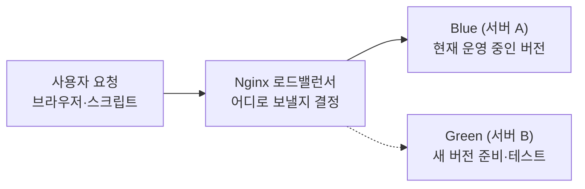

# N052 · 로드밸런서로 무중단 배포 구성하기

> 버전 1.1 · 2026-10-28 (학습서 + 해설서 통합 + **`[실습 결과]`** 덧붙임. 내 컴퓨터에서 직접 해 본 결과를 장마다 덧붙였고, v1.0은 `_판본_v1.0/`에 그대로 보존)

## 목차

- [핵심 한 문장 요약](#핵심-한-문장-요약)
- [1. 새 버전으로 바뀌는 순간, 사용자에게는 무슨 일이 생길까](#1-새-버전으로-바뀌는-순간-사용자에게는-무슨-일이-생길까)
- [2. 가용성을 숫자로 말하기](#2-가용성을-숫자로-말하기)
- [3. 로드밸런서가 하는 일](#3-로드밸런서가-하는-일)
- [4. 시작 상태 맞추기 — 컨테이너 세 개 띄우기](#4-시작-상태-맞추기--컨테이너-세-개-띄우기)
- [5. 요청 확인 스크립트로 네 가지 실험](#5-요청-확인-스크립트로-네-가지-실험)
- [6. 컨테이너 밖에 데이터 두기 — Supabase](#6-컨테이너-밖에-데이터-두기--supabase)
- [7. 오늘 배운 것](#7-오늘-배운-것)
- [맺음말](#맺음말)
- [부록 A · 실전 코드 모음](#부록-a--실전-코드-모음)
- [부록 B · 트러블슈팅 표](#부록-b--트러블슈팅-표)
- [부록 C · AI 프롬프트 모음집](#부록-c--ai-프롬프트-모음집)
- [부록 D · 용어 사전](#부록-d--용어-사전)
- [부록 E · 개념 비교표 모음](#부록-e--개념-비교표-모음)
- [부록 F · 학습 로드맵](#부록-f--학습-로드맵)
- [부록 G · 복습 퀴즈](#부록-g--복습-퀴즈)

## 핵심 한 문장 요약

> 📌 **요약** — 무중단 배포는 서버를 새 버전으로 바꾸는 기술이 아니라, **요청을 안전하게 옮기고(로드밸런서), 문제가 생기면 되돌리고(롤백), 사용자가 하던 일까지 이어지게(상태를 서버 밖 데이터베이스에)** 설계하는 일이다. "전환 성공"과 "무중단"은 같은 뜻이 아니다 — 요청이 끊기지 않는 것과 사용자가 하던 일이 이어지는 것을 **따로** 확인해야 한다.

> 🧪 **예제** — `[실습 결과]` 한 줄 요약: 설정 한 줄로 전환·롤백해도 요청 실패는 0건이었지만(341건), 대화가 서버 메모리에 있을 때는 전환하자 0개로 사라졌고(5장 ④), 대화를 Supabase로 옮기자 green 전환·blue 재시작·시크릿 창(다른 게스트)에서 모두 기대대로 동작했다(6장). 서버 하나를 멈췄을 때 실패는 기본 설정에서 13건, 연결 대기를 1초로 줄이면 0건이었다.

이번 강의는 N046~N051에서 만든 AI 친구 에이전트 서비스(저장소 `friend-agent`, 이미지 `friend-agent:local`, 줄여서 에이전트 서비스)에서 시작한다. 전제는 저장소 루트의 Dockerfile로 이 서비스를 이미지로 만들 수 있는 상태다. 실습은 전부 **내 컴퓨터의 Docker**로 하고 Google Cloud는 쓰지 않는다.

> 💡 **팁** — 문서에서 "학습서"(33쪽)는 교안 본문, "해설서"(45쪽)는 같은 교안을 쉽게 풀어 쓴 책이다. 두 책은 챕터 01~07이 1:1로 대응하지만 내용이 겹치거나 변주되는 곳이 있어(예: 해설서 Ch01은 강의 전체의 미리보기) 겹치는 부분은 하나로 합쳤다. 해설서의 쉬운 비유(식당 안내 직원·급식실 배식대·고객 상담실·상담원 수첩)를 우선 살렸고, 명령·프롬프트·수치는 학습서 원문 그대로 옮겼다. `[보충 비유]`·`[보충]`이라고 표시한 것만 이 노트에서 덧붙인 설명이다.

> 💡 **팁** — 버전 1.1은 v1.0(교안 기준)에 **`[실습 결과]`**를 덧붙인 판이다. 2026-10-28에 Windows 11·Docker Desktop 29.9.2·PowerShell 환경에서 4~6장을 직접 실행한 결과이며, 원본 기록은 같은 폴더의 `N052_실습_진행기록.md`와 `실습로그/`에 있다. 터미널 명령과 측정은 AI 코딩 도우미(Claude)가 실행했고, Supabase 대시보드 작업·`.env` 편집·브라우저 확인은 직접 했다. `[실습 결과]`가 붙지 않은 부분은 여전히 교안 기준이다. 교안과 **다른** 결과가 나온 곳은 그렇게 표시했다. 해설서 PDF는 명령어 앞의 하이픈이 빠져 나오는 문제(`--name`이 `name`으로 보임)가 있어, 명령은 모두 학습서를 기준으로 썼다. 학습서의 인터랙티브 시각화 3종(웹 전용)은 PDF에 없고 설명 문단만 있으므로, 이 노트는 그 설명을 근거로 서술한다. 키 값·프로젝트 주소·사용자 ID는 공개 저장소에 올라가므로 적지 않았다.

---

## 1. 새 버전으로 바뀌는 순간, 사용자에게는 무슨 일이 생길까

### 1-1. 오늘의 질문

배포를 자동으로 돌리면 하루에도 여러 번 새 버전이 나간다. 그런데 새 버전으로 바뀌는 그 몇 초 동안 누군가 메시지를 보냈다면, 그 사람은 오류를 봤을까. 그리고 바뀐 뒤에도 방금까지 나눈 대화가 그대로 남아 있을까. 오늘은 서비스를 끄지 않고 새 버전으로 바꾸는 **무중단 배포**의 원리를 배우고, 그 중심에 있는 **로드밸런서**를 내 컴퓨터에 Nginx로 직접 만들어 에이전트 서비스 두 벌 사이를 전환해 본다. 마지막으로 대화를 컨테이너 밖 데이터베이스로 옮겨, 어느 쪽으로 전환해도 대화가 이어지게 만든다.

해설서는 이 문제를 내 서비스에 대입해 보라고 권한다. 예를 들어 사용자가 자신의 일기를 입력하고 AI와 대화하면서 자서전을 만드는 MSM(My-Story-Maker) 같은 서비스라면, 서비스가 업데이트되는 중에도 사용자가 오류를 겪거나 지금까지 쓴 이야기가 사라져서는 안 된다.

### 1-2. 학습목표 6개

1. 가용성, 단일 장애점, 이중화, 무상태가 무엇이고 고가용성 서비스에서 각각 무엇을 막는지 설명할 수 있다.
2. 롤링, 블루그린, 카나리 배포의 차이와, 무중단 배포에서 헬스체크, 그레이스풀 셧다운, DB 호환성이 필요한 이유를 설명할 수 있다.
3. 로드밸런서가 서버를 고르고 고장 난 서버를 알아채는 방식과, Nginx가 리버스 프록시와 로드밸런서로 하는 일을 설정 파일로 읽을 수 있다.
4. 내 컴퓨터에서 Nginx와 에이전트 서비스 두 벌을 컨테이너로 띄우고, 설정 한 줄로 블루그린 전환과 롤백을 할 수 있다.
5. 전환하는 동안과 서버 하나가 멈췄을 때의 요청 실패를 측정하고, 그 결과를 Nginx 설정과 연결해 설명할 수 있다.
6. Supabase에 데이터와 익명 로그인을 붙여, 어느 쪽으로 전환해도 대화가 이어지는 서비스로 만들 수 있다.

### 1-3. 네 가지 핵심 개념

| 개념 | 쉽게 말하면 |
|---|---|
| 가용성 | 얼마나 계속 이용할 수 있는가 |
| 단일 장애점 | 어디 하나가 고장 나면 전체가 멈추는가 |
| 이중화 | 고장에 대비해 여분을 준비하는가 |
| 무상태 | 사용자 정보가 특정 서버에만 묶여 있지 않은가 |

> 💡 **팁** — 해설서의 첫 비유: Docker 이미지는 제품의 설계도와 포장 세트이고, 컨테이너는 그 제품을 실제로 작동시킨 것이다. Nginx는 고객을 어느 창구로 안내할지 결정하는 **안내 직원**이다.

### 1-4. 오늘 만드는 구조 한눈에

새 버전의 서버 B(Green)가 정상인지 확인한 뒤 Nginx의 요청 경로를 B로 바꾼다. 문제가 생기면 다시 A(Blue)로 돌릴 수 있다. 서비스를 새로 만드는 일과 사용자 요청의 목적지를 바꾸는 일을 분리하는 것이 핵심이다.

<!-- flow: 그림 1. 사용자 요청은 Nginx를 거쳐 Blue 또는 Green으로 간다. 어느 쪽으로 보낼지는 Nginx 설정 한 줄이 정한다. | 사용자 요청/브라우저·스크립트/1 ; Nginx 로드밸런서/어디로 보낼지 결정/2 ; Blue (서버 A)/현재 운영 중인 버전/3 ; Green (서버 B)/새 버전 준비·테스트/4 -->


```text
[사용자 요청] → [Nginx 로드밸런서] → [Blue (서버 A, 운영 중)]
                                  ┄→ [Green (서버 B, 새 버전 준비)]
```
<!-- /flow -->

> 💡 **팁** — `[보충 비유]` 기획·경영 경험으로 보면 **신규 생산라인 병행 가동 후 전환**과 같다. 새 라인(Green)을 기존 라인(Blue)이 돌아가는 동안 따로 세워 시험 생산을 해 보고, 이상이 없을 때 물량 배정표(Nginx)만 바꾼다. 문제가 생기면 배정표를 되돌리면 되니, 기존 라인을 곧바로 철거하지 않는 것이 롤백의 조건이다.

### 1-5. 오늘 직접 해 보는 흐름

이번 강의의 줄거리는 "성공했는데 뭔가 이상하다"를 두 번 발견하는 이야기다.

| 순서 | 하는 일 | 알게 되는 것 |
|---|---|---|
| ① | blue → green 전환과 롤백 | 요청 실패 0건. 설정 한 줄로 전환된다 |
| ② | 가중치 3 대 1 | 요청의 약 75%와 25%로 나뉜다 (카나리 배포의 원리) |
| ③ | green을 멈춤 | 연결 대기 60초면 실패가 쏟아지고, 1초로 줄이면 거의 사라진다 |
| ④ | 전환 뒤 대화 확인 | 요청은 성공했는데 **대화가 사라진다** |
| ⑤ | Supabase에 데이터 이동 | 어느 쪽으로 전환해도 대화가 이어진다 |
| ⑥ | 남은 위험 | 두 버전이 같은 DB를 쓰므로 **DB 호환성**이 새 숙제가 된다 |

<!-- flow: 그림 2. 오늘의 줄거리. 성공 → 장애 → 사라진 대화 → 해결 → 새 위험 순서로 진행된다. | 전환 성공/실패 0건/1 ; 서버 멈춤/연결 대기·실패/4 ; 대화 사라짐/상태가 메모리에/3 ; Supabase로 이동/대화가 이어짐/2 ; 새 위험/DB 호환성/4 -->


```text
[전환 성공: 실패 0건] → [서버 멈춤: 연결 대기·실패] → [대화 사라짐: 상태가 메모리에]
        → [Supabase로 이동: 대화가 이어짐] → [새 위험: DB 호환성]
```
<!-- /flow -->

### 1-6. 왜 이 구조가 중요한가 — 개발자·1인 창업가에게

해설서는 이 구조가 중요한 이유를 네 가지로 정리한다. 처음부터 대규모 인프라를 구축할 필요는 없고, 로컬에서 두 컨테이너를 전환해 보는 이번 실습만으로도 운영 구조의 기본 원리를 익힐 수 있다.

| 이유 | 뜻 |
|---|---|
| 서비스 안정성 | 업데이트 중에도 이용할 수 있도록 배포 구조를 설계한다 |
| 복구 가능성 | 새 버전에 문제가 생겼을 때 이전 버전으로 되돌릴 수 있게 한다 |
| 데이터 지속성 | 사용자 기록을 특정 서버에만 의존하지 않도록 한다 |
| 검증 가능한 운영 | 감으로 판단하지 않고 요청 실패율과 실제 데이터로 확인한다 |

### 1-7. 시작 질문 — 먼저 내 생각을 적어 보기

학습서의 시작 질문은 이렇다. "에이전트 서비스가 새 버전으로 바뀌는 순간, 사용자에게는 무슨 일이 일어날 수 있을까요? 오류, 끊김, 대화 내용 같은 것들 가운데 떠오르는 대로 적고, 그렇게 생각한 이유도 적어 보세요." (300자)

> 🧪 **예제** — 해설서의 예시 답변: 에이전트 서비스가 새 버전으로 바뀌는 순간, 서버가 잠시 중단되어 사용자가 오류 메시지를 보거나 요청이 실패할 수 있다. 서버가 다시 실행되더라도 기존 대화 내용이 서버 내부의 메모리에만 저장되어 있다면 대화가 사라질 수도 있다. 따라서 새 버전을 배포하기 전에 다른 서버를 준비하고, 로드밸런서로 요청을 전환하며, 대화 데이터는 외부 데이터베이스에 저장해야 한다고 생각한다. 이 답변은 이번 강의에서 다룰 **서비스 가용성, 서버 전환, 데이터 지속성**이라는 세 가지 문제를 모두 짚고 있다. 7장에서 이 답을 다시 읽고 실제 결과와 비교한다.

---

## 2. 가용성을 숫자로 말하기

### 2-1. 9의 개수로 말하는 가용성

**가용성(availability)** 은 서비스를 쓸 수 있었던 시간의 비율이다. 1년 내내 멈추지 않으면 100%다. 업계는 가용성이 아주 높아 거의 멈추지 않는 것을 **고가용성(high availability)** 이라 하고, 9가 몇 개인지로 말한다.

| 가용성 | 부르는 말 | 1년 중 멈춰도 되는 시간 (학습서) | 정밀값 (해설서) |
|---|---|---|---|
| 99% | 투 나인 | 약 3.65일 | 약 3일 15시간 36분 |
| 99.9% | 쓰리 나인 | 약 8.8시간 | 약 8시간 46분 |
| 99.99% | 포 나인 | 약 53분 | 약 52분 34초 |
| 99.999% | 파이브 나인 | 약 5분 | 약 5분 15초 |

두 책의 수치는 둘 다 옳은 근사이며, 해설서가 정밀값이다. 해설서의 단서: 1년 365일을 기준으로 한 이론적 중단 시간이고, 실제 서비스의 가용성 측정 기준과 계약 조건에 따라 계산 방식은 달라질 수 있다.

99%는 높아 보이지만 1년에 사흘 넘게 멈춘다는 뜻이다. 9가 하나 늘 때마다 멈춰도 되는 시간은 10분의 1로 줄고, 파이브 나인은 담당자가 알림을 받고 노트북을 켜는 사이에 지나갈 만큼 짧다. 그래서 고가용성의 핵심은 **사람이 고치기 전에 시스템이 스스로 버티게 만드는 것**이다. 9를 하나 더 얻을 때마다 서버 수와 구조의 복잡도가 크게 늘기 때문에 서비스마다 목표로 잡는 9의 개수는 다르다. 모든 서비스가 무조건 파이브 나인을 목표로 할 필요는 없고, 서비스의 중요도와 장애 비용에 맞게 정해야 한다.

> 💡 **팁** — `[보충 비유]` 서비스 수준 협약(SLA)이나 납기 준수율을 정할 때와 같다. 목표를 99.999%로 올리는 순간 비용이 자릿수로 늘어나므로, "얼마나 멈춰도 사업이 버티는가"에서 거꾸로 정한다.

### 2-2. 단일 장애점과 이중화

서버가 한 대뿐인데 그 서버가 고장 나면 전체 서비스가 멈춘다. 전체 서비스의 운명이 한 곳에 달려 있는 것이다. 그런 곳을 **단일 장애점(SPOF, single point of failure)** 이라 한다. 같은 일을 하는 서버나 장치를 하나 더 두어 단일 장애점을 없애는 것이 **이중화(redundancy)** 다.

그런데 이중화에는 한계가 있다. 두 서버가 같은 전원이나 네트워크 장비, 데이터센터에 의존한다면 공통된 장애가 발생했을 때 둘 다 멈출 수 있다.

> ⚠️ **주의** — 2022년 10월 판교 데이터센터 화재 때 카카오 서비스가 오래 멈춘 원인 가운데 하나도, 예비 서버로 넘길 때 쓰는 관리 도구를 그 데이터센터 안에서만 이중화해 둔 것이었다. 서버를 여러 대 준비하는 것뿐 아니라 장애 발생 시 복구하는 **관리 체계까지** 함께 대비해야 한다.

고가용성 기법은 복잡해 보여도 세 단계로 정리된다.

| 단계 | 하는 일 |
|---|---|
| 이중화 | 예비를 둔다 |
| 장애 감지 | 고장을 알아챈다 |
| 장애 조치(failover) | 예비로 자동으로 넘긴다 |

> 💡 **팁** — `[보충 비유]` 단일 장애점은 **키맨 리스크**다. 핵심 업무를 한 사람만 알고 있다면 그 사람이 휴가를 가는 순간 부서가 멈춘다. 대체 인력을 두는 것(이중화)만으로는 부족하고, 결근을 알아채는 체계(장애 감지)와 즉시 업무를 넘기는 절차(장애 조치)까지 있어야 한다.

### 2-3. 액티브-스탠바이와 액티브-액티브

| 구분 | 액티브-스탠바이 | 액티브-액티브 |
|---|---|---|
| 평상시 | 한 서버가 주로 처리하고 다른 서버는 대기 | 여러 서버가 함께 처리 |
| 서버 한 대 고장 | 대기 서버로 전환 | 남은 서버들이 요청을 처리 |
| 장점 | 구조가 비교적 단순함 | 평소에도 여러 서버의 자원을 활용 |
| 주의점 | 대기 자원이 놀 수 있음 | 부하 분산, 데이터 일관성 등을 더 세심하게 관리해야 함 |

액티브-액티브라고 해서 서버 한 대가 고장 나도 무조건 정상 운영되는 것은 아니다. **남은 서버가 늘어난 요청을 감당할 수 있어야** 한다.

### 2-4. 무상태 서버

서버를 여러 대 두면 같은 사용자의 요청이 매번 다른 서버로 갈 수 있다. 로그인 정보나 대화 기록을 서버 A의 메모리에만 저장했는데 다음 요청이 서버 B로 가면, 사용자는 로그아웃되었거나 대화가 사라진 것처럼 본다.

| 구분 | 방식 A. 서버 메모리에 저장 | 방식 B. 공용 데이터베이스에 저장 |
|---|---|---|
| 첫 요청 (서버 A) | A의 메모리에 "여행을 좋아합니다 / 다음 여행은 어디로 가고 싶으세요?" 저장 | A가 공용 DB에 저장 |
| 다음 요청 (서버 B) | B의 메모리에는 이전 대화가 없음 → AI가 맥락을 잃을 수 있음 | B도 같은 데이터를 읽음 → 대화가 이어짐 |

그래서 이런 정보는 서버 밖의 공용 저장소(데이터베이스 등)에 두고, 서버는 어떤 요청이 와도 똑같이 처리하게 만든다. 이렇게 요청 처리에 필요한 상태를 자기 안에 두지 않는 서버를 **무상태(stateless) 서버**라 한다. 무상태여야 서버를 마음대로 늘리고, 빼고, 새 버전으로 바꿀 수 있다.

> ⚠️ **주의** — 정확히는 서버가 아무것도 기억하지 않는다는 뜻이 아니다. 요청 처리에 필요한 상태를 외부 저장소에서 가져오거나, 요청에 포함된 정보로 확인할 수 있도록 설계한다는 의미다. 그리고 **지금의 에이전트 서비스는 무상태가 아니다.** 캐릭터, 대화, 기억을 인스턴스 메모리에 두고 있어서 새 리비전이 뜨면 그동안의 대화가 사라진다. 이 차이를 5장에서 직접 보고, 6장에서 데이터베이스로 옮겨 해결한다.

### 2-5. 데이터베이스는 어떻게 이중화하나 — 복제

가장 흔한 방법은 쓰기는 **마스터(primary)** 한 곳에서만 받고, 바뀐 내용을 여러 **복제본(replica)** 에 계속 복사해 읽기를 나눠 맡기는 **복제(replication)** 다. 마스터가 멈추면 가장 최신인 복제본을 새 마스터로 올린다(승격, promotion). **복제는 백업이 아니다.** 실수로 지운 데이터도 곧바로 복제되므로, 되돌리려면 백업을 따로 둔다.

> 🧪 **예제** — 실수로 대화 기록 1,000개를 삭제했다면 복제본에도 삭제가 전파될 수 있다. 따라서 복제본만으로는 삭제 이전 상태를 복구할 수 없을 수 있다. 복제는 **가용성**에, 백업은 **과거 데이터 복구**에 중요한 역할을 한다.

이 과정에서 쓰는 Supabase는 이런 데이터베이스 운영(설치·업데이트·복제·백업)을 대신 맡는 **관리형 서비스(managed service)** 다.

### 2-6. 무중단 배포와 세 가지 방식

예전에는 새 버전을 올릴 때 서버를 끄고 "점검 중" 화면을 띄운 뒤 새 코드를 올리고 다시 켰다. 하루에 여러 번 배포하는 서비스라면 이렇게 할 수 없고, 사용자에게는 업데이트 때문에 멈추는 것도 고장으로 멈추는 것과 똑같다. 그래서 **이전 버전을 끄지 않은 채 새 버전을 띄우고, 요청을 새 버전으로 옮긴 다음에 이전 버전을 끈다.** 이것이 **무중단 배포(zero-downtime deployment)** 이고, 모든 방법이 서버 여러 대와 그 앞에서 요청을 나눠 주는 로드밸런서를 바탕으로 한다.

| 방식 | 작동 원리 | 장점과 특징 |
|---|---|---|
| 롤링(rolling update) | 서버를 한 대씩 돌아가며 새 버전으로 바꿈 | 서버를 더 두지 않아도 되지만, 바꾸는 동안 이전 버전과 새 버전이 함께 요청을 받음 |
| 블루그린(blue-green) | 서버 묶음을 두 벌 준비해 새 버전을 다 올린 뒤 로드밸런서의 방향을 한 번에 바꿈 | 전환과 롤백이 단순하고 가장 깔끔하지만 서버가 두 배 필요 |
| 카나리(canary) | 새 버전을 전체 요청의 1%나 10%에만 먼저 보내 보고 지표가 괜찮으면 비율을 올림 | 실제 환경에서 문제를 조기에 발견하기 좋지만 트래픽 비율 관리와 결과 관찰이 필요 |

블루그린에서 문제가 생기면 다시 블루로 돌리면 되고, 이렇게 이전 버전으로 되돌리는 것을 **롤백(rollback)** 이라 한다. 카나리라는 이름은 광부들이 유독가스를 먼저 알아채려고 카나리아를 데리고 갱도에 들어간 데서 왔다. **이번 강의에서 직접 실습할 핵심은 블루그린 배포**이고, 가중치 실험(5장)에서 카나리의 원리도 엿본다.

세 방식의 공통점은 기존 서비스를 한꺼번에 중단하지 않고 새 버전으로 전환한다는 것이다. 하지만 실제 무중단 여부는 배포 방식뿐 아니라 서버 준비 상태, 요청 처리 방식, 데이터베이스 호환성에도 달려 있다.

세 방식은 결국 **로드밸런서를 조작하는 일**이다. 롤링은 로드밸런서에서 서버를 한 대씩 빼고 넣기를 반복하고, 블루그린은 로드밸런서가 가리키는 서버 묶음을 통째로 바꾸고, 카나리는 새 서버로 보내는 가중치를 조금씩 올린다. DNS 주소를 바꾸는 방법도 있지만, 사용자 컴퓨터가 옛 주소를 한동안 기억해서 바로 바뀌지 않는다.

> 💡 **팁** — `[보충 비유]` 신제품 도입에 빗대면 롤링은 **지점을 하나씩 돌며 새 진열대로 교체**, 블루그린은 **새 매장을 옆에 완성해 놓고 간판을 한 번에 바꿔 달기**, 카나리는 **시범 판매 지점 한두 곳에서 먼저 반응을 보기**다.

> 💡 **팁** — 학습서 시각화 그림은 이전 강의의 Cloud Run 기반으로 그려져 있다(예: 블루그린은 새 리비전 트래픽을 0%로 올려 태그 URL로만 확인한 뒤 100%로 전환, 카나리는 10%→50%→100%). "Cloud Run 기본 배포는 롤링 업데이트가 아니다. 새 리비전이 준비되면 트래픽 100%를 새 리비전으로 넘기고, 넘어가는 동안 처리 중이던 요청만 마저 처리된다"는 설명도 곁들인다. 이번 실습은 이 일을 Nginx로 직접 해 보는 것이다.

### 2-7. 새 버전으로 바꿀 때 지킬 세 가지

| 조건 | 하는 일 | 지키지 않으면 |
|---|---|---|
| 헬스체크(health check) | 새 서버가 요청을 받을 준비가 됐는지 먼저 물어보고, 정상이라고 답해야 요청을 보냄 (예: `/health`가 200이어야) | 켜지는 중인 서버로 요청이 가서 오류가 남 |
| 그레이스풀 셧다운(graceful shutdown) | 이전 서버를 끌 때 새 요청을 그만 받고, 처리 중이던 요청을 끝까지 마친 뒤 끔 | 답을 보내던 도중에 연결이 끊김 |
| DB 호환성 | 이전 버전과 새 버전이 같은 데이터베이스를 함께 써도 둘 다 동작하게 함 | 새 버전이 테이블 구조를 바꾸면 전환 중이나 롤백 뒤에 이전 버전이 깨짐 |

마지막 줄이 가장 까다롭다. 서버는 여러 대지만 데이터베이스는 보통 하나를 함께 쓰므로(**버전은 둘, 데이터베이스는 하나**), 새 버전이 열 이름을 바꾸면 전환하는 동안 요청을 받는 이전 버전은 그 열을 찾지 못하고, 롤백해도 같은 일이 생긴다.

> 🧪 **예제** — 기존 데이터베이스의 `user_name` 열을 새 버전에서 `display_name`으로 바꾼다고 하자. 새 버전은 새 열을 쓰지만 구버전은 여전히 기존 열을 찾는다. 배포 중 두 버전이 함께 실행되면 오류가 생길 수 있다. 데이터베이스 구조 변경도 서버 배포처럼 한 번에 바꾸지 않고 **호환되는 단계**를 거쳐야 한다.

테이블 구조를 바꾸는 일을 **스키마 마이그레이션(schema migration)** 이라 하고, 여러 번에 나눠 하는 순서를 **확장-축소 패턴(expand and contract)** 이라 한다.

| 단계 | 하는 일 |
|---|---|
| 1 | 새 열을 추가하되 기존 열은 유지한다 |
| 2 | 구버전과 신버전이 함께 작동할 수 있도록 코드를 배포한다 |
| 3 | 기존 열을 사용하는 버전이 모두 종료되었는지 확인한다 |
| 4 | 충분히 안전하다고 판단된 뒤 기존 열을 제거한다 |

> 💡 **팁** — `[보충 비유]` 업무 양식을 개정할 때 **구 양식·신 양식 병행 접수 기간**을 두는 것과 같다. 어느 날 갑자기 구 양식을 받지 않으면 처리 중이던 건이 반려된다. 구 양식 접수가 완전히 끝난 것을 확인한 뒤에 폐지한다.

### 2-8. 내 서비스에 적용하면 (MSM 예)

해설서는 이 내용을 MSM(My-Story-Maker)에 적용하는 표를 준다.

| 상황 | 필요한 설계 |
|---|---|
| 사용자가 AI와 나눈 대화가 사라지면 안 됨 | 대화 기록을 공용 데이터베이스에 저장 |
| 사용자가 몰려 서버 한 대로 처리하기 어려움 | 서버 추가와 로드밸런싱 고려 |
| 서버 한 대가 고장 나도 서비스를 제공해야 함 | 이중화, 장애 감지, 자동 장애 조치 |
| 새 기능 배포 후 문제가 생김 | 헬스체크, 지표 확인, 롤백 |
| 데이터베이스 구조를 변경함 | 구버전과 신버전의 호환성을 고려한 마이그레이션 |
| 사용자 데이터가 실수로 삭제됨 | 별도 백업과 복구 절차 마련 |

> 📌 **요약** — 초기 1인 서비스라면 처음부터 복잡한 다중 지역 인프라를 구성하기보다, **데이터 손실 방지와 복구 가능한 배포 구조부터 확보**한 뒤 서비스 규모에 맞춰 고가용성을 높이는 접근이 현실적이다.

---

## 3. 로드밸런서가 하는 일

### 3-1. 주소 하나로 받아 여러 서버에 나눠 보내기

사용자는 서비스 주소 하나만 안다. 서버가 여러 대라면 그 주소로 온 요청을 어느 서버로 보낼지 정하는 장치가 입구에 있어야 하고, 이 장치가 **로드밸런서(load balancer)** 다. 사용자가 주소로 요청하면 그 주소는 서버가 아니라 로드밸런서를 가리키고, 로드밸런서가 요청을 뒤의 서버 하나에 넘긴 뒤 그 서버의 응답을 받아 사용자에게 돌려준다. 사용자 쪽에서는 서비스 하나와 주고받은 것이고, 뒤에 서버가 몇 대인지는 알 수 없다.

> 💡 **팁** — 해설서의 비유: 손님이 식당에 들어오면 **안내 직원**은 어느 테이블로 안내할지 결정한다. 한 테이블에 손님이 몰리지 않도록 나눠 주고, 사용할 수 없는 테이블은 제외할 수도 있다. 로드밸런서도 같은 일을 한다. 사용자는 서버 A, B, C의 주소를 직접 알 필요가 없다. 로드밸런서가 요청을 전달하고 응답을 돌려주기 때문이다. `[보충 비유]` 콜센터의 **ARS 배분 장치**를 떠올려도 좋다. 고객은 대표번호 하나만 누르고, 어느 상담원에게 연결할지는 장치가 정한다.

### 3-2. 서버를 고르는 규칙 네 가지

| 규칙 | 보내는 방식 | 쓰는 때 |
|---|---|---|
| 라운드 로빈(round robin) | 1번, 2번, 3번, 다시 1번처럼 순서대로 | 서버 성능이 비슷할 때. 가장 단순함 |
| 최소 연결(least connections) | 지금 처리 중인 요청이 가장 적은 서버로 | 요청마다 처리 시간이 크게 다를 때. LLM 응답처럼 몇 초에서 수십 초까지 걸리는 요청 |
| 가중치(weighted) | 정해 둔 비율대로. 예: 90 대 10 | 성능이 다른 서버를 섞을 때, 카나리 배포 |
| IP 해시(IP hash) | 같은 사용자는 늘 같은 서버로 | 서버가 사용자 상태를 기억할 때. 다만 그 서버가 바뀌면 상태도 사라짐 |

AI 에이전트의 요청은 간단한 질문이면 몇 초 만에 끝나지만, 긴 문서를 분석하거나 여러 도구를 호출하면 수십 초가 걸릴 수도 있다. 이런 경우에는 단순히 번갈아 보내는 것보다 현재 처리 중인 연결 수를 고려하는 방법이 도움이 된다. 다만 최소 연결이 항상 실제 작업량을 가장 정확하게 측정하는 것은 아니다. 연결 수가 적더라도 각 요청의 연산 비용이 매우 클 수 있기 때문이다.

> ⚠️ **주의** — IP 해시처럼 같은 사용자를 같은 서버로 묶는 방식을 **세션 고정(sticky session)** 이라 한다. 서버가 상태를 갖고 있을 때 급한 대로 쓰는 방법이지만, 그 서버가 멈추거나 새 버전으로 바뀌면 묶여 있던 사용자의 상태가 함께 사라지고, 한 서버에 사용자가 몰려도 다른 서버로 나눌 수 없다. 그래서 2장의 무상태 서버를 **먼저** 만들고, 규칙은 라운드 로빈이나 최소 연결을 쓰는 것이 보통이다.

### 3-3. 고장 난 서버를 알아채는 법 — 능동과 수동 헬스체크

| 구분 | 능동 헬스체크 | 수동 헬스체크 |
|---|---|---|
| 알아채는 방법 | 로드밸런서가 주기적으로 먼저 물어봄 | 실제 요청이 실패한 것을 보고 앎 |
| 사용자가 겪는 실패 | 확인 주기 사이에 간 요청 정도 | 알아채는 데 쓰인 요청과, 그 요청이 실패하기까지 기다린 시간 |
| 지원하는 곳 | HAProxy, 클라우드 로드밸런서, 유료판 NGINX Plus | 무료 Nginx를 포함한 대부분 |

**무료 Nginx는 수동 헬스체크만 한다.** 한 서버로 보낸 요청이 실패하면(`max_fails`, 기본 1번) 그 서버를 일정 시간(`fail_timeout`, 기본 10초) 동안 빼고, 실패한 요청은 목록의 다른 서버로 다시 보낸다. 문제는 **실패라고 판단하기까지 걸리는 시간**이다. 서버가 아예 응답하지 않으면 Nginx는 연결을 기다리는 시간(`proxy_connect_timeout`, 기본 60초)이 지나야 실패로 보고 다른 서버로 넘기므로, 그 사이 요청을 보낸 사용자는 그만큼 기다린다.

| 설정 | 뜻 |
|---|---|
| `max_fails` | 서버를 실패한 것으로 판단하기까지 허용하는 실패 횟수 |
| `fail_timeout` | 실패를 판단하는 시간 구간이자, 서버를 일시적으로 제외하는 시간 |
| `proxy_connect_timeout` | 뒤쪽 서버와 연결을 맺기까지 기다리는 시간 제한 |

> ⚠️ **주의** — 연결 제한을 줄이는 것만으로 모든 지연이 해결되지는 않는다. 서버에 연결된 뒤 응답이 늦는 경우에는 별도의 읽기 타임아웃 등의 설정도 검토해야 한다. 그리고 `proxy_connect_timeout`은 연결 시도에 적용되는 제한 시간이지 전체 요청 처리 시간의 제한이 아니다.

### 3-4. 서버 한 대를 안전하게 바꾸는 순서 — 드레이닝

서버 한 대를 바꿀 때는 먼저 로드밸런서에서 그 서버로 새 요청을 보내지 않게 빼고, 처리 중이던 요청이 다 끝나면 끄고 업데이트한다. 다시 켜서 헬스체크를 통과하면 다시 넣는다.

| 단계 | 하는 일 |
|---|---|
| ① 빼기 | 새 요청을 그 서버로 보내지 않음 |
| ② 마치기 | 처리 중인 요청이 끝날 때까지 기다림 |
| ③ 바꾸기 | 서버를 끄고 새 버전으로 교체 |
| ④ 헬스체크 | 준비됐는지 물어봄 |
| ⑤ 넣기 | 정상일 때 다시 요청을 보냄 |

①~②를 **드레이닝(draining)** 이라 한다. 새 요청은 끊고 하던 요청은 마치게 하는 것이다. AI가 긴 보고서를 작성하는 도중 서버를 강제로 종료하면 사용자는 응답을 받지 못할 수 있기 때문이다. 단, 요청이 무한정 길어지지 않도록 적절한 제한 시간과 종료 정책도 필요하다.

> 💡 **팁** — `[보충 비유]` 매장 영업 종료와 같다. 폐점 시각이 되면 **새 손님 입장부터 막고**, 이미 안에 있는 손님이 계산을 마치면 문을 닫는다. 새 손님을 계속 받으면서 문을 잠그면 계산하던 손님이 쫓겨난다.

### 3-5. 로드밸런서 자신도 단일 장애점이다

로드밸런서는 모든 요청이 지나가는 곳이라 그 자체가 단일 장애점이 될 수 있다. 그래서 로드밸런서도 두 대를 액티브-스탠바이로 두고, **가상 IP(virtual IP)** 라는 주소 하나를 함께 쓴다. 평소에는 주 로드밸런서가 그 주소를 갖고 있다가, 멈추면 예비 로드밸런서가 넘겨받는다. 사용자는 같은 주소로 접속하므로 바뀐 것을 알지 못하고, 클라우드의 로드밸런서는 이 일을 대신 해 준다.

| 종류 | 예 | 특징 |
|---|---|---|
| 소프트웨어 | Nginx, HAProxy | 서버 한 대에 설치하면 로드밸런서가 됨. 오늘 실습에서 씀 |
| 클라우드 서비스 | AWS ELB, Google Cloud Load Balancing | 빌려 씀. 로드밸런서 자체의 이중화와 능동 헬스체크를 클라우드가 맡음. Cloud Run도 서비스 안에 이 기능을 품고 있음 |
| 하드웨어 | 전용 장비 | 비싸서 요즘은 큰 회사에서 주로 씀 |

실제 서비스에서는 맨 앞을 클라우드 로드밸런서가 받고 그 뒤에 Nginx를 함께 두는 경우도 많다.

### 3-6. Nginx — 세 가지 얼굴

Nginx(엔진엑스)는 2004년에 동시 접속이 많을 때 느려지던 기존 웹 서버의 문제를 풀려고 만들어졌고, 지금은 전 세계 웹사이트의 30% 정도가 쓴다(W3Techs, 2026년 10월 기준).

| 역할 | 하는 일 |
|---|---|
| 웹 서버 | HTML, 이미지, CSS 같은 파일을 그대로 꺼내 응답 |
| 리버스 프록시 | 요청을 받아 뒤에 있는 애플리케이션 서버에 넘기고, 응답을 받아 사용자에게 돌려줌. 애플리케이션 서버는 바깥에 직접 드러나지 않음 |
| 로드밸런서 | 리버스 프록시를 넓힌 것. 뒤의 서버가 여러 대면 3-2의 규칙으로 나눠 보냄 |

포워드 프록시가 사용자 쪽에 서서 바깥으로 나가는 요청을 대신 보낸다면, **리버스 프록시는 서버 쪽에 서서 바깥에서 들어오는 요청을 대신 받는다.** 방향이 반대라서 리버스라고 부른다.

예전 웹 서버는 연결 하나마다 처리 단위(프로세스나 스레드)를 하나씩 붙였다. 접속이 1만 개면 처리 단위도 1만 개가 필요했고, 각각 메모리를 차지해서 금방 한계에 닿았다. Nginx는 **작업 프로세스(worker process)** 몇 개가 수천 개의 연결을 함께 맡는다. 한 연결이 뒤의 서버 응답을 기다리는 동안 그 연결에 묶여 있지 않고 다른 연결을 처리하다가, 응답이 도착했다는 알림(이벤트)이 오면 돌아와 이어서 처리한다. 이 방식을 **이벤트 기반(event-driven) 비동기 처리**라 하고, 지금은 다른 웹 서버도 대부분 같은 방식을 쓴다.

작업 프로세스는 보통 CPU 코어 수만큼 띄운다. 작업 프로세스는 서로 메모리를 나눠 쓰지 않으므로 라운드 로빈의 "다음은 몇 번 서버" 같은 순서도 프로세스마다 따로 센다. 요청이 많을 때는 결과적으로 고르게 나뉘지만, 요청을 한 번에 하나씩만 보내는 실습에서는 매번 다른 프로세스가 받아 같은 서버로만 가는 것처럼 보일 수 있다. `upstream` 블록에 `zone`을 적으면 작업 프로세스들이 공유 메모리에서 순서와 실패 기록을 함께 센다.

### 3-7. Nginx 설정 읽기

설정은 중괄호로 묶은 블록으로 되어 있다. `server` 블록이 "어느 포트로 들어온 요청을 받을지", 그 안의 `location` 블록이 "어떤 경로의 요청을 어떻게 처리할지", `upstream` 블록이 "넘겨줄 서버 목록"을 정한다.

```nginx
upstream my_app {
    zone my_app 64k;
    server 10.0.0.1:8080 weight=3;
    server 10.0.0.2:8080;
    server 10.0.0.3:8080 backup;
}
server {
    listen 80;
    location / {
        proxy_pass http://my_app;
        proxy_connect_timeout 2s;
    }
}
```

이 설정은 80번 포트로 들어온 모든 경로(`/`)의 요청을 `my_app` 목록으로 넘긴다. 서버 줄 뒤 옵션은 이렇게 읽는다.

| 설정 | 뜻 |
|---|---|
| `weight=3` | 다른 서버보다 3배 많이 보냄. 적지 않으면 1 |
| `backup` | 다른 서버가 모두 빠졌을 때만 보냄 |
| `max_fails=1 fail_timeout=10s` | 10초 안에 1번 실패하면 10초 동안 뺌. 적지 않으면 이 값 |
| `zone my_app 64k` | 작업 프로세스들이 순서와 실패 기록을 공유 메모리에서 함께 셈 |
| `proxy_connect_timeout 2s` | 뒤의 서버에 연결될 때까지 2초만 기다리고, 넘으면 실패로 보고 다른 서버로 보냄. 적지 않으면 60초 |

해설서는 초보자용으로 세 덩어리로 묶는다. ① `upstream` = 요청을 전달할 서버 목록과 각 서버의 분배 조건, ② `server`와 `location` = 어느 포트로 들어온 요청을 받고 어떤 경로의 요청을 처리할지(여기서 `server`는 Nginx의 수신 설정을 의미한다), ③ `proxy_pass` = 실제 요청을 `upstream`에 정의한 서버 목록으로 전달.

가중치가 3 대 1이면 요청 4개 가운데 3개가 첫 서버로 가므로, 이 비율을 9 대 1이나 99 대 1로 두면 **카나리 배포**가 된다. **블루그린은 목록에 한 줄만 두고**, 전환할 때 그 줄을 다른 서버로 바꾸는 것이다.

> ⚠️ **주의** — `weight=3`과 기본 가중치 1이 있다고 해서 모든 짧은 실험에서 정확히 3 대 1로 관찰되는 것은 아니다. 연결 재사용, 작업 프로세스, 요청 수와 분배 방식에 따라 관찰 결과가 달라질 수 있다.

### 3-8. 설정 바꾸기 — `nginx -t`와 `nginx -s reload`

설정을 바꾼 뒤에는 `nginx -t`로 문법을 검사하고, `nginx -s reload`로 다시 읽게 한다. reload는 Nginx를 재시작하지 않고 설정만 바꿔 끼운다. 기존 작업 프로세스는 처리하던 요청을 마무리하고, 새 작업 프로세스가 새 설정으로 다음 요청부터 받으므로, 설정을 바꾸는 순간에도 Nginx 쪽에서 끊기는 요청이 없다.

| 단계 | 명령 | 하는 일 |
|---|---|---|
| ① 설정 고치기 | (편집기) `server blue:8080;` → `server green:8080;` | 행선지를 바꿈 |
| ② 문법 검사 | `nginx -t` | 실패하면 여기서 멈춤 |
| ③ 다시 읽기 | `nginx -s reload` | 이전 작업 프로세스는 마무리, 새 작업 프로세스는 새 설정으로 |

문법 검사가 실패한 설정으로 reload하면 Nginx는 새 설정을 버리고 이전 설정으로 계속 돈다. 그래도 검사를 먼저 하는 이유는 실패를 사람이 바로 보고 고치기 위해서다. 순서는 반드시 **수정 → 검사 → reload**이다.

> ⚠️ **주의** — 두 가지를 기억한다. 첫째, **Nginx는 뒤의 서버를 관리하지 않는다.** 전환한 직후 이전 서버를 바로 꺼 버리면 그 서버가 처리하던 요청은 끊길 수 있고, 롤백할 곳도 사라진다. 둘째, Nginx는 설정을 읽을 때 `blue` 같은 서버 이름을 IP 주소로 바꿔 기억해 둔다. 뒤의 서버를 지우고 다시 띄워 IP가 바뀌면 Nginx는 옛 주소로 계속 보내므로, 다시 띄운 뒤에는 reload해서 이름을 다시 찾게 한다.

### 3-9. 시각화로 확인하는 것 (웹 전용 — PDF에는 설명만 있음)

학습서에는 점 하나가 요청 하나인 인터랙티브 시각화가 세 번 나온다. PDF에는 없고 설명 문단만 있어 그 내용을 요약한다.

| 시각화 | 탭에서 해 보는 것 |
|---|---|
| 가용성·무상태·배포 (2장) | ① 서버 한 대/액티브-스탠바이/액티브-액티브에서 서버 1을 고장 내면 로드밸런서가 알아채는 2초 동안 실패가 난다. ② 대화를 서버 메모리에 둘 때와 공용 저장소에 둘 때 앞의 대화가 몇 개 보이는지 견준다. ③ "새 버전에 오류 있음"을 켜고 롤링·블루그린·카나리로 배포해 오류를 본 요청 수와 롤백 시점을 비교한다 |
| 로드밸런서 (3장) | ① 규칙을 바꿔 가며 요청이 어느 서버로 가는지와 서버마다 처리 중인 요청 수를 본다(최소 연결은 막대가 고르고, IP 해시는 점 색마다 늘 같은 서버로 간다). ② 능동·수동 헬스체크 실패 수 비교와 드레이닝 순서. ③ reload 뒤 이전 작업 프로세스가 blue로 보낸 요청을 끝까지 받는 모습, 그리고 reload 직후 blue를 바로 끄면 끊기는 요청이 생김 |
| 시뮬레이터 (5장) | 파란 점은 blue, 초록 점은 green의 응답, 흰 점은 멈춘 서버에 연결되기를 기다리는 요청. ① green으로 전환 ② 3 대 1 ③ `docker stop green` 뒤 `proxy_connect_timeout` 1초와 비교 |

---

## 4. 시작 상태 맞추기 — 컨테이너 세 개 띄우기

### 4-1. 시작 상태 확인

앞 실습을 이어서 하고 있다면 아래 확인 명령만 실행하고 넘어간다. 처음부터 모두 맞추면 한두 시간이 걸리므로, 빠진 항목이 많다면 수업 전에 맞춰 두거나 강사에게 먼저 알린다. 기존 실습을 이어서 진행한다면 이미 있는 네트워크나 컨테이너를 무조건 다시 만들거나 삭제하지 말고 먼저 현재 상태를 확인한다.

| 확인할 것 | 확인 방법 | 없으면 |
|---|---|---|
| 템플릿으로 만든 내 저장소와 가상환경 | 가상환경을 켜고 `python -c "import httpx"`가 오류 없이 끝남 | 템플릿 `docs/start-states.md`의 A 항목 3번, 저장소 README의 로컬 실행 준비 |
| Docker Desktop과 `Dockerfile`, `.dockerignore` | `docker info`가 오류 없이 나오고, 두 파일이 저장소 루트에 있음 | `docs/start-states.md`의 F 항목 |
| 에이전트 서비스 이미지 `friend-agent:local` | `docker images friend-agent:local`에 한 줄 | 저장소 루트에서 `docker build -t friend-agent:local .` |

```bash
python -c "import httpx"
docker info
ls Dockerfile .dockerignore
docker images friend-agent:local
```

Windows 가상환경은 `.\.venv\Scripts\Activate.ps1`로 켠다. 템플릿의 "실습별 시작 상태 문서"는 `https://github.com/88chacha/friend-agent-template/blob/main/docs/start-states.md`에 있다. 코딩 에이전트에게는 이렇게 맡길 수 있다.

```text
docs/start-states.md 의 표를 보고, 이 저장소와 지금 gcloud 프로젝트가 '무중단 배포' 실습을 시작할 상태인지 확인해 줘.
확인 명령만 실행하고 아무것도 만들거나 바꾸지 마. 빠진 항목이 있으면 문서의 어느 항목(A~I)을 실행해야 하는지 알려 줘.
```

### 4-2. 구조 — 급식실 배식대

> 💡 **팁** — 해설서의 비유: 학교 급식실에 배식대가 두 개 있다. **Blue 배식대**는 현재 학생들이 이용하는 배식대, **Green 배식대**는 새로 준비해 놓은 배식대, **Nginx**는 학생들을 어느 배식대로 보낼지 결정하는 안내 직원이다. 새 배식대를 준비하는 동안 기존 배식대를 계속 이용할 수 있고, 준비가 끝나면 안내 직원의 지시만 바꾸면 된다. 즉 **서비스를 새로 만드는 작업과 사용자 요청의 목적지를 바꾸는 작업을 분리**하는 것이 핵심이다.

구성은 Docker 네트워크 `bg-lab` 하나 안에 컨테이너 세 개다.

| 컨테이너 | 역할 | 비고 |
|---|---|---|
| `blue` | 에이전트 서비스 (현재 운영) | 같은 이미지, 화면 배너와 버전 정보만 다르게 설정. 내 컴퓨터에 포트를 열지 않음 |
| `green` | 에이전트 서비스 (새 버전 역할) | 위와 같음 |
| `bg-nginx` | 교통정리 담당. 사용자의 요청을 받아 활성화된 blue 또는 green으로 전달 | 내 컴퓨터 8080 → 컨테이너 80 |

blue와 green에는 `-p`를 붙이지 않는다. 두 컨테이너는 내 컴퓨터에 포트를 열지 않아 바깥에서 직접 들어갈 수 없고, 같은 네트워크의 Nginx만 요청을 넘길 수 있다. 3장에서 본 **리버스 프록시**의 모습이다.

| 환경변수 | Blue | Green | 의미 |
|---|---|---|---|
| `BANNER` | BLUE | GREEN | 화면에 표시할 배너 |
| `K_REVISION` | blue | green | `/version` 응답에서 구분할 버전 정보 (Cloud Run이 리비전 이름을 알려 줄 때 쓰는 환경변수를, 응답한 쪽을 구별하려고 직접 넣음) |
| `LLM_PROVIDER` | fake | fake | 실제 LLM 대신 가짜 LLM 사용 |

LLM API는 부르지 않도록 페이크 LLM(`LLM_PROVIDER=fake`)으로 띄운다. 전환을 확인하는 데는 실제 답이 필요 없고, 키를 컨테이너에 넣지 않아도 된다.

> 💡 **팁** — 학습서 도해 "명령을 어디에서 실행하나": 명령은 모두 **내 컴퓨터의 터미널**에서 친다. 컨테이너 안에서 실행할 명령은 `docker exec`로 그 컨테이너에 건넨다. 설정 파일은 내 컴퓨터의 폴더에 있고 그 폴더가 컨테이너의 `/etc/nginx/conf.d`에 연결되어 있어 양쪽에서 같은 파일을 본다.
>
> 내 터미널에서 그대로 실행: `docker run`, `docker rm -f`, 설정 파일 고치기, 요청 확인 스크립트. `docker exec bg-nginx …`로 건넴: 전환 전 확인(`wget`), 설정 검사와 적용(`nginx -t`, `nginx -s reload`).

### 4-3. 설정 파일과 컨테이너 세 개 띄우기 (macOS·Linux 기준 원문)

```bash
# 실습 폴더와 Nginx 설정 파일. 처음에는 blue 로 보낸다
mkdir -p ~/bluegreen-lab
cat > ~/bluegreen-lab/default.conf <<'EOF'
upstream active_app {
    zone active_app 64k;
    server blue:8080;
}
server {
    listen 80;
    location / {
        proxy_pass http://active_app;
    }
}
EOF
# 세 컨테이너가 이름으로 서로 찾는 Docker 네트워크
docker network create bg-lab
# 에이전트 서비스 두 벌 (같은 이미지, 환경변수만 다름)
docker run -d --name blue  --network bg-lab -e LLM_PROVIDER=fake -e K_REVISION=blue  -e BANNER=BLUE  friend-agent:local
docker run -d --name green --network bg-lab -e LLM_PROVIDER=fake -e K_REVISION=green -e BANNER=GREEN friend-agent:local
# 로드밸런서 역할의 Nginx. 내 컴퓨터 8080 → 컨테이너 80, 설정 폴더 연결
docker run -d --name bg-nginx --network bg-lab -p 8080:80 -v "$HOME/bluegreen-lab:/etc/nginx/conf.d" nginx:1.27-alpine
docker ps
```

처음 설정은 3장에서 읽은 모양에서 서버를 `blue` 한 줄만 둔 것이고, `zone` 줄은 5장에서 서버를 두 줄로 늘릴 때 작업 프로세스들이 순서를 함께 세게 하려고 미리 넣어 둔다.

| 옵션 | 뜻 |
|---|---|
| `-d` | 백그라운드 실행 |
| `--name` | 컨테이너 이름 지정 |
| `-e` | 환경변수 설정 |
| `-p 8080:80` | 내 컴퓨터 8080 → 컨테이너 80 |
| `-v` | 호스트 폴더를 컨테이너 설정 폴더에 연결 |
| `--network` | 같은 네트워크에 붙임 |

> ⚠️ **주의** — 세 가지 함정이 있다. ① 설정 **파일 하나가 아니라 폴더를** 연결한다. 편집기나 명령으로 파일을 고치면 파일이 새로 만들어지는 경우가 많은데, 파일 하나만 연결해 두면 컨테이너는 새 파일을 보지 못한다. ② 경로는 `~`가 아니라 `$HOME`으로 쓴다. `~`를 따옴표 안에 넣으면 홈 폴더 경로로 바뀌지 않아 설정 폴더가 연결되지 않은 채 Nginx가 기본 설정으로 뜬다. ③ 내 컴퓨터에서 다른 프로그램이 8080번 포트를 쓰고 있다면 `-p`의 앞 숫자를 다른 번호로 바꾸고 이후 주소도 그 번호로 바꾼다.

코딩 에이전트에게 맡길 때는 이렇게 쓴다(`default.conf` 내용은 위와 같다).

```text
내 홈 폴더에 bluegreen-lab 폴더를 만들고 그 안에 Nginx 설정 파일 default.conf 를 아래 내용으로 만들어 줘.
(default.conf 내용)
그다음 Docker 네트워크 bg-lab 을 만들고, friend-agent:local 이미지로 컨테이너 blue 와 green 을 이 네트워크에 띄워 줘.
둘 다 LLM_PROVIDER=fake 로 하고, blue 는 K_REVISION=blue, BANNER=BLUE, green 은 K_REVISION=green, BANNER=GREEN 을 넣어 줘. 포트는 열지 마.
마지막으로 nginx:1.27-alpine 이미지로 bg-nginx 컨테이너를 같은 네트워크에 띄우고, 내 컴퓨터 8080 을 컨테이너 80 에 연결하고, bluegreen-lab 폴더를 /etc/nginx/conf.d 에 연결해 줘. 폴더 경로는 $HOME 으로 써 줘.
```

### 4-4. Windows PowerShell에서는

교안은 Windows에서 달라지는 명령을 이렇게 안내한다. `docker` 명령은 PowerShell에서도 그대로 쓰고, `-v "$HOME/bluegreen-lab:/etc/nginx/conf.d"`도 PowerShell에서 내 홈 폴더로 바뀐다.

| 교안 명령 | Windows PowerShell에서 |
|---|---|
| `mkdir -p ~/bluegreen-lab` | `mkdir $HOME\bluegreen-lab` |
| `cat > ~/bluegreen-lab/default.conf <<'EOF'` 부터 `EOF` 까지 | 편집기(VS Code 등)로 `default.conf`를 열어 그 사이의 내용을 붙여 넣고 저장 |
| `sed -i '' 's/server blue:8080;/server green:8080;/' …` | 편집기로 `default.conf`의 서버 줄을 직접 고치고 저장 |
| `ls Dockerfile .dockerignore` | `ls Dockerfile, .dockerignore` |
| `docker logs blue 2>&1 \| head -5` | `docker logs blue 2>&1 \| Select-Object -First 5` |

저장한 `default.conf`의 줄바꿈 형식이 Windows 방식(CRLF)이어도 Nginx는 그대로 읽는다. 저장한 뒤에는 macOS와 같이 `docker exec bg-nginx nginx -t`와 `docker exec bg-nginx nginx -s reload`를 실행한다.

### 4-5. 제대로 떴는지 확인 4단계

1. `docker ps`에 `blue`, `green`, `bg-nginx` 세 줄이 보이고, `bg-nginx`의 포트 칸에만 `8080->80`이 있는지 본다.
2. `docker exec bg-nginx cat /etc/nginx/conf.d/default.conf`로 Nginx가 보는 설정이 위에서 만든 내용인지 본다.
3. 브라우저에서 `http://localhost:8080`을 열어 BLUE 배너가 보이는지 본다.
4. `http://localhost:8080/version`의 `revision`이 `blue`인지 본다.

> 💡 **팁** — `http://localhost:8080`에서 "Welcome to nginx!"가 보이는데 `/version`은 정상이라면, 설정 없이 Nginx를 먼저 띄웠을 때의 화면이 브라우저 캐시에 남은 것이다. 강력 새로고침(macOS `Cmd+Shift+R`, Windows `Ctrl+Shift+R`)을 한다. (학습서 스크린샷의 `docker ps`는 `bg-nginx`가 `nginx:1.27-alpine`, `0.0.0.0:8080->80/tcp`로, `blue`·`green`은 `friend-agent:local`에 포트 표시가 없는 모습이다.)


### 4-6. `[실습 결과]` 내 PC에서 띄워 본 결과 (09:15)

> 🧪 **예제** — 이 장은 교안대로 됐다. 다만 **Docker Desktop이 꺼져 있어** 먼저 켜야 했고, Git Bash에서 `docker exec`의 경로가 윈도 경로로 바뀌는 함정을 한 번 만났다. 원본: `실습로그/01_*.log`, `02_*.log`.

| 확인 | 결과 |
|---|---|
| 시작 상태(4-1) | 처음에 `failed to connect to the docker API … dockerDesktopLinuxEngine`. Docker Desktop을 실행하자 약 20초 뒤 엔진이 올라왔다(서버 29.9.2). `friend-agent:local`(473MB, amd64)은 있었고, 포트 8080은 비어 있었다 |
| 이미지 | `nginx:1.27-alpine`은 이 PC에 없어서 첫 `docker run`에서 내려받았다(레이어 8개) |
| `docker ps`(확인 1) | `bg-nginx`에만 `0.0.0.0:8080->80/tcp`, `blue`·`green`의 포트 칸은 비어 있음 ✅ |
| Nginx가 보는 설정(확인 2) | 만든 내용과 같음 ✅ (Git Bash에서는 아래 함정 때문에 처음에 실패) |
| 브라우저(확인 3) | 맨 위 **BLUE 배너**, 왼쪽 아래 "빌드 local" ✅ |
| `/version`(확인 4) | `revision: blue`, `storage: memory`, `auth: none` ✅ |
| 직접 접근 | blue·green은 포트를 열지 않아 `localhost:8081`로는 연결되지 않음 — 리버스 프록시 구조 확인 |

> ⚠️ **주의** — `[실습 결과]` Git Bash에서 `docker exec bg-nginx cat /etc/nginx/conf.d/default.conf`를 쳤더니 `cat: can't open 'C:/Program Files/Git/etc/nginx/conf.d/default.conf'`가 나왔다. Git Bash가 `/etc/...`를 윈도 경로로 바꿔 컨테이너에 넘긴 것이다. `MSYS_NO_PATHCONV=1`을 앞에 붙이면 정상이다(교안의 PowerShell에서는 일어나지 않는다).

---

## 5. 요청 확인 스크립트로 네 가지 실험

### 5-1. 두 개의 고객 상담실

> 💡 **팁** — 해설서의 비유: 상담실이 두 개 있다. **Blue 상담실**은 기존 상담원이 근무하는 곳, **Green 상담실**은 새로운 상담원이 근무하는 곳, **Nginx**는 고객을 어느 상담실로 보낼지 결정하는 안내 직원, **요청 확인 스크립트**는 고객이 상담을 요청할 때마다 성공 여부를 기록하는 관찰자다. 새 상담실로 안내를 바꿨는데 고객이 기다리지 않고 상담을 받았다면 요청은 성공한 것이다. 그런데 새 상담원이 고객의 이전 상담 내용을 모른다면? 고객은 연결은 되었지만 같은 설명을 다시 해야 한다. 또 기존 상담실을 닫았는데 안내 직원이 그 사실을 모른다면, 고객은 문이 닫힌 상담실 앞에서 기다리다가 실패할 수 있다.

이번 실습에서 구분해야 하는 두 문제는 이렇다.

| 문제 | 질문 |
|---|---|
| 가용성 문제 | 요청에 정상적으로 응답했는가? |
| 상태 유지 문제 | 사용자의 대화와 작업 내용이 이어지는가? |

**요청이 끊기지 않는 것과 사용자가 하던 일을 계속할 수 있는 것은 서로 다른 문제다.**

**요청 확인 스크립트(`scripts/watch_requests.py`)** 는 주소의 `/version`에 0.2초마다(초당 약 5회) 요청하고, 응답 코드와 응답한 revision을 기록한다. 연결 실패나 2초 안에 답이 없어도 실패로 센다. `--seconds`로 정한 시간(최대 5분)이 지나거나 `Ctrl+C`로 멈추면 전체 요청 수, 실패 수, revision별 응답 수를 요약한다. `/version`은 LLM API를 부르지 않으므로 오래 돌려도 비용이 들지 않는다. 터미널 두 개를 쓴다. 한쪽은 스크립트, 다른 쪽은 전환 명령.

```bash
# 저장소 루트, 가상환경을 켠 터미널에서
python scripts/watch_requests.py http://localhost:8080
```

### 5-2. 실험 ① blue에서 green으로 전환, 그리고 롤백

```bash
# 1. 전환 전 확인: Nginx 컨테이너 안에서 green 의 /health 와 /version
docker exec bg-nginx wget -qO- http://green:8080/health
docker exec bg-nginx wget -qO- http://green:8080/version
# 2. upstream 줄을 blue 에서 green 으로 바꾼다 (Linux 는 sed -i 's/…/…/')
sed -i '' 's/server blue:8080;/server green:8080;/' ~/bluegreen-lab/default.conf
# 3. 문법 검사 뒤 reload
docker exec bg-nginx nginx -t
docker exec bg-nginx nginx -s reload
```

무료 Nginx는 1번 확인을 미리 해 주지 않으므로 사람이 한다. Windows에서는 2번을 편집기로 하고 3번만 실행한다. 롤백은 같은 줄을 되돌리고 같은 검사와 reload를 한다.

```bash
sed -i '' 's/server green:8080;/server blue:8080;/' ~/bluegreen-lab/default.conf
docker exec bg-nginx nginx -t
docker exec bg-nginx nginx -s reload
```

<!-- flow: 그림 3. 전환 순서. 설정 검사와 실제 요청 확인은 별개다. | green 확인/health·version/2 ; 설정 한 줄 수정/blue → green/1 ; nginx -t/문법 검사/3 ; nginx -s reload/설정 교체/4 ; 요청 확인/실패 0건인가/2 -->


```text
[green 확인] → [설정 한 줄 수정] → [nginx -t] → [nginx -s reload] → [요청 확인: 실패 0건?]
                                      ↑ 실패하면 reload하지 않는다
```
<!-- /flow -->

**결과 해석.** 브라우저를 새로고침하면 배너가 GREEN으로 바뀌고 `/version`의 revision이 green이 된다. 스크립트를 멈추면 요약에 blue와 green의 응답 수가 함께 찍히고 실패는 0건이다. reload는 Nginx를 재시작하지 않고, 이전 작업 프로세스가 하던 요청을 마치는 동안 새 작업 프로세스가 다음 요청부터 green으로 보내기 때문이다. 응답한 쪽이 바뀐 시각은 스크립트 기록에서 revision이 바뀐 줄로 찾을 수 있다. 학습서의 예시 화면은 1013건 중 실패 0건, blue 689건(68%), green 324건(32%)이었다. 실패가 있다면 그 시각을 reload한 시각과 맞춰 보고, 배포와 상관없이 드문드문 났다면 내 컴퓨터의 일시적인 문제일 수 있으니 한 번 더 측정한다.

> ⚠️ **주의** — 실패 0건은 **이번 측정 구간에서 실패가 관찰되지 않았다**는 뜻이지, 모든 상황에서 무중단이 보장된다는 뜻이 아니다. 설정 파일이 올바르더라도 서비스 컨테이너가 준비되지 않았거나 네트워크 연결이 잘못되어 있으면 요청은 실패할 수 있으므로, 설정 검사와 실제 요청 확인은 별개다. 코딩 에이전트에게 맡길 때는 실행 전에 "바뀌는 줄이 `upstream` 안의 한 줄뿐인지, `nginx -t`가 성공한 다음에만 reload하는지"를 점검한다.


> 🧪 **예제** — `[실습 결과]` **실험 ①**(원본: `실습로그/03_*.log`): 스크립트를 70초 돌리며 09:16:57에 전환, 09:17:10에 롤백했다. **전체 요청 341건, 실패 0건, blue 274건(80%) · green 67건(20%).** green이 응답한 구간(09:16:57~09:17:11, 약 14초)이 전체 70초의 20%라서 나온 숫자이지 분배 규칙이 아니다. 응답한 쪽은 reload가 끝난 같은 초에 바뀌었다(첫 green 응답 09:16:57.257, 롤백 뒤 첫 blue 응답 09:17:10.999). 교안의 예시(1013건, blue 68% · green 32%)와 비율이 다른 것은 전환한 시각을 내가 정했기 때문이다. 이번에는 `sed` 대신 부록 A-6의 PowerShell `-replace` 방식으로 한 줄만 바꿨고, 전환·롤백 두 번 모두 나머지 줄은 그대로였다.

### 5-3. 실험 ② 가중치 3 대 1

```bash
cat > ~/bluegreen-lab/default.conf <<'EOF'
upstream active_app {
    zone active_app 64k;
    server blue:8080 weight=3;
    server green:8080;
}
server {
    listen 80;
    location / {
        proxy_pass http://active_app;
    }
}
EOF
docker exec bg-nginx nginx -t
docker exec bg-nginx nginx -s reload
# 첫 번째 터미널에서 30초 동안 측정
python scripts/watch_requests.py http://localhost:8080 --seconds 30
```

요약의 revision별 응답 수가 blue 약 75%, green 약 25%로 나뉜다. 요청 4개마다 3개가 blue로 가도록 Nginx가 순서를 세기 때문이고, `zone` 줄 덕분에 여러 작업 프로세스가 같은 순서를 함께 센다. 비율이 정확히 3 대 1이 아니라 조금 어긋나는 것은 측정 시작과 끝이 순서 중간에 걸리기 때문이다. 이것이 새 버전에 일부 요청만 보내는 **카나리 배포**와 비슷한 원리다.

> ⚠️ **주의** — 브라우저에서 새로고침을 여러 번 하면 BLUE와 GREEN 배너가 섞여 보이는데, 지금 에이전트 서비스라면 새로고침마다 다른 컨테이너의 메모리를 보게 되므로 **대화도 뒤섞인다.** 이 문제는 5-6에서 따로 본다.


> 🧪 **예제** — `[실습 결과]` **실험 ②**(원본: `실습로그/04_*.log`): `weight=3` 설정으로 30초 측정. **147건, 실패 0건, blue 110건(75%) · green 37건(25%)**, 110 : 37 = 2.97 : 1이다. 응답 리비전이 바뀐 시각을 보면 green이 약 0.6~0.8초(요청 4개)마다 한 번 나오고 그 사이 blue가 세 번 응답했다. `zone` 줄이 있는 설정으로만 실험했고 zone을 뺀 경우는 시험하지 않았다.

### 5-4. 실험 ③ green이 멈췄을 때 — 60초 대 1초

```bash
# 첫 번째 터미널
python scripts/watch_requests.py http://localhost:8080 --seconds 60
# 두 번째 터미널 (스크립트를 켜고 10초쯤 뒤)
docker stop green
```

**기본값(60초)의 결과.** green을 멈춘 직후부터 수십 초 동안 `실패: ReadTimeout` 줄이 여러 번 찍히고, 요약의 실패 수가 0이 아니다. 그 뒤로는 blue만 응답한다. Nginx는 green에 연결을 시도한 요청이 60초(`proxy_connect_timeout`)를 다 기다려야 실패로 기록하는데, 그 기록이 남기 전까지는 green을 빼지 않으므로 그사이 green 차례가 된 요청들도 같이 기다린다. 스크립트는 2초 안에 답이 없으면 실패로 세므로 이 요청들이 모두 실패로 찍힌다. 실제 사용자라면 화면이 멈춘 채로 기다리다 오류를 본 것이다.

이제 대기 시간을 1초로 줄여 다시 재 본다.

```bash
docker start green
cat > ~/bluegreen-lab/default.conf <<'EOF'
upstream active_app {
    zone active_app 64k;
    server blue:8080 weight=3;
    server green:8080;
}
server {
    listen 80;
    location / {
        proxy_pass http://active_app;
        proxy_connect_timeout 1s;
    }
}
EOF
docker exec bg-nginx nginx -t
docker exec bg-nginx nginx -s reload
# 첫 번째 터미널에서 60초 측정, 두 번째 터미널에서 10초쯤 뒤 docker stop green
python scripts/watch_requests.py http://localhost:8080 --seconds 60
```

`docker start green` 뒤 reload를 하는 이유는 Nginx가 설정을 읽을 때 컨테이너 이름을 IP 주소로 바꿔 두므로, green을 다시 켠 뒤에는 reload로 이름을 다시 찾게 하기 위해서다.

**1초의 결과.** 이번에는 green을 멈춰도 실패가 0건이거나 아주 적다. Nginx가 green에 1초 안에 연결되지 않으면 바로 실패로 보고 같은 요청을 blue로 다시 보내므로, 스크립트가 기다리는 2초 안에 blue의 응답이 도착하기 때문이다. 대신 green 차례였던 요청은 1초쯤 늦게 응답한다. 그리고 green을 뺀 뒤에도 `fail_timeout`(기본 10초)이 지나면 Nginx는 실제 요청 하나를 다시 green에 보내 보므로, green이 멈춰 있는 동안 10초마다 요청 하나씩은 1초를 더 기다린다.

| 항목 | 기본 60초 | 1초로 줄임 |
|---|---|---|
| green을 멈춘 직후 | 수십 초 동안 `ReadTimeout` 실패가 쌓임 | 실패 0건이거나 아주 적음 |
| 사용자 체감 | 화면이 멈춘 채 기다리다 오류 | green 차례 요청이 1초쯤 늦게 응답 |
| 이유 | 60초를 다 기다려야 실패로 기록, 그 전까지 green을 빼지 않음 | 1초 안에 연결 실패 → 같은 요청을 blue로 재전송 |

> 💡 **팁** — **수동 헬스체크에서는 고장을 알아채는 비용을 사용자 요청이 낸다**는 것이 이 숫자로 드러난다. 대기 시간을 너무 짧게 잡으면 잠깐 바빠서 늦게 연결된 정상 서버까지 실패로 볼 수 있다. 실제 서비스에서는 서버가 보통 연결되는 시간보다 넉넉하게 잡거나, 능동 헬스체크를 하는 로드밸런서를 쓴다.

> ⚠️ **주의** — 해설서의 단서: 실패가 반드시 0건이 되는 것은 아니다. 재시도 동작, 응답 시간, 연결 상태 등에 따라 실패가 남을 수 있다. "Nginx가 서버의 고장을 알아차리는 시간"과 "사용자가 기다리는 시간"은 다르다. 60초 설정에서 `ReadTimeout`이 많이 찍히는 이유는 Nginx가 연결 실패를 확정하기 전에 스크립트가 먼저 시간 초과로 판단하기 때문이다.


> 🧪 **예제** — `[실습 결과]` **실험 ③**(원본: `실습로그/05_*.log`, `06_*.log`): 같은 3 대 1 설정에서 스크립트를 60초 돌리고 시작 약 10초 뒤에 `docker stop green`을 실행했다.

| 항목 | ③-a 기본값 | ③-b 연결 대기 1초 |
|---|---|---|
| 요청 수 (60초) | 159 | 272 |
| **실패 수** | **13건** | **0건** |
| 멈춘 서버를 Nginx가 알아챈 시점 | 멈춘 뒤 약 38초 (09:20:10, `113 Host is unreachable`) | 멈춘 뒤 1초 (09:21:38, `110 Operation timed out`) |
| 사용자가 겪은 일 | 4번에 한 번(green 차례) 멈췄다가 스크립트의 2초 제한에서 실패. 실패 간격 약 2.83초 | green 차례 요청이 약 1초 늦게 200으로 응답 |
| green을 뺀 뒤 | 더 이상 실패 없음 | 12~15초마다 요청 하나가 1초씩 더 기다림 |

- ③-b의 지연 측정(green 정지 상태 30초, 52건): 0.5초를 넘은 요청이 2건뿐이고 둘 다 **1.006초·1.015초에 상태 코드 200**이었다. `fail_timeout` 간격으로 한 요청이 1초를 더 기다린다는 교안 설명 그대로다.
- **교안과 다른 점**: 교안은 기본값에서 `proxy_connect_timeout` 60초를 다 기다린다고 했는데, 이번 환경에서는 약 38초 만에 운영체제가 `Host is unreachable`로 실패시켰다. 멈춘 컨테이너 주소로 가는 연결이 Docker 네트워크에서 응답을 못 받다가 커널이 도달 불가로 판정한 것으로 **추정**하며 확인한 것은 로그의 문구와 시각까지다. 환경(Docker Desktop·Windows 11)에 따라 달라질 수 있다.
- 교안의 핵심 세 가지는 재현됐다: ① 대기 시간을 줄이면 실패가 사라진다(13 → 0) ② 대신 green 차례 요청은 1초 늦다 ③ 알아채는 비용을 사용자 요청이 낸다.

### 5-5. 되돌리기

```bash
docker start green
cat > ~/bluegreen-lab/default.conf <<'EOF'
upstream active_app {
    zone active_app 64k;
    server blue:8080;
}
server {
    listen 80;
    location / {
        proxy_pass http://active_app;
    }
}
EOF
docker exec bg-nginx nginx -t
docker exec bg-nginx nginx -s reload
```

### 5-6. 실험 ④ 전환하면 사라지는 대화

대화창에 "내일 아침 8시에 물 마시라고 알려 줘"처럼 입력해 약속을 만든다. 순서는 이렇다.

1. blue가 활성인 상태에서 약속 하나를 만들고 "기억과 약속" 화면에서 확인한다.
2. green으로 전환하고 새로고침한다. 약속과 대화가 보이는가?
3. 다시 blue로 롤백하고 새로고침한다. 약속이 다시 보이는가?
4. `docker restart blue` 후 `docker exec bg-nginx nginx -s reload`를 실행하고 새로고침한다. 약속이 남아 있는가?

**결과.** green으로 전환하면 약속과 대화가 보이지 않고, blue로 돌아오면 다시 보인다. 데이터가 사라진 것이 아니라 blue 컨테이너의 메모리에만 있었기 때문이다. blue 컨테이너를 다시 시작하면 그 메모리도 비워져 약속이 **완전히 사라진다.** 2장에서 본 무상태 조건을 지금 에이전트 서비스가 채우지 못한다는 것을 직접 확인한 셈이다. 새 버전을 배포할 때마다 대화가 사라지던 것도 같은 이유이고, 3 대 1로 나눠 보냈을 때처럼 컨테이너가 둘이면 요청이 어느 쪽으로 가느냐에 따라 보이는 대화가 달라진다. 요청은 끊기지 않고 옮겨 갔지만, 사용자 입장에서는 친구가 방금 나눈 대화를 잊어버린 것이라 이 상태로는 **무중단 배포라고 하기 어렵다.**


> 🧪 **예제** — `[실습 결과]` **실험 ④**(원본: `실습로그/08_*.log`): 한글 JSON을 Git Bash `curl -d`로 보내면 깨지는 문제를 피하려고 같은 API를 파이썬(`httpx`)으로 호출했다. 교안의 4단계 결과가 숫자까지 그대로 재현됐다.

| 단계 | 응답한 쪽 | 대화 메시지 | 약속 |
|---|---|---|---|
| 0 시작 상태 | blue | 0 | 0 |
| 1 blue에서 "내일 아침 8시에 물 마시라고 알려 줘" | blue | **2** | **1** |
| 2 green으로 전환 | green | **0** | **0** |
| 3 blue로 롤백 | blue | **2** | **1** (다시 나타남) |
| 4 `docker restart blue` + reload | blue | **0** | **0** (완전히 사라짐) |

실험 ①에서 요청 실패 0건이던 바로 그 전환이 사용자에게는 "대화가 사라진 것"이었다. **"전환 성공 ≠ 무중단"**이 숫자로 확인됐다.

### 5-7. 무엇을 점검해야 하는가

해설서는 무중단 여부를 다섯 영역으로 나눠 보라고 한다. 대화 데이터의 저장 방식이 잘못되어 있다면 요청 오류가 0건이어도 사용자 경험은 나빠질 수 있다.

| 점검 영역 | 질문 |
|---|---|
| 요청 가용성 | 배포 전환 중 오류가 발생했나요? |
| 응답 지연 | 사용자가 얼마나 오래 기다렸나요? |
| 상태 연속성 | 이전 대화와 약속이 새 버전에서도 보이나요? |
| 데이터 지속성 | 컨테이너를 재시작해도 중요한 데이터가 남나요? |
| 롤백 | 새 버전에 문제가 생기면 이전 버전으로 안전하게 돌아갈 수 있나요? |

실험 요약은 이렇다.

| 실험 | 한 일 | 의미 |
|---|---|---|
| Blue → Green 전환 | Nginx 설정을 바꾸고 요청을 전환 | 새 서버가 준비되어 있다면 전환을 빠르게 할 수 있다 |
| 롤백 | 다시 Blue로 요청을 보냄 | 문제가 생겼을 때 이전 버전으로 돌아갈 수 있다 |
| 가중치 분배 | 3:1 비율 | 새 버전에 일부 요청만 보내는 카나리 배포와 비슷한 원리 |
| 서버 중단 | 연결 대기 시간에 따라 실패 수가 달라짐 | 장애 감지와 타임아웃 설정이 사용자 경험에 영향을 준다 |

---

## 6. 컨테이너 밖에 데이터 두기 — Supabase

### 6-1. 왜 데이터를 밖으로 옮기나

> 💡 **팁** — 해설서의 비유: Blue와 Green을 각각 다른 상담원이라고 하자. 이전에는 상담원마다 **자기 수첩**에 고객의 대화를 기록했다. 고객이 다른 상담원에게 가면 이전 상담 내용을 알 수 없었다. 이번에는 상담 내용을 모두가 함께 쓰는 **중앙 고객 기록 시스템**에 저장한다. Blue도 Green도 같은 기록을 읽고 상담한다. Blue가 퇴근하거나 재시작되어도 기록은 남는다. 이것이 외부 데이터베이스를 쓰는 이유다.

여기서 컨테이너를 **무상태**로 만든다는 것은 서버가 사용자 대화의 유일한 사본을 메모리에 가지고 있지 않도록 하는 것이다. 그렇다고 서비스에 상태가 없어지는 것은 아니고, **상태를 서버 메모리에서 외부 저장소로 옮기는 것**이다. `[보충 비유]` 개인 수첩에 쌓아 둔 고객 이력을 **공용 CRM**으로 옮기는 일과 같다.

### 6-2. Supabase 구성과 키 세 개

| 구성 요소 | 쉬운 설명 | 이번 실습에서 하는 일 |
|---|---|---|
| PostgreSQL | 데이터를 표 형태로 저장하는 데이터베이스 | 대화, 기억, 약속 저장 |
| Auth | 사용자가 누구인지 확인하는 기능 | 게스트 사용자 식별 |
| RLS(Row Level Security) | 데이터 행마다 접근 권한을 제한하는 기능 | 사용자별 데이터 보호 |
| 관리형 서비스 | 서버 운영의 많은 부분을 서비스 제공자가 맡는 방식 | 직접 DB 서버를 설치·운영하는 부담 감소 |

여러 사용자의 대화가 하나의 데이터베이스에 저장되므로, 시스템은 어떤 사용자의 데이터인지 구별하고 해당 사용자에게 허용된 데이터만 제공해야 한다. 그래서 데이터베이스뿐 아니라 로그인 기능도 필요하다. 템플릿은 로그인 없이 데이터베이스만 켜면 모든 방문자의 대화가 한 사람 것으로 섞이므로, 그런 설정으로는 앱이 시작하지 않게 막아 두었다.

| 값 | 용도 | 취급 원칙 |
|---|---|---|
| `SUPABASE_URL` | 어떤 프로젝트에 연결할지 지정 | 앱 설정에 사용 |
| `SUPABASE_PUBLISHABLE_KEY` | 브라우저에서 인증 및 공개 API 접근 | 드러나도 RLS 때문에 테이블을 직접 읽을 수 없다. 단, RLS가 올바르게 설정되어 있어야 한다 |
| `SUPABASE_SECRET_KEY` | 서버에서 높은 권한으로 데이터 접근 | RLS를 건너뛰어 모든 사용자의 데이터를 읽고 쓸 수 있으므로 **서버에만** 보관하고 절대 브라우저에 노출하지 않음 |

내 컴퓨터에서는 세 값을 모두 저장소 루트의 `.env`에 넣는다. `.env`는 커밋하지 않는 파일이라 secret key를 넣어도 되지만, 화면에 출력하거나 채팅에 붙여 넣지 않는다. 배포한 서비스에서는 secret key를 LLM API 키처럼 시크릿 저장소(Secret Manager)에 두고 이름으로 연결한다.

### 6-3. Supabase 프로젝트 만들기

1. 프로젝트명은 `friend-agent-staging`처럼 **시험용임을 알 수 있게** 짓는다. 리전은 에이전트 서비스를 배포하는 Cloud Run 리전(us-central1)과 가까운 미국 리전(예: East US (Ohio))으로 한다. DB 비밀번호는 Supabase가 만들어 주는 값을 비밀번호 관리 도구에 저장한다. 에이전트 서비스 저장소가 있는 GitHub 계정으로 `Continue with GitHub`로 가입하며, 절차는 템플릿 `docs/supabase.md`에도 있다.
2. SQL Editor에 템플릿 `supabase/migrations/0001_init.sql` 내용을 붙여 넣고 실행한다. 캐릭터, 대화, 요약, 기억, 약속 테이블이 만들어지고, 모든 테이블에 RLS가 켜져 브라우저는 테이블을 직접 읽거나 쓸 수 없다.
3. `Authentication > Sign In / Providers`에서 `Allow anonymous sign-ins`를 켠다.
4. `Authentication > Rate Limits`에서 익명 로그인 한도를 확인한다. 기본값은 IP 하나당 시간당 30건이라, 같은 와이파이를 쓰는 강의실에서는 금방 걸릴 수 있다.
5. `Project Settings > API Keys`에서 프로젝트 URL, publishable key, secret key 위치를 확인한다. **키 값은 채팅이나 명령, 코드에 붙여 넣지 않는다.**

무료 플랜은 활성 프로젝트가 2개까지이고, 1주 동안 활동이 없으면 일시정지된다(2026년 10월 기준). 해설서는 이 정책이 바뀔 수 있으니 실제 프로젝트를 만들 때는 현재 Supabase 대시보드의 안내를 기준으로 판단하라고 덧붙인다.

`.env`에는 다섯 줄을 넣는다. `STORAGE=supabase`와 `AUTH=supabase`는 저장소와 로그인을 Supabase로 바꾸는 스위치이고, 값은 편집기로 직접 붙여 넣는다.

```text
STORAGE=supabase
AUTH=supabase
SUPABASE_URL=직접_입력
SUPABASE_PUBLISHABLE_KEY=직접_입력
SUPABASE_SECRET_KEY=직접_입력
```

> ⚠️ **주의** — 키를 다루는 코딩 에이전트 요청은 이렇게 **값을 읽지 말라고 못박는다.** "`.env`에서 Supabase 연결에 필요한 줄의 이름만 알려 줘. STORAGE, AUTH, SUPABASE_URL, SUPABASE_PUBLISHABLE_KEY, SUPABASE_SECRET_KEY가 맞는지 `.env.example`과 비교해 줘. 값은 내가 편집기로 직접 넣을 거야. `.env` 파일의 내용을 읽어서 출력하지 마."


> 🧪 **예제** — `[실습 결과]` **프로젝트 만들기와 SQL 실행**(사용자가 대시보드에서 직접 진행, 원본: 진행기록 9~11절). 조직에는 이전 프로젝트 3개가 있었지만 모두 일시정지 상태라 활성 프로젝트 0개에서 새로 만들 수 있었다. 프로젝트는 `friend-agent-staging`, 리전 **East US (Ohio)**, Nano, 상태 Healthy.

- **교안에 없던 만들기 화면 옵션 3개**: Enable Data API(✅ 유지), Automatically expose new tables(✅ 유지, 화면은 "끄기를 권장"), Enable automatic RLS(안 켬). 템플릿 `0001_init.sql`에는 `GRANT` 문이 없고 테이블 6개에 `enable row level security`만 있어서, 새 테이블 노출을 끄면 서버가 secret key로 접근할 때 `permission denied`가 날 수 있다고 추정해 기본값으로 두었다(이 PC에서 끄고 시험하지는 않았다). 권한은 RLS(허용 정책 0개)가 맡으므로 브라우저의 publishable key로는 테이블을 직접 읽고 쓸 수 없다.
- **테이블은 6개**다: `characters`, `memories`, `messages`, `reminders`, `summaries`, `user_settings`(교안 본문은 5개로 말하지만 학습서 화면에도 6개가 보인다). 테이블 이름 옆 **지구본 아이콘은 RLS 표시가 아니라 Data API에 노출된 테이블이라는 표시**다. RLS는 테이블을 열었을 때 상단의 `Add RLS policy` 버튼(정책 0개)으로 확인한다.
- 익명 로그인 켜기는 사용자 보고를 따랐고, 실제 동작은 6-5에서 "게스트로 사용 중"으로 확인했다.

### 6-4. 데이터베이스를 붙여 다시 띄우기

```bash
# 메모리에 대화를 두던 두 컨테이너를 지운다
docker rm -f blue green
# .env 의 Supabase 값으로 다시 띄운다. -e 로 준 값이 .env 보다 우선한다
docker run -d --name blue  --network bg-lab --env-file .env -e LLM_PROVIDER=fake -e K_REVISION=blue  -e BANNER=BLUE  friend-agent:local
docker run -d --name green --network bg-lab --env-file .env -e LLM_PROVIDER=fake -e K_REVISION=green -e BANNER=GREEN friend-agent:local
# 바뀐 IP를 Nginx가 다시 찾게 한다
docker exec bg-nginx nginx -s reload
# 시작할 때 남긴 줄. storage 와 auth 가 supabase 인지 본다
docker logs blue 2>&1 | head -5
```

실행 전에는 지우는 컨테이너가 `blue`, `green` 두 개뿐인지, `.env`의 내용을 출력하는 명령(`cat .env` 등)이 없는지 본다. 두 컨테이너 안에만 저장되어 있던 데이터가 있다면 함께 사라질 수 있으니 실습 대상이 맞는지 확인한다. 정상 신호는 로그 첫 줄의 `"storage": "supabase"`, `"auth": "supabase"`와 `Uvicorn running`이다. `--env-file .env`는 파일의 환경변수를 컨테이너에 전달하고, 같은 변수면 `-e`가 `--env-file`보다 우선한다.


> ⚠️ **주의** — `[실습 결과]` **첫 시도는 실패했다**(원본: `실습로그/09_*.log`, 진행기록 12~13절). `--env-file .env`로 두 컨테이너를 다시 띄웠는데 시작 로그가 `"storage": "memory", "auth": "none"`이었다. 앱이 시작을 거부하지도 않았다. 원인은 `.env`에 Supabase 세 값은 넣었지만 **기존 `STORAGE=memory`·`AUTH=none` 줄의 값을 `supabase`로 바꾸지 않은 것**이었다(`app/config.py`는 환경변수가 없으면 `memory`·`none`이 기본값). 교안의 "다섯 줄을 넣는다"는 말은 기존 줄을 **고치는** 일이라는 점이 빠지기 쉽다. 키 값이 들어 있는지는 `.env`를 열지 않고 사용자가 직접 실행한 점검 명령(줄 수와 글자 수만 출력)으로 확인했다(URL 40자 · publishable key 46자 · secret key 41자). 두 줄을 고친 뒤 재기동하자 시작 로그가 **`"storage": "supabase", "auth": "supabase"`**로 나왔고 앱이 시작을 거부하지 않았다(필요한 값이 하나라도 비면 시작하지 않으므로 값이 있다는 간접 증거). 환경변수는 컨테이너를 **다시 만들어야** 반영된다(`docker restart`는 안 됨).

### 6-5. 대화가 이어지는지 확인 5단계

1. `http://localhost:8080` 왼쪽 아래에 "게스트로 사용 중"이 보이는지 본다. upstream이 green이면 먼저 blue로 바꿔 둔다.
2. blue에서 캐릭터를 저장하고 약속 하나를 만든 뒤, Supabase 대시보드 `Table Editor`의 `messages`와 `reminders` 테이블에 행이 생겼는지 본다.
3. green으로 전환하고 새로고침한다. 같은 약속과 대화가 보이는가?
4. `docker restart blue`와 `docker exec bg-nginx nginx -s reload` 뒤 blue로 롤백해도 약속이 남아 있는가?
5. 다른 브라우저나 시크릿 창으로 열면 다른 게스트 사용자로 로그인되어 앞의 대화가 보이지 않는가?

> 💡 **팁** — 학습서 스크린샷의 `messages` 테이블에는 `user_id`, `role`(user·assistant), `content`, `meta`가 행으로 쌓여 있다. 예: "내일 날씨 어때?"와 "(가짜 응답) …", "내일 아침 8시에 물 마시라고 알려 줘"와 "(가짜 응답) 약속을 저장했습니다…". 같은 `user_id`가 반복되는 것이 곧 한 게스트 사용자의 대화다.

| 실험 | 기대 결과 | 의미 |
|---|---|---|
| Blue에서 Green으로 전환 | 대화와 약속 유지 | 두 컨테이너가 공용 DB를 사용 |
| Blue 컨테이너 재시작 | 대화와 약속 유지 | 데이터가 컨테이너 메모리에만 있지 않음 |
| 다른 브라우저로 접속 | 앞 사용자의 데이터가 보이지 않음 | 사용자 식별과 데이터 접근 제한이 동작 |

다른 브라우저에서 앞의 대화가 보이지 않은 것은 브라우저마다 다른 게스트 사용자로 로그인하고, 서버가 모든 조회에 그 사용자의 ID 조건을 붙이기 때문이다. 단, 실제로 안전하다고 판단하려면 RLS 정책과 서버의 사용자별 데이터 조회·쓰기 로직도 함께 검증해야 한다.


> 🧪 **예제** — `[실습 결과]` **확인 5단계**(사용자가 본인 브라우저·Supabase 화면으로 직접 확인, 원본: 진행기록 14~19절. 화면의 주소·사용자 ID는 기록하지 않았다).

| 확인 | 결과 |
|---|---|
| ① 게스트 접속·약속 만들기 | 왼쪽 아래 "게스트로 사용 중". `messages` **3행**(인사 → "내일 아침 8시에 물 마시라고 알려 줘" → "약속을 저장했습니다…"), `reminders` **1행**("물 마시기", `pending`, 시각은 UTC 표기 10월 28일 23:00 = 한국 시간 10월 29일 08:00) |
| ② green으로 전환 | 배너 GREEN, 대화 3개·약속이 **그대로** (5장 ④에서는 0개) |
| ②-b `docker restart blue` 뒤 blue로 롤백 | 배너 BLUE, 대화 3개·약속 **그대로** (5장 ④에서는 완전히 사라짐) |
| ③ 시크릿 창(다른 게스트) | 대화 화면이 비어 있음. "내 약속 뭐 있어?"에 "저장된 약속이 없습니다.". `messages`가 6행이 되었고 4~6행은 **다른 `user_id`** |

- 메시지가 2개가 아니라 **3개**인 이유는 앱이 처음 열릴 때 캐릭터가 건네는 인사(`greeting`) 메시지가 하나 저장되기 때문이다.
- 시각은 데이터베이스에 UTC로 저장되고 앱이 한국 시간으로 보여 준다.
- **새로 관찰한 것(추정)**: 시크릿 창의 요청이 도구 선택·첫 글자·답 전체 모두 **3.0초**였다. 페이크 LLM은 외부 AI를 부르지 않는데도 걸린 시간이라, 미국 동부(Ohio)의 데이터베이스를 여러 번 왕복한 시간으로 **추정**한다(서울 리전과 비교해 확인하지는 않았다). 데이터를 밖으로 옮기면 지연이 늘 수 있고 리전 선택이 중요하다.
- `reminders`는 시크릿 창 확인 때 캡처하지 않아, 게스트 B 때문에 늘지 않았다는 것은 확인하지 못했다.

### 6-6. 새로 생긴 위험 — 두 버전이 같은 테이블을 쓴다

이제 blue와 green은 언제든 꺼지고 새로 켜져도 되는 무상태 서버가 되었고, 로드밸런서는 사용자가 알아채지 못하게 둘 사이를 오갈 수 있다. 3 대 1로 나눠 보내도 이제는 대화가 뒤섞이지 않는다. 대신 **두 버전이 같은 테이블을 함께 쓰므로, 한쪽 버전이 테이블 구조를 바꾸면 다른 쪽이 바로 영향을 받는다.** 2장에서 본 DB 호환성과 확장-축소 패턴이 이제부터 실제로 적용된다. MSM처럼 사용자의 개인 기록을 다루는 서비스라면 데이터가 사라지지 않는 것뿐 아니라 **다른 사용자의 기록이 섞이지 않는 것**도 매우 중요하다(서비스 실행·데이터 지속성·데이터 보안).

### 6-7. 정리

```bash
docker rm -f blue green bg-nginx
docker network rm bg-lab
```

지우기 전에 이름이 `blue`, `green`, `bg-nginx`, `bg-lab`인지 확인한다. Supabase 프로젝트와 `.env`의 값은 지우지 않아도 된다. 이후 로컬에서 에이전트 서비스를 띄우면 같은 시험용 데이터베이스를 쓴다. 메모리 저장으로 돌아가려면 `.env`의 `STORAGE`와 `AUTH`를 `memory`, `none`으로 되돌린다.


> 🧪 **예제** — `[실습 결과]` **정리(6-7)**(원본: `실습로그/14_정리.log`): 이름을 확인한 뒤 `docker rm -f blue green bg-nginx`, `docker network rm bg-lab`로 지웠다. Supabase 프로젝트와 `.env`, 이미지, `bluegreen-lab` 폴더는 남겼다. 다만 `.env`의 `STORAGE`·`AUTH`가 `supabase`로 바뀌어 있어, 메모리 저장으로 돌아가려면 두 줄을 `memory`·`none`으로 되돌려야 한다.

---

## 7. 오늘 배운 것

### 7-1. 네 문단 정리

| 주제 | 핵심 |
|---|---|
| 고가용성의 기본 | 가용성은 9의 개수로 말하고, 단일 장애점을 없애는 이중화, 고장을 알아채는 장애 감지, 예비로 넘기는 장애 조치로 고가용성을 만든다. 서버를 마음대로 늘리고 바꾸려면 상태를 서버 밖에 두는 무상태가 먼저 필요하고, 상태를 맡은 데이터베이스는 복제와 승격으로 이중화한다 |
| 무중단 배포와 로드밸런서 | 롤링, 블루그린, 카나리는 모두 로드밸런서가 요청을 보내는 곳을 바꾸는 방법이고, 바꿀 때는 헬스체크, 그레이스풀 셧다운, DB 호환성을 지켜야 한다. 무료 Nginx는 실제 요청이 실패해야 서버를 뺀다 |
| 직접 해 본 블루그린과 장애 실험 | 설정 한 줄로 전환하고 롤백했다. 가중치로 요청을 3 대 1로 나눠 보냈고, 서버 하나를 멈췄을 때 연결 대기 시간에 따라 실패 수가 달라지는 것을 측정했다 |
| 데이터를 밖으로 | 전환하면 대화가 사라지는 것을 본 뒤 Supabase에 데이터와 익명 로그인을 붙이자 어느 쪽으로 전환해도 대화가 이어졌다. 대신 두 버전이 같은 데이터베이스를 함께 쓰게 되었다 |

### 7-2. 세 가지 비유로 다시 외우기

> 💡 **팁** — 해설서의 마무리 비유 세 개. **고가용성**: 식당의 계산대가 하나뿐이면 고장 났을 때 모든 손님이 기다려야 한다. 계산대를 두 개 준비하고, 하나가 고장 나면 다른 쪽으로 손님을 보내면 서비스를 계속할 수 있다(이중화, 장애 감지, 장애 조치). **블루-그린**: 기존 매장인 Blue를 운영하면서 새 매장인 Green을 미리 준비한다. Green이 정상인지 확인한 다음 안내판을 바꿔 손님을 Green으로 보낸다. 문제가 생기면 다시 Blue로 안내할 수 있다. 이때 요청을 어느 서버로 보낼지 결정하는 역할이 로드밸런서(Nginx)다. **무상태 + 외부 DB**: 두 매장이 같은 손님의 주문 내역을 알아야 한다면 각 매장의 직원 기억에만 의존해서는 안 되고 공용 장부에 기록해야 한다. 서버의 메모리가 아니라 Supabase 같은 외부 데이터베이스에 대화와 약속을 저장하면, 서버가 바뀌어도 사용자 데이터가 유지된다.

### 7-3. 특히 기억할 세 가지

1. **전환 성공과 무중단은 같은 뜻이 아니다.**
2. **서버가 살아 있는 것과 사용자의 경험이 유지되는 것은 다르다.**
3. **데이터베이스를 공유하면 새로운 위험도 생긴다.**

해설서의 "꼭 기억할 핵심 정리"는 한 줄이다. 고가용성 = 이중화 + 장애 감지 + 장애 조치 / 무중단 배포 = 안전한 전환 + 장애 대비(헬스체크, 타임아웃, 롤백도 중요) / 무상태 서비스 + 외부 데이터베이스 / 공유 데이터베이스의 호환성(새 버전을 배포할 때 이전 버전과 롤백도 고려).

### 7-4. 회고 — 처음 답과 비교하기

학습서의 회고 질문은 이렇다. "1장에서 새 버전으로 바뀌는 순간 사용자에게 일어날 수 있는 일을 적었습니다. 그 답을 다시 읽고, 오늘 직접 본 것(전환 중 실패 0건, 서버가 멈췄을 때의 실패, 사라진 대화, 데이터베이스를 붙인 뒤 이어진 대화)과 비교해 맞았던 것과 새로 알게 된 것을 적어 보세요."

> 🧪 **예제** — 해설서의 모범 답안: 처음에는 새 버전으로 전환하는 순간 서비스가 잠시 중단되거나 사용자의 요청이 실패할 수 있다고 생각했다. 실제 실험에서는 Blue에서 Green으로 전환하고 다시 롤백하는 과정에서 요청 실패가 0건인 경우도 확인했다. 따라서 새 서버를 미리 준비하고 로드밸런서의 설정을 바꾸면 서비스 중단을 줄일 수 있다는 예상은 맞았다. 하지만 서버 하나를 강제로 중단했을 때는 연결 대기 시간에 따라 요청 실패 수가 달라졌다. 이를 통해 서버에 장애가 발생했다는 사실을 감지하고 다른 서버로 전환하는 데에도 시간이 걸리며 타임아웃 설정이 중요하다는 것을 새롭게 알게 되었다. 또한 서버를 전환하자 기존 대화가 사라지는 문제도 확인했다. 서버 내부 메모리에만 데이터를 저장하면 다른 서버가 그 정보를 알 수 없기 때문이다. 이후 Supabase와 익명 로그인을 연결해 데이터를 외부에 저장하자 Blue와 Green을 전환해도 대화가 이어졌다. 결과적으로 무중단 배포를 위해서는 서버 전환만 잘하는 것으로 충분하지 않고, 장애 감지와 복구, 데이터의 연속성, 데이터베이스 호환성까지 함께 설계해야 한다는 점을 배웠다.


### 7-5. `[실습 결과]` 실습으로 새로 확인된 것

| 구분 | 내용 |
|---|---|
| 교안대로 재현됨 | 설정 한 줄 전환·롤백 실패 0건 / 3 대 1 분배(75% : 25%) / 연결 대기를 줄이면 실패가 사라지고 대신 1초 늦어짐 / 메모리에 있던 대화는 전환·재시작에서 사라짐 / Supabase로 옮기면 전환·재시작·시크릿 창에서 기대대로 동작 |
| 교안과 달랐음 | 기본값에서 60초가 아닌 약 38초(`113 Host is unreachable`, 환경 차이로 추정) / 대화 메시지가 3개(인사 포함) / 만들기 화면에 보안 옵션 3개가 있고 템플릿 SQL에는 `GRANT`가 없음 / `.env`는 줄을 넣는 것이 아니라 기존 `STORAGE`·`AUTH` 줄을 고쳐야 함 |
| 환경 때문에 만난 것 | Docker Desktop이 꺼져 컨테이너가 `Exited (255)`로 남음(`--restart` 없이 띄운 컨테이너는 자동으로 돌아오지 않아 `docker start`와 `nginx -s reload`로 되살림, 환경변수는 유지됨) / Git Bash의 경로 변환(`MSYS_NO_PATHCONV=1`) |
| 확인하지 못한 것 | 38초의 정확한 원인 / 3.0초 지연의 원인(추정만) / zone을 뺀 분배 / "새 테이블 노출"을 끈 경우의 동작 / `reminders` 행 수(시크릿 창 뒤) |

---

## 맺음말

오늘은 서버를 바꾸는 일보다 **"무엇을 확인해야 무중단이라고 말할 수 있는가"** 를 배웠다. 요청 성공률과 응답 시간만으로는 부족하고, 데이터의 지속성·대화 상태의 공유·장애 복구와 롤백까지 따로 검증해야 한다. 그리고 아직 남은 숙제도 분명하다. 무료 Nginx는 능동 헬스체크가 없어서 고장을 알아채는 비용을 사용자 요청이 낸다. 두 버전이 같은 데이터베이스를 쓰면서 생긴 호환성 문제는 확장-축소 패턴으로 풀어야 한다. 복제는 백업이 아니므로 백업과 복구 절차도 따로 필요하다.

> 📌 **요약** — 해설서의 한 문장: 고가용성 서비스는 서버를 여러 개 준비하는 것에서 끝나지 않고, **장애가 발생했을 때 안전하게 전환하며 사용자 데이터와 경험까지 유지하도록 설계하는 서비스**다.

1인 AI 서비스를 운영한다고 가정해 보자. 사용자가 AI와 30분 동안 대화하며 중요한 정보를 입력했는데, 새 버전을 배포하자 대화가 사라진다면 사용자는 서비스를 신뢰하기 어렵다. 해설서는 오늘 배운 것이 이렇게 쓰인다고 정리한다.

| 상황 | 오늘의 실무적 이점 |
|---|---|
| AI 에이전트 운영 | 서비스를 멈추지 않고 새 버전을 배포하는 구조를 이해 |
| 서비스 개선 | 설정 한 줄로 전환하고 문제가 생기면 롤백 |
| 장애 대응 | 장애 감지 시간과 타임아웃 설정이 사용자 경험에 미치는 영향을 측정 |
| 사업 신뢰도 | 배포해도 사용자의 대화와 작업이 사라지지 않음 |

---

## 부록 A · 실전 코드 모음

> 💡 **팁** — 명령은 학습서 원문(macOS·Linux)이다. Windows PowerShell에서는 4-4의 대응표를 따른다. 여기에 모은 순서는 본문의 흐름 그대로이므로, 실습할 때는 단계 순서대로 위에서 아래로 실행한다.

### A-1. 시작 상태 확인과 정리 대상 확인

```bash
python -c "import httpx"
docker info
ls Dockerfile .dockerignore
docker images friend-agent:local
```

### A-2. 환경 만들기 (설정 파일, 네트워크, 컨테이너 세 개)

```bash
mkdir -p ~/bluegreen-lab
cat > ~/bluegreen-lab/default.conf <<'EOF'
upstream active_app {
    zone active_app 64k;
    server blue:8080;
}
server {
    listen 80;
    location / {
        proxy_pass http://active_app;
    }
}
EOF
docker network create bg-lab
docker run -d --name blue  --network bg-lab -e LLM_PROVIDER=fake -e K_REVISION=blue  -e BANNER=BLUE  friend-agent:local
docker run -d --name green --network bg-lab -e LLM_PROVIDER=fake -e K_REVISION=green -e BANNER=GREEN friend-agent:local
docker run -d --name bg-nginx --network bg-lab -p 8080:80 -v "$HOME/bluegreen-lab:/etc/nginx/conf.d" nginx:1.27-alpine
docker ps
docker exec bg-nginx cat /etc/nginx/conf.d/default.conf
```

### A-3. 전환과 롤백

```bash
# 전환 전 확인
docker exec bg-nginx wget -qO- http://green:8080/health
docker exec bg-nginx wget -qO- http://green:8080/version
# blue → green
sed -i '' 's/server blue:8080;/server green:8080;/' ~/bluegreen-lab/default.conf
docker exec bg-nginx nginx -t
docker exec bg-nginx nginx -s reload
# 롤백 (green → blue)
sed -i '' 's/server green:8080;/server blue:8080;/' ~/bluegreen-lab/default.conf
docker exec bg-nginx nginx -t
docker exec bg-nginx nginx -s reload
```

### A-4. 요청 측정

```bash
# 저장소 루트, 가상환경을 켠 터미널
python scripts/watch_requests.py http://localhost:8080
python scripts/watch_requests.py http://localhost:8080 --seconds 30
python scripts/watch_requests.py http://localhost:8080 --seconds 60
# 서버 멈추기 / 다시 켜기 (다시 켠 뒤에는 reload 필수)
docker stop green
docker start green
docker exec bg-nginx nginx -s reload
```

### A-5. 데이터베이스 붙여 다시 띄우기 · 정리

```bash
docker rm -f blue green
docker run -d --name blue  --network bg-lab --env-file .env -e LLM_PROVIDER=fake -e K_REVISION=blue  -e BANNER=BLUE  friend-agent:local
docker run -d --name green --network bg-lab --env-file .env -e LLM_PROVIDER=fake -e K_REVISION=green -e BANNER=GREEN friend-agent:local
docker exec bg-nginx nginx -s reload
docker logs blue 2>&1 | head -5
# 확인 뒤 정리: 이름이 blue, green, bg-nginx, bg-lab 인지 먼저 확인
docker rm -f blue green bg-nginx
docker network rm bg-lab
```

### A-6. Windows PowerShell 버전 `[보충]`

교안은 Windows에서 `default.conf`를 편집기로 고치라고 안내한다. 아래는 같은 일을 PowerShell 명령으로 하는 방법이며 이 노트가 덧붙인 것이다. `[실습 결과]` 부분별로 확인 여부가 다르다 — **`mkdir`과 blue → green `-replace` 한 줄(`Set-Content -Encoding ascii` 포함)은 실제로 실행해 동작을 확인했다**(전환·롤백 두 번 모두 의도한 한 줄만 바뀌고 Nginx가 읽음). **`@'…'@` here-string으로 `default.conf`를 처음 만드는 부분은 실행해 보지 않았다**(실습에서는 편집기로 만들었다). Nginx가 읽는 설정 파일은 ASCII로 저장하는 것이 안전하다.

```powershell
# 폴더와 default.conf 만들기 (내용은 A-2와 같다)
mkdir $HOME\bluegreen-lab
@'
upstream active_app {
    zone active_app 64k;
    server blue:8080;
}
server {
    listen 80;
    location / {
        proxy_pass http://active_app;
    }
}
'@ | Set-Content -Path $HOME\bluegreen-lab\default.conf -Encoding ascii

# blue → green (교안의 sed 대신)
(Get-Content $HOME\bluegreen-lab\default.conf) -replace 'server blue:8080;','server green:8080;' | Set-Content -Path $HOME\bluegreen-lab\default.conf -Encoding ascii
docker exec bg-nginx nginx -t
docker exec bg-nginx nginx -s reload

# 시작 로그 첫 다섯 줄
docker logs blue 2>&1 | Select-Object -First 5
```

---

## 부록 B · 트러블슈팅 표

### B-1. Nginx · Docker 구성

| 증상 | 원인 | 해결 |
|---|---|---|
| `http://localhost:8080`에서 "Welcome to nginx!"가 보이는데 `/version`은 정상 | 설정 없이 Nginx를 먼저 띄웠을 때의 화면이 브라우저 캐시에 남음 | 강력 새로고침 (macOS `Cmd+Shift+R`, Windows `Ctrl+Shift+R`) |
| Nginx가 기본 설정으로 뜸 (설정 폴더가 연결되지 않음) | `-v` 옵션에서 `~`를 따옴표 안에 넣어 홈 경로로 바뀌지 않음 | `$HOME` 사용 |
| 설정 파일을 고쳤는데 컨테이너가 새 파일을 못 봄 | 파일 하나만 연결하면 편집기가 파일을 새로 만들 때 컨테이너가 새 파일을 보지 못함 | 파일이 아니라 폴더를 연결 |
| 8080 포트를 이미 다른 프로그램이 사용 | 포트 충돌 | `-p`의 앞 숫자를 다른 번호로 바꾸고 이후 주소도 바꿈 |
| 컨테이너를 지우고 다시 띄운 뒤 Nginx가 옛 주소로 계속 보내 요청이 실패 | Nginx가 설정을 읽을 때 서버 이름(`blue`)을 IP로 바꿔 기억함 | 다시 띄운 뒤 `docker exec bg-nginx nginx -s reload` |
| reload 직후 이전 서버(blue)를 바로 껐더니 끊기는 요청이 생김, 롤백할 곳도 사라짐 | Nginx는 뒤의 서버를 관리하지 않음 | 드레이닝을 거친 뒤 끔. 이전 서버는 바로 끄지 않고 남겨 둠 |
| 새 설정에 문법 오류가 있음 | — | `nginx -t`를 먼저. 실패한 설정으로 reload해도 Nginx는 새 설정을 버리고 이전 설정으로 계속 돌지만, 사람이 바로 보고 고치려고 검사를 먼저 함 |
| 한 번에 하나씩 보내는 실습에서 같은 서버로만 가는 것처럼 보임 | 라운드 로빈 순서를 작업 프로세스마다 따로 셈 | `upstream`에 `zone`을 추가 |

### B-2. 측정 결과 해석

| 증상 | 원인 | 해결 |
|---|---|---|
| 서버 한 대 전원이 꺼졌을 때 사용자가 실패를 보거나 오래 기다림 | 무료 Nginx는 수동 헬스체크만 하고, 기본 `proxy_connect_timeout` 60초를 다 기다려야 실패로 기록함. 그 전까지 그 서버를 빼지 않아 그 차례 요청들도 같이 기다림 | `proxy_connect_timeout 1s` (너무 짧으면 정상 서버도 실패 처리될 수 있으니 서버의 평소 연결 시간보다 넉넉히), 또는 능동 헬스체크 로드밸런서 |
| 60초 설정에서 `실패: ReadTimeout`이 다수 | 스크립트의 2초 제한이 Nginx의 60초보다 먼저 만료됨 | 정상 동작. 타임아웃 값을 줄여 다시 측정 |
| 배포와 무관하게 드문드문 실패가 찍힘 | 내 컴퓨터의 일시적인 문제일 수 있음 | 한 번 더 측정 |
| 3:1이 정확히 안 나옴 (68%/32% 등) | 측정 시작·끝이 순서 중간에 걸림, 연결 재사용, 작업 프로세스별 순서 | `zone` 줄 확인. 짧은 실험은 정확히 3:1이 안 나올 수 있음 |
| 새로고침마다 BLUE/GREEN이 번갈아 뜨고 대화가 뒤섞임 | 컨테이너마다 메모리가 따로임 | 6장: 데이터를 DB로 이동 |
| green으로 전환하자 대화·약속이 사라짐 (blue로 돌아오면 다시 보이고, blue를 재시작하면 완전히 사라짐) | 데이터가 컨테이너 메모리에만 있음 | Supabase로 옮김 |

### B-3. Supabase · 보안

| 증상 | 원인 | 해결 |
|---|---|---|
| 앱이 시작하지 않음, 로그가 "앱을 시작하지 않습니다"로 끝남 | 템플릿이 "로그인 없이 DB만 켜는" 설정을 막음 / `.env` 값 누락 | 그 줄에 적힌 값을 `.env`에 채우고 다시 띄움 |
| "로그인을 시작하지 못했습니다" 창이 뜸 | 대부분 Supabase의 `Allow anonymous sign-ins`가 꺼져 있거나 저장되지 않음 | 켜고 저장한 뒤 새로고침 |
| 같은 강의실에서 익명 로그인이 금방 막힘 | 기본 한도가 IP당 시간당 30건 | `Authentication > Rate Limits` 확인 |
| 다른 브라우저에서 앞의 대화가 보이지 않음 | 정상. 브라우저마다 다른 게스트 사용자이고 서버가 모든 조회에 사용자 ID 조건을 붙임 | 문제 아님 (사용자 분리가 동작하는 것) |
| 한쪽 버전이 테이블 구조를 바꾼 뒤 다른 버전이 깨짐 | 두 버전이 같은 테이블을 공유함 | 확장-축소 패턴으로 나눠 변경 |
| 키가 노출될 위험 | 채팅·명령·코드에 키를 붙여 넣음, `cat .env`로 출력 | 키 값은 편집기로 직접 넣고 출력하지 않음. secret key는 서버에서만 |

### B-4. Windows

| 증상 | 원인 | 해결 |
|---|---|---|
| `sed`, `cat <<EOF`가 동작하지 않음 | PowerShell에 없는 명령 | 편집기로 직접 수정하거나 A-6 `[보충]` 방법 |
| `head -5`가 동작하지 않음 | PowerShell에 없는 명령 | `Select-Object -First 5` |
| 저장한 설정의 줄바꿈이 CRLF임 | Windows 편집기의 기본 | 문제 없음. Nginx는 그대로 읽는다 |


### B-5. `[실습 결과]` 실습에서 직접 만난 문제

| 증상 | 원인 | 해결 |
|---|---|---|
| `docker`가 `failed to connect to the docker API … dockerDesktopLinuxEngine`, 브라우저는 `ERR_CONNECTION_REFUSED`(`localhost:8080`) | **Docker Desktop이 꺼져 있었다.** 켜 보면 컨테이너가 `Exited (255)`로 남아 있다(`--restart` 없이 `docker run`한 컨테이너는 Docker가 꺼지면 같이 멈추고 자동 복귀하지 않음) | Docker Desktop 실행 → `docker start blue green bg-nginx` → `docker exec bg-nginx nginx -s reload`. `docker start`는 컨테이너를 새로 만들지 않아 환경변수가 유지된다 |
| Git Bash에서 `docker exec … cat /etc/nginx/…`가 `C:/Program Files/Git/etc/…`를 찾음 | Git Bash가 `/etc/…`를 윈도 경로로 바꿔 넘김 | `MSYS_NO_PATHCONV=1`을 앞에 붙이거나 PowerShell을 쓴다 |
| `--env-file .env`로 띄웠는데 시작 로그가 `"storage": "memory", "auth": "none"` | `.env`에 Supabase 세 값은 넣었지만 기존 `STORAGE=memory`·`AUTH=none` 줄을 바꾸지 않음(앱은 환경변수가 없으면 이 기본값) | 두 줄을 `supabase`로 고치고 컨테이너를 **다시 만든다**(`docker rm -f` 뒤 `docker run`). 확인은 시작 로그 첫 줄의 `storage`·`auth` |
| 테이블 이름 옆 지구본 아이콘을 RLS 표시로 착각 | 그 아이콘은 Data API에 노출된 테이블이라는 표시 | RLS는 테이블을 열어 상단 `Add RLS policy` 버튼 등으로 확인 |
| 기본 설정에서 서버가 멈추면 약 38초 동안 4번에 한 번씩 실패 | 무료 Nginx는 수동 헬스체크. 이번 환경에서는 `113 Host is unreachable`로 판정됨(60초 타임아웃이 아님) | `proxy_connect_timeout 1s`(실패 13 → 0, 대신 green 차례 요청이 약 1초 늦음), 또는 능동 헬스체크 로드밸런서 |
| 대화 메시지가 2개일 줄 알았는데 3개 | 앱이 처음 열릴 때 인사 메시지를 하나 저장함 | 문제 아님. 대화가 비어 있을 때 한 번만 저장됨 |

---

## 부록 C · AI 프롬프트 모음집

> 💡 **팁** — 원문은 코딩 에이전트에게 맡길 때 요청문을 준다. 공통 패턴은 **① 대상 이름을 명시 ② 조회와 변경을 구분 ③ 바꾸지 말 것을 못박기 ④ 실행 전에 확인을 요구**하는 것이다. 아래 C-1~C-5는 원문, C-6~C-9는 이 노트가 추가한 것이다.

### C-1. 시작 상태 확인

```text
docs/start-states.md 의 표를 보고, 이 저장소와 지금 gcloud 프로젝트가 '무중단 배포' 실습을 시작할 상태인지 확인해 줘.
확인 명령만 실행하고 아무것도 만들거나 바꾸지 마. 빠진 항목이 있으면 문서의 어느 항목(A~I)을 실행해야 하는지 알려 줘.
```

### C-2. 설정 파일과 컨테이너 세 개 띄우기

```text
내 홈 폴더에 bluegreen-lab 폴더를 만들고 그 안에 Nginx 설정 파일 default.conf 를 아래 내용으로 만들어 줘.
(default.conf 내용)
그다음 Docker 네트워크 bg-lab 을 만들고, friend-agent:local 이미지로 컨테이너 blue 와 green 을 이 네트워크에 띄워 줘.
둘 다 LLM_PROVIDER=fake 로 하고, blue 는 K_REVISION=blue, BANNER=BLUE, green 은 K_REVISION=green, BANNER=GREEN 을 넣어 줘. 포트는 열지 마.
마지막으로 nginx:1.27-alpine 이미지로 bg-nginx 컨테이너를 같은 네트워크에 띄우고, 내 컴퓨터 8080 을 컨테이너 80 에 연결하고, bluegreen-lab 폴더를 /etc/nginx/conf.d 에 연결해 줘. 폴더 경로는 $HOME 으로 써 줘.
```

### C-3. green 확인 후 전환

```text
bg-nginx 컨테이너 안에서 http://green:8080/health 와 /version 을 확인해 줘. 둘 다 정상이면 ~/bluegreen-lab/default.conf 의 upstream 줄을 server green:8080; 으로 바꾸고, bg-nginx 에서 nginx -t 로 검사한 뒤 nginx -s reload 해 줘. 검사가 실패하면 reload 하지 말고 오류를 보여 줘. 다른 줄은 바꾸지 마.
```

### C-4. Supabase 연결 값 점검 (값은 읽지 않게)

```text
.env 에서 Supabase 연결에 필요한 줄의 이름만 알려 줘. STORAGE, AUTH, SUPABASE_URL, SUPABASE_PUBLISHABLE_KEY, SUPABASE_SECRET_KEY 가 맞는지 .env.example 과 비교해 줘. 값은 내가 편집기로 직접 넣을 거야. .env 파일의 내용을 읽어서 출력하지 마.
```

### C-5. 데이터베이스를 붙여 컨테이너 다시 띄우기

```text
컨테이너 blue 와 green 을 지우고, 저장소 루트의 .env 를 --env-file 로 넣어 같은 이름으로 다시 띄워 줘. LLM_PROVIDER=fake 는 그대로 두고, blue 는 K_REVISION=blue, BANNER=BLUE, green 은 K_REVISION=green, BANNER=GREEN 을 -e 로 넣어 줘. 네트워크는 bg-lab, 포트는 열지 마. 다 띄운 뒤 bg-nginx 를 reload 하고, blue 로그의 처음 다섯 줄을 보여 줘. .env 의 값은 출력하지 마.
```

### C-6. 측정 결과 해석 요청 `[추가]`

```text
아래는 watch_requests.py 의 요약 출력이야. 전체 요청 수, 실패 수, revision 별 응답 수를 보고
(1) 실패가 있다면 reload 시각이나 docker stop 시각과 맞는지, (2) 내 컴퓨터 문제로 보이는 드문 실패인지 구분해 줘.
(출력 붙여넣기)
추측하지 말고 어떤 근거로 그렇게 판단했는지 줄마다 적어 줘.
```

### C-7. 내 Nginx 설정 검토 요청 `[추가]`

```text
아래 Nginx 설정을 읽고 upstream, server, location, proxy_pass 가 각각 무엇을 하는지 한 줄씩 설명해 줘.
그다음 이 설정에서 서버 한 대가 갑자기 꺼졌을 때 사용자가 겪을 일을 proxy_connect_timeout, max_fails, fail_timeout 기본값 기준으로 설명해 줘.
설정을 고치지는 말고, 고친다면 어떤 줄을 어떻게 바꿀지만 제안해 줘.
(설정 붙여넣기)
```

### C-8. 스키마 변경 계획 요청 `[추가]`

```text
우리 서비스는 blue 와 green 두 버전이 같은 Supabase 테이블을 함께 써.
messages 테이블의 user_name 열을 display_name 으로 바꾸고 싶어.
확장-축소 패턴(새 열 추가 → 두 열을 함께 쓰는 코드 배포 → 이전 버전 종료 확인 → 옛 열 삭제)에 맞춰 단계별 계획을 써 줘.
각 단계에서 롤백이 가능한지도 적고, 아직 아무것도 실행하지 마.
```

### C-9. 내 서비스에 적용 점검 요청 `[추가]`

```text
내 서비스(MSM 같은 사용자 기록 서비스)에 무중단 배포를 적용하려고 해.
다음 다섯 영역(요청 가용성, 응답 지연, 상태 연속성, 데이터 지속성, 롤백)에 대해 지금 상태에서 확인해야 할 질문을 영역별로 두 개씩 만들어 줘.
확인 방법은 명령어 말고 내가 눈으로 볼 수 있는 방법으로 알려 줘.
```

---

## 부록 D · 용어 사전

### D-1. 영문 알파벳순

| 용어 | 뜻 |
|---|---|
| active-active (액티브-액티브) | 모든 서버가 같이 일하다가 한 대가 멈추면 나머지가 그 몫까지 맡는 방식. 남은 서버가 늘어난 요청을 감당할 수 있어야 한다 |
| active-standby (액티브-스탠바이) | 한 대가 일하고 한 대는 기다리다가 넘겨받는 방식 |
| anonymous sign-in (익명 로그인) | 가입 없이 바로 쓰는 로그인. 브라우저마다 게스트 사용자 하나가 만들어진다 |
| availability (가용성) | 서비스를 쓸 수 있었던 시간의 비율. 1년 내내 멈추지 않으면 100% |
| `BANNER` | 화면에 표시할 배너. 여기서는 BLUE/GREEN으로 응답한 쪽을 눈으로 구별 |
| blue-green deployment (블루그린 배포) | 서버 묶음을 두 벌 준비해 새 버전을 다 올린 뒤 로드밸런서의 방향을 한 번에 바꾸는 배포 |
| canary deployment (카나리 배포) | 새 버전을 1%나 10%에만 먼저 보내 보고 지표가 괜찮으면 비율을 올리는 배포 |
| container (컨테이너) | 이미지로 실제 실행한 프로그램 |
| draining (드레이닝) | 서버를 뺄 때 새 요청은 끊고 하던 요청은 마치게 하는 것 |
| event-driven (이벤트 기반 비동기 처리) | 적은 수의 작업 프로세스가 수천 개의 연결을 응답 도착 알림(이벤트)으로 번갈아 처리하는 방식 |
| expand and contract (확장-축소 패턴) | 새 열 추가 → 두 열을 함께 쓰는 버전 배포 → 이전 버전이 모두 내려간 뒤 옛 열 삭제 |
| `fail_timeout` | 실패를 판단하는 시간 구간이자 서버를 일시적으로 제외하는 시간 (기본 10초) |
| failover (장애 조치) | 고장 나면 예비로 자동으로 넘기는 것 |
| forward proxy (포워드 프록시) | 사용자 쪽에 서서 바깥으로 나가는 요청을 대신 보내는 것 |
| graceful shutdown (그레이스풀 셧다운) | 서버를 끌 때 새 요청을 받지 않고 처리 중이던 요청을 끝까지 마친 뒤 끔 |
| health check (헬스체크) | 새 서버가 요청 받을 준비가 됐는지 물어보는 것. 능동(먼저 물어봄)과 수동(실패를 보고 앎)이 있다 |
| high availability (고가용성) | 가용성이 아주 높아 거의 멈추지 않는 것 |
| image (이미지) | 컨테이너를 만들 때 쓰는 실행 패키지. 해설서 비유로는 제품의 설계도와 포장 세트 |
| IP hash (IP 해시) | 같은 사용자를 늘 같은 서버로 보내는 규칙 |
| `K_REVISION` | `/version` 응답에서 구분할 버전 정보. 원래는 Cloud Run이 리비전 이름을 알려 주는 환경변수 |
| least connections (최소 연결) | 처리 중인 요청이 가장 적은 서버로 보내는 규칙 |
| load balancer (로드밸런서) | 서비스 주소 하나로 온 요청을 뒤의 서버 하나로 보내고 응답을 돌려주는 장치 |
| managed service (관리형 서비스) | 서버의 설치·업데이트·복제·백업 같은 운영을 제공사가 맡는 서비스 (예: Supabase) |
| `max_fails` | 서버를 실패한 것으로 판단하기까지 허용하는 실패 횟수 (기본 1) |
| Nginx (엔진엑스) | 웹 서버·리버스 프록시·로드밸런서 역할을 하는 프로그램. 2004년 등장 |
| primary / replica (마스터 / 복제본) | 쓰기는 마스터 한 곳, 읽기는 복제본이 나눠 맡는 구조 |
| `proxy_connect_timeout` | 뒤쪽 서버와 연결을 맺기까지 기다리는 시간 제한 (기본 60초) |
| publishable key | 브라우저에서 인증·공개 API 접근에 쓰는 공개용 키. RLS가 올바르게 설정되어야 안전 |
| redundancy (이중화) | 같은 일을 하는 서버나 장치를 하나 더 두어 단일 장애점을 없애는 것 |
| reload | Nginx를 재시작하지 않고 설정만 새로 읽어 바꿔 끼우는 것 (`nginx -s reload`) |
| replication (복제) | 마스터의 바뀐 내용을 복제본에 계속 복사하는 것. 백업이 아니다 |
| reverse proxy (리버스 프록시) | 서버 쪽에 서서 바깥에서 들어오는 요청을 대신 받는 것 |
| RLS (Row Level Security) | 데이터 행마다 접근 권한을 제한하는 기능 |
| rollback (롤백) | 문제가 생긴 새 버전 대신 이전 버전으로 되돌리는 것 |
| rolling update (롤링 배포) | 서버를 한 대씩 돌아가며 새 버전으로 바꾸는 배포 |
| round robin (라운드 로빈) | 순서대로 돌아가며 보내는 규칙 |
| schema migration (스키마 마이그레이션) | 테이블 구조를 바꾸는 일 |
| secret key | RLS를 건너뛰어 모든 데이터에 접근하는 서버 전용 키. 브라우저에 노출 금지 |
| SPOF (단일 장애점) | 그것 하나만 고장 나도 전체가 멈추는 부분 |
| stateless (무상태 서버) | 요청 처리에 필요한 상태를 자기 안에 두지 않는 서버 |
| sticky session (세션 고정) | 같은 사용자를 같은 서버에 묶는 방식. 서버가 바뀌면 상태도 사라진다 |
| upstream | Nginx 설정에서 넘겨줄 서버 목록 블록 |
| virtual IP (가상 IP) | 주 로드밸런서와 예비 로드밸런서가 함께 쓰는 주소 하나 |
| weighted (가중치) | 정해 둔 비율대로 보내는 규칙 (예: 90 대 10) |
| worker process (작업 프로세스) | Nginx에서 실제로 연결을 맡아 처리하는 프로세스. 보통 CPU 코어 수만큼 |
| zero-downtime deployment (무중단 배포) | 이전 버전을 끄지 않은 채 새 버전을 띄우고, 요청을 옮긴 다음 이전 버전을 끄는 방식 |
| `zone` | `upstream`에서 작업 프로세스들이 순서와 실패 기록을 공유 메모리에서 함께 세게 하는 설정 |

### D-2. 한글 가나다순

| 용어 | 뜻 |
|---|---|
| 가상 IP | 주 로드밸런서와 예비 로드밸런서가 함께 쓰는 주소 하나 |
| 가용성 | 서비스를 쓸 수 있었던 시간의 비율 |
| 가중치 | 정해 둔 비율대로 보내는 규칙. 카나리 배포에 쓴다 |
| 고가용성 | 가용성이 아주 높아 거의 멈추지 않는 것. 9가 몇 개인지로 말한다 |
| 관리형 서비스 | 서버 운영을 제공사가 맡는 서비스. 예: Supabase |
| 그레이스풀 셧다운 | 서버를 끌 때 처리 중이던 요청을 끝까지 마친 뒤 끔 |
| 단일 장애점 | 그것 하나만 고장 나도 전체가 멈추는 부분 |
| 드레이닝 | 새 요청은 끊고 하던 요청은 마치게 하는 것 |
| 라운드 로빈 | 서버를 순서대로 돌아가며 고르는 규칙 |
| 로드밸런서 | 주소 하나로 온 요청을 여러 서버로 나눠 보내는 장치 |
| 롤링 배포 | 서버를 한 대씩 돌아가며 새 버전으로 교체하는 배포 |
| 롤백 | 이전 버전으로 되돌리는 것 |
| 리버스 프록시 | 서버 쪽에서 들어오는 요청을 대신 받는 것 |
| 마스터·복제본 | 쓰기는 마스터가, 읽기는 복제본이 나눠 맡는 구조 |
| 무상태 서버 | 요청 처리에 필요한 상태를 자기 안에 두지 않는 서버 |
| 무중단 배포 | 이전 버전을 끄지 않고 새 버전으로 옮기는 배포 |
| 복제 | 마스터의 변경을 복제본에 계속 복사하는 것. 백업이 아니다 |
| 블루그린 배포 | 서버 두 벌을 준비해 방향을 한 번에 바꾸는 배포 |
| 세션 고정 | 같은 사용자를 같은 서버로 묶는 방식 |
| 스키마 마이그레이션 | 테이블 구조를 바꾸는 일 |
| 액티브-스탠바이 | 한 대가 일하고 한 대는 대기하는 이중화 방식 |
| 액티브-액티브 | 여러 대가 함께 일하는 이중화 방식 |
| 이벤트 기반 비동기 처리 | 적은 프로세스가 이벤트로 수천 연결을 번갈아 처리하는 방식 |
| 이중화 | 같은 일을 하는 서버를 하나 더 두는 것 |
| 익명 로그인 | 가입 없이 쓰는 로그인. 브라우저마다 게스트 사용자 생성 |
| 장애 감지·장애 조치 | 고장을 알아채는 것 / 예비로 자동으로 넘기는 것 |
| 최소 연결 | 처리 중인 요청이 가장 적은 서버로 보내는 규칙 |
| 카나리 배포 | 일부 요청에만 먼저 새 버전을 보내 보는 배포 |
| 컨테이너 | 이미지로 실제 실행한 프로그램 |
| 포워드 프록시 | 사용자 쪽에서 나가는 요청을 대신 보내는 것 |
| 헬스체크 | 서버가 요청을 받을 준비가 됐는지 확인하는 것 |
| 확장-축소 패턴 | 테이블 구조 변경을 여러 단계로 나눠 하는 순서 |

---

## 부록 E · 개념 비교표 모음

### E-1. 복제 vs 백업

| 구분 | 복제 | 백업 |
|---|---|---|
| 목적 | 가용성 (마스터가 멈춰도 계속) | 과거 데이터 복구 |
| 실수로 지웠을 때 | 삭제도 곧바로 복제됨 | 삭제 이전 시점으로 되돌릴 수 있음 |
| 예 | 마스터 → 복제본 | 일정 시점의 사본 보관 |

### E-2. 롤링 vs 블루그린 vs 카나리

| 구분 | 롤링 | 블루그린 | 카나리 |
|---|---|---|---|
| 방법 | 한 대씩 교체 | 두 벌 준비 후 한 번에 전환 | 일부 요청만 먼저 새 버전으로 |
| 서버 자원 | 추가 거의 없음 | 두 배 필요 | 상황에 따라 |
| 이전·새 버전 동시 운영 | 교체 중 함께 운영 | 전환 순간까지 분리 | 점진적으로 함께 운영 |
| 롤백 | 교체 방향을 되돌려야 함 | 방향만 되돌리면 됨 | 비율을 0%로 되돌림 |
| 로드밸런서 조작 | 서버를 한 대씩 빼고 넣음 | 가리키는 서버 묶음을 통째로 바꿈 | 새 서버로 가는 가중치를 조금씩 올림 |

### E-3. 포워드 프록시 vs 리버스 프록시

| 구분 | 포워드 프록시 | 리버스 프록시 |
|---|---|---|
| 서는 위치 | 사용자 쪽 | 서버 쪽 |
| 하는 일 | 바깥으로 나가는 요청을 대신 보냄 | 바깥에서 들어오는 요청을 대신 받음 |
| 숨겨지는 것 | 사용자 | 애플리케이션 서버 |

### E-4. publishable key vs secret key

| 구분 | publishable key | secret key |
|---|---|---|
| 쓰는 곳 | 브라우저 | 서버만 |
| 권한 | RLS의 제한을 받음 | RLS를 건너뛰어 모든 데이터 접근 |
| 드러났을 때 | RLS가 올바르면 테이블을 직접 읽을 수 없음 | 유출되면 심각한 문제 |
| 보관 | 화면 코드로 전달됨 | 서버·`.env`·시크릿 저장소에만. 출력 금지 |

### E-5. 요청이 끊기지 않는 것 vs 사용자 작업이 이어지는 것

| 구분 | 요청 가용성 | 상태 연속성 |
|---|---|---|
| 질문 | 요청에 정상적으로 응답했는가? | 이전 대화·약속이 이어지는가? |
| 5장에서 본 결과 | 전환 중 실패 0건 | 전환 후 대화가 사라짐 |
| 해결 | 로드밸런서·헬스체크·타임아웃 | 무상태 서버 + 외부 데이터베이스 |

### E-6. 능동 vs 수동 헬스체크

| 구분 | 능동 | 수동 |
|---|---|---|
| 알아채는 방법 | 로드밸런서가 먼저 물어봄 | 실제 요청 실패를 보고 앎 |
| 사용자 실패 | 확인 주기 사이의 요청 정도 | 알아채는 요청 + 기다린 시간 |
| 지원 | HAProxy, 클라우드 로드밸런서, NGINX Plus | 무료 Nginx 포함 |

---

## 부록 F · 학습 로드맵

### F-1. 이 강의로 할 수 있게 된 것

| 영역 | 할 수 있게 된 것 |
|---|---|
| 개념 | 가용성·단일 장애점·이중화·무상태를 설명하고 99.9%와 99.99%의 차이를 시간으로 말하기 |
| 배포 방식 | 롤링·블루그린·카나리의 차이와 헬스체크·그레이스풀 셧다운·DB 호환성이 필요한 이유 설명 |
| Nginx | `upstream`·`server`·`location`·`proxy_pass`와 `weight`·`backup`·`max_fails`·`fail_timeout`·`zone` 읽기 |
| 전환 | 내 컴퓨터에서 Nginx와 서비스 두 벌을 띄워 설정 한 줄로 전환·롤백 (수정 → 검사 → reload) |
| 측정 | 전환 중 요청 실패와 서버 정지 시 실패를 측정하고 타임아웃 설정과 연결해 설명 |
| 데이터 | Supabase에 데이터와 익명 로그인을 붙여 전환·재시작에도 대화가 이어지게 하기 |
| 판단 | "전환 성공"과 "무중단"을 구분하고 다섯 영역으로 점검하기 |

### F-2. 다음에 배우면 좋을 것

| 순서 | 주제 | 방향 |
|---|---|---|
| 1 | 능동 헬스체크를 하는 로드밸런서 | HAProxy 또는 클라우드 로드밸런서에서 같은 실험을 해 보고 60초 문제가 어떻게 달라지는지 비교 `[보충]` |
| 2 | 카나리 가중치 단계 올리기 | 9 대 1 → 5 대 5 → 100%, 단계마다 넘어갈 조건 정하기 |
| 3 | 확장-축소 패턴 실습 | `user_name` → `display_name`을 단계별로 바꾸며 blue·green 동시 운영으로 호환성 확인 `[보충]` |
| 4 | 백업과 복구 | 복제와 별개로 백업 정책과 복구 절차 만들기 |
| 5 | 배포 중 사용자 오류 측정 자동화 | `watch_requests.py`를 배포 파이프라인에 연결 `[보충]` |
| 6 | 클라우드 환경에 적용 | Cloud Run의 리비전별 트래픽 비율(`--no-traffic --tag`, `update-traffic`)로 같은 일을 하기 |
| 7 | RLS 정책 검증 | 사용자별 접근 제한이 실제로 지켜지는지 테스트 |

### F-3. 내 프로젝트(MSM 등)에 가져가기

1. 대화·원고가 서버 메모리에만 있지 않은지 먼저 확인한다 (무상태 점검).
2. 한 대 고장 시 서비스가 어떻게 되는지, 새 버전 배포 중 사용자가 오류를 보는지 측정한다.
3. 처음부터 복잡한 다중 지역을 구성하지 말고, **데이터 손실 방지와 복구 가능한 배포 구조**부터 확보한다.
4. DB 구조를 바꿀 때는 구 양식·신 양식을 병행하는 확장-축소 단계로 나눈다.
5. 사용자 기록 서비스라면 다른 사용자의 기록이 섞이지 않는지(RLS·사용자 ID 조건)까지 검증한다.

---

## 부록 G · 복습 퀴즈

원문의 객관식 5문항과 주관식 3문항을 모았다. 객관식은 학습서의 문제와 해설서의 정답·풀이를 합쳤다(정답은 모두 2번). `[추가]`는 이 노트가 만든 문제다. 정답과 풀이는 접어 두었다.

<details>
<summary>문제 1. (객관식) 로그인 정보를 서버 메모리에만 저장하는 서비스를 서버 두 대와 로드밸런서로 운영하고 있습니다. 사용자가 새로고침할 때마다 로그아웃되는 일이 생긴다면 가장 알맞은 해결은?</summary>

① 서버를 한 대로 줄인다 ② 로그인 정보를 서버 밖의 공용 저장소에 두어 서버를 무상태로 만든다 ③ 로드밸런서의 헬스체크 간격을 줄인다 ④ 블루그린 배포로 바꾼다

**정답: ②** 로그인 정보가 특정 서버의 메모리에만 저장되어 있기 때문이다. 로드밸런서가 다음 요청을 다른 서버로 보내면 그 서버는 기존 로그인 정보를 알지 못한다. 공용 저장소나 검증 가능한 토큰 등으로 관리하면 여러 서버가 같은 인증 상태를 확인할 수 있다. ①은 장애 대응 능력이 떨어진다. ③ 헬스체크는 서버의 정상 여부를 확인하는 기능이지 로그인 정보를 공유하는 기능이 아니다. ④ 블루그린은 새 버전으로 전환하는 방법이며 이 문제 자체를 해결하지 않는다.

</details>

<details>
<summary>문제 2. (객관식) 무료 Nginx 뒤에 서버 두 대를 두었는데 한 대의 전원이 갑자기 꺼졌습니다. 기본 설정이라면 사용자에게 어떤 일이 생길 가능성이 가장 높나요?</summary>

① Nginx가 몇 초마다 먼저 확인하므로 사용자는 아무것도 겪지 않는다 ② 꺼진 서버로 간 요청을 보낸 사용자가 연결을 기다리는 시간만큼 기다리거나 실패를 본 뒤, 그다음 요청부터는 다른 서버로 간다 ③ Nginx가 멈추고 모든 요청이 실패한다 ④ 꺼진 서버가 다시 켜질 때까지 모든 요청의 절반이 계속 실패한다

**정답: ②** 무료 Nginx의 기본 HTTP 로드밸런싱은 능동 헬스체크를 하지 않는다. 꺼진 서버로 요청이 전달되면 사용자는 연결을 기다리거나 실패를 경험할 수 있고, 실패가 감지된 뒤에는 그 서버가 일시적으로 제외되어 다른 서버로 요청이 전달된다.

</details>

<details>
<summary>문제 3. (객관식) upstream 블록에 zone 줄과 함께 server blue:8080; 과 server green:8080; 두 줄을 적고 reload했습니다. 요청 확인 스크립트로 요청을 계속 보내면 어떻게 보일까요?</summary>

① 항상 blue만 응답한다 ② blue와 green이 번갈아 응답한다 ③ 항상 green만 응답한다 ④ 설정 오류로 Nginx가 멈춘다

**정답: ②** 두 서버가 모두 정상이고 별도의 가중치나 백업 설정이 없으면 기본 라운드 로빈으로 분배한다. 단, 요청 수가 적거나 연결 재사용, 작업 프로세스별 상태 등의 영향을 받을 수 있으므로 엄격하게 번갈아 응답한다고 단정하기보다는 분배 규칙이 적용된다고 이해하는 것이 정확하다.

</details>

<details>
<summary>문제 4. (객관식) Supabase에서 받은 값 가운데 secret key만 서버에서 쓰고 publishable key는 브라우저로 전달해도 되는 이유로 가장 알맞은 것은?</summary>

① secret key가 더 길어서 브라우저 코드에 들어가지 않기 때문이다 ② secret key는 RLS를 건너뛰어 모든 사용자의 데이터에 접근할 수 있고, publishable key는 드러나도 RLS 때문에 테이블을 직접 읽을 수 없기 때문이다 ③ publishable key는 Supabase가 매일 바꾸기 때문이다 ④ 브라우저는 키를 하나만 쓸 수 있기 때문이다

**정답: ②** secret key는 RLS를 우회해 높은 권한으로 데이터에 접근하므로 서버에서만 써야 한다. publishable key는 브라우저에서 쓰도록 설계되었지만 데이터 보호를 위해 RLS와 적절한 접근 정책이 반드시 필요하다.

</details>

<details>
<summary>문제 5. (객관식) 데이터베이스를 붙인 뒤 blue에서 green으로 전환해도 대화가 이어졌습니다. 이때 새로 생기는 위험으로 가장 알맞은 것은?</summary>

① green이 blue의 메모리를 읽지 못한다 ② 두 버전이 같은 테이블을 함께 쓰므로, 한쪽이 테이블 구조를 바꾸면 전환 중이나 롤백 뒤에 다른 쪽이 깨질 수 있다 ③ 로드밸런서가 데이터베이스 요청까지 나눠 보내서 느려진다 ④ Supabase가 컨테이너마다 다른 데이터를 돌려준다

**정답: ②** 두 버전이 같은 테이블을 공유하기 때문에 한 버전의 구조 변경이 다른 버전의 실행이나 롤백에 영향을 줄 수 있다. 데이터베이스 변경도 이전 버전과 호환되도록 관리해야 한다.

</details>

<details>
<summary>문제 6. (주관식, 시작 질문) 에이전트 서비스가 새 버전으로 바뀌는 순간, 사용자에게는 무슨 일이 일어날 수 있을까요? 이유와 함께 적어 보세요.</summary>

해설서의 예시 답변은 1-7에 있다. 좋은 답은 **서비스 가용성(요청 실패·끊김), 서버 전환(로드밸런서로 요청 이동), 데이터 지속성(대화가 서버 메모리에만 있으면 사라짐)** 세 가지를 모두 짚는다.

</details>

<details>
<summary>문제 7. (주관식, 이해 점검) 블루그린 전환 뒤 실패는 0건이었지만 대화가 사라졌고, green을 멈춘 실험에서는 대화와 상관없이 요청이 실패했습니다. 두 결과를 나란히 놓고, 무중단 배포를 확인할 때 '요청이 끊기지 않는 것'과 '사용자가 하던 일이 이어지는 것'을 왜 따로 봐야 하는지 설명해 보세요.</summary>

**모범 답안(해설서):** 요청이 끊기지 않는다는 것은 서버를 전환하는 동안에도 사용자의 요청에 정상적으로 응답할 수 있다는 의미이고, 사용자가 하던 일이 이어진다는 것은 이전 대화와 약속 같은 상태 정보가 새 서버에서도 유지된다는 의미다. Blue에서 Green으로 전환했을 때 요청은 성공했지만 대화가 사라졌다면 네트워크와 요청 전달은 정상이어도 사용자 상태가 서버 메모리에만 저장되어 있다는 뜻일 수 있다. 반대로 Green이 멈췄을 때 요청이 실패했다면 서버 장애를 감지하고 다른 서버로 전환하는 과정에서 가용성 문제가 발생한 것이다. 따라서 무중단 배포를 제대로 확인하려면 요청 성공률과 응답 시간뿐 아니라 데이터의 지속성, 대화 상태의 공유, 장애 복구와 롤백까지 별도로 검증해야 한다.

</details>

<details>
<summary>문제 8. (주관식, 회고) 1장에서 적은 답을 다시 읽고, 오늘 직접 본 것(전환 중 실패 0건, 서버가 멈췄을 때의 실패, 사라진 대화, 데이터베이스를 붙인 뒤 이어진 대화)과 비교해 맞았던 것과 새로 알게 된 것을 적어 보세요.</summary>

해설서의 모범 답안은 7-4에 있다. 핵심은 "새 서버를 미리 준비하고 로드밸런서 설정을 바꾸면 중단을 줄일 수 있다는 예상은 맞았다 / 장애 감지와 타임아웃에도 시간이 걸린다는 것과 서버 메모리에만 저장한 대화가 사라진다는 것은 새로 알았다 / 장애 감지와 복구, 데이터의 연속성, 데이터베이스 호환성까지 함께 설계해야 한다"이다.

</details>

<details>
<summary>문제 9. [추가] (객관식) green을 멈췄는데 60초 설정에서는 실패가 쏟아지고 1초 설정에서는 거의 없었습니다. 이 차이를 가장 잘 설명한 것은?</summary>

① 1초 설정이 green을 더 빨리 되살리기 때문이다 ② 1초 안에 연결되지 않으면 Nginx가 바로 실패로 보고 같은 요청을 blue로 다시 보내, 스크립트가 기다리는 2초 안에 응답이 오기 때문이다 ③ 1초 설정에서는 Nginx가 능동 헬스체크를 하기 때문이다 ④ 60초 설정에서는 스크립트가 고장 난 것이다

**정답: ②** 무료 Nginx는 수동 헬스체크만 한다. 60초 설정에서는 실패가 기록되기 전까지 green을 빼지 않아 그 차례 요청이 모두 기다리다 스크립트의 2초 제한에 걸린다. 1초 설정은 대기 시간을 줄였을 뿐이고 능동 헬스체크를 하는 것은 아니다.

</details>

<details>
<summary>문제 10. [추가] (객관식) blue에서 green으로 전환한 직후 blue를 바로 `docker rm -f` 했습니다. 어떤 문제가 생길 수 있나요?</summary>

① 아무 문제 없다. reload했으니 blue는 쓰이지 않는다 ② blue가 처리하던 요청이 끊길 수 있고, 롤백할 곳도 사라진다 ③ Nginx가 자동으로 blue를 다시 만들어 준다 ④ green이 함께 멈춘다

**정답: ②** Nginx는 뒤의 서버를 관리하지 않는다. 이전 서버는 드레이닝으로 새 요청을 끊고 하던 요청을 마친 뒤 끄는 것이 안전하고, 롤백을 위해 한동안 남겨 두는 것이 좋다.

</details>

<details>
<summary>문제 11. [추가] (주관식) 배포 중 두 버전이 함께 도는데 새 버전이 데이터베이스의 열 이름을 바꿨습니다. 어떻게 나눠서 바꿔야 하나요?</summary>

**확장-축소 패턴**이다. ① 새 열을 추가하되 기존 열은 유지한다 ② 구버전과 신버전이 함께 작동하도록 코드를 배포한다 ③ 기존 열을 쓰는 버전이 모두 종료되었는지 확인한다 ④ 충분히 안전하다고 판단되면 기존 열을 제거한다. 한 번에 바꾸면 전환 중이나 롤백 뒤에 이전 버전이 깨진다.

</details>

<details>
<summary>문제 12. [추가] (객관식) 실패가 0건이었다는 측정 결과를 어떻게 해석해야 하나요?</summary>

① 어떤 상황에서도 무중단이 보장된다 ② 이번 측정 구간에서 실패가 관찰되지 않았다는 뜻이며, 상태 연속성과 데이터 지속성은 따로 확인해야 한다 ③ 로드밸런서 설정이 완벽하다 ④ 데이터베이스는 점검할 필요가 없다

**정답: ②** 해설서의 단서처럼 실패 0건은 모든 상황의 보장이 아니다. 요청 오류가 0건이어도 대화가 사라지면 사용자 경험은 나빠진다.

</details>

---

<p class="footer-note">이 노트는 학습서(33쪽)와 해설서(45쪽)를 통합 정리한 v1.1이다. v1.0(교안 기준)에 2026-10-28 실습 결과(`[실습 결과]`)를 덧붙였고 v1.0은 `_판본_v1.0/`에 보존했다. 학습서의 인터랙티브 시각화 3종(웹 전용)은 PDF에 없어 설명 문단을 요약해 옮겼고, 해설서의 외부 이미지 링크 캡션은 내용 근거로 쓰지 않았다.</p>
