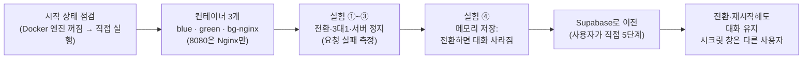

# [제출 보고서] N052 「로드밸런서로 무중단 배포 구성하기」 실습 과제 수행 결과

**수신**: N052 강의 강사님 · **발신**: 수강생 전대진(DJ)
**실습일**: 2026-10-28
**과제 대상**: AI 친구 에이전트 서비스(`friend-agent`)의 이미지를 내 컴퓨터의 Docker에서 두 벌(blue·green)로 띄우고, 그 앞에 Nginx 로드밸런서를 세워 ① 설정 한 줄로 전환·롤백 ② 가중치 3 대 1 ③ 서버 하나가 멈췄을 때(기본값과 연결 대기 1초) ④ 전환하면 사라지는 대화를 측정하는 실습. 이어서 대화를 컨테이너 밖 Supabase 데이터베이스로 옮겨 전환·재시작 뒤에도 대화가 이어지는지, 브라우저가 다르면 다른 사용자가 되는지 확인했다.
**평가 방법**: 12번 "평가 체크리스트"를 보고 항목별로 점수와 한 줄 의견을 남겨 주세요.

> **요약** — 이 문서는 N051 보고서와 같은 구조(한눈에 → 절별 기록 → 사고 표 → 정리 → 궁금했던 것)로 쓴 **한눈에 읽는 보고서**이다. 근거는 같은 폴더의 `N052_실습_진행기록.md`와 `실습로그\` 원본 로그(번호 01~14 묶음, 파일 24개)뿐이며, 로그에 없는 것은 "확인하지 못했다"고 적었다. **누가 했는지**를 절마다 구분한다. Docker·Nginx 명령과 요청 측정은 **AI 코딩 도우미(Claude)가 실행**했고, Supabase 대시보드 작업·`.env` 편집·브라우저 확인은 **사용자(DJ)가 직접** 했다. 저장소가 공개이므로 Supabase 프로젝트 주소·ID, 키 값, 사용자 ID, DB 비밀번호, GitHub 계정·저장소 주소는 싣지 않았다. 시각은 한국 시각(KST)이며, Nginx 에러 로그와 Supabase 테이블의 시각(`created_at`·`due_at`)은 UTC로 찍혀 있어 그대로 UTC라고 표시했다.

## 0. 한눈에



```ascii
시작 점검 → 컨테이너 3개 → 실험 ①②③(요청 실패 측정) → 실험 ④(메모리: 대화 사라짐) → Supabase 이전 → 전환·재시작해도 대화 유지
```

*그림: 오늘의 흐름. 5장까지는 "요청이 끊기는가"를, 6장은 "사용자가 하던 일이 이어지는가"를 본다.*

전환 때 요청 실패가 0건이어도 대화가 메모리에만 있으면 사용자에게는 대화가 사라진 것이었고, 대화를 Supabase로 옮기자 같은 조작에서 대화가 이어졌다. 즉 **전환 성공은 곧 무중단이 아니다.**

| 구분 | 결과 |
|---|---|
| ① blue → green 전환·롤백 (70초) | 요청 **341건**, 실패 **0건** · blue 274건(80%) · green 67건(20%) · 전환·롤백 모두 reload 직후 1초 안에 응답한 쪽이 바뀜 |
| ② 가중치 3 대 1 (30초) | 요청 **147건**, 실패 **0건** · blue 110건(75%) · green 37건(25%) |
| ③-a green 정지, 기본값 (60초) | 요청 **159건**, 실패 **13건** · Nginx가 알아챈 것은 멈춘 뒤 약 **38초** (교안은 60초) |
| ③-b green 정지, 연결 대기 1초 (60초) | 요청 **272건**, 실패 **0건** · 지연 측정에서 0.5초 넘은 요청 **2건**(1.006초·1.015초, 둘 다 200) |
| ④ 전환하면 사라지는 대화 (메모리 저장) | green에서 대화·약속 **0/0** → blue 복귀 **2/1** → blue 재시작 **0/0** |
| 6장 Supabase (사용자가 직접 확인) | green 전환 후·blue 재시작 후 모두 대화 **3개 그대로** · 시크릿 창은 다른 `user_id`로 `messages` 행 6개가 됨 |
| 정리 | 컨테이너 `blue`·`green`·`bg-nginx`와 네트워크 `bg-lab` 삭제 |

- 환경: Windows 11 · PowerShell/Git Bash · Docker 29.9.2(`docker --version`·엔진 모두), 이미지 `friend-agent:local`(473MB, amd64) · `nginx:1.27-alpine`
- 이번 실습은 git이 추적하는 저장소 파일을 고치지 않았다. 저장소 루트의 `.env`(추적하지 않는 파일)만 6장에서 사용자가 편집했고, 설정 폴더는 저장소 밖 `%USERPROFILE%\bluegreen-lab`에 두었다. 이미지·컨테이너는 어디에도 올리지 않았다(`AGENTS.md`: 배포용 이미지는 Actions에서만). Google Cloud는 쓰지 않았다.
- 사고·문제: Docker Desktop 꺼짐 **2회**, Git Bash 경로 변환 **1회**, `.env` 첫 시도 실패 **1회**(원인은 기존 줄을 고치지 않은 것), 지구본 아이콘에 대한 안내 오류 **1건**, 점검 명령의 세 번째 출력이 처음에 전달되지 않아 다시 요청한 일 **1건**(8절)

## 1. 시작 상태 점검 (교안 4-1, 09:15) — 실행: Claude

교안은 앞 실습을 이어 하고 있다면 확인 명령만 돌리고 넘어가라고 한다.

| 확인 | 결과 |
|---|---|
| Docker Desktop | 처음에 엔진이 꺼져 있어(`failed to connect to the docker API … dockerDesktopLinuxEngine`) **Claude가 Docker Desktop을 실행**했다. 약 20초 뒤 엔진이 올라왔다(서버 29.9.2, linux/x86_64) |
| 가상환경·Dockerfile | `.venv`(`httpx 0.28.1`, Python 3.14.6), 저장소 루트의 Dockerfile·.dockerignore 모두 있음 |
| 이미지 `friend-agent:local` | 있음(473MB, `amd64`, 만든 시각 2026-10-26 14:11). 마지막 앱 변경 커밋이 14:12(PDF 공지문 읽기)라 이 이미지가 현재 코드와 같다고 보고 **다시 빌드하지 않고** 썼다 |
| 포트 8080 | 비어 있음 |
| 기존 컨테이너·네트워크 | 컨테이너 없음, `bg-lab` 네트워크 없음(깨끗한 상태) |
| 요청 확인 스크립트 | `scripts/watch_requests.py` 있음(0.2초 간격, 최대 300초, 실패는 연결 실패·2초 초과) |

- **작업 전 점검**: 저장소는 git이 관리하고 시작 시점 브랜치는 `staging`, 작업 트리의 변경은 N051에서 남은 미추적 파일 하나(`docs/cleanup-policy.json`)뿐이었다.
- **교재와 다르게 한 것**: 교안은 "Docker Desktop이 켜져 있다"를 전제로 하는데 PC를 다시 켠 뒤라 꺼져 있었다. `docker info`가 먼저 알려 준다.

## 2. 컨테이너 세 개 띄우기 (교안 4-2~4-5, 09:15) — 실행: Claude

서비스 두 벌(blue·green)과 로드밸런서 역할의 Nginx를 같은 Docker 네트워크 `bg-lab`에 놓고, 설정 한 줄로 요청 목적지를 바꿀 수 있게 만들었다.

1. 설정 폴더 `%USERPROFILE%\bluegreen-lab` 생성. `cat > … <<'EOF'`가 PowerShell에 없어서 `default.conf`는 Claude가 **편집기 도구로 직접 만들었다**(내용은 교안과 같음: `upstream active_app { zone active_app 64k; server blue:8080; }` + `server { listen 80; location / { proxy_pass http://active_app; } }`).
2. `docker network create bg-lab`
3. `blue`·`green`: `-e LLM_PROVIDER=fake -e K_REVISION=… -e BANNER=…`, **`-p`를 붙이지 않음**
4. `bg-nginx`: `-p 8080:80 -v "$HOME/bluegreen-lab:/etc/nginx/conf.d" nginx:1.27-alpine`(폴더를 통째로 연결, 경로는 `$HOME`)

| 확인(교안 4-5) | 결과 |
|---|---|
| 1. `docker ps` | 세 줄. **`bg-nginx`에만 `0.0.0.0:8080->80/tcp`**가 있고 `blue`·`green`의 포트 칸은 비어 있음 |
| 2. Nginx가 보는 설정 | 위에서 만든 내용과 같음(Git Bash 경로 문제는 8절 3번) |
| 3. 브라우저 `http://localhost:8080` | 맨 위 **BLUE 배너**, 왼쪽 아래 "빌드 local" (`증거화면/01_localhost8080_BLUE배너.jpg`) |
| 4. `/version` | `revision: blue`, `storage: memory`, `auth: none`, `banner: BLUE` |

- `nginx:1.27-alpine`은 이 PC에 없어 처음 `docker run`할 때 Docker Hub에서 내려받았다.
- 직접 접근: blue·green은 포트를 열지 않아 `localhost:8081`은 연결이 안 된다(코드 000). 같은 네트워크의 Nginx만 요청을 넘길 수 있다(리버스 프록시).
- `docker exec bg-nginx nginx -t`: `syntax is ok` / `test is successful`

## 3. 실험 ① blue → green 전환과 롤백 (교안 5-2, 09:16~09:17) — 실행: Claude

요청 확인 스크립트(`python -u scripts/watch_requests.py http://localhost:8080 --seconds 70`, 0.2초 간격)를 한쪽 터미널에서 돌리고, 다른 쪽에서 전환 명령을 실행했다. 원본은 `실습로그/03_*.log`이다.

| 시각 | 한 일 | 결과 |
|---|---|---|
| 09:16:43 | 스크립트 시작 | 첫 응답 리비전 `blue` |
| 09:16:54 | 전환 전 확인: `docker exec bg-nginx wget -qO- http://green:8080/health`, `/version` | `{"status":"ok"}`, `revision: green`(green은 바깥에 포트가 없지만 bg-nginx 안에서는 닿는다) |
| 09:16:55 | upstream 줄 `server blue:8080;` → `server green:8080;` | 아래 "도구" |
| 09:16:56 | `nginx -t` | `syntax is ok` / `test is successful` |
| 09:16:56~57 | `nginx -s reload` | `signal process started` |
| **09:16:57.257** | 스크립트가 처음 `green` 응답을 기록 | reload 완료와 같은 초 |
| 09:17:09~10 | **롤백**: 같은 줄을 `green` → `blue`, `nginx -t`, reload | 서버 줄이 `server blue:8080;`로 돌아옴 |
| **09:17:10.999** | 스크립트가 다시 `blue` 응답 기록 | reload 완료의 1초 뒤 |

**측정 결과**: 전체 요청 **341건, 실패 0건**, 70초 / blue 274건(80%) / green 67건(20%). green이 응답한 구간은 09:16:57~09:17:11, 약 14초이고 0.2초 간격이므로 약 70건인데 실제 green은 67건이다. 80%·20%는 "green이 응답한 시간이 70초 중 20%"라서 나온 숫자이지 분배 규칙(가중치)이 아니다.

- 브라우저 화면도 전환 중에는 맨 위 배너가 **GREEN**으로 바뀌었다(`증거화면/02_전환후_GREEN배너.jpg`).
- 교안 예시(1013건, blue 68%·green 32%, 215초)와 비율이 다른 것은 **전환 시각을 내가 정했기 때문**이다. 실패 0건은 같다.
- **도구**: Windows에는 `sed`가 없어 교안은 편집기로 고치라고 한다. 이번에는 강의노트 부록 A-6에 `[보충]`·미실행으로 적었던 PowerShell 방식 `(Get-Content …) -replace "server blue:8080;","server green:8080;" | Set-Content … -Encoding ascii`를 실제로 썼다. 전환·롤백 두 번 모두 의도한 한 줄만 바뀌고 Nginx가 문제없이 읽었다. 이 명령은 동작한다.
- reload는 Nginx를 재시작하지 않는데도 실패 0건이었다. 순서(수정 → 검사 → reload)를 지켰고 blue는 끄지 않고 남겨 두어 롤백이 1초 만에 가능했다. **실패 0건은 이 70초 구간의 결과**일 뿐이다.

## 4. 실험 ② 가중치 3 대 1 (교안 5-3, 09:18) — 실행: Claude

Claude가 `default.conf`를 편집기 도구로 교안 그대로 바꿨다(`server blue:8080 weight=3;` + `server green:8080;`, `zone` 유지). `nginx -t` → `nginx -s reload` → `watch_requests.py … --seconds 30`. 원본은 `실습로그/04_실험2_가중치.log`이다.

- **결과**: 전체 요청 **147건, 실패 0건**, 30초 / blue 110건(**75%**) / green 37건(**25%**). 110 : 37 = 2.97 : 1로 교안이 말한 "약 75%와 25%"와 같다.
- 응답 리비전이 바뀐 시각 `green(09:18:56.285) → blue(56.492) → green(57.104) → blue(57.314) → green(57.929)`에서 **green은 약 0.6~0.8초(요청 4개)마다 한 번**, 그 사이 blue가 세 번 응답한다. "요청 4개마다 3개가 blue로" 가는 순서 세기가 그대로 보인다.
- `zone active_app 64k;`가 있는 상태로만 실험했다. **zone을 뺀 경우의 어긋남은 확인하지 못했다.**

## 5. 실험 ③ green을 멈췄을 때 — 기본값과 연결 대기 1초 (교안 5-4, 09:19~09:23) — 실행: Claude

무료 Nginx에는 능동 헬스체크가 없다. 서버 하나가 갑자기 멈추면 사용자 요청이 어떻게 되는지, 3 대 1 설정 그대로 스크립트를 60초 돌리고 시작 약 10초 뒤 `docker stop green`을 실행해 보았다.

### 5-1. ③-a 기본값 (원본 `실습로그/05_*.log`)

| 시각 | 사건 |
|---|---|
| 09:19:18 | 스크립트 시작, blue·green이 3 대 1로 번갈아 응답 |
| 09:19:28.4 | `docker stop green` 실행(종료까지 약 4초, 09:19:32에 끝남) |
| 09:19:31.67 | green의 마지막 응답 |
| **09:19:32.482** | **첫 `실패: ReadTimeout`**(2초 안에 답을 못 받음) |
| 09:19:35.3 → 38.1 → 40.9 … | 이후 **약 2.83초마다** 한 번씩 실패(총 13번) |
| 09:20:06.439 | 마지막 실패 |
| **09:20:10 (UTC 00:20:10)** | Nginx 에러 로그: `connect() failed (113: Host is unreachable) while connecting to upstream`, `upstream server temporarily disabled` |
| 09:20:18 | 스크립트 종료(60초) |

**결과**: 전체 요청 **159건, 실패 13건**, 60초 / blue 130건(82%) / green 16건(10%) / 실패 시각 처음 09:19:32.482, 마지막 09:20:06.439.

- 실패 간격 2.83초는 "green 차례 요청 1개가 2초 제한에 걸려 실패 + 그 사이 blue 차례 3개" 한 바퀴와 맞는다. **4번에 한 번(green 차례)** 요청이 실패한 것으로 읽힌다(로그는 응답 리비전이 바뀔 때만 찍히므로 blue 성공은 로그에 보이지 않는다).
- 에러 로그의 `upstream server temporarily disabled`는 교안 3-3의 `max_fails=1, fail_timeout=10s`(기본값) 동작이다. green을 잠시 빼서 실패가 더 이어지지 않았다.
- **교안과 다른 점**: 교안은 연결 대기 시간(`proxy_connect_timeout`, 기본 60초)이 지나야 실패로 본다고 설명한다. 이번 환경에서는 실패 구간이 **60초가 아니라 약 38초**(09:19:32 → 09:20:10)였고, 로그의 원인도 타임아웃이 아니라 `113: Host is unreachable`이었다. 멈춘 컨테이너 주소로 가는 연결이 Docker 네트워크에서 응답을 못 받다가 커널이 도달 불가로 판정한 것으로 **추정**한다. 확인한 것은 오류 문구와 시각까지다. 실행 환경(Docker Desktop·Windows 11) 차이일 수 있다.
- 그래도 교안의 핵심인 **"알아채는 비용을 사용자 요청이 낸다"**는 재현됐다. 실패 13건이 알아채는 데 쓰인 요청들이다.

### 5-2. ③-b 연결 대기 1초 (원본 `실습로그/06_*.log`)

1. 09:21:07 `docker start green`
2. Claude가 편집기 도구로 `location /` 안에 `proxy_connect_timeout 1s;` 한 줄 추가 → `nginx -t` 통과 → `nginx -s reload`(green을 다시 켰으니 reload로 이름을 다시 찾게 함, 교안 5-4)
3. 스크립트 60초 시작, 09:21:33 `docker stop green`(09:21:37에 끝남)

**결과**: 전체 요청 **272건, 실패 0건**, 60초 / blue 257건(94%) / green 15건(6%).

- Nginx 에러 로그: 09:21:38에 `upstream timed out (110: Operation timed out) while connecting to upstream`과 `upstream server temporarily disabled`. 이어서 00:21:50 → 00:22:02 → 00:22:14(UTC)에 약 12초마다 같은 두 줄이 반복됐다. `fail_timeout`(기본 10초)이 지나면 요청 하나를 다시 green에 보내 보고 1초 만에 실패하면 다시 빼는 동작으로 읽는다.
- **지연 측정**(`06_실험3_1초_지연측정.log`): green이 멈춘 채 30초 동안 0.2초 간격으로 요청해(로그에 적힌 총 건수는 52건이다. 요청마다 걸리는 시간이 더해져 30초÷0.2초보다 적다) 0.5초를 넘은 것은 **2건**, 둘 다 약 1.0초(1.006초·1.015초)에 상태 코드 200이었고 시각은 09:22:49·09:23:04로 약 15초 간격이다. 나머지 50건은 0.5초 이하.
- 실패가 0건인 이유는 Nginx가 1초 안에 실패로 보고 같은 요청을 blue로 다시 보냈고 스크립트의 2초 안에 blue 응답이 돌아왔기 때문으로 **읽는다**(로그에는 `110` 오류와 실패 0건, 약 1초 지연된 200 응답이 있고, blue 재전송 자체를 보여 주는 기록은 없다).

### 5-3. ③-a와 ③-b 비교

| 항목 | ③-a 기본값 | ③-b 연결 대기 1초 |
|---|---|---|
| 요청 수 (60초) | 159 | 272 |
| **실패 수** | **13건** | **0건** |
| Nginx가 서버 하나가 멈춘 것을 알아챈 시점 | 멈춘 뒤 약 38초(`113 Host is unreachable`) | 멈춘 뒤 1초(`110 Operation timed out`, 설정한 1초) |
| 사용자가 겪은 것 | 4번에 한 번(green 차례)꼴로 멈췄다가 2초 제한에서 실패한 것으로 읽힘 | green 차례 요청이 약 1초 늦게 200 |
| green을 뺀 뒤 | 더 이상 실패 없음 | 12~15초마다 요청 하나가 1초씩 더 기다림 |

- 교안의 핵심 세 가지가 재현됐다: 대기 시간을 줄이면 실패가 사라지고(13 → 0), 대신 green 차례 요청이 1초 늦으며, green을 뺀 뒤에도 `fail_timeout` 간격으로 한 요청이 1초 더 기다린다. ③-b는 **설정한 1초가 그대로** 동작했다.
- **하지 않은 시험**: 대기 시간을 너무 짧게 잡으면 잠깐 바빠서 늦게 연결된 정상 서버를 실패로 볼 수 있다는 교안의 주의는 시험하지 않았다. `proxy_connect_timeout`은 연결 시도에만 적용되므로 연결 뒤 응답이 늦는 경우(읽기 타임아웃)도 보지 않았다.

### 5-4. 되돌리기 (교안 5-5, 09:23)

09:23:34 `docker start green` → `nginx -t` 통과 → reload 후 세 컨테이너 Up. 5장이 끝난 09:25 기준 `default.conf`는 `server blue:8080;` 한 줄(처음 상태)이었다. 이 로그(`07_되돌리기.log`)에는 설정 내용이 없고, 설정을 되돌린 뒤 `/version` 응답 6번이 모두 blue였다는 것이 간접 근거이다.

## 6. 실험 ④ 전환하면 사라지는 대화 (교안 5-6, 09:24) — 실행: Claude

지금까지는 "요청이 끊기는가"만 봤다. 이제 사용자가 하던 일이 이어지는가를 본다. 이때 두 서버는 각자 자기 메모리에 대화·약속을 두고 있다(`storage: memory`). 브라우저 대신 같은 API를 파이썬(`httpx`)으로 호출했다. 한글 JSON을 Git Bash `curl -d`로 보내면 깨지는 문제를 피하려는 선택이며, 이 확인 스크립트는 작업용이라 저장소에 넣지 않았다. 원본은 `실습로그/08_실험4_*.log`이다.

| # | 시각 | 한 일 | 응답한 쪽 | 대화 메시지 | 약속 | 기억 |
|---|---|---|---|---|---|---|
| 0 | 09:24:06 | 시작 상태 | blue | 0 | 0 | 0 |
| 1 | 09:24:07 | `POST /api/chat` "내일 아침 8시에 물 마시라고 알려 줘" | blue | **2** | **1** | 0 |
| 2 | 09:24:19 | **green으로 전환**(`server green:8080;`, `nginx -t`, reload) | green | **0** | **0** | 0 |
| 3 | 09:24:30 | **blue로 롤백** | blue | **2** | **1** | 0 |
| 4 | 09:24:40 | `docker restart blue` + `nginx -s reload` | blue | **0** | **0** | 0 |

- 1단계 응답: 가짜 LLM이 규칙(`decided_by: rule`)으로 `create_reminder`를 골라 "약속을 저장했습니다: 10월 29일(목) 08:00에 '물 마시기'."를 돌려줬다.
- 2단계: green의 약속·대화는 0개. 요청은 성공했지만 사용자가 하던 일은 보이지 않는다.
- 3단계: 롤백하자 blue의 대화 2개·약속 1개가 그대로 다시 나타났다. 지워진 것이 아니라 **blue 서버의 메모리에만 있었다.**
- 4단계: blue를 다시 시작하자 완전히 사라졌다. 교안 5-6의 해석 4줄이 숫자까지 그대로 재현됐다.
- 실험 ①에서 실패 0건이던 바로 그 blue → green 전환이 사용자에게는 "대화가 사라진 것"이었다.

## 7. Supabase로 데이터 옮기기 (교안 6장, 09:27~14:33)

6장은 계정·키가 필요해 09:27에 멈추고 **사용자가 직접 하는 단계**를 안내했다(교안도 "키 값은 채팅이나 명령, 코드에 붙여 넣지 않는다"). 이 세션은 `.env`의 내용을 읽거나 출력하지 않았고(줄 이름만 확인하는 명령도 허용되지 않아 실행하지 않았다), 변수 이름은 `.env.example`로 확인했다. 값이 맞게 들어갔는지는 컨테이너 시작 로그의 `storage`·`auth`로만 보았다.

### 7-1. 사용자가 직접 한 일 5단계

| 단계 | 한 일 (사용자 DJ) | 시각 | 확인 방식 | 결과 |
|---|---|---|---|---|
| 1 | Supabase 프로젝트 만들기 | 09:39 | 사용자의 화면으로 확인 | 이름 `friend-agent-staging`, 리전 **East US (Ohio) · us-east-2**, Nano(무료), 상태 **Healthy**. 옵션: Enable Data API ✅ / Automatically expose new tables ✅ (둘 다 기본값 유지) / Enable automatic RLS ⬜ 안 켬 / GitHub 연결 안 함. DB 비밀번호는 사용자가 비밀번호 관리 도구에 저장(`.env`에는 쓰지 않음) |
| 2 | SQL Editor에 `supabase/migrations/0001_init.sql` 붙여 넣고 Run | 09:42 | 사용자의 화면으로 확인 | Table Editor(`schema public`)에 테이블 **6개**: `characters`·`memories`·`messages`·`reminders`·`summaries`·`user_settings` |
| 3 | `Authentication > Sign In / Providers`에서 `Allow anonymous sign-ins` 켜고 저장 | 09:45 | **사용자의 보고만 받음, 화면으로 확인하지 못함** | 실제 동작은 7-4의 "게스트로 사용 중"으로 간접 확인 |
| 4 | `Authentication > Rate Limits`에서 익명 로그인 한도 확인(교안: 기본 IP당 시간당 30건) | — | **진행기록에 확인 기록이 없다** | 한도 값을 확인했는지 확인하지 못했다 |
| 5 | `Project Settings > API Keys`의 URL·publishable key·secret key를 편집기로 `.env`에 직접 입력(`STORAGE`·`AUTH` 포함 다섯 줄) | 09:49:54 저장 | `.env`는 이 세션이 읽지 않음 | 7-2·7-3 |

- 조직은 무료(Free) 플랜이었고 이전 프로젝트 3개가 모두 일시정지(Paused)라 활성 프로젝트가 0개였다. 아무것도 멈추거나 지우지 않고 새로 만들 수 있었으며, 새로 가입하는 단계는 기록에 없다.
- 옵션을 기본값으로 둔 것은 Claude의 판단이다. 템플릿 SQL에 `GRANT` 문이 없어 "새 테이블 노출"을 끄면 서버가 secret key로 접근할 때 `permission denied`가 날 수 있다고 **추정**했으나 끈 경우는 시험하지 않았다.
- **교안과 다른 점**: ① 만들기 화면에 교안(2026-10 기준)에 없던 **보안 옵션 3개**(Data API·새 테이블 노출·자동 RLS)가 있었고 권장이 "새 테이블 노출 끄기"로 바뀌어 있었다. ② 교안 본문은 테이블을 5개로 말하지만 실제로는 `user_settings`가 하나 더 있는 **6개**였다.

### 7-2. `.env` 첫 시도 실패와 원인 (09:50~09:53)

- **첫 시도(09:50, 실행: Claude)**: `docker rm -f blue green` → `--env-file .env -e LLM_PROVIDER=fake …`로 재기동 → `nginx -s reload`. 두 컨테이너 모두 정상 기동했지만 시작 로그가 **`"storage": "memory", "auth": "none"`**이었고 앱이 시작을 거부하는 오류도 없었다(`실습로그/09_6장_재기동.log`).
- **원인 추정**: `app/config.py`는 `STORAGE`·`AUTH`가 없으면 `memory`·`none`을 쓴다. 따라서 `STORAGE=supabase`·`AUTH=supabase`가 전달되지 않았다. `.env`를 읽지 않는 규칙 때문에 사용자가 직접 확인하는 비밀값 없는 점검 명령을 안내했다.
- **사용자가 직접 실행한 점검 결과(09:53)**: 파일 크기 839바이트, 수정 시각 09:49:54(재기동 직전, 저장은 되어 있었다), **10번 줄 `STORAGE=memory`, 11번 줄 `AUTH=none`**이 각각 한 줄뿐. 비밀 세 개의 줄 수·길이는 점검 명령 ③의 출력이 전달되지 않아 이때는 확인하지 못했다.
- **원인 확정**: 처음 `.env`에 있던 `STORAGE=memory`·`AUTH=none`을 **바꾸지 않았다.** 교안은 "다섯 줄을 넣는다"고만 해서 기존 줄을 **고치는** 일이라는 점이 빠지기 쉽다(Claude의 안내에는 "이미 있으면 값을 바꿉니다"라고 적었으나 놓치기 쉬웠다).

### 7-3. 재기동 성공 (09:55)

- **점검 ③의 결과(사용자 실행, 값은 안 나옴)**: `SUPABASE_URL` 줄 1개·값 **40자**, `SUPABASE_PUBLISHABLE_KEY` 줄 1개·값 **46자**, `SUPABASE_SECRET_KEY` 줄 1개·값 **41자**. 각 형식의 길이와 맞아 값이 제대로 들어 있다고 판단했다(값은 보지 않았다).
- 사용자는 `STORAGE`·`AUTH`를 `supabase`로 고쳐 저장했다고 따로 알려 오지는 않았으나, Claude가 재기동한 로그로 확인했다.
- **재기동(09:55:51, 실행: Claude)**: 같은 명령으로 두 컨테이너를 다시 만들자 시작 로그가 **`"storage": "supabase", "auth": "supabase"`**, `Uvicorn running`이었다(`실습로그/10_6장_재기동2.log`). 코드의 검사(`STORAGE=supabase`이면 `AUTH=supabase`·URL·publishable·secret이 모두 있어야 함)를 통과한 것이다. 환경변수는 컨테이너를 **다시 만들어야** 반영된다(`docker restart`로는 안 됨).

### 7-4. Table Editor 확인 (14:19, 사용자가 직접 확인)

blue가 활성인 상태(Docker 재시작 직후)에서 사용자가 본인 브라우저로 `http://localhost:8080`을 열어 게스트로 접속하고 캐릭터를 저장한 뒤 "내일 아침 8시에 물 마시라고 알려 줘"를 보냈다. 이어서 Supabase `Table Editor` 화면 두 장을 보내 확인했다(화면의 주소·사용자 ID 값은 적지 않는다).

**`messages` 테이블 — 행 3개**(모두 같은 `user_id`, 한 게스트 사용자)

| id | role | content (앞부분) | created_at (UTC → KST) |
|---|---|---|---|
| 1 | assistant | "(가짜 응답) 안녕, 나 하루! 오늘은 어떻게…" (`action: greeting`) | 05:15:45 → 14:15:45 |
| 2 | user | "내일 아침 8시에 물 마시라고 알려 줘" | 05:16:00 → 14:16:00 |
| 3 | assistant | "(가짜 응답) 약속을 저장했습니다: 10월 29…" (`tools: create_reminder`) | 05:16:01 → 14:16:01 |

**`reminders` 테이블 — 행 1개**: `text` "물 마시기", `due_at` 2026-10-28 23:00:00(**UTC**, 한국 시간 10월 29일(목) 08:00), `status` `pending`, `delivered_at` NULL.

- **교안과 다른 점**: 5장 실험 ④의 API 확인에서는 메시지가 2개였는데 이번 화면에서는 **3개**다. 1번 행은 앱이 처음 열릴 때 캐릭터가 먼저 건네는 인사(greeting)로 보인다(API 확인은 화면을 거치지 않아 인사가 없었다).
- 화면의 `Add RLS policy` 버튼이 보여 RLS가 켜져 있고 정책이 0개인 상태와 맞다. `id`가 1부터 시작한다(메모리 모드에서는 약속 id가 2였음). 시각은 DB에 UTC로 저장되고 앱이 한국 시간으로 바꿔 보여 준다. 왼쪽 아래 "게스트로 사용 중"이 보여 익명 로그인(단계 3)이 동작함을 간접 확인했다.

### 7-5. green 전환 · blue 재시작 · 시크릿 창

- **green 전환(14:19 Claude 전환, 14:24 사용자 확인)**: Claude가 Nginx를 green으로 전환(`nginx -t` 통과, reload, `/version`이 `revision: green`·`storage: supabase`, `실습로그/12_6장_green전환.log`)한 뒤 사용자가 새로고침했다. 배너가 **GREEN**으로 바뀌었고 대화 **3개 메시지가 그대로** 보였으며 캐릭터 카드와 "게스트로 사용 중"도 그대로였다.
- **blue 재시작(14:24:39 Claude 재시작, 14:26 사용자 확인)**: green이 활성인 동안 `docker restart blue` → Claude가 편집기 도구로 `server blue:8080;`로 되돌림 → `nginx -t` 통과 → reload(14:25:01) → `/version`이 `revision: blue`·`storage: supabase`(`실습로그/13_6장_blue재시작.log`). 사용자가 새로고침한 화면에서 배너 **BLUE**, 대화 3개 **그대로**, 인사도 또 생기지 않았다.

| 조작 | 5장 ④ (메모리) | 6장 (Supabase) |
|---|---|---|
| blue → **green** 전환 후 | 대화·약속 **0개** | 대화 **그대로** |
| **blue 재시작** 후 | 대화·약속 **0/0** | 대화 3개 **그대로** |

**시크릿 창(14:33, 사용자가 직접 확인)**: Chrome 시크릿 창에서 `http://localhost:8080`을 열었다(blue 활성). 첫 번째 게스트를 "게스트 A", 시크릿 창을 "게스트 B"라 부른다. 캡처 3장의 결과는 다음과 같다.

1. 시크릿 창의 대화 화면은 **비어 있다**(배너 BLUE, "게스트로 사용 중", 기본 캐릭터 카드). 게스트 A의 대화 3개는 보이지 않는다.
2. "내 약속 뭐 있어?"에 "(가짜 응답) 저장된 약속이 없습니다."라고 답했다(도구 `list_reminders`, 확신도 75%, 키워드 규칙). 게스트 A의 약속은 나오지 않았다.
3. `messages`가 **6행**이 되었다. 1~3번은 게스트 A의 것(그대로), **4~6번은 다른 `user_id`**(앞 8자리가 게스트 A와 다름): 인사(05:31:26 UTC) → user "내 약속 뭐 있어?"(05:31:38) → assistant "저장된 약속이 없습니다."(05:31:38).

- 교안 6-5 확인 5단계 중 `reminders` 행 수를 뺀 나머지가 확인됐다. `reminders`는 시크릿 창 뒤에 캡처하지 않아 게스트 B의 약속 행 여부는 **확인하지 못했다**(만들지 않았으므로 1행 그대로일 것으로 예상).
- **새로 관찰한 것(추정)**: 오른쪽 "걸린 시간" 패널이 도구 선택·첫 글자·답 전체 모두 **3.0초**였다. 가짜 LLM은 외부 AI를 부르지 않는데도 걸린 시간이라, 미국 동부(Ohio) DB를 여러 번 왕복한 시간으로 **추정**한다. 서울 리전과 비교하지 않아 **확인하지 못했다**.

## 8. 사고·문제 표

| 번호 | 증상 | 원인 | 조치 |
|---|---|---|---|
| 1 | 4-1(09:15)에서 `failed to connect to the docker API … dockerDesktopLinuxEngine` | Docker Desktop 엔진이 꺼져 있었다(PC를 다시 켠 뒤) | Claude가 Docker Desktop을 실행, 약 20초 뒤 엔진이 올라와 진행 |
| 2 | 14시대에 사용자의 Chrome에서 `http://localhost:8080`이 `ERR_CONNECTION_REFUSED`, `docker ps`도 같은 API 오류, 엔진이 올라온 뒤 컨테이너 3개가 모두 `Exited (255)` | Docker Desktop이 꺼져 있었다(마지막 재기동 09:55 이후 시간이 지나 14시대에 확인, 꺼진 시점은 확인하지 못함). `--restart` 옵션 없이 `docker run`한 컨테이너는 Docker가 꺼지면 같이 멈추고 자동으로 돌아오지 않는다 | Docker Desktop 실행 → `docker start blue green bg-nginx` → `nginx -s reload`(재시작 뒤 IP가 바뀔 수 있어서). 로그 14:13:38. `docker start`는 컨테이너를 새로 만들지 않아 Supabase 환경변수가 유지됨(`/version`이 `storage: supabase`) |
| 3 | Git Bash에서 `docker exec bg-nginx cat /etc/nginx/conf.d/default.conf`가 `cat: can't open 'C:/Program Files/Git/etc/nginx/conf.d/default.conf'` | Git Bash가 `/etc/...`를 윈도 경로로 바꿔 컨테이너에 넘겼다(교안의 PowerShell에서는 일어나지 않음, N050 지침 G378과 같은 증상) | `MSYS_NO_PATHCONV=1`을 앞에 붙여 정상. 이후 `docker exec`는 모두 이 설정으로 실행 |
| 4 | `.env`를 쓴 첫 재기동의 시작 로그가 `storage: memory, auth: none`(기대는 `supabase`) | `.env`의 기존 10번 줄 `STORAGE=memory`·11번 줄 `AUTH=none`을 `supabase`로 **고치지 않았다**(사용자 점검 결과) | 두 줄이 `supabase`로 바뀐 것을 재기동 로그로 확인(사용자의 별도 보고는 없었음) → 컨테이너를 다시 만들어 재기동하자 `storage: supabase, auth: supabase` |
| 5 | 사용자 점검 명령 ③의 출력이 전달되지 않아 비밀 세 개의 줄 수·길이를 확인하지 못함(09:53) | 출력이 전달되지 않은 이유는 확인하지 못했다 | 점검을 다시 실행해 줄 1개씩, 40자·46자·41자를 확인 |
| 6 | Claude가 "테이블 이름 옆에 RLS 표시가 있어야 한다"고 안내했는데 화면의 지구본 아이콘이 RLS 표시가 아니었다 | 지구본 아이콘은 RLS가 아니라 **Data API에 노출된 테이블** 표시다("Automatically expose new tables"를 켜 두었기 때문). Claude의 안내가 틀렸다 | 정정. RLS는 각 테이블을 열었을 때 상단 표시(`Add RLS policy` 버튼 등)로 확인 |

1·2번은 "서버는 언제든 꺼질 수 있다"는 6장의 주제를 우연히 두 번 겪은 것이다. 4번은 "설정은 코드가 아니라 환경변수 한 줄로 바뀐다"는 장면이 실패와 성공 양쪽으로 확인된 사례이기도 하다.

## 9. 풀지 못한 것 · 교재와 달라진 것

**풀지 못한 것 / 확인하지 못한 것**
- ③-a의 38초와 `113 Host is unreachable`의 정확한 원인(**추정**만 있음).
- `zone`을 뺀 3 대 1의 어긋남, 연결 대기 시간을 너무 짧게 잡았을 때의 정상 서버 오판, 연결 뒤 응답이 늦는 경우(읽기 타임아웃)는 시험하지 않았다.
- 7-1의 단계 3은 사용자 보고만 받았고 단계 4는 확인 기록이 없다. `.env` 내용은 보지 않고 줄 수·글자 수와 시작 로그로만 확인했다.
- "Automatically expose new tables"를 껐을 때 `permission denied`가 나는지는 시험하지 않았다(추정만).
- Supabase 요청 3.0초가 미국 동부 리전 때문인지 서울 리전과 비교하지 못했다(추정).
- 교안 6-6의 "두 버전이 같은 테이블을 쓰는 위험"(스키마 변경 호환성)과 RLS 정책·서버 조회 로직의 별도 검증은 하지 않았다.

**교재와 달라진 것**
- ③-a: 실패 구간이 60초가 아니라 **약 38초**, 원인 로그가 타임아웃이 아니라 `113 Host is unreachable`(환경 차이로 추정). 핵심(알아채는 비용을 사용자 요청이 낸다)은 재현됨
- ①의 요청 수와 비율이 교안 예시(1013건, blue 68%·green 32%, 215초)와 다름: 우리는 70초이고 전환 시각을 직접 정했기 때문
- 6장 화면의 메시지가 2개가 아니라 **3개**(인사 메시지, 5장 실험 ④ API 확인은 2개)
- 테이블이 5개가 아니라 **6개**(`user_settings`)
- 새 Supabase 만들기 화면의 보안 옵션 **3개**(교안에 없음), 템플릿 SQL에 `GRANT`가 없는 점
- `.env`는 다섯 줄을 "넣는" 것이 아니라 기존 `STORAGE`·`AUTH` 줄을 **고치는** 일이었다
- 강의노트 부록 A-6의 PowerShell `-replace` 방식은 `[보충]`·미실행이었으나 이번에 **동작을 확인**했다

## 10. 정리 (교안 6-7, 14:33) — 실행: Claude

- **지우기 전 확인**: `docker ps -a`에 `green`·`blue`·`bg-nginx` 세 개, 네트워크 목록에 `bg-lab`이 있어 이름이 실습에서 만든 것과 일치했다. 실습로그·진행기록에서 키 값·프로젝트 주소·사용자 ID 원문은 0건이었다.
- **한 일**: `docker rm -f blue green bg-nginx` → `docker network rm bg-lab`. 정리 후 컨테이너 목록이 비고 네트워크는 기본 `bridge`·`host`·`none`만 남았다(`실습로그/14_정리.log`). 컨테이너를 지우면 환경변수로 들어 있던 Supabase 값도 함께 사라진다.
- **남긴 것**: Supabase 프로젝트와 `.env`, `friend-agent:local`·`nginx:1.27-alpine` 이미지, 설정 폴더 `%USERPROFILE%\bluegreen-lab`(처음 상태로 되돌린 `default.conf`). `.env`의 `STORAGE`·`AUTH`는 `supabase` 그대로라 이후 로컬에서 에이전트를 띄우면 같은 시험용 데이터베이스를 쓴다. 메모리 저장으로 돌아가려면 두 줄을 `memory`·`none`으로 되돌린다.

## 11. 궁금했던 것

아래는 실습 중 사용자(DJ)가 실제로 한 질문이다.

**Q1. "Supabase 진행과정을 상세하게 알려줘"**

- 사용자 몫(7-1의 5단계: 프로젝트 → SQL → 익명 로그인 → 한도 확인 → `.env` 입력) 뒤에 Claude가 컨테이너를 `--env-file .env`로 다시 띄우고 시작 로그의 `storage`·`auth`를 확인한다. 이어 게스트 로그인·약속 만들기 → Table Editor 확인 → green 전환·blue 재시작·시크릿 창 확인 → 정리 순서다. 실제 진행은 7절에 시각순으로 적었다.

**Q2. "Supabase로 내가 어떤 일을 하면 되는지 상세하게 알려줘"**

- 사용자가 직접 할 일은 7-1의 5단계다(프로젝트 생성, SQL 실행, 익명 로그인 켜기, 한도 확인, 키 값을 편집기로 `.env`에 입력). 계정·키·비밀번호를 다루는 일은 에이전트가 대신하지 않고, 키 값은 채팅·명령·문서에 붙여 넣지 않는다. Claude는 `.env`를 읽지 않고 컨테이너 재기동·Nginx reload·시작 로그 확인만 한다. `.env`에서 기존 `STORAGE`·`AUTH` 줄은 새로 넣는 것이 아니라 값을 바꾸는 일이라는 점을 이번에 겪었다(8절 4번).

**Q3. "Table Editor를 확인할 수 있는 URL을 알려줘"**

- 주소 자체는 이 보고서에 적지 않는다(프로젝트 주소가 들어 있고 저장소가 공개). Supabase 대시보드에 로그인해 **해당 프로젝트(`friend-agent-staging`)를 선택한 뒤 `Table Editor`로 들어가** `schema public`에서 `messages`·`reminders` 테이블을 연다.

## 12. 평가 체크리스트 (1~5점, 한 줄 의견)

점수는 사용자(DJ)가 입력한다. 오른쪽 칸은 점수의 근거가 되는 사실 한 줄이다.

| 번호 | 확인할 것 | 근거가 있는 절 | 점수 | 근거가 되는 사실 |
| --- | --- | --- | --- | --- |
| 1 | 시작 상태를 점검하고 컨테이너 세 개를 띄워 포트가 Nginx에만 열려 있음을 확인했는가 | 1, 2 | (DJ 입력) | `docker ps`에서 `0.0.0.0:8080->80/tcp`는 `bg-nginx`에만 있고 `localhost:8081`은 연결 안 됨 |
| 2 | 설정 한 줄로 전환·롤백하고 전환 중 요청 실패를 측정했는가 | 3 | (DJ 입력) | 341건 중 실패 0건, 전환·롤백 모두 reload 후 1초 안에 응답 쪽이 바뀜 |
| 3 | 가중치 3 대 1을 측정하고 설정과 연결해 설명했는가 | 4 | (DJ 입력) | 147건 중 blue 110(75%)·green 37(25%), green이 요청 4개마다 한 번 응답 |
| 4 | 서버 하나를 멈춘 실험을 두 설정으로 비교하고 교안과 다른 결과를 환경 차이로 설명했는가 | 5 | (DJ 입력) | 실패 13건 → 0건, 알아챈 시점 약 38초 vs 1초, 38초 원인(`113`)은 추정으로 표시 |
| 5 | "전환 성공은 무중단이 아니다"를 대화 상태로 확인했는가 | 6 | (DJ 입력) | 메모리 저장에서 green 0/0 → blue 복귀 2/1 → blue 재시작 0/0 |
| 6 | Supabase를 붙여 전환·재시작 뒤에도 대화가 이어짐을 확인했는가 | 7 | (DJ 입력) | green 전환 후·blue 재시작 후 모두 대화 3개 그대로, `messages` 3행·`reminders` 1행 |
| 7 | 브라우저(게스트)별 사용자 분리를 화면과 데이터로 확인했는가 | 7-5 | (DJ 입력) | 시크릿 창에서 앞 대화가 안 보이고 `messages` 4~6번 행이 다른 `user_id` |
| 8 | 사고와 교재와 달라진 점·풀지 못한 것을 숨기지 않고 적었는가 | 8, 9 | (DJ 입력) | Docker 꺼짐 2회·`.env` 첫 시도 실패·안내 오류 정정을 적고, 확인하지 못한 것은 못 했다고 적음 |
| 9 | 정리까지 마치고 남긴 것을 밝혔는가 | 10 | (DJ 입력) | 이름 확인 후 컨테이너 3개·네트워크 삭제, Supabase 프로젝트·`.env`·이미지는 남김 |

**전체 의견**: (DJ 입력)

## 13. 첨부할 증거 화면 (Notion에 직접 붙여 넣기)

증거는 폴더 `강의정리\N052\증거화면\`에 둔다. 현재 폴더에는 아래 두 파일만 있고, 사용자가 보낸 캡처는 폴더에 없어 **사용자가 직접 첨부**해야 한다.

> **주의** — 사용자가 보낸 Table Editor·시크릿 창 캡처에는 Supabase **프로젝트 주소와 사용자 ID(`user_id`)**가 보인다. 공개 문서나 노션에 올리기 전에 해당 부분을 가릴지 정한다. 이 보고서 본문에는 싣지 않았다.

| 절 | 장면 | 파일 | 상태 |
|---|---|---|---|
| 2 | 컨테이너 세 개를 띄운 뒤 `http://localhost:8080` 맨 위 BLUE 배너, 왼쪽 아래 "빌드 local" | `증거화면/01_localhost8080_BLUE배너.jpg` | 폴더에 있음 |
| 3 | 전환 후 같은 주소의 GREEN 배너 | `증거화면/02_전환후_GREEN배너.jpg` | 폴더에 있음 |
| 7-1 | Supabase 프로젝트 대시보드(Healthy, East US (Ohio))·만들기 화면의 옵션 3개, Table Editor의 테이블 6개 목록(지구본 아이콘) | (제안 이름) `증거화면/03_Supabase_프로젝트_생성.jpg`, `04_테이블6개.jpg` | 사용자가 직접 첨부 |
| 7-4 | `messages` 3행·`reminders` 1행(2장) — `user_id`·주소 가림 필요 | (제안 이름) `증거화면/05_TableEditor_messages.jpg`, `06_TableEditor_reminders.jpg` | 사용자가 직접 첨부 |
| 7-5 | green 전환 후·blue 재시작 후 브라우저(대화 3개, "게스트로 사용 중") | (제안 이름) `증거화면/07_green전환후_대화유지.jpg`, `08_blue재시작후_대화유지.jpg` | 사용자가 직접 첨부 |
| 7-5 | 시크릿 창 3장: 빈 대화 / "내 약속 뭐 있어?" 응답·개발용 패널 / `messages` 6행 — 가림 필요 | (제안 이름) `증거화면/09_시크릿_빈대화.jpg`, `10_시크릿_약속응답.jpg`, `11_TableEditor_6행.jpg` | 사용자가 직접 첨부 |

(5장 실험 ①~④와 6장 재기동의 터미널 출력은 `실습로그\`의 원본 로그에 남겼다. 사용자가 보낸 캡처가 실제로 몇 장 남아 있는지는 확인하지 못했다.)
