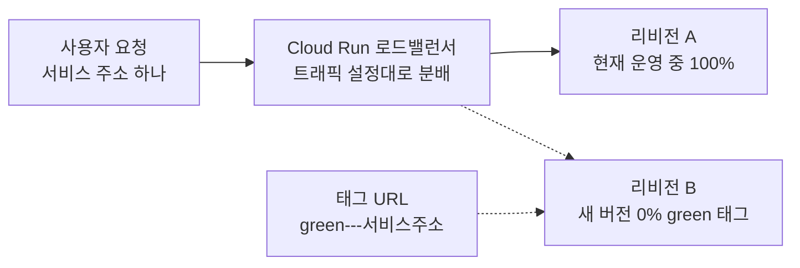
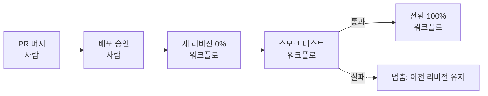

# N053 · Cloud Run으로 무중단 배포하기

> 버전 1.1 · 2026-10-29 (학습서 + 해설서 통합 + **`[실습 결과]`** 덧붙임. 내 컴퓨터와 Google Cloud에서 직접 해 본 결과를 장마다 덧붙였고, v1.0은 `_판본_v1.0/`에 그대로 보존)

## 목차

- [핵심 한 문장 요약](#핵심-한-문장-요약)
- [1. Cloud Run으로 무중단 배포하기](#1-cloud-run으로-무중단-배포하기)
- [2. 로드밸런서를 Cloud Run이 맡는다](#2-로드밸런서를-cloud-run이-맡는다)
- [3. 시작 상태 맞추기](#3-시작-상태-맞추기)
- [4. 요청 확인 스크립트로 배포 중 실패를 숫자로 보기](#4-요청-확인-스크립트로-배포-중-실패를-숫자로-보기)
- [5. 트래픽 0%로 새 리비전 올리기](#5-트래픽-0로-새-리비전-올리기)
- [6. 직접 해 보기: 블루그린 배포 자동화](#6-직접-해-보기-블루그린-배포-자동화)
- [7. 무중단 증명과 원클릭 롤백](#7-무중단-증명과-원클릭-롤백)
- [8. 오늘 배운 것](#8-오늘-배운-것)
- [맺음말](#맺음말)
- [부록 A · 실전 코드 모음](#부록-a--실전-코드-모음)
- [부록 B · 트러블슈팅 표](#부록-b--트러블슈팅-표)
- [부록 C · AI 프롬프트 모음집](#부록-c--ai-프롬프트-모음집)
- [부록 D · 용어 사전](#부록-d--용어-사전)
- [부록 E · 개념 비교표 모음](#부록-e--개념-비교표-모음)
- [부록 F · 학습 로드맵](#부록-f--학습-로드맵)
- [부록 G · 복습 퀴즈](#부록-g--복습-퀴즈)

## 핵심 한 문장 요약

> 📌 **요약** — 안전한 배포는 **준비 상태 확인 + 사전 검증 + 적절한 트래픽 전환 + 빠른 롤백 + 실제 요청 검증**이다. 배포가 성공했다는 것은 Cloud Run이 정한 준비 조건을 통과했다는 뜻일 뿐, 사용자가 오류를 보지 않았다는 뜻이 아니다. 그래서 새 버전을 올리는 자동화가 아니라 **검증되지 않은 버전이 사용자에게 전달되지 않도록 통제하는 자동화**를 만든다.

> 🧪 **예제** — `[실습 결과]` 한 줄 요약: 기본 프로브에서는 준비가 늦은 버전을 배포하자 요청 54건이 503이었고 `/health` 프로브에서는 0건이었다(대신 배포가 오래 걸림, 4장). 새 버전을 0%로 올려 태그 URL로 확인한 뒤 전환하는 흐름을 머지 한 번으로 돌게 만들었고(6장), production 배포 중 요청 752건에 실패 0건을 기록했다(첫 측정은 6건, 7장). 원클릭 롤백은 production에서 명령부터 확인까지 15초였으나 직후 요청 4건이 실패했고(콜드 스타트 **추정**), 일부러 망가뜨린 버전은 CI를 통과했지만 스모크 테스트가 전환을 막았다(요청 735건 실패 0건).

이번 강의는 N046~N052에서 만든 AI 친구 에이전트 서비스(저장소 `friend-agent`, 줄여서 에이전트 서비스)에서 시작한다. 전제는 이 서비스가 PR을 머지할 때 CI(코드를 합칠 때마다 테스트를 자동으로 돌리는 것)를 거쳐 GitHub Actions가 만든 이미지로 staging과 production에 배포되는 상태다. 지난 강의(N052)는 Nginx로 직접 로드밸런서를 세워 블루그린을 해 봤고, 이번에는 그 일을 **Google Cloud의 Cloud Run이 대신 맡아 주는 구조**에서 다시 해 본 뒤, 절차 전체를 **PR 머지 한 번으로 자동으로 돌게** 만든다.

> 💡 **팁** — 문서에서 "학습서"(31쪽)는 실습 교안, "해설서"(36쪽)는 같은 교안을 쉽게 풀어 쓴 책이다. 두 책은 챕터 01~08이 1:1로 대응한다. 학습서에는 명령·수치·"직접 해 보기" 과제가 있고 비유는 거의 없으며, 해설서에는 식당·상담센터·병원·교통경찰 비유와 퀴즈 정답이 있다. 그래서 이 노트는 **비유는 해설서, 명령·수치·표는 학습서 원문**을 따랐다. 학습서 Ch05가 해설서에서 가장 크게 다르게 정리되어 있어 5장에서는 두 책을 한 흐름으로 합쳤다. `[보충 비유]`·`[보충]`이라고 표시한 것만 이 노트에서 덧붙인 설명이다.

> ⚠️ **주의** — PDF에는 세 가지 변환 흔적이 있어 바로잡았다. ① 해설서 Ch05~Ch07 제목 앞의 `/강의정리`는 슬래시 명령 흔적이라 뺐다. ② 해설서·학습서 일부에서 명령 옵션의 이중 하이픈이 하나로 깨져 보인다(`-no-traffic`, `-to-tags`, `-to-revisions`, `-to-latest`, `-remove-tags`). 실제 명령 블록에서 확인한 대로 모두 `--` 두 개가 맞다. ③ 학습서에서 "섹션 N"은 **챕터 N**을 뜻한다. 학습서의 인터랙티브 시각화("움직여 보는 리비전과 트래픽", 웹 전용)는 PDF에 설명 문단만 남아 있어, 이 노트는 그 설명을 근거로 서술한다. 해설서의 비교 그림 출처 캡션(Semaphore, Seagate 등)은 외부 이미지 표기라 옮기지 않았다.

> 💡 **팁** — 버전 1.1은 v1.0(교안 기준)에 **`[실습 결과]`**를 덧붙인 판이다. 2026-10-29에 Windows 11 · PowerShell과 Git Bash · `gcloud` · `gh` 환경에서 3~7장을 직접 했고, 원본 기록은 `실습/N053_실습_진행기록.md`와 `실습/실습로그/`(원본 로그 12개)에 있다. 터미널 명령·측정·워크플로 작성·PR 생성은 AI 코딩 도우미(Claude)가 했고, Supabase 대시보드, Secret Manager 값 입력, PR 머지, production 승인, `rollback` 버튼, 브라우저 확인은 직접 했다. `[실습 결과]`가 붙지 않은 부분은 여전히 교안 기준이다. 교안과 **다른** 결과가 나온 곳은 그렇게 표시했다. 이 저장소는 공개라서 프로젝트 ID·프로젝트 번호·주소 해시·키 값·사용자 ID는 적지 않았고, 실습 로그는 주소의 프로젝트 번호와 해시를 마스킹한 사본이다.

> ⚠️ **주의** — 이번 실습에서 **하지 않은 것**: 선택 과제(알림, 카나리 자동 승격), 스키마 변경 시험(7-6), 짝과 서로 보여주기(7-7), 6장·7장의 "가장 오래 막힌 곳" 개인 회고. `/health`가 항상 실패하는 버전(교안 방식)도 하지 않고, CI를 통과하는 `/version` 커밋 불일치 방식으로 대신했다(7-4).

> 🧪 **예제** — 해설서의 "사용자님"은 전부 이 강의를 듣는 본인을 가리키는 개인화 문구다. 비개발자·1인 사업 관점으로 읽기 쉽게, 이 노트는 "1인 AI 사업(My-Story-Maker, 뉴스레터 에이전트, AI 컨설팅 서비스)에 적용하면"으로 옮겼다.

---

## 1. Cloud Run으로 무중단 배포하기

### 1-1. 오늘의 질문

학습서는 이렇게 시작한다. "지금까지 여러 번 배포했지만, 배포하는 동안 사용자가 오류를 봤는지는 확인한 적이 없습니다. 새 버전이 준비되기 전에 요청을 받으면 어떻게 될까요. 새 버전을 사용자에게 보내기 전에 나만 먼저 볼 수는 없을까요. 일부 사용자에게만 먼저 보내고 숫자를 본 뒤 넓힐 수는 없을까요."

오늘은 Cloud Run이 리비전 사이에서 요청을 옮기는 방식을 배우고, 대화가 데이터베이스에 남는 에이전트 서비스로 블루그린과 카나리를 직접 해 본 뒤, 그 절차를 PR 머지 한 번으로 자동으로 돌게 만든다.

### 1-2. 학습목표 5개

1. Cloud Run의 **리비전, 트래픽 설정, 태그 URL, 스타트업 프로브**가 무중단 배포에서 각각 무엇을 맡는지 설명할 수 있다.
2. staging과 production 서비스에 **Supabase를 연결**하고, secret key를 시크릿으로 넣어 새 리비전에서도 대화가 남게 할 수 있다.
3. 배포하는 동안의 **요청 실패를 측정**하고, 준비가 늦은 버전의 실패를 `/health` 스타트업 프로브로 막을 수 있다.
4. 트래픽 0% 배포와 태그 URL로 **블루그린 전환과 롤백**을, 트래픽 비율로 **카나리**를 손으로 할 수 있고, **트래픽 고정** 때문에 생기는 문제를 설명할 수 있다.
5. 0% 배포, 스모크 테스트, 전환, 롤백을 **하나의 자동 배포 흐름**으로 설계하고, 배포 중 실패 0건과 망가진 버전에서 멈추는 동작을 기록으로 증명할 수 있다.

### 1-3. 식당 신메뉴 비유

해설서의 첫 비유다.

> 식당에서 새로운 메뉴를 출시한다고 생각해 보겠습니다. **기존 버전**: 현재 손님에게 제공하고 있는 메뉴. **새 버전**: 새롭게 개발한 메뉴. **무중단 배포**: 새 메뉴를 준비하는 동안에도 기존 메뉴를 계속 제공하는 것. **롤백**: 새 메뉴에 문제가 있으면 기존 메뉴로 되돌리는 것.

새 메뉴를 모든 손님에게 한 번에 제공했다가 문제가 생기면 피해가 크다. 먼저 직원이 시험해 보고, 일부 손님에게 제공한 뒤 문제가 없으면 전체로 확대하는 것이 더 안전하다. AI 서비스도 같은 원리다.

> 💡 **팁** — `[보충 비유]` 기획·경영 경험으로 보면 **신제품 시범 판매와 같다.** 전 매장에 한꺼번에 깔지 않고 직원 시식 → 시범 매장 몇 곳 → 전 매장 순서로 넓히고, 실적 기준이 나쁘면 신제품을 거두고 기존 제품 진열로 돌아간다. 오늘 배우는 도구는 이 "진열 비율 조절 장치"를 명령 한 줄로 쥐여 주는 것이다.

### 1-4. 다섯 가지 핵심 개념

| 개념 | 한 줄 정의 | 무중단 배포에서 맡는 일 |
|---|---|---|
| 리비전(revision) | 배포할 때마다 만들어지는 이미지와 설정의 한 벌 | 새 버전을 만들어도 기존 리비전이 남아 있어 문제가 생기면 되돌아갈 수 있다 |
| 트래픽(traffic) 설정 | 어느 리비전에 요청의 몇 퍼센트를 보낼지 정한 것 | 기존 90%, 새 버전 10%처럼 나눠 보낼 수 있다. 배포는 결국 새 리비전을 만들고 이 설정을 바꾸는 일 |
| 태그 URL | `https://green---서비스주소` 처럼 태그 이름으로 시작하는 주소 | 일반 사용자 트래픽을 바꾸지 않고도 새 버전만 직접 열어 볼 수 있다 |
| 스타트업 프로브(startup probe) | 새 인스턴스가 요청을 받을 준비가 됐는지 확인하는 검사 | 준비가 끝나기 전에 요청이 가서 오류가 나는 것을 막는다 |
| Supabase와 시크릿 | 대화 기록을 저장하는 데이터베이스와 비밀 키 보관 | 새 리비전에서도 같은 대화를 읽는다. 키는 코드가 아니라 시크릿으로 관리 |

해설서는 여기에 두 가지 배포 방식을 소개한다. **블루그린**은 "기존 버전(Blue)과 새 버전(Green)을 준비해 두고 새 버전을 충분히 시험한 후 트래픽을 전환"하는 방식이고(장점: 전환 전 충분히 검증하고 롤백이 쉽다. 주의: 새 버전이 데이터베이스 구조나 대화 처리 방식까지 바꾼다면 기존 버전과의 호환성을 확인해야 한다), **카나리**는 "새 버전에 소량의 트래픽만 보내고 실제 사용 환경에서 문제가 없는지 확인한 뒤 점차 확대"하는 방식이다(장점: 문제가 생겨도 노출되는 요청을 제한할 수 있다. 주의: 10%만 시험하면 드물게 발생하는 오류를 발견하지 못할 수도 있다).

> ⚠️ **주의** — 트래픽 비율을 나누더라도 **같은 사용자의 연속 요청이 반드시 같은 리비전으로 가는 것은 아니다.** 에이전트의 대화 상태를 데이터베이스에 저장하고 버전 간 호환성을 확보해야 하는 이유다(3장에서 직접 한다).

### 1-5. 시작 질문 — 먼저 내 생각을 적어 보기

학습서의 시작 질문이다. "새 버전을 배포했는데 사용자 100명 가운데 일부에게서만 답이 이상하게 나온다고 가정해 보세요. 한 번에 전환했을 때와 트래픽의 10%만 새 버전으로 보냈을 때, 문제를 발견하기까지와 피해 범위가 각각 어떻게 다를지 적어 보세요."

> 🧪 **예제** — 해설서의 모범 답안: 한 번에 전환하는 경우에는 새 버전의 오류가 전체 사용자에게 영향을 줄 수 있고, 오류를 발견하기까지 시간이 걸리면 피해 범위가 커질 수 있다. 반면 트래픽의 10%만 새 버전으로 보내는 경우에는 새 버전을 사용하는 일부 사용자에게 문제가 집중되므로 초기 피해를 제한할 수 있다. 다만 10%의 사용자에게서 오류가 실제로 발생해야 발견할 수 있으므로, 오류 감시와 충분한 테스트가 필요하다. 이 답은 8장에서 다시 읽고 오늘 본 것과 비교한다.

### 1-6. 실제 서비스에 적용하는 순서 여섯 단계

해설서가 정리한 흐름이다. 오늘 3~5장은 이 순서를 손으로 해 보고, 6~7장은 이 순서를 자동화한다.

| 순서 | 하는 일 | 설명 |
|---|---|---|
| 1 | 코드 변경 후 PR 머지 | 새 기능이나 수정 사항을 반영한다 |
| 2 | CI 테스트 및 이미지 생성 | 테스트를 통과한 코드로 컨테이너 이미지를 만든다 |
| 3 | Cloud Run에 트래픽 0%로 배포 | 새 리비전을 준비하되 일반 사용자 트래픽은 보내지 않는다 |
| 4 | 준비 상태 확인 및 스모크 테스트 | 서비스가 시작되고 핵심 기능이 정상 작동하는지 확인한다 |
| 5 | 트래픽 전환 | 전체 전환 또는 일부 트래픽만 보내는 카나리 방식을 고른다 |
| 6 | 오류 감시 및 롤백 | 문제가 생기면 기존 리비전으로 되돌리고 결과를 기록한다 |

<!-- flow: 그림 1. 새 버전을 올리는 일과 사용자에게 보내는 일을 나눈다. 0%로 올려 확인한 뒤에만 전환하고, 문제가 생기면 롤백한다. | 코드 머지/PR 합치기/1 ; 0% 배포/새 리비전 준비/2 ; 스모크 테스트/태그 URL로 확인/3 ; 트래픽 전환/100% 이동/4 ; 오류 감시/문제 시 롤백/2 -->


```text
[코드 머지] → [0% 배포] → [스모크 테스트] → [트래픽 전환] → [오류 감시 · 롤백]
```
<!-- /flow -->

### 1-7. 왜 이 구조가 중요한가 — 1인 AI 사업에게

해설서의 결론은 이렇다. 이 기술은 단순한 서버 운영 지식이 아니라 **직접 운영할 AI 서비스의 신뢰도를 높이는 사업 역량**이다.

| 서비스 | 적용하면 |
|---|---|
| My-Story-Maker(MSM) | 사용자의 글과 이야기를 분석하는 기능이 잘못 배포되어도 서비스 중단과 데이터 손실 위험을 줄인다 |
| 뉴스레터 에이전트 | 예약된 시간에 실행되는 서비스의 새 버전을 먼저 시험하고, 발행 오류가 발견되면 이전 버전으로 되돌린다 |
| AI 컨설팅 서비스 | 고객별로 다른 에이전트를 운영할 때 배포 절차를 표준화해 운영 위험과 유지보수 비용을 관리한다 |

> 📌 **요약** — 고객의 대화 기록을 저장하는 AI 서비스에서는 코드뿐 아니라 **데이터의 안전성, 버전 간 호환성, 오류 발생 시 복구 방법**까지 함께 설계해야 한다.

---

## 2. 로드밸런서를 Cloud Run이 맡는다

### 2-1. 안내 직원 비유

무중단 배포에는 서비스 앞에서 요청을 받아 뒤의 서버로 나눠 보내는 **로드밸런서**가 필요하다. 이전 버전을 끄지 않은 채 새 버전을 띄우고, 로드밸런서가 요청을 보내는 곳을 새 버전으로 바꾼 뒤 이전 버전을 끄는 것이 기본 구조다. 해설서의 비유는 이렇다.

> 식당 입구에 손님을 안내하는 직원이 있다고 생각해 보겠습니다. **로드밸런서**: 손님을 어느 식당으로 안내할지 결정하는 직원. **리비전**: 서로 다른 버전의 식당. **트래픽 설정**: 각 식당에 보내는 손님의 비율. **배포**: 새 식당을 준비하고 손님을 보내는 방식을 변경하는 것. **롤백**: 문제가 생기면 손님을 이전 식당으로 다시 안내하는 것.

직접 서버를 운영하면 Nginx 같은 프로그램을 설치해 이 안내 직원 역할을 맡겨야 한다. 하지만 Cloud Run에서는 Google Cloud가 이 역할을 관리하므로, 개발자는 **리비전과 트래픽 설정**에 집중할 수 있다.

Cloud Run에서는 서비스 주소로 들어온 요청을 Cloud Run이 받아 서비스의 리비전 가운데 하나로 보낸다. 어느 리비전에 요청의 몇 퍼센트를 보낼지 정한 것이 트래픽 설정이고, **배포는 결국 새 리비전을 만들고 이 트래픽 설정을 바꾸는 일**이다.

### 2-2. 지난 강의의 Nginx와 나란히 놓기

학습서 2쪽의 그림("Nginx로 직접 하는 일을 Cloud Run에서는 무엇이 하나")을 표로 옮겼다. 구조는 같다. 입구가 요청을 받아 뒤의 여러 버전 중 하나로 보내고, 보낼 곳을 바꿔 전환한다.

| 하는 일 | N052 Nginx로 직접 구성한 블루그린 | Cloud Run |
|---|---|---|
| 요청을 받는 입구 | Nginx 서버(포트 80) | Cloud Run 서비스 주소(로드밸런서를 Cloud Run이 운영) |
| 뒤에서 답하는 쪽 | 컨테이너 blue, green | 리비전(배포할 때마다 하나씩 생김) |
| 보낼 곳 정하기 | `upstream`의 `server` 줄 | 트래픽 설정(리비전별 %) |
| 바꾸는 방법 | 설정 파일 고치고 `nginx -s reload` | `gcloud run services update-traffic` |
| 나눠 보내기 | `server` 줄에 `weight=3` | `--to-tags canary=10` |
| 전환 전에 새 쪽만 확인 | Nginx를 거치지 않고 green에 직접 요청 | 태그 URL(`green---`로 시작하는 주소) |
| 새 쪽이 준비됐는지 | 사람이 `/health` 확인(무료 Nginx는 미리 묻지 않음) | 스타트업 프로브(기본은 포트만, `/health`로 바꿀 수 있음) |
| 이전 쪽 정리 | 하던 요청이 끝난 뒤 사람이 끔 | 트래픽 0% 인스턴스를 Cloud Run이 종료 신호 뒤 정리 |

<!-- flow: 그림 2. 사용자는 서비스 주소 하나로 들어온다. Cloud Run이 트래픽 설정에 따라 리비전을 고른다. 태그 URL은 새 리비전만 따로 열어 보는 뒷문이다. | 사용자 요청/서비스 주소 하나/1 ; Cloud Run 로드밸런서/트래픽 설정대로 분배/2 ; 리비전 A/현재 운영 중 100%/3 ; 리비전 B/새 버전 0% green 태그/4 -->


```text
[사용자 요청] → [Cloud Run 로드밸런서] → [리비전 A (100%)]
                                      ┄→ [리비전 B (0%, green)] ← [태그 URL로 직접 확인]
```
<!-- /flow -->

> 💡 **팁** — `[보충 비유]` 지난 강의에서는 물량 배정표(Nginx 설정 파일)를 내가 직접 고치고 reload했다. 이번에는 **배정표 관리 부서가 따로 생긴 셈**이다. 내가 하는 일은 "어느 제품에 몇 퍼센트"라는 지시만 내리는 것이고, 지시를 이행하고 옛 라인을 정리하는 일은 부서가 한다. 다만 "새 라인이 정말 가동 준비됐는지"는 부서가 알아서 판단해 주지 않으므로 내가 기준(스타트업 프로브)을 정해 줘야 한다(4장).

### 2-3. 옵션 없이 배포하면 — 기본 배포 순서

옵션 없이 배포하면 Cloud Run은 다음 순서로 움직인다. 해설서는 네 단계로 정리한다.

| 순서 | 단계 | 설명 |
|---|---|---|
| 1 | 새 리비전 생성 | 새 리비전의 인스턴스를 켠다 |
| 2 | 스타트업 프로브 통과 | 새 인스턴스가 요청을 처리할 준비가 되었는지 확인한다 |
| 3 | 새 리비전으로 트래픽 전환 | 기본 배포는 새 버전으로 100% 전환한다 |
| 4 | 이전 인스턴스 종료 | 종료 신호(SIGTERM)를 보내고 10초를 기다린다. 이 10초 동안 처리 중이던 요청을 마치는 것을 **그레이스풀 셧다운**이라 한다 |

> ⚠️ **주의** — 정상 종료를 위한 대기 시간은 모든 요청의 완료를 무조건 보장하는 시간이 아니다. 애플리케이션이 종료 신호에 적절히 대응하고 제한 시간 안에 요청 처리를 마쳐야 한다.

### 2-4. 방식별 명령 한눈에

| 방식 | 하는 일 | 명령 |
|---|---|---|
| 기본 배포 | 준비되면 바로 100% | `gcloud run services update …` |
| 블루그린 | 0%로 올려 태그 URL로 확인한 뒤 한 번에 100% | `--no-traffic --tag green`, 그다음 `update-traffic --to-tags green=100` |
| 카나리 | 0%로 올린 뒤 10%, 50%, 100%로 나눠 옮김 | `update-traffic --to-tags canary=10`을 비율을 바꿔 반복 |
| 롤백 | 트래픽을 이전 리비전으로 되돌림 | `update-traffic --to-revisions <이전 리비전>=100` |

`--to-tags`, `--to-revisions`, `--to-latest`는 각각 **태그, 특정 리비전, 최신 리비전**으로 트래픽을 전환할 때 쓴다. 롤백은 새 이미지를 다시 만들 필요 없이 트래픽 설정만 바꾸는 방식이라 몇 초 안에 끝난다.

### 2-5. 트래픽 고정 — 배포는 성공했는데 사용자는 옛 버전

이 장에서 가장 중요한 함정이다. 트래픽 설정에는 두 가지 모양이 있다.

- "가장 최근 리비전에 100%"로 되어 있으면 새 리비전이 배포될 때마다 트래픽이 **따라 옮겨 간다.**
- "리비전 3에 100%"처럼 특정 리비전이나 태그에 비율을 정해 두면 그 설정이 **그대로 남는다.**

롤백이나 카나리를 한 번 하면 트래픽이 특정 리비전에 고정되고, 그 뒤의 배포는 새 리비전을 만들기만 하고 트래픽은 옮기지 않는다. 고정을 풀려면 `update-traffic --to-latest`로 다시 가장 최근 리비전을 따라가게 한다. 해설서는 4단계 시나리오로 보여 준다.

| 단계 | 일어난 일 | 트래픽 |
|---|---|---|
| 1. 정상 배포 | 리비전 2가 사용자 트래픽을 받고 있다 | 리비전 2 |
| 2. 문제 발생 후 롤백 | 트래픽을 리비전 1에 100%로 고정한다 | 리비전 1 (고정) |
| 3. 버그 수정 후 재배포 | 리비전 3이 생성되지만 트래픽 설정이 자동으로 바뀌지 않아 사용자는 여전히 리비전 1을 쓴다 | 리비전 1 |
| 4. 최신 버전으로 전환 | `--to-latest`로 최신 리비전에 트래픽을 보낸다 | 리비전 3 |

> ⚠️ **주의** — "CI 테스트가 통과하고 이미지가 만들어졌더라도, 실제 서비스 주소에서 `/version`을 확인해 새 리비전이 응답하는지 점검해야 한다." 배포 성공과 사용자에게 새 버전이 제공되는 것은 서로 다른 문제다.

> 💡 **팁** — `[보충 비유]` 업무 이관 지시를 "최신 담당자에게"라고 쓰지 않고 "김 대리에게"라고 이름을 박아 두면, 새 담당자가 아무리 와도 서류는 계속 김 대리 책상으로 간다. 트래픽 고정이 바로 이 "이름 박아 둔 지시"다.

### 2-6. 롤백의 한계와 태그 URL 보안

- **롤백의 한계**: Cloud Run은 롤백할 때 스타트업 프로브를 다시 돌리지 않고 데이터베이스 같은 바깥 의존성도 확인하지 않는다. 되돌아갈 리비전이 지금도 정상인지는 **사람이 확인한다.** 롤백은 트래픽을 이전 리비전으로 되돌리는 것이며, 이전 버전의 정상 작동을 자동으로 보장하지 않는다.
- **태그 URL 보안**: 태그 URL은 트래픽 설정과 상관없이 태그를 붙인 리비전 하나로만 요청을 보내는 별도 주소다. 서비스가 공개되어 있으면 태그 URL도 누구나 열 수 있으므로, 민감한 서비스는 접근 통제를 고려한다.

### 2-7. 이 장을 마치면 갖는 세 가지 습관

해설서는 앞으로 "배포가 성공했습니다"라는 메시지만 보지 말고 세 가지를 함께 확인하라고 권한다. ① 새 리비전이 정상적으로 생성되었는가? ② 새 리비전이 실제 요청을 받고 있는가? ③ 요청 처리 결과가 정상인가?

> 📌 **요약** — Cloud Run 무중단 배포의 핵심은 리비전을 안전하게 준비하고 트래픽을 제어하는 것이며, 롤백 이후에는 트래픽 고정 때문에 새 버전이 실제 사용자에게 제공되지 않는 상황까지 점검해야 한다.

학습서의 참고 자료는 세 개다. Rollbacks, gradual rollouts, and traffic migration(트래픽 0% 배포·태그 URL·단계적 전환·롤백·트래픽 고정을 한곳에서), Configure container health checks(스타트업 프로브의 기본값과 HTTP 프로브 설정법), Container runtime contract(인스턴스를 끌 때 종료 신호를 보내고 기다리는 시간).

---

## 3. 시작 상태 맞추기

### 3-1. 왜 데이터베이스가 먼저인가 — 상담센터 비유

지금 Cloud Run의 에이전트 서비스는 캐릭터, 대화, 기억을 **인스턴스 메모리**에 둔다. 새 리비전이 뜨면 새 인스턴스가 시작하므로 그동안의 대화가 사라지고, 블루그린이나 카나리로 두 리비전이 함께 요청을 받으면 요청마다 보이는 대화가 달라진다. 그래서 무중단 배포를 하기 전에 데이터를 모든 리비전이 함께 보는 데이터베이스로 옮겨 서비스를 **무상태(stateless)**로 만든다. 해설서의 비유다.

> 여러 직원이 근무하는 상담센터를 생각해 보겠습니다. **인스턴스 메모리**: 직원 한 명이 자기 책상에만 보관한 상담 기록. **Supabase 데이터베이스**: 모든 직원이 함께 보는 중앙 상담 기록실. **사용자 인증(Auth)**: 상담을 받으러 온 사람이 누구인지 확인하는 절차. **무상태**: 직원이 바뀌어도 중앙 기록실에서 상담 기록을 찾아 이어서 처리하는 구조. **Secret Manager**: 중요한 열쇠를 안전하게 보관하는 금고.

기존에는 상담 직원이 바뀌면 책상에 있던 기록을 잃어버리는 문제가 있었다. 이제 상담 기록을 중앙 데이터베이스에 저장하면 새로운 직원이 와도 이전 기록을 이어서 확인할 수 있다. 지난 강의(N052)의 "상담원 수첩 → 중앙 고객 기록 시스템"과 같은 이야기다.

### 3-2. 다섯 가지 핵심 개념

| 개념 | 뜻 |
|---|---|
| Supabase | PostgreSQL 데이터베이스와 사용자 인증 기능을 함께 제공하는 관리형 서비스. 이번에는 에이전트의 대화 기록을 저장한다 |
| 익명 로그인 | 가입 없이 브라우저마다 게스트 사용자를 하나씩 만드는 기능 |
| RLS(Row Level Security) | 행 단위 접근 제한. 사용자 A가 사용자 B의 대화 기록을 조회하지 못하도록 통제한다. 실제 보호를 위해서는 정책 설정도 올바르게 되어 있어야 한다 |
| publishable key / secret key | publishable은 브라우저에 전달할 수 있는 공개용 키, secret은 강력한 권한이라 서버에서만 쓰고 Secret Manager에 보관 |
| 무상태 서비스 | 인스턴스가 바뀌어도 필요한 대화 기록을 데이터베이스에서 다시 읽을 수 있는 구조 |

<!-- flow: 그림 3. 두 리비전이 같은 데이터베이스를 읽으므로 인스턴스가 바뀌어도 대화가 이어진다. | 사용자 브라우저/게스트 로그인 · 대화 입력/1 ; Cloud Run/기존 또는 새 리비전/2 ; Supabase/사용자 · 캐릭터 · 대화 저장/3 -->


```text
[사용자 브라우저] → [Cloud Run (기존 리비전 또는 새 리비전)] → [Supabase (사용자 · 캐릭터 · 대화 기록)]
```
<!-- /flow -->

환경도 둘로 나눈다. 이렇게 분리하면 시험 중 만들어진 대화 기록과 운영 데이터가 섞이는 것을 막는다.

| 구분 | Cloud Run 서비스 | Supabase |
|---|---|---|
| 시험 환경 | `friend-agent-staging` | 시험용 프로젝트 |
| 운영 환경 | `friend-agent` | `friend-agent-production` |

### 3-3. 시작 상태 확인

앞 실습을 이어서 하고 있다면 아래 확인 명령만 실행하고 넘어간다. 빠진 상태가 있으면 템플릿의 실습별 시작 상태 문서(`docs/start-states.md`)에서 "없으면" 칸의 항목을 표의 위 칸부터 차례로 실행한다. 처음부터 모두 맞추면 한두 시간이 걸리므로, 빠진 항목이 많다면 수업 전에 맞춰 두거나 강사에게 먼저 알린다.

```bash
gcloud config list
gcloud run services list --region us-central1
gh variable list
git branch -r
grep -n "docker build" .github/workflows/deploy.yml
```

| 필요한 상태 | 확인할 것 | 없으면 |
|---|---|---|
| Google Cloud 프로젝트와 gcloud 설정, `friend-agent` 서비스 | `gcloud config list`, `gcloud run services list`에 `friend-agent` | A, B |
| 배포 권한(WIF)과 저장소 변수 | `gh variable list`에 `GCP_PROJECT_ID`, `WIF_PROVIDER`, `DEPLOY_SA`, `RUNTIME_SA`, `AR_REPO` | `docs/wif-setup.md` 0~5, 7단계 |
| CI와 환경별 배포, staging 브랜치, GitHub 환경, `friend-agent-staging` 서비스 | `.github/workflows/ci.yml`, 원격 staging 브랜치, `gcloud run services list`에 `friend-agent-staging` | C, D, E |
| 루트의 Dockerfile과 Actions에서 이미지를 만들어 배포하는 `deploy.yml` | `deploy.yml` 안에 `docker build`와 `image:` 줄 | F, G |
| Supabase 시험용 프로젝트(테이블, 익명 로그인) | Supabase 대시보드에 프로젝트가 있고, Authentication에서 `Allow anonymous sign-ins`가 켜져 있음 | `docs/supabase.md` 1단계 |

> ⚠️ **주의** — 학습서 PDF의 이 표는 열이 풀려 나와 순서대로 복원한 것이다. 문서의 A~I 항목 이름은 템플릿의 `docs/start-states.md`를 직접 열어 확인한다. 이 노트는 항목 이름 자체를 옮기지 않았다.

> 🧪 **예제** — `[실습 결과]` **시작 상태 점검**(읽기만 함): 두 서비스 모두 환경변수에 `STORAGE`·`AUTH`·`SUPABASE_*`가 없었고(`/version`도 `storage: memory`), 스타트업 프로브는 기본(포트 확인)이었으며, Secret Manager에는 `llm-api-key`·`llm-api-key-staging` 둘뿐이었다. N052에서 만든 Supabase `friend-agent-staging`은 활성이었고 `friend-agent-production`은 없었다. 그래서 3장을 처음부터 했다. 트래픽은 둘 다 `latestRevision: true` 100%(고정 아님). 원본: 진행기록 1절.

### 3-4. production용 Supabase 프로젝트 만들기

학습서는 직접 확인할 곳을 다섯 단계로 안내한다(대시보드 작업은 직접 한다).

1. Supabase 대시보드에서 `friend-agent-production` 프로젝트를 만든다. 리전은 Cloud Run 서비스가 있는 us-central1과 가까운 미국 리전(예: East US (Ohio))을 고른다. 리전이 멀면 요청마다 지연이 붙는다.
2. SQL Editor에 템플릿 `supabase/migrations/0001_init.sql`의 내용을 붙여 넣고 실행한다. 모든 테이블에 RLS가 켜져 브라우저는 테이블을 직접 읽거나 쓸 수 없다.
3. Authentication > Sign In / Providers에서 `Allow anonymous sign-ins`를 켜고 저장한다. 꺼져 있으면 화면에 "로그인을 시작하지 못했습니다" 창이 뜬다.
4. Authentication > Rate Limits에서 익명 로그인 한도(기본 IP 하나당 시간당 30건)를 확인한다.
5. 두 프로젝트 각각의 Project Settings > API Keys에서 프로젝트 URL, publishable key, secret key가 어디 있는지 확인한다. **키 값은 채팅이나 명령, 코드에 붙여 넣지 않는다.**

> ⚠️ **주의** — 무료 플랜은 활성 프로젝트가 2개까지이고, 1주 동안 활동이 없으면 일시정지된다(2026년 10월 기준). 오늘은 시험용 프로젝트와 production 프로젝트가 동시에 활성이어야 한다.

### 3-5. 키 세 개, 넣는 곳이 다르다

| 값 | 어디에 쓰나 | 넣는 곳 |
|---|---|---|
| 프로젝트 URL | 브라우저가 로그인할 때 | 일반 환경변수 |
| publishable key | 브라우저가 로그인할 때(화면 코드로 전달됨) | 일반 환경변수. 공개되는 값이라 명령에 직접 넣어도 된다 |
| secret key | 서버에서만. RLS를 건너뛰어 모든 사용자의 데이터를 읽고 쓸 수 있는 키 | **Secret Manager의 시크릿.** 명령에 넣지 않고 시크릿 이름으로만 연결 |

staging과 production의 secret key는 서로 다른 시크릿(`supabase-secret-staging`, `supabase-secret-production`)으로 두고, 런타임 서비스 계정이 두 시크릿을 하나씩 읽을 수 있게 한다. **시크릿을 만드는 단계는 키 값이 명령 기록이나 에이전트 대화에 남지 않도록 콘솔에서 직접** 한다(콘솔 > 보안 > Secret Manager > 보안 비밀 만들기).

> ⚠️ **주의** — Publishable Key가 공개 가능하다는 것은 데이터 접근까지 무제한으로 허용한다는 뜻이 아니다. 실제 데이터 보호는 RLS와 올바른 접근 정책에 달려 있다.

### 3-6. staging에 Supabase 연결하고 확인하기

먼저 런타임 서비스 계정에 두 시크릿 각각의 읽기 권한을 준다. 프로젝트 전체가 아니라 시크릿 **각각에 대해서만**이다.

```bash
gcloud secrets add-iam-policy-binding supabase-secret-staging --member "serviceAccount:friend-agent-runtime@<PROJECT_ID>.iam.gserviceaccount.com" --role roles/secretmanager.secretAccessor
gcloud secrets add-iam-policy-binding supabase-secret-production --member "serviceAccount:friend-agent-runtime@<PROJECT_ID>.iam.gserviceaccount.com" --role roles/secretmanager.secretAccessor
```

그다음 staging 서비스에 값 다섯 개를 연결한다. `STORAGE=supabase`, `AUTH=supabase`는 저장소와 로그인을 Supabase로 바꾸는 스위치다.

```bash
gcloud run services update friend-agent-staging --region us-central1 \
  --update-env-vars STORAGE=supabase,AUTH=supabase,SUPABASE_URL=<시험용 프로젝트 URL>,SUPABASE_PUBLISHABLE_KEY=<시험용 publishable key> \
  --update-secrets SUPABASE_SECRET_KEY=supabase-secret-staging:latest
```

> ⚠️ **주의** — 이 교안에서 줄 끝에 `\`를 붙여 여러 줄로 나눈 명령은 모두 macOS와 Linux 기준이다. Windows PowerShell에서는 `\` 대신 백틱(`` ` ``)으로 줄을 잇거나 한 줄로 이어 쓴다. 또 실행 전에 서비스 이름이 `friend-agent-staging`인지(시크릿이 `-staging` 쪽인지), 환경변수 옵션이 기존 값을 지우는 `--set-env-vars`가 아니라 `--update-env-vars`인지 본다.

**직접 확인할 곳 — staging에서 데이터가 남는지**

1. staging 주소를 열면 화면 왼쪽 아래에 "게스트로 사용 중"이 보인다.
2. 캐릭터를 저장하고 메시지를 몇 개 보낸 뒤, Supabase Table Editor의 `messages` 테이블에 방금 보낸 대화가 행으로 생겼는지 본다(열: `user_id`, `role`, `content`). 캐릭터를 저장하지 않으면 화면이 처음 열릴 때 캐릭터 만들기에서 멈추고 대화 기록을 불러오지 않는다.
3. 새 리비전을 하나 만든다. 새 리비전이 뜬 뒤 새로고침해도 대화가 그대로 남아 있는지 본다.
4. 다른 브라우저나 시크릿 창으로 staging 주소를 열면 다른 게스트 사용자로 시작해, 앞의 대화가 보이지 않는지 본다.

```bash
gcloud run services update friend-agent-staging --region us-central1 --update-env-vars BANNER=저장확인
```

> 🧪 **예제** — 결과 해석(학습서): 새 리비전은 새 인스턴스로 시작했지만 대화는 그대로 보인다. 대화가 인스턴스 메모리가 아니라 Supabase의 `messages` 테이블에 있고, 새 인스턴스도 같은 테이블을 읽기 때문이다. 다른 브라우저에서 앞의 대화가 보이지 않은 것은 브라우저마다 다른 게스트 사용자로 로그인하고, 서버가 모든 조회에 그 사용자의 ID 조건을 붙이기 때문이다. 이제 두 리비전이 함께 요청을 받아도 같은 대화를 보게 되었고, 대신 **두 리비전이 같은 테이블을 함께 쓰므로 한쪽이 테이블 구조를 바꾸면 다른 쪽이 바로 영향을 받는다**(7장에서 다시 만난다).

> 🧪 **예제** — `[실습 결과]` **staging 연결과 막힌 곳**(원본: 진행기록 3절). 첫 시도는 `<…>` 자리 표시를 통째로 바꾸지 않았고 PowerShell에서 쉼표가 든 값을 따옴표로 감싸지 않아 `unrecognized arguments`로 실패했다. 교안의 한 줄 명령은 macOS·Linux 기준이라 PowerShell에서는 값을 변수에 넣고 큰따옴표로 감싸야 한다. 두 번째 시도는 연결에는 성공했지만 화면에 **"로그인을 시작하지 못했습니다"**가 떴다. 서비스에 저장된 키의 글자 구조를 값은 보지 않고 확인하니 길이가 61이고 `sb_publishable_`이 두 번 이어져 있었다(복사한 값에 이미 있는 접두사를 한 번 더 씀). 같은 키로 Supabase에 익명 가입을 요청하면 401이었다. 키를 다시 넣고 길이 46을 확인한 뒤 재실행해 해결했다.

> 🧪 **예제** — `[실습 결과]` **3-6의 확인 4단계**: ② `messages`에 오늘 새 `user_id`로 5행이 쌓였다(인사, 날씨 질문, 답, "고마워…", 답). ③ `BANNER=저장확인`으로 새 리비전을 만든 뒤 일반 창을 새로고침하자 노란 띠에 `저장확인`이 보이고 대화가 그대로 남았다. ④ 시크릿 창은 `캐릭터 만들기`로 시작했다(다른 게스트). ① "게스트로 사용 중"은 캡처가 잘려 "…용 중"만 보여 전체 글자는 확인하지 못했다.

### 3-7. production 연결과 권한의 한계

staging 확인이 끝나면 production 서비스에 같은 방식으로 연결한다. production은 실제 사용자가 쓰므로 명령의 서비스 이름이 `friend-agent`이고 값이 모두 production 프로젝트 것인지 한 번 더 확인한다.

```bash
gcloud run services update friend-agent --region us-central1 \
  --update-env-vars STORAGE=supabase,AUTH=supabase,SUPABASE_URL=<production 프로젝트 URL>,SUPABASE_PUBLISHABLE_KEY=<production publishable key> \
  --update-secrets SUPABASE_SECRET_KEY=supabase-secret-production:latest
```

서비스에 넣은 환경변수와 시크릿 연결은 다음 자동 배포에서도 그대로 남는다. 배포 워크플로는 커밋 SHA와 `ENV`만 바꿔 넣고 나머지 설정은 서비스에 있는 값을 이어 쓰기 때문이다.

> ⚠️ **주의** — 학습서가 일부러 남겨 둔 한계: 지금은 staging 서비스와 production 서비스가 **같은 런타임 서비스 계정**(`friend-agent-runtime`)으로 실행되고, 이 계정이 두 시크릿을 모두 읽을 수 있다. 그래서 staging 서비스도 production의 secret key를 읽을 수 있는 상태다. staging은 시험 중인 코드가 먼저 올라가는 곳이라 실수나 취약점이 생기기 쉬운데, 이 구성에서는 staging에서 생긴 문제가 production 사용자의 데이터까지 닿을 수 있다. **데이터는 환경별로 나눴지만 권한은 나누지 않은 것이다.** 실무에서는 환경마다 런타임 서비스 계정을 따로 두고 각 계정이 그 환경의 시크릿만 읽게 한다. 이 과정의 워크플로는 저장소 변수 `RUNTIME_SA`로 계정을 정하므로 GitHub의 staging 환경에 같은 이름의 변수를 두면 워크플로를 고치지 않고도 나눌 수 있다. 이 차이는 서비스를 실제로 공개하기 전에 정리할 항목으로 남겨 둔다.

> 💡 **팁** — `[보충 비유]` 경리 담당 두 사람(시험 부서, 운영 부서)이 각자 자기 부서 금고 열쇠만 가져야 하는데, 지금은 열쇠고리 하나에 두 금고 열쇠가 다 달려 있는 셈이다. 금고(데이터)는 둘로 나눴지만 열쇠(권한)는 아직 하나다.

> 📌 **요약** — 무중단 배포를 제대로 하려면 대화 기록을 인스턴스 메모리에서 공용 데이터베이스로 옮기고, 사용자 인증과 환경별 비밀 키 관리로 **데이터의 지속성과 보안을 함께** 확보해야 한다.

---

> 🧪 **예제** — `[실습 결과]` **production 연결**: 변수 `$PURL`·`$PKEY`에 넣고 `$PKEY.Length`가 46인지 먼저 확인한 뒤 실행해 한 번에 성공했다(리비전 `friend-agent-00024-62j`). 환경변수 이름 5개가 추가됐고 시크릿은 `supabase-secret-production`을 참조하며, 키 길이 46·접두사 1회, staging과 다른 프로젝트 URL, 익명 가입 요청 200을 확인했다. 코드는 그대로라 커밋은 `8243335`다. 권한은 런타임 서비스 계정에 두 시크릿 **각각에 대해서만** 읽기 권한(`secretAccessor`)을 줬고 정책을 다시 조회해 확인했다. 이 장의 한계(두 환경이 같은 런타임 서비스 계정을 씀)는 그대로 남아 있다.

## 4. 요청 확인 스크립트로 배포 중 실패를 숫자로 보기

### 4-1. 새 주방 비유

배포가 성공했다는 것과 사용자가 오류를 보지 않았다는 것은 다르다. 그 차이를 숫자로 보는 도구가 요청 확인 스크립트다. 해설서의 비유부터 보자.

> 식당에서 새로운 주방을 열었다고 생각해 보겠습니다. 주방의 전등이 켜졌다고 요리를 바로 할 수 있는 것은 아닙니다. 재료와 조리 도구가 준비되어야 손님에게 음식을 제공할 수 있습니다. 준비가 끝나기 전에 손님을 새 주방으로 안내하면 주문이 실패할 수 있습니다. Cloud Run의 기본 스타트업 프로브가 포트가 열렸는지만 확인한다면, 전등이 켜진 것만 보고 주방이 준비되었다고 판단하는 셈입니다. `/health` 프로브를 활용하면 실제 서비스가 준비되었는지 확인한 뒤 트래픽을 전환하도록 구성할 수 있습니다.

해설서의 예로, AI 에이전트가 실행된 직후에는 포트가 열려 있어도 모델 설정이나 색인을 불러오는 중일 수 있다. **포트가 열렸다는 사실과 서비스가 완전히 준비되었다는 사실은 다르다.**

### 4-2. 요청 확인 스크립트 `watch_requests.py`

학습서의 설명: 스크립트는 주소의 `/version`에 0.2초마다 요청을 보내고, 응답 코드와 응답한 `revision`을 기록한다. 연결이 실패하거나 2초 안에 답이 없어도 실패로 센다. `--seconds`로 정한 시간(최대 5분)이 지나거나 Ctrl+C로 멈추면, 전체 요청 수, 실패 수, 리비전별 응답 수, 실패가 난 시각을 요약해 보여 준다. `/version`은 LLM API를 부르지 않으므로 오래 돌려도 비용이 들지 않는다.

새 리비전은 이미지를 새로 만들지 않고 화면 문구 환경변수 `BANNER`만 바꿔 만든다. 배포용 이미지는 GitHub Actions에서만 만든다는 규칙을 지키면서, `/version`의 `banner` 값으로 어느 리비전이 답했는지도 구별할 수 있다.

> ⚠️ **주의** — staging은 요청이 없으면 인스턴스가 0개로 줄어 있어서, 쉬고 있던 서비스의 첫 요청은 인스턴스를 새로 켜느라 늦어지는 **콜드 스타트**가 난다. 스크립트는 2초 안에 응답이 없으면 실패로 기록하므로 배포와 무관한 콜드 스타트도 실패로 찍힌다. 스크립트를 켜기 전에 브라우저로 staging 주소를 한 번 열어 둔다.

### 4-3. 세 가지 실험

| 실험 | 명령에서 바꾸는 것 | 확인하려는 것 |
|---|---|---|
| ① 기본 배포 | `BANNER=측정1` | 새 리비전으로 전환할 때 요청 실패가 발생하는지 |
| ② 준비가 늦은 버전 | `SLOW_START_SECONDS=30`, `BANNER=측정2` | 포트는 열렸지만 앱이 준비되지 않아 503 오류가 발생하는지 |
| ③ `/health` 프로브 | 스타트업 프로브 설정, `BANNER=측정3` | 앱이 준비될 때까지 기존 리비전이 요청을 처리해 실패가 줄어드는지 |

`SLOW_START_SECONDS=30`은 시작 지연 스위치다. 포트는 바로 열지만 30초 동안 모든 요청에 503(준비 중)을 돌려준다. 첫 번째 터미널에서 스크립트를 켜고, 두 번째 터미널에서 새 리비전을 만든다.

```bash
# 실험 ①
python scripts/watch_requests.py https://<staging 서비스 주소> --seconds 120
gcloud run services update friend-agent-staging --region us-central1 --update-env-vars BANNER=측정1

# 실험 ②
python scripts/watch_requests.py https://<staging 서비스 주소> --seconds 120
gcloud run services update friend-agent-staging --region us-central1 --update-env-vars SLOW_START_SECONDS=30,BANNER=측정2

# 실험 ③ 시작 지연은 켜 둔 채 새 리비전을 만든다
python scripts/watch_requests.py https://<staging 서비스 주소> --seconds 150
gcloud run services update friend-agent-staging --region us-central1 \
  --startup-probe=httpGet.path=/health,periodSeconds=5,failureThreshold=12,timeoutSeconds=2 \
  --update-env-vars BANNER=측정3
```

### 4-4. 결과 해석 — 교안의 예상 결과

> 🧪 **예제** — **① 기본 배포**: 요약에 이전 리비전과 새 리비전의 응답 수가 함께 찍히고 실패는 0건이거나 아주 적다. 새 리비전이 포트를 연 뒤에야 트래픽이 옮겨 가고, 이전 리비전은 종료 신호를 받은 뒤 처리하던 요청을 마치기 때문이다. 전환 직후 몇 번 느려지는 것은 콜드 스타트다. 실패가 있다면 실패 시각을 배포 명령이 끝난 시각과 맞춰 보고, 배포와 상관없이 드문드문 났다면 내 네트워크 문제일 수 있으니 한 번 더 측정한다.

> 🧪 **예제** — **② 준비가 늦은 버전**: 새 리비전으로 바뀐 직후부터 30초 가까이 실패가 찍힌다. 기본 스타트업 프로브는 포트가 열렸는지만 보므로 Cloud Run은 준비됐다고 보고 트래픽을 옮겼고, 앱은 그 뒤 30초 동안 503을 돌려줬기 때문이다. 사용자라면 배포 직후 30초 동안 보낸 메시지가 모두 실패한 것이다. **배포 명령은 성공으로 끝났다**는 점도 본다. 배포가 성공했다는 것은 Cloud Run이 정한 준비 조건을 통과했다는 뜻일 뿐이다.

> 🧪 **예제** — **③ `/health` 프로브**: 시작 지연이 켜져 있는데도 실패가 0건이다. 대신 배포 명령이 30초쯤 더 걸리고, 스크립트 기록에서 이전 리비전이 그만큼 더 오래 답한 뒤 새 리비전으로 바뀐다. 콘솔의 리비전 상세 > 컨테이너 탭에서 스타트업 프로브가 HTTP `/health`로 보이는지도 확인한다. 실패를 없앤 대가는 배포가 끝나는 시간이고, **사용자가 오류를 보는 것보다 배포가 30초 늦어지는 편이 낫다는 판단**이다.

이 숫자들은 교안의 예상 결과다. 해설서도 "실제 측정 결과는 실행 환경과 요청 타이밍에 따라 달라질 수 있으므로, 교안의 예상 결과와 직접 관찰한 결과를 비교하는 것이 중요하다"고 한다.

> 🧪 **예제** — `[실습 결과]` **세 실험**(staging, 원본 `실습로그/08~12`). 실험마다 스크립트를 먼저 켜고 10초 뒤 새 리비전을 만들었고, 시작 전에 `/version`을 한 번 불러 콜드 스타트를 피했다.

| 실험 | 프로브 | 시작 지연 | 전체 요청 | 실패 | 배포 명령 시간 |
|---|---|---|---|---|---|
| ① 기본 배포 | 기본(포트) | 없음 | 285 | 3 (`ReadTimeout`) | 27초 |
| ② 준비가 늦은 버전 | 기본(포트) | 30초 | 295 | 54 (전부 503) | 37초 |
| ③ `/health` 프로브 | `/health`, 5초, 12회, 2초 | 30초 | 377 | 0 | 약 84초 |

> 🧪 **예제** — `[실습 결과]` **해석**: ①의 실패 3건은 새 리비전으로 트래픽이 옮겨 가는 막바지(12:05:36~12:05:40, KST)에 몰렸고 교안의 "0건이거나 아주 적음"에 해당한다(콜드 스타트로 **추정**). ②는 배포 명령이 성공으로 끝난 뒤에도 약 19초 더 503이 이어졌다(12:08:07~12:08:28). 교안은 "30초 가까이"라 했지만 실제는 약 21초였고, 지연이 컨테이너 시작부터 세어진다는 것은 **추정**이다. ③은 같은 조건에서 실패 0건이었다. 이전 리비전이 12:17:11까지 답한 뒤 새 리비전으로 바뀌었고, 배포가 교안의 "30초쯤"보다 훨씬 오래 걸린 이유는 확인하지 못했다.

> ⚠️ **주의** — `[실습 결과]` ③을 **세 번** 돌렸다. 첫 번째는 Git Bash가 `--startup-probe=httpGet.path=/health`의 `/health`를 윈도 경로로 바꿔 서비스에 저장된 프로브 경로가 `C:/Program Files/Git/health`가 됐다(조회해서 발견, 그 실행의 값은 근거로 쓰지 않음). 두 번째는 `MSYS_NO_PATHCONV=1`로 변환을 전부 끄자 `gcloud`의 bash 래퍼가 자기 파일 경로를 못 찾아 **배포가 실행되지 않았다**. 세 번째는 `MSYS2_ARG_CONV_EXCL="--startup-probe"`로 그 옵션 하나만 제외했고 저장된 값이 `/health`인 것을 조회로 확인했다. 실행 뒤 **저장된 값을 조회해 확인**하는 습관이 필요하다(PowerShell에서는 이 문제가 없다).

### 4-5. 프로브 설정값 읽기

| 설정 | 뜻 |
|---|---|
| `httpGet.path=/health` | `/health` 주소로 준비 상태를 확인한다 |
| `periodSeconds=5` | 5초 간격으로 검사한다 |
| `failureThreshold=12` | 연속 실패를 12번까지 허용한다 |
| `timeoutSeconds=2` | 검사 한 번의 응답을 최대 2초 기다린다 |
| `BANNER=측정3` | 새 리비전을 구분하기 위한 문구 |

5초마다 묻고 12번(60초)까지 실패를 기다린다. 60초 안에 준비되지 않으면 새 리비전은 실패로 끝나고 **트래픽은 옮겨 가지 않는다.**

> ⚠️ **주의** — 5초 간격으로 12번 실패한다고 해서 모든 환경에서 정확히 60초 후에 종료되는 것은 아니다. 검사 시작 시점과 각 검사에 걸린 시간 등도 영향을 준다. 또 `/health`는 단순히 HTTP 200을 반환하는 주소가 아니라 **서비스가 실제로 요청을 처리할 준비가 되었을 때** 성공 응답을 반환하도록 구현되어야 한다.

### 4-6. 자동 배포에도 남기기

지금은 staging 서비스에 명령으로 직접 넣었다. 자동 배포에서도 매번 같은 설정이 들어가야 하므로 `deploy.yml`의 배포 단계 `flags` 줄에 같은 설정을 적어 둔다. 그러면 production에도 같은 프로브가 적용된다.

```text
# .github/workflows/deploy.yml 의 배포 단계 flags 줄
#   flags: --service-account=${{ vars.RUNTIME_SA }} --startup-probe=httpGet.path=/health,periodSeconds=5,failureThreshold=12,timeoutSeconds=2
```

`deploy.yml`은 작업 브랜치에서 고치고 PR로 올려 staging을 거쳐 main까지 머지한다. 바꾸는 줄이 `flags` 한 줄뿐인지, 기존 `--service-account`를 지우지 않았는지 본다. 끝난 뒤 staging의 실습용 값을 정리한다.

```bash
gcloud run services update friend-agent-staging --region us-central1 --remove-env-vars SLOW_START_SECONDS,BANNER
```

> 💡 **팁** — 해설서의 사업 관점: "배포가 성공했습니다"보다 **"배포 중 요청 600건 가운데 실패가 0건이었습니다"**처럼 측정 가능한 결과가 더 유용하다. 단, 실패 0건은 측정한 시간과 요청 범위에서만 의미가 있으며 모든 상황에서 오류가 없다는 보증은 아니다. 고객에게 서비스를 배포할 때 성공 여부뿐 아니라 오류율과 사용자 영향을 기록으로 보여 줄 수 있다.

> 📌 **요약** — 무중단 배포는 새 버전을 만드는 것만으로 완성되지 않으며, 실제 요청을 측정하고 **애플리케이션이 준비된 뒤 트래픽을 전환**하도록 해야 사용자 오류를 줄일 수 있다.

---

> 🧪 **예제** — `[실습 결과]` **프로브를 자동 배포에 남기기**: 브랜치에서 `deploy.yml`의 `flags` 줄 **한 줄만** 바꿔(`--startup-probe=httpGet.path=/health,periodSeconds=5,failureThreshold=12,timeoutSeconds=2` 추가, `--service-account`는 그대로) PR #29(→ `staging`)를 만들었다. CI가 통과해 머지했고 staging 배포가 성공했으며(리비전 `00020-dc2`, 커밋 `55734e4`) 저장된 프로브가 `/health`임을 조회로 확인했다. 이어 `staging → main` PR #30을 머지하고 production 승인까지 마쳐 production도 같은 프로브가 됐다(리비전 `friend-agent-00025-txp`, 커밋 `55734e4`로 승격). staging의 실습용 값(`SLOW_START_SECONDS`, `BANNER`)은 지우고 프로브는 남겼다.

## 5. 트래픽 0%로 새 리비전 올리기

### 5-1. 새 메뉴를 만드는 일과 파는 일을 나눈다

해설서의 비유다.

> 새로운 식당 메뉴를 출시한다고 생각해 보겠습니다. **기본 배포**: 새 메뉴를 모든 손님에게 한꺼번에 제공합니다. **블루그린**: 기존 메뉴는 계속 판매하면서 새 메뉴를 직원들이 먼저 시험한 뒤, 준비가 끝나면 한꺼번에 전환합니다. **카나리**: 처음에는 손님 일부에게만 새 메뉴를 제공하고, 반응이 좋으면 점점 더 많은 손님에게 제공합니다. **롤백**: 새 메뉴에 문제가 발견되면 기존 메뉴로 즉시 돌아갑니다. 여기서 중요한 것은 새 메뉴를 준비하는 일과 실제 손님에게 판매하는 일을 구분한다는 점입니다.

예를 들어 리비전 A는 기존 버전으로 정상 운영 중이며 트래픽 100%, 리비전 B는 새 버전으로 테스트 중이며 트래픽 0%에 `green` 태그가 붙어 있다. 새 버전 B를 만들었다고 해서 기존 버전 A가 사라지는 것은 아니다. 두 버전을 모두 유지한 상태에서 새 버전을 시험할 수 있다.

### 5-2. 블루그린 손으로 하기 — 0% 배포와 태그 URL

블루그린은 세 단계다. ① 기존 버전 운영 100% ② 새 버전 테스트 0%(green 태그 URL로 새 버전만 따로 확인) ③ 문제가 없다면 새 버전으로 전환 100%. 핵심은 **새 버전을 만들 때와 사용자의 요청을 새 버전으로 보내는 시점을 분리**하는 것이다.

<!-- flow: 그림 4. 블루그린의 세 단계. 새 버전은 0%인 동안 태그 URL로만 열어 본다. | 기존 운영/리비전 A 100%/1 ; 새 버전 테스트/리비전 B 0% green/2 ; 전체 전환/리비전 B 100%/3 ; 문제 시 롤백/리비전 A 100%로 복귀/4 -->


```text
[리비전 A 100%] → [리비전 B 0% (green 태그, 직접 확인)] → [리비전 B 100%]
                                                         ┄→ 문제가 생기면 [리비전 A 100%]로 롤백
```
<!-- /flow -->

먼저 지금 트래픽을 받는 리비전과 비율을 적어 둔다(롤백할 때 돌아갈 이름이다). 그다음 새 리비전을 0%로 올리고 `green` 태그를 붙인다.

```bash
# 지금 트래픽을 받는 리비전과 비율
gcloud run services describe friend-agent-staging --region us-central1 --format "yaml(status.traffic)"
# --no-traffic: 새 리비전에 트래픽을 보내지 않음  --tag: 새 리비전에만 닿는 태그 URL을 만듦
gcloud run services update friend-agent-staging --region us-central1 --update-env-vars "BANNER=GREEN" --no-traffic --tag green
```

| 옵션 | 뜻 |
|---|---|
| `--update-env-vars` | 환경변수 `BANNER` 값을 변경한다 |
| `--no-traffic` | 새 리비전으로 일반 트래픽을 보내지 않는다. **이 옵션이 빠지면 새 리비전이 바로 트래픽 100%를 받아 기본 배포가 된다** |
| `--tag green` | 새 리비전을 확인할 수 있는 태그 URL을 만든다 |

**직접 확인할 곳**: ① 태그 URL(`https://green---friend-agent-staging-….run.app`)에 `/version`을 붙여 `BANNER=GREEN`이 보이는지, 원래 서비스 주소는 이전 리비전이 답하는지 비교한다. ② 콘솔 리비전 탭에서 새 리비전이 트래픽 0%이고 `green` 태그가 붙어 있는지 본다.

> ⚠️ **주의** — 태그 URL은 서비스 주소와 호스트 이름이 달라 브라우저가 로그인 정보를 따로 보관하므로 **새 게스트 사용자로 시작**한다. 원래 주소에서 나눈 대화가 보이지 않는 것은 이 때문이고, 데이터베이스가 달라서가 아니다. 또 트래픽 0%는 일반 트래픽을 보내지 않는다는 뜻이지, 새 버전이 자동으로 검증되었다는 뜻이 아니다. 태그 URL을 이용한 시험과 스모크 테스트를 별도로 해야 한다.

> 🧪 **예제** — `[실습 결과]` **0% 배포**: 시작은 `friend-agent-staging-00020-dc2`가 `latestRevision: true` 100%였다. `--update-env-vars "BANNER=GREEN" --no-traffic --tag green`으로 새 리비전 `00021-fup`을 0%로 올렸다. 태그 URL의 `/version`은 `00021-fup`·`banner: GREEN`, 원래 서비스 주소는 `00020-dc2`·`banner: ""`이고 태그 URL의 `/health`는 200이었다. 태그 URL은 조회가 돌려준 `https://green---<서비스>-<해시>-uc.a.run.app` 형식과, 서비스 주소 앞에 `green---`만 붙인 주소가 **둘 다** 열렸다. 그리고 배포 직후 100% 줄에서 `latestRevision: true`가 사라져 **트래픽이 `00020`에 고정**됐다(`--no-traffic`의 부수 효과, 6장 자동화에서 반드시 풀어야 한다).

### 5-3. 한 번에 전환하고 롤백하기

요청 확인 스크립트를 켜 두고 트래픽 100%를 `green`으로 옮긴다. 그다음 문제가 생겼다고 가정하고 처음 적어 둔 리비전으로 되돌린다. 버튼을 누르듯 명령 하나로 끝나는 시간을, 코드를 되돌려 다시 빌드하고 배포하는 시간과 비교해 본다.

```bash
# 첫 번째 터미널
python scripts/watch_requests.py https://<staging 서비스 주소> --seconds 120
# 두 번째 터미널: green 으로 100%
gcloud run services update-traffic friend-agent-staging --region us-central1 --to-tags green=100
# 롤백: 처음에 적어 둔 리비전으로 100%
gcloud run services update-traffic friend-agent-staging --region us-central1 --to-revisions <처음 리비전 이름>=100
```

> 🧪 **예제** — 결과 해석(교안): 요약에 두 리비전의 응답이 함께 찍히고 실패는 0건이다. 전환과 롤백 모두 새 인스턴스를 켜거나 이미지를 만들지 않고 트래픽 설정만 바꾸므로 몇 초 안에 끝난다. 같은 브라우저 탭을 새로고침하면 배너가 GREEN이 되었다가 롤백 뒤 사라지고, 대화는 그대로 남는다. 두 리비전이 같은 Supabase 테이블을 보기 때문이다. 롤백이 빨랐던 이유는 이전 리비전을 지우지 않고 남겨 두었기 때문이다.

> 🧪 **예제** — `[실습 결과]` **전환과 롤백**(요청 281건, 실패 4건, 원본 `실습로그/13`):

| 동작 | 명령 | 시각(KST) | 결과 |
|---|---|---|---|
| 전환 | `update-traffic --to-tags green=100` | 12:41:19 ~ 12:41:37 (명령 18.5초) | 첫 `00021` 응답 12:41:35, 전환 중 **실패 0건** |
| 롤백 | `update-traffic --to-revisions 00020-dc2=100` | 12:42:13 ~ 12:42:24 (명령 11.5초) | `ReadTimeout` **4건**(12:42:22~12:42:29), `00020`의 첫 응답 12:42:32 |

> ⚠️ **주의** — `[실습 결과]` 교안은 전환·롤백 모두 "실패 0건, 몇 초"를 예상했지만 롤백에서 4건이 났고 명령도 더 걸렸다. 이전 리비전이 약 35초 동안 트래픽을 못 받아 인스턴스가 줄었다가 다시 켜진 **콜드 스타트로 추정**한다(인스턴스 수는 확인하지 않았다). 명령 시간이 교안보다 긴 이유도 확인하지 못했다.

### 5-4. 카나리 — 10%, 50%, 100%

```bash
# 첫 번째 터미널 (최대 5분, LLM API 호출 없음)
python scripts/watch_requests.py https://<staging 서비스 주소>
# 두 번째 터미널
gcloud run services update-traffic friend-agent-staging --region us-central1 --to-tags green=10
gcloud run services update-traffic friend-agent-staging --region us-central1 --to-tags green=50
gcloud run services update-traffic friend-agent-staging --region us-central1 --to-tags green=100
```

10%에서 1~2분 머물며 스크립트의 리비전별 응답 수를 보고, 문제가 없으면 다음 비율로 올린다.

> ⚠️ **주의** — 10%로 두면 요약에서 새 리비전 응답이 8%나 13%처럼 나온다. 비율은 요청 하나하나에 **확률로 적용**되므로 요청 수가 적을수록 설정값에서 멀어진다. 같은 사람의 요청도 요청마다 다른 리비전으로 갈 수 있으므로, 같은 탭에서 새로고침을 여러 번 하면 배너가 나타났다 사라진다.

리비전별 숫자는 콘솔에서 이렇게 본다. Cloud Run 서비스의 측정항목 탭에 있는 요청 수 그래프는 응답 코드(2xx, 4xx, 5xx)별로만 나뉜다. 리비전별로 보려면 Cloud Monitoring의 Metrics Explorer에서 Cloud Run Revision의 Request Count를 고르고 `service_name`으로 서비스를 거른 뒤 `revision_name`으로 묶는다. staging에서는 스크립트가 보낸 요청이 거의 전부라 숫자가 작지만, production이라면 이 화면이 판단의 근거가 된다.

> 🧪 **예제** — `[실습 결과]` **카나리**(요청 503건, 실패 0건, 원본 `실습로그/14`): `green=10`이면 `00020` 90% / `00021` 10%, `green=50`이면 50 / 50, `green=100`이면 `00021` 100%였다. 응답 수는 `00020` 280건(56%), `00021` 223건(44%)이고, 각 단계에 머문 시간(0%·10%·50%·100% 순으로 24·66·65·44초)으로 계산한 기대값 약 42%와 비슷하다. 다만 스크립트는 응답 리비전이 **바뀔 때만** 한 줄씩 찍어 **단계별** 새 리비전 응답 수는 직접 세지 못했다. 교안의 "10%가 8%·13%로 나온다"를 이번 로그로 증명한 것은 아니다.

### 5-5. 트래픽 고정 직접 확인하고 풀기

지금은 트래픽이 `green` 태그에 정해져 있다. 이 상태에서 새 리비전을 하나 더 만들어 2장의 트래픽 고정을 실제로 본다.

```bash
# 고정된 상태에서 새 리비전 만들기
gcloud run services update friend-agent-staging --region us-central1 --update-env-vars BANNER=고정확인
gcloud run services describe friend-agent-staging --region us-central1 --format "yaml(status.traffic)"
# 가장 최근 리비전을 따라가게 하고, 태그와 실습용 문구 지우기
gcloud run services update-traffic friend-agent-staging --region us-central1 --to-latest
gcloud run services update-traffic friend-agent-staging --region us-central1 --remove-tags green
gcloud run services update friend-agent-staging --region us-central1 --remove-env-vars BANNER
```

> 🧪 **예제** — 결과 해석(교안): `BANNER=고정확인`으로 만든 리비전은 명령이 성공으로 끝났는데도 **트래픽 0%로 남고**, 서비스 주소는 여전히 `green` 리비전이 답한다. 트래픽을 태그에 정해 둔 설정이 남아 있기 때문이다. 자동 배포가 이 상태에서 돌면 워크플로는 초록색으로 끝나도 사용자는 새 버전을 받지 못한다. `--to-latest`를 실행한 뒤 다시 조회하면 트래픽이 가장 최근 리비전 100%로 바뀐다. 6장에서 전환과 롤백을 자동화할 때 이 동작을 고려해야 한다.

> 🧪 **예제** — `[실습 결과]` **트래픽 고정 재현**: 카나리 끝에 트래픽이 `green` 태그(`00021`) 100%로 고정된 상태에서 `--update-env-vars "BANNER=고정확인"`을 실행했다. 명령은 성공으로 끝났지만 출력이 서비스 중인 `00021-fup`을 가리켜 **새 리비전이 안 생긴 것처럼** 보였다. 조회하니 `00022-tvw`가 만들어졌고 Ready지만 트래픽 0%·`Retired`(인스턴스 없음)였으며, 서비스 주소 `/version`은 여전히 `banner: GREEN`(`00021`)이었다. 배포는 성공했는데 사용자는 옛 리비전을 본 것이다. `update-traffic --to-latest`로 100%가 `00022-tvw`로 옮겨졌고(`banner: 고정확인`), `--remove-tags green`과 `--remove-env-vars BANNER` 뒤 `latestRevision: true` 100%로 돌아왔다.

### 5-6. 언제 되돌릴까 — 롤백 신호 다섯 가지

카나리 비율을 올릴지, 지금 되돌릴지는 **배포하기 전에** 정해 둔다. 숫자가 나쁘게 나온 뒤에 기준을 정하면 "조금만 더 지켜보자"는 쪽으로 기울기 쉽고, 그사이 새 버전을 경험하는 사용자가 늘어난다. 실무에서 롤백을 결정하는 신호는 보통 다섯 가지이고, 모두 이전 리비전과 나란히 비교한다.

| 신호 | 무엇을 보나 | 롤백 기준의 예 |
|---|---|---|
| 오류율 | 새 리비전 요청 가운데 5xx 응답의 비율 | 이전 리비전보다 눈에 띄게 높아짐(예: 1%를 넘거나 이전의 두 배 이상) |
| 지연 시간 | 응답이 느린 쪽의 지연 시간(p95, 요청 100개 중 95번째로 빠른 값) | 이전 리비전보다 크게 늘어남(예: 1초 이상) |
| 핵심 기능 | 로그인, 메시지 전송처럼 서비스가 꼭 해야 하는 일과 스모크 테스트 | 한 번이라도 실패 |
| 인스턴스 상태 | 시작 실패, 메모리 초과로 인한 재시작, 인스턴스 수가 갑자기 늘어남 | 이전 리비전에 없던 일이 생김 |
| 사용자와 비용 | 사용자 신고, LLM API 호출 수와 토큰 비용 | 새 버전 이후 갑자기 늘어남 |

평균이나 p50(가운데 값)만 보면 일부 요청이 아주 느려진 것을 놓치므로 지연 시간은 느린 쪽(p95, p99)을 본다. 그리고 판단하려면 새 리비전이 **충분한 요청**을 받아야 한다. 10%에서 몇 분 머무는 동안 새 리비전이 받은 요청이 몇 건뿐이라면, 실패 0건은 문제가 없다는 증거가 되지 못한다. 신호가 애매하면 먼저 롤백하고 원인을 찾는 편이 안전하다. 롤백은 트래픽 설정만 바꾸므로 몇 초 만에 끝나고, 다시 전환하는 것도 같은 명령 하나이기 때문이다. 다만 새 버전이 테이블 구조를 바꿨다면 이전 리비전이 바뀐 테이블을 읽지 못할 수 있어, 이 경우에는 롤백도 미리 시험해 둔 순서로만 한다.

> 💡 **팁** — `[보충 비유]` 신규 사업에 투자하기 전에 "이 지표가 얼마 아래로 내려가면 철수한다"는 기준을 미리 합의해 두는 것과 같다. 결과를 본 뒤에 기준을 정하면 대개 기준이 현실에 맞춰 늘어난다.

### 5-7. 어떤 방식을 고를까

| 기준 | 이럴 때 | 맞는 방식 |
|---|---|---|
| 요청 수 | 하루 요청이 수십 건 정도라 일부만 보내면 숫자가 쌓이지 않음 | 블루그린. 태그 URL로 직접 확인한 뒤 한 번에 전환 |
| 문제가 드러나는 방식 | 특정 입력이나 일부 사용자에게서만 문제가 드러남 | 카나리. 일부 요청으로 먼저 확인 |
| 두 버전을 함께 돌려도 되는가 | 새 버전과 이전 버전이 같은 테이블이나 같은 API를 다르게 쓰면 함께 돌 때 깨짐 | 블루그린(함께 도는 시간이 짧음). 카나리를 하려면 먼저 두 버전이 함께 동작하게 만듦 |
| 문제가 생겼을 때 허용되는 영향 | 결제처럼 일부 사용자라도 실패하면 안 됨 | 카나리로 영향 범위를 작게, 롤백 기준을 엄격하게 |
| 리비전별로 숫자를 볼 수 있는가 | 리비전별 오류율과 지연 시간을 볼 도구와 정해 둔 기준이 없음 | 블루그린이나 기본 배포. 카나리는 볼 숫자가 있어야 의미가 있음 |
| 변경의 크기 | 문구 하나처럼 작고 되돌리기 쉬운 변경 | 기본 배포도 충분함 |

사용자가 아직 적은 에이전트 서비스라면 블루그린으로 시작하고, 사용자가 늘어 일부 요청만으로도 숫자가 쌓이게 되면 카나리로 넘어가는 경우가 많다. 방식은 한 번 정하면 끝이 아니라 요청 수와 관측 도구가 달라지면 다시 고른다. 오늘 후반부의 직접 해 보기는 사용자가 적은 지금의 에이전트 서비스에 맞춰 **블루그린으로 자동화**하고, 카나리를 자동으로 올리는 배포는 마지막 도전 과제로 둔다.

> 🧪 **예제** — 해설서의 퀴즈 풀이: 하루 30건의 요청을 받는 서비스에서 새 버전이 10%를 받으면 하루 평균 약 3건만 새 버전으로 들어간다. 이때 오류가 없었다고 해서 충분히 안전하다고 판단하기는 어렵다. 요청 수가 적을 때는 블루그린으로 새 버전을 충분히 확인한 뒤 한 번에 전환하는 편이 더 적합하다(부록 G 문제 4).

### 5-8. AI 서비스는 확인할 것이 더 많다

해설서는 AI 서비스가 단순한 웹페이지보다 배포 후 확인할 사항이 많다고 짚는다. 새 버전에서 이런 일이 생길 수 있다. 프롬프트 수정으로 답변 품질이 달라진다. LLM API 호출 방식 변경으로 응답 속도와 비용이 증가할 수 있다. 로그인이나 대화 저장 기능에 문제가 생길 수 있다. 새로운 코드가 특정 입력에서만 오류를 일으킬 수 있다. 따라서 배포 성공 메시지만 보고 정상이라고 판단해서는 안 되고, 실제 요청이 정상 처리되는지, 오류와 지연이 늘지 않는지, 핵심 기능이 유지되는지 확인해야 한다.

| 서비스 | 새 리비전에서 확인할 것 |
|---|---|
| MSM | 분석 결과, 문체 유지, 저장 기능. 기존 버전을 남겨 두면 문제가 생겼을 때 신속히 되돌린다 |
| 뉴스레터 에이전트 | 뉴스 수집·기사 선별·근거 검증·발행 중 한 단계가 잘못 바뀌어도 모든 사용자에게 즉시 영향을 주지 않도록 먼저 확인. 실제 발행이나 외부 전송은 테스트 환경에서 분리 |
| AI 컨설팅 에이전트 | 진단 질문이나 보고서 생성 로직을 바꿀 때 테스트용 사례로 품질을 확인하고 이전 버전과 결과를 비교한 뒤 전환. 고객 데이터와 운영 환경 분리 |

> 📌 **요약** — 안전한 배포란 새 버전을 만드는 데서 끝나는 것이 아니라, 충분히 확인한 후 트래픽을 전환하고 문제가 생기면 **검증된 이전 버전으로 즉시 돌아갈 수 있게** 만드는 것이다. 1인 창업에서는 장애 대응 전담팀이 없을 수 있어, 빠르게 복구하는 구조 자체가 사업의 신뢰성을 높이는 경쟁력이 된다.

학습서의 참고 자료는 `gcloud run services update-traffic`(`--to-tags`, `--to-revisions`, `--to-latest`, `--remove-tags`의 정확한 문법)과 Martin Fowler의 "Canary Release"(카나리가 어떤 문제를 풀려고 생겼는지 정리한 영어 글)다.

---

## 6. 직접 해 보기: 블루그린 배포 자동화

### 6-1. 목표와 클리어 조건

지금까지는 명령을 손으로 쳤다. 이제 그 절차를 PR 머지 한 번으로 돌게 만든다. 해설서의 비유는 "자동 운전 경로를 만드는 것"이다.

> 배포 자동화는 자동 운전 경로를 만드는 것과 같습니다. 1. PR 머지 및 승인: 사람이 시작하는 단계. 2. 새 리비전 배포: 트래픽 0% · 새 버전 준비. 3. 스모크 테스트: 새 버전의 상태와 커밋 확인. 4. 트래픽 100% 전환: 테스트 통과 시에만 진행. **테스트 실패 시**: 워크플로가 실패하고 전환 단계는 실행되지 않습니다. 이미 운영 중인 이전 리비전은 계속 요청을 처리합니다.

자동화의 핵심은 명령을 자동으로 실행하는 것뿐 아니라 **각 단계의 성공 여부에 따라 다음 단계의 실행 여부를 통제하는 것**이다. 클리어 조건은 네 개다.

1. PR을 main에 머지하고 배포를 승인한다. 그 뒤로 손대지 않는다.
2. 몇 분 뒤 서비스 주소의 `/version`에 새 커밋이 보인다.
3. 배포하는 동안 요청 확인 스크립트의 실패가 0건이다.
4. 새 버전에 문제가 있으면 GitHub의 버튼 하나(Run workflow)로 이전 리비전으로 롤백한다.

> 📌 **요약** — 1번과 2번만 되면 **자동 배포**다. 3번까지 되어야 **무중단 배포**이고, 4번의 **원클릭 롤백**이 있어야 문제가 생겼을 때 사람이 명령을 찾지 않고 바로 이전 리비전으로 돌아갈 수 있다. 자동으로 배포되기만 해서는 충분하지 않다. 새 버전이 정상인지 확인하고, 문제가 있으면 전환을 막거나 복구할 수 있어야 한다.

<!-- flow: 그림 5. 사람이 하는 일은 머지와 승인뿐이고, 0% 배포·스모크 테스트·전환은 워크플로가 한다. 테스트가 실패하면 전환까지 가지 않는다. | PR 머지/사람이 한다/1 ; 배포 승인/사람이 한다/1 ; 새 리비전 0%/워크플로/2 ; 스모크 테스트/워크플로/3 ; 전환 100%/통과해야 실행/4 -->


```text
[PR 머지] → [배포 승인] → [새 리비전 0%] → [스모크 테스트] → [전환 100%]
(사람)       (사람)         (워크플로)       (워크플로)         (통과해야 실행)
                                              ┄→ 실패하면 여기서 멈춤, 이전 리비전이 계속 답함
```
<!-- /flow -->

### 6-2. 규칙 — 정답 파일은 없다

학습서의 규칙이다. 지금부터는 **정답 워크플로 파일이 없다.** 각 스테이지에는 목표, 생각해 볼 것, 클리어 확인 방법, 접힌 힌트만 있고, 힌트에도 코드 대신 "무엇을 알아내야 하는지, 어디를 봐야 하는지"만 적혀 있다. 워크플로는 코딩 에이전트에게 맡겨 만들어도 되고 직접 써도 된다. 다만 **만들어진 워크플로의 각 단계가 무엇을 하는지 내가 남에게 설명할 수 있어야 클리어**다. 정답을 복사해 붙이면 돌아가기는 하지만 배포 중에 멈췄을 때 어디를 고쳐야 할지 모르게 된다. 힌트는 30분쯤 혼자 찾아본 뒤에 연다.

지금 배포 워크플로는 이미지를 만들어 바로 100%로 배포한다. 이번 직접 해 보기는 **그 마지막 배포 단계를 3~5번으로 나누는 작업**이다. 테스트, 이미지 만들기, staging 배포, production 승인 구조는 그대로 둔다. 자동화는 손으로 하던 절차를 옮겨 적는 일이라 옮길 원본이 없으면 워크플로도 만들 수 없다.

> ⚠️ **주의** — 코딩 에이전트에게 워크플로를 맡겨도 되지만 결과물을 이해하지 못한 채 복사하는 것은 피한다. 해설서의 핵심 세 가지: ① **배포와 전환은 별개**다. 새 리비전을 올린다고 즉시 사용자가 새 버전을 쓰는 것은 아니다. ② 테스트 통과 후 전환한다. 태그 URL로 새 버전을 검증하고, 실패하면 기존 버전을 계속 운영한다. ③ 자동화된 절차를 설명할 수 있어야 한다.

### 6-3. 스테이지 0 — 손으로 한 순서 되짚기

자동화는 손으로 하던 절차를 옮겨 적는 일이므로, 5장의 순서를 다섯 단계로 다시 적는다.

1. 지금 요청을 받는 리비전 이름을 확인한다(리비전 탭 또는 `gcloud run services describe`).
2. `BANNER`만 바꾼 새 리비전을 트래픽 0%로 올리고 `green` 태그를 붙인다.
3. 태그 URL의 `/version`과 화면으로 새 리비전만 확인한다. 원래 주소는 이전 리비전이 답하는지도 본다.
4. 요청 확인 스크립트를 켜 두고 `green`으로 100% 옮긴다. 실패 0건과 바뀐 시각을 본다.
5. `--to-latest`로 최신 리비전이 트래픽을 받는 상태로 돌려놓고, 태그와 `BANNER`를 지운다.

단계마다 "워크플로가 대신할 수 있는 일인지, 그때 필요한 정보(리비전 이름, 태그 URL, 이번 커밋)를 어디서 얻을지" 짚어 본다. 특히 손으로 할 때 "지금 트래픽을 받는 리비전이 무엇인지"를 콘솔에서 눈으로 확인한 순간이 있었는가? **워크플로는 콘솔을 볼 수 없다.** 같은 정보를 명령으로 알아내는 방법을 찾아야 한다.

> 🧪 **예제** — `[실습 결과]` **스테이지 0**: 5장에서 손으로 한 순서(현재 리비전 기록 → `--no-traffic --tag green` → 태그 URL 확인 → 전환 → `--to-latest`로 정리)가 이 스테이지의 답이다. 워크플로가 대신 못 하는 것은 콘솔에서 눈으로 "지금 트래픽을 받는 리비전"을 보는 일이어서, `gcloud run services describe --format json`으로 같은 정보를 조회하는 단계로 바꿨다.

### 6-4. 스테이지 1 — 머지하면 0%로 배포되게

배포 단계를 "새 리비전을 트래픽 0%로 올리고 태그를 붙이는" 동작으로 바꾼다. 생각할 것은 세 가지다. 지금 쓰는 배포 액션에 "트래픽 없이 배포"와 "태그"에 해당하는 설정이 있을까? 태그를 배포할 때마다 같은 이름으로 붙이면 이전 리비전에 붙어 있던 같은 이름의 태그는 어떻게 될까? 그리고 지금 `deploy.yml`의 배포 단계는 하나뿐이라 staging 브랜치에서는 `friend-agent-staging`에, main에서는 `friend-agent`에 배포하도록 **두 환경이 같이 쓴다.** 이 단계를 바꾸면 두 환경이 함께 바뀌므로, 0% 배포를 두 환경 모두에 적용할지 production에만 적용할지 먼저 정한다. 두 환경 모두에 적용하면 같은 흐름이 staging에서 먼저 돌아 보고 production에서 다시 돌고, production에만 적용하면 뒤에 넣을 스모크 테스트와 전환 단계에도 같은 조건을 계속 붙여야 한다.

**클리어 확인**: ① 작업 브랜치에서 PR을 열기만 했을 때는 production에 아무 일도 일어나지 않는다. ② staging을 거쳐 main에 머지하고 배포를 승인한다. ③ Cloud Run > `friend-agent` > 리비전 탭에서 새 리비전이 트래픽 0%이고 태그가 붙어 있다. ④ 원래 서비스 주소의 `/version`은 이전 커밋, 태그 URL의 `/version`은 새 커밋이다.

> 💡 **팁** — 힌트 1: 배포 액션의 설정 목록(README의 inputs)에서 "트래픽", "태그"라는 단어가 들어간 항목을 찾아보자. 코딩 에이전트에게는 "이 액션에서 트래픽 없이 배포하고 태그를 붙이는 설정이 무엇인지 공식 문서 근거와 함께 찾아 줘"라고 물어볼 수 있다. **태그는 서비스 안에서 이름이 겹칠 수 없다.** 같은 이름을 새 리비전에 붙이면 이전 리비전에서는 어떻게 되는지 콘솔에서 두 번 배포해 보며 확인한다.

> 🧪 **예제** — `[실습 결과]` **스테이지 1**: 사용자가 "staging과 production **둘 다**에 적용, 전환은 `--to-latest`, 태그는 고정 이름 `green`"으로 하는 설계를 확인했고, `deploy.yml`에 **67줄만 추가**했다(기존 줄은 그대로). 배포 단계에 `no_traffic: true`와 `tag: green`을 더했고 `concurrency` 그룹으로 같은 서비스의 배포가 겹치지 않게 했다. 푸시 전에 YAML 문법과 모든 `run:` 블록의 `bash -n`을 검사했다. 배포 액션 v3의 `no_traffic`·`tag` 입력은 공식 `action.yml`에서 확인했다(힌트 1의 답).

### 6-5. 스테이지 2 — 스모크 테스트

새 리비전이 "올라왔다"와 "멀쩡하다"는 다르다. 전환하기 전에 태그 URL의 `/health`가 정상인지, `/version`의 커밋이 이번에 머지한 커밋과 같은지 확인하는 단계를 넣는다. 이렇게 배포 직후 핵심 기능이 동작하는지 빠르게 확인하는 테스트를 **스모크 테스트**라 한다. 스모크 테스트가 실패하면 워크플로는 실패로 끝나고 다음 단계(전환)로 가지 않아야 한다.

생각할 것: **원래 서비스 주소로 확인하면 누가 대답할까?** 새 리비전이 트래픽 0%인 동안은 이전 리비전이 답한다. 새 리비전이 막 올라온 직후에는 첫 요청이 콜드 스타트로 늦거나 실패할 수 있는데, 몇 번까지 얼마 간격으로 다시 물어볼까? 스모크 테스트 단계는 태그 URL을 어디서 받아 와야 할까?

**클리어 확인**: ① 정상 버전을 머지하고 승인한다. Actions 실행 화면에서 스모크 테스트 단계가 초록색으로 끝난다. ② 스모크 테스트 단계 로그에 어느 URL로 몇 번 물어봤는지, 받은 커밋이 무엇이었는지 보인다. ③ 이 단계까지는 리비전 탭에서 새 리비전이 여전히 트래픽 0%여야 한다.

> 💡 **팁** — 힌트 2: 태그 URL은 서비스 주소 앞에 태그 이름과 하이픈 세 개가 붙는 형태다(공식 문서의 tagged revision 설명). 배포 단계가 끝나면 Actions 로그에 어떤 URL이 출력되는지 먼저 확인한다. 그 URL이 태그 URL이 아니라면 태그 URL을 어떻게 만들거나 조회할지 정해야 한다. 한 단계의 결과를 다음 단계에서 쓰는 방법은 GitHub 문서의 단계 출력(step outputs)을 찾아본다. 실패로 끝내는 방법은 셸 명령이 0이 아닌 값으로 끝나면 그 단계가 실패한다는 점에서 출발한다.

> 🧪 **예제** — 해설서의 모범 답안(학습서 주관식): 스모크 테스트를 원래 서비스 주소로 하면 어떻게 될까? 새 리비전은 트래픽 0%로 배포되었기 때문에 원래 서비스 주소로 요청하면 새 버전이 아니라 **기존 리비전이 응답한다.** 따라서 기존 버전의 `/health`가 정상이고 `/version`의 커밋이 이전 값이라고 해도 새 리비전이 정상이라는 것을 증명할 수 없다. 새 리비전의 태그 URL로 확인해야 실제 배포한 버전의 상태와 커밋을 검증할 수 있다.

> 💡 **팁** — `[보충 비유]` 납품받은 부품을 쓰기 전에 샘플 검수를 하는데, 검수한 것이 **납품된 신제품이 아니라 창고에 있던 옛 재고**였다면 검수는 통과해도 아무것도 증명하지 못한다.

> 🧪 **예제** — `[실습 결과]` **스테이지 2**: 스모크 테스트는 조회로 받은 태그 URL의 `/health`와 `/version` 커밋을 6초 간격 최대 10번 확인한다. PR #31을 staging에 머지한 첫 실행(run #25)에서 1번째 시도에 통과했다(`/health` 정상, `/version` 커밋 일치). 스모크 테스트가 새 리비전이 아니라 원래 주소를 봤다면 이전 리비전이 답했을 것이다.

### 6-6. 스테이지 3 — 통과하면 한 번에 전환

스모크 테스트를 통과하면 새 리비전으로 트래픽 100%를 한 번에 옮긴다. 블루그린 전환이다. 해설서는 전환 **전에 현재 트래픽을 받던 리비전 이름을 로그에 남겨야 한다**고 짚는다. 롤백할 때 필요한 정보이기 때문이다. 생각할 것: 전환할 때 리비전 이름으로 옮길까, 태그로 옮길까? 전환한 뒤 트래픽이 특정 리비전이나 태그에 묶여 있으면 다음 배포의 0% 단계에 어떤 영향이 있을까? 5장에서 트래픽 고정을 확인하고 풀 때 무엇을 했는지 떠올려 본다.

**클리어 확인**: ① 머지와 승인 뒤 손대지 않고 기다린다. ② Cloud Run > `friend-agent` > 리비전 탭에서 새 리비전이 100%다. ③ 서비스 주소의 `/version`이 새 커밋이다. ④ **같은 작업을 두 번 연속 해도** 매번 새 리비전이 0%로 올라온 뒤 전환된다.

> 🧪 **예제** — `[실습 결과]` **스테이지 3**: 전환 전에 **최신 준비 리비전이 방금 테스트한 리비전과 같은지** 확인하고(다르면 전환하지 않음) `update-traffic --to-latest`로 100%를 옮긴다. 리비전 이름이나 태그로 옮기면 트래픽이 고정돼 이후 배포나 손으로 한 배포가 사용자에게 가지 않기 때문이다. 전환 전에 트래픽을 받던 리비전 이름은 로그에 남기고, 전환 뒤 서비스 주소 `/version` 커밋도 확인한다. 로그에 `0% 00031-wod` → `100% LATEST (currently 00031-wod)`가 찍혔다. 두 번 이상 연속 배포해도 매번 `0% → 100% LATEST`였다(staging run #25·#27·#30, production run #26·#28).

### 6-7. 자동화에서 점검할 여섯 가지

해설서가 정리한 위험 요소다.

| 확인 사항 | 왜 중요한가요? |
|---|---|
| 태그 이름 관리 | 이전 배포의 태그와 충돌하면 엉뚱한 리비전을 확인할 수 있습니다 |
| 커밋 일치 여부 | 이번에 빌드한 코드가 실제 테스트 대상인지 확인해야 합니다 |
| 실패 시 단계 중단 | 테스트가 실패했는데도 전환되면 안전장치가 의미 없어집니다 |
| 환경 분리 | staging 변경이 의도치 않게 production에 적용되면 안 됩니다 |
| 이전 리비전 기록 | 롤백할 대상을 명확하게 알아야 합니다 |
| 연속 배포 | 두 번째 배포에서도 0% 배포와 전환이 정상 작동해야 합니다 |

> ⚠️ **주의** — 스모크 테스트가 성공했다고 모든 기능이 완벽하다는 뜻은 아니다. `/health`와 `/version`은 기본적인 확인 수단이다. 실제 AI 서비스라면 별도로 로그인, 메시지 전송, 데이터 저장 같은 핵심 기능도 테스트해야 한다. 이때 운영 데이터와 테스트 데이터를 분리하고, 외부 발행이나 고객에게 영향을 주는 작업은 테스트 단계에서 실제 실행되지 않도록 한다.

> 📌 **요약** — 안전한 배포 자동화는 새 버전을 올리는 자동화가 아니라, **검증되지 않은 버전이 사용자에게 전달되지 않도록 통제하는 자동화**다. 6장의 질문에 "어디서 정보를 얻을지"가 계속 나오는 이유는, 워크플로가 사람의 눈(콘솔)을 대신할 수 없어서 눈으로 보던 것을 명령 출력으로 바꿔야 하기 때문이다.

---

> 🧪 **예제** — `[실습 결과]` **production 반영**: `staging → main` PR #32(run #26)를 머지하고 production 승인을 마쳤다. 단계(승격, 기록, 배포, 스모크 테스트, 전환, 전환 확인)가 모두 성공했고 이미지 빌드는 건너뛰었다(staging 이미지를 다이제스트 그대로 승격). production 리비전 `friend-agent-00026-vis`가 `latestRevision: true` 100%였고 `/version` 커밋 `1a4819e`가 staging과 같았다.

## 7. 무중단 증명과 원클릭 롤백

### 7-1. 병원 접수 시스템 비유와 학습 목적 네 가지

해설서의 비유다.

> 병원 접수 시스템을 새 버전으로 바꾼다고 생각해 보겠습니다. 기존 접수 시스템을 유지한 채 새 시스템을 준비하고, 새 시스템이 정상인지 확인한 다음 접수 업무를 넘깁니다. 이때 확인할 질문은 단순히 "새 시스템이 설치되었나요?"가 아닙니다. 전환하는 동안 접수 요청이 실패하지 않았나요? 전환 전에는 기존 시스템이, 전환 후에는 새 시스템이 응답했나요? 새 시스템이 실제로 정상 동작했나요?

7장의 학습 목적은 네 가지다. ① **무중단 증명**: 배포 중 요청 실패가 있었는지 확인한다. ② **원클릭 롤백**: 문제가 생기면 GitHub Actions 버튼으로 이전 리비전으로 돌아간다. ③ **실패 상황 검증**: 일부러 고장 난 버전을 배포해 스모크 테스트가 전환을 막는지 확인한다. ④ **데이터베이스 호환성**: 이전·새 버전이 같은 데이터베이스를 쓰는 동안 스키마 변경이 어떤 위험을 만드는지 이해한다.

### 7-2. 스테이지 4 — 무중단 증명

배포를 승인하기 직전에 다른 터미널에서 production 주소로 요청 확인 스크립트를 켜 두고, 전환이 끝날 때까지 실패 수를 센다. 스크립트는 최대 5분 뒤 스스로 멈추므로, 승인과 전환이 5분 안에 끝나지 않으면 전환 직전에 한 번 더 켠다.

```bash
# 배포 승인 직전에 켜 둔다 (LLM API 호출 없음, 최대 5분)
python scripts/watch_requests.py https://<production 서비스 주소>
```

판정 기준은 세 가지다.

| 지표 | 질문 |
|---|---|
| 전체 요청 수 | 배포 중 실제로 얼마나 많은 요청을 확인했는가? |
| 리비전별 응답 수 | 기존 리비전과 새 리비전이 모두 요청을 처리했는가? |
| 실패 수 | 관측한 요청 중 실패가 몇 건 발생했는가? |

리비전별 응답 수에 이전 리비전과 새 리비전이 모두 보이고 실패가 0건이면, 트래픽이 끊기지 않고 옮겨 간 것을 증명한 것이다. 실패가 0이 아니면 어느 순간에 났는지 실패 시각을 Actions 로그의 단계 시각과 맞춰 보고, 내 와이파이 문제도 실패로 잡힐 수 있으니 배포 탓과 구별한다.

> ⚠️ **주의** — 해설서의 단서: 이것만으로 모든 사용자의 무중단을 완벽히 증명하는 것은 아니다. 요청 수가 충분한지, 실제 핵심 기능도 정상인지, 실패가 네트워크 문제인지 배포 문제인지 함께 살펴봐야 한다. 워크플로가 성공했다는 것은 작업이 정상 종료되었다는 뜻이지 사용자에게 장애가 없었다는 뜻이 아니다.

> 🧪 **예제** — `[실습 결과]` **스테이지 4 — 무중단 증명**: 승인으로 `deploy` 작업이 시작되는 순간 production 주소에 5분간 요청을 보냈다(원본 `실습로그/15`, `16`).

| 측정 | 전체 요청 | 실패 | 응답 리비전 |
|---|---|---|---|
| 첫 측정(run #26) | 723 | **6** (`ReadTimeout`, 감시 시작 후 15초 안) | 이전 `00025` 152건 → 새 `00026` 565건 |
| 재측정(run #28, 감시 전에 production을 깨워 둠) | 752 | **0** | 이전 `00026` 195건 → 새 `00028` 557건 (전환 14:29:32 KST) |

> ⚠️ **주의** — `[실습 결과]` 첫 측정의 6건은 새 리비전이 트래픽을 받기 약 1분 전, 감시를 켠 직후에 몰려 배포 전환이 원인은 아니다. 감시 전에 production을 깨워 두지 않아 생긴 콜드 스타트로 **추정**했고, 깨워 둔 재측정에서 0건이 나온 것이 그 추정과 일관되지만 원인을 직접 확인한 것은 아니다. 첫 측정은 지우지 않고 그대로 기록에 남겼다. 스테이지 4의 조건("이전·새 리비전 응답이 모두 보이고 실패 0건")은 재측정으로 충족했다.

### 7-3. 스테이지 5 — 원클릭 롤백 워크플로

지난 챕터에서는 롤백 명령을 직접 쳤다. 이번에는 그 명령을 별도의 `.github/workflows/rollback.yml` 파일에 넣어 필요할 때 실행할 수 있게 한다. 버튼 한 번으로 롤백한다고 해서 **원클릭 롤백**이라 부른다. 해설서는 세 단계로 그린다. ① 새 버전에서 문제 발생(오류 증가, 핵심 기능 실패) → ② GitHub Actions에서 Run workflow 버튼으로 롤백 작업을 시작 → ③ 트래픽 100%를 지정한 리비전으로 옮기고 `/version`으로 확인.

**클리어 확인**: ① GitHub 저장소 > Actions > 왼쪽 목록에서 롤백 워크플로를 고르고 Run workflow를 누른다. ② 실행이 끝나면 Cloud Run > `friend-agent` > 리비전 탭에서 이전 리비전이 100%다. ③ 버튼을 누른 시각부터 `/version`이 이전 커밋으로 바뀐 시각까지 걸린 시간을 잰다. ④ 다시 새 버전으로 돌아갈 방법(같은 버튼에 새 리비전 이름 넣기 등)도 한 번 해 본다.

설계에서 정할 것은 세 가지다. 학습서의 생각거리: 이전 리비전 이름을 어디서 알 수 있을까? 이 워크플로도 Google Cloud에 접근해야 하는데 지금 쓰는 배포 서비스 계정 연결을 그대로 쓸 수 있을까? 롤백에도 production 승인을 거치게 할지 정한다. 급할 때 승인을 기다려야 하는 것과 아무나 누를 수 있는 것 가운데 어느 쪽 위험이 더 큰지 따져 본다.

| 선택 | 해설서의 평가 |
|---|---|
| 되돌아갈 리비전 지정 | 버튼을 누를 때 리비전 이름을 직접 입력하면 의도한 대상을 명확하게 선택할 수 있다 |
| 이전 리비전 자동 탐색 | 편리하지만, 트래픽 설정과 배포 기록을 잘못 해석하면 엉뚱한 버전으로 돌아갈 위험이 있다 |
| production 승인 | 승인 절차를 유지하면 무단 실행 위험이 줄지만 장애 대응이 늦어질 수 있다. 조직의 권한 관리와 긴급 대응 정책을 고려해 결정한다 |

> ⚠️ **주의** — 개인 프로젝트라도 **롤백은 강력한 운영 권한**이다. GitHub에서 누가 실행할 수 있는지 제한하고, 배포에 쓰는 인증 방식과 필요한 권한을 재사용한다. 권한 오류가 나면 오류 메시지에 나온 권한 이름을 먼저 읽고, 배포 서비스 계정에 그 권한 하나만 더할지 지금 역할로 되는 다른 방법이 있는지 확인한 뒤 결정한다. **넓은 역할을 주는 지름길은 승인하지 않는다.**

> 💡 **팁** — 힌트 5: 버튼으로 실행하는 워크플로는 GitHub 문서의 `workflow_dispatch` 이벤트를 찾아본다. 입력 칸을 만드는 방법도 같은 문서에 있다.

> 🧪 **예제** — `[실습 결과]` **스테이지 5 — 원클릭 롤백**: `.github/workflows/rollback.yml`을 새로 만들었다. 입력은 서비스(`staging`/`production`)와 되돌아갈 리비전 이름(직접 입력, 필수)이고, 단계는 ① 이름 형식(`서비스-5자리-3글자`)·서비스 소속·Ready 검사 ② `update-traffic --to-revisions 리비전=100` ③ 서비스 주소 `/version` 확인과 걸린 초를 실행 요약에 표로 남김이다. **production 승인은 거치지 않기로** 했다(저장소의 승인자이자 실행자가 한 명이라 승인 절차는 보호보다 지연이 크다고 판단, 대신 입력 검사를 안전장치로 둠). 입력값은 셸에 직접 끼워 넣지 않고 환경변수로만 넘겼다. `workflow_dispatch` 버튼은 기본 브랜치(main)에 있어야 보여서 staging을 거쳐 main까지 두 번 머지했다.

| # | 대상 | 되돌아갈 리비전 | 실행자 | 롤백 명령부터 확인까지 |
|---|---|---|---|---|
| #1 | staging | `00031-wod` | 에이전트(`gh workflow run`) | 32초 |
| #2 | staging | `00033-bas` (새 버전으로 복귀) | 에이전트 | 21초 |
| #3 | **production** | `00026-vis` | **사용자(버튼)** | 15초 (워크플로 전체 33초) |
| #4 | production | `00028-rum` (새 버전으로 복귀) | 에이전트 | 4초 |

> ⚠️ **주의** — `[실습 결과]` #3 직후 production 요청 확인(원본 `실습로그/17`)은 357건 중 **실패 4건**(`ReadTimeout`, 롤백 직후 약 9초)이었다. #4(`실습로그/18`)는 249건에 실패 0건이었다. 되돌아간 리비전이 한동안 트래픽을 못 받으면 인스턴스가 줄어 있다가 다시 켜지는 **콜드 스타트로 추정**하며(#4의 대상은 6분 전까지 트래픽을 받던 리비전), 롤백은 스타트업 프로브를 다시 돌리지 않아 막아 주지 못한다(교안의 설명과 일치). 확인 단계의 첫 시도가 "아직 없음 이 응답 중"으로 찍히는 것도 같은 구간의 재시도다.

### 7-4. 스테이지 6 — 일부러 망가진 버전으로 시험

안전장치는 정상 상황에서만 확인해서는 부족하고, **실제로 장애를 막아내는지 시험**해야 한다. `/health`가 항상 실패하도록 바꾼 PR을 main에 머지하고 승인한다. 워크플로는 실패로 끝나야 하고, 서비스 주소는 계속 이전 버전으로 답해야 한다. 어느 단계에서 멈췄는지도 본다. 스타트업 프로브를 `/health`로 설정해 두었다면 Cloud Run이 새 리비전을 준비 완료로 보지 않아 **배포 단계에서 먼저** 멈출 수 있고, 그렇지 않다면 스테이지 2의 스모크 테스트 단계에서 멈춘다. 어느 쪽이든 전환 단계까지 가지 않았으면 클리어다. 확인한 뒤에는 GitHub의 Revert 버튼으로 revert 커밋을 만들어 망가진 변경을 되돌린다.

| 기대 결과 | 확인할 곳 |
|---|---|
| 워크플로가 실패한다 | 실패한 단계 이름, 전환 단계가 건너뛰어졌는지 |
| 실패 지점은 배포 단계 또는 스모크 테스트 단계 | Actions 실행 화면 |
| 트래픽 전환 단계는 실행되지 않는다 | Actions 실행 화면 |
| 기존 리비전이 계속 트래픽 100%를 받는다 | 리비전 탭 |
| 요청 확인 스크립트의 실패가 0건으로 관측된다 | 스크립트 요약 |
| Revert로 되돌린 뒤 정상 배포가 다시 끝까지 돈다 | Revert PR 머지 후 Actions |

> ⚠️ **주의** — 실제 production에서 고장 난 버전을 시험하기보다는 격리된 staging 환경에서 먼저 검증하는 것이 안전하다고 해설서는 권한다. 그리고 망가진 버전인데 워크플로가 초록이고 `/version`이 새 커밋이라면, 스모크 테스트가 원래 서비스 주소를 보았거나 스모크 테스트 실패가 단계 실패로 이어지지 않았다고 의심한다(부록 G 문제 5).

> 🧪 **예제** — `[실습 결과]` **스테이지 6 — 망가진 버전**(방식 A, staging에서만): 교안의 "`/health`가 항상 실패"는 `test_health`가 `/health`를 검사하고 `staging` 브랜치가 `test` 체크 필수(관리자 적용)라 그 PR이 CI에서 막힌다. `/version`은 테스트가 없어 `/version`이 `"broken-" + 커밋 앞 7글자`를 돌려주게 바꿨다(PR #35, 로컬 `pytest` 15개 통과). 머지 후 run #29: `test` 통과 → 이미지 빌드 → 0% 배포(`/health` 정상이라 프로브 통과) → **스모크 테스트 실패**(기대 커밋 `b50cc5c…`, 10번 모두 `broken-b50cc5c`) → 전환·전환 확인·배포 결과는 건너뜀. staging은 이전 리비전 `00033-bas`가 100% 그대로였고, 그동안 요청 확인(원본 `실습로그/19`) **735건 실패 0건**이었다. 병합 커밋을 `git revert -m 1`로 되돌린 PR #36을 머지하자 run #30이 전 단계 성공했고(스모크 1번째 통과, `0% 00038-veg` → `100% LATEST`) 롤백으로 고정돼 있던 staging 트래픽도 풀렸다.

### 7-5. 선택 과제 — 머지 한 번 배포를 내 손으로 넓히기

| 구분 | 과제 | 접근 힌트 | 성공하면 |
|---|---|---|---|
| 기본 | 배포 결과를 Discord나 Slack으로 알리기 | 배포 성공·실패·롤백마다 메시지를 보내는 단계를 워크플로 끝에 붙인다. 웹훅 URL은 시크릿이므로 GitHub Secrets에 넣고 워크플로 파일에는 이름만 쓴다 | 망가진 버전을 한 번 더 머지했을 때 실패 알림이 오고, 워크플로 파일 어디에도 웹훅 URL이 보이지 않는다 |
| 도전 | 카나리 자동 승격 배포 | 10%로 전환한 뒤 정한 시간만큼 기다리고 5장의 롤백 신호(오류율, 지연 시간)를 숫자로 확인해 통과하면 50%, 100%로 올린다. 통과하지 못하면 이전 리비전으로 롤백하고 워크플로를 실패로 끝낸다 | 요청 확인 스크립트의 리비전별 응답 수가 10%, 50%, 100% 순서로 바뀌고, 망가진 버전은 10%에서 롤백된다 |

> ⚠️ **주의** — 카나리 자동 승격은 블루그린보다 구현 난도가 높다. 특히 요청 수가 적으면 오류율과 지연 시간 통계가 불안정할 수 있으므로, 충분한 관측량과 명확한 판정 기준을 먼저 마련해야 한다. 무엇을 언제 어떻게 판단할지는 내가 정하고, 에이전트는 그 구조대로 워크플로를 고치게 한다.

> 🧪 **예제** — `[실습 결과]` 선택 과제(Discord·Slack 알림, 카나리 자동 승격)는 **하지 않았다.**

### 7-6. 생각해 보기 — 스키마 변경이 있는 배포

에이전트 서비스는 이제 Supabase에 저장하고, 템플릿의 `supabase/migrations/0001_init.sql`에 적힌 테이블(`messages`, `memories`, `reminders` 등)을 쓴다. 오늘 만든 배포 흐름에서 새 버전이 `reminders` 테이블의 열 이름 하나를 바꾸는 **스키마 마이그레이션**(테이블 구조를 바꾸는 작업)을 한다면 어떤 일이 생길까? 전환하는 동안에는 이전 리비전과 새 리비전이 같은 테이블을 함께 쓰고(카나리라면 10%에 머무는 동안 더 오래), 롤백 버튼을 누르면 이전 리비전이 바뀐 테이블을 다시 읽게 된다.

학습서는 질문만 던지고 답은 해설서에만 있다. 해설서의 예는 `reminders` 테이블에 `reminder_text` 열이 있는 경우다. 기존 리비전은 `reminder_text` 열을 쓰고, 새 리비전은 `message` 열을 쓰도록 바뀌었다. 두 리비전이 함께 실행되는 동안 데이터베이스가 한쪽 코드와 호환되지 않으면 오류가 난다. 그리고 **롤백해도 데이터베이스 구조가 자동으로 원래대로 돌아가지는 않는다.**

해설서가 권하는 안전한 순서는 **확장 → 코드 전환 → 정리**다.

| 단계 | 하는 일 |
|---|---|
| 1. 확장 | 새 열을 추가하되 기존 열은 유지한다 |
| 2. 호환 코드 배포 | 이전 코드와 새 코드가 모두 동작할 수 있게 한다. 필요하면 양쪽 열을 함께 기록하고 데이터를 동기화한다 |
| 3. 코드 전환 | 새 코드가 새 열을 쓰도록 전환한다 |
| 4. 정리 | 이전 리비전으로 돌아갈 필요가 없고 데이터가 검증된 뒤에만 이전 열을 제거한다 |

이 방식은 블루그린뿐 아니라 카나리에서도 중요하다. 새 리비전에 트래픽을 10%만 보내더라도 두 버전이 같은 테이블을 쓰기 때문이다.

> 💡 **팁** — `[보충 비유]` 업무 양식을 개정할 때 구 양식·신 양식을 병행 접수하는 기간을 두는 것과 같다. 어느 날 갑자기 구 양식을 받지 않으면 처리 중이던 건이 반려된다. 구 양식 접수가 완전히 끝난 것을 확인한 뒤에 폐지한다(N052 2장 "확장-축소 패턴"과 같은 이야기).

> ⚠️ **주의** — 해설서 원문은 "확장 → 코드 전환 → 정리"라는 세 단어인데 번호 목록은 4단계(호환 코드 배포가 따로 있다)다. 이 노트는 번호 목록을 따랐다.

> 🧪 **예제** — `[실습 결과]` 스키마 변경 배포(`reminders` 열 이름 변경)는 생각해 보기만 하고 **직접 시험하지 않았다.** 위의 확장 → 호환 코드 → 코드 전환 → 정리 순서는 해설서 근거다.

### 7-7. 서로 보여주기와 자가 점검

옆 사람과 짝을 지어 5분씩 내 배포 흐름을 보여 준다. PR 하나를 머지하고 승인한 뒤, 콘솔의 트래픽 비율이 바뀌는 모습과 요청 확인 스크립트의 요약을 함께 본다. 듣는 사람은 "스모크 테스트가 실패하면 어디서 멈추는가", "롤백 버튼은 어느 리비전으로 돌아가는가" 두 가지를 묻는다.

**자가 점검 (모두 체크되면 마무리)**

- [ ] 워크플로 파일에 API 키, 서비스 계정 키 같은 시크릿이 없다
- [ ] PR을 열기만 했을 때는 production에 배포되지 않는다
- [ ] 스모크 테스트가 실패하면 전환되지 않는다
- [ ] 두 번 연속 배포해도 매번 새 리비전이 0%로 올라온 뒤 전환된다
- [ ] 배포 중 실패 0건을 요약으로 증명했다
- [ ] 버튼 하나로 이전 리비전으로 롤백할 수 있다
- [ ] 액션 버전이 템플릿과 같고, 넓은 역할을 새로 주지 않았다
- [ ] 워크플로의 각 단계가 무엇을 하는지 남에게 설명할 수 있다

마지막 점검으로 `.github/workflows/`의 두 파일을 열고 단계마다 이름 옆에 하는 일을 한 문장으로 말해 본다. 막히는 단계가 있으면 그 단계의 공식 문서를 다시 읽는다. 그리고 Google Cloud 콘솔 > IAM 및 관리자 > IAM에서 배포 서비스 계정의 역할이 오늘 아침과 같은지, 바뀌었다면 무엇이 왜 늘었는지 본다.

> 🧪 **예제** — 학습서의 회고 질문: "직접 해 보기에서 **가장 오래 막힌 곳**을 하나 골라, 무엇을 보고 막힌 줄 알았는지, 원인을 어디서 찾았는지, 어떻게 풀었는지 순서대로 적어 보세요." 해설서에도 모범 답안이 없는 개인 경험 작성형이다. 실습을 마치면 이 자리에 내 기록을 덧붙인다(v1.1).

학습서의 직접 해 보기 참고 자료는 네 개다. google-github-actions/deploy-cloudrun(배포 액션의 설정 목록과 출력값, 스테이지 1·2), Passing information between jobs(한 단계의 결과를 다음 단계에서 쓰는 방법, 스테이지 2·3), Events that trigger workflows: workflow_dispatch(버튼으로 실행하는 워크플로, 스테이지 5), Manually running a workflow(Actions 탭에서 Run workflow 버튼을 찾는 화면 안내).

> 📌 **요약** — 안전한 AI 서비스 운영은 새 버전을 배포하는 기술만이 아니라, **장애를 감지하고, 전환을 통제하고, 빠르게 복구하며, 그 결과를 숫자로 증명하는 체계**를 만드는 것이다. 1인 사업에서는 처음부터 감지, 복구, 증명 세 가지를 마련한다.

---

> 🧪 **예제** — `[실습 결과]` **자가 점검**(근거는 진행기록 11절): ① 워크플로 파일(`deploy.yml`, `rollback.yml`)에 키 패턴이 없고 값은 `${{ vars.* }}`로만 읽는다 ✓ ② 트리거가 `push`(`staging`·`main`)뿐이라 PR을 열기만 하면 배포되지 않는다(PR #29~#37을 열어 둔 동안 배포 실행이 생기지 않았다) ✓ ③ 스모크 테스트 실패 시 전환 안 됨(run #29) ✓ ④ 연속 배포마다 `0% → 100% LATEST` ✓ ⑤ 배포 중 실패 0건(production 752건) ✓ ⑥ 버튼 하나로 롤백(production 15초) ✓ ⑦ 액션 버전은 시작 전 판본과 같고 새로 준 권한은 런타임 서비스 계정의 시크릿 단위 읽기 권한 2개뿐 ✓(제한적) ⑧ 각 단계를 남에게 설명할 수 있는가는 **본인 몫**이다.

> ⚠️ **주의** — `[실습 결과]` 마지막 점검 "배포 서비스 계정의 역할이 오늘 아침과 같은지"는 **비교하지 못했다.** 아침의 역할 목록을 기록해 두지 않았다(시작 때 스냅샷을 남기지 않은 누락). 지금 상태는 프로젝트 수준 역할 `roles/run.sourceDeveloper`·`roles/serviceusage.serviceUsageConsumer`, Artifact Registry 저장소 `artifactregistry.writer`, 런타임 서비스 계정에 대한 `iam.serviceAccountUser`이고 소유자·편집자 같은 넓은 역할은 없다.

> 🧪 **예제** — `[실습 결과]` **가장 오래 걸린 곳**(기록 기준): 실험 ③을 세 번 돌린 일(Git Bash 경로 변환)과 연결 후 로그인이 실패한 일(키 접두사 중복)이 가장 시간을 썼다. 둘 다 "명령이 성공했다"는 출력이 아니라 **저장된 값을 조회**하고서야 원인이 보였다. 본인 회고(무엇을 보고 막힌 줄 알았고, 원인을 어디서 찾고, 어떻게 풀었는지)는 직접 덧붙이는 자리다.

## 8. 오늘 배운 것

### 8-1. 네 가지 정리

학습서의 "오늘 배운 것"은 네 문단이다.

1. **Cloud Run이 맡는 것과 내가 정하는 것.** Cloud Run은 로드밸런서를 운영하고, 리비전 사이의 트래픽 설정으로 요청을 옮기고, 이전 인스턴스에 종료 신호를 보낸 뒤 정리한다. 새 리비전이 언제 준비됐다고 볼지는 스타트업 프로브로 내가 정하고, 기본값인 포트 확인을 `/health`로 바꾸자 준비가 늦은 버전에서도 실패가 0건이 되었다.
2. **대화가 남는 서비스.** staging과 production을 Supabase에 연결하고 secret key를 시크릿으로 넣어, 새 리비전이 떠도 대화가 남고 두 리비전이 같은 데이터를 보게 했다. 대신 두 리비전이 같은 테이블을 함께 쓰게 되었다.
3. **블루그린, 카나리, 트래픽 고정.** 트래픽 0% 배포와 태그 URL로 확인한 뒤 전환하고 몇 초 만에 롤백했고, 비율을 나눠 카나리를 했다. 트래픽을 특정 리비전에 정해 두면 다음 배포가 트래픽을 받지 못한다는 것도 직접 확인했다.
4. **손 작업을 워크플로로.** 손으로 하던 0% 배포, 스모크 테스트, 전환을 워크플로의 단계로 옮겼고, 스모크 테스트가 실패하면 전환하지 않고 멈추는 것과 원클릭 롤백을 시험했다. 무중단은 요청 확인 스크립트의 실패 0건으로 증명했다.

해설서가 덧붙인 한 장면은 교통경찰 비유다.

> Cloud Run은 교통정리를 담당하는 교통경찰과 비슷합니다. 요청을 여러 리비전으로 보내고, 이전 인스턴스를 정리합니다. 하지만 새 버전이 실제로 요청을 받을 준비가 되었는지는 별도로 판단해야 합니다.

| 담당 | 내용 |
|---|---|
| Cloud Run이 담당 | 로드밸런싱, 트래픽 분배, 이전 인스턴스 종료 처리 |
| 내가 설정 | 새 버전의 준비 상태를 확인하는 스타트업 프로브와 확인 경로 |

| 용어 | 식당 비유 |
|---|---|
| 스타트업 프로브 | 새 주방이 손님을 받을 준비가 되었는지 확인하는 점검 |
| 블루그린 | 새 메뉴를 미리 준비하고 확인한 뒤 전체 메뉴를 교체하는 것 |
| 카나리 | 일부 손님에게만 새 메뉴를 제공해 반응을 확인하는 것 |
| Supabase | 주방이 바뀌어도 주문 내역이 남아 있는 공용 주문 시스템 |
| 워크플로 | 준비·검사·출시·복구 과정을 체크리스트에 따라 자동으로 수행하는 시스템 |

### 8-2. 코딩을 AI에게 맡겨도 이것만은 이해해야 한다

해설서는 코딩을 AI 에이전트에게 맡기더라도 운영 구조를 이해하지 못하면 잘못된 설정을 발견하기 어렵다고 하며 세 가지를 꼽는다.

- **준비 상태와 실행 상태는 다르다.** 서버가 실행 중이어도 요청을 처리할 준비가 안 되었을 수 있다.
- **코드 롤백과 데이터 롤백은 다르다.** 이전 리비전으로 돌아가도 이미 변경된 데이터베이스 구조까지 자동으로 복구되지는 않는다.
- **자동화와 검증은 다르다.** 배포가 자동으로 완료되었다는 사실만으로 무중단이 증명되지는 않는다.

### 8-3. 회고 — 1장의 내 답을 다시 읽기

학습서의 회고 질문: "1장에서 한 번에 전환할 때와 10%만 보낼 때를 비교해 적었습니다. 그 답을 다시 읽고, 오늘 직접 본 것(준비가 늦은 버전의 실패, 태그 URL로 미리 본 새 리비전, 카나리 비율, 트래픽 고정, 직접 해 보기에서 멈춘 단계)과 비교해 생각이 달라진 부분과 그대로인 부분을 적어 보세요."

> 🧪 **예제** — 해설서의 모범 답안(1인칭 샘플). **달라진 부분**: 처음에는 카나리가 항상 더 안전하다고 생각했다. 하지만 배포 방식뿐 아니라 새 버전의 준비 상태를 정확하게 확인하고, 문제가 발생했을 때 전환을 멈추거나 롤백할 수 있는 구조가 중요하다는 점을 알게 되었다. 스타트업 프로브를 적절하게 설정하자 요청 실패가 0건으로 나타났고, 태그 URL로 운영 트래픽을 보내기 전에 미리 확인할 수 있었다. 또 트래픽이 적으면 10%에 해당하는 요청 자체가 너무 적어 문제를 발견하기 어려우므로, 서비스의 요청량과 위험 수준에 따라 블루그린과 카나리를 선택해야 한다. **그대로인 부분**: 한 번에 전환하는 것보다 단계적으로 전환하는 방식이 더 안전하다는 생각은 유지한다. 다만 그 안전성은 트래픽 비율만으로 결정되지 않고 사전 검증, 오류 관측, 롤백 준비 여부에 달려 있다. 트래픽 고정으로 다음 배포가 트래픽을 받지 못할 수 있다는 것도 확인했고, 스모크 테스트가 실패하면 전환하지 않도록 설계하며 실패 0건을 스크립트로 검증해야 한다.

> 💡 **팁** — 해설서의 한 줄 요약(8장): **무중단 배포란 새 버전을 올리는 기술이 아니라, 문제가 생겨도 사용자의 서비스 이용을 지킬 수 있도록 검증과 복구까지 설계하는 운영 기술이다.**

> 🧪 **예제** — 해설서의 활용 예시. 뉴스레터 에이전트: 새로운 기사 수집·평가 로직을 0% 배포 후 확인하고, 이상이 없을 때 운영 트래픽을 전환한다. MSM: 새로운 글 분석 또는 웹소설 생성 기능을 카나리 방식으로 일부 사용자에게 먼저 제공할 수 있다. AI 컨설팅 서비스: 새 버전에서 상담 기록이 사라지지 않도록 데이터베이스에 저장하고, 테스트 실패 시 이전 버전으로 복구한다. 서비스가 복잡해질수록 배포 자동화와 데이터 보호는 기능 개발만큼 중요한 운영 역량이 된다.

---

## 맺음말

N052는 "Nginx로 직접 해 보는 무중단 배포"였고, N053은 "같은 일을 Cloud Run에 맡기고, 그 절차를 자동화하는" 강의였다. 구조는 같았다. 입구가 요청을 받아 뒤의 여러 버전 중 하나로 보내고, 보낼 곳을 바꿔 전환한다. 달라진 것은 **누가 그 일을 하느냐**다. 배정표를 직접 고치던 일(Nginx)은 Cloud Run이 맡고, 내가 정해야 하는 일은 "새 버전이 언제 준비됐다고 볼지"(스타트업 프로브), "무엇을 보고 되돌릴지"(롤백 신호), "어떤 순서로 전환할지"(워크플로)로 옮겨 갔다.

세 문장으로 줄이면 이렇다.

1. 배포가 성공했다는 것과 사용자가 오류를 보지 않았다는 것은 다르다. 그래서 **측정**한다.
2. 새 버전을 올리는 일과 사용자에게 보내는 일은 다르다. 그래서 0%로 올려 **확인한 뒤** 전환한다.
3. 자동화는 명령을 자동으로 치는 일이 아니라, 검증 실패 시 다음 단계가 실행되지 않게 **통제**하는 일이다.

`[실습 결과]`를 덧붙이며 하나를 더 배웠다. 숫자는 **나온 대로** 적어야 한다. 첫 production 측정은 실패 6건이었고, 깨워 둔 재측정은 0건이었다. 둘 다 기록에 남겼고 원인은 추정이라 적었다. 롤백은 배포보다 **준비 확인 없이 곧바로 트래픽을 옮기므로** 되돌아간 직후 몇 초가 가장 약하다는 점도 숫자로 보였다.

---

## 부록 A · 실전 코드 모음

학습서와 해설서의 명령을 장별로 한곳에 모았다. 이어서 붙인 줄 끝의 `\`는 macOS/Linux 기준이며, Windows PowerShell에서는 `\` 대신 백틱(`` ` ``)으로 잇거나 한 줄로 쓴다. `<…>` 자리는 내 값으로 바꾼다. **secret key 값은 명령에 넣지 않는다.**

### A-1. 시작 상태 확인 (3장)

```bash
gcloud config list
gcloud run services list --region us-central1
gh variable list
git branch -r
grep -n "docker build" .github/workflows/deploy.yml
```

### A-2. 시크릿 읽기 권한과 Supabase 연결 (3장)

```bash
# 런타임 서비스 계정에 두 시크릿 각각의 읽기 권한
gcloud secrets add-iam-policy-binding supabase-secret-staging --member "serviceAccount:friend-agent-runtime@<PROJECT_ID>.iam.gserviceaccount.com" --role roles/secretmanager.secretAccessor
gcloud secrets add-iam-policy-binding supabase-secret-production --member "serviceAccount:friend-agent-runtime@<PROJECT_ID>.iam.gserviceaccount.com" --role roles/secretmanager.secretAccessor

# staging 연결
gcloud run services update friend-agent-staging --region us-central1 \
  --update-env-vars STORAGE=supabase,AUTH=supabase,SUPABASE_URL=<시험용 프로젝트 URL>,SUPABASE_PUBLISHABLE_KEY=<시험용 publishable key> \
  --update-secrets SUPABASE_SECRET_KEY=supabase-secret-staging:latest

# 저장 확인용 새 리비전
gcloud run services update friend-agent-staging --region us-central1 --update-env-vars BANNER=저장확인

# production 연결 (서비스 이름과 값이 production 것인지 한 번 더 확인)
gcloud run services update friend-agent --region us-central1 \
  --update-env-vars STORAGE=supabase,AUTH=supabase,SUPABASE_URL=<production 프로젝트 URL>,SUPABASE_PUBLISHABLE_KEY=<production publishable key> \
  --update-secrets SUPABASE_SECRET_KEY=supabase-secret-production:latest
```

### A-3. 요청 확인 스크립트와 세 가지 실험 (4장)

```bash
# 첫 번째 터미널: 저장소 루트, 가상환경을 켠 터미널에서
python scripts/watch_requests.py https://<staging 서비스 주소> --seconds 120
# 두 번째 터미널 ① 기본 배포
gcloud run services update friend-agent-staging --region us-central1 --update-env-vars BANNER=측정1
# ② 준비가 늦은 버전
gcloud run services update friend-agent-staging --region us-central1 --update-env-vars SLOW_START_SECONDS=30,BANNER=측정2
# ③ /health 스타트업 프로브 (스크립트는 --seconds 150으로)
gcloud run services update friend-agent-staging --region us-central1 \
  --startup-probe=httpGet.path=/health,periodSeconds=5,failureThreshold=12,timeoutSeconds=2 \
  --update-env-vars BANNER=측정3
# 시작 지연과 실습용 문구 빼기
gcloud run services update friend-agent-staging --region us-central1 --remove-env-vars SLOW_START_SECONDS,BANNER
```

`deploy.yml`의 배포 단계 `flags` 줄(작업 브랜치에서 고치고 PR로 올린다):

```text
flags: --service-account=${{ vars.RUNTIME_SA }} --startup-probe=httpGet.path=/health,periodSeconds=5,failureThreshold=12,timeoutSeconds=2
```

### A-4. 블루그린·카나리·롤백·트래픽 고정 (5장)

```bash
# 지금 트래픽을 받는 리비전과 비율
gcloud run services describe friend-agent-staging --region us-central1 --format "yaml(status.traffic)"

# 0% 배포 + 태그
gcloud run services update friend-agent-staging --region us-central1 --update-env-vars "BANNER=GREEN" --no-traffic --tag green

# green 으로 100% (블루그린 전환)
gcloud run services update-traffic friend-agent-staging --region us-central1 --to-tags green=100

# 롤백: 처음에 적어 둔 리비전으로 100%
gcloud run services update-traffic friend-agent-staging --region us-central1 --to-revisions <처음 리비전 이름>=100

# 카나리
gcloud run services update-traffic friend-agent-staging --region us-central1 --to-tags green=10
gcloud run services update-traffic friend-agent-staging --region us-central1 --to-tags green=50
gcloud run services update-traffic friend-agent-staging --region us-central1 --to-tags green=100

# 트래픽 고정 확인 후 풀기
gcloud run services update friend-agent-staging --region us-central1 --update-env-vars BANNER=고정확인
gcloud run services describe friend-agent-staging --region us-central1 --format "yaml(status.traffic)"
gcloud run services update-traffic friend-agent-staging --region us-central1 --to-latest
gcloud run services update-traffic friend-agent-staging --region us-central1 --remove-tags green
gcloud run services update friend-agent-staging --region us-central1 --remove-env-vars BANNER
```

### A-5. 명령 옵션 읽는 법

| 옵션 | 한 줄 뜻 |
|---|---|
| `--update-env-vars` | 환경변수를 **추가·변경**한다(기존 값은 유지). 기존 값을 지우는 `--set-env-vars`와 혼동 금지 |
| `--update-secrets` | 시크릿을 환경변수로 연결한다(`이름=시크릿이름:latest`) |
| `--no-traffic` | 새 리비전에 트래픽을 보내지 않는다 |
| `--tag green` | 새 리비전에 `green` 태그 URL을 만든다 |
| `--to-tags green=100` | `green` 태그가 붙은 리비전으로 100% |
| `--to-revisions A=100` | 리비전 A로 100% (롤백) |
| `--to-latest` | 가장 최근 리비전을 따라가게 함(트래픽 고정 해제) |
| `--remove-tags green` | `green` 태그 삭제 |
| `--startup-probe=httpGet.path=/health,…` | 준비 검사를 HTTP `/health`로 |
| `--format "yaml(status.traffic)"` | 트래픽 설정만 보기 |

### A-6. 요청 확인 스크립트 요약 읽는 법

스크립트가 끝나면 요약에 **전체 요청 수, 실패 수, 리비전별 응답 수, 실패가 난 시각**이 나온다. 무중단 증명은 이 세 줄을 본다.

| 요약의 항목 | 이렇게 읽는다 |
|---|---|
| 리비전별 응답 수에 이전·새 리비전이 모두 보임 | 전환 중 두 쪽이 모두 요청을 처리했다 |
| 실패 0건 | 관측한 요청에서는 끊김이 없었다(요청 수가 충분해야 의미) |
| 실패 시각이 배포와 무관하게 드문드문 | 내 네트워크 문제일 수 있다. 한 번 더 측정하고 Actions 로그 단계 시각과 비교 |

### A-7. 실습에서 만든 워크플로 `[실습 결과]`

저장소 `friend-agent`의 `.github/workflows/`에 실제로 들어간 내용이다(키·주소 값은 `${{ vars.* }}`로만 읽는다). 아래는 `deploy.yml`에 **추가한 단계**(배포 단계의 `no_traffic: true`와 `tag: green` 두 줄은 기존 `deploy-cloudrun` 단계의 `with:` 안에 더했다)이다.

```yaml
      # 롤백할 때 돌아갈 곳. 배포로 트래픽이 바뀌기 전에 적어 둔다
      - name: 지금 트래픽을 받는 리비전 기록
        run: |
          set -euo pipefail
          PREV=$(gcloud run services describe "${{ vars.SERVICE }}" --region us-central1 --format json | jq -r '.status.traffic | max_by(.percent) | .revisionName')
          echo "PREV_REVISION=$PREV" >> "$GITHUB_ENV"
          echo "지금 ${{ vars.SERVICE }} 의 트래픽을 받는 리비전: $PREV (문제가 생기면 여기로 롤백한다)"

      - id: deploy
        uses: google-github-actions/deploy-cloudrun@v3
        with:
          service: ${{ vars.SERVICE }}
          region: us-central1
          project_id: ${{ vars.GCP_PROJECT_ID }}
          image: ${{ env.IMAGE }}
          env_vars: |
            COMMIT_SHA=${{ env.COMMIT }}
            ENV=${{ vars.ENV }}
          flags: --service-account=${{ vars.RUNTIME_SA }} --startup-probe=httpGet.path=/health,periodSeconds=5,failureThreshold=12,timeoutSeconds=2
          # 새 리비전은 트래픽 0%로 올리고 green 태그를 붙인다. 사용자에게는 아직 보내지 않는다
          no_traffic: true
          tag: green

      # 0%인 새 리비전은 원래 서비스 주소로는 안 보인다(이전 리비전이 답한다). 그래서 태그 URL로 확인한다
      - name: 스모크 테스트 (태그 URL)
        run: |
          set -euo pipefail
          INFO=$(gcloud run services describe "${{ vars.SERVICE }}" --region us-central1 --format json)
          TAG_URL=$(echo "$INFO" | jq -r '.status.traffic[] | select(.tag=="green") | .url')
          NEW_REV=$(echo "$INFO" | jq -r '.status.traffic[] | select(.tag=="green") | .revisionName')
          if [ -z "$TAG_URL" ] || [ "$TAG_URL" = "null" ]; then echo "green 태그 URL을 찾지 못했다"; exit 1; fi
          echo "NEW_REVISION=$NEW_REV" >> "$GITHUB_ENV"
          echo "확인 대상: $TAG_URL (리비전 $NEW_REV), 기대하는 커밋: $COMMIT"
          GOT=""
          for i in $(seq 1 10); do
            if curl -fsS -m 5 "$TAG_URL/health" > /dev/null && GOT=$(curl -fsS -m 5 "$TAG_URL/version" | jq -r '.commit') && [ "$GOT" = "$COMMIT" ]; then
              echo "[$i/10] 통과: /health 정상, /version 커밋 $GOT"
              exit 0
            fi
            echo "[$i/10] 아직 아님 (받은 커밋: ${GOT:-없음}). 6초 뒤 다시 확인한다"
            sleep 6
          done
          echo "스모크 테스트 실패. 전환하지 않는다. 사용자는 계속 $PREV_REVISION 을 쓴다"
          exit 1

      # 위 단계가 실패하면 이 단계는 실행되지 않는다(기본 동작)
      - name: 전환 (스모크 테스트를 통과했을 때만)
        run: |
          set -euo pipefail
          LATEST=$(gcloud run services describe "${{ vars.SERVICE }}" --region us-central1 --format='value(status.latestReadyRevisionName)')
          if [ "$LATEST" != "$NEW_REVISION" ]; then
            echo "테스트한 리비전($NEW_REVISION)이 최신 준비 리비전($LATEST)과 다르다. 전환하지 않는다"
            exit 1
          fi
          echo "전환 전에 트래픽을 받던 리비전: $PREV_REVISION"
          # 리비전 이름이나 태그로 옮기면 트래픽이 거기에 고정돼 다음 배포가 막힌다. 그래서 최신 리비전을 따라가게 한다
          gcloud run services update-traffic "${{ vars.SERVICE }}" --region us-central1 --to-latest
          echo "$NEW_REVISION 으로 트래픽 100% 전환 완료"

      - name: 전환 확인 (서비스 주소)
        run: |
          set -euo pipefail
          URL='${{ steps.deploy.outputs.url }}'
          for i in $(seq 1 10); do
            GOT=$(curl -fsS -m 5 "$URL/version" | jq -r '.commit') || GOT=""
            if [ "$GOT" = "$COMMIT" ]; then
              echo "[$i/10] 서비스 주소의 /version 커밋이 $GOT 로 바뀌었다"
              exit 0
            fi
            echo "[$i/10] 아직 이전 커밋이 응답 중 (받은 커밋: ${GOT:-없음}). 3초 뒤 다시 확인한다"
            sleep 3
          done
          echo "전환했는데 서비스 주소가 새 커밋으로 바뀌지 않았다. 롤백하려면 $PREV_REVISION 으로 되돌린다"
          exit 1
```

새 파일 `rollback.yml` 전체는 다음과 같다.

```yaml
# 버튼 하나로 이전 리비전으로 되돌린다 (원클릭 롤백).
# 사용법: GitHub > Actions > rollback > Run workflow 에서 서비스(staging/production)와 되돌아갈 리비전 이름을 넣는다.
# 되돌아갈 리비전 이름은 Cloud Run 콘솔의 리비전 탭이나, 배포 로그의 "지금 트래픽을 받는 리비전" 줄에서 확인한다.
# production 승인은 거치지 않는다. 대신 입력 형식과 리비전 상태를 먼저 검사하고, 실행할 수 있는 사람은 저장소에 쓰기 권한이 있는 사람뿐이다.
name: rollback

on:
  workflow_dispatch:
    inputs:
      target:
        description: 되돌릴 서비스
        type: choice
        options: [staging, production]
        default: staging
      revision:
        description: 되돌아갈 리비전 이름 (예 friend-agent-00025-txp)
        type: string
        required: true

permissions:
  contents: read
  id-token: write

jobs:
  rollback:
    runs-on: ubuntu-latest
    # 같은 서비스의 배포와 겹치지 않게 deploy.yml 과 같은 그룹 이름을 쓴다
    concurrency:
      group: deploy-${{ inputs.target == 'production' && 'main' || 'staging' }}
      cancel-in-progress: false
    # 입력값은 셸에 직접 끼워 넣지 않고 환경변수로만 넘긴다
    env:
      TARGET: ${{ inputs.target }}
      REVISION: ${{ inputs.revision }}
    steps:
      - uses: google-github-actions/auth@v3
        with:
          workload_identity_provider: ${{ vars.WIF_PROVIDER }}
          service_account: ${{ vars.DEPLOY_SA }}

      - uses: google-github-actions/setup-gcloud@v3

      - name: 입력과 리비전 확인
        run: |
          set -euo pipefail
          case "$TARGET" in
            production) SERVICE=friend-agent ;;
            staging) SERVICE=friend-agent-staging ;;
            *) echo "서비스는 staging 또는 production 이어야 한다"; exit 1 ;;
          esac
          # 서비스 이름 + 5자리 번호 + 3글자 꼴만 받는다. 그래서 staging 리비전을 production 에 쓰는 실수도 막힌다
          if ! [[ "$REVISION" =~ ^${SERVICE}-[0-9]{5}-[a-z0-9]{3}$ ]]; then
            echo "리비전 이름이 $SERVICE 의 것이 아니다: $REVISION"
            exit 1
          fi
          INFO=$(gcloud run revisions describe "$REVISION" --region us-central1 --format json)
          OWNER=$(echo "$INFO" | jq -r '.metadata.labels["serving.knative.dev/service"]')
          READY=$(echo "$INFO" | jq -r '.status.conditions[] | select(.type=="Ready") | .status')
          if [ "$OWNER" != "$SERVICE" ] || [ "$READY" != "True" ]; then
            echo "되돌아갈 수 없는 리비전이다 (서비스: $OWNER, Ready: $READY)"
            exit 1
          fi
          CURRENT=$(gcloud run services describe "$SERVICE" --region us-central1 --format json | jq -r '.status.traffic | max_by(.percent) | .revisionName')
          echo "SERVICE=$SERVICE" >> "$GITHUB_ENV"
          echo "CURRENT=$CURRENT" >> "$GITHUB_ENV"
          echo "$SERVICE: 지금 $CURRENT 이 트래픽을 받는다. $REVISION 으로 되돌린다"

      - name: 롤백 (트래픽 100%를 그 리비전으로)
        run: |
          set -euo pipefail
          echo "STARTED=$(date +%s)" >> "$GITHUB_ENV"
          gcloud run services update-traffic "$SERVICE" --region us-central1 --to-revisions "$REVISION=100"

      - name: 확인 (서비스 주소의 /version)
        run: |
          set -euo pipefail
          URL=$(gcloud run services describe "$SERVICE" --region us-central1 --format='value(status.url)')
          for i in $(seq 1 15); do
            VER=$(curl -fsS -m 5 "$URL/version" || echo '{}')
            GOT=$(echo "$VER" | jq -r '.revision // "없음"')
            if [ "$GOT" = "$REVISION" ]; then
              SECS=$(( $(date +%s) - STARTED ))
              COMMIT=$(echo "$VER" | jq -r '.commit')
              echo "[$i/15] /version 이 $REVISION (커밋 $COMMIT) 로 바뀌었다. 롤백 명령부터 ${SECS}초"
              {
                echo "### 롤백 결과"
                echo "| 항목 | 값 |"
                echo "|---|---|"
                echo "| 서비스 | $SERVICE |"
                echo "| 이전 | $CURRENT |"
                echo "| 이후 | $REVISION (커밋 \`$COMMIT\`) |"
                echo "| 롤백 명령부터 확인까지 | ${SECS}초 |"
              } >> "$GITHUB_STEP_SUMMARY"
              echo "참고: 트래픽이 이 리비전에 고정됐다. 다음 정상 배포의 전환 단계가 풀어 준다. 새 버전으로 돌아가려면 같은 버튼에 새 리비전 이름을 넣는다"
              exit 0
            fi
            echo "[$i/15] 아직 $GOT 이 응답 중. 3초 뒤 다시 확인한다"
            sleep 3
          done
          echo "롤백했는데 /version 이 $REVISION 으로 바뀌지 않았다"
          exit 1
```

---

## 부록 B · 트러블슈팅 표

| 증상 | 원인 | 해결 |
|---|---|---|
| 화면에 "로그인을 시작하지 못했습니다" 창이 뜬다 | Supabase `Allow anonymous sign-ins`가 꺼져 있다 | Authentication > Sign In / Providers에서 켜고 저장 |
| 화면이 처음 열릴 때 캐릭터 만들기에서 멈추고 대화 기록을 불러오지 않는다 | 캐릭터를 저장하지 않았다 | 캐릭터를 저장하고 메시지를 보낸 뒤 `messages` 테이블 확인 |
| staging 첫 요청이 2초를 넘어 실패로 찍힌다 | 콜드 스타트(인스턴스가 0개로 줄어 있음) | 스크립트를 켜기 전에 브라우저로 staging 주소를 한 번 열어 둔다 |
| 0% 배포인데 새 리비전이 바로 100%를 받는다 | `--no-traffic`을 빠뜨렸다 | `--no-traffic`을 넣어 다시 배포. 실행 전에 명령에 들어 있는지 본다 |
| 태그 URL로 열었더니 원래 주소의 대화가 안 보인다 | 호스트 이름이 달라 브라우저가 로그인 정보를 따로 보관해 새 게스트로 시작한다 | 정상 동작이다. 데이터베이스가 달라서가 아니다 |
| 배포 명령은 성공인데 직후 30초 가까이 실패가 찍힌다 | 기본 스타트업 프로브가 포트만 보고 준비 완료로 판단했다 | 프로브를 `/health`로 바꾼다 |
| 배포 명령이 30초 더 걸린다 | `/health` 프로브가 준비될 때까지 트래픽을 옮기지 않고 기다린다 | 정상 동작이다. 오류를 보는 것보다 배포가 늦는 편이 낫다 |
| 워크플로는 초록인데 서비스 주소의 `/version`이 이전 리비전이다 | 트래픽 고정(롤백·카나리 뒤 특정 리비전·태그에 묶임) | `update-traffic --to-latest` 후 다시 조회 |
| 카나리 10%인데 관측 비율이 8%, 13%다 | 비율이 요청마다 확률로 적용된다 | 요청 수를 늘려 다시 본다. 요청이 적으면 판단 근거로 약하다 |
| 같은 탭을 새로고침하면 배너가 나타났다 사라진다 | 같은 사람의 요청도 요청마다 다른 리비전으로 갈 수 있다 | 정상 동작이다. 대화는 Supabase에 있으므로 이어진다 |
| 망가진 버전인데 워크플로가 초록이고 `/version`이 새 커밋이다 | 스모크 테스트가 원래 서비스 주소를 보았거나, 실패가 단계 실패로 이어지지 않았다 | 태그 URL로 확인하게 바꾸고, 셸 종료 코드가 0이 아니면 단계가 실패하게 한다 |
| 롤백 워크플로에서 권한 오류가 난다 | 배포 서비스 계정의 권한 부족 | 오류에 나온 권한 이름을 읽고 **그 권한 하나만** 더할지 판단. 넓은 역할을 주는 지름길은 승인하지 않는다 |
| 실패가 배포와 무관하게 드문드문 찍힌다 | 내 네트워크 문제 | 한 번 더 측정하고 실패 시각을 Actions 로그 단계 시각과 비교 |
| 새 태그를 붙였는데 이전 리비전에서 태그가 사라진다 | 태그는 서비스 안에서 이름이 겹칠 수 없다 | 콘솔에서 두 번 배포해 확인. 배포마다 고유한 태그 이름을 쓴다 |
| 롤백했는데 이전 리비전이 오류를 낸다 | 새 버전이 테이블 구조를 바꿨다. 롤백은 코드만 되돌리고 데이터 구조는 되돌리지 않는다 | 확장 → 코드 전환 → 정리 순서로 스키마를 바꾼다 |
| `[실습 결과]` 연결 명령이 `unrecognized arguments: 프로젝트 / URL>`로 실패 | `<…>` 자리 표시를 통째로 바꾸지 않았고, PowerShell에서 쉼표가 든 값을 따옴표로 감싸지 않아 배열로 쪼개짐 | 값을 `$URL`·`$KEY` 변수에 넣고 `"…"`로 감싸 실행. `<>`는 글자와 함께 지운다 |
| `[실습 결과]` 연결은 성공했는데 화면에 "로그인을 시작하지 못했습니다" | publishable key 앞에 `sb_publishable_`이 두 번 들어감(저장 길이 61, Supabase 응답 401). 익명 로그인 설정 문제가 아니었다 | 복사한 값 전체만 넣고 `$KEY.Length`가 46인지 확인한 뒤 다시 실행 |
| `[실습 결과]` 저장된 프로브 경로가 `C:/Program Files/Git/health` | Git Bash가 `/`로 시작하는 옵션 값을 윈도 경로로 바꿈 | 실행 뒤 저장된 값을 조회해 확인하고, 그 옵션만 `MSYS2_ARG_CONV_EXCL="--startup-probe"`로 변환에서 제외(PowerShell에는 없는 문제) |
| `[실습 결과]` `MSYS_NO_PATHCONV=1` 뒤 `gcloud`가 `C:\c\Users\…\gcloud.py`를 못 찾음 | 변환을 전부 끄면 `gcloud`의 bash 래퍼가 자기 경로를 못 찾아 배포 명령 자체가 실행되지 않음 | 변환 전체가 아니라 문제 옵션 하나만 제외 |
| `[실습 결과]` 고정된 상태에서 환경변수를 바꿨는데 새 리비전이 안 생긴 것처럼 보임 | 트래픽이 태그·리비전에 고정돼 새 리비전은 Ready·0%로 남고, 출력은 서비스 중인 리비전을 가리킴 | `describe`로 리비전 목록과 트래픽을 조회하고 `update-traffic --to-latest`로 해제 |
| `[실습 결과]` 배포 중 요청 확인 첫 15초에 실패 6건 | 감시 전에 production을 깨워 두지 않아 이전 리비전의 콜드 스타트로 추정(새 리비전은 1분 뒤에야 트래픽을 받음) | 깨워 둔 뒤 재측정(실패 0건). 첫 측정은 지우지 않고 기록 |
| `[실습 결과]` 롤백 직후 요청 4건 실패(약 9초) | 되돌아갈 리비전이 한동안 트래픽을 못 받아 인스턴스가 줄었다가 다시 켜진 콜드 스타트로 추정. 롤백은 스타트업 프로브를 다시 돌리지 않음 | 확인 단계가 재시도하며 기다림. 롤백 대상이 최근에 트래픽을 받았는지에 따라 달라짐(#4는 0건) |
| `[실습 결과]` 실습 로그를 공개 저장소에 올리려는데 서비스 주소에 프로젝트 번호가 들어 있음 | 서비스 주소·태그 URL에 번호와 해시가 포함돼 로그에 그대로 찍힘 | 커밋 전에 `<프로젝트번호>`·`<해시>`로 마스킹하고 패턴 검색으로 0건 확인 |

---

## 부록 C · AI 프롬프트 모음집

학습서는 단계마다 "직접 실행할 명령"과 "코딩 에이전트에게 맡길 때"를 짝으로 준다. 아래는 맡길 때의 프롬프트 모음이다. **실행 전에는 항상** ① 서비스 이름이 맞는지(`friend-agent-staging`인가 `friend-agent`인가) ② 시크릿이 `-staging` 쪽인지 ③ `--update-env-vars`(O)인지 `--set-env-vars`(X)인지 ④ `--no-traffic`이 들어 있는지 ⑤ 바꾸기 전과 후를 나란히 보여 달라고 했는지 ⑥ `--service-account`가 보존됐는지 ⑦ 액션 버전이 그대로인지를 점검한다.

### C-1. 학습서 원문 프롬프트

**시작 상태 확인**

```text
docs/start-states.md 의 표를 보고, 이 저장소와 지금 gcloud 프로젝트가 '블루그린과 카나리' 실습을 시작할 상태인지 확인해 줘.
확인 명령만 실행하고 아무것도 만들거나 바꾸지 마. 빠진 항목이 있으면 문서의 어느 항목(A~I)을 실행해야 하는지 알려 줘.
```

**두 시크릿 읽기 권한**

```text
friend-agent-runtime 서비스 계정에 Secret Manager 시크릿 supabase-secret-staging 과 supabase-secret-production 각각에 대해서만 읽기 권한을 줘.
프로젝트 전체에 권한을 주지 말고, 시크릿 값은 읽거나 출력하지 마.
```

**staging 서비스에 Supabase 연결**

```text
friend-agent-staging 서비스에 환경변수 STORAGE=supabase, AUTH=supabase, SUPABASE_URL, SUPABASE_PUBLISHABLE_KEY 를 추가하고,
SUPABASE_SECRET_KEY 는 Secret Manager 의 supabase-secret-staging 최신 버전으로 연결해 줘.
URL과 publishable key 는 내가 직접 붙여 넣을 테니 자리만 비워 둔 명령을 보여 줘. 다른 환경변수와 설정은 바꾸지 마.
```

**스타트업 프로브 바꾸기**

```text
friend-agent-staging 서비스의 스타트업 프로브를 /health 에 HTTP로 묻도록 바꿔 줘. 5초 간격, 실패 12번까지, 응답 대기 2초.
같은 명령에서 BANNER=측정3 으로 바꿔 새 리비전이 생기게 하고, SLOW_START_SECONDS 는 그대로 둬. 다른 설정은 바꾸지 마.
```

**스타트업 프로브를 워크플로에 적고 staging 정리**

```text
작업 브랜치를 만들고 .github/workflows/deploy.yml 의 배포 단계 flags 줄 끝에 --startup-probe=httpGet.path=/health,periodSeconds=5,failureThreshold=12,timeoutSeconds=2 를 붙여 줘.
--service-account 는 그대로 두고, flags 줄 말고 다른 줄과 액션 버전은 바꾸지 마. 바꾸기 전과 후의 flags 줄을 나란히 보여 줘.
그다음 friend-agent-staging 서비스에서 환경변수 SLOW_START_SECONDS 와 BANNER 만 빼 줘. PR은 내가 올린다.
```

**0%로 새 리비전 올리기**

```text
friend-agent-staging 서비스에서 지금 트래픽을 받는 리비전 이름과 비율을 먼저 보여 줘.
그다음 환경변수 BANNER=GREEN 을 넣은 새 리비전을 만들되 트래픽은 보내지 말고 green 태그를 붙여 줘. production 과 다른 설정은 건드리지 마.
끝나면 태그 URL을 알려 줘.
```

**트래픽 비율 바꾸기**

```text
friend-agent-staging 서비스에서 green 태그가 붙은 리비전으로 트래픽 10%를 보내 줘. 나머지 90%는 지금 리비전에 그대로 둬.
다음 단계는 내가 숫자를 확인하고 말할 때만 진행해 줘. 비율을 바꾸는 것 말고 다른 설정은 바꾸지 마.
```

### C-2. 직접 해 보기 요청 틀 (빈칸을 채워 쓴다)

**스테이지 1 — 0% 배포**

```text
.github/workflows/deploy.yml 의 배포 단계를 바꿔 줘. 이 단계는 staging 과 production 이 같이 쓴다.
- 0%로 올리는 범위: [staging 과 production 둘 다 / production 만]
- 바꿀 것: 새 리비전이 트래픽을 받지 않은 채(0%) 올라오고, 태그 [        ] 가 붙게 한다.
- 바꾸지 말 것: 테스트, 이미지 만들기, production 승인 구조, 액션 버전.
- 바꾸기 전에 지금 파일의 해당 부분과 바꿀 내용을 나란히 보여 주고, 바뀌는 줄마다 무엇을 하는지 설명해 줘.
- PR은 내가 올리고 머지한다.
```

**스테이지 2 — 스모크 테스트**

```text
.github/workflows/deploy.yml 의 배포 단계 바로 뒤에 스모크 테스트 단계를 넣어 줘.
- 확인 대상: 방금 만든 리비전의 [태그 URL / 서비스 주소] 중 [        ]
- 확인 내용: /health 가 정상 응답, /version 의 commit 이 이번 커밋과 같음
- 다시 시도: [  ]초 간격으로 최대 [  ]번
- 끝까지 실패하면: 워크플로를 실패로 끝내고 다음 단계로 가지 않게
- 다른 단계와 액션 버전은 바꾸지 마. 바뀌는 줄마다 무엇을 하는지 설명해 줘.
```

**스테이지 3 — 전환**

```text
.github/workflows/deploy.yml 의 스모크 테스트 단계 뒤에 전환 단계를 넣어 줘.
- 전환 방식: 블루그린, 새 리비전으로 100%
- 옮길 대상: [태그 이름 또는 리비전을 정하는 방법]
- 스모크 테스트 단계가 실패하면 이 단계는 실행되지 않아야 한다.
- 전환 전에 지금 트래픽을 받던 리비전 이름을 로그에 남겨 줘(롤백할 때 쓴다).
- 다른 단계와 액션 버전은 바꾸지 마. 바뀌는 줄마다 무엇을 하는지 설명해 줘.
```

**스테이지 5 — 롤백 워크플로**

```text
.github/workflows/rollback.yml 을 새로 만들어 줘.
- 실행 방법: Actions 탭의 Run workflow 버튼으로만 실행
- 버튼을 누를 때 받을 값: [되돌아갈 리비전 이름 / 받지 않고 스스로 찾기]
- 하는 일: friend-agent 서비스의 트래픽 100%를 그 리비전으로 옮기고, 끝난 뒤 /version 을 출력
- 인증: 배포 워크플로와 같은 방식, 같은 변수. production 승인은 [거친다 / 거치지 않는다]
- 액션 버전은 배포 워크플로와 같게. 파일의 줄마다 무엇을 하는지 설명해 줘.
```

**선택 과제**

```text
.github/workflows/deploy.yml 에 [기본: 알림 단계 / 도전: 카나리 자동 승격]을 추가하려고 해.
조건: [언제 무엇을 보낼지 / 몇 분 기다리고 어떤 숫자를 넘으면 되돌릴지]
시크릿은 [GitHub Secrets 이름]에서 읽고, 다른 단계와 액션 버전은 바꾸지 마.
바꾸기 전에 어느 줄을 왜 바꾸는지 먼저 설명해 줘.
```

### C-3. 해설서의 완성형 프롬프트 (6장 전체를 한 번에)

```text
.github/workflows/deploy.yml 을 검토하고 블루그린 배포 자동화를 단계별로 구현해 줘.
1. 현재 테스트, 이미지 빌드, staging 배포, production 승인 구조와 액션 버전을 유지해 줘.
2. 새 리비전을 트래픽 0%로 배포하고 고유한 태그를 붙여 줘.
3. 태그 URL의 /health 와 /version 을 확인하는 스모크 테스트를 추가해 줘. /version 의 커밋이 이번 배포 커밋과 일치해야 해.
4. 스모크 테스트가 성공한 경우에만 새 리비전으로 트래픽 100%를 전환해 줘.
5. 전환 전에 기존 트래픽을 받던 리비전 이름을 로그에 기록해 줘.
6. 기존 staging과 production 환경의 설정 및 권한 경계를 유지해 줘.
7. 실패 시 자동으로 다음 단계로 넘어가지 않도록 해 줘.
수정 전에 기존 코드와 변경안을 비교해서 보여 주고, 각 단계와 옵션의 역할을 초보자도 이해할 수 있도록 설명해 줘. 먼저 계획과 변경안을 제시하고 내가 확인하기 전에는 파일을 수정하거나 PR을 만들지 마.
추가로 다음 배포에서도 태그 이름 충돌이나 트래픽 고정 문제가 발생하지 않는지 검토해 줘. 롤백은 별도의 수동 실행 워크플로로 설계하고, 이전 리비전이 명시적으로 지정되도록 해 줘.
```

### C-4. 상황별 추가 프롬프트 `[보충]`

**공식 문서 근거 찾기** (학습서 힌트 1)

```text
이 액션에서 트래픽 없이 배포하고 태그를 붙이는 설정이 무엇인지 공식 문서 근거와 함께 찾아 줘
```

**워크플로 이해 점검** `[보충]`

```text
.github/workflows/ 의 deploy.yml 과 rollback.yml 을 단계별로 한 문장씩 설명해 줘. 각 단계가 실패하면 다음 단계가 실행되는지 아닌지도 함께 알려 줘. 파일은 수정하지 마.
```

**트래픽 고정 점검** `[보충]`

```text
friend-agent-staging 의 현재 트래픽 설정을 조회해서 특정 리비전이나 태그에 고정되어 있는지 알려 줘. 고정되어 있다면 풀기 위해 필요한 명령만 보여 주고, 내가 확인하기 전에는 실행하지 마.
```

**롤백 후 점검** `[보충]`

```text
friend-agent 서비스의 트래픽을 이전 리비전으로 되돌린 뒤, /version 이 이전 커밋으로 바뀌었는지와 이전 리비전의 /health 가 정상인지 확인하는 명령을 알려 줘. 스키마가 바뀐 변경이 있었는지도 함께 점검할 항목을 적어 줘.
```

**스키마 변경 점검** `[보충]`

```text
supabase/migrations/0001_init.sql 을 읽고, 새 버전이 reminders 테이블의 열 이름을 바꾼다고 가정했을 때 이전 리비전과 새 리비전이 함께 실행되는 동안 어떤 오류가 생길 수 있는지 알려 줘. 확장 → 코드 전환 → 정리 순서로 바꾸는 계획도 제안해 줘. 파일은 수정하지 마.
```

---

## 부록 D · 용어 사전

### D-1. 영문 알파벳순

| 용어 | 뜻 |
|---|---|
| `BANNER` | 화면에 표시할 문구. 새 리비전을 구분하려고 이미지는 그대로 두고 이 값만 바꿔 리비전을 만든다 |
| blue-green deployment (블루그린 배포) | 기존 버전과 새 버전을 함께 두고, 새 버전을 충분히 시험한 뒤 트래픽을 한 번에 전환하는 배포 |
| canary deployment (카나리 배포) | 새 버전에 트래픽 10%처럼 일부만 먼저 보내 보고 괜찮으면 50%, 100%로 넓히는 배포 |
| CI | 코드를 합칠 때마다 테스트를 자동으로 돌리는 것 |
| cold start (콜드 스타트) | 쉬고 있던 서비스의 첫 요청이 인스턴스를 새로 켜느라 늦어지는 것 |
| graceful shutdown (그레이스풀 셧다운) | 이전 인스턴스에 종료 신호(SIGTERM)를 보내고 10초를 기다려, 그동안 처리 중이던 요청을 마치게 하는 것 |
| load balancer (로드밸런서) | 서비스 앞에서 요청을 받아 뒤의 서버로 나눠 보내는 장치. Cloud Run에서는 Cloud Run이 운영 |
| p95 / p50 | 요청 100개 중 95번째로 빠른 응답 시간 / 가운데 값 |
| publishable key | 브라우저로 전달해도 되는 공개용 키. 데이터 보호는 RLS와 접근 정책에 달려 있다 |
| revision (리비전) | 배포할 때마다 만들어지는 이미지와 설정의 한 벌 |
| rollback (롤백) | 문제가 생긴 새 버전 대신 이전 리비전으로 트래픽을 되돌리는 것 |
| RLS (Row Level Security) | 데이터의 행 단위 접근 제한 |
| schema migration (스키마 마이그레이션) | 테이블 구조를 바꾸는 작업 |
| secret (시크릿) | API 키처럼 밖에 드러나면 안 되는 값 |
| secret key | RLS를 건너뛰어 모든 사용자의 데이터를 읽고 쓸 수 있는 서버 전용 키. Secret Manager에 시크릿으로 보관 |
| Secret Manager | Google Cloud에서 시크릿을 안전하게 보관하는 서비스 |
| service account (서비스 계정) | 사람이 아니라 프로그램이 쓰는 계정. 이 강의에는 배포용(`DEPLOY_SA`)과 런타임용(`friend-agent-runtime`)이 있다 |
| smoke test (스모크 테스트) | 배포 직후 핵심 기능이 동작하는지 빠르게 확인하는 테스트 |
| startup probe (스타트업 프로브) | 새 인스턴스가 요청을 받을 준비가 됐는지 확인하는 검사. 기본은 포트가 열렸는지만 본다 |
| stateless (무상태) | 요청 처리에 필요한 상태를 인스턴스 안에 두지 않는 것 |
| Supabase | PostgreSQL 데이터베이스와 로그인 기능(Auth)을 함께 제공하는 관리형 서비스 |
| tag URL (태그 URL) | `https://green---서비스주소`처럼 태그 이름으로 시작하는 주소. 트래픽 설정과 상관없이 그 리비전 하나로만 요청을 보낸다 |
| traffic (트래픽) 설정 | 어느 리비전에 요청의 몇 퍼센트를 보낼지 정한 것 |
| traffic pinning (트래픽 고정) | 트래픽을 특정 리비전·태그에 정해 두어, 이후 배포가 새 리비전을 만들기만 하고 트래픽은 받지 못하는 상태 |
| watch_requests.py | `/version`에 0.2초마다 요청을 보내 응답 코드·리비전·실패를 기록하는 요청 확인 스크립트 |
| workflow (워크플로) | GitHub Actions에서 단계별로 자동 실행되는 작업 흐름 |
| `workflow_dispatch` | Actions 탭의 Run workflow 버튼으로 실행하게 하는 워크플로 이벤트 |
| zero-downtime deployment (무중단 배포) | 이전 버전을 끄지 않은 채 새 버전을 띄우고, 요청을 옮긴 다음 이전 버전을 정리하는 방식 |

### D-2. 한글 가나다순

| 용어 | 뜻 |
|---|---|
| 그레이스풀 셧다운 | 이전 인스턴스가 종료 신호 후 10초 동안 처리 중이던 요청을 마치는 것 |
| 로드밸런서 | 요청을 받아 뒤의 서버로 나눠 보내는 장치 |
| 롤백 | 이전 리비전으로 트래픽을 되돌리는 것 |
| 리비전 | 배포할 때마다 만들어지는 이미지와 설정의 한 벌 |
| 무상태 | 요청 처리에 필요한 상태를 인스턴스 밖(데이터베이스)에 두는 구조 |
| 무중단 배포 | 이전 버전을 끄지 않고 새 버전으로 옮기는 배포 |
| 블루그린 | 새 버전을 0%로 올려 확인한 뒤 한 번에 전환하는 방식 |
| 서비스 계정 | 프로그램이 쓰는 계정(배포용·런타임용) |
| 스모크 테스트 | 배포 직후 핵심 기능을 빠르게 확인하는 테스트 |
| 스키마 마이그레이션 | 테이블 구조를 바꾸는 작업 |
| 스타트업 프로브 | 새 인스턴스가 준비됐는지 확인하는 검사 |
| 시크릿 | 밖에 드러나면 안 되는 값 |
| 원클릭 롤백 | GitHub의 Run workflow 버튼 한 번으로 이전 리비전으로 되돌리는 것 |
| 익명 로그인 | 가입 없이 브라우저마다 게스트 사용자를 만드는 로그인 |
| 카나리 | 일부 트래픽만 먼저 새 버전으로 보내 단계적으로 넓히는 방식 |
| 콜드 스타트 | 쉬던 서비스의 첫 요청이 인스턴스를 켜느라 늦어지는 것 |
| 태그 URL | 태그 이름으로 시작하는, 특정 리비전만 여는 주소 |
| 트래픽 고정 | 트래픽이 특정 리비전·태그에 묶여 새 리비전이 트래픽을 못 받는 상태 |
| 트래픽 설정 | 리비전별 요청 비율 |
| 워크플로 | 단계별로 자동 실행되는 GitHub Actions 작업 흐름 |

---

## 부록 E · 개념 비교표 모음

### E-1. 블루그린 vs 카나리 vs 기본 배포

| 구분 | 기본 배포 | 블루그린 | 카나리 |
|---|---|---|---|
| 방법 | 준비되면 새 리비전으로 바로 100% | 0%로 올려 태그 URL로 확인한 뒤 한 번에 100% | 10% → 50% → 100%로 나눠 옮김 |
| 사전 확인 | 스타트업 프로브 통과뿐 | 태그 URL로 새 버전만 미리 확인 | 일부 실제 요청으로 확인 |
| 롤백 | 이전 리비전으로 트래픽 전환 | 이전 리비전으로 트래픽 전환(몇 초) | 비율을 되돌림 |
| 적합한 상황 | 문구 하나처럼 작고 되돌리기 쉬운 변경 | 하루 요청이 적을 때, 충분히 확인 후 전환하고 싶을 때 | 요청이 충분하고 리비전별 숫자를 볼 수 있을 때 |
| 주의 | 포트만 보는 기본 프로브로는 준비 전 요청이 갈 수 있다 | 같은 DB를 쓰면 호환성 확인 | 요청 수가 적으면 판단 근거가 약하다. 두 버전이 오래 함께 돈다 |

### E-2. 포트가 열림 vs 앱이 준비됨

| 구분 | 포트가 열림 | 앱이 준비됨 |
|---|---|---|
| 기본 스타트업 프로브가 보는 것 | 예 | 아니오(`/health`로 바꿔야 본다) |
| 예 | 모델 설정이나 색인을 불러오는 중에도 포트는 열려 있다 | `/health`가 성공 응답할 때 |
| 결과 | 준비 전 트래픽이 가서 503이 난다 | 준비될 때까지 기존 리비전이 요청을 처리한다 |

### E-3. 배포 성공 vs 사용자 요청 성공 vs 무중단

| 구분 | 무엇을 뜻하나 | 어떻게 확인하나 |
|---|---|---|
| 배포 성공 | Cloud Run이 정한 준비 조건을 통과했다 | 배포 명령의 종료 |
| 워크플로 성공 | 작업이 정상 종료되었다 | Actions 초록색 |
| 사용자 요청 성공 / 무중단 | 배포하는 동안 요청이 실패하지 않았다 | 요청 확인 스크립트의 실패 0건 + 리비전별 응답 수 |
| 새 버전 제공 | 사용자가 실제로 새 리비전의 응답을 받는다 | 서비스 주소의 `/version` |

### E-4. 자동 배포 vs 무중단 배포 vs 원클릭 롤백

| 구분 | 자동 배포 | 무중단 배포 | 원클릭 롤백 |
|---|---|---|---|
| 클리어 조건 | 1(머지·승인)·2(`/version`에 새 커밋) | 3(배포 중 실패 0건)까지 | 4(버튼 하나로 이전 리비전) |
| 핵심 | 손으로 하던 절차가 자동으로 돈다 | 검증 후 전환 + 요청 끊김 없음 | 문제 시 명령을 찾지 않고 바로 복구 |

### E-5. 태그 URL vs 서비스 주소

| 구분 | 서비스 주소 | 태그 URL |
|---|---|---|
| 어디로 가나 | 트래픽 설정대로 리비전에 나뉨 | 태그가 붙은 리비전 하나 |
| 새 리비전이 0%일 때 | 이전 리비전이 답한다 | 새 리비전이 답한다 |
| 로그인 정보 | 이 주소의 게스트 | 호스트가 달라 **새 게스트**로 시작 |
| 공개 범위 | 공개 서비스면 누구나 | 공개 서비스면 누구나(민감한 서비스는 접근 통제 고려) |

### E-6. publishable key vs secret key

| 구분 | publishable key | secret key |
|---|---|---|
| 쓰는 곳 | 브라우저(화면 코드로 전달) | 서버만 |
| 권한 | RLS의 제한을 받음 | RLS를 건너뛰어 모든 데이터 접근 |
| 넣는 곳 | 일반 환경변수(명령에 직접 넣어도 됨) | Secret Manager 시크릿(명령에 넣지 않고 이름으로만 연결) |

### E-7. 코드 롤백 vs 데이터 롤백

| 구분 | 코드 롤백 | 데이터 롤백 |
|---|---|---|
| 방법 | 트래픽을 이전 리비전으로 되돌림(몇 초) | 이미 바뀐 테이블 구조는 자동으로 돌아가지 않는다 |
| 대비 | 이전 리비전을 지우지 않고 남겨 둔다 | 확장 → 코드 전환 → 정리 순서로 스키마를 바꾼다 |

### E-8. `--update-env-vars` vs `--set-env-vars`

| 구분 | `--update-env-vars` | `--set-env-vars` |
|---|---|---|
| 동작 | 지정한 값만 추가·변경 | 기존 환경변수를 **지우고** 지정한 값만 남김 |
| 이번 강의 | 항상 이쪽 | 쓰지 않는다(다른 설정이 사라진다) |

---

## 부록 F · 학습 로드맵

### F-1. 이 강의로 할 수 있게 된 것

| 영역 | 할 수 있게 된 것 |
|---|---|
| Cloud Run 개념 | 리비전·트래픽 설정·태그 URL·스타트업 프로브가 각각 무엇을 맡는지 설명, Nginx로 하던 일과 대응시키기 |
| 상태 분리 | Supabase로 대화를 옮기고 secret key를 시크릿으로 연결해 새 리비전에서도 대화가 남게 하기 |
| 측정 | 요청 확인 스크립트로 배포 중 실패를 재고, 포트만 보는 프로브와 `/health` 프로브의 차이를 숫자로 설명 |
| 배포 방식 | 0% 배포·태그 URL·전환·롤백·카나리를 손으로 하고, 요청 수·위험·관측 도구로 방식을 고르기 |
| 함정 | 트래픽 고정을 설명하고 `--to-latest`로 풀기 |
| 자동화 | 0% 배포 → 스모크 테스트 → 전환 → 롤백을 워크플로 단계로 옮기고, 실패 시 전환이 멈추는 것을 시험 |
| 판단 | "배포 성공"·"워크플로 성공"·"무중단"·"새 버전 제공"을 구분하고 롤백 기준을 배포 전에 정하기 |

### F-2. 다음에 배우면 좋을 것

| 순서 | 주제 | 방향 |
|---|---|---|
| 1 | 스테이징·운영 서비스 계정 분리 | 환경마다 런타임 서비스 계정을 따로 두고 각 계정이 그 환경의 시크릿만 읽게 하기. 더 나아가 배포 서비스 계정과 프로젝트까지 분리 |
| 2 | 카나리 자동 승격 | 10% → 50% → 100%로 올리며 오류율·p95를 숫자로 판정하고, 기준 미달이면 자동 롤백 |
| 3 | 배포 알림 | 성공·실패·롤백을 Discord·Slack으로 알리고 웹훅 URL은 GitHub Secrets에 보관 |
| 4 | 확장-축소 패턴 실습 | `reminders` 열 이름 변경을 확장 → 호환 코드 → 전환 → 정리 순서로 해 보기 `[보충]` |
| 5 | 핵심 기능 스모크 테스트 확대 | `/health`, `/version`을 넘어 로그인·메시지 전송·저장까지 확인하기 `[보충]` |
| 6 | 리비전별 모니터링 | Metrics Explorer에서 리비전별 오류율·지연 시간을 대시보드로 묶어 롤백 신호를 자동 감시 `[보충]` |
| 7 | 태그 URL 접근 통제 | 공개 서비스의 태그 URL이 노출되는 문제를 인증·접근 제한으로 막기 `[보충]` |

### F-3. 내 프로젝트(MSM·뉴스레터 에이전트·AI 컨설팅)에 가져가기

1. 대화·원고·고객 기록이 인스턴스 메모리에만 있지 않은지 먼저 확인한다(무상태 점검).
2. 새 버전 배포 중 사용자가 오류를 보는지 **숫자로** 측정하고 "배포 중 요청 N건 중 실패 0건"으로 기록한다.
3. 서비스의 준비 상태를 알려 주는 `/health`를 실제 준비 여부에 맞게 만들고 스타트업 프로브로 연결한다.
4. 요청이 적은 서비스는 블루그린으로 시작하고, 요청이 늘어 숫자가 쌓이면 카나리로 넘어간다.
5. 롤백 기준(오류율·지연 시간·핵심 기능·비용)을 **배포 전에** 적어 둔다.
6. 뉴스레터처럼 외부 발행이 있는 서비스는 테스트 단계에서 실제 발행이 실행되지 않게 분리한다.
7. 롤백 버튼 권한은 필요한 사람만 쓰게 하고, 넓은 권한을 새로 주지 않는다.

---

## 부록 G · 복습 퀴즈

원문의 객관식 5문항(학습서의 문제와 해설서의 정답·풀이를 합침)과 주관식 3문항(학습서 질문 + 해설서 모범 답안)을 모았다. 객관식 정답은 문제 3만 ③이고 나머지는 ②다. `[추가]`는 이 노트가 만든 문제(문제 8·9)다. 정답과 풀이는 접어 두었다.

<details>
<summary>문제 1. (객관식) 카나리를 하다가 문제가 있어 --to-revisions <이전 리비전>=100 으로 롤백했습니다. 다음 날 버그를 고친 PR을 머지했고 배포 워크플로도 초록색으로 끝났는데, 서비스 주소의 /version 은 여전히 이전 리비전입니다. 가장 알맞은 설명은?</summary>

① 배포 워크플로가 이미지를 만들지 못했다 ② 롤백할 때 트래픽을 특정 리비전에 정해 두어, 새 리비전은 만들어졌지만 트래픽 0%로 남았다 ③ 스타트업 프로브가 실패해 새 리비전이 지워졌다 ④ 태그 URL이 서비스 주소를 대신하고 있다

**정답: ②** 롤백할 때 트래픽을 이전 리비전에 고정했기 때문에 새 리비전은 생성되었어도 사용자 트래픽을 받지 못한 것이다. 이미지를 만들지 못했다면 이미지 생성 단계에서 문제가 나타났을 것이다. 스타트업 프로브 실패가 반드시 리비전 삭제를 뜻하지는 않으며, 태그 URL이 일반 서비스 주소를 자동으로 대체하는 것도 아니다. `--to-latest`로 푼다.

</details>

<details>
<summary>문제 2. (객관식) Supabase에서 받은 값 가운데 secret key 만 Secret Manager에 넣고, publishable key 는 일반 환경변수로 넣었습니다. 그 이유로 가장 알맞은 것은?</summary>

① secret key가 더 길어서 환경변수에 들어가지 않기 때문이다 ② secret key는 RLS를 건너뛰어 모든 사용자의 데이터에 접근할 수 있어서 서버에서만 써야 하고, publishable key는 브라우저로 전달되는 공개 값이기 때문이다 ③ publishable key는 Supabase가 매일 바꾸기 때문이다 ④ Secret Manager에는 시크릿을 하나만 넣을 수 있기 때문이다

**정답: ②** Secret Key는 RLS 정책을 우회하거나 광범위한 데이터 접근 권한을 가질 수 있으므로 서버 측에서 안전하게 관리해야 한다. Publishable Key는 브라우저에 전달할 수 있는 공개용 키다. 다만 공개 가능하다는 것이 데이터 접근을 무제한 허용한다는 뜻은 아니며, 실제 보호는 RLS와 올바른 접근 정책에 달려 있다.

</details>

<details>
<summary>문제 3. (객관식) 스타트업 프로브를 /health 로 바꾼 뒤 시작 지연 30초인 버전을 배포했더니 실패는 0건이었지만 배포 명령이 30초 넘게 걸렸습니다. 그 30초 동안 사용자 요청은 어디서 처리되었나요?</summary>

① 새 리비전이 503을 돌려주며 처리했다 ② Cloud Run이 요청을 모아 두었다가 새 리비전이 준비된 뒤 보냈다 ③ 트래픽이 아직 옮겨 가지 않아 이전 리비전이 처리했다 ④ 태그 URL로 보내졌다

**정답: ③** `/health` 프로브가 새 리비전의 준비 완료를 확인할 때까지 Cloud Run은 새 리비전으로 트래픽을 전환하지 않는다. 준비가 늦어지는 동안 기존 리비전이 사용자 요청을 처리한다. 2번처럼 요청을 모아 두었다가 나중에 보내는 방식은 아니다. 핵심은 요청을 대기열에 쌓는 것이 아니라 기존 버전을 계속 쓰다가 새 버전이 준비되면 전환하는 것이다.

</details>

<details>
<summary>문제 4. (객관식) 하루 요청이 30건 정도인 서비스에서 "10%에서 10분 머물고, 실패 0건이면 50%로"라는 카나리 기준을 정했습니다. 이 기준의 가장 큰 문제는?</summary>

① 10분이 너무 길어서 배포가 늦어진다 ② 10분 동안 새 리비전이 받는 요청이 거의 없어 실패 0건이 아무것도 증명하지 못한다 ③ 카나리는 요청이 적은 서비스에서는 명령이 실행되지 않는다 ④ 실패 대신 지연 시간만 봐야 한다

**정답: ②** 하루 요청이 30건인 서비스에서 새 버전으로 10%를 보내면 단순 평균으로 하루 약 3건만 새 버전에 도달한다. 10분 동안은 거의 한 건도 가지 않으므로 실패 0건은 안전성을 입증하지 못한다. 요청 수가 적을 때는 블루그린으로 새 버전을 충분히 확인한 뒤 한 번에 전환하는 편이 더 적합하다.

</details>

<details>
<summary>문제 5. (객관식) /health 가 항상 실패하는 버전을 머지했는데, 워크플로가 초록색으로 끝나고 서비스 주소의 /version 이 새 커밋으로 바뀌었습니다. 가장 먼저 의심할 곳은?</summary>

① 요청 확인 스크립트의 간격이 너무 길었다 ② 스모크 테스트 단계가 원래 서비스 주소를 보았거나, 스모크 테스트 실패가 단계 실패로 이어지지 않았다 ③ Cloud Run의 최대 인스턴스 수가 부족했다 ④ production 승인을 너무 빨리 눌렀다

**정답: ②** 가능성이 높은 원인은 두 가지다. 스모크 테스트가 새 리비전의 태그 URL이 아니라 기존 리비전이 응답하는 원래 서비스 주소를 확인했거나, 테스트 실패가 워크플로의 실패로 처리되지 않아 전환 단계까지 실행되었다. 테스트를 실행했다는 사실만으로는 충분하지 않고, **올바른 대상을 검사하고 실패하면 전환이 중단되는 구조**인지 확인해야 한다.

</details>

<details>
<summary>문제 6. (주관식, 학습서 1장 시작 질문) 새 버전을 배포했는데 사용자 100명 가운데 일부에게서만 답이 이상하게 나온다고 가정하세요. 한 번에 전환했을 때와 10%만 새 버전으로 보냈을 때, 문제를 발견하기까지와 피해 범위가 각각 어떻게 다를까요?</summary>

**모범 답안(해설서)**: 한 번에 전환하는 경우 새 버전의 오류가 전체 사용자에게 영향을 줄 수 있고, 오류를 발견하기까지 시간이 걸리면 피해 범위가 커질 수 있다. 10%만 보내는 경우 새 버전을 쓰는 일부 사용자에게 문제가 집중되므로 초기 피해를 제한할 수 있다. 다만 그 10%에서 오류가 실제로 발생해야 발견할 수 있으므로 오류 감시와 충분한 테스트가 필요하다.

</details>

<details>
<summary>문제 7. (주관식, 학습서 6장 스테이지 2) 스모크 테스트를 원래 서비스 주소로 하면 어떤 일이 생길지, 새 리비전이 트래픽 0%라는 점과 연결해 설명해 보세요.</summary>

**모범 답안(해설서)**: 새 리비전은 트래픽 0%로 배포되었기 때문에 원래 서비스 주소로 요청하면 새 버전이 아니라 기존 리비전이 응답한다. 따라서 기존 버전의 `/health`가 정상이고 `/version`의 커밋이 이전 값이라고 해도 새 리비전이 정상이라는 것을 증명할 수 없다. 새 리비전의 태그 URL로 확인해야 실제 배포한 버전의 상태와 커밋을 검증할 수 있다.

</details>

<details>
<summary>문제 8. [추가] (주관식) 해설서는 "워크플로가 성공했다는 것은 작업이 정상 종료되었다는 뜻이지, 사용자에게 장애가 없었다는 뜻은 아니다"라고 합니다. 이번 강의에서 이 말이 맞아떨어진 장면을 두 개 들어 보세요.</summary>

**예시 답안**: ① 트래픽 고정 — 배포 워크플로는 초록색으로 끝났지만 트래픽이 이전 리비전·태그에 묶여 있어 사용자는 여전히 옛 버전을 받았다(2장·5장). ② 포트만 보는 프로브 — 배포 명령은 성공으로 끝났지만 새 리비전이 준비되기 전에 트래픽이 옮겨 가 30초 가까이 503이 났다(4장). 스모크 테스트가 원래 서비스 주소를 보면 망가진 버전도 통과하는 경우(6장, 문제 5)도 같은 맥락이다.

</details>

<details>
<summary>문제 9. [추가] (객관식) 롤백 기준을 "배포하기 전에" 정해 두라는 이유로 가장 알맞은 것은?</summary>

① 롤백 명령이 배포 전에만 실행되기 때문이다 ② 숫자가 나쁘게 나온 뒤에 기준을 정하면 "조금만 더 지켜보자"로 기울어 그사이 새 버전을 경험하는 사용자가 늘기 때문이다 ③ Cloud Run이 기준을 미리 요구하기 때문이다 ④ 기준이 없으면 `--no-traffic`을 쓸 수 없기 때문이다

**정답: ②** 불확실한 상황에서 기준을 정하면 판단이 늦어지고 피해가 커진다. 실패 0건도 요청 수가 충분할 때만 의미가 있으며, 신호가 애매하면 먼저 롤백하고 원인을 찾는 편이 안전하다.

</details>

<details>
<summary>문제 10. (주관식, 학습서 8장 회고) 1장에서 쓴 "한 번에 전환 vs 10%" 답을 다시 읽고, 오늘 본 것과 비교해 생각이 달라진 부분과 그대로인 부분을 적어 보세요.</summary>

**모범 답안 요지(해설서)**: 달라진 점 — 카나리가 항상 정답은 아니며 준비 상태 확인, 사전 검증(태그 URL), 롤백 구조가 더 중요하다. 요청이 적으면 10%는 너무 적어 문제를 못 찾으므로 서비스의 요청량과 위험 수준에 따라 블루그린과 카나리를 고른다. 그대로인 점 — 단계적 전환이 더 안전하다는 생각은 유지하되, 그 안전성은 트래픽 비율이 아니라 사전 검증·오류 관측·롤백 준비 여부에 달려 있다. 결론: 안전한 배포 = 준비 상태 확인 + 사전 검증 + 적절한 트래픽 전환 + 빠른 롤백 + 실제 요청 검증.

</details>
