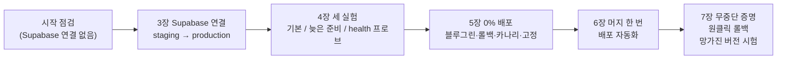

# [제출 보고서] N053 「Cloud Run으로 무중단 배포하기」 실습 과제 수행 결과

> 💡 **팁** — 작성일 2026-10-29 · 근거: 같은 폴더 `실습\N053_실습_진행기록.md`(사실 장부)와 `실습\실습로그\` 원본 로그 12개(08~19번), 강의노트 `N053_Cloud_Run으로_무중단_배포하기(cloud-run).md`

> 📌 **요약** — 이 문서는 N052 보고서와 같은 구조(한눈에, 절별 기록, 사고 표, 풀지 못한 것, 정리, 궁금했던 것, 체크리스트, 증거 화면)로 쓴 보고서이다. 숫자·시각·리비전 이름·run 번호는 진행기록과 로그에 있는 값만 썼고, 없는 것은 "확인하지 못했다"고 적었다. 진행기록이 "추정"이라 한 것은 이 문서에서도 추정이라 쓰고 단정하지 않았다. **시각은 모두 한국 시간(KST)**이다. GitHub Actions 화면은 UTC로 보이며 UTC 시각 숫자는 KST보다 9시간 작다(예: KST 14:42는 Actions 화면의 05:42). UTC로 적은 곳은 따로 표기했다. 공개 저장소에 올라가므로 Google Cloud 프로젝트 ID·번호, 서비스 주소의 숫자·해시(`<프로젝트번호>`·`<해시>`로 표기), Supabase 프로젝트 주소·ID, 키 값, 사용자 ID, 이메일은 싣지 않았다.

**실행 주체 표시**: **Claude** = AI 코딩 도우미가 실행한 명령·측정·워크플로 작성·PR 생성. **사용자** = Supabase 대시보드 작업, Secret Manager 값 입력, 연결 명령의 값 입력, PR 머지, production 승인, rollback 버튼, 브라우저 확인.

## 0. 한눈에

**실습 범위**: 교안 3~7장. 시작 상태가 부족해(Cloud Run 서비스에 Supabase 연결이 없고 production용 Supabase 프로젝트도 없었음) **3~5장을 모두 실습한 뒤** 6~7장 직접 해 보기(스테이지 0~6)를 했다. 0% 배포·스모크 테스트·전환은 staging과 production 둘 다에 적용했다. 대상은 AI 친구 에이전트 서비스 `friend-agent`(production)와 `friend-agent-staging`(staging)이다.

<!-- flow: 그림 1. 오늘의 흐름. 앞 절반은 손으로, 뒤 절반은 같은 일을 PR 머지와 버튼으로 자동화했다. | 시작 점검/Supabase 연결 없음/4 ; 3장 연결/staging 다음 production/1 ; 4장 세 실험/프로브 세 종류/2 ; 5장 손으로/0% 배포·롤백·카나리/3 ; 6장 자동화/머지 한 번 배포/1 ; 7장 증명/롤백·망가진 버전/2 -->


```text
시작 점검 → Supabase 연결 → 요청 확인 3실험 → 0% 배포·롤백·카나리·고정 → 머지 한 번 배포 자동화 → 무중단 증명 · 롤백 버튼 · 망가진 버전 시험
```
<!-- /flow -->

| 구분 | 결과 |
|---|---|
| 3장 Supabase 연결 | staging·production 모두 `/version`에 `storage: supabase`. staging은 새 리비전(`BANNER=저장확인`) 뒤에도 대화 유지, 시크릿 창은 다른 게스트. production 쪽 대화 직접 확인은 하지 않음 |
| 4장 ① 기본 배포 | 요청 285건, 실패 **3건**(`ReadTimeout`), 배포 명령 27초 |
| 4장 ② 준비가 늦은 버전 | 요청 295건, 실패 **54건**(전부 503, 약 21초), 배포 명령 37초 |
| 4장 ③ `/health` 프로브 | 요청 377건, 실패 **0건**, 배포 명령 약 84초(Git Bash 경로 변환 때문에 세 번 돌림) |
| 5장 블루그린 전환·롤백 | 요청 281건, 전환 중 실패 0건, **롤백에서 4건**(`ReadTimeout`) |
| 5장 카나리 10% → 50% → 100% | 요청 503건, 실패 0건 |
| 5장 트래픽 고정 | 배포는 성공했는데 사용자는 옛 리비전인 상태를 재현하고 `--to-latest`로 풀었다 |
| 6장 배포 자동화 | `deploy.yml`에 67줄 추가(PR #31). staging run #25 첫 실행에서 전 단계 성공, production run #26 성공 |
| 7장 무중단 증명 | 첫 측정(로그 15) 실패 **6건** → 깨워 두고 재측정(로그 16) 요청 752건 실패 **0건** |
| 7장 원클릭 롤백 | `rollback.yml` 신설. staging 2회·production 2회 실행. production 사용자 버튼 롤백(#3)은 요청 4건 실패(15초), 새 버전 복귀(#4)는 0건(4초) |
| 스테이지 6 망가진 버전 | run #29에서 스모크 테스트 실패·전환 건너뜀, 요청 735건 실패 0건, Revert(PR #36) 뒤 run #30 정상 |

**한 문장 요약**: 배포 명령이 성공하고 워크플로가 초록이어도 사용자가 겪는 일은 다르다는 것을, 요청 확인 스크립트의 숫자(배포 명령 성공 뒤 503 54건, 롤백 직후 4건, 감시 직후 6건)로 직접 확인했고, 그 확인 절차를 PR 머지 한 번과 버튼 하나로 자동화했다.

- 환경: Windows 11 · PowerShell/Git Bash · `gcloud` · `gh`. 저장소 `friend-agent`(로컬 `Documents\friend-agent-practice\friend-agent`), 리전 us-central1.
- 작업 전 판본: 고치기 전 `deploy.yml`·`ci.yml`과 HEAD 커밋 번호를 `N053/실습/판본_시작전/`에 복사해 두었다.
- 원본 로그의 서비스 주소에는 프로젝트 번호와 주소 해시가 들어 있어 공개 저장소에 올리기 전에 `<프로젝트번호>`·`<해시>`로 **마스킹**했다(그 외는 원본 그대로).
- 사고·문제 요약은 8절, 확인하지 못한 것은 9절에 모았다.

## 1. 시작 상태 점검 (교안 3-3, 2026-10-29) — 실행: Claude

교안 3-3의 확인을 읽기 전용으로 돌렸다. 시작 시각은 진행기록에 적혀 있지 않다(확인하지 못함).

| 항목 | 결과 |
|---|---|
| 로컬 저장소 | 브랜치 `staging`, HEAD `1010a7d`(= `origin/main`), 미추적 파일은 `docs/cleanup-policy.json` 하나 |
| 워크플로 | `ci.yml`, `deploy.yml`, `hello.yml`. `deploy.yml`은 staging 브랜치에서 이미지를 만들고 main에서는 staging 리비전의 다이제스트로 승격(N051) |
| GitHub 저장소 변수 | `AR_REPO`, `DEPLOY_SA`, `GCP_PROJECT_ID`, `RUNTIME_SA`, `WIF_PROVIDER` 5개(값은 적지 않음) |
| Cloud Run 서비스 | `friend-agent`, `friend-agent-staging` 모두 us-central1에 있음. 트래픽은 둘 다 `latestRevision: true` 100%(고정 아님) |
| 리비전(시작 시점) | production `friend-agent-00023-8ht`(커밋 `8243335`), staging `friend-agent-staging-00011-7sm`(커밋 `1010a7d`). production이 staging보다 한 커밋 뒤 |
| 환경변수 이름 | production `LLM_PROVIDER, LLM_API_KEY, COMMIT_SHA, ENV, OCR_ENABLED` / staging `ENV, LLM_API_KEY, COMMIT_SHA, OCR_ENABLED` — **`STORAGE`·`AUTH`·`SUPABASE_*` 없음** |
| `/version` | 두 서비스 모두 `storage: memory`, `auth: none`, `banner: ""` |
| 스타트업 프로브 | 두 서비스 모두 기본값(`tcpSocket` 포트만 확인) — `/health` 프로브가 아님 |
| Secret Manager 시크릿 | `llm-api-key`, `llm-api-key-staging` 둘뿐 — **`supabase-secret-staging`·`supabase-secret-production` 없음** |
| 배포 액션 | `google-github-actions/deploy-cloudrun@v3`에 `no_traffic`·`tag` 입력이 있음(공식 `action.yml` v3로 확인) |

- **결론**: 교안은 "지난 시간에 이어서 하고 있으면 확인만 하고 넘어가라"는 식으로 시작하지만, 이 서비스에는 Supabase 연결이 없었다. 그래서 3장(Supabase 연결)부터 4·5장을 모두 실습한 뒤 6·7장을 하기로 사용자가 범위를 정했다.
- **하지 않기로 한 것**: 키·가입·대시보드·Secret Manager 값 입력은 Claude가 하지 않고 사용자가 직접 한다. PR 머지와 production 승인도 사용자가 한다.

## 2. Supabase 연결 (교안 3장, staging·production, 2026-10-29) — 실행: 사용자(대시보드·시크릿 값 입력)·Claude(권한·확인)

### 2-1. 시작 전에 있던 것과 없던 것

| 항목 | 결과 |
|---|---|
| Supabase `friend-agent-staging`(us-east-2) | N052에서 만든 것이 활성 상태. 조직의 나머지 3개 프로젝트는 일시정지 그대로(사용자 확인, 증거 01) |
| Supabase `friend-agent-production` | 없었음 → **사용자**가 새로 만들고(East US Ohio, 무료) SQL Editor에 `0001_init.sql` 실행 → Table Editor에서 **테이블 6개** 확인(증거 02). 지구본 아이콘은 Data API 노출 표시이고 RLS 표시가 아니다 |
| 익명 로그인 | production은 **사용자**가 켜고 Save. staging은 **Claude**가 서비스에 설정된 키로 익명 가입 요청을 보내 200과 세션 토큰이 돌아오는 것으로 켜져 있음을 확인(대시보드 화면으로 확인한 것은 아님) |
| Secret Manager | **사용자**가 콘솔에서 `supabase-secret-staging`·`supabase-secret-production`을 직접 만듦(값은 채팅에 없음). **Claude**가 각각 활성 버전 1개임을 확인 |
| 읽기 권한 | **Claude**가 런타임 서비스 계정에 시크릿 **각각에 대해서만** `secretAccessor`를 부여하고 정책을 다시 조회해 확인 |

### 2-2. staging 연결과 막힌 곳 — publishable key 접두사 중복

1. **사용자**가 PowerShell에서 연결 명령을 실행했다. 첫 시도는 `<staging 프로젝트 URL>` 자리 표시를 통째로(꺾쇠 포함) 바꾸지 않았고, 쉼표가 들어간 값을 따옴표로 감싸지 않아(**Claude의 안내가 틀렸다**) `unrecognized arguments`로 실패했다. 변수(`$URL`, `$KEY`)를 쓰고 값을 큰따옴표로 감싸는 방식으로 바꿨다.
2. 두 번째 시도는 명령이 성공했다(리비전 `friend-agent-staging-00012-2l9`, `/version`에 `storage: supabase`). 그러나 브라우저에 **"로그인을 시작하지 못했습니다"** 창이 떴다(증거 03).
3. **Claude**가 서비스에 저장된 키를 값은 출력하지 않고 글자 구조만 확인했다: 길이 61, `sb_publishable_`이 **두 번** 이어져 있었다. 같은 키로 Supabase 익명 가입 요청을 보내면 401이었다. 원인은 복사한 값에 이미 들어 있는 접두사를 `$KEY = "sb_publishable_…"`에 한 번 더 쓴 것이다(Claude의 예시가 오해를 만들었다). 익명 로그인 설정 문제가 아니었다.
4. **사용자**가 키를 다시 넣고 `$KEY.Length`로 확인(처음 32, 다시 46)한 뒤 재실행했다 → 리비전 `00013-fs2`. **Claude**가 저장된 값을 조회해 길이 46·접두사 1회, 익명 가입 요청 200을 확인했다. 중간에 사용자가 붙여 준 출력은 이전 실행(00012)의 글이었고, 실제 상태는 조회로 확인했다.

> ⚠️ **주의** — 교안 부록 B의 "로그인을 시작하지 못했습니다" 원인은 익명 로그인이 꺼져 있는 것이다. 이번 원인은 달랐다(키 접두사 중복). 같은 증상에서도 먼저 저장된 값의 구조(길이·접두사)를 조회해 보면 원인을 빨리 가른다.

### 2-3. staging 확인 4단계 (교안 3-6)

| 확인 | 결과 |
|---|---|
| ① 화면 왼쪽 아래 "게스트로 사용 중" | 사용자의 캡처에서 왼쪽 아래 문구가 잘려 "…용 중"만 보였다(게스트 표시로 **추정**, 글자 전체는 확인하지 못함). 로그인 실패 창은 키를 고친 뒤 뜨지 않음 |
| ② `messages`에 행 생성 | 사용자의 캡처: 오늘(10-29) UTC 02:52~02:53(KST 11:52~11:53) 새 `user_id`로 5행(인사·날씨 질문·답·"고마워…"·답). 1~6행은 어제 N052 로컬 실습 기록이다(증거 04) |
| ③ 새 리비전 뒤에도 대화 유지 | **Claude**가 `BANNER=저장확인`으로 리비전 `00014-vbd`를 만들고 `/version`의 banner를 확인. **사용자**가 일반 창을 새로고침하자 노란 띠에 `저장확인`이 보이고 대화가 그대로였다(증거 06) |
| ④ 다른 브라우저에서 앞 대화가 안 보임 | **사용자**의 시크릿 창은 `캐릭터 만들기`로 시작했고(다른 게스트) 노란 띠에는 `저장확인`이 보였다(증거 05) |

### 2-4. production 연결 (3장 마무리)

- **사용자**가 production 서비스에 연결 명령을 실행했다(변수 `$PURL`·`$PKEY`, `$PKEY.Length`로 46 확인 후) → 리비전 `friend-agent-00024-62j`.
- **Claude**의 확인: `/version`에 `env: production`, `storage: supabase`, `auth: supabase`. 환경변수 이름 5개 추가, 시크릿은 `supabase-secret-production` 참조, 키 길이 46·접두사 1회, staging과 다른 프로젝트 URL, 익명 가입 요청 200(production 프로젝트에 익명 사용자 1명 생김). 코드는 그대로라 커밋은 `8243335`(staging은 `1010a7d`).
- 3장 확인 4단계 중 "production에서 직접 대화해 `messages` 확인"은 이번에 **하지 않았다**(staging에서만 확인). staging 쪽 `BANNER=저장확인`은 4장 실험 전에 지우기로 했고 3-3절에서 정리됐다.

## 3. 실험 ①②③ 요청 확인 (교안 4장, staging, 12:05~12:18) — 실행: Claude

방법: `scripts/watch_requests.py`를 `--seconds`만큼 돌리고(`/version`에 0.2초 간격, 2초 안에 응답이 없으면 실패로 기록), 시작 약 10초 뒤 `gcloud run services update`로 새 리비전을 만들었다. 시작 전에 `/version`을 한 번 불러 콜드 스타트를 피했다. 원본은 `실습로그/08~12_*.log`이다.

### 3-1. 세 실험 비교

| 실험 | 프로브 | 시작 지연 | 전체 요청 | 실패 | 배포 명령 시간 | 비고 |
|---|---|---|---|---|---|---|
| ① 기본 배포 `BANNER=측정1` | 기본(포트) | 없음 | 285 | **3** (`ReadTimeout`, 12:05:36~12:05:40) | 27초(12:05:13~12:05:40) | 새 리비전 `00015-z97`로 트래픽이 옮겨 가는 막바지에 몰림. 새 리비전 첫 응답 12:05:42.970. 교안의 "0건이거나 아주 적음"에 해당. 원인은 콜드 스타트로 **추정**(미확인) |
| ② 준비가 늦은 버전 `SLOW_START_SECONDS=30,BANNER=측정2` | 기본(포트) | 30초 | 295 | **54** (전부 503, 12:08:07~12:08:28, 약 21초) | 37초(12:07:32~12:08:10) | 배포 명령이 성공으로 끝난 뒤에도 약 19초 더 503. 교안은 "30초 가까이"라 했으나 약 21초. 지연이 컨테이너 시작부터 센다는 것은 **추정**(미확인). 새 리비전 `00016-8qn`의 첫 정상 응답 12:08:29.130 |
| ③ `/health` 프로브 `BANNER=측정3b` | `/health`, 5초, 12회, 2초 | 30초 | 377 | **0** | 약 84초(12:16:01~12:17:25) | 새 리비전 `00018-ts2`의 첫 응답이 12:17:11.9에 찍혀 그때 이전 리비전 `00017-g8d`에서 전환된 것으로 보임(`00018-ts2` 177건, 47%). 배포가 ①보다 훨씬 오래 걸림(원인 미확인) |

- ②는 **배포 명령이 성공으로 끝났는데 사용자는 503을 본** 장면이다. 교안의 "배포 성공은 Cloud Run이 정한 준비 조건을 통과했다는 뜻일 뿐"이 숫자로 보였다. 교안 설명대로라면 기본 프로브는 포트가 열렸는지만 보므로 앱이 아직 준비되지 않았는데도 트래픽이 넘어간 것이다(교안 4-1의 "전등이 켜진 것만 보고 주방이 준비됐다고 판단"하는 경우). 이번에 직접 확인한 것은 503이 약 21초 이어졌다는 데까지이고, 프로브의 동작 자체를 따로 확인하지는 않았다.
- ③은 같은 조건에서 실패 0건이었고 배포 명령은 ①보다 훨씬 오래 걸렸다(약 84초). 교안은 이를 "사용자가 오류를 보는 것보다 배포가 늦어지는 편이 낫다"는 대가로 설명한다. 이번 로그만으로는 배포가 그만큼 길어진 원인을 확인하지 못했다.
- 시각은 모두 KST이다. 로그의 12:05는 Actions 화면 기준 UTC 03:05에 해당한다(이 실험은 Actions를 쓰지 않았다).

### 3-2. 실험 ③을 세 번 돌린 이유 (Git Bash 경로 변환)

| 순서 | 무엇이 일어났나 | 결과 | 로그 |
|---|---|---|---|
| 첫 실행(**무효**) | Git Bash가 `--startup-probe=httpGet.path=/health`의 `/health`를 윈도 경로로 바꿔 서비스에 저장된 프로브 경로가 `C:/Program Files/Git/health`가 됐다(서비스를 조회해서 발견, N052의 `MSYS_NO_PATHCONV` 함정과 같은 종류) | 요청 376건·실패 0건·배포 약 65초가 나왔으나 **근거로 쓰지 않았다**. 알 수 없는 경로에도 앱이 200으로 답했을 **가능성**이 있지만 확인하지 않았다 | `10_측정3_잘못된경로_GitBash변환.log` |
| 두 번째(**무효**) | `MSYS_NO_PATHCONV=1`을 켜자 `gcloud`의 bash 래퍼가 자기 파이썬 파일 경로(`C:\c\Users\…\gcloud.py`)를 못 찾아 **배포가 실행되지 않았다**. 서비스는 그대로 `00017`·잘못된 경로 | 로그에는 요청 371건·`ConnectTimeout` 1건(12:12:41, 명령이 실패하기 전 구간이라 이 실험과 무관해 보이나 원인은 확인하지 않음) | `11_측정3_재실행_무효_gcloud경로오류.log` |
| 세 번째(**유효**) | `MSYS2_ARG_CONV_EXCL="--startup-probe"`로 그 옵션 하나만 변환에서 제외 → 저장된 프로브가 `httpGet.path=/health`임을 서비스 조회로 확인 | 위 표의 ③은 이 실행 값 | `12_측정3_health프로브_재실행.log` |

> 💡 **팁** — Git Bash에서 `/`로 시작하는 옵션 값은 변환될 수 있으니 실행 뒤 **저장된 값을 조회해** 확인한다. 변환 전체를 끄면 `gcloud` 래퍼가 깨질 수 있어 해당 옵션만 제외한다(`MSYS2_ARG_CONV_EXCL`). PowerShell에서는 이 문제가 없다.

### 3-3. 정리와 자동 배포에 남기기 (교안 4-6, PR #29·#30)

- **Claude**: `--remove-env-vars SLOW_START_SECONDS,BANNER` → 리비전 `friend-agent-staging-00019-6qj`. **`/health` 프로브는 남겼다.** 환경변수 이름은 `ENV, LLM_API_KEY, COMMIT_SHA, OCR_ENABLED, STORAGE, AUTH, SUPABASE_*`로 돌아왔다.
- 프로브 설정은 서비스에 직접 넣은 것이라, 자동 배포에서도 같은 설정이 들어가도록 **Claude**가 브랜치 `startup-probe-health`에서 `deploy.yml`의 `flags` 줄 한 줄만 바꿨다(`--startup-probe=httpGet.path=/health,periodSeconds=5,failureThreshold=12,timeoutSeconds=2` 추가, `--service-account` 유지). PR #29(→ `staging`), CI `test`·`hello` 통과(증거 07).
- **사용자**가 #29를 `staging`에 머지 → staging 배포 성공(리비전 `00020-dc2`, `/version` 커밋 `55734e4`, 프로브 `/health` 저장을 Claude가 확인).
- **Claude**가 `staging → main` PR #30을 만들었다(#28의 `AGENTS.md` 한 줄 포함). **사용자**가 머지와 production 승인 → production 리비전 `friend-agent-00025-txp`, `/version` 커밋 `55734e4`(staging과 같음, 이미지 승격 확인), 프로브 `/health`, 트래픽 `latestRevision: true` 100%.

## 4. 5장 블루그린·롤백·카나리·트래픽 고정 (교안 5장, staging, 12:41~12:47, 0% 배포 시각은 기록 없음) — 실행: Claude

시작 상태는 `friend-agent-staging-00020-dc2`가 `latestRevision: true`로 100%였다. 원본은 `실습로그/13·14`이다.

### 4-1. 0% 배포와 태그 URL (교안 5-2)

- `gcloud run services update … --update-env-vars "BANNER=GREEN" --no-traffic --tag green` → 새 리비전 `00021-fup`이 0%, 태그 URL 생성. **배포 직후 100% 줄에서 `latestRevision: true`가 사라지고 `00020`에 고정**됐다(`--no-traffic`의 부수 효과).
- 태그 URL `/version`은 `00021-fup`·`banner: GREEN`, 원래 서비스 주소 `/version`은 `00020-dc2`·`banner: ""`, 태그 URL `/health`는 200 `{"status":"ok"}`.
- 태그 URL은 두 형식 모두 열렸다: ① 서비스 조회(`status.traffic[].url`)가 돌려준 `https://green---<서비스>-<해시>-uc.a.run.app` ② 서비스 주소(프로젝트 번호 형식) 앞에 `green---`만 붙인 주소. 워크플로에서는 조회로 받은 값을 쓰는 편이 안전하다(형식이 바뀌어도 따라감).

### 4-2. 블루그린 전환과 롤백 (로그 13) — 요청 281건, 실패 4건

| 동작 | 명령 | 시각 | 결과 |
|---|---|---|---|
| 전환 | `update-traffic --to-tags green=100` | 12:41:19.4 ~ 12:41:37.9 (명령 18.5초) | 첫 `00021` 응답 12:41:35.2, 전환 중 **실패 0건** |
| 롤백 | `update-traffic --to-revisions friend-agent-staging-00020-dc2=100` | 12:42:13.0 ~ 12:42:24.5 (명령 11.5초) | `ReadTimeout` **4건**(12:42:22.9, 25.1, 27.5, 29.8), `00020`의 첫 응답 12:42:32.2 |

- 응답 수: `00020` 157건(56%), `00021` 120건(43%).
- 교안은 "전환·롤백 모두 실패 0건·몇 초"를 예상했으나 롤백에서 4건, 명령 시간은 18.5초·11.5초였다. 롤백 4건은 이전 리비전 인스턴스가 약 35초 동안 트래픽이 없어 줄었다가 다시 켜진 **콜드 스타트로 추정**한다(인스턴스 수는 확인하지 않음). 명령 시간이 교안보다 긴 이유도 확인하지 못했다.

### 4-3. 카나리 10% → 50% → 100% (로그 14) — 요청 503건, 실패 0건

| 단계 | 명령 | 시각 | 트래픽 |
|---|---|---|---|
| 10% | `update-traffic --to-tags green=10` | 12:43:50.2 ~ 12:44:04.7 | `00020` 90 / `00021` 10 |
| 50% | `--to-tags green=50` | 12:44:59.8 ~ 12:45:10.0 | 50 / 50 |
| 100% | `--to-tags green=100` | 12:46:05.1 ~ 12:46:15.8 | `00021` 100 |

- 응답 수: `00020` 280건(56%), `00021` 223건(44%). 단계별 머문 시간(0%·10%·50%·100% 순으로 24·66·65·44초)으로 계산한 기대값은 약 42%로 관찰값과 비슷하다.
- **한계**: 스크립트는 응답 리비전이 바뀔 때만 한 줄씩 찍어 단계별로 새 리비전 응답이 몇 건이었는지 따로 세지 못했다. 교안의 "10%가 8%·13%로 나온다"는 이번 로그로 증명하지 못했다.

### 4-4. 트래픽 고정 재현과 해제 (교안 5-5)

- 상태: 카나리 끝에 트래픽이 `green` 태그(`00021`) 100%로 고정돼 있었다.
- `--update-env-vars "BANNER=고정확인"`: 명령은 성공으로 끝났지만 출력이 서비스 중인 `00021-fup`을 가리켜 **새 리비전이 안 생긴 것처럼 보였다.** 조회하니 `00022-tvw`가 만들어졌고 Ready였지만 트래픽 0%·`Retired`(인스턴스 없음)였다. 서비스 주소 `/version`은 `00021`(`banner: GREEN`) 그대로였다 → **배포는 성공했는데 사용자는 옛 리비전**인 상태를 재현했다.
- `update-traffic --to-latest` → 100%가 `00022-tvw`로 옮겨 가고 `/version`에 `banner: 고정확인`. `--remove-tags green`, `--remove-env-vars BANNER`(→ `00023-jrk`) 뒤 최종: `latestRevision: true` 100%, `banner: ""`.
- 조회 중 파이썬 출력에서 `BANNER` 한글이 깨져 보였으나 서비스의 `/version`은 `고정확인`으로 정상이었다. 파이프 읽기 인코딩 문제로 보이며 실제 값 문제는 아니다.

> 📌 **요약** — 롤백 뒤와 카나리 뒤에 트래픽이 특정 리비전에 고정되는 것을 두 번 확인했다. 그래서 6장 자동화는 (a) 0% 배포 뒤 반드시 명시적으로 전환하고 (b) 마지막에 `--to-latest`로 고정을 풀어 두는 쪽으로 설계했다.

## 5. 6장 머지 한 번 배포 자동화 (교안 6장, PR #29~#34)

### 5-1. 설계와 PR (실행: Claude 작성, 사용자 확인 뒤 진행)

사용자가 "staging과 production 둘 다"에 적용하고, 전환은 `--to-latest`, 태그는 고정 이름 `green`으로 하는 설계를 확인했다("이대로 진행"). `deploy.yml`에 **67줄만 추가**하고 기존 줄은 그대로 두었다(브랜치 `blue-green-auto`, PR #31, 대상 `staging`). 추가한 단계는 다음과 같다.

| 단계 | 하는 일 |
|---|---|
| ⓪ `concurrency` | 같은 브랜치의 배포는 한 번에 하나만 실행 |
| ① 리비전 기록 | 지금 트래픽을 받는 리비전을 기록(롤백·메시지용) |
| ② 배포 | `no_traffic: true`, `tag: green`으로 0% 배포 |
| ③ 스모크 테스트 | 태그 URL의 `/health`와 `/version`의 커밋 일치 여부를 6초 간격으로 최대 10번 확인 |
| ④ 전환 | 최신 준비 리비전이 테스트한 리비전과 **같을 때만** `update-traffic --to-latest` |
| ⑤ 전환 확인 | 서비스 주소 `/version`의 커밋 확인 |

푸시 전 검증: YAML 문법, 모든 `run:` 블록 `bash -n` 통과. 실제 동작은 머지 뒤에 확인했다.

### 5-2. PR과 run 대응표 (진행기록에 적힌 것만)

| PR | 방향 | 내용 | 머지 뒤 run과 결과 |
|---|---|---|---|
| #29 | → `staging` | `/health` 프로브를 `deploy.yml`의 `flags`에 추가 | staging 리비전 `00020-dc2`, 커밋 `55734e4` (run 번호는 진행기록에 없음) |
| #30 | `staging → main` | #29 + `AGENTS.md` 한 줄 | production 리비전 `00025-txp`, 커밋 `55734e4` (run 번호는 진행기록에 없음) |
| #31 | → `staging` | 0% 배포 + 스모크 테스트 + 전환 67줄 | **run #25**(커밋 `1a4819e`) 전 단계 성공, staging `00031-wod` |
| #32 | `staging → main` | #31 승격 | **run #26** 전 단계 성공, production `00026-vis` |
| #33 | → `staging` | `rollback.yml` 신설 | **run #27** 성공, staging `00033-bas`, 커밋 `8d549df` |
| #34 | `staging → main` | #33 승격 | **run #28** 성공, production `00028-rum`, 커밋 `8d549df` |
| #35 | → `staging` | 일부러 망가뜨린 버전(7절) | **run #29** 스모크 테스트 실패(병합 커밋 `b50cc5c`) |
| #36 | → `staging` | #35의 Revert(7절) | **run #30** 성공, 커밋 `412a785` |

### 5-3. staging 첫 실행 (run #25, 커밋 `1a4819e`) — 실행: 사용자(머지)·Claude(감시·확인)

- 기록된 전환 전 리비전은 `friend-agent-staging-00023-jrk`. 새 리비전 `00031-wod`를 0%로 올렸다(이미지 빌드·푸시·준비 대기를 포함해 스모크 시작까지 약 2분 30초).
- 스모크 테스트는 1번째 시도에서 통과(`/health` 정상, `/version` 커밋 일치). 전환 로그는 `0%  00031-wod` / `100% LATEST (currently 00031-wod)`. 전환 확인도 1번째 시도에서 통과.
- 최종 상태: `latestRevision: true` 100%(고정 아님), `green` 태그는 같은 리비전에 남음, `/version` 커밋 `1a4819e`(증거 10).
- 리비전 번호가 `00023`에서 `00031`로 건너뛰었다. 중간 번호의 리비전은 목록에 없고 이유는 확인하지 못했다. 동작에는 영향이 없어 보인다.

### 5-4. production 반영 (PR #32 → run #26) — 실행: 사용자(머지·승인)·Claude(감시·확인)

- 사용자가 PR #32를 머지하고 production 승인. run 전체 성공. 단계: `staging 이미지 찾기(production 승격)` ✓ → 리비전 기록 ✓ → 배포 ✓ → 스모크 테스트 ✓ → 전환 ✓ → 전환 확인 ✓ (이미지 빌드는 건너뜀: staging에서 만든 이미지를 승격).
- production 최종: 리비전 `friend-agent-00026-vis`가 `latestRevision: true` 100%, `/version` 커밋 `1a4819e`(staging과 같음), `storage`·`auth`는 `supabase`.
- 증거 화면 09(run 24, main 배포)와 08(run 23, staging 배포 진행 중)은 6장 이전 PR #29·#30의 배포 화면이다(증거 파일명 기준. 진행기록에 run 번호는 없다).

## 6. 7장 무중단 증명과 원클릭 롤백 (교안 7장)

### 6-1. 스테이지 4 — 배포 중 production 요청 확인

**첫 측정(로그 15, run은 PR #32 승인 건)** — 실행: Claude. 승인으로 `deploy` 작업이 시작되는 순간(14:10:22)을 감지해 production `/version`에 0.2초 간격 요청을 5분간 보냈다.

| 항목 | 값 |
|---|---|
| 전체 요청 | 723건 |
| 실패 | **6건** (모두 `ReadTimeout`, 14:10:23~14:10:35) |
| 응답 | `friend-agent-00025-txp`(이전) 152건 21%, `friend-agent-00026-vis`(새) 565건 78% |
| 이전 → 새 리비전 전환 | 14:11:39에 새 리비전의 첫 응답. **이 전환 구간의 실패는 0건** |

- 실패 6건은 감시 시작 직후 15초 안에 몰렸고 14:10:37에 이전 리비전의 첫 응답이 왔다. 새 리비전이 트래픽을 받기(14:11:39) 약 1분 전이므로 **배포 전환이 원인은 아니다.** 감시 전에 production을 한 번 깨워 두지 않아 이전 리비전 인스턴스의 콜드 스타트였던 것으로 **추정**한다(확인하지 않음).
- 스테이지 4의 클리어 조건("실패 0건")은 이 로그만으로는 엄밀히는 충족하지 못했다. 그래서 다음 production 배포에서 감시 전에 production을 깨워 두고 다시 재기로 했다.

**재측정(로그 16, run #28)** — 실행: Claude(감시), 사용자(승인).

- 승인을 기다리는 동안 production `/version`을 20초마다 호출해 깨워 둔 뒤, 승인으로 `deploy` 작업이 시작되는 순간(14:28:12) 5분간 요청 확인을 켰다.
- 결과: **전체 752건, 실패 0건.** 이전 리비전 `00026-vis` 195건(26%) → 새 리비전 `00028-rum` 557건(74%), 새 리비전의 첫 응답 14:29:32(승인 약 80초 뒤).
- 배포 run #28: 승격 → 기록 → 배포 → 스모크 테스트 → 전환 → 전환 확인 전 단계 성공, 전체 2분 13초(`deploy` 작업 1분 35초). production은 `latestRevision: true` 100%, `/version` 커밋 `8d549df`.

| 비교 | 로그 15 | 로그 16 |
|---|---|---|
| 감시 전 production 깨우기 | 하지 않음 | 승인 대기 중 20초마다 호출 |
| 전체 요청 | 723 | 752 |
| 실패 | 6 | 0 |
| 이전 리비전 응답 | 152건(21%) | 195건(26%) |
| 새 리비전 응답 | 565건(78%) | 557건(74%) |

- 6건이 사라진 것은 "감시 직후 콜드 스타트" 추정과 일관되지만 **원인을 직접 확인한 것은 아니다.** 깨워 두기만 바꾼 이 한 번의 비교가 근거이다.
- 스테이지 4 클리어 조건("이전·새 리비전 응답이 모두 보이고 실패 0건")은 **로그 16**으로 충족했다. 사용자가 승인하는 화면(Deployment protection rules에 `production` 승인 기록)과 run #28의 단계 목록은 발표 장면으로 쓸 수 있다(증거 11).

### 6-2. 스테이지 5 — 원클릭 롤백 `rollback.yml`

**설계** — 실행: Claude 작성, 사용자가 선택.

- 사용자가 "롤백에도 production 승인을 거치지 않음"을 선택했다. 이유: 이 저장소는 본인 한 명이 승인자이자 유일한 실행자라 승인 절차는 보호보다 지연이 크고, 입력 형식·서비스 소속·Ready 검사를 안전장치로 둔다. 과제 문구는 이 선택을 직접 따져 정하라는 것이며 어느 쪽도 맞다. 반대 위험("급할 때도 무단 실행")은 `environment: production`을 붙이면 바로 막을 수 있다.
- `.github/workflows/rollback.yml` 새 파일 하나. `workflow_dispatch` 입력은 `target`(staging/production)과 `revision`(리비전 이름, 필수). 단계: 인증(WIF, 배포와 같은 변수) → 입력과 리비전 확인(이름 형식 `^서비스-NNNNN-xxx$`, 서비스 소속, Ready) → `update-traffic --to-revisions 리비전=100` → 서비스 주소 `/version` 확인과 걸린 초를 실행 요약에 표로 기록. 입력값은 환경변수로만 셸에 전달하고, 배포와 같은 `concurrency` 그룹을 쓴다.
- 푸시 전 검증: YAML·`bash -n`, 입력 형식 시험(정상 통과 / staging 리비전·`x; rm -rf /` 거부), 실제 리비전으로 소속·Ready 조회 경로 확인(내 컴퓨터에 `jq`가 없어 같은 경로를 파이썬으로 확인).
- PR #33(→ `staging`) 머지 → staging 배포 성공(리비전 `00033-bas`, 커밋 `8d549df`) → PR #34(→ `main`) 머지·production 승인 → Actions에 `rollback`이 등록됐다(기본 브랜치에 있어야 버튼이 보인다). 증거 12.

**시험 결과 (rollback #1~#4)**

| # | 대상 | 입력(되돌아갈 리비전) | 실행자 | 롤백 명령부터 `/version` 확인까지 | 워크플로 전체 |
|---|---|---|---|---|---|
| #1 | staging | `friend-agent-staging-00031-wod` | Claude(`gh workflow run`) | 32초 (확인 3번째 시도) | 약 52초 |
| #2 | staging | `friend-agent-staging-00033-bas` (새 버전으로 복귀) | Claude | 21초 (1번째 시도) | 기록 없음 |
| #3 | **production** | `friend-agent-00026-vis` | **사용자(버튼)** | 15초 (확인 2번째 시도) | 33초 (KST 14:42:01~14:42:34, Actions 화면 UTC 05:42:01~05:42:34) |
| #4 | production | `friend-agent-00028-rum` (새 버전으로 복귀) | Claude(`gh workflow run rollback.yml --ref main -f target=production -f revision=friend-agent-00028-rum`) | 4초 (1번째 시도) | 약 27초 (KST 14:48:36~14:49:03) |

- #3 직후 production: 트래픽 `00026-vis` 100%(고정, `latestRevision` 없음), `/version` 커밋 `1a4819e`. 새 버전(`00028-rum`)은 0%·`green` 태그만 남았다(증거 13: rollback #3 production 실행 중).
- 확인 단계의 첫 시도는 #1·#3에서 `curl: (28) … timed out after 5001 ms` → "아직 없음 이 응답 중"으로 찍혀 재시도됐다. 되돌아간 리비전의 인스턴스가 깨어나는 동안일 것으로 **추정**한다(확인하지 않음). 출력 문구가 어색하다(응답이 없을 때 "없음 이"로 읽힘).
- 교안의 클리어 확인 4가지: ① Actions의 Run workflow 버튼 → #3(사용자가 직접), ② Cloud Run 리비전 탭에서 이전 리비전 100% → 조회로 확인, ③ 버튼부터 `/version`이 바뀐 시각까지 → 롤백 **명령**부터 확인까지 15초(요약 표와 로그의 "롤백 명령부터 15초"), 버튼을 누른 때부터 워크플로 전체는 33초, ④ 새 버전으로 다시 돌아가기 → #4.

### 6-3. production 롤백 중 요청 확인 (로그 17, rollback #3) — 실행: Claude

- 승인 없는 버튼이라, 버튼이 눌린 것을 감지해(rollback 실행 시작 14:42:04) production `/version`에 150초간 요청했다. 대기 중에는 production을 20초마다 깨워 두었다.
- **전체 357건, 실패 4건**(`ReadTimeout`, 14:42:21~14:42:28). 이전 리비전 `00028-rum` 40건(11%) → 롤백 대상 `00026-vis` 313건(88%), `00026-vis`의 첫 응답 14:42:30.6.
- 실패 4건은 트래픽이 `00026-vis`로 옮겨 간 직후 약 9초에 몰렸다. staging 롤백(로그 13)에서도 같은 모양(4건)이 있었다. 롤백 대상이 그동안 트래픽을 못 받아(약 13분 이상) 인스턴스가 줄어 있다가 다시 켜지는 **콜드 스타트로 추정**한다. 배포 전환(로그 16, 0건)과 달리 **롤백은 준비되지 않은 리비전으로 곧바로 트래픽을 옮기므로** 스타트업 프로브가 막아 주지 못한다(교안의 "롤백은 프로브를 다시 돌리지 않는다"와 일치).
- 요청이 끊기는 시간까지 보면 명령 시간 15초 외에 약 9초가 추가로 보인다.

### 6-4. production을 새 버전으로 복귀 (로그 18, rollback #4) — 실행: Claude

- 사용자가 "제가 실행"(에이전트가 실행하는 쪽 버튼)을 선택해 Claude가 위 명령으로 실행했다. 롤백 명령부터 `/version` 확인까지 **4초**, 워크플로 전체 약 27초.
- 요청 확인(100초): **전체 249건, 실패 0건.** `00026-vis` 72건(29%) → `00028-rum` 177건(71%), 전환 14:48:56.
- #3(실패 4건·15초)과 달리 이번에는 0건·4초였다. 되돌아간 `00028-rum`이 롤백 약 6분 전까지 트래픽을 받아 인스턴스가 남아 있었을 **가능성**이 있다(콜드 스타트 추정과 일관됨, 확인하지 않음).
- 최종: production `friend-agent-00028-rum` 100%(고정, `latestRevision` 없음)·`green` 태그 유지, `/version` 커밋 `8d549df`. 다음 정상 배포의 전환 단계가 고정을 푼다.

| 롤백 측정 | 대상 | 전체 요청 | 실패 | 명령부터 확인까지 |
|---|---|---|---|---|
| 로그 13 (staging, 손으로) | `00020-dc2`로 | 281 | 4 | 명령 11.5초 |
| 로그 17 (production, rollback #3) | `00026-vis`로 | 357 | 4 | 15초 |
| 로그 18 (production, rollback #4) | `00028-rum`으로 | 249 | 0 | 4초 |

## 7. 스테이지 6 망가진 버전 시험 (staging, 2026-10-29 14:58~15:04)

### 7-1. 방식 A를 고른 이유

교안은 "`/health`가 항상 실패하는 버전"을 말하지만, `test_health`가 `/health`를 검사하고 `staging` 브랜치는 `test` 체크가 필수(관리자에게도 적용)라서 그 PR은 CI에서 막힌다. 통과시키려면 테스트도 같이 바꿔야 하는데 그러면 시험 취지가 흐려진다. `/version`은 테스트가 없다.

- 사용자가 **A(`/version`이 틀린 커밋을 돌려주게 함)**를 선택했다. `/health`는 정상이라 스타트업 프로브는 통과하고, **새로 만든 스모크 테스트의 커밋 비교에서만** 걸린다. 교안의 "어느 쪽이든 전환 단계까지 가지 않으면 클리어"에 해당한다. B(`/health`가 항상 실패)는 하지 않았다.
- 변경은 `app/main.py` 한 줄(`"commit": "broken-" + settings.commit[:7]`)과 주석뿐이다. 로컬 `pytest` 15개 통과, 실제 CI도 통과했다. production은 건드리지 않았고 `staging → main`으로 올리지 않았다. PR #35(→ `staging`)를 사용자가 머지했다.

### 7-2. 결과 (run #29, 병합 커밋 `b50cc5c`)

| 단계 | 결과 |
|---|---|
| test | success (19초) — CI는 통과 |
| 이미지 만들기와 올리기 | success |
| 지금 트래픽을 받는 리비전 기록 | success (`friend-agent-staging-00033-bas`) |
| deploy (0% 배포, 새 리비전 `00037-duy`) | success — `/health`가 정상이라 프로브 통과 |
| **스모크 테스트 (태그 URL)** | **failure** — 기대 커밋 `b50cc5ce…`, 10번 모두 `broken-b50cc5c` |
| 전환 / 전환 확인 / 배포 결과 | **skipped** |

- 스모크 테스트 로그의 마지막 줄: "스모크 테스트 실패. 전환하지 않는다. 사용자는 계속 friend-agent-staging-00033-bas 을 쓴다"(증거 14).
- 시험 뒤 staging: 트래픽 `00033-bas` 100% 그대로, `/version` 커밋 `8d549df`. 망가진 `00037-duy`는 0%·`green` 태그만 남았다.

### 7-3. 요청 확인 (로그 19, 5분 감시)

- 감시는 deploy 작업 시작(14:59:24)을 감지해 켰고, 대기 중 staging을 20초마다 깨워 두었다. **전체 735건, 실패 0건**, 응답은 전부 `00033-bas`(100%).
- 즉 사용자는 망가진 버전을 한 번도 보지 못했다.

### 7-4. Revert와 정상 배포 (PR #36 → run #30)

- Claude가 병합 커밋을 `git revert -m 1 b50cc5c`로 되돌려 브랜치 `revert-broken-version`, PR #36(→ `staging`)을 만들었다. 되돌린 뒤 `app/main.py`가 시험 전 커밋 `8d549df`와 같음을 diff로 확인했다(교안은 GitHub Revert 버튼을 말하나 같은 결과). 사용자가 머지했다.
- run #30(커밋 `412a785`)은 전 단계 success: 스모크 테스트 1번째 시도 통과(`/health` 정상, `/version` 커밋 일치), 전환 로그 `0%  00038-veg` → `100% LATEST (currently 00038-veg)`, 전환 확인 통과(증거 15).
- 최종 staging: `00038-veg`가 `latestRevision: true` 100% — **롤백(#1·#2)으로 고정돼 있던 트래픽도 이 전환 단계(`--to-latest`)가 풀었다.** `/version` 커밋 `412a785`.

**스테이지 6 클리어 확인 4개 충족**: ① 실패한 단계와 건너뛴 전환 ② 트래픽 100%가 이전 리비전 그대로 ③ 요청 확인 실패 0건 ④ Revert 머지 뒤 정상 배포가 끝까지 돎.

> ⚠️ **주의** — 교안 7-4의 단서처럼 망가진 버전인데 워크플로가 초록이고 `/version`이 새 커밋이라면 스모크 테스트가 원래 서비스 주소를 보았거나 실패가 단계 실패로 이어지지 않았다고 의심해야 한다. 이번에는 스모크 테스트가 태그 URL을 보게 했고 실제로 단계가 실패로 끝났다.

## 8. 사고·문제 표

| 번호 | 증상 | 원인 | 해결 |
|---|---|---|---|
| 1 | 2절: 연결 명령 성공 뒤 브라우저에 "로그인을 시작하지 못했습니다" 창(증거 03) | publishable key에 이미 들어 있는 `sb_publishable_`을 명령에서 한 번 더 붙여 저장된 키가 길이 61·접두사 2회(익명 가입 요청 401). Claude의 예시가 오해를 만들었다. 익명 로그인 설정 문제가 아니었다 | 값을 출력하지 않고 길이·접두사만 조회해 원인 확인. 사용자가 키를 다시 넣고 `$KEY.Length`로 확인(46) 후 재실행 → `00013-fs2`, 익명 가입 200 |
| 2 | 2절 첫 시도에서 `unrecognized arguments` | PowerShell에서 쉼표가 들어간 값을 따옴표로 감싸지 않았고(Claude의 안내가 틀림), `<staging 프로젝트 URL>` 자리 표시를 꺾쇠까지 통째로 바꾸지 않았다 | 변수(`$URL`, `$KEY`)를 쓰고 값을 큰따옴표로 감싸는 방식으로 변경 |
| 3 | 3절 실험 ③ 첫 실행이 실패 0건·배포 약 65초로 끝났으나 서비스에 저장된 프로브 경로가 `C:/Program Files/Git/health` | Git Bash가 `/`로 시작하는 옵션 값을 윈도 경로로 바꿨다(N052의 `MSYS_NO_PATHCONV` 함정과 같은 종류). **실험 ③ 무효** | 서비스 조회로 발견. 결과를 근거로 쓰지 않고 로그만 보존(`10_…`) |
| 4 | 3절 실험 ③ 두 번째 실행에서 배포가 실행되지 않고 `can't open file '…gcloud.py'` | `MSYS_NO_PATHCONV=1`로 변환 전체를 끄자 `gcloud`의 bash 래퍼가 자기 파이썬 파일 경로를 못 찾았다. **실험 ③ 무효 2회째** | `MSYS2_ARG_CONV_EXCL="--startup-probe"`로 해당 옵션만 제외. 세 번째 실행이 유효(`12_…`), 저장된 값 `httpGet.path=/health` 확인 |
| 5 | 6-1절 production 배포 중 감시 직후 실패 **6건**(`ReadTimeout`, 14:10:23~14:10:35)으로 첫 측정이 스테이지 4 조건 미충족 | 감시 전에 production을 깨워 두지 않아 이전 리비전 인스턴스의 콜드 스타트였던 것으로 **추정**(미확인). 새 리비전 전환(14:11:39) 약 1분 전이라 배포 전환 탓은 아님 | 승인 대기 중 20초마다 production을 깨워 두고 재측정 → 752건 실패 0건(로그 16). 첫 측정은 기록에 그대로 남김 |
| 6 | 롤백 직후 실패 4건: staging 로그 13(`ReadTimeout` 4건), production 로그 17(4건) | 롤백 대상 리비전이 한동안 트래픽을 못 받아 줄었던 인스턴스가 다시 켜지는 **콜드 스타트로 추정**(인스턴스 수 미확인). 롤백은 준비되지 않은 리비전으로 곧바로 트래픽을 옮기므로 프로브가 막지 못한다 | 해결하지 않고 관찰로 남김. 최근까지 트래픽을 받던 리비전으로 복귀한 #4는 0건(가능성) |
| 7 | 4-4절 트래픽 고정 시 `BANNER=고정확인` 배포 명령이 성공했는데 새 리비전이 안 생긴 것처럼 보임 | 트래픽이 `green` 태그에 고정돼 있어 명령 출력이 서비스 중인 `00021-fup`을 가리켰다. 조회하니 `00022-tvw`는 만들어졌지만 0%·`Retired`였고 서비스 주소는 옛 리비전 | `update-traffic --to-latest`로 풀고 6장 자동화에 "0% 배포 뒤 명시적 전환·마지막에 `--to-latest`"를 반영 |
| 8 | 원본 로그의 서비스 주소에 프로젝트 번호·주소 해시가 들어 있어 공개 저장소에 그대로 올릴 수 없음 | 서비스 주소 형식이 `…-<프로젝트번호>.us-central1.run.app`, 태그 URL에 해시 포함 | 올리기 전에 `<프로젝트번호>`·`<해시>`로 마스킹(그 외 내용은 원본 그대로) |
| 9 | rollback 확인 단계의 첫 시도가 `curl: (28) … timed out after 5001 ms`로 찍힘(#1·#3) | 되돌아간 리비전의 인스턴스가 깨어나는 동안으로 **추정**(미확인). 출력 문구도 어색함("없음 이 응답 중") | 확인 단계의 재시도로 통과(2~3번째 시도). 문구는 고치지 않음 |
| 10 | 교안 방식(`/health`가 항상 실패하는 버전)은 CI `test_health`에서 PR이 막힘 | 테스트가 `/health`를 검사하고 `staging` 브랜치는 `test` 체크가 필수 | 사용자가 방식 A(`/version` 커밋 불일치)를 선택(7-1절) |
| 11 | 조회 출력에서 `BANNER` 한글이 깨져 보임(4-4절) | 파이프 읽기 인코딩 문제로 **보임**(서비스의 `/version`은 `고정확인`으로 정상) | 실제 값은 `/version`으로 확인. 실제 값 문제는 아님 |
| 12 | 2-2절 중간에 붙여 준 출력이 이전 실행(00012)의 글이었음 | 사용자가 붙여 준 출력과 실제 상태가 어긋남 | 서비스를 조회해 실제 상태(`00013-fs2`, 키 길이 46)를 확인 |

## 9. 풀지 못한 것 · 교안과 달라진 것

### 9-1. 확인하지 못한 것 · 추정으로 남은 것

- **콜드 스타트 추정 3곳**: ① 실험 ①의 `ReadTimeout` 3건(3-1절) ② 롤백 직후 4건(로그 13의 staging, 로그 17의 production)과 첫 측정 6건(로그 15)을 콜드 스타트로 본 것 ③ rollback 확인 첫 시도의 timeout. 모두 인스턴스 수를 직접 보지 않았으므로 추정이다. 깨워 두기만 바꾼 로그 15 → 16의 비교 한 번이 유일한 간접 근거이다.
- **실험 ②**의 503이 약 21초(교안 "30초 가까이")였던 이유: 지연이 컨테이너 시작부터 센다는 것은 추정이며 확인하지 않았다.
- **실험 ③**이 약 84초로 ①(27초)보다 훨씬 오래 걸린 원인(교안은 30초쯤 더 걸린다고 했음, 이번 차이는 약 57초): 확인하지 못했다.
- **잘못된 경로에서도 실패 0건**: 실험 ③ 첫 실행은 프로브 경로가 `C:/Program Files/Git/health`였는데도 실패 0건·배포 약 65초였다. 앱이 알 수 없는 경로에 200으로 답했을 가능성이 있지만 확인하지 않았다.
- **블루그린 명령 시간**(전환 18.5초·롤백 11.5초): 교안의 "몇 초"보다 길었고 이유는 확인하지 못했다.
- **카나리 단계별 비율**: 스크립트가 리비전이 바뀔 때만 찍어 단계별 새 리비전 응답 수를 세지 못했다. 교안의 "10%가 8%·13%로 나온다"는 증명하지 못했다(전체 44%가 기대값 약 42%와 비슷하다는 것까지만 확인).
- **리비전 번호가 건너뜀**: staging이 `00023`에서 `00031`로 건너뛰었고(중간 번호는 목록에 없음) 이유는 확인하지 못했다. 이 밖에도 production `00027`, staging `00032`·`00034`~`00036`은 진행기록에 이름이 나오지 않으며 정체를 확인하지 않았다.
- **배포 시간**이 교안보다 길었다: 실험 ③ 약 84초, run #25의 스모크 시작까지 약 2분 30초, run #28 전체 2분 13초. 교안 기준과의 차이 이유는 확인하지 못했다.
- **아침 IAM 스냅샷 없음**: 교안 마지막 점검은 "배포 서비스 계정의 역할이 오늘 아침과 같은지" 보라고 하지만 시작 때 스냅샷을 남기지 않아 비교하지 못했다. 오늘 IAM 변경은 Claude가 한 것이 전부 기록되어 있어(런타임 서비스 계정에 시크릿 각각에 대한 `secretAccessor` 2개) 변경 사항의 추적까지만 했다.
- **3장 일부**: staging의 "게스트로 사용 중" 문구가 캡처에서 잘려 전체 글자를 확인하지 못했다. production에서 직접 대화해 `messages`를 확인하는 단계는 하지 않았다. `$KEY.Length`가 처음 32였던 이유는 기록에 없다.
- **스테이지 6 방식 B**(`/health`가 항상 실패해 프로브가 배포 단계에서 먼저 막는 경로)는 시험하지 않았다.
- **교안 7-6 "스키마 변경이 있는 배포"**와 7-5 선택 과제는 진행기록에 시험·응답 기록이 없다(확인하지 못함).
- 교안 3-7이 남겨 둔 한계(staging·production이 같은 런타임 서비스 계정을 쓰는 점)를 나누는 작업은 진행기록에 없다.
- 증거 08·09의 run 번호(23·24)는 증거 파일명 기준이며 진행기록에는 run 번호가 적혀 있지 않다.

### 9-2. 교안과 달라진 것

| 항목 | 교안 | 이번 결과 |
|---|---|---|
| ① 기본 배포 실패 | 0건이거나 아주 적음 | 3건(`ReadTimeout`) — "아주 적음"에 해당 |
| ② 준비가 늦은 버전 503 | 30초 가까이 | 54건·약 21초, 명령 성공 뒤에도 약 19초 더 |
| ③ `/health` 프로브 | 실패 0건, 배포 30초쯤 더 | 실패 0건은 같고 배포는 27초 → 약 84초 |
| 블루그린 롤백 | 실패 0건·몇 초 | 4건·명령 11.5초(전환은 0건·18.5초) |
| production 롤백(rollback #3) | (교안은 프로브를 다시 돌리지 않는다고 설명) | 4건·15초, 같은 조건의 #4는 0건·4초 |
| `--no-traffic` 부수 효과 | (교안에 명시 없음) | 배포 직후 `latestRevision: true`가 사라지고 이전 리비전에 고정됨 |
| 스테이지 4 | 실패 0건 | 첫 측정 6건 → 깨워 두고 재측정 0건 |
| 스테이지 5 승인 | "승인 유지 vs 급할 때 지연"을 따져 정함 | 승인을 붙이지 않고 입력·소속·Ready 검사를 안전장치로 둠(`environment: production`을 붙이면 막을 수 있음) |
| 스테이지 6 방식 | `/health`가 항상 실패하는 버전 | CI에서 막혀 `/version` 커밋 불일치(방식 A)로 변경 |
| Revert | GitHub의 Revert 버튼 | `git revert -m 1`로 PR #36(같은 결과를 diff로 확인) |
| Claude의 안내 | — | PowerShell 쉼표 처리와 키 접두사 예시가 오해를 만들었다(8절 1·2번) |

## 10. 정리

진행기록이 남긴 최종 상태와 정리 내용만 적는다(마지막 점검은 이 절의 마지막 항목, 근거는 진행기록 11절).

- **정리한 것**: 오늘 만든 로컬 브랜치 5개(모두 `origin/staging`에 포함된 것을 확인한 뒤 삭제, 이전 실습의 브랜치와 원격 브랜치는 그대로), 4장 실험용 `SLOW_START_SECONDS`·`BANNER`를 지웠고(`00019-6qj`), 5장 실험용 태그·`BANNER`를 지웠다(`00023-jrk`, `latestRevision: true` 복귀).
- **남긴 것**: `/health` 스타트업 프로브(staging은 서비스에 직접 + `deploy.yml`, production은 PR #30), `rollback.yml`과 `deploy.yml`의 67줄, Supabase production 프로젝트와 Secret Manager 시크릿 2개, 시크릿 각각에 대한 `secretAccessor` 2개, 판본 폴더 `N053/실습/판본_시작전/`, 원본 로그 12개.
- **최종 상태**:
  - staging: `friend-agent-staging-00038-veg`가 `latestRevision: true` 100%, `/version` 커밋 `412a785`.
  - production: `friend-agent-00032-hey`가 `latestRevision: true` 100%, `green` 태그 유지, `/version` 커밋 `412a785`(staging과 같음). 롤백 시험으로 `00028-rum`에 고정돼 있던 트래픽은 PR #37의 production 배포(run #31, 커밋 `8a0559b`)의 전환 단계(`--to-latest`)가 풀었다.
  - 코드: 두 서비스 모두 커밋 `412a785`다. `staging` 브랜치에는 망가진 버전(PR #35)과 그 Revert(PR #36)가 차례로 들어 있어 코드의 순변화는 없다(`app/main.py`가 시험 전 `8d549df`와 같음을 diff로 확인, `staging → main` PR #37의 `diff --stat`도 비어 있었다).
- **마지막 점검**: 배포 서비스 계정의 프로젝트 수준 역할은 `roles/run.sourceDeveloper`·`roles/serviceusage.serviceUsageConsumer` 두 개, Artifact Registry 저장소 `friend-agent`에 `artifactregistry.writer`, 런타임 서비스 계정에 대한 `iam.serviceAccountUser`이며 Cloud Run 서비스 수준 바인딩은 없다. 소유자·편집자 같은 넓은 기본 역할은 목록에 없다. 런타임 서비스 계정은 프로젝트 수준 역할이 없고 시크릿 단위 권한만 있다. 아침의 역할 목록은 기록해 두지 않아 "아침과 같은지"는 비교하지 못했다.

## 11. 궁금했던 것

아래는 실습 중 사용자(DJ)가 실제로 한 질문이다(말투는 줄여 옮겼다). 진행기록에는 답변 원문이 남아 있지 않아, 각 질문과 연결되는 진행기록의 확인·결정을 요약했다.

**Q1. "이건 이미 지난 시간에 한 것 아닌가?"**

- 지난 강의(N052)의 블루그린은 내 컴퓨터의 Docker·Nginx에서 직접 로드밸런서를 세운 것이고, 이번에는 같은 일을 Cloud Run이 맡는 구조에서 한 뒤 PR 머지 한 번으로 자동화했다. 또 시작 점검(1절)에서 Cloud Run 서비스에 Supabase 연결·시크릿이 없다는 것이 확인되어, 지난 시간 결과를 그대로 쓸 수 없는 부분(3장)부터 실습하기로 범위를 정했다. 지난 시간에 한 것이 이미 활용된 곳은 staging용 Supabase 프로젝트 하나였다.

**Q2. "승인 없이 실행하는 게 과제 목적에 맞는가?"**

- rollback 워크플로에 production 승인을 붙일지의 문제로 정리했다(6-2절). 이 저장소는 본인 한 명이 승인자이자 실행자라 승인은 보호보다 지연이 크다고 보고 입력 형식·서비스 소속·Ready 검사를 안전장치로 두는 쪽을 사용자가 선택했다. 과제 문구가 이 선택을 직접 따져 정하라는 것이라 어느 쪽도 맞고, `environment: production`을 붙이면 바로 승인이 걸린다고 답했다.

**Q3. 꺾쇠 <>도, 큰따옴표도 지워야 하나?**

- 자리 표시는 꺾쇠까지 포함해 통째로 실제 값으로 바꾼다. 첫 시도가 실패한 이유 중 하나가 `<staging 프로젝트 URL>` 자리 표시를 통째로 바꾸지 않은 것이었다(2-2절). 값 자체는 PowerShell에서 큰따옴표로 감싸고 변수(`$URL`, `$KEY`)에 담아 쓰는 방식으로 바꿨다.

**Q4. "staging 익명 로그인은 어디서 확인하나?"**

- Supabase 대시보드의 Authentication > Sign In / Providers에서 `Allow anonymous sign-ins`를 본다(교안 부록 B). 이번에는 Claude가 대시보드를 보지 않고 서비스에 설정된 키로 익명 가입 요청을 보내 200과 세션 토큰이 돌아오는 것으로 켜져 있음을 확인했다(2-1절).

**Q5. "URL은 어디서 찾나?"**

- Supabase 프로젝트 URL은 각 프로젝트의 Project Settings > API Keys에서 찾는다(교안 3-4). URL 값은 보고서에 적지 않았다. Cloud Run 서비스 주소와 태그 URL은 서비스 조회(`status.traffic[].url`)로 얻는 값을 쓰는 편이 안전하다(4-1절).

## 12. 자가 점검 체크리스트 (교안 7-7의 8항목, 진행기록 11절 그대로)

점수는 새로 매기지 않았다. 결과와 근거만 적었다.

| 번호 | 항목 | 결과 | 근거 |
|---|---|---|---|
| 1 | 워크플로 파일에 API 키·서비스 계정 키 같은 시크릿이 없다 | ✓ | `deploy.yml`·`rollback.yml`에서 키 패턴(`BEGIN … KEY`, `AIza…`, `sk-…`, `ghp_…`, `sb_…`, JWT, `client_secret`) 검색 결과 없음. 값은 `${{ vars.* }}`로만 읽음 |
| 2 | PR을 열기만 했을 때는 production에 배포되지 않는다 | ✓ | `deploy.yml`의 트리거는 `push`(`staging`·`main`)뿐이고 `pull_request`가 없다. PR #29~#36을 열어 둔 동안 배포 실행이 생기지 않았고 머지 때만 생겼다 |
| 3 | 스모크 테스트가 실패하면 전환되지 않는다 | ✓ | run #29 (7-2절): 스모크 테스트 failure, 전환·전환 확인·배포 결과 skipped |
| 4 | 두 번 연속 배포해도 매번 새 리비전이 0%로 올라온 뒤 전환된다 | ✓ | staging 연속 정상 배포 run #25(`00031`)·#27(`00033`)·#30(`00038`), production run #26(`00026`)·#28(`00028`) 모두 `0% → 100% LATEST` 로그(#26·#28은 production 승인 후 실행) |
| 5 | 배포 중 실패 0건을 요약으로 증명했다 | ✓ | production 배포 중 752건 실패 0건(로그 16). 첫 측정(로그 15)은 6건이었고 기록에 그대로 남김 |
| 6 | 버튼 하나로 이전 리비전으로 롤백할 수 있다 | ✓ | production rollback #3을 사용자가 버튼으로 실행, 명령부터 확인 15초(로그 17: 요청 4건 실패는 콜드 스타트 **추정**) |
| 7 | 액션 버전이 템플릿과 같고, 넓은 역할을 새로 주지 않았다 | ✓ (제한적) | `deploy.yml`의 `uses:` 목록이 시작 전 판본과 같고 `rollback.yml`도 같은 `auth@v3`·`setup-gcloud@v3`만 사용. 오늘 새로 준 권한은 런타임 서비스 계정에 시크릿 각각에 대한 `secretAccessor` 2개뿐(배포 서비스 계정은 바꾸지 않음). 제한적인 이유: 아침 IAM 스냅샷이 없어 "오늘 아침과 같은지"를 비교하지 못했다(10절) |
| 8 | 워크플로의 각 단계가 무엇을 하는지 남에게 설명할 수 있다 | (비워 둠) | **사용자 몫**이라 채우지 않았다. 설명의 재료는 진행기록 8-1·9-1의 단계 표와 PR #31·#33 본문에 단계별로 적어 두었다. 발표 연습과 "스모크 테스트가 실패하면 어디서 멈추는가", "롤백 버튼은 어느 리비전으로 돌아가는가" 두 질문에 대한 답을 직접 말해 보는 것은 사용자가 한다 |

## 13. 증거 화면

증거 화면은 `N053/증거화면/` 폴더에 01~15번 PNG로 있다. 공개 저장소에 올리기 위해 가림 처리한 사본이다: 주소창과 즐겨찾기 줄(프로젝트 번호), 대화상자 제목의 프로젝트 번호(`<번호>`로 대체), `user_id`(앞 3글자만), 프로필 사진. 이 폴더는 깃에 올리지 않는다. 무료 체험 배너의 금액·남은 일수가 보이는 캡처는 목록에서 뺐다.

| 번호 | 파일명 | 무엇을 보여 주는가 | 어느 절 |
|---|---|---|---|
| 01 | `01_Supabase_프로젝트목록.png` | Supabase 조직의 프로젝트 목록(`friend-agent-staging` 활성, 나머지 일시정지, 새로 만든 `friend-agent-production`) | 2-1 |
| 02 | `02_production_테이블6개.png` | production 프로젝트 Table Editor의 테이블 6개(지구본 아이콘은 Data API 노출 표시) | 2-1 |
| 03 | `03_로그인시작실패_키접두사중복.png` | "로그인을 시작하지 못했습니다" 창(키 접두사 중복 때) | 2-2, 8(1) |
| 04 | `04_messages_저장확인.png` | staging 연결 뒤 `messages` 테이블의 새 `user_id` 5행(UTC 02:52~02:53) | 2-3 |
| 05 | `05_시크릿창_다른게스트.png` | 시크릿 창이 `캐릭터 만들기`로 시작한 다른 게스트(노란 띠 `저장확인`) | 2-3 |
| 06 | `06_일반창_대화유지_저장확인.png` | 새 리비전(`BANNER=저장확인`) 뒤 일반 창 새로고침에서 대화 유지 | 2-3 |
| 07 | `07_PR29_스타트업프로브.png` | PR #29(`flags` 한 줄에 `--startup-probe` 추가)와 CI 통과 | 3-3, 5-2 |
| 08 | `08_run23_staging배포_진행중.png` | PR #29 머지 뒤 staging 배포가 진행 중인 Actions 화면(run 번호는 진행기록에 없음) | 3-3, 5-4 |
| 09 | `09_run24_main배포.png` | PR #30 머지 뒤 main(production) 배포 Actions 화면(run 번호는 진행기록에 없음) | 3-3, 5-4 |
| 10 | `10_run25_새흐름_staging.png` | 새 흐름 첫 실행(run #25)의 단계 목록: 기록 → 0% 배포 → 스모크 테스트 → 전환 → 전환 확인 | 5-3 |
| 11 | `11_run28_production배포_승인기록.png` | run #28의 production 승인 기록(Deployment protection rules)과 단계 목록 | 6-1 |
| 12 | `12_rollback_워크플로_목록.png` | Actions 왼쪽 목록에 등록된 `rollback` 워크플로 | 6-2 |
| 13 | `13_rollback3_production_실행중.png` | 사용자가 버튼으로 실행한 rollback #3(production) 진행 화면 | 6-2, 6-3 |
| 14 | `14_run29_망가진버전_배포.png` | run #29: 스모크 테스트 실패, 전환 이후 단계 skipped | 7-2 |
| 15 | `15_run30_Revert_배포.png` | Revert(PR #36) 뒤 run #30의 정상 배포 단계 목록 | 7-4 |

(4장~7장의 터미널 측정 결과는 이미지가 아니라 `실습\실습로그\` 08~19번 원본 로그에 남겼다.)
