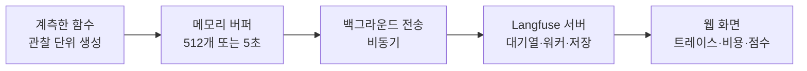
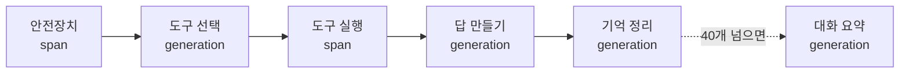
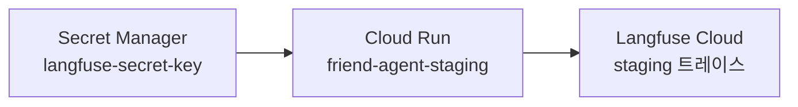
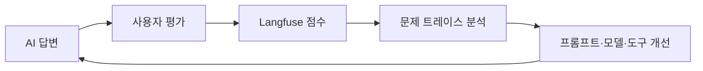

# N054 · Langfuse로 에이전트 문제 찾기

> 버전 1.1 · 2026-11-02 (학습서 + 해설서 통합 + **`[실습 결과]`** 덧붙임. friend-agent에 Langfuse를 직접 붙여 해 본 결과를 장마다 덧붙였고, v1.0은 `_판본_v1.0/`에 그대로 보존. 근거는 `실습/N054_실습_진행기록.md`)

## 목차

- [핵심 한 문장 요약](#핵심-한-문장-요약)
- [1. 로그만으로는 왜 부족한가? (원문 Ch01)](#1-로그만으로는-왜-부족한가-원문-ch01)
- [2. 로그에 안 보이는 것은 무엇인가? (원문 Ch02)](#2-로그에-안-보이는-것은-무엇인가-원문-ch02)
- [3. 실습 전에 무엇을 맞춰 두나? (원문 Ch03)](#3-실습-전에-무엇을-맞춰-두나-원문-ch03)
- [4. 엉뚱한 날씨 답을 잡으려면 무엇부터 정하나? (원문 Ch04)](#4-엉뚱한-날씨-답을-잡으려면-무엇부터-정하나-원문-ch04)
- [5. 코딩 에이전트에게 계측을 어떻게 맡기나? (원문 Ch05)](#5-코딩-에이전트에게-계측을-어떻게-맡기나-원문-ch05)
- [6. 가끔 느린 답과 많은 요금은 어디서 오나? (원문 Ch06)](#6-가끔-느린-답과-많은-요금은-어디서-오나-원문-ch06)
- [7. 이사 이야기와 느려진 업데이트는 어떻게 찾나? (원문 Ch07)](#7-이사-이야기와-느려진-업데이트는-어떻게-찾나-원문-ch07)
- [8. 언제였는지 모르는 별로인 답은 어떻게 찾나? (원문 Ch08)](#8-언제였는지-모르는-별로인-답은-어떻게-찾나-원문-ch08)
- [9. 오늘 배운 것은 무엇이고 아직 못 하는 것은 무엇인가? (원문 Ch09)](#9-오늘-배운-것은-무엇이고-아직-못-하는-것은-무엇인가-원문-ch09)
- [맺음말](#맺음말)
- [부록 A · 실전 코드 모음](#부록-a--실전-코드-모음)
- [부록 B · 트러블슈팅 표](#부록-b--트러블슈팅-표)
- [부록 C · AI 프롬프트 모음집](#부록-c--ai-프롬프트-모음집)
- [부록 D · 용어 사전](#부록-d--용어-사전)
- [부록 E · 개념 비교표 모음](#부록-e--개념-비교표-모음)
- [부록 F · 학습 로드맵](#부록-f--학습-로드맵)
- [부록 G · 복습 퀴즈](#부록-g--복습-퀴즈)

## 핵심 한 문장 요약

> 📌 **요약** — LLM 서비스의 문제는 대부분 "요청은 성공(200)했는데 답이 이상하다"는 모양이라 서버 로그에는 흔적이 없다. 그래서 **메시지 하나를 트레이스로 묶고, 단계마다 입력·출력·토큰·시간·비용을 남기는 관측(Langfuse)** 을 붙인다. 무엇을 어떤 단위로 남길지(계측 구조)와 원문을 남길지·가릴지는 **서비스를 아는 사람이 먼저 정하고**, 코드는 코딩 에이전트에게 그 구조와 공식 문서 근거를 함께 줘서 맡긴다. 관측은 "무슨 일이 일어났는지"를 보여 줄 뿐 "좋았는지 나빴는지"는 아직 사람이 읽어야 안다.

> 🧪 **예제** — `[실습 결과]` 한 줄 요약: friend-agent에 Langfuse를 붙여 단계별로 읽을 수 있게 만들었고(5장), 공휴일 오답은 도구 선택 지침과 '도구 결과를 질문 바로 앞에 한 번 더'로 같은 입력 12번 0/12 → 11/12로 고쳤으며(6장), 이사 이야기의 틀린 약속·기억 값은 코드 안전장치로 막고(7장), 좋아요·별로예요·신고를 점수로 붙였다(8장). 풀지 못한 것: Cloud Run에서 트레이스가 20건 중 9건만 도착하는 원인, 도구 없는 답에서 앞선 틀린 답을 되풀이하는 것. 도쿄 날씨는 재현되지 않았다.

### 한눈에

- **무엇을 하나** — N046~N053에서 만든 AI 친구 에이전트 서비스(저장소 `friend-agent`)에 LLM 관측 도구 Langfuse를 붙인다.
- **어떻게 배우나** — 동료 5명이 일주일 쓰고 말한 문제 6가지를 하나씩 다시 만들고, Langfuse의 어느 화면으로 원인을 찾는지 짝지어 간다.
- **순서** — 계측(엉뚱한 답·느린 답·요금) → 속성(이사 이야기·버전 비교) → 점수(별로인 답) 순으로 하나씩 더한다.
- **오늘의 교훈** — 계측은 코딩 에이전트에게 맡길 수 있지만, 무엇을 관찰하고 어떤 정보를 남길지는 문제를 이해하는 사람이 먼저 정한다.

### 비유 대응표

| 용어 | 쉬운 말 | 비유 |
|---|---|---|
| 서버 로그 | 서버에 무슨 일이 있었는지 한 줄씩 남긴 기록 | 택배가 접수되고 배송 완료됐다는 기록 / 병원 출입 기록 |
| 트레이스 (trace) | 요청 하나의 처리 과정 전체 | 택배가 어느 경로로 갔는지 보여 주는 상세 기록 / 접수·검사·진단·처방을 적은 진료 기록 / `[보충 비유]` 결재 문서 한 건의 결재선 전체 |
| 관찰 단위 (observation) | 트레이스 안의 작업 하나 | 사건의 개별 장면 |
| span | 모델을 부르지 않는 일반 단계 | 접수창구에서 서류 확인하기 |
| generation | 모델을 부르는 단계 (모델 이름·토큰·비용이 붙음) | AI가 생각하고 말한 과정, `[보충 비유]` 영수증이 붙는 외주 상담 |
| Langfuse | 이 기록을 모아 보여 주는 관측 도구 | AI 에이전트의 블랙박스 기록 장치 |
| 속성 (user·session·environment·version) | 트레이스에 붙이는 꼬리표 | 택배 상자에 붙인 받는 사람·주소·날짜 이름표 |
| Public Key / Secret Key | 프로젝트 식별값 / 기록을 보낼 권한 | 어느 건물인지 알려 주는 주소표 / 건물에 들어갈 수 있는 출입증 |
| 점수 (score) | 사용자나 프로그램의 평가를 트레이스에 붙인 값 | 쇼핑몰에서 상품을 산 뒤 주는 별점 |
| Local / Staging / Production | 내 컴퓨터 / 배포 전 최종 점검 / 실제 운영 | 내 작업실 / 최종 점검 공간 / 고객이 이용하는 운영 공간 (`[보충 비유]` 시제품실 / 시범 매장 / 전 매장) |
| flush() | 모아 둔 기록을 지금 보내라는 명령 | `[보충 비유]` 퇴근 전 쌓아 둔 결재함을 한꺼번에 올리기 |

> 💡 **팁** — 비유의 한계: 택배는 한 줄로 흘러가지만 트레이스는 **나무 모양**이다(관찰 단위 안에 다른 관찰 단위가 들어간다). 또 택배 추적은 "어디까지 갔나"를 보여 줄 뿐이지만 트레이스는 단계마다 **입력과 출력 원문**까지 담는다. 그래서 개인정보를 어떻게 다룰지가 따라붙는다(4장).

> 💡 **팁** — 문서에서 "학습서"(36쪽)는 실습 교안, "해설서"(69쪽)는 같은 교안을 쉽게 풀어 쓴 책이다. 두 책은 챕터 01~09가 1:1로 대응한다. 학습서에는 명령·수치·요청 틀 전문·화면 그림이 있고, 해설서에는 택배·병원·블랙박스 비유와 퀴즈 정답·해설이 있다. 그래서 이 노트는 **비유와 쉬운 설명은 해설서, 코드·명령·표·요청 틀은 학습서 원문**을 따랐다. `[보충 비유]`·`[보충]`이라고 표시한 것만 이 노트에서 덧붙인 설명이다.

> ⚠️ **주의** — PDF를 정리하면서 바로잡은 것. ① 해설서 챕터 제목 앞의 `/강의정리`는 슬래시 명령 흔적이라 뺐다. ② 본문의 "섹션 N"은 **챕터 N**이다. ③ 학습서의 "움직여 보는 한 턴의 트레이스"(웹 전용 인터랙티브)는 PDF에 설명 문단만 남아 있어 그 설명으로 서술했다. ④ 해설서에는 필자의 1인칭 의견("제 생각에는")이 몇 군데 있는데, 이 노트는 의견이 아니라 내용만 옮겼다. ⑤ 학습서·해설서의 화면 스크린샷에 보이는 조직명·계정·키 조각은 옮기지 않았다. ⑥ "2026년 10월 기준"이 붙은 수치(SDK 버전·버퍼 값·무료 플랜 한도)는 바뀔 수 있으니 도입 전에 최신 문서로 다시 확인한다.

> 🧪 **예제** — 함수 이름이 두 벌이다. 2장의 `run_turn`·`check_safety`·`choose_tools`·`run_tool`·`make_reply`·`update_memories`는 **구조를 설명하려는 예시 이름**이고, 4장의 `chat-turn`·`safety`·`choose-tools`·`tool:<도구 이름>`·`reply`·`memory-update`가 **실제로 쓰는 정본 이름**이다. 점수 값도 1장의 좋아요 1·별로예요 0·신고 -1은 개념 예시이고, 8장의 `user-feedback` true/false와 `report` true가 실제 구현이다.

---

## 1. 로그만으로는 왜 부족한가? (원문 Ch01)

### 1-1. 오늘의 상황

지금까지는 에이전트를 만들고 제대로 돌아가게 하는 데 집중했다면, 이제는 실제 사용자가 쓸 때 생기는 문제를 찾고 고치는 **운영 단계**로 넘어간다. 에이전트 서비스를 동료 다섯 명에게 일주일 써 보게 했더니 단체 대화방에 이런 말들이 모였다고 해 보자.

| 사용자 불만 | 찾아야 할 원인 |
|---|---|
| 도쿄 날씨를 물었는데 엉뚱한 답이 나옴 | 잘못된 도구 선택, 도구 결과 오류 |
| 답이 가끔 한참 있다가 옴 | LLM 응답 지연, 도구 실행 지연 |
| 이사 간다고 말했는데 기억을 못 함 | 기억 저장 또는 검색 실패 |
| 어제 업데이트 뒤로 느려진 것 같음 | 모델이나 코드 변경에 따른 성능 저하 |
| 별로인 답이 있었는데 언제였는지 모름 | 답변 품질 문제 |
| 보낸 메시지 수에 비해 요금이 많음 | 불필요한 LLM 호출, 토큰 과다 사용 |

지금 손에 있는 것은 Cloud Run의 서버 로그뿐이다. 로그에는 `POST /api/chat 200`이 수백 줄 찍혀 있고, 대화 원문은 개인정보라서 로그에 남기지 않기로 했다. 그래서 어느 요청이 그 동료의 대화였는지, 모델이 어떤 도구를 골랐고 무엇을 보고 답을 만들었는지, 어느 단계가 시간과 돈을 썼는지 알 수 없다.

### 1-2. 학습목표 6개

1. LLM 서비스가 일반 프로그램과 다른 점을 들어 **LLMOps**가 필요한 이유를 설명하고, 트레이스·관찰 단위(span, generation)가 무엇이며 기록이 어떻게 모여 보내지는지 말할 수 있다.
2. 운영 중 들어온 문제를 보고 Langfuse의 **어느 화면과 기능**으로 확인할지, 그러려면 **무엇을 미리 기록**해야 하는지 고를 수 있다.
3. 한 턴의 단계를 어떤 관찰 단위로 남기고 무엇을 가릴지 **계측 구조를 먼저 정하고**, 코딩 에이전트에게 그 구조대로 계측을 맡길 수 있다.
4. 트레이스를 **거슬러 올라가며** 읽어 엉뚱한 답·느린 답·늘어난 비용이 처음 생긴 단계를 찾을 수 있다.
5. 사용자·세션·환경·버전을 붙여 한 사람의 대화와 배포 버전별 트레이스를 나눠 볼 수 있다.
6. 화면의 좋아요·별로예요·신고를 Langfuse 점수로 모아 **먼저 읽을 트레이스**를 고를 수 있다.

### 1-3. Langfuse는 무엇이고 무엇을 기록하나

해설서의 첫 비유다.

> Langfuse는 AI 에이전트의 블랙박스 기록 장치입니다. 자동차가 사고 났을 때 블랙박스를 확인하면 사고 직전 어떤 일이 있었는지 알 수 있듯이, Langfuse를 사용하면 AI가 어떤 질문을 받고 어떤 도구를 사용했으며 어디에서 문제가 발생했는지 확인할 수 있습니다.

기록은 세 층으로 나뉜다. **Trace**는 사건 전체, **Span**은 사건의 개별 장면, **Generation**은 AI가 생각하고 말한 과정이다. "다음 주 도쿄 날씨를 알려줘"라는 질문 하나는 이렇게 기록된다.

| 층 | 예 | 맡은 일 |
|---|---|---|
| Trace | 전체 대화 처리 | 사용자 질문부터 최종 답변까지 전체 기록 |
| Span 1 | 사용자 질문 분석 | 질문의 의도와 필요한 작업 파악 |
| Span 2 | 날씨 도구 실행 | 도쿄 날씨 정보 요청 |
| Span 3 | LLM Generation | 모델이 도구 결과를 바탕으로 답변 생성 |
| Span 4 | 최종 답변 전달 | 사용자에게 답변 반환 |

모든 span이 generation인 것은 아니다. generation에는 모델 이름·입력과 출력 토큰·걸린 시간·비용이 붙고, 도구 실행 같은 일반 단계는 span으로 남긴다.

### 1-4. 문제를 어느 화면에서 보나

| 들어온 말 | 열 곳 | 확인하는 것 |
|---|---|---|
| 엉뚱한 답 | 트레이스 상세 화면 | 어떤 도구를 골랐고 결과가 무엇이었나 |
| 응답이 느림 | 트레이스·span 시간 | 어느 단계가 오래 걸렸나 |
| 기억 못 함 | 트레이스 상세 화면 | 기억 저장·검색 단계가 실행됐나 |
| 업데이트 후 느려짐 | 버전별 트레이스 비교 | 변경 전후 응답 시간과 토큰 사용량 |
| 답변 품질 저하 | 점수·사용자 피드백 | 좋아요·별로예요·신고가 붙은 요청 |
| 요금 증가 | generation 상세 정보 | 모델별 호출 횟수, 입력·출력 토큰, 비용 |

> 📌 **요약** — Langfuse는 문제를 자동으로 해결해 주는 도구가 아니다. 문제가 생긴 위치와 원인을 찾을 **근거를 제공하는 도구**다.

### 1-5. 미리 기록해 둬야 하는 것

User ID(특정 사용자의 문제 추적), Session ID(한 사용자의 대화 흐름), Environment(개발·테스트·운영 구분), Version(배포 버전별 비교), Trace ID(요청 전체 추적), Span(단계별 실행), Model(어떤 모델인가), Token(사용량과 비용 분석), Latency(단계별 속도), Score(만족도와 품질 평가). 특히 User ID·Session ID·Environment·Version은 운영 단계에서 매우 중요하다. 특정 동료가 업데이트 뒤에만 문제를 겪었다면 사용자와 버전으로 트레이스를 걸러 볼 수 있어야 하기 때문이다.

개인정보는 신중하게 다뤄야 한다. 대화 원문 대신 이런 항목만 남기는 방식도 가능하다.

| 항목 | 예 |
|---|---|
| 사용자 ID | user_001 |
| 세션 ID | session_20261102 |
| 환경 | production |
| 버전 | v1.2.0 |
| 실행 도구 | weather_search |
| 실행 시간 | 1.2초 |
| 사용 토큰 | 850개 |
| 결과 상태 | 성공 |

> ⚠️ **주의** — 위처럼 원문 없이 메타 정보만 남기는 방식은 개인정보에는 안전하지만 "왜 답이 이상했나"를 읽을 수 없다. 이번 실습은 원문을 남기고 전화번호·이메일·카드 번호 패턴을 가리는 쪽으로 간다(4~5장). 원문을 남길지는 **서비스 운영자가 정하는 정책**이다.

### 1-6. 점수와 사업 관점

점수는 AI가 만든 결과에 사용자가 평가를 붙이는 기능이다. 쇼핑몰에서 상품을 산 뒤 별점을 주는 것과 비슷하다. 활용은 5단계다. ① 불만이 생긴 트레이스를 먼저 확인 ② 어떤 모델과 도구가 쓰였는지 분석 ③ 문제가 반복되는 유형 찾기 ④ 프롬프트나 도구 실행 로직 개선 ⑤ 개선 전후 비교.

AI 서비스를 만드는 것과 사업으로 운영하는 것은 다르다. 개발 단계에서는 기능이 되는지가 중요하지만 사업 단계에서는 네 가지가 중요하다.

| 관점 | 질문 |
|---|---|
| 품질 | 고객이 원하는 답을 주는가 |
| 속도 | 고객이 기다리지 않아도 되는가 |
| 비용 | 매출 대비 AI 운영비가 적절한가 |
| 신뢰 | 문제가 생겼을 때 원인을 찾아 고칠 수 있는가 |

### 1-7. 시작 질문과 모범 답안

학습서의 시작 질문은 "동료들이 한 말이나 늘어난 요금 가운데 하나를 골라, 원인을 찾으려면 어떤 정보가 필요할지, 그 정보를 지금 서비스에서 어디서 얻을 수 있는지(또는 없는지) 적어 보세요"다. 해설서의 모범 답안 요지는 이렇다.

> 도쿄 날씨를 물었는데 엉뚱한 답이 나왔다는 상황을 고르면, 원인을 찾으려면 사용자의 질문, AI가 선택한 도구, 도구에 전달한 검색 조건, 실제로 반환된 날씨 정보, 최종 답변 생성에 쓰인 모델과 프롬프트가 필요합니다. 지금 Cloud Run 로그에는 요청 성공 여부만 있어서 확인하기 어렵습니다. Langfuse로 한 번의 요청을 Trace로 기록하고 단계를 Span과 Generation으로 남기며, 사용자 ID·세션 ID·배포 버전을 연결하고, 개인정보는 가려서 기록하겠습니다.

> 📌 **요약** — 핵심 6개: ① LLMOps는 AI 서비스를 안정적으로 운영하고 개선하는 체계 ② Langfuse는 내부 실행 과정을 관찰·분석하는 도구 ③ Trace는 요청 전체 ④ Span은 개별 작업 단계 ⑤ Generation은 LLM이 실제로 답을 만든 기록 ⑥ Score는 사용자 피드백을 수치로 만들어 개선에 쓰는 것.

> 🧪 **예제** — **[실습 결과]** 이 노트의 실습은 N046~N053에서 키운 AI 친구 에이전트(friend-agent)에 Langfuse를 붙여 했다(2026-11-02, 로컬과 staging). 1-1의 여섯 가지 말 가운데 도쿄 날씨는 **재현되지 않았고**(4번 모두 정직하게 답함), 나머지(느린 답·요금·이사 이야기·업데이트 뒤 느려짐·별로인 답)는 트레이스로 원인을 찾거나 확인했다. 한계: 교안이 상정한 '동료 5명이 일주일 쓴 기록'은 없었다. 실습은 직접 보낸 메시지로 상황을 다시 만든 것이다.

> ▶ **한 줄 요약** — 서버 로그에는 "요청이 성공했다"만 남고, 문제의 원인은 그 안의 단계에 있다. 그래서 단계를 기록하는 Langfuse가 필요하다.

---

## 2. 로그에 안 보이는 것은 무엇인가? (원문 Ch02)

### 2-1. 서버 로그와 LLM 트레이스, 무엇이 다른가?

서버 로그는 서버에 어떤 일이 생겼는지를, LLM 트레이스는 AI가 **어떤 과정을 거쳐** 그 답을 만들었는지를 남긴다.

> 서버 로그는 택배가 접수되고 배송이 완료되었다는 기록입니다. LLM 트레이스는 택배가 어떤 경로로 이동했고, 어느 지점에서 문제가 생겼는지 보여 주는 상세 기록입니다.

서버 입장에서 `POST /api/chat 200`은 성공이다. 그런데 사용자는 잘못된 답을 받았다. **기술적으로 성공한 요청이 사용자 관점에서는 실패한 서비스 경험일 수 있다**는 것이 LLM 서비스의 특징이다. 서버 로그가 필요 없다는 뜻은 아니다. 로그는 시스템의 건강 상태를, 트레이스는 AI의 내부 처리 과정을 본다. 둘은 서로 보완한다.

에이전트 서비스의 메시지 하나는 **안전장치, 도구 선택, 도구 실행, 답 만들기, 기억 정리**의 다섯 단계를 거치고, 그중 세 단계에서 모델을 부른다. 답이 이상했다면 모델이 도구를 잘못 골랐는지, 도구가 실패했는지, 모델이 도구 결과를 무시하고 지어냈는지, 기억이 엉뚱하게 들어갔는지를 나눠 봐야 한다.

학습서의 그림은 같은 메시지를 두 방식으로 남긴 모습을 보여 준다. 왼쪽 서버 로그는 7줄이 다른 사용자의 요청과 섞여 시간순으로 쌓이고, 날씨 조회 실패 줄과 대화 성공 줄이 같은 메시지인지조차 알 수 없다. 오른쪽 트레이스는 `chat-turn` 하나 아래에 안전장치(2ms), 도구 선택(0.6초·640토큰), 도구 실행(날씨, 0.4초, 실패), 답 만들기(1.3초·910토큰), 기억 정리(0.5초·420토큰)가 한 묶음으로 보여서 "날씨 조회가 실패했는데 모델이 날씨를 지어냈다" 같은 원인을 한 화면에서 찾는다(그림의 숫자는 설명용 예시).

### 2-2. 일반 프로그램과 무엇이 달라서 LLMOps가 필요한가?

| 구분 | 일반 프로그램 운영 | LLMOps |
|---|---|---|
| 확인 대상 | 서버, 코드, 오류 | 서버 + AI의 판단과 결과 |
| 실행 결과 | 정해진 결과 | 확률적인 결과 |
| 문제 분석 | 오류 로그 | 질문, 모델, 도구, 응답 추적 |
| 성능 관리 | 실행 시간 | 응답 시간, 토큰, 비용 |
| 품질 관리 | 기능 정상 작동 | 답변의 정확성과 만족도 |

LLMOps는 AI 서비스를 안정적으로 운영하기 위한 관찰·평가·관리 체계다. 머신러닝 모델을 직접 학습·배포하는 MLOps와 달리, 이미 학습된 모델에 **무엇을 어떻게 물을지(프롬프트와 컨텍스트)** 와 그 결과를 관리하는 데 무게가 있다. LLM 서비스만의 문제는 네 가지다.

**① 실행할 때마다 답이 달라진다.** 계산기에 1+1을 넣으면 항상 2가 나온다(결정론적). LLM은 다음 단어를 확률로 고르는 **비결정론적**이라 같은 "오늘 좀 지쳤어"에도 위로로 답하기도, 되묻기도 한다. 도쿄 날씨 질문도 지금 다시 보내면 제대로 답할 수 있다. 그래서 **문제를 겪은 바로 그 실행의 기록**이 남아 있어야 한다. 나중에 다시 보내는 것으로는 재현되지 않을 수 있다.

**② 오류 없이 이상한 답이 나온다.** 일반 프로그램은 오류가 나면 스택 트레이스와 로그로 원인을 찾는다. LLM의 이상한 답에는 오류 메시지가 없으니, 그 순간 모델에 무엇이 들어가고 나갔는지가 남아야 한다. 모델을 부를 때마다 다섯 가지를 남긴다.

| 남길 것 | 내용 |
|---|---|
| 전체 프롬프트 | 시스템 프롬프트, 사용자 메시지, 함께 넘긴 기억과 도구 결과 |
| 모델 설정 | 모델 이름, temperature(답의 다양성), max_tokens(최대 길이) |
| 걸린 시간 | 응답이 나오기까지 |
| 토큰과 비용 | 입력·출력 토큰 수와 비용 |
| 거친 단계 | 어떤 도구를 골랐고 무엇을 돌려줬는지 |

**③ 비용을 미리 알기 어렵다.** LLM API는 토큰 단위로 요금을 받는다. 토큰은 모델이 글을 잘라 세는 단위로 글자 수와 정확히 같지 않고 모델마다 다르다. 입력과 출력 토큰의 단가가 다르고 모델마다도 다르다. 게다가 이 서비스는 메시지 하나에 도구 선택·답 만들기·기억 정리로 **모델을 세 번** 부른다.

| 계산 | 값 |
|---|---|
| 동료 5명 × 하루 20개 × 7일 | 메시지 700개 |
| 700개 × 메시지당 모델 호출 3회 | 모델 호출 2,100회 |

답 만들기의 입력에는 최근 대화와 기억이 함께 들어가서 대화가 길어질수록 호출 한 번의 입력 토큰도 늘어난다. 호출마다 토큰과 비용을 남겨 두지 않으면 청구 화면을 연 뒤에야 요금이 늘어난 것을 알게 된다.

**④ 통과·실패로 가를 수 없다.** 일반 프로그램은 `assert add(2,3)==5`로 맞고 틀림을 바로 가린다. 그런데 "이사 준비 때문에 정신이 없어"에 대한 좋은 답은 정답이 하나가 아니다. 사용자의 감정을 이해했는지, 이전 대화를 기억했는지, 정한 말투를 지켰는지, 사실과 다른 내용을 지어내지 않았는지, 해로운 내용이 없는지를 함께 따져야 한다. 그래서 사람의 평가와 자동 평가를 함께 쓰는 품질 관리 체계가 필요하다.

운영 중에는 다섯 가지 지표를 계속 본다.

| 지표 | 보는 것 | 동료들의 말에서 |
|---|---|---|
| 응답 품질 | 사용자의 반응, 평가 점수 | 언제였는지 모르는 별로인 답 |
| 지연 시간 | 메시지를 보내고 답을 받기까지 | 가끔 느린 답, 업데이트 뒤 느려진 답 |
| 비용 | 하루·한 달 동안 쓴 토큰과 요금 | 메시지 수보다 많은 요금 |
| 오류율 | LLM API 호출 실패, 시간 초과 | 오늘은 없었지만 늘 봐야 하는 값 |
| 사용 패턴 | 어떤 도구와 기능을 많이 쓰는지 | 도쿄처럼 지원하지 않는 지역을 얼마나 묻는지 |

### 2-3. Langfuse는 무엇을 하나?

Langfuse는 이 일을 한곳에서 하는 오픈소스 LLMOps 플랫폼이다. 특정 LLM 제공사나 프레임워크에 묶이지 않아서 LLM API를 직접 부르는 코드에도, LangChain 같은 프레임워크에도 붙일 수 있다.

| 기능 | 하는 일 | LLMOps에서 맡는 일 |
|---|---|---|
| 트레이싱 | 모델 호출과 코드의 단계를 트레이스로 기록하고 화면에서 펼쳐 봄 | 관측 |
| 비용 추적과 대시보드 | 토큰 수로 비용을 계산하고 비용·지연·점수를 그래프로 모아 봄 | 모니터링 |
| 점수 | 사람의 피드백이나 자동 채점 결과를 트레이스에 붙임 | 평가 |
| 프롬프트 관리 | 프롬프트를 코드 밖에 버전으로 저장하고 실행 중에 가져다 씀 | 프롬프트 관리 |
| 데이터셋과 실험 | 입력과 기대 결과를 모아 두고 프롬프트·코드 버전끼리 같은 입력으로 비교 | 실험 |

### 2-4. 동료들의 말은 Langfuse의 어느 기능에 대응하나?

| 들어온 말 | 확인할 곳 | 미리 기록해 둘 것 | 장 |
|---|---|---|---|
| 엉뚱한 날씨 답 | 트레이스 하나의 단계별 입력과 출력 | 한 턴의 단계를 관찰 단위로 계측 | 4, 5 |
| 가끔 느린 답 | 트레이스 목록의 지연 시간 정렬, 단계별 시간 막대 | 계측 | 6 |
| 메시지 수보다 많은 요금 | generation의 토큰과 비용, 대시보드 | 계측, generation의 모델 이름과 토큰 수 | 6 |
| 잊어버린 이사 이야기 | 사용자·세션 화면, 기억 정리 단계의 출력 | 사용자 ID, 세션 ID | 7 |
| 업데이트 뒤 느려진 답 | 환경과 버전으로 거른 트레이스 목록 | 환경, 배포 버전 | 7 |
| 언제였는지 모르는 별로인 답 | 점수로 거른 트레이스 목록 | 화면의 반응을 점수로 보내기 | 8 |

> ⚠️ **주의** — 셋째 열("미리 기록해 둘 것")은 **문제가 생긴 뒤에는 채울 수 없다.** 기록하지 않은 지난주의 대화는 지금 계측을 붙여도 볼 수 없다. 그래서 오늘은 동료들이 겪은 상황을 내 컴퓨터와 staging에서 **다시 만들어** 확인한다. 이 표가 곧 오늘의 순서다. 계측만 해 두면 엉뚱한 답·느린 답·요금까지 보이고, 이사 이야기와 버전 비교는 사용자와 버전을 더 붙여야 보이고, 별로인 답은 점수를 보내야 보인다.

### 2-5. 트레이스와 관찰 단위는 어떻게 생겼나?

Langfuse의 기록은 **트레이스**와 **관찰 단위** 두 가지다. 트레이스는 요청 하나가 서비스를 지나가는 처리 전체이고(에이전트 서비스에서는 메시지 하나를 보내 답을 받을 때까지가 트레이스 하나), 관찰 단위는 그 안의 작업 하나다. 관찰 단위 안에 다른 관찰 단위가 들어가서 트레이스는 나무 모양이 된다.

| 종류 | 뜻 | 에이전트 서비스에서의 예 |
|---|---|---|
| span | 일반 작업. 입력·출력·걸린 시간을 남김 | 안전장치 검사, 날씨 API 부르기 |
| generation | 모델 호출. span에 더해 모델 이름·입력과 출력 토큰 수·비용을 남김 | 도구 선택, 답 만들기, 기억 정리 |
| event | 시간이 걸리지 않는 한 시점의 기록 | "기억 세 개를 불러옴" |

Langfuse는 이 밖에도 agent, tool, chain, retriever, evaluator, embedding, guardrail 같은 종류를 지원한다. 단계의 역할을 화면에 드러내는 이름이다. 토큰과 비용이 계산되는 것은 generation과 embedding이고 나머지는 span과 같은 값을 담는다. 오늘은 **generation과 span 두 가지**로 계측한다.

> 📌 **요약** — 나누는 기준 한 가지: **그 단계에서 실제 LLM을 호출하는가.** 날씨 API를 부르는 것은 도구 실행이라 span, 날씨 정보로 답을 만드는 것은 모델 호출이라 generation이다.

### 2-6. 코드에는 기록 지점을 어떻게 넣나?

트레이스를 남기도록 코드에 기록 지점을 넣는 일을 **계측**(instrumentation)이라 한다. 파이썬에서는 함수 위에 `@`로 붙여 동작을 덧붙이는 **데코레이터**를 쓴다(해설서: "함수에 붙이는 자동 기록 스티커"). 구조를 보여 주려고 줄인 예다. 실제 계측은 5장에서 코딩 에이전트에게 맡긴다.

```python
from langfuse import observe

@observe()
def check_safety(message):
    ...

@observe(as_type="generation")
def make_reply(message, tool_result):
    ...  # 여기서 모델을 부른다

@observe()
def run_turn(message):
    check_safety(message)
    tool_result = run_tool(message)
    return make_reply(message, tool_result)
```

가장 바깥의 `run_turn`이 실행되면 트레이스가 하나 만들어지고, 그 안에서 부른 함수들은 따로 지정하지 않아도 자식으로 기록된다. 이것이 **자동 중첩**이다. 한 턴을 모두 계측하면 이런 모양이 된다(토큰 수는 설명용).

```text
트레이스: run_turn
├── span: check_safety
├── generation: choose_tools      입력 820, 출력 40 토큰
├── span: run_tool                결과: 지원하지 않는 지역
├── generation: make_reply        입력 1,950, 출력 120 토큰
└── generation: update_memories   입력 1,100, 출력 60 토큰
```

도쿄 날씨 질문이라면 `run_tool`의 결과와 `make_reply`의 입력을 나란히 열어, 모델이 "지원하지 않는 지역"이라는 결과를 받고도 날씨를 지어냈는지 볼 수 있다. 메시지 하나의 비용은 generation 세 개의 비용을 합한 값이고 그중 어느 단계가 가장 많이 썼는지도 나눠 볼 수 있다.

### 2-7. 트레이스에 붙는 속성과 데이터 모델

트레이스는 사용자(user)와 세션(session)으로 모아 볼 수 있고, 사람이나 프로그램이 매긴 평가는 점수(score)로 붙는다. 그 밖의 붙임표가 속성이다.

| 속성 | 뜻 | 쓰임 |
|---|---|---|
| User | 서비스를 이용하는 사용자 | 특정 사용자의 문제 확인 |
| Session | 이어지는 대화의 묶음 | 한 대화 흐름 추적 |
| Score | 사람이나 프로그램의 평가 | 좋아요·별로예요 분석 |
| Environment | 실행 환경 | staging과 production 구분 |
| Version | 배포 버전 | 업데이트 전후 비교 |
| Tags | 분류용 태그 | 도구 선택·오류 유형 구분 |
| Metadata | 추가 속성 정보 | 도구 선택 확신도 등 |

"업데이트한 뒤로 느려졌다"는 말은 Version 1.1.0과 1.2.0의 평균 응답 시간을 같은 환경에서 비교해야 확인된다.

### 2-8. 기록은 어떤 길로 화면까지 가나?

<!-- flow: 그림 1. 기록은 서비스 안의 버퍼에 모였다가 따로 서버로 간다. 사용자에게 가는 답은 버퍼를 기다리지 않는다. | 계측한 함수/관찰 단위를 만듦/1 ; 메모리 버퍼/512개 또는 5초/2 ; 백그라운드 전송/한꺼번에 비동기로/3 ; Langfuse 서버/대기열 · 워커 · 저장/4 ; 웹 화면/트레이스·비용·점수/1 -->


```text
[계측한 함수] → [버퍼] → [백그라운드 전송] → [Langfuse 서버] → [웹 화면]
                 (사용자에게 가는 답은 이 줄과 별개로 바로 나간다)
```
<!-- /flow -->

읽는 법: 위 줄이 기록의 길이고, 사용자에게 가는 답은 이 길과 따로 바로 나간다. 그래서 기록을 보내는 시간만큼 사용자가 답을 늦게 받지 않는다.

계측한 함수가 실행되면 SDK가 관찰 단위를 만들고, 곧바로 서버로 가지 않고 메모리 **버퍼**에 쌓는다. 백그라운드 스레드가 기본값으로 기록이 **512개** 쌓이거나 **5초**가 지나면 한꺼번에 보낸다(2026년 10월 기준 Python SDK 기본값). 비동기로 보내므로 Langfuse 서버가 잠시 응답하지 않아도 서비스의 답은 그대로 나간다. 대신 서버가 받은 기록을 대기열에 넣고 처리하므로 **화면에 뜨기까지 몇 초에서 수십 초**가 걸리고, 프로세스가 강제로 끝나면 버퍼에 남은 기록을 잃는다. 짧게 돌고 끝나는 스크립트나 노트북 셀의 끝에서 `flush()`를 불러 버퍼를 비우는 이유다.

서버 쪽은 `web`이 기록을 받아 확인하고 Redis 대기열에 넣고, `worker`가 합치고 비용을 계산해 저장한다. 저장소는 ClickHouse(트레이스·관찰 단위·점수), Postgres(프로젝트·사용자·프롬프트·설정), 오브젝트 스토리지(받은 기록 원본)다.

현재 Langfuse Python SDK는 트레이스·지표·로그를 남기고 보내는 공개 표준 **OpenTelemetry(OTel)** 위에 만들어져 있다(해설서: 서로 다른 프로그램과 도구들이 같은 방식으로 실행 기록을 주고받게 만든 공통 언어). 자동 중첩도 이 표준의 컨텍스트 전파 덕분이다. 표준을 따르므로 LLM API 클라이언트나 LangChain처럼 OTel 계측을 지원하는 라이브러리의 호출은 연동 설정만으로 기록되는데 이것이 **자동 계측**이다. 다만 자동 계측은 모델 호출은 남겨도 "도구 선택"이나 "기억 정리" 같은 **우리 서비스의 단계 이름**은 모른다. 그래서 자동 계측(라이브러리의 모델 호출)과 수동 계측(우리 서비스의 업무 단계·도구 실행)을 함께 쓰는 것이 좋다.

### 2-9. Cloud로 쓸까, 직접 띄울까?

| 비교 | Cloud | Self-hosting |
|---|---|---|
| 서버 운영 | Langfuse 회사 | 내가 직접 |
| 설치 | 간편 | 복잡 |
| 관리 부담 | 낮음 | 높음 |
| 데이터 통제 | 제공사 정책에 따름 | 직접 관리 |
| 적합한 경우 | 학습, 초기 개발 | 보안 규제, 특수한 운영 환경 |

셀프 호스팅은 `web`과 `worker` 컨테이너에 Postgres·ClickHouse·Redis·오브젝트 스토리지까지 함께 운영해야 한다. 대화 데이터를 회사 밖으로 보낼 수 없는 규제가 있거나 트래픽이 아주 클 때 고른다. 이 과정은 설치 없이 바로 쓰는 **Langfuse Cloud 무료 플랜(Hobby)** 을 쓴다. 한 달 5만 단위(트레이스와 관찰 단위 등을 합친 수)까지 기록하고, 30일 지난 데이터는 볼 수 없고, 프로젝트당 사용자는 2명이다(2026년 10월 기준). SDK 코드는 두 방식에서 같고 보낼 서버 주소(`LANGFUSE_BASE_URL`)와 키만 다르다.

### 2-10. 1인 AI 사업에게 왜 중요한가

AI 서비스를 만드는 사람은 두 가지 능력이 필요하다. **만드는 능력**(프롬프트 설계, 모델·도구 연결, 에이전트 흐름, 데이터와 메모리 관리)과 **운영하고 개선하는 능력**(트레이스 분석, 비용·토큰 관리, 응답 속도 관리, 만족도 평가, 버전별 성능 비교)이다. 첫 번째만 있으면 프로그램을 만들 수 있지만, 두 번째까지 있어야 고객에게 안정적인 서비스를 주고 사업으로 운영할 수 있다. 특히 비개발자 창업가에게 Langfuse 같은 도구가 중요한 이유는, 코드를 다 이해하지 못해도 관측 데이터를 근거로 개발자나 코딩 에이전트에게 문제를 구체적으로 설명하고 개선을 요청할 수 있기 때문이다.

> 💡 **팁** — `[보충 비유]` 기획·경영 경험으로 보면 **결재선 전체를 남기는 문서 관리 체계**와 같다. 서버 로그는 "문서가 접수되고 완결됐다"는 대장이고, 트레이스는 담당자 검토 → 팀장 수정 → 임원 결재까지 단계마다 누가 무엇을 바꿨는지 남긴 결재 이력이다. 결재가 끝났는데 결과가 이상하면 이력을 거슬러 올라가 **처음 어긋난 결재 단계**를 찾는다. 오늘 배우는 일이 그것이다.

> 🧪 **예제** — **[실습 결과]** 계측 뒤 실제 한 턴이 `chat-turn` 아래 단계들로 도착했다(처음 확인: `choose-tools` 입력 876·출력 29 토큰, `reply` 443·42, `memory-update` 539·24, `reply` 첫 글자까지 0.658초). SDK는 PyPI 최신 5.1.0으로 고정했다. 일회용 시험에서 **속성(`propagate_attributes`)은 그 안에서 만든 관찰 단위에만 붙는다**는 것을 확인했다(밖에서 만든 자식은 환경만 있고 사용자·세션·버전이 비었다). 한계: Cloud Run(staging)에서는 대화 트레이스가 **20건 중 9건만** 도착했고 원인은 확인하지 못했다(7장).

> ▶ **한 줄 요약** — 로그는 결과를, 트레이스는 과정을 남기고, 서비스가 클수록 과정의 기록 없이는 원인을 찾을 수 없다.

---

## 3. 실습 전에 무엇을 맞춰 두나? (원문 Ch03)

### 3-1. 시작 상태와 세 환경

오늘은 본격적으로 계측 코드를 쓰기 전에 에이전트와 관측 도구가 연결될 환경을 맞춘다. 이전 실습을 이어서 하고 있다면 확인 명령만 돌리고 넘어간다. 처음부터 모두 맞추면 한두 시간이 걸리므로 빠진 항목이 많다면 수업 전에 맞추거나 강사에게 알린다.

| 필요한 상태 | 확인할 것 | 없으면 |
|---|---|---|
| 템플릿으로 만든 내 저장소와 가상환경, `.env`에 실제 LLM API 키 | 가상환경을 켜고 `uvicorn app.main:app`으로 띄운 화면에서 답이 옴 | 시작 상태 문서의 A 중 3번, 저장소 README의 로컬 실행 준비 |
| staging과 production 서비스, Actions 배포 워크플로 | `gcloud run services list`에 두 서비스, `deploy.yml`에 `docker build` | A, B, C, D, E, F, G |
| staging과 production의 Supabase 연결 | staging 화면 왼쪽 아래 "게스트로 사용 중" | I (연결하지 않았다면 사용자가 모두 `local-user` 하나로 기록되지만 실습은 진행 가능) |

확인 명령 세 개다. 서버를 띄우는 것이 아니라 코드가 import되는지, 두 서비스가 있는지, 배포 파일에 이미지 빌드가 있는지 본다.

```bash
python -c "import app.main" && echo ok
gcloud run services list --region us-central1
grep -n "docker build" .github/workflows/deploy.yml
```

세 환경은 이렇게 쓴다. 섹션 4~6은 **내 컴퓨터(Local)** 에서, 섹션 7부터 **staging**에 붙인다. Local과 Staging·Production이 **하나의 Langfuse 프로젝트**에 연결되고, 환경은 별도 프로젝트가 아니라 `environment` 속성으로 나눈다. 그러면 한 화면에서 환경별 성능을 비교할 수 있다.

> 🧪 **예제** — 가짜 LLM(`LLM_PROVIDER=fake`)으로도 트레이스의 **구조**는 볼 수 있지만 토큰과 비용이 0으로 남아 늘어난 요금의 원인은 확인할 수 없다. 비용·토큰을 보려면 실제 LLM API 키가 필요하다. 가짜 LLM은 구조 테스트에, 실제 LLM은 비용 분석에 쓴다.

### 3-2. Langfuse Cloud 프로젝트와 키 만들기

Langfuse Cloud는 데이터를 둘 **리전**을 가입할 때 고른다. 에이전트가 미국(`us-central1`)의 Cloud Run에서 도니 미국 리전을 고르면 지연이 적다. 접속 주소는 리전마다 다르다.

| 리전 | 접속 주소 | 이번 실습 |
|---|---|---|
| 미국 | `https://us.cloud.langfuse.com` | 사용 |
| 유럽 | `https://cloud.langfuse.com` | 사용 안 함 |

> ⚠️ **주의** — 가입할 때 고른 리전의 주소와 SDK 설정의 `LANGFUSE_BASE_URL`이 같아야 한다. **리전이 다르면 키가 맞아도 트레이스가 들어가지 않고 오류 메시지도 없다.** 트레이스가 하나도 안 들어올 때 가장 먼저 의심할 것이 이것이다.

만드는 순서는 이렇다. ① 미국 주소에 가입(GitHub 계정 가능) ② 조직(Organization)과 프로젝트 생성, 프로젝트 이름은 `friend-agent` 같은 식으로 ③ Settings → API Keys에서 새 키 만들기 ④ 나온 공개키(`pk-lf-`)·비밀키(`sk-lf-`)·접속 주소를 바로 `.env`에 넣기. 비밀키는 화면을 닫으면 다시 볼 수 없다. 키 값은 채팅·명령·코드에 붙여 넣지 않는다.

```text
LANGFUSE_PUBLIC_KEY=pk-lf-...
LANGFUSE_SECRET_KEY=sk-lf-...
LANGFUSE_BASE_URL=https://us.cloud.langfuse.com
```

공개키는 어느 건물에 데이터를 보내는지 알려 주는 **주소표**이고, 비밀키는 건물에 들어갈 수 있는 **출입증**이다. 공개키만으로는 기록을 보낼 수 없다. 비밀키가 드러나면 누구든 내 프로젝트에 가짜 트레이스를 쌓을 수 있다.

`.env.example`에는 같은 이름을 **값 없이** 적어 둔다. 저장소를 받은 사람이 어떤 값이 필요한지 알 수 있다. `.env`는 Git 추적에서 제외하고 배포 환경에서는 Secret Manager에 둔다.

| 비교 | Local | Cloud Run |
|---|---|---|
| 실행 환경 | 내 컴퓨터 | Google Cloud |
| 환경변수 설정 | `.env` | Cloud Run 설정 |
| 비밀 관리 | 로컬 파일 보호 | Secret Manager |
| Langfuse 연결 | SDK가 `.env`를 읽음 | 배포 환경에서 키 전달 |

> 📌 **요약** — 코드와 비밀번호를 분리한다. 코드는 GitHub에 올라가도 되지만 비밀키는 올라가면 안 된다.

> 🧪 **예제** — **[실습 결과]** Langfuse 미국 리전 가입·프로젝트·키 발급·`.env` 입력은 사용자가 했다. 가입 설문의 'AI powered features'(데이터가 AWS Bedrock으로 갈 수 있음)는 끄도록 했고, 첫 화면의 'Add tracing with your coding agent'(외부 저장소의 스킬을 설치하는 프롬프트)는 학습서 방식(우리가 정한 구조표와 요청 틀)과 달라 **쓰지 않았다**. 키는 값을 보지 않고 형식만 확인했다(`sk-lf-` 접두사 1번·길이 42·앞뒤 공백 없음, N053의 접두사 중복 사고 대비). 시작 상태: 기존 테스트 15개 통과, Cloud Run 서비스 둘 정상, `langfuse` 패키지는 없었다.

> ▶ **한 줄 요약** — 올바른 리전의 프로젝트와 키를 만들고, 로컬은 `.env`로, 배포는 Secret Manager로 안전하게 연결한다.

---

## 4. 엉뚱한 날씨 답을 잡으려면 무엇부터 정하나? (원문 Ch04)

### 4-1. 로그로는 무엇을 알 수 없나?

동료가 "어제 저녁 도쿄 날씨가 어땠어?"라고 물었는데 엉뚱한 답을 받았다. 서버 로그에는 `POST /api/chat 200`, `get_weather 선택`, `POST /api/chat 200`만 있다. 알 수 없는 것은 넷이다. 사용자가 실제로 어떤 질문을 했는가, AI가 왜 날씨 도구를 골랐는가, 날씨 도구가 무엇을 돌려줬는가, AI가 그 결과를 보고 어떻게 답했는가. 이 장의 목적은 한 번의 대화를 **하나의 트레이스**로 묶고 단계별로 기록하는 **구조를 설계**하는 것이다.

> 🧪 **예제** — 해설서의 병원 비유: 서버 로그는 병원에 누가 몇 시에 들어왔고 나갔는지를 적은 출입 기록이고, 트레이스는 환자가 접수하고 검사받고 진단받고 처방받는 과정을 단계별로 적은 진료 기록이다. 출입 기록만 있으면 방문한 사실은 알지만 왜 잘못된 진단을 내렸는지는 알기 어렵다.

| 확인할 것 | 서버 로그 | 트레이스 |
|---|---|---|
| 요청 발생 | 확인 가능 | 확인 가능 |
| 사용자 메시지 | 제한적 | 기록 가능 |
| 모델 호출 | 제한적 | 단계별 확인 |
| 도구 실행 결과 | 별도 기록 필요 | 입력·출력 기록 가능 |
| 모델 답변 | 별도 기록 필요 | 기록 가능 |
| 토큰과 비용 | 확인 어려움 | generation으로 추적 |
| 문제 원인 분석 | 제한적 | 단계별 분석 가능 |

### 4-2. 한 턴을 어떻게 나누나?

에이전트 서비스의 한 턴은 다섯 단계(+ 요약 한 단계)다. 템플릿의 `app/agent.py` 맨 위 설명과 `run_turn` 함수가 같은 순서다.

<!-- flow: 그림 2. 메시지 하나(트레이스 하나)가 거치는 단계. 대화 요약은 요약되지 않은 메시지가 40개를 넘을 때만 붙는다. | 안전장치/위기 표현 확인/1 ; 도구 선택/무슨 도구를 쓸지/2 ; 도구 실행/날씨 API 등/3 ; 답 만들기/모델이 답 생성/4 ; 기억 정리/기억 추가·수정·삭제/2 -->


```text
[안전장치] → [도구 선택] → [도구 실행] → [답 만들기] → [기억 정리] ┄(40개 넘으면)→ [대화 요약]
  span       generation     span          generation     generation              generation
```
<!-- /flow -->

읽는 법: 한 줄이 메시지 하나의 처리 순서이고, 이 한 줄 전체가 트레이스 하나다. 칸 아래의 span·generation은 4-3에서 정하는 종류다.

**더 잘게 나누지 않는 기준은 고치는 단위다.** 엉뚱한 답의 원인이 도구 선택이면 도구 선택 프롬프트나 규칙을, 도구 실행이면 도구 코드를, 답 만들기면 답 만들기 프롬프트를 고친다. 고칠 곳이 다른 단계는 따로 보여야 하고, 고칠 곳이 같은 함수들(시스템 프롬프트 조립과 모델 호출 등)은 한 단계로 묶는다. 도구 실행은 도구마다 하나씩 남긴다(한 메시지에 도구를 두 개까지 고를 수 있고 날씨·공휴일처럼 실패 이유가 다르다).

트레이스는 `run_turn` 단위로 만든다(메시지 하나). 화면을 열 때 먼저 말을 거는 `greet`는 `/api/greeting`이라는 다른 요청이라 트레이스를 따로 만든다.

### 4-3. span으로 둘까, generation으로 둘까?

| 단계 | 코드에서 확인할 곳 | 모델을 부르나 | 종류 |
|---|---|---|---|
| 안전장치 | `app/safety.py`의 `is_crisis` | 부르지 않음, 위기 표현 목록과 비교하는 코드 규칙 | span |
| 도구 선택 | `app/router.py`의 `choose` | 실제 LLM이면 부름. 가짜 LLM이거나 응답을 읽지 못하면 키워드 규칙이 대신 고름 | generation |
| 도구 실행 | `app/tools.py`의 `run_tool` | 부르지 않음, 날씨 API 같은 바깥 서비스 호출 | span |
| 답 만들기 | `app/agent.py`의 `llm.chat_stream` 호출부 | 부름, 스트리밍으로 받음 | generation |
| 기억 정리 | `app/memory.py`의 `update_memories` | 실제 LLM이면 부름 | generation |
| 대화 요약 | `app/memory.py`의 `maybe_summarize` | 요약할 때만 부름 | generation |

모델을 부르는 단계를 generation으로 남겨야 Langfuse가 모델 이름과 토큰 수로 비용을 계산한다. 도구 선택은 규칙이 고를 때 모델을 부르지 않으니 그때 토큰이 0으로 남는다. 모델이 정했는지 규칙이 정했는지를 `decided_by`로 함께 남겨 두면, 토큰이 0인 트레이스를 보고 계측이 빠진 것인지 규칙이 정한 것인지 헷갈리지 않는다.

### 4-4. 단계마다 무엇을 남기고 이름은 어떻게 짓나?

남길 것은 "이 단계가 틀렸다는 것을 무엇을 보고 알 수 있나"로 정한다. 대부분은 입력과 출력이면 충분하다. 도구 선택은 고른 도구와 인자에 더해 **확신도와 누가 정했는지**를 남겨야 도구를 쓰지 않고 되묻기로 넘어간 이유를 안다. 도구 실행은 **성공 여부**를 남겨야 실패한 도구만 걸러 본다. generation에는 **모델 이름과 입력·출력 토큰 수**를 꼭 남긴다(없으면 비용이 계산되지 않는다). 답 만들기에는 **첫 글자가 나온 시각**을 더한다. 답이 스트리밍으로 가므로 사용자가 기다린 시간은 답이 끝난 시각이 아니라 첫 글자가 나온 시각까지다.

관찰 단위 이름은 Langfuse 화면에서 거르고 묶는 기준이다. 같은 단계는 어느 트레이스에서나 같은 이름이어야 `reply`만 모아 지연을 보거나 `memory-update`의 비용만 합칠 수 있다. 함수 이름은 코드를 고치면 바뀌므로, 화면에서 읽기 쉬운 이름을 따로 정한다. 지금까지 정한 것을 모으면 **계측 구조표**가 되고, 이 표가 5장에서 코딩 에이전트에게 건네는 설계다.

| 단계 | 관찰 단위 이름 | 종류 | 남길 것 | 쓰는 곳 |
|---|---|---|---|---|
| 한 턴 전체 | `chat-turn` | 트레이스 | 사용자 메시지, 최종 답, 메시지 ID | 전부 |
| 안전장치 | `safety` | span | 위기 표현 감지 여부 | 엉뚱한 답 |
| 도구 선택 | `choose-tools` | generation | 모델 입력·출력, 고른 도구, 확신도, 누가 정했는지 | 엉뚱한 답, 느린 답, 요금 |
| 도구 실행 | `tool:<도구 이름>` | span | 인자, 결과, 성공 여부 | 엉뚱한 답, 느린 답 |
| 답 만들기 | `reply` | generation | 모델에 보낸 메시지, 답, 토큰, 첫 글자 시각 | 엉뚱한 답, 느린 답, 요금, 기억 |
| 기억 정리 | `memory-update` | generation | 추가·수정·삭제한 기억 | 요금, 기억 |
| 대화 요약 | `memory-summary` | generation | 요약에 합친 메시지 수, 새 요약 | 요금 |
| 먼저 말 걸기 | `greeting` | 트레이스 | 인사말 | 요금 |

대화 요약은 요약되지 않은 메시지가 **40개**를 넘을 때만, 먼저 말 걸기는 대화가 처음이거나 **6시간** 넘게 쉬었거나 전할 약속이 있을 때만 모델을 부른다. 자주 일어나지 않는 호출이라도 따로 이름을 붙여 두면 비용이 어디서 나왔는지 나눠 볼 때 빠지지 않는다.

### 4-5. 세션은 무엇으로 묶고, 원문은 남기나 가리나?

속성의 값은 Langfuse가 알아서 채우지 않는다. 서비스가 이미 아는 값 가운데 무엇을 넣을지 정해야 한다.

| 속성 | 서비스에서 가져올 값 | 정할 것 |
|---|---|---|
| `user_id` | 서버가 로그인 토큰으로 확인한 사용자 ID | 이메일 같은 개인정보 대신 ID만 |
| `session_id` | 서비스에 대화방이 없고 대화가 계속 이어짐 | 무엇을 한 묶음으로 볼지. 예: 사용자 ID + 한국 날짜 |
| `environment` | 환경변수 `ENV` (local, staging, production) | 로컬 시험 트레이스를 섞지 않을지 |
| `version` | Cloud Run이 넣어 주는 `K_REVISION` | 커밋 SHA와 함께 남길지 |
| 입력과 출력 | 사용자 메시지, 프롬프트, 모델 답, 도구 결과 | **원문을 남길지, 무엇을 가릴지** |
| 점수 | 화면의 좋아요·별로예요·신고 버튼 | 메시지와 트레이스를 어떻게 이을지 |

세션은 대화방이 없으니 "사용자 ID와 한국 날짜를 합친 값"처럼 하루치 대화를 한 세션으로 보는 식으로 정한다. 그러면 세션 화면에서 한 사람이 하루 동안 나눈 대화를 순서대로 볼 수 있다.

**가장 신중하게 정할 것은 입력과 출력이다.** 트레이스에는 사용자가 보낸 메시지와 모델의 답, 기억 메모가 그대로 올라간다. 템플릿의 작업 규칙(`AGENTS.md`)은 대화와 기억을 개인정보로 보고 서버 로그에 원문을 남기지 않게 하는데, 원문이 없으면 도쿄 날씨처럼 답이 왜 이상했는지 읽을 수 없다. 그래서 실무에서는 접근할 수 있는 사람이 정해진 관측 도구에는 원문을 남기되, 다음 네 가지를 함께 정한다.

1. 전화번호·이메일·카드 번호 같은 패턴은 보내기 전에 **가린다**(마스킹, SDK에 보내기 전에 값을 바꾸는 기능이 있다)
2. **누가** 트레이스에 접근할 수 있는지 정한다
3. **보관 기간**을 정한다
4. 개인정보처리방침에 외부 관측 도구로 보낸다는 사실을 **적는다**

> ⚠️ **주의** — 이 결정을 요청 틀에 적지 않으면 코딩 에이전트는 작업 규칙과 부딪혀 원문을 아예 빼거나, 반대로 아무것도 가리지 않고 보낼 수 있다. 무조건 남기거나 무조건 빼는 것이 아니라 **분석에 필요한 정보와 개인정보 보호의 균형**을 설계한다. 1장의 "메타 정보만 남기기"와 이번 실습의 "원문 남기고 가리기"는 서로 다른 정책이고, 어느 쪽인지는 사람이 정하는 빈칸이다.

### 4-6. SDK 버전은 왜 먼저 확인하나?

Langfuse Python SDK는 2026년 10월 기준 **v5가 최신**이다. 웹의 예제 상당수는 v2·v3 시절 문법이라 그대로 쓰면 동작하지 않고, 코딩 에이전트도 학습한 시점의 옛 문법을 쓰기 쉽다. 그래서 요청할 때 "공식 문서의 최신 SDK 문서를 먼저 읽고 어느 문서를 근거로 했는지 알려 달라"고 함께 적고, 에이전트가 쓴 코드의 `import` 줄과 함수 이름이 공식 문서와 같은지 확인한다.

> 📌 **요약** — 필수 암기 8가지: ① 서버 로그는 요청 발생은 보여도 내부 과정은 못 본다 ② 트레이스는 메시지 한 번의 처리를 묶는다 ③ 고칠 곳이 다른 단계는 따로 나눈다 ④ 모델을 부르면 generation, 안 부르면 span ⑤ generation에는 모델 이름과 토큰을 남겨야 비용을 본다 ⑥ 도구 선택·실행·답 만들기를 나눠야 원인을 찾는다 ⑦ user·session·environment·version으로 분류한다 ⑧ 원문을 남길 땐 마스킹·접근 권한·보관 기간·안내를 함께 설계한다.

> 🧪 **예제** — **[실습 결과]** 계측 구조표는 교안 그대로 시작했지만 6장의 시간 분석에서 **표에 없던 저장소 접근 구간**(총 8.4초 중 약 3.5초)이 드러나 `load-context`·`save-turn`·`summary-check` 단계를 더했다(표의 빈틈은 실제로 돌려 봐야 보였다). 원문 정책은 학습서 값대로 '남기고, 이메일·카드 번호·전화번호는 가린다'로 했고 마스킹 테스트를 만들었다. 세션은 사용자 ID + 한국 날짜.

> ▶ **한 줄 요약** — 코드를 짜기 전에 문제에서 거꾸로 "어느 단계를 어떤 이름과 종류로, 무엇과 함께 남길지"를 먼저 표로 정한다.

---

## 5. 코딩 에이전트에게 계측을 어떻게 맡기나? (원문 Ch05)

### 5-1. "Langfuse 붙여 줘"는 왜 위험한가?

> Langfuse를 우리 서비스에 연결해 줘.

이 요청은 너무 막연하다. 에이전트는 두 방향 중 하나로 가기 쉽다. 하나는 **LLM API 호출만 자동 계측**하는 것이다. 모델 호출 세 개는 나란히 보이지만 어느 것이 도구 선택이고 어느 것이 답 만들기인지 이름이 없고, 모델을 부르지 않는 도구 실행은 아예 남지 않아서 도쿄 날씨에 도구가 무엇을 돌려줬는지 볼 수 없다. 다른 하나는 **눈에 띄는 함수마다 계측을 붙이는 것**이다. 한 턴에 관찰 단위가 수십 개 생겨 봐야 할 단계를 찾기 어렵고 무료 플랜의 한 달 한도도 빨리 쓴다. 어느 쪽이 맞는지는 코드만 봐서는 정할 수 없고, 이 트레이스로 무엇을 확인하려는지 아는 사람이 정해야 한다. 그 기준이 1장의 동료들의 말이다.

### 5-2. 요청 틀은 어떻게 생겼나?

요청 틀은 Claude Code 같은 코딩 에이전트에게 보낼 메시지의 **초안**이다. 저장소 폴더에서 에이전트를 열고, 붙여 넣은 뒤 대괄호 안을 내가 정한 값으로 바꿔 보낸다. 대괄호로 비워 둔 곳은 서비스를 운영하는 사람이 정해야 하는 값이라 에이전트에게 정해 달라고 넘기지 않는다. 이 장에서는 **관찰 단위와 입력·출력만** 넣는다(사용자·세션·환경·버전은 7장, 점수는 8장). 단계를 나눠 맡겨야 무엇이 잘못됐을 때 어느 변경 때문인지 찾기 쉽다.

```text
작업 브랜치를 만들고 에이전트 서비스에 Langfuse 계측을 넣어 줘.
- 먼저 Langfuse 공식 문서(Python SDK 최신 버전)를 읽고, 근거로 한 문서 주소를 알려 줘. 옛 버전 문법은 쓰지 마.
- requirements.txt 에 langfuse 를 추가해 줘. 버전은 [  ] 로 고정.
- 관찰 단위는 아래 표대로. 이름도 그대로 써 줘.
  chat-turn(트레이스), safety(span), choose-tools(generation), tool:<도구 이름>(span), reply(generation),
  memory-update(generation), memory-summary(generation), greeting(트레이스)
- generation 에는 모델 이름과 입력, 출력 토큰 수를 남겨 줘. 가짜 LLM 일 때는 모델 이름을 fake 로.
- choose-tools 에는 고른 도구, 확신도, 누가 정했는지(decided_by)를, tool 에는 성공 여부를 남겨 줘.
- reply 에는 답의 첫 글자가 나온 시각도 남겨 줘.
- 입력과 출력 원문은 [남긴다 / 남기지 않는다]. 남긴다면 보내기 전에 [전화번호, 이메일, 카드 번호] 패턴은 가려 줘.
- LANGFUSE_PUBLIC_KEY, LANGFUSE_SECRET_KEY 가 없으면 계측을 끄고 앱은 그대로 돌게 해 줘.
- 기존 테스트(pytest)가 모두 통과해야 해. 서버 로그에 대화 원문을 남기지 않는 규칙은 그대로 지켜 줘.
- 바꾸는 파일과 이유를 먼저 설명하고, 바꾼 뒤 테스트 결과를 보여 줘.
```

줄마다 들어간 이유는 다음과 같다.

| 줄 | 들어간 이유 | 빈칸에 넣을 값 |
|---|---|---|
| 공식 문서를 먼저 읽고 근거 주소를 알려 달라 | 옛 SDK 문법을 막고, 내가 근거를 확인할 수 있게 함 | 없음 |
| 버전 고정 | 배포마다 다른 버전이 깔리면 어제 되던 계측이 오늘 깨질 수 있음 | 에이전트가 근거로 든 문서의 버전 번호. 모르면 "지금 최신 버전을 확인해 그 번호로" |
| 관찰 단위와 이름 | 4장 표. 이름이 다르면 뒤 장에서 화면을 확인하는 단계와 맞지 않음 | 없음 |
| generation의 모델 이름·토큰, 도구 선택·실행에 남길 값, 첫 글자 시각 | 4장에서 정한 것 | 없음 |
| 원문을 남길지와 가릴 패턴 | 4장의 개인정보 결정 | 이번 실습은 "남긴다"와 전화번호·이메일·카드 번호 |
| 키가 없으면 계측을 끔 | CI 테스트나 키 없는 동료 컴퓨터에서 앱이 멈추지 않게 함 | 없음 |
| 기존 테스트와 로그 규칙 | `AGENTS.md`를 지키고 다른 기능이 깨지지 않았는지 확인 | 없음 |
| 먼저 설명하고 테스트 결과를 보여 달라 | 승인하기 전에 무엇을 바꿀지 읽을 수 있게 함 | 없음 |

예를 들어 버전 줄은 "버전은 지금 PyPI의 최신 버전을 확인해 그 번호로 고정", 원문 줄은 "입력과 출력 원문은 남긴다. 보내기 전에 전화번호, 이메일, 카드 번호 패턴은 가려 줘"처럼 채운다. 원문을 남기지 않기로 했다면 "입력과 출력에는 글자 수만 남겨 줘"라고 적을 수 있지만, 그러면 뒤에서 엉뚱한 답의 원인을 읽을 수 없다.

### 5-3. 맡기고 어떻게 확인하나?

작업 순서는 여섯 단계다. ① 저장소 폴더에서 코딩 에이전트를 연다 ② 요청 틀의 빈칸을 채워 보낸다 ③ 에이전트가 먼저 보여 주는 문서 주소·수정 파일·이유를 검토한다 ④ 변경을 승인한다 ⑤ pytest 결과를 확인한다(실패하면 바로 고치게 하지 말고 원인을 먼저 설명하게 한다) ⑥ 로컬에서 실행해 트레이스를 확인한다. 바뀐 파일 목록에 `.env`가 들어 있지 않은지도 본다.

**승인 전에 볼 다섯 가지**는 다음과 같다.

| 확인 | 막는 것 |
|---|---|
| `import` 줄과 함수 이름이 근거로 든 공식 문서와 같은가 | 구버전 문법 |
| 4장 표의 관찰 단위 이름이 그대로인가 | 분석 기준 어긋남 |
| 키가 없을 때 계측을 끄는 분기가 있는가 | 기존 서비스 중단 |
| 서버 로그에 원문을 넣는 줄이 새로 생기지 않았는가 | 개인정보 유출 |
| 키 값이 코드나 테스트 파일에 들어가지 않았는가 | 비밀정보 유출 |

템플릿의 LLM 호출은 OpenAI 호환·Claude·가짜 LLM 세 클래스(`app/llm.py`)로 나뉘어 있다. 에이전트가 한 제공사의 자동 계측만 쓰면 다른 제공사로 바꿨을 때 기록이 빠질 수 있으니 **세 클래스가 모두 같은 방식으로 기록되는지**도 물어본다.

이제 로컬에서 설치·테스트·실행한다.

```bash
# 저장소 루트, 가상환경을 켠 터미널에서
pip install -r requirements.txt
pytest -q
uvicorn app.main:app --reload --port 8080
```

`pytest -q`가 중요하다. Langfuse를 붙였다고 기존 서비스 기능이 망가지면 안 된다. 그다음 `http://localhost:8080`에서 캐릭터를 저장하고 잡담을 두세 개 보낸 뒤 Langfuse에서 확인한다.

1. Tracing → Traces에 보낸 메시지 수만큼 `chat-turn` 트레이스가 생겼는지 본다(처음 대화를 시작했다면 `greeting` 트레이스도 하나 보인다)
2. 트레이스 하나를 열어 왼쪽 나무 구조에 `safety`·`choose-tools`·`reply`·`memory-update`가 차례로 있는지 본다(잡담에는 도구를 안 쓰니 `tool:…`은 없는 것이 정상)
3. `reply`를 눌러 모델 이름·입력과 출력 토큰·비용이 나오는지 본다

> ⚠️ **주의** — 트레이스가 안 들어오면 먼저 `.env`의 세 값 이름이 정확한지, 서버를 다시 띄웠는지 본다. 그다음 서버 터미널의 Langfuse 경고를 본다. 트레이스는 버퍼에 모였다가 따로 보내므로 화면에 나타나기까지 몇 초에서 1분쯤 걸릴 수 있다. 1분이 지나도 없으면 에이전트에게 "Langfuse 클라이언트가 인증에 성공했는지 확인하는 방법을 공식 문서에서 찾아 알려 줘"라고 묻는다.

### 5-4. 도쿄 날씨는 어떻게 거슬러 올라가나?

날씨 도구는 정해 둔 국내 도시만 지원한다. 그래서 "도쿄 날씨 어때?"를 보내면 동료가 겪은 것과 같은 트레이스가 생긴다. 비교용으로 "내일 서울 비 와?"도 하나 보낸다(서울은 지원되는 지역). 문제를 찾을 때는 답만 보지 않고 **답을 만들기 전에 모델이 무엇을 받았는지**부터 거슬러 올라간다.

1. `reply`의 **출력**에서 사용자가 본 답을 확인한다
2. `reply`의 **입력**에서 시스템 프롬프트의 `[도구 결과]` 부분을 찾아, 도구가 실패했다는 사실이 모델에게 전달됐는지 본다
3. `tool:get_weather`의 **출력**에서 도구가 실제로 무엇을 돌려줬는지, 성공 여부가 무엇인지 본다
4. `choose-tools`의 **출력**에서 어떤 도구를 어떤 인자로 골랐는지, 확신도가 얼마였는지, 모델이 정했는지 규칙이 정했는지 본다
5. 서울 트레이스의 같은 자리와 나란히 놓고, 도쿄 트레이스가 **처음 달라진 단계**를 한 문장으로 적는다

결과 해석은 이렇다. 도쿄 트레이스에서는 `tool:get_weather`가 "지원하지 않는 지역"이라는 실패 결과를 돌려주고 그 문장이 `reply` 입력의 `[도구 결과]`에 그대로 들어간다. 여기까지는 서비스가 정한 대로 움직인 것이다. 그다음 `reply`의 출력이 "도쿄 날씨는 아직 알려 줄 수 없어요"라면 이번 실행에서는 문제가 재현되지 않은 것이고, 그럴듯한 날씨를 지어냈다면 **도구 결과를 받고도 무시한 것**이다.

| 처음 어긋난 단계 | 고칠 곳 |
|---|---|
| `choose-tools`가 도구를 잘못 골랐다 | 도구 선택 프롬프트나 규칙 |
| `tool:…`이 잘못된 결과를 돌려줬다 | 도구 쪽 코드 |
| 도구는 실패를 정상 전달했는데 `reply`가 지어냈다 | 답 만들기 프롬프트 |

도쿄의 경우 실패한 도구 결과를 어떻게 말할지 답 만들기 프롬프트에 정해 두지 않았다면 고칠 곳은 답 만들기 프롬프트다. 해설서는 이런 규칙을 추가하라고 한다.

> 도구 실행이 실패하거나 필요한 정보를 가져오지 못했다면, 추측하거나 사실처럼 만들어 답하지 말고 실패 사실을 사용자에게 알린다.

> 💡 **팁** — 중요한 것은 오류가 난 **마지막** 단계가 아니라 **처음 어긋난** 단계를 찾는 것이다. LLM은 같은 입력에도 답이 달라질 수 있으니 몇 번 더 보내 보고 한 번의 결과로 단정하지 않는다. 실행마다 결과가 다르다는 것 자체가 LLM 서비스의 특징이다. 이 "처음 어긋난 단계를 찾는 습관"이 평가의 출발점이다. 실패한 트레이스를 모아 유형을 나누면 어느 단계부터 고쳐야 하는지 숫자로 보이기 때문이다.

해설서의 주관식 모범 답안(재현된 경우): 처음 어긋난 단계는 `reply`다. `tool:get_weather` 출력에서 "지원하지 않는 지역"이라는 실패 결과가 확인됐고 이 내용이 `reply` 입력에도 전달됐다. 그런데 `reply` 출력에서는 실제 날씨를 확인한 것처럼 답을 만들었다. 그러니 도구 실행 코드를 고치기보다 도구 실패 시 추측하지 않고 실패 사실을 알리도록 답 만들기 프롬프트를 고쳐야 한다. 재현되지 않았다면 그렇다고 적고 LLM의 비결정성 때문에 여러 번 확인한다고 적는다.

> 🧪 **예제** — **[실습 결과]** 요청 틀로 맡겨 `observe.py`·`agent.py`·`llm.py`가 만들어졌고 승인 전 5가지(import·함수 시그니처를 5.1.0에서 직접 확인, 이름 그대로, 키 없을 때 끔, 서버 로그에 원문 없음, 키 값 없음)를 확인했다. 테스트는 15개에서 26개로 늘었다. **도쿄 날씨는 4번 모두 지어내지 않았다**(재현 안 됨, 서울과 처음 달라진 단계는 `tool:get_weather` 3번·`choose-tools` 1번). 대신 **공휴일에서 오답이 재현됐다** — 도구 선택이 한 달 범위만 골랐고(`choose-tools`), 도구가 '없음'을 정확히 알려 줬는데도 모델이 '11월 9일 한글날'을 지어냈다(`reply`). 한계: 같은 입력의 한 번 재현·비재현으로 단정하지 못한다.

> ▶ **한 줄 요약** — 계측은 에이전트에게 맡기되 구조·원문 정책·공식 문서 근거를 요청 틀로 못 박고, 결과는 승인 전 다섯 가지와 pytest로 확인한 뒤 트레이스를 거슬러 읽는다.

---

## 6. 가끔 느린 답과 많은 요금은 어디서 오나? (원문 Ch06)

### 6-1. 사용자가 기다린 시간은 어디까지인가?

Cloud Run 콘솔의 요청 지연 시간 그래프에서도 느린 요청이 있었다는 것은 보이지만, 답을 스트리밍으로 보내므로 요청이 열려 있던 **전체 시간**이 찍힐 뿐 어느 단계가 늦었는지는 보이지 않는다. Langfuse의 트레이스 목록은 지연 시간(Latency) 열로 정렬할 수 있고, 트레이스를 열면 관찰 단위마다 시작과 끝이 **시간 막대**로 보인다. 5장에서 계측한 그대로 쓸 수 있으니 코드를 더 바꿀 필요가 없다.

직접 확인하는 순서는 이렇다. ① 5장의 메시지에 더해 도구를 쓰는 메시지("내일 부산 미세먼지 어때?", "다음 공휴일이 언제야?")와 잡담을 두세 개씩 보낸다 ② Tracing → Traces에서 Latency 열로 정렬해 가장 느린 트레이스를 연다 ③ 시간 막대에서 `choose-tools`·`tool:…`·`reply`·`memory-update`가 각각 차지한 시간을 적는다 ④ `reply`에서 첫 글자가 나오기까지의 시간(Time to First Token)을 본다 ⑤ 가장 빠른 트레이스도 열어 두 트레이스가 어느 단계에서 차이가 났는지 본다.

**트레이스 목록의 Latency는 사용자가 기다린 시간과 같지 않다.** 기억 정리는 답의 글자가 화면에 다 나온 뒤 같은 요청 안에서 돌기 때문에 트레이스 전체 시간에는 들어가지만 사용자는 그 시간을 기다리지 않는다.

| 시간 | 포함하는 것 |
|---|---|
| 사용자가 체감하는 대기(Time to First Token) | 도구 선택 호출 + 도구 실행 + 답의 첫 토큰까지 |
| Langfuse의 전체 지연 시간 | 위에 더해 기억 정리까지 포함한 요청 전체 |

해설서의 예: 답이 화면에 나오기까지 5초, 이후 기억 정리에 3초가 걸렸다면 사용자의 체감 대기는 약 5초, Langfuse 전체 지연은 약 8초다. 그래서 느린 트레이스를 열면 `memory-update` 막대가 길어도 **먼저 `reply` 앞쪽**을 본다.

| 느린 곳 | 원인 | 생각해 볼 방법 |
|---|---|---|
| `choose-tools` | 도구 선택 모델 응답 지연 | 키워드로 정할 수 있는 메시지는 규칙으로 처리 |
| `tool:…` | 외부 API 응답 지연 | 결과 캐싱, API 최적화 |
| `reply` | 답변 생성 모델 지연 | 모델 변경, 입력 토큰 축소 |
| `memory-update` | 기억 정리 지연 | 비동기 처리, 기억 정리 최적화 |

동료가 말한 "가끔"은 대개 도구를 쓰는 메시지였을 가능성이 높지만, 같은 단계라도 LLM 제공사의 응답 속도가 시간대에 따라 달라지므로 **한두 개의 트레이스로 단정하지 않는다.**

### 6-2. 메시지 수보다 요금이 많은 이유는?

초보자는 흔히 "하루 메시지 1,000건 × AI 호출 1회 비용 = 예상 요금"으로 계산한다. 하지만 에이전트는 메시지 하나에 모델을 여러 번 부른다.

| 호출 | 언제 | 비고 |
|---|---|---|
| `choose-tools` | 메시지마다 | 도구를 쓸지 판단 |
| `reply` | 메시지마다 | 사용자에게 보이는 답 |
| `memory-update` | 메시지마다 | 사용자는 못 보지만 빠짐없이 비용이 듦 |
| `memory-summary` | 요약되지 않은 메시지가 40개를 넘으면 | 한 번 더 붙음 |
| `greeting` | 대화가 처음이거나 6시간 넘게 쉬었다 화면을 열면 | 메시지를 보내지 않아도 생김 |

게다가 `reply`의 입력에는 캐릭터 지시문, 기억 메모, 대화 요약, **최근 10턴의 대화**가 들어간다. 같은 짧은 메시지라도 대화가 길어질수록 입력 토큰이 커진다. 가장 비싼 트레이스와 가장 싼 트레이스를 비교하면 `reply`의 입력 토큰 차이가 가장 큰 경우가 많다. 즉 AI 사용료는 질문의 길이만이 아니라 **전체 입력·출력·호출 횟수**로 정해진다.

직접 확인하는 순서는 이렇다. ① Traces에서 Cost 열로 정렬해 가장 비싼 트레이스와 가장 싼 트레이스를 연다 ② 두 트레이스에서 `choose-tools`·`reply`·`memory-update`의 입력 토큰·출력 토큰·비용을 적는다 ③ 트레이스 목록에서 `chat-turn`이 아닌 트레이스(`greeting`)가 몇 개인지, 모델을 불렀는지 본다 ④ Dashboards에서 오늘의 트레이스 수와 총비용, 모델별 비용을 보고 메시지당 평균 비용을 계산해 둔다.

```text
메시지당 평균 비용 = 하루 총 AI 비용 ÷ 하루 메시지 수
```

이 평균을 낼 때 알아 둘 것이 두 가지 있다.

> ⚠️ **주의** — 비용 칸이 비어 있다면 두 가지다. 가짜 LLM이면 모델을 부르지 않았으니 토큰·비용이 0이다. 실제 모델인데 비용만 비어 있다면 Langfuse가 그 모델 이름을 가격표에서 못 찾은 것이다. OpenAI·Anthropic·Google처럼 널리 쓰이는 모델의 가격은 미리 알지만 목록에 없거나 이름이 조금 다르게 기록된 모델은 계산하지 못한다. 이때는 Project Settings → Models에서 모델 이름과 토큰당 가격을 직접 추가하면 그 뒤에 들어오는 기록부터 계산된다.

> ⚠️ **주의** — 이 평균 비용은 내가 보낸 몇 개의 메시지로 계산했으므로 정확하지 않다. 가격을 정할 때 출발점이 되는 숫자이지만 동료들이 실제로 쓴 트레이스가 쌓인 뒤 다시 계산해야 의미가 있다.

> 🧪 **예제** — 해설서의 사업 관점: 월 구독료가 9,900원인 서비스를 만들었는데 고객 한 명의 월평균 AI 사용 비용이 12,000원이라면 많이 팔수록 손해다. 그래서 품질·속도·비용을 함께 관리하고 **고객 한 명당 사용 비용(Unit Economics)** 을 알아야 한다.

> 📌 **요약** — 기억할 것 7가지: ① 전체 Latency와 체감 대기는 다르다 ② 사용자가 기다리는 시간은 첫 글자까지 ③ 느린 원인은 단계별로 비교 ④ 메시지 한 건이 모델을 여러 번 부를 수 있다 ⑤ 기억 정리와 greeting도 비용을 만든다 ⑥ 대화가 길면 입력 토큰이 늘어 같은 질문도 비싸진다 ⑦ 사업성은 고객 한 명당 평균 AI 비용으로 본다.

> 🧪 **예제** — **[실습 결과]** 사용자 메시지 12개 평균: 전체 7.5초, 요청부터 첫 글자까지 5.1초이고 그중 이름 없던 앞 구간이 평균 2.5초(1.3~3.8초)였다(같은 코드를 내 컴퓨터 메모리 저장소로 돌리면 0.01초라 저장소 접근으로 본다). `choose-tools` 평균 1.6초. 요금: 메시지 한 건 $0.000336~$0.000464(평균 $0.000413), 14개와 `greeting` 합계 $0.005878, `reply` 입력 토큰은 549에서 1105로 늘었다. 공휴일 오답은 도구 선택 지침과 '도구 결과를 질문 바로 앞에 한 번 더'로 고쳤다(같은 입력 12번 중 정답 0 → 11, 앱 경로 8/8). 한계: 표본이 작고 가격은 Langfuse의 gpt-4o-mini 가격표 값이다.

> ▶ **한 줄 요약** — 느림은 첫 글자 앞 단계에서, 요금은 메시지 한 건이 부르는 모델 호출 수와 입력 토큰에서 찾는다.

---

## 7. 이사 이야기와 느려진 업데이트는 어떻게 찾나? (원문 Ch07)

### 7-1. 속성은 왜 필요하고 어디에 붙이나?

이사 이야기 건은 **누가** 보냈는지가, 업데이트 뒤 느려졌다는 말은 **어느 리비전**이 만든 트레이스인지가 필요하다. 지금은 다섯 동료의 대화가 한 목록에 섞여 있고 내 컴퓨터에서 시험한 트레이스까지 섞여 있다. 해설서의 비유: 속성은 택배 상자에 받는 사람·배송 주소·배송 날짜를 붙여 두는 것과 같다. 트레이스에도 속성을 붙이면 누구의 대화인지, 어느 환경에서 실행됐는지, 어떤 버전에서 일어났는지 구분된다.

| 속성 | 답하는 질문 | 값 |
|---|---|---|
| `user_id` | 누가 사용했나 | 사용자 ID |
| `session_id` | 어떤 대화 묶음인가 | 사용자 ID + 한국 날짜 |
| `environment` | 어디서 실행했나 | local, staging, production |
| `version` | 어떤 배포 버전인가 | Cloud Run 리비전(`K_REVISION`), 없으면 local |
| `metadata` | 추가 상세 정보 | 커밋 SHA, 고른 도구, 확신도, 안전 응답 여부 |
| `tags` | 검색·분류용 꼬리표 | 고른 도구 이름, 안전 응답 등 |

한 번 정한 속성을 그 안의 모든 관찰 단위에 함께 붙이는 방법이 SDK에 있으므로, **한 턴이 시작되는 지점에서 한 번만** 정하면 된다. `chat-turn`(그리고 `greeting`)에 붙이면 아래의 `safety`·`choose-tools`·`tool:…`·`reply`·`memory-update`에서도 쓸 수 있다.

```text
chat-turn Trace
  user_id: user123
  session_id: user123-2026-11-02
  environment: staging
  version: friend-agent-00002
    safety Span
    choose-tools Generation
    tool execution Span
    reply Generation
    memory-update Generation
```

이 단계의 요청 틀이다(5장과 같은 브랜치에서).

```text
같은 브랜치에서 Langfuse 트레이스에 속성을 붙여 줘. 공식 문서 근거를 알려 줘.
- user_id: 서버가 로그인으로 확인한 사용자 ID (이메일은 넣지 마)
- session_id: [사용자 ID + 한국 날짜 / 다른 기준:        ]
- environment: 환경변수 ENV 값 (local, staging, production)
- version: Cloud Run 이 넣어 주는 K_REVISION. 없으면 local
- metadata: 커밋(COMMIT_SHA), 고른 도구 이름, 도구 선택 확신도, 안전 응답 여부
- tags: [고른 도구 이름 / 안전 응답 / 필요한 것:        ]
- chat-turn 과 greeting 모두에 붙여 줘. 바꾸는 줄과 이유를 먼저 설명해 줘.
```

### 7-2. 기억이 끊긴 자리는 어디인가?

로컬에서 "나 다음 주 토요일에 이사 가"를 보내고 잡담을 두세 개 보낸 뒤 "내가 다음 주에 뭐 한다고 했지?"를 보낸다. 그다음 ① 트레이스 목록의 User·Session·Environment·Version 열이 채워졌는지(로컬이니 environment와 version은 `local`) ② Users 화면에서 내 사용자 ID의 트레이스 수와 비용이 한 사람 기준으로 모였는지 ③ Sessions 화면에서 오늘 날짜의 세션 대화가 순서대로 이어지는지 ④ 이사 이야기를 보낸 턴의 `memory-update` 출력에 이사 기억이 추가됐는지 ⑤ 마지막 질문 턴의 `reply` 입력의 `[기억 메모]`에 그 기억이 들어 있는지 본다.

기억을 못 했다면 끊긴 자리는 세 곳 중 하나다.

| 끊긴 곳 | 증상 | 어디를 보나 |
|---|---|---|
| ① 저장 실패 | `memory-update` 출력에 기억이 추가되지 않음 | 모델이 기억할 거리로 보지 않았거나, 응답 형식이 맞지 않아 건너뜀. 계좌 번호·비밀번호 같은 민감 패턴은 코드가 일부러 저장하지 않음 |
| ② 전달 실패 | 기억은 저장됐는데 `reply` 입력에 없음 | 답 만들기에는 최근 기억 **30개**까지만 넣음. 기억이 아주 많은 사용자에게서 생김 |
| ③ 활용 실패 | 입력에 들어갔는데 답이 무시함 | 답 만들기 프롬프트 |

> ⚠️ **주의** — 함정이 하나 있다. 같은 날 몇 마디 사이의 대화라면 최근 10턴의 원문이 `reply` 입력에 함께 들어가므로 기억 메모가 없어도 모델이 이사 이야기를 기억하는 것처럼 답할 수 있다. 오늘 실습에서 답이 맞았다고 기억 정리가 잘 된 것은 아니다. 며칠 뒤에 물었을 때도 기억하는지는 `memory-update` 출력으로 확인해야 한다. 실제 동료의 경우라면 Users 화면에서 그 동료를 열어 이사 이야기를 한 날의 세션을 찾고 같은 순서로 본다.

### 7-3. staging에 키는 어떻게 넣나?

"업데이트한 뒤로 느려졌다"는 배포한 서비스의 버전을 비교해야 하므로 staging에서 확인한다. 그러려면 staging 서비스가 Langfuse 키를 읽을 수 있어야 한다.

<!-- flow: 그림 3. 비밀키는 Secret Manager에 두고 서비스 계정에 읽기 권한만 준다. 공개키와 주소는 일반 환경변수로 넣는다. | Secret Manager/langfuse-secret-key/1 ; Cloud Run staging/공개키+주소+비밀키/2 ; Langfuse Cloud/staging 트레이스 수집/3 -->


```text
[Secret Manager: 비밀키] → [Cloud Run staging: 공개키 + 주소 + 비밀키] → [Langfuse Cloud]
```
<!-- /flow -->

읽는 법: 비밀키는 Secret Manager에서 서비스로, 서비스에서 Langfuse로 간다. 비밀키가 코드나 명령 기록에 남는 곳은 없다.

비밀키는 콘솔에서 Secret Manager에 `langfuse-secret-key`라는 이름으로 **직접** 만든다(보안 → Secret Manager → 보안 비밀 만들기). 키 값이 명령 기록이나 에이전트 대화에 남지 않게 하려는 것이다. 그다음 런타임 서비스 계정이 이 시크릿 **하나만** 읽을 수 있게 권한을 주고, 공개키·주소는 일반 환경변수로, 비밀키는 시크릿으로 연결한다.

```bash
gcloud secrets add-iam-policy-binding langfuse-secret-key --member "serviceAccount:friend-agent-runtime@<PROJECT_ID>.iam.gserviceaccount.com" --role roles/secretmanager.secretAccessor
gcloud run services update friend-agent-staging --region us-central1 \
  --update-env-vars LANGFUSE_PUBLIC_KEY=<공개키>,LANGFUSE_BASE_URL=https://us.cloud.langfuse.com \
  --update-secrets LANGFUSE_SECRET_KEY=langfuse-secret-key:latest
```

실행 전에 환경변수 옵션이 `--update-env-vars`인지(기존 값을 지우는 `--set-env-vars`가 아닌지), 서비스 이름이 `friend-agent-staging`인지 본다. `--update-env-vars`는 기존 값을 유지하면서 추가·수정하고, `--set-env-vars`는 기존 구성을 대체할 수 있다. Windows PowerShell에서는 줄 끝의 `\` 대신 백틱으로 줄을 잇거나 한 줄로 쓴다. 서비스에 넣은 환경변수와 시크릿 연결은 다음 자동 배포에도 그대로 남는다.

### 7-4. 리비전은 어떻게 비교하나?

"업데이트한 뒤로"를 확인하려면 리비전이 둘 있어야 한다. 지금까지의 작업을 PR로 올려 staging에 머지하면 첫 리비전이 생기고, 같은 날 한 번 더 배포하면 두 번째 리비전이 생긴다. 두 리비전에 비슷한 메시지를 보내고 **Version으로 나눠** 비교한다.

1. staging 배포가 끝나면 도구를 쓰는 메시지와 잡담을 섞어 대여섯 개 보낸다
2. 트레이스 목록 위의 환경 선택에서 `staging`만 고르고 Version 열에 staging 리비전 이름이 찍혔는지 본다(로컬에서 시험한 `local` 트레이스는 목록에서 빠져야 한다)
3. 트레이스 하나를 열어 `metadata`에 커밋과 고른 도구, 확신도가 있는지 본다
4. 새 리비전을 한 번 더 배포하고 같은 메시지들을 보낸 뒤 Version으로 걸러 두 리비전의 트레이스가 나뉘어 보이는지 본다
5. 리비전마다 Latency와 `reply`의 첫 글자까지의 시간을 비교한다

해석은 이렇다. 두 리비전의 숫자가 비슷하다면 "업데이트한 뒤로 느려졌다"는 말은 배포 때문이 아니라 도구를 쓰는 메시지였거나 LLM 제공사의 응답이 늦은 시간대였을 가능성이 크다. 새 리비전이 분명히 느리다면 6장의 방법으로 어느 단계의 막대가 늘었는지 찾고 `metadata`의 커밋으로 그 리비전에 들어간 변경을 찾는다. 해설서의 예(리비전 A 평균 2초, B 평균 5초)는 이해를 위한 숫자이고 실제 성능은 Langfuse에서 재야 한다. 일부 요청에만 새 버전을 보내는 **카나리 배포**에서도 이 Version 값이 판단 근거가 된다. production에도 같은 방법으로 키를 넣으면 실제 사용자의 트레이스는 `environment`가 `production`으로 따로 쌓인다.

> ⚠️ **주의** — 트레이스가 몇 분 늦게 나타나거나 일부가 빠지면 Cloud Run의 특성 때문일 수 있다. Cloud Run은 요청을 처리하는 동안에만 CPU를 넉넉히 주는데 SDK는 트레이스를 모았다가 따로 보내기 때문이다. 이때는 응답을 마칠 때 SDK의 `flush()`를 부르게 코딩 에이전트에게 맡긴다. 대가는 응답이 아주 조금 늦어지는 것이다. 기록이 빠지지 않게 하는 것과 응답 속도를 지키는 것 사이의 균형이다.

> 📌 **요약** — 기억할 것 8가지: ① `user_id`는 사용자 구분 ② `session_id`는 대화 흐름 연결 ③ `environment`는 local·staging·production ④ `version`은 Cloud Run 리비전 ⑤ 기억 실패는 저장·전달·활용으로 나눠 확인 ⑥ 배포 전후는 비슷한 메시지를 보내 Version별로 비교 ⑦ 비밀키는 Secret Manager에 두고 서비스 계정엔 최소 권한 ⑧ `flush()`는 모아 둔 기록을 지금 보내라는 명령.

> 🧪 **예제** — **[실습 결과]** 속성: 한 트레이스의 관찰 단위 9개 모두에 사용자·세션·환경·버전이 붙었다(조회 API로 확인, 태그는 조회에서 비어 확인하지 못함). 이사 이야기: 약속이 11/7로 저장되고 기억에 '11월 12일(토)'(11/12는 목요일)이 들어갔다(정답 11/14). 틀린 약속이 조회·답·기억으로 되살아나는 고리까지 코드 안전장치로 막았다(수정 뒤 약속 저장 0/6, 부탁 표현 5가지 날짜 20/20). staging 연결은 시크릿 한 개 권한과 환경변수 3개로 했고 저장된 값을 다시 조회해 확인했다. 같은 이미지의 두 리비전 총시간은 5.06초 vs 4.48초(변동). **트레이스 누락**: staging 대화 요청 20건 중 9건만 Langfuse에 도착했고(4/10 → flush 뒤 3/5 → flush 위치를 옮긴 뒤 2/5), 원인으로 추정한 CPU 제한과 flush 위치는 둘 다 증거로 지지되지 않았다. **원인은 확인하지 못했다.**

> ▶ **한 줄 요약** — 사용자·세션·환경·버전 꼬리표를 붙이면 "누구에게, 어느 버전에서" 문제가 났는지 데이터로 좁힐 수 있다.

---

## 8. 언제였는지 모르는 별로인 답은 어떻게 찾나? (원문 Ch08)

### 8-1. 점수는 무엇을 어떻게 남기나?

동료가 "별로인 답이 몇 번 있었어요"라고 하지만 언제였는지는 기억하지 못한다. 수십 개의 대화를 하나씩 읽을 수는 없다. 그래서 사용자가 답을 본 자리에서 좋아요·별로예요·신고를 누르면 해당 트레이스에 점수가 자동으로 붙게 한다. 화면에는 이미 답 옆에 신고 버튼이 있지만 지금은 서버 로그에 경고 한 줄만 남긴다(`app/main.py`의 `/api/report`). 여기에 좋아요·별로예요 버튼을 더하고 세 반응을 모두 Langfuse 점수로 보낸다.

| 반응 | 점수 이름 | 값 | 기타 |
|---|---|---|---|
| 좋아요 | `user-feedback` | 1 (true) | BOOLEAN |
| 별로예요 | `user-feedback` | 0 (false) | BOOLEAN |
| 신고 | `report` | 1 (true) | BOOLEAN, 신고 사유는 `comment`에 |

해설서의 비유처럼 점수는 쇼핑몰의 별점과 같다. 1장의 "좋아요 1·별로예요 0·신고 -1"은 개념 예시였고 실제 서비스에 맞는 평가 기준은 따로 정해야 한다.

### 8-2. 메시지와 트레이스는 어떻게 이어붙이나?

어려운 부분은 화면의 메시지와 Langfuse 트레이스를 잇는 일이다. 사용자가 보는 것은 답 메시지이고 점수를 붙이는 대상은 트레이스인데, 둘은 서로 다른 ID를 쓴다. 화면은 답의 `message_id`만 알고 Langfuse 점수는 트레이스 ID를 알아야 붙는다. 이어 붙이는 방법은 두 가지다.

| 방법 | 장점 |
|---|---|
| 메시지의 메타데이터(`meta`)에 트레이스 ID를 함께 저장하고 반응이 오면 꺼내 쓴다 | 다시 열었을 때도 이어짐 |
| 스트리밍이 끝날 때 보내는 `done` 이벤트에 트레이스 ID를 실어 화면이 들고 있게 한다 | 저장 구조를 바꾸지 않아도 됨 |

어느 쪽을 쓸지 정해 요청 틀에 적는다. 핵심은 사용자가 반응한 메시지가 어느 트레이스에서 만들어졌는지 정확히 찾는 것이다.

```text
같은 브랜치에서 사용자 반응을 Langfuse 점수로 보내게 해 줘. 공식 문서(점수 만들기) 근거를 알려 줘.
- 화면(static/index.html): 답 말풍선 옆에 좋아요, 별로예요 버튼을 더해 줘. 신고 버튼은 그대로 둬.
- 백엔드: 반응을 받는 API 를 [새로 만들기 / /api/report 를 넓히기] 로 해 줘.
- 메시지와 트레이스 잇기: [메시지 meta 에 트레이스 ID 저장 / done 이벤트에 트레이스 ID 싣기]
- 점수 이름과 값: user-feedback 은 좋아요 1, 별로예요 0 (BOOLEAN), report 는 신고 1 (BOOLEAN). 신고 사유는 comment 로.
- 남의 메시지에 점수를 매길 수 없게, 로그인한 사용자의 메시지인지 서버에서 확인해 줘.
- Langfuse 키가 없을 때는 점수 보내기를 건너뛰고 오류 없이 응답해 줘. 기존 테스트가 통과해야 해.
```

두 줄은 특히 중요하다. **서버 소유자 확인**: A 사용자가 B 사용자의 답에 임의로 별로예요를 남기면 평가 데이터가 오염되므로, 서버가 로그인한 사용자와 메시지 주인이 같을 때만 점수를 기록한다. 이것은 기능이 아니라 데이터 신뢰성을 지키는 보안 절차다. **키가 없을 때의 동작**: 모니터링 도구가 잠시 안 돼도 AI 서비스 자체는 정상 운영되어야 하므로 점수 전송만 건너뛰고 반응 API는 오류 없이 처리한다.

### 8-3. 점수가 붙었는지 어떻게 찾아보나?

로컬에서 답 몇 개에 좋아요·별로예요·신고를 누른다(5장의 도쿄 답처럼 실제로 별로였던 답에 별로예요를 누른다). 반응을 남긴 트레이스를 열어 `user-feedback`·`report` 점수가 붙었는지 본다(목록에는 점수 열이 저절로 나타나지 않는다). 그다음 목록 위 검색창에 다음을 넣으면 별로예요가 붙은 트레이스만 걸러진다.

```text
scores."user-feedback":false
```

BOOLEAN 점수는 화면에서 0과 1이 아니라 `false`와 `true`로 나타나고 검색도 그렇게 한다. User 필터를 함께 걸면 한 사람이 별로라고 한 답만 남는다. 걸러진 트레이스에서는 5장의 순서대로 `choose-tools`(도구 선택이 잘못됐나), `tool:…`(외부 도구가 잘못된 결과를 줬나), `reply`(AI가 잘못된 답을 만들었나), `memory-update`(기억 정리에 문제가 있었나)를 본다. 마지막으로 다른 브라우저(다른 게스트)에서 남의 메시지 ID로 반응을 보냈을 때 **거절되는지**를 코딩 에이전트에게 시험 방법을 물어 확인한다. PR을 staging에 머지해 staging에서도 한 번 확인하고, production에는 키를 넣고 main에 머지할 때 함께 나간다.

> ⚠️ **주의** — 점수가 엉뚱한 트레이스에 붙으면 메시지와 트레이스를 잇는 값이 어긋난 경우가 많다. 답을 저장하는 시점에 이미 끝난 트레이스의 ID를 쓰고 있지 않은지, 화면을 다시 열었을 때 불러온 지난 메시지에도 트레이스 ID가 함께 오는지 본다. 에이전트에게 "메시지 ID 하나를 골라 그 메시지의 트레이스 ID가 어디서 정해지고 어디에 저장되는지 따라가며 보여 줘"라고 시키면 끊긴 곳을 찾기 쉽다.

### 8-4. 피드백 점수를 어떻게 읽어야 하나?

<!-- flow: 그림 4. 사용자의 반응이 점수로 남고, 문제 트레이스를 분석해 개선한 AI가 다시 답한다. | AI 답변/답변 생성/1 ; 사용자 평가/좋아요·별로예요·신고/2 ; Langfuse 점수/트레이스에 기록/3 ; 문제 분석/처음 어긋난 단계 찾기/4 ; 개선/프롬프트·모델·도구 수정/1 -->


```text
[AI 답변] → [사용자 평가] → [Langfuse 점수] → [문제 분석] → [개선] ┄ 개선된 AI가 다시 답변
```
<!-- /flow -->

읽는 법: 한 바퀴를 돌 때마다 사용자의 불만이 "읽을 순서"가 되어 개선으로 이어진다. 개발자가 모든 대화를 읽을 수 없는 실제 서비스에서 필요한 피드백 기반 개선 체계다.

그런데 숫자를 곧이곧대로 읽으면 안 된다. 전체 답 중 "별로예요"가 붙은 트레이스가 3%라고 하자. 이것을 "나머지 97%는 만족스럽다"로 읽으면 안 된다.

| 이유 | 내용 |
|---|---|
| 일부만 누른다 | 사용자 대부분은 버튼을 누르지 않는다 |
| 만족한 사람은 조용하다 | 만족한 사용자는 반응을 남기지 않을 가능성이 크다 |
| 화난 사람은 더 누른다 | 불만이 큰 사용자는 상대적으로 더 자주 누른다 |
| 대표성이 없다 | 피드백을 남긴 사람의 반응이 전체 의견을 대표하지 않는다 |

그래서 피드백 점수는 **읽을 순서를 정하는 데** 쓰고, 품질을 판단하는 숫자로는 사람이 직접 읽고 나눈 결과와 자동 채점을 함께 본다. 신고 점수는 앱 스토어가 요구하는 "AI가 만든 부적절한 내용을 신고하는 기능"의 기록이 되기도 한다.

> 📌 **요약** — 기억할 것 8가지: ① 점수는 사용자 평가를 트레이스에 연결 ② 좋아요 `user-feedback`=true, 별로예요=false ③ 신고 `report`=true, 사유는 `comment` ④ 화면의 `message_id`와 Langfuse의 `trace_id`를 연결 ⑤ 서버가 로그인 사용자와 메시지 주인을 확인 ⑥ `scores."user-feedback":false`로 검색 ⑦ 피드백은 절대 지표가 아니라 분석 우선순위 ⑧ 사람의 직접 평가와 자동 채점을 함께 쓴다.

> 🧪 **예제** — **[실습 결과]** `POST /api/feedback`을 새로 만들고 `/api/report`를 넓혀 좋아요 1·별로예요 0(BOOLEAN `user-feedback`), 신고 `report`를 트레이스에 점수로 붙였다. 메시지와 트레이스는 메시지 `meta`에 저장한 트레이스 ID로 잇고, 서버가 로그인한 사용자 자신의 답인지 확인한다(남의 메시지는 404). 확인(API 조회): 별로예요 → `user-feedback` = False, 신고 사유의 전화번호는 `[전화번호]`로 가려진 코멘트로 도착, false인 트레이스 목록에 눌렀던 트레이스만 포함, staging(Supabase 저장소)에서도 같은 흐름. **처음에는 신고 버튼만 보였다** — 스트리밍 중에는 메시지 ID를 마지막 `done`에서야 알아서였다(서버 테스트는 화면 스크립트를 지나지 않는다). 한계: Langfuse 웹 화면의 점수 탭은 일부만 사용자가 봤고, 신고는 staging에서 누르지 않았다.

> ▶ **한 줄 요약** — 버튼 한 번이 점수가 되고, 점수는 "언제였는지 모르는 별로인 답"을 먼저 읽을 목록으로 바꿔 준다.

---

## 9. 오늘 배운 것은 무엇이고 아직 못 하는 것은 무엇인가? (원문 Ch09)

### 9-1. 동료들의 말에서 기능으로

1장의 동료들의 말은 모두 응답 코드 200 뒤에 숨은 일이었고 서버 로그로는 어느 것에도 답할 수 없었다. 이제 말마다 어느 화면을 열고 무엇을 찾는지를 짝지었다. 그 짝이 계측·속성·점수를 더하는 순서가 되었다.

| 들어온 말 | 연 화면 | 찾은 것 |
|---|---|---|
| 엉뚱한 날씨 답 | 트레이스 하나의 단계별 입력과 출력 | 도구 결과와 답 만들기 사이에서 처음 어긋난 단계 |
| 가끔 느린 답 | Latency 정렬과 시간 막대, 첫 글자까지의 시간 | 지연 시간과 사용자가 기다린 시간의 차이, 느린 단계 |
| 메시지 수보다 많은 요금 | generation별 토큰과 비용, 대시보드 | 메시지당 모델 호출 수와 메시지 없이 생긴 호출 |
| 잊어버린 이사 이야기 | Users, Sessions, 기억 정리 출력 | 기억이 저장·전달·활용 중 어디서 끊겼는지 |
| 업데이트 뒤 느려진 답 | environment와 version으로 거른 목록 | 리비전 사이에 숫자가 실제로 달라졌는지 |
| 언제였는지 모르는 별로인 답 | 점수로 거른 목록 | 먼저 읽을 트레이스 |

문제가 생긴 뒤 무작정 로그를 뒤지는 대신, 문제 유형에 맞는 화면과 데이터를 미리 정해 놓았다는 점이 중요하다.

### 9-2. 구조를 먼저 설계한다는 것

계측은 "Langfuse를 연결해 줘"라고 요청하는 작업이 아니다. 먼저 서비스에서 어떤 문제를 확인하고 싶은지 정해야 한다. 기억 실패를 찾으려는 에이전트라면 ① 어떤 단계를 기록할지 ② 각 단계의 입력·출력 ③ 사용자를 어떤 기준으로 구분할지 ④ 대화 세션이 어디서 시작하고 끝나는지 ⑤ 개인정보를 어디까지 기록할지 ⑥ 사용자 평가를 어떻게 연결할지를 정한다. 그다음 코딩 에이전트에게 공식 문서 근거와 함께 구현을 요청한다.

> 📌 **요약** — 무엇을 관찰할지 결정하는 것은 **서비스 기획자의 역할**이고 이를 코드로 옮기는 것은 개발자 또는 코딩 에이전트의 역할이다. 비개발자라도 서비스의 업무 흐름과 고객의 문제를 이해하고 있다면 계측 구조를 설계할 수 있다.

### 9-3. 아직 못 하는 것 — 관측은 평가가 아니다

| 한계 | 이유 | 보완 |
|---|---|---|
| 답변의 실제 품질 판단 | 트레이스는 과정만 보여 줌 | 사람이 직접 평가하고 자동 채점 |
| 피드백의 대표성 | 일부 사용자만 버튼을 누름 | 다양한 평가 데이터 확보 |
| 대량 트레이스 분석 | 수백 개를 하나씩 읽을 수 없음 | 평가 자동화와 분석 체계 |
| 비용·지연의 정확성 | 오늘 보낸 메시지가 몇 개뿐 | 실제 사용자 데이터가 쌓인 뒤 다시 봄 |
| 개인정보 보호 | 대화 원문이 외부 서비스에 올라감 | 마스킹·접근 권한·보관 기간·사용자 안내를 공개 전에 점검 |

가장 중요한 한계는 **관측(Observability)은 AI가 무슨 일을 했는지 보여 주고, 평가(Evaluation)는 그 일이 좋았는지 나빴는지 판단한다**는 점이다. Langfuse에 기록된 트레이스만으로 답변 품질을 자동으로 확정할 수는 없다.

### 9-4. 1인 AI 사업에 적용하면

해설서는 매 챕터 같은 틀로 다섯 프로젝트에 적용 방법을 적었다. 이 노트는 그것을 한 표로 모았다.

| 프로젝트 | 기록할 단계 | 이 관점으로 볼 것 |
|---|---|---|
| AI 친구 에이전트 | 질문 분석 → 도구 선택 → 실행 → 답변 → 기억 | 대화 품질, 기억 저장·활용, 응답 속도, 비용 |
| MSM (My-Story-Maker) | 원문 분석 → 문체 분석 → 스토리 구성 → 웹소설 생성 → 검증 | 원래 사용자의 문체가 어느 단계에서 사라졌는지 |
| 뉴스레터 에이전트 | 뉴스 수집 → 분류 → 요약 → 평가 → 발송 | 뉴스 누락, 요약 품질, 기사별 호출 비용 |
| AI 컨설팅 에이전트 (ASP) | 요구 분석 → 자료 검색 → 진단 → 보고서 작성 | 잘못된 자료 인용, 고객별 이력과 접근 권한, 버전별 품질 |
| Travel Creator | 여행지 검색 → 일정 구성 → 추천 → 검증 | 잘못된 장소·일정, 외부 API 지연, 검색 횟수 비용 |

MSM의 "내 글의 느낌이 사라졌다"를 예로 들면, 각 단계를 span 또는 generation으로 나눠 두었을 때 원문 분석 · 문체 분석 · 재작성 · 최종 생성 중 어느 단계에서 원래 문체가 훼손됐는지 찾아갈 수 있다. 사용자가 글을 한 번 입력했을 때 모델을 몇 번 부르고 어느 단계가 토큰을 가장 많이 쓰는지 알면 무료 이용량·유료 구독료·생성 횟수를 정하는 근거가 된다.

### 9-5. 회고 질문과 모범 답안

학습서의 회고 질문은 "1장의 시작 질문에서 고른 동료의 말과 적어 둔 답을 다시 읽고, 오늘 그 상황을 Langfuse의 어느 화면에서 어떻게 확인했는지, 그리고 오늘 만든 관측으로도 아직 확인할 수 없는 것은 무엇인지 나눠 적어 보세요"다. 해설서의 답안 요지: 이사 이야기를 기억 못 한다는 말은 Users·Sessions 화면에서 그 사용자의 대화를 찾아 `memory-update` 출력과 이후 질문의 `reply` 입력을 보면 저장이 안 된 것인지, 저장은 됐는데 전달이 안 된 것인지 가를 수 있다. 다만 AI가 기억을 실제로 잘 활용했는지, 장기간 대화에서도 일관되게 기억하는지는 지금의 관측만으로 알기 어렵다. 실제 대화가 더 쌓여야 하고, 사람의 평가와 자동 채점이 필요하며, 개인정보 마스킹과 보관 기간을 공개 전에 점검해야 한다.

> ▶ **한 줄 요약** — 오늘 만든 것은 "무슨 일이 있었는지"를 보는 눈이고, "그 일이 좋았는지"를 가리는 평가는 다음 숙제다.

### 9-6. `[실습 결과]` 동료들의 말에서 실제로 찾은 것

1-1의 여섯 가지 말을 이번 실습에서 실제로 어떻게 확인했는지 정리했다. 숫자는 `실습/N054_실습_진행기록.md`의 것이다.

| 들어온 말 | 실제로 찾은 것 | 고친 곳 | 상태 |
|---|---|---|---|
| 엉뚱한 날씨 답 | 도쿄 4번 모두 지어내지 않음(재현 안 됨). 대신 **공휴일**에서 오답 재현 — 도구는 '없음'을 정확히 줬는데 모델이 앞선 틀린 답을 따라 함 | 도구 선택 지침, 도구 결과를 질문 바로 앞에 한 번 더 | 🔶 도구 있는 답은 막음, 도구 없는 답은 못 막음 |
| 가끔 느린 답 | 요청부터 첫 글자까지 평균 5.1초 중 이름 없던 앞 구간 평균 2.5초(저장소 접근) | `load-context` 등 단계 추가(보이게 함, 줄이지는 않음) | 🔶 원인 확인, 줄이지는 않음 |
| 메시지 수보다 많은 요금 | 메시지 한 건에 모델 3번, 평균 $0.000413, `reply` 입력 549 → 1105 토큰 | — (측정) | ✅ |
| 잊어버린 이사 이야기 | 저장은 됐으나 **틀린 값**(약속 11/7, 기억 11/12(토), 정답 11/14)이 서로를 되살림 | 코드 안전장치(약속 저장 조건, 날짜 보정, 요일·날짜 검사, 약속 조회 조건) | ✅ 같은 조건 재현에서 기억 6/6 정확, 답 되풀이 2/6 남음 |
| 업데이트 뒤 느려진 답 | 같은 이미지의 두 리비전도 총시간이 5.06 vs 4.48초(변동) — 배포 때문이 아님 | — | ✅ 방법 확인, 표본 작음 |
| 언제였는지 모르는 별로인 답 | 별로예요 → `user-feedback`=false가 그 트레이스에 붙고 false 목록으로 걸러짐 | 점수 수집 API·버튼 | ✅ API 조회 확인 / 🔶 웹 화면은 일부 |

> 📌 **요약** — 6개 중 확인·해결된 것은 이사 이야기·요금·업데이트 비교·별로인 답(점수)이고, 도쿄는 재현되지 않았으며, 공휴일 같은 "도구 없는 답의 되풀이"와 **Cloud Run의 트레이스 누락(20건 중 9건 도착)** 은 해결하지 못했다. 마지막 하나는 production에서 운영하려면 그 전에 원인을 찾아야 한다.

---

## 맺음말

아침에는 동료들의 말에 서버 로그만 뒤적였다면, 이제는 문제마다 어느 화면을 열어 무엇을 볼지 말할 수 있고, 새로 들어오는 문제에도 같은 방법으로 확인할 곳을 고를 수 있다. 오늘 배운 것은 Langfuse 사용법이 아니라 **AI 서비스를 운영하는 눈**이다.

가장 중요한 학습 성과는 관점의 이동이다. AI 서비스를 **만드는 사람**에서 **운영하고 개선하는 사람**으로. 해설서의 권고도 같은 방향이다. 앞으로 기능을 만들 때는 구현하기 전에 "나중에 이 기능이 잘못 작동하면 어디서 원인을 찾을 것인가"를 먼저 생각하는 습관을 들이고, MSM이나 ASP를 출시할 때도 처음부터 모든 기능을 완벽히 만들기보다 고객의 문제를 관측하고 원인을 찾아 개선할 구조를 먼저 갖춘다. 마지막으로 하나 더, 관측은 무슨 일이 일어났는지를 보여 줄 뿐 그 일이 좋았는지는 아직 사람이 읽어야 안다. 피드백 점수는 일부 사용자의 치우친 반응이고 트레이스를 하나씩 읽는 방법은 수백 개가 쌓이면 감당할 수 없다. 트레이스에는 대화 원문이 올라가므로 가린 패턴·보관 기간·사용자 안내를 서비스를 공개하기 전에 한 번 더 점검해야 한다.

---

> 🧪 **예제** — **[실습 결과]** 이 맺음말은 교안 기준으로 쓴 것이고, 실습으로 바뀐 점이 둘 있다. 첫째, "관측은 무슨 일이 있었는지 보여 줄 뿐"이라는 말은 실제로 확인됐다 — 도쿄는 정직했는데 공휴일은 지어냈다는 것은 트레이스를 열어 봐야 알았고, 열어 본 뒤에도 고치는 것은 별개의 일이었다. 둘째, **계측 자체도 틀릴 수 있다** — 트레이스가 20건 중 9건만 도착하는 것을 요청 로그와 세어 보고서야 알았다. 관측 도구를 믿으려면 그 도구가 빠뜨리는 것이 없는지 다른 기록과 맞춰 봐야 한다.

---

## 부록 A · 실전 코드 모음

### A-1. 계측의 모양 (@observe)

```python
from langfuse import observe

@observe()
def check_safety(message):
    ...

@observe(as_type="generation")
def make_reply(message, tool_result):
    ...  # 여기서 모델을 부른다

@observe()
def run_turn(message):
    check_safety(message)
    tool_result = run_tool(message)
    return make_reply(message, tool_result)
```

### A-2. 짧은 스크립트에서 기록 보내기 (flush)

```python
# 작업을 모두 마친 뒤 기록 전송
langfuse.flush()
```

평가용 메시지 20개를 처리하는 스크립트가 오류 없이 끝났는데 Langfuse에 트레이스가 일부만 보일 때, 버퍼에 남은 기록을 보내기 전에 프로세스가 끝난 것이다. 스크립트 끝에서 `flush()`를 부른다.

### A-3. 시작 상태 확인

```bash
python -c "import app.main" && echo ok
gcloud run services list --region us-central1
grep -n "docker build" .github/workflows/deploy.yml
```

### A-4. 환경변수

```text
# .env (실제 키, Git 추적 제외)
LANGFUSE_PUBLIC_KEY=pk-lf-...
LANGFUSE_SECRET_KEY=sk-lf-...
LANGFUSE_BASE_URL=https://us.cloud.langfuse.com

# .env.example (이름만, 값은 비움)
LANGFUSE_PUBLIC_KEY=
LANGFUSE_SECRET_KEY=
LANGFUSE_BASE_URL=
```

### A-5. 로컬 실행과 확인

```bash
# 저장소 루트, 가상환경을 켠 터미널에서
pip install -r requirements.txt
pytest -q
uvicorn app.main:app --reload --port 8080
```

각 명령의 뜻은 다음과 같다.

| 명령 | 하는 일 |
|---|---|
| `pip install -r requirements.txt` | 필요한 Python 패키지 설치 |
| `pytest -q` | 기존 기능이 정상인지 테스트 |
| `uvicorn app.main:app` | 에이전트 서버 실행 |
| `--reload` | 코드가 바뀌면 자동 재시작 |
| `--port 8080` | 8080 포트에서 실행 |

### A-6. 버전 고정

```text
# requirements.txt
langfuse==[확인한 버전]
```

배포 환경과 개발 환경에서 서로 다른 SDK가 깔리는 일을 막는다.

### A-7. staging에 Langfuse 연결

```bash
gcloud secrets add-iam-policy-binding langfuse-secret-key --member "serviceAccount:friend-agent-runtime@<PROJECT_ID>.iam.gserviceaccount.com" --role roles/secretmanager.secretAccessor
gcloud run services update friend-agent-staging --region us-central1 \
  --update-env-vars LANGFUSE_PUBLIC_KEY=<공개키>,LANGFUSE_BASE_URL=https://us.cloud.langfuse.com \
  --update-secrets LANGFUSE_SECRET_KEY=langfuse-secret-key:latest
```

### A-8. 별로예요가 붙은 트레이스만 걸러 보기

```text
scores."user-feedback":false
```

### A-9. 트레이스 모양 (한 턴)

```text
chat-turn            (트레이스, session = 사용자 ID + 한국 날짜)
├── safety           (span)
├── choose-tools     (generation)  고른 도구, 확신도, decided_by
├── tool:get_weather (span)        인자, 결과, 성공 여부
├── reply            (generation)  모델, 토큰, 첫 글자 시각
└── memory-update    (generation)  추가·수정·삭제한 기억
```

### A-10. 요청 틀 3종

요청 틀의 전문은 5장(계측), 7장(속성), 8장(점수)에 있다. 줄마다 들어간 이유까지 보려면 그 장을 본다.

---

## 부록 B · 트러블슈팅 표

| 증상 | 원인 | 해결 |
|---|---|---|
| 트레이스가 하나도 안 들어오고 오류도 없다 | `LANGFUSE_BASE_URL`이 가입한 리전의 주소와 다르다 | 미국이면 `https://us.cloud.langfuse.com`, 유럽이면 `https://cloud.langfuse.com`로 맞추고 서버를 다시 띄운다 |
| 키는 맞는데 안 들어온다 | `.env` 변수 이름 오타, 서버를 다시 띄우지 않음 | 세 값 이름을 확인하고 서버를 재시작한다. 서버 터미널의 Langfuse 경고를 본다 |
| 트레이스가 몇 초~1분 늦게 나타난다 | SDK가 버퍼에 모았다 보내고 서버가 대기열로 처리한다 | 1분쯤 기다린다. 1분 넘게 없으면 에이전트에게 인증 성공 확인 방법을 묻는다 |
| 평가 스크립트를 돌렸는데 트레이스가 일부만 보인다 | 버퍼의 기록을 보내기 전에 프로세스가 끝났다 | 스크립트 끝에서 `flush()`를 부른다 |
| Cloud Run에서 트레이스가 늦거나 빠진다 | 요청이 끝난 뒤 CPU가 제한돼 SDK가 못 보낸다 | 응답을 마칠 때 `flush()`를 부른다 (응답이 아주 조금 늦어짐) |
| 토큰·비용이 0이다 | 가짜 LLM이거나 계측에서 토큰을 안 남겼다 | 실제 LLM 키로 실행하고, generation에 모델 이름과 입력·출력 토큰이 있는지 본다 |
| 실제 모델인데 비용만 비어 있다 | 모델 이름이 Langfuse 가격표에 없다 | Project Settings → Models에서 모델 이름과 토큰당 가격을 추가한다 (이후 기록부터 적용) |
| `choose-tools`의 토큰이 0이다 | 규칙이 도구를 골랐다(모델 미호출) | `decided_by`가 규칙인지 확인한다. 계측 누락이 아니다 |
| 도구 실행이 트레이스에 없다 | 자동 계측만 썼다(모델 호출만 남음) | 요청 틀로 `tool:<도구 이름>` span을 수동 계측한다 |
| 관찰 단위가 한 턴에 수십 개다 | 눈에 띄는 함수마다 계측을 붙였다 | 4장 표(고칠 곳이 다른 단계)만 남긴다 |
| 에이전트가 옛 문법을 썼다 | v2·v3 예제를 학습했다 | 공식 최신 문서 근거를 요구하고 `import`·함수 이름을 대조한다 |
| 개인정보가 트레이스에 그대로 올라갔다 | 마스킹 규칙을 요청 틀에 안 적었다 | 전화번호·이메일·카드 번호 패턴을 전송 전에 가리도록 요청하고 접근 권한·보관 기간·안내를 정한다 |
| 로컬 시험 트레이스가 staging과 섞인다 | `environment`를 안 붙였다 | `environment`를 `local`·`staging`·`production`으로 나눠 붙인다 |
| 기억을 못 하는데 같은 날엔 맞게 답한다 | 최근 10턴 원문이 `reply` 입력에 들어가서 생긴 착시 | `memory-update` 출력과 며칠 뒤 질문으로 확인한다 |
| 점수가 엉뚱한 트레이스에 붙는다 | `message_id`와 `trace_id` 연결이 어긋났다 | 저장 시점에 이미 끝난 트레이스 ID를 쓰는지, 다시 열었을 때 트레이스 ID가 오는지 본다 |
| 남의 메시지에 점수가 붙는다 | 서버가 소유자를 확인하지 않는다 | 로그인 사용자와 메시지 주인이 같을 때만 기록하게 한다 |
| 점수 검색이 안 된다 | BOOLEAN 점수를 0·1로 검색했다 | `scores."user-feedback":false`처럼 false·true로 검색한다 |
| `--set-env-vars`로 기존 환경변수가 사라졌다 | 기존 구성을 대체하는 옵션이다 | `--update-env-vars`를 쓴다 |

---

## 부록 C · AI 프롬프트 모음집

### C-1. 원문에 있는 요청과 확인 문장

| 상황 | 요청 문장 |
|---|---|
| 시작 상태 확인 | `docs/start-states.md 의 표를 보고, 이 저장소와 지금 gcloud 프로젝트가 'Langfuse 관측' 실습을 시작할 상태인지 확인해 줘. 확인 명령만 실행하고 아무것도 만들거나 바꾸지 마. 빠진 항목이 있으면 문서의 어느 항목(A~I)을 실행해야 하는지 알려 줘.` |
| 인증 확인 | `Langfuse 클라이언트가 인증에 성공했는지 확인하는 방법을 공식 문서에서 찾아 알려 줘` |
| LLM 세 클래스 확인 | `OpenAI 호환, Claude, 가짜 LLM 세 클래스가 모두 같은 방식으로 기록되는지 알려 줘` |
| staging 연결 | `friend-agent-runtime 서비스 계정에 Secret Manager 시크릿 langfuse-secret-key 하나에 대해서만 읽기 권한을 줘. 그다음 friend-agent-staging 서비스에 환경변수 LANGFUSE_PUBLIC_KEY, LANGFUSE_BASE_URL 을 추가하고, LANGFUSE_SECRET_KEY 는 langfuse-secret-key 최신 버전으로 연결해 줘. 공개키는 내가 붙여 넣을 테니 자리만 비워 둔 명령을 보여 줘. 다른 환경변수와 설정은 바꾸지 말고, 시크릿 값은 읽거나 출력하지 마.` |
| 점수 추적 | `메시지 ID 하나를 골라, 그 메시지의 트레이스 ID가 어디서 정해지고 어디에 저장되는지 따라가며 보여 줘` |
| 계측·속성·점수 | 5장(계측), 7장(속성), 8장(점수)의 요청 틀 전문 |

### C-2. 상황별로 더 쓸 수 있는 요청 `[추가]`

| 상황 | 요청 문장 |
|---|---|
| 에이전트가 계측을 끝냈을 때 | `바꾼 파일과 이유를 먼저 보여 주고, 근거로 읽은 공식 문서 주소와 import 줄이 그 문서와 같은지 표로 비교해 줘. 서버 로그에 원문을 넣는 줄이 새로 생겼는지, .env 나 키 값이 바뀐 파일에 있는지도 확인해 줘.` |
| 느린 답을 조사시킬 때 | `Langfuse 트레이스에서 가장 느린 5개와 가장 빠른 5개를 골라 단계별(choose-tools, tool, reply, memory-update) 시간과 reply 첫 글자까지의 시간을 표로 비교해 줘. 한두 개로 단정하지 말고 경향만 말해 줘.` |
| 요금을 조사시킬 때 | `트레이스 하나를 골라 모델을 부르는 관찰 단위가 몇 개이고 각각의 토큰·비용이 얼마인지 표로 보여 줘. greeting처럼 메시지 없이 생긴 트레이스가 하루에 몇 개인지도 알려 줘.` |
| 도구 실패에 지어낼 때 | `tool 결과가 실패일 때 reply 가 지어내지 않도록, 답 만들기 프롬프트에 '도구가 실패했거나 필요한 정보를 못 가져왔다면 추측하지 말고 실패 사실을 알린다'는 규칙을 넣어 줘. 바꾸는 줄과 이유를 먼저 보여 줘.` |
| 새 서비스(MSM·ASP)에 적용할 때 | `우리 서비스의 단계를 나눠 계측 구조표(단계 / 관찰 단위 이름 / span 또는 generation / 남길 것 / 어느 문제에 쓰는지)를 먼저 초안으로 써 줘. 코드는 쓰지 마. 내가 고친 뒤에 계측을 맡길게.` |

---

## 부록 D · 용어 사전

### D-1. 영문 알파벳순

| 용어 | 뜻 |
|---|---|
| `@observe` | 파이썬 함수 위에 붙여 그 함수를 관찰 단위로 기록하는 데코레이터 |
| auto-instrumentation (자동 계측) | LLM API 클라이언트나 LangChain 같은 라이브러리의 호출을 연동 설정만으로 기록하는 것. 모델 호출은 남아도 우리 서비스의 단계 이름은 모름 |
| buffer (버퍼) | 기록을 서버로 보내기 전에 메모리에 잠시 모아 두는 곳 |
| `chat-turn` | 사용자 메시지 하나를 처리하는 트레이스의 이름 |
| ClickHouse | Langfuse 서버가 트레이스·관찰 단위·점수를 저장하는 저장소 |
| `decided_by` | 도구를 모델이 골랐는지 규칙이 골랐는지 남기는 속성 |
| decorator (데코레이터) | 기존 함수를 크게 바꾸지 않고 기능을 덧붙이는 파이썬 문법. 해설서는 "함수에 붙이는 자동 기록 스티커"라고 설명 |
| deterministic (결정론적) | 같은 입력이면 항상 같은 출력이 나오는 성질. 일반 프로그램 |
| environment | 기록이 생긴 환경(local, staging, production)을 나누는 속성 |
| evaluation (평가) | AI가 한 일이 좋았는지 나빴는지 판단하는 일 |
| event | 시간이 걸리지 않는 한 시점의 기록 |
| `flush()` | 버퍼에 남은 기록을 지금 서버로 보내라는 명령 |
| Fake LLM (가짜 LLM) | 실제 모델을 부르지 않고 가상의 답을 돌려주는 테스트 방식. 구조는 보이나 토큰·비용은 0 |
| generation | 모델을 부르는 관찰 단위. 모델 이름·토큰·비용을 남김 |
| `greeting` | 화면을 열 때 먼저 말을 거는 별도 요청의 트레이스 이름 |
| instrumentation (계측) | 트레이스를 남기도록 코드에 기록 지점을 넣는 일 |
| Langfuse | LLM 서비스의 트레이스·비용·점수를 모아 보여 주는 오픈소스 LLMOps 플랫폼 |
| Langfuse Cloud | Langfuse 회사가 서버를 운영해 주는 방식 |
| LLMOps | LLM 서비스를 운영하며 관찰·평가·관리하는 체계 |
| masking (마스킹) | 전화번호·이메일·카드 번호 같은 패턴을 보내기 전에 가리는 것 |
| metadata | 고른 도구·확신도처럼 나중에 걸러 보고 싶은 값을 담는 칸 |
| MLOps | 머신러닝 모델을 학습·배포·운영하는 체계 |
| non-deterministic (비결정론적) | 같은 입력에도 답이 달라질 수 있는 성질. LLM |
| observability (관측) | AI가 무슨 일을 했는지 보는 것 |
| observation (관찰 단위) | 트레이스 안의 작업 하나(span, generation, event) |
| OpenTelemetry (OTel) | 트레이스·지표·로그를 남기고 보내는 공개 표준 |
| revision (리비전) | Cloud Run에서 배포할 때마다 새로 만들어지는 버전 |
| score (점수) | 사람이나 프로그램의 평가를 트레이스에 붙인 값 |
| self-hosting | Langfuse를 내 서버에 직접 설치·운영하는 방식 |
| session | 이어지는 대화의 묶음 |
| span | 모델을 부르지 않는 일반 관찰 단위 |
| Time to First Token | 질문을 보낸 뒤 첫 글자가 화면에 나올 때까지 걸리는 시간 |
| token (토큰) | 모델이 글을 잘라 세는 단위. 요금의 기준 |
| trace (트레이스) | 요청 하나의 처리 전체를 담은 기록 |
| Unit Economics | 고객 한 명당 사용 비용(과 수익)으로 사업성을 보는 것 |
| version | 어느 배포 버전이 만든 기록인지 나누는 속성 |

### D-2. 한글 가나다순

| 용어 | 뜻 |
|---|---|
| 계측 | 코드에 기록 지점을 넣는 일 |
| 관찰 단위 | 트레이스 안의 작업 하나(span·generation·event) |
| 관측 | 무슨 일이 일어났는지 보는 것. 좋고 나쁨을 가르는 평가와 다름 |
| 마스킹 | 민감한 패턴을 보내기 전에 가리는 것 |
| 버퍼 | 기록을 서버로 보내기 전에 모아 두는 메모리 |
| 비결정론적 | 같은 질문에도 답이 달라질 수 있는 성질 |
| 세션 | 이어지는 대화의 묶음. 이 서비스는 사용자 ID + 한국 날짜 |
| 속성 | 트레이스에 붙이는 꼬리표(user·session·environment·version 등) |
| 자동 중첩 | 가장 바깥 계측 함수 안에서 부른 함수가 자동으로 자식 관찰 단위가 되는 것 |
| 점수 | 평가를 트레이스에 붙인 값. `user-feedback`, `report` |
| 토큰 | 모델이 글을 세는 단위. 요금의 기준 |
| 트레이스 | 요청 하나의 처리 전체 기록. 이 서비스는 메시지 하나 |
| 평가 | AI가 한 일이 좋았는지 판단하는 일 |
| 프롬프트 | 모델에게 무엇을 어떻게 물을지 적은 글 |
| 리비전 | Cloud Run 배포 버전. 배포마다 새로 생김 |

---

## 부록 E · 개념 비교표 모음

### E-1. 서버 로그 vs LLM 트레이스

| 비교 | 서버 로그 | LLM 트레이스 |
|---|---|---|
| 중심 | 결과 (요청 완료) | 과정 (질문 분석 → 도구 → 답) |
| 답하는 질문 | 서버에 어떤 일이 있었나 | AI가 어떤 과정으로 이 답을 만들었나 |
| 사용자 메시지·모델 입출력 | 원문을 남기지 않기로 했으면 없음 | 입력과 출력, 토큰, 시간, 비용이 붙음 |
| 비유 | 택배 접수·배송 완료 / 병원 출입 기록 | 택배 이동 경로 / 진료 기록 |
| 관계 | 시스템의 건강 확인 | AI의 내부 처리 분석. 둘은 보완 |

### E-2. span vs generation vs event

| 비교 | span | generation | event |
|---|---|---|---|
| 기준 | 모델을 부르지 않음 | 모델을 부름 | 시간이 걸리지 않는 한 시점 |
| 남기는 것 | 입력·출력·시간 | span + 모델 이름·토큰·비용 | 그 시점의 사실 |
| 이 서비스의 예 | `safety`, `tool:get_weather` | `choose-tools`, `reply`, `memory-update`, `memory-summary` | "기억 세 개를 불러옴" |

### E-3. Langfuse Cloud vs Self-hosting

| 비교 | Cloud | Self-hosting |
|---|---|---|
| 서버 운영 | 외부 서비스 | 직접 운영 |
| 설치 | 간편 | 복잡 (web·worker + Postgres·ClickHouse·Redis·오브젝트 스토리지) |
| 관리 부담 | 낮음 | 높음 |
| 데이터 통제 | 제공사 정책에 따름 | 직접 관리 |
| 적합한 경우 | 학습, 초기 개발, 1인 창업의 MVP | 보안 규제, 특수한 운영 환경 |

### E-4. Local vs Staging vs Production

| 비교 | Local | Staging | Production |
|---|---|---|---|
| 어디 | 내 컴퓨터 | Cloud Run 테스트 서비스 | Cloud Run 운영 서비스 |
| 용도 | 개발·실험·계측 확인 | 배포 전 최종 점검, 버전 비교 | 실제 고객 운영 |
| Langfuse `environment` | `local` | `staging` | `production` |
| 키 관리 | `.env` | Secret Manager | Secret Manager |

### E-5. 관측 vs 평가

| 비교 | 관측 (Observability) | 평가 (Evaluation) |
|---|---|---|
| 답하는 질문 | AI가 무슨 일을 했나 | 그 일이 좋았나 나빴나 |
| 도구 | 트레이스, 시간 막대, 비용 | 사용자 피드백, 사람의 직접 읽기, 자동 채점, 점수 |
| 오늘 한 것 | 계측·속성·점수 수집 | 아직 못 함 (수동으로 읽는 수준) |

### E-6. 전체 지연 시간 vs 사용자 체감 대기

| 비교 | 사용자 체감 대기 | Langfuse 전체 Latency |
|---|---|---|
| 끝나는 곳 | 첫 글자가 보일 때(Time to First Token) | 요청 전체가 끝날 때 |
| 포함 | 도구 선택 호출 + 도구 실행 + 답의 첫 토큰 | 위 + 답 스트리밍 + 기억 정리 |
| 예 | 약 5초 | 약 8초 |

### E-7. Public Key vs Secret Key

| 비교 | Public Key | Secret Key |
|---|---|---|
| 모양 | `pk-lf-…` | `sk-lf-…` |
| 비유 | 어느 건물인지 알려 주는 주소표 | 건물에 들어갈 수 있는 출입증 |
| 할 수 있는 것 | 혼자서는 기록을 보낼 수 없음 | 인증하고 기록을 보냄 |
| 배포 환경에서 | 일반 환경변수 | Secret Manager |

---

## 부록 F · 학습 로드맵

### F-1. 이 강의로 할 수 있게 된 것

| 영역 | 할 수 있게 된 것 |
|---|---|
| 개념 | LLMOps가 필요한 이유 네 가지와 트레이스·span·generation·점수를 설명 |
| 설계 | 문제에서 거꾸로 계측 구조표(단계·이름·종류·남길 것)를 정하고 원문 정책을 정함 |
| 위임 | 코딩 에이전트에게 공식 문서 근거·버전 고정·키 없을 때 동작을 포함한 요청 틀로 계측을 맡기고 승인 전 다섯 가지를 확인 |
| 추적 | 트레이스를 거슬러 올라가 처음 어긋난 단계와 고칠 곳을 판단 |
| 속도·비용 | 체감 대기와 전체 Latency를 구분하고 메시지당 모델 호출 수·입력 토큰으로 요금을 설명 |
| 속성 | 사용자·세션·환경·버전으로 한 사람의 대화와 리비전별 트레이스를 나눠 봄 |
| 점수 | 좋아요·별로예요·신고를 점수로 보내 먼저 읽을 트레이스를 고르고, 피드백의 편향을 설명 |

### F-2. 다음에 배우면 좋을 것

| 주제 | 이유 |
|---|---|
| 자동 평가 (LLM-as-a-judge) | 수백 개의 트레이스를 사람이 못 읽을 때 일관된 기준으로 채점 |
| 데이터셋과 실험 | 프롬프트·코드 버전끼리 같은 입력으로 비교해 개선 전후를 증명 |
| 프롬프트 관리 | 프롬프트를 코드 밖에 버전으로 두고 실행 중에 가져다 쓰기 |
| 마스킹·보관 기간 설계 | 원문을 외부 관측 도구에 올리는 것의 법적·운영적 점검 |
| 알림과 대시보드 운영 | 비용·지연·오류율이 기준을 넘으면 알려 주기 |
| MSM·ASP에 계측 구조 이식 | 서비스마다 단계·이름·남길 것을 새로 설계 |

### F-3. 오늘의 순서 한눈에

| 단계 | 한 일 | 장 |
|---|---|---|
| 1 | 문제와 기록의 필요 이해 | 1~2 |
| 2 | 환경·키 맞추기 | 3 |
| 3 | 계측 구조 설계 | 4 |
| 4 | 요청 틀로 계측 위임, 도쿄 날씨 추적 | 5 |
| 5 | 느린 답·요금 분석 | 6 |
| 6 | 속성 부착, 이사 이야기·리비전 비교 | 7 |
| 7 | 점수 수집 | 8 |
| 8 | 정리와 한계 | 9 |

---

## 부록 G · 복습 퀴즈

학습서의 객관식 7문항과 주관식 3문항, 해설서의 정답·해설을 합쳤다. 학습서 PDF에는 정답이 표시되어 있지 않고, 정답과 풀이는 해설서(Ch02·Ch04·Ch06·Ch08)를 따랐다. 해설서에 정답 문구가 없는 문제 2는 본문 논리로 추정한 것이라 표시했다. 문제 8·9는 이 노트가 만든 문제(`[추가]`)다. 정답과 풀이는 접어 두었다.

<details>
<summary>문제 1. (객관식) 평가용 메시지 20개를 보내는 스크립트를 내 컴퓨터에서 돌렸습니다. 스크립트는 오류 없이 바로 끝났는데 Langfuse 화면에는 트레이스가 12개만 보이고 몇 분을 기다려도 늘지 않습니다. 가장 먼저 의심할 것은?</summary>

① Langfuse 무료 플랜의 한 달 한도를 넘었다 ② SDK 버퍼에 남은 기록을 보내기 전에 프로세스가 끝났다 ③ LLM 제공사가 요청 8개를 거절했다 ④ Langfuse 서버가 트레이스를 30일 동안 보관하지 않았다

**정답: ②** 스크립트가 끝나기 전에 버퍼의 기록을 보내지 못했을 가능성이 가장 높다. 스크립트 끝에서 `flush()`를 불렀는지 본다. 평가 스크립트처럼 실행하고 바로 끝나는 프로그램에서는 `flush()`를 챙기는 습관이 중요하다.

</details>

<details>
<summary>문제 2. (객관식) Langfuse 키를 넣고 계측까지 했는데 트레이스가 하나도 들어오지 않습니다. 오류 메시지도 없습니다. 가장 먼저 확인할 것은?</summary>

① Cloud Run 인스턴스 수 ② `LANGFUSE_BASE_URL`이 가입할 때 고른 리전의 주소와 같은지 ③ LLM API 키의 잔액 ④ Supabase 익명 로그인 설정

**정답: ②** (해설서에 정답 문구 없음, 본문 논리로 추정) 리전이 다르면 키가 맞아도 트레이스가 들어가지 않는다. 가입한 리전과 SDK가 데이터를 보내는 주소가 같아야 한다.

</details>

<details>
<summary>문제 3. (객관식) 동료가 도쿄 날씨를 물었는데 엉뚱한 날씨를 들었다고 합니다. 서버 로그에는 그 시각의 POST /api/chat 200 과 get_weather 를 골랐다는 도구 선택 로그가 있습니다. 트레이스가 있다면 가장 먼저 확인할 것은?</summary>

① Cloud Run 인스턴스 수가 부족했는지 ② 그 트레이스의 도구 실행 출력과 답 만들기의 입력·출력을 나란히 보고 도구 결과를 모델이 어떻게 다뤘는지 ③ 응답 코드가 200이었는지 ④ 같은 시각 다른 사용자의 요청 수

**정답: ②** 도구 실행 결과가 잘못됐는지, 도구 결과는 정상인데 모델이 잘못 해석했는지를 구분할 수 있다. 응답 코드는 이미 200이라는 것을 알고 있고, 문제의 원인은 그 안의 단계에 있다.

</details>

<details>
<summary>문제 4. (객관식) 코딩 에이전트가 계측을 넣으면서 기억 정리(memory-update)를 generation이 아닌 span으로 남겼습니다. 트레이스에서 볼 수 없게 되는 것은?</summary>

① 기억 정리가 추가한 기억 ② 기억 정리 호출의 모델 이름, 토큰 수, 비용 ③ 기억 정리가 걸린 시간 ④ 기억 정리가 한 턴 안에서 실행된 순서

**정답: ②** span으로도 실행 시간과 입력·출력은 기록할 수 있지만, 모델 이름·토큰 수·비용은 generation으로 남겨야 비용 분석에 쓸 수 있다.

</details>

<details>
<summary>문제 5. (객관식) 트레이스에 사용자 메시지 원문을 남기기로 했습니다. 함께 정해야 할 것으로 가장 알맞은 것은?</summary>

① 원문은 남기므로 더 정할 것이 없다 ② 전화번호·이메일 같은 패턴을 보내기 전에 가리고, 누가 볼 수 있는지·보관 기간·개인정보처리방침의 안내를 정한다 ③ 서버 로그에도 같은 원문을 남겨 두 곳에서 볼 수 있게 한다 ④ 원문 대신 메시지 길이만 남긴다

**정답: ②** 원문을 기록하기로 했다면 마스킹, 접근 권한, 보관 기간, 개인정보 안내를 함께 정해야 한다. 서버 로그에 원문을 남기지 않는 규칙은 그대로 지킨다.

</details>

<details>
<summary>문제 6. (객관식) 하루 메시지 1,000건에 모델 호출 한 번 가격을 곱해 예상한 금액보다 청구서가 3배 가까이 나왔습니다. Langfuse에서 가장 먼저 확인할 것은?</summary>

① 트레이스 수가 1,000개인지 ② 트레이스 하나를 열어 모델을 부르는 관찰 단위가 몇 개이고 각각의 토큰과 비용이 얼마인지, 그리고 greeting 처럼 메시지 없이 생긴 트레이스가 있는지 ③ 응답 지연 시간이 긴 트레이스 ④ 점수가 낮은 트레이스

**정답: ②** 메시지 하나가 여러 번 모델을 부를 수 있고, 사용자가 메시지를 보내지 않아도 `greeting` 같은 별도 호출이 생긴다. ①은 트레이스 수가 메시지 수와 다를 수 있어 호출 비용 원인을 설명하지 못하고, ③은 속도 문제 지표이고, ④는 품질 지표다.

</details>

<details>
<summary>문제 7. (객관식) "별로예요" 점수가 붙은 트레이스가 전체의 3%였습니다. 이 숫자에 대한 해석으로 가장 알맞은 것은?</summary>

① 나머지 97%의 답은 사용자가 만족한 것이다 ② 버튼을 누르는 사용자는 일부이고 불만이 있을 때 더 누르므로, 3%는 읽을 순서를 정하는 단서이고 전체 품질은 직접 읽고 나눈 결과와 함께 봐야 한다 ③ 3%는 낮으므로 더 볼 필요가 없다 ④ 점수가 잘못 붙은 것이므로 계측을 다시 해야 한다

**정답: ②** 사용자 피드백은 전체 사용자의 만족도를 그대로 대표하지 않는다. ①은 반응하지 않은 97%가 모두 만족했다고 볼 수 없고, ③은 3%라는 숫자만으로 문제를 무시할 수 없고, ④는 점수가 정상적으로 붙었다면 계측 오류라고 볼 근거가 없다.

</details>

<details>
<summary>문제 8. (주관식 + 추가) 도쿄 트레이스에서 처음 어긋난 단계는 어디였나요? 문제가 재현되지 않았다면 그렇다고 적고, 재현되었다면 그 단계를 고른 근거와 무엇을 고쳐야 할지 적어 보세요.</summary>

**모범 답안(해설서):** 재현된 경우 처음 어긋난 단계는 `reply`다. `tool:get_weather` 출력에서 "지원하지 않는 지역"이라는 실패 결과가 확인됐고 이 내용이 `reply` 입력에도 전달됐는데, `reply` 출력에서는 실제 날씨를 확인한 것처럼 답했다. 따라서 도구 실행 코드가 아니라 도구 실패 시 추측하지 않고 실패 사실을 알리도록 답 만들기 프롬프트를 고쳐야 한다. 재현되지 않았다면 "이번 실행에서는 재현되지 않았다. LLM의 비결정성 때문에 같은 질문을 여러 번 실행해 추가로 확인한다"고 적는다.

</details>

<details>
<summary>문제 9. (주관식 + 추가) 1장의 표에서 동료의 말 하나를 고르고, 그 문제를 확인하려면 어떤 화면을 열고 어떤 값을 미리 기록해 둬야 하는지 적어 보세요.</summary>

**예시:** "업데이트 뒤 느려졌다"를 고르면 열 곳은 `environment`로 거른 트레이스 목록이고, 미리 기록해 둘 것은 `environment`와 `version`(Cloud Run 리비전)이다. 두 리비전에 비슷한 메시지를 보내 Latency와 `reply`의 첫 글자까지 걸린 시간을 비교한다. 이 값을 문제가 생기기 전에 붙여 두지 않았다면 지난 업데이트의 트레이스는 나중에 비교할 수 없다.

</details>

<details>
<summary>문제 10. (주관식 + 추가) 오늘 만든 관측으로도 아직 확인할 수 없는 것은 무엇인가요?</summary>

**예시:** 답이 실제로 좋았는지(품질), 피드백을 안 남긴 대부분의 사용자의 만족도, 수백 개 트레이스를 한꺼번에 평가하는 일, 오늘 몇 개뿐인 메시지로 낸 평균 비용·지연의 정확도, 원문을 외부 도구에 올리는 것의 개인정보 점검이다. 관측은 무슨 일이 일어났는지를 보여 줄 뿐 좋고 나쁨의 판단은 사람의 평가와 자동 채점이 따로 필요하다.

</details>

<p class="footer-note">N054 · Langfuse로 에이전트 문제 찾기 — 학습서 36쪽 + 해설서 69쪽을 하나로 통합한 정리 노트 (v1.0, 2026-11-02)</p>
