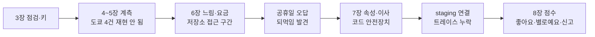
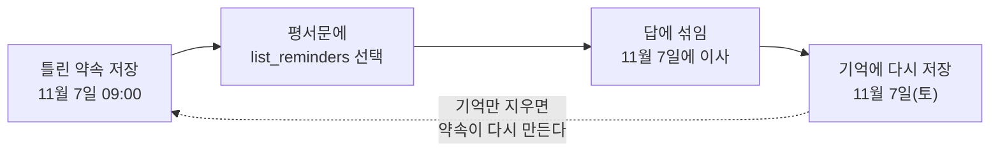

# N054 실습과제 제출보고서 — 서버 로그에 안 보이던 AI 친구의 실수를 Langfuse로 어디까지 찾았나?

> 버전 1.0 · 2026-11-02 · 대상 서비스 AI 친구 에이전트(friend-agent) · 근거 `실습\N054_실습_진행기록.md` 1~9절 · 실행 주체는 표에 사용자 / Claude로 적었다

**한눈에 보기**

**테스트 15 → 57개 통과(머지된 staging 최종) · Cloud Run(staging) 트레이스 도착 9/20(45%, 원인 미확인)**
  ↳ 같은 입력 재생 결과: 공휴일 오답 0/12 → 11/12(도구 결과 위치 변경), 이사 이야기 날짜 20/20 정확. 반면 도쿄 날씨 오답은 4번 모두 재현되지 않았다(0/4)

- **문제** — 동료가 말한 6가지 중 도쿄 날씨 오답은 재현되지 않았다. 대신 공휴일과 이사 이야기에서 지어낸 답이 나왔고, Cloud Run에서는 트레이스의 절반 이상이 Langfuse에 닿지 않았다.
- **원인** — 공휴일은 도구 선택 범위(한 달)와 앞선 대화에 쌓인 내 틀린 답의 되먹임이었다. 이사 이야기는 모델이 지시문을 어긴 약속 저장과 지어낸 날짜였다. 트레이스 누락은 추정 두 번이 모두 빗나가 원인 미확인이다.
- **해결** — 공휴일·이사 이야기는 코드 안전장치와 도구 결과 위치 조정으로 고쳤다. 트레이스 누락은 고치지 못하고 한계로 남겼다.
- **현재 판단 [추론]** — staging까지는 쓸 만하다. production 연결은 누락 원인을 찾은 뒤에 한다. 단, 자동 평가가 없고 마스킹 외의 개인정보 점검(접근 권한·보관 기간)은 하지 않았다.

`근거 [확인] 47 · [추론] 9 · [미확인] 29 · 요구 9개 중 2개 완료·5개 일부·1개 미해결·1개 하지 않음`

| 요구(교안 1-2 학습목표 6개 + 교안 7·9장이 요구한 것) | 상태 | 근거 숫자 |
|---|---|---|
| ① LLMOps·트레이스·관찰 단위를 설명한다 | 🔶 | 관찰 단위 9종을 직접 만들고 읽었다. 말로 설명한 기록은 없다 [미확인] |
| ② 문제에 맞는 Langfuse 화면과 미리 기록할 것을 고른다 | 🔶 | 트레이스 상세·Latency 정렬·점수 조회는 썼다. Users·Sessions 화면 확인은 기록이 없다 [미확인] |
| ③ 계측 구조를 먼저 정하고 코딩 에이전트에게 맡긴다 | ✅ | 요청 틀 빈칸 4개 확정 → 파일 6개 변경, 승인 전 5가지 확인, 테스트 26개 통과 |
| ④ 트레이스를 거슬러 읽어 처음 어긋난 단계를 찾는다 | ✅ | 도쿄 4건, 공휴일(두 곳), 이사(세 갈래), 느린 구간(평균 2.5초) |
| ⑤ 사용자·세션·환경·버전으로 나눠 본다 | 🔶 | 한 트레이스 9개 관찰 단위 모두에 붙음. 태그와 화면 확인은 못 했고 리비전 비교는 같은 코드라 방향만 |
| ⑥ 좋아요·별로예요·신고를 점수로 모아 먼저 읽을 트레이스를 고른다 | 🔶 | 로컬·staging 점수 도착, 걸러내기는 API 조회로 확인. 웹 검색창 문법은 못 열어 봤다 |
| ⑦ Cloud Run에서 트레이스가 빠지지 않게 한다(교안 7장 flush) | ❌ | 도착 4/10 → 3/5 → 2/5, flush 위치는 원인이 아니었다 |
| ⑧ 개인정보 점검(마스킹·접근 권한·보관 기간·사용자 안내, 교안 9장) | 🔶 | 마스킹만 했다. 나머지 셋은 하지 않았다 |
| ⑨ production 연결 | ⚪ | 일부러 하지 않았다 |

▸ 이 문서에 대해 (접기)
  - 작성일 2026-11-02. 근거는 `실습\N054_실습_진행기록.md`(1~9절)와 강의노트 v1.0이다. 숫자와 사건은 진행기록에서만 가져왔고 없는 것은 "기록 없음"이라 적었다.
  - **원본 로그는 별도로 저장하지 않았다.** 진행기록은 에이전트(Claude)가 관찰한 출력을 옮겨 적은 것이다. 같은 조회·재생을 다시 돌릴 수 있는 확인 스크립트 22개만 `실습\확인스크립트` 폴더에 있다. 그래서 `[확인]`은 "진행기록에 관찰 결과로 적혀 있다"는 뜻이지 원본 출력이 남아 있다는 뜻이 아니다.
  - **증거 화면 목록은 만들지 않았다.** Langfuse 화면 캡처는 대화에서 사용자가 보여 줬고 폴더에는 저장하지 않았다.
  - 시간대: 진행기록에 표기가 없다. 화면 시각(10:04)과 조회·요청 로그 시각(01:26, 02:28)이 섞여 있고 앞은 한국 시간, 뒤는 UTC로 보인다 [추론].
  - 테스트 개수: 점수 브랜치 위에서는 55개, 앞선 PR #40 변경까지 합쳐진 머지된 staging 최종 코드에서는 57개다(임시 작업 사본에서 `pytest`를 돌려 확인 [확인]). 점수 브랜치를 #40 머지 전의 `origin/staging`에서 땄기 때문에 진행기록은 55로 적었다.
  - 가린 정보: 프로젝트 번호·주소의 숫자 부분, API 키와 그 일부, 사용자 UUID, 세션·트레이스 ID, 이메일, 조직·계정 이름.
  - 환경: Python 3.14.6(`.venv`), `langfuse==5.1.0`, 모델 gpt-4o-mini, 저장소 Supabase, 배포 Cloud Run(staging), Langfuse Cloud 미국 리전(Hobby).

> 🏷️ 근거 표시 — [확인] 진행기록이 관찰한 출력으로 적은 것 · [추론] 기록에서 판단했거나 기록이 "추정"이라 한 것 · [미확인] 기록이 "확인하지 못했다"고 한 것 또는 기록 없음

> ❓ 시작 질문 — 아침에 동료들의 말 가운데 하나를 골라 "원인을 찾으려면 어떤 정보가 필요하고, 지금 어디서 얻을 수 있나"를 적었다면, 끝에서(13절) 다시 읽는다. 아침에 실제로 적은 답은 진행기록에 없다 [미확인].

## 1. 이 문서를 읽는 법

용어는 경영 비유로 바꿔 읽는다. 큰 틀은 **결재 문서 한 건의 결재선**이다.

| 용어 | 쉬운 말 | 경영으로 말하면 (단, 어긋나는 곳) |
|---|---|---|
| 서버 로그 | "요청이 왔고 200으로 끝났다"만 남는 기록 | 출퇴근 기록부 — 출근은 보이지만 무슨 일을 했는지는 없다 (단, 로그는 일의 내용을 아예 담지 않는다) |
| 트레이스 | 메시지 한 건의 처리 전 과정 | 결재 문서 한 건의 결재선 전체 (단, 결재선은 한 줄이지만 트레이스는 나무 모양이다) |
| 관찰 단위 (span·generation) | 트레이스 안의 한 칸. 모델을 부르는 칸이 generation | 결재선의 한 칸. generation은 외주 용역 칸이라 영수증(토큰·비용)이 붙는다 |
| Langfuse | 이 기록을 모아 보여 주는 도구 | 감사 기록실 (단, 기록은 보여 줄 뿐 잘했는지는 판정하지 않는다) |
| 속성 (user·session·environment·version) | 트레이스에 붙이는 꼬리표 | 문서번호·기안자·부서·개정판 도장 |
| Local / Staging / Production | 내 컴퓨터 / 배포 전 점검 / 실제 운영 | 시제품실 / 시범 매장 / 전 매장 (단, staging도 같은 Supabase를 쓴다 — 10절 K) |
| 점수 (score) | 좋아요·별로예요·신고를 트레이스에 붙인 값 | 고객 만족도 카드 (단, 낸 사람의 의견만 모인다) |
| flush | 모아 둔 기록을 지금 보내라는 명령 | 퇴근 전에 결재함을 한꺼번에 올리기 (단, 이번에는 올려도 일부가 닿지 않았고 이유를 모른다) |
| 되먹임 | 틀린 값이 다음 답의 재료가 되는 것 | 틀린 회의록이 다음 회의 자료가 되는 것 (5·6절의 핵심 사건) |

그림 색 규칙: 이 문서의 그림 색은 단계를 구분할 뿐 성공·실패를 뜻하지 않는다. 이 절의 비유는 읽기 쉽게 하려는 것이고, 근거는 각 절의 `[확인]` 표시를 본다.

▼ 그림 1 · 오늘의 큰 흐름 — 계측을 먼저 붙인 뒤, 사건이 나올 때마다 거슬러 읽고 고쳤다

<!-- flow: 그림 1. 오늘의 흐름. 앞 절반은 계측·관찰, 뒤 절반은 사건마다 거슬러 읽고 고친 뒤 staging과 점수로 확장했다. | 점검·키/3장/4 ; 계측/4~5장/1 ; 관찰/느림·요금/2 ; 공휴일/되먹임/3 ; 속성·이사/7장/4 ; staging/누락 미해결/1 ; 점수/8장/2 -->


```text
점검·키 → 계측(도쿄 재현 안 됨) → 느림·요금 → 공휴일 오답 → 속성·이사 이야기 → staging 연결·누락 → 점수
```
<!-- /flow -->

*읽는 법: 6장 중간에 공휴일 오답이 우연히 나와 계획에 없던 수정이 끼어들었다. 누락(staging)만 끝까지 풀지 못했다.*

## 2. 시작 전에 무엇을 맞췄나? *(교안 3장)*

_이 절의 목적: 시작 상태와 키를 값 노출 없이 확인한 과정을 남긴다._

| 한 일 | 결과 | 누가 | 한계 |
|---|---|---|---|
| 시작 상태 점검(읽기 전용) | 브랜치 `staging`, 마지막 커밋 `412a785`, `import app.main` 통과, 기준선 `pytest` 15 passed. 앱 시작 로그가 provider `openai`·model `gpt-4o-mini`·storage·auth 모두 `supabase`라 실제 LLM 키와 Supabase 연결이 있음 [확인] | Claude | `.env`와 `.env.example`은 열지 않았다 |
| Cloud Run 서비스 확인 | `friend-agent`·`friend-agent-staging` 두 개, 마지막 배포 2026-10-29 [확인] | Claude | — |
| Langfuse 가입·프로젝트(Hobby)·키 발급·`.env`에 세 줄 | 완료 [확인] | 사용자 | 키는 채팅에 붙이지 않았다 |
| 키 형식 점검(값은 출력하지 않음) | 공개키·비밀키 모두 접두사 정상·중복 없음·길이 42, 주소는 미국 리전, 따옴표·공백 없음 [확인] | Claude | 형식만 봤고 전송 성공은 3절에서 확인했다 |

**교재와 다르게 한 것**: 시스템 `python`에는 fastapi가 없어 `.venv`의 python으로 돌려야 했다. 앞 실습을 이어서 하는 경우라 시작 상태 문서의 "없으면" 항목은 실행하지 않았다. 가입 설문의 "Enable AI powered features"(데이터가 외부 AI 서비스로 갈 수 있음)는 끄도록 권했다. 실제로 껐는지는 기록이 없다 [미확인]. 첫 화면의 "코딩 에이전트로 트레이싱 추가" 프롬프트(외부 저장소 스킬 설치)는 교안의 구조표·요청 틀 방식과 달라 쓰지 않았다.

**막혔던 일**: 없다. 다만 N053에서 키 접두사가 두 번 들어가 로그인이 실패한 일이 있어 접두사 중복을 일부러 확인했다.

> ▶ **한 줄 요약** — 키는 값을 보지 않고 형식(접두사·중복·길이)만 확인했고, 앞 실습의 사고를 이번 점검 항목으로 옮겼다.

## 3. 계측은 어떻게 맡겼고, 도쿄 날씨는 재현됐나? *(교안 4~5장)*

_이 절의 목적: 구조를 먼저 정해 맡긴 과정과, 교안의 대표 사건(도쿄 날씨)의 실제 결과를 나란히 둔다._

| 한 일 | 결과 | 누가 | 한계 |
|---|---|---|---|
| 공식 문서 확인(요청 틀 첫 줄) | SDK 최신 5.1.0(Python 3.11 이상). 문서가 알려 주지 않은 것: v5 이름 변경, 키 없을 때 동작, `mask`의 최신 권장 방식 [확인] | Claude | 마지막 항목은 끝내 비교하지 못했다 [미확인] |
| 계획 승인, 작업 브랜치 `langfuse-tracing` | 요청 틀 빈칸: 버전 `5.1.0` 고정, 원문 남김, 가릴 패턴 이메일·카드·전화번호, 세션 = 사용자 ID + 한국 날짜 [확인] | 사용자(승인)·Claude | — |
| 계측 구현 | `observe.py` 신설(키 없으면 끔, 오류는 삼켜 경고 한 줄, 전송 전 마스킹, `TracedLLM` 감싸개), `agent.py`·`llm.py` 수정, `tests/conftest.py`·`test_observe.py` [확인] | Claude | — |
| 승인 전 5가지 확인·테스트 | 시그니처·단위 이름·키 없음 분기·서버 로그에 원문 없음·`pk-lf`/`sk-lf` 없음 통과, 15 → **26 passed**(새 11개) [확인] | Claude | 가짜 LLM 경로 중심(10절 G) |
| 실제 LLM·실제 Langfuse 실행 | 한 턴 관찰 단위 5개가 부모·자식으로 도착. `choose-tools` 876→29, `reply` 443→42(첫 글자까지 0.658초), `memory-update` 539→24 토큰 [확인] | Claude | — |
| 로컬 서버 확인 | `Langfuse 관측을 켰습니다.` 로그, greeting 1건과 잡담 3건이 `chat-turn`으로 도착(목록 52줄·루트 11) [확인] | 사용자 | 환경 열은 전부 `default` |

**교재와 다르게 한 것**: 부모·자식을 `@observe`의 자동 중첩이 아니라 **직접 들고 다녔다**. `run_turn`이 멈췄다 이어지는 제너레이터라 데코레이터가 맞지 않았다. 계측은 `router.py`·`memory.py`를 고치지 않고 `TracedLLM`으로 감쌌다.

### 도쿄 날씨 — 교안은 "엉뚱한 답이 재현된다"고 기대했지만 4번 모두 정직했다

| 메시지(같은 화면, 사용자가 보냄) | 처음 어긋난(서울과 달라진) 단계 | 화면 답 |
|---|---|---|
| `도쿄 날씨 어때?` | `tool:get_weather` — "지원하지 않습니다"(WARNING). 그 문장이 `reply` 입력의 `[도구 결과]`에 그대로 전달 | "잘 모르겠어" |
| `어제 저녁 도쿄 날씨가 어땠어?`(동료 문장) | `choose-tools`가 도구를 아예 고르지 않음(`tools: []`). `[도구 결과]` 자체가 없음 | "잘 모르겠어" |
| `도쿄 날씨 알려줘` | 날씨 도구 두 번 호출, 둘 다 "지원하지 않습니다" | "잘 모르겠어" |
| `오사카 날씨는?` | `tool:get_weather` — "지원하지 않습니다" | "오사카도 잘 모르겠어" |

서울(`내일 서울 비 와?`)은 도구가 날씨를 돌려줘 정확히 답했다 [확인]. 같은 "모르겠다"라도 어긋난 단계가 달랐다(도구 실패 3건, 도구 미선택 1건). **재현되지 않은 이유(모델·프롬프트가 동료 때와 달라졌는지, 동료의 문장이 달랐는지)는 확인하지 못했다** [미확인].

**막혔던 일**: ① 처음 실행에서 `Calling end() on an ended span.` 경고 — 루트를 두 곳에서 닫고 있었다. 한 곳은 값만 적는 `observe.update`로 바꿨다. ② `conftest`를 고치기 전 `pytest` 두 번이 `.env`의 Langfuse 키를 읽어 실제 프로젝트에 가짜 LLM 트레이스를 보냈다(10절 B). ③ 조회 스크립트가 `metadata` 필드를 요청하지 않아 확신도를 못 읽었다 — 기록 누락이 아니라 조회 방식 문제였다.

> ▶ **한 줄 요약** — 구조(단계 이름·종류·원문 정책)를 먼저 정해 맡기니 첫 실행에서 5단계가 이어서 도착했지만, 교안의 대표 사건인 도쿄 오답은 재현되지 않아 방법 연습은 다음 사건(5절)이 대신했다.

## 4. 가끔 느린 답과 늘어난 요금은 어디서 왔나? *(교안 6장)*

_이 절의 목적: 숫자로 느린 구간을 찾고, 그 결과로 계측 구조표를 고친 과정을 남긴다._

표본은 진짜 LLM을 쓴 `chat-turn` 14개다. 사용자 12개(저장소 Supabase)와 Claude가 일회용 스크립트로 돌린 2개(저장소 내 컴퓨터 메모리)다. 사용자가 Latency 정렬로 화면을 보고, Claude가 같은 트레이스를 API로 읽어 단계별 시각·토큰·비용을 표로 냈다(원문은 읽지 않음) [확인].

| 구간(사용자 12개) | 걸린 시간 | 비고 |
|---|---|---|
| `safety` 앞 이름 없는 구간 | 평균 약 2.5초(1.29~3.80) | 12개 모두에 있다. 메모리 저장소로 돌린 2개는 **0.01초** |
| `choose-tools` | 평균 약 1.6초 | 잡담에도 매번 모델을 한 번 부른다 |
| `tool:…` | 날씨 1.21초, 대기질+날씨 2.38초, 공휴일 0.51초 | 지원 안 하는 지역은 약 0.00초 |
| `reply` / `memory-update` | 0.71~1.18초 / 0.56~1.72초 | `memory-update`는 답이 나간 뒤라 사용자는 안 기다린다 |

- **총 시간**: 4.75~10.28초(평균 약 7.5초). 가장 느린 것은 `내일 부산 미세먼지 어때?`(도구 둘, 10.28초). 사용자가 기다린 시간(요청 → `reply` 첫 글자)은 평균 약 5.1초(3.0~7.6초)이고 이름 없는 앞 구간이 약 절반이다 [확인].
- **원인 판단**: 12개 전부에 1.3~3.8초가 깔린 상시 비용이고 메모리 저장소 대조(0.01초)가 근거라 저장소 접근으로 본다 [추론]. 호출별(설정·캐릭터·기억·요약·대화·저장) 분해는 못 했다 [미확인].
- **요금**: 메시지 한 건 $0.000336~$0.000464, 14개 평균 **$0.000413(약 0.6원)**. 한 메시지에 모델을 세 번 부르고 `reply` 입력 토큰이 549 → 1105로 늘었다(앞선 대화·기억 포함). 가격은 Langfuse가 gpt-4o-mini 가격표로 계산했다 [확인]. 표본 14개, 가장 싼 값은 대화가 빈 내 스크립트라 평균 비용은 실사용 뒤 다시 봐야 한다.

**고친 것**: 구조표에 없던 저장소 접근 구간을 `load-context`·`save-turn`·`summary-check` span 세 개로 더했다(테스트 26개 통과). 사용자 화면의 새 메시지에서 총 7.58초 아래 단계 합이 약 7.36초로 맞아 빈 구간이 채워졌다 [확인]. **교재와 다르게**: 교안 4장의 구조표는 `chat-turn` 아래 5단계였고 이 구간이 없었다. 구조표를 먼저 정해도 실측을 보고 고쳐야 했다.

> 경영으로 말하면 — 결재선에 없던 "서류 보관실 왕복"이 총 소요의 약 3분의 1이었다(단, 보관실 안 어느 서랍인지는 못 나눴다).

> ▶ **한 줄 요약** — 느림은 첫 글자 앞의 이름 없는 구간(평균 2.5초, 저장소 접근으로 추정)에서, 요금은 메시지당 모델 세 번 호출과 늘어나는 입력 토큰에서 찾았다.

## 5. 도쿄 대신 재현된 공휴일 오답은 어디서 처음 어긋났나? *(교안 5장 방식, 6장 중 발견)*

_이 절의 목적: 교안 5장의 "거슬러 읽기"를 실제로 쓴 사건을 시간 순서로 남긴다. 이 보고서에서 가장 많이 배운 절이다._

사용자가 `다음 공휴일이 언제고 어떤 날인지 알려줘`에 "다음 공휴일은 11월 9일(월)이고, 한글날이야!"를 받고 "10월 9일이 한글날인데"라고 지적했다. 오늘은 2026-11-02이고 11월에는 공휴일이 없다(다음은 12월 25일).

| 단계 | 값 |
|---|---|
| `reply` 출력 | "11월 9일(월)이고 한글날" — 지어낸 답 [확인] |
| `reply` 입력의 `[도구 결과]` | "11월 말까지 공휴일이 없습니다" 두 줄 — 도구는 '없다'고 정확히 전달했는데 모델이 무시 |
| `tool:get_holidays` ×2 | 둘 다 `to: 2026-11-30`까지만 조회 → 그 범위에서는 사실 |
| `choose-tools` 출력 | `get_holidays`를 두 번, 범위를 11월 30일까지로 잡음 |

**처음 어긋난 곳은 두 군데였다.** ① `choose-tools`가 "다음 공휴일"에 한 달 범위를 골랐다(도구에 '다음 공휴일' 기능이 없음). ② 그 "없음"을 받고도 `reply`가 실제처럼 지어냈다. 도쿄 때는 나타나지 않던 "도구 결과를 받고도 지어내는" 유형이 여기서 재현됐다 [확인].

### 5-1. 첫 수정 — 고치려던 문장이 새 문제를 만들었다

| 수정 | 결과 |
|---|---|
| 도구 선택 지침에 "args 를 빈 객체로 둔다"만 씀 | 같은 질문 4번 중 **3번 도구 없이** 답했고(이유란에 "빈 객체를 선택했습니다") 3번 모두 `[도구 결과]` 없이 날짜를 지어냈다 [확인] |
| 문장을 "반드시 `get_holidays`를 고르고 args는 `{}`. 예: `{"name": "get_holidays", "args": {}}`. 도구를 안 고르면 안 된다"로 바꿈 | `다음 공휴일이 언제고…` 4/4, `다음 공휴일이 언제야?` 4/4, `11월에 공휴일 있어?` 3/3 정확. 회귀 확인 `도쿄 날씨 어때?` 3/3 정직 [확인] |
| 답 만들기 규칙 한 줄 추가("없다고 하면 꾸며 말하지 않는다") | 같은 입력 5번씩 사람이 읽고 판정: 수정 전 3/5, 뒤 2/5가 지어냄 — **차이가 있다고 말할 수 없다** [확인] |

처음 만든 자동 판정(키워드 검사)은 "세종대왕 탄신일"·"구정 연휴" 같은 지어낸 말을 못 잡아 수정 전 0/5로 잘못 나왔고, 사람이 다시 읽어 고쳤다 [확인]. 규칙에 "지어내지 않는다"가 이미 있었는데도 모델이 지어냈다. 규칙 한 줄을 더하는 것보다 도구 선택을 바로잡아 정확한 결과를 주는 쪽이 믿을 만했다 [추론].

### 5-2. 고쳤는데 화면에서는 여전히 틀렸다 — 대화 기록의 되먹임

화면에서 `다음 공휴일은 언제야?`를 세 번 보냈는데 세 번 모두 "11월 9일(월) 한글날"이었다. 트레이스를 읽으니 도구 선택·도구 결과는 이미 고쳐져 있었다. `reply` 입력에 앞선 대화 20개가 같이 들어 있었고, 그 안에 내가 앞서 한 틀린 답이 2~4개 있었다. 모델은 정확한 도구 결과보다 **자기 앞선 말**을 따랐다 [확인]. 진행기록 6-3의 내 시험은 매번 **빈 대화**로 보내서 이 조건이 안 보였다.

| 같은 실제 입력 12번 재생 | 정답(답에 '12월 25일') |
|---|---|
| A. 기록된 그대로 | **0/12**(화면의 오답 재현) |
| B. 규칙 한 줄 추가("앞선 말과 달라도 도구 결과를 따른다") | 1/12 |
| C. **도구 결과를 질문 바로 앞에 system 메시지로 한 번 더** | **11/12** |
| D. 도구 결과를 마지막 user 메시지 뒤에 붙임 | 1/12 |

작은 시뮬레이션(틀린 답 3쌍만 넣은 빈 저장소)에서는 A도 6/6이었다. 오염은 대화가 길고 틀린 답이 여럿 쌓였을 때 생긴다. 고친 곳은 `agent.py`의 `tool_note()`(C안)다. 화면에서 틀렸던 실제 대화 20개로 `run_turn`을 도구 선택부터 8번 돌리니 **8/8 정답**이었고, 사용자가 같은 대화에서 두 번 정답을 확인했다. 테스트는 33개 통과(공휴일 7개) [확인].

**한계**: ① Claude 클래스는 system 메시지를 맨 앞 한곳으로 모아 보내(`to_claude`) 위치 효과가 없다. gpt-4o-mini에서만 확인했다 [미확인]. ② 틀린 답이 쌓인 사용자 대화는 지우지 않았다. ③ 도구를 안 고른 채 지어내는 경우는 여전히 규칙으로 못 막는다.

> 경영으로 말하면 — 잘못된 회의록이 쌓인 팀에서는 새 보고서가 맞아도 팀이 지난 회의록을 따른다. 해법은 새 보고서를 결재 직전 맨 앞장에 끼워 넣는 것이었다(단, 틀린 회의록 자체는 그대로 남는다).

> ▶ **한 줄 요약** — 도구 결과는 맞았는데 답이 틀린 원인은 앞선 대화 속 내 틀린 답이었고, 규칙 한 줄(1/12)이 아니라 정확한 결과를 질문 바로 앞에 놓는 위치 변경(11/12)이 막았다.

## 6. 속성은 붙었는데 기억은 왜 틀렸나? *(교안 7장 앞쪽 — 속성과 이사 이야기)*

_이 절의 목적: 꼬리표를 붙인 과정과, 이사 이야기에서 틀린 값이 퍼진 길을 남긴다._

| 한 일 | 결과 | 누가 | 한계 |
|---|---|---|---|
| 요청 틀 빈칸 | user = 서버가 확인한 사용자 ID(이메일 아님), session = 사용자 ID + 한국 날짜, environment = `ENV`, version = Cloud Run 리비전(`K_REVISION`, 없으면 `local`), metadata = 커밋, tags = 고른 도구·안전 응답 [확인] | Claude | — |
| 일회용 시험으로 범위 확인 | `propagate_attributes`는 그 `with` 안에서 **만든** 관찰 단위에만 붙는다. 루트만 안에서 만들면 자식에는 `environment`만 있었다 [확인] | Claude | — |
| `Handle` 설계 | 관찰 단위를 만드는 순간에만 `propagate_attributes`를 열어 붙임(제너레이터라 `with`를 길게 못 연다). 테스트 3개 추가 → **36 passed** | Claude | — |
| 실제 Langfuse 확인 | 한 트레이스 **9개 관찰 단위 모두**에 user·session·environment·version, 루트 메타데이터에 commit [확인] | Claude | **태그는 조회 API에서 비어 있어 확인 못 함** [미확인] |
| 화면 시나리오 | 이사 이야기 다섯 `chat-turn` 모두 속성 붙음 [확인] | 사용자 | Users·Sessions 화면 확인 기록 없음 [미확인] |

알아 둘 것: SDK가 루트 메타데이터에 `scope.attributes.public_key`(공개키 전체)를 자동으로 넣는다. 혼자서는 못 쓰는 식별자이지만 이 필드가 보이는 화면을 공유할 때 알아 둔다 [확인].

### 6-1. 이사 이야기 — 맞는 날짜는 11월 14일(토)인데 값이 세 개로 갈렸다

`나 다음 주 토요일에 이사 가`에 화면이 "약속을 저장했습니다: 11월 7일(토) 09:00"와 "기억함: 11월 12일(토) 이사"를 함께 띄웠다. 오늘은 2026-11-02(월)이라 정답은 11월 14일(토)이다.

| 곳 | 값 | 판정 |
|---|---|---|
| `tool:create_reminder` | 11월 7일 09:00 "이사 가기" | 부탁이 없었는데 저장(지시문에 "분명히 부탁할 때만"이 있었다). 날짜도 '이번 주' 토요일 |
| `memory-update` | `11월 12일(토) 이사` | 지어낸 날짜(11/12는 목요일) |
| 마지막 `choose-tools` → `reply` | `list_reminders` 조회 → "11월 7일" | 틀린 약속이 다음 답의 재료가 됨 |

학습서의 기억이 끊기는 세 곳(저장·전달·활용) 말고 **네 번째 자리(저장된 값이 틀림)**였다. 틀린 약속·기억은 사용자 데이터라 지우지 않았다 [확인]. **수정(코드 안전장치 3개 — 지시문이 있었는데 모델이 어겼기 때문)**: ① 부탁하는 말(`알려`·`알림`·`리마인드`·`깨워`·`잊지`·`말해 줘`)이 없으면 `create_reminder`를 뺀다. ② 모델의 약속 날짜가 규칙 계산과 다르면 날짜만 규칙 값으로 고친다(수정 전 6번 중 2번 틀림). ③ 날짜와 요일이 안 맞는 기억은 저장하지 않는다. **결과**: 부탁 없는 같은 말 6번 중 약속 저장 0/6, 요일 틀린 기억 0/6. 부탁 5표현 × 4번 = **20/20 날짜 정확**. 테스트 42 passed [확인].

### 6-2. "기억을 지웠는데도 똑같다" — 틀린 약속이 기억을 다시 만들었다

사용자가 틀린 **기억**만 지우고 같은 말을 보내자 "11월 7일(토) 이사"가 다시 저장됐다. `choose-tools`가 평서문에 `list_reminders`를 골랐고, 남아 있던 틀린 약속이 조회돼 답에 섞였고, 그 답에서 `memory-update`가 다시 저장했다. **요일이 맞는 날짜라 6-1의 요일 검사를 통과했다** [확인].

▼ 그림 2 · 틀린 값이 약속·답·기억을 돌며 되살아난 길

<!-- flow: 그림 2. 지운 것은 기억뿐이라 약속이 다시 기억을 만들어 냈다. | 틀린 약속 저장/11월 7일 09:00/1 ; 약속 조회/평서문에 list_reminders/2 ; 답에 섞임/11월 7일에 이사 간다고/3 ; 기억에 저장/요일은 맞는 11월 7일(토)/4 -->


```text
틀린 약속 → 평서문에 약속 조회 → 답에 섞임 → 기억에 다시 저장 → (기억만 지우면) 약속이 다시 기억을 만든다
```
<!-- /flow -->

*읽는 법: 고리의 한 칸만 지우면 다른 칸이 되살린다. 그래서 지우는 순서보다 고리를 끊는 안전장치가 필요했다.*

**수정 둘**: ① 묻는 말이 없는 문장에 `list_reminders`를 고르면 뺀다. ② `내일`·`다음 주 토요일` 같은 상대 날짜가 있는데 기억의 `M월 D일`이 다르면 고친다(날짜가 둘 이상이면 저장하지 않음). 테스트 46 passed. **수정 뒤 같은 조건 재현 6번**: 기억 6/6이 `11월 14일(토) 이사`, `list_reminders` 0/6. 그러나 **답에 "11월 7일"이 나온 것이 2/6**이었다. 앞선 대화에 남은 내 틀린 답의 되풀이이고, 도구 없는 답에는 5절의 방법(정확한 결과를 앞에 놓기)을 쓸 근거가 없다 [확인]. 사용자가 틀린 약속을 취소하고 기억 한 줄만 지운 뒤 같은 말을 보내자 날짜를 되풀이하지 않았고 기억이 `11월 14일(토)`로 저장됐다(한 번이라 효과를 말하기 이르다). `내 데이터 모두 삭제`는 캐릭터 설정까지 지워서 쓰지 않았다 [확인]. **한계**: 요일이 맞는 엉뚱한 날짜(예: 11월 19일(목))와 규칙 파서가 못 읽는 표현은 못 막는다.

> ▶ **한 줄 요약** — 속성은 9개 관찰 단위 모두에 붙었고, 이사 이야기의 틀린 값은 약속·기억·대화 기록이 서로를 재료로 삼아 퍼져 코드 안전장치로 고리를 끊었지만 도구 없는 답의 되풀이는 2/6 남았다.

## 7. staging에는 어떻게 연결했고, 트레이스는 왜 빠졌나? *(교안 7장 뒤쪽 — 키·리비전·flush)*

_이 절의 목적: 연결 절차와, 원인을 끝내 못 찾은 누락을 있는 그대로 남긴다._

| 한 일 | 결과 | 누가 | 한계 |
|---|---|---|---|
| 올리기 전 점검 | 46 passed, 공개 저장소용 민감 패턴 검색(`pk-lf-`·`sk-lf-`·긴 숫자·이메일·사용자 ID) 0건. 두 커밋(`4aee42d` 계측, `b91150f` 오답 수정) | Claude | `docs/cleanup-policy.json`은 제외 |
| 시크릿 `langfuse-secret-key` 생성 | 사용자가 콘솔에서 만듦(값은 채팅에 안 붙임). Claude가 접두사 정상·중복 없음·길이 42·공백 없음만 확인 | 사용자·Claude | 값은 안 봄 |
| 권한·서비스 갱신·재조회 | 런타임 계정에 **이 시크릿 하나에만** `secretAccessor`, `--update-env-vars`(기존 값 유지)·`--update-secrets`로 연결. 다시 조회하니 환경변수 기존 9개 + 새 3개, 기존 값 그대로 [확인] | Claude | production은 안 건드림 |
| PR #38 머지 → 자동 배포 | staging `/version` 커밋 `112a1b8`, 리비전 `…-00041-vim`, 화면 "빌드 112a1b8"과 일치 | 머지 주체 기록 없음, 서술은 Claude 시점 [추론] | — |
| 첫 트레이스 | greeting과 `chat-turn` 2개가 단계 8개 모두, environment `staging`·version 리비전 이름으로 도착. 답은 둘 다 "12월 25일 금요일, 크리스마스" 정확 [확인] | 사용자(메시지)·Claude(조회) | 표본 2 |

**교재와 다르게 한 것**: 교안 7장은 새 리비전이 둘 있어야 비교한다고 한다. 저장소 변경 없이 `BANNER=revision-compare-2`로 **같은 이미지의 두 번째 리비전**(`…-00030-bqk`)을 만들었다. 두 리비전의 코드가 같으므로 숫자 차이는 배포가 아니라 변동이다. 비교 뒤 `BANNER`는 지웠다 [확인].

| 질문 | 리비전 | 총시간 | `load-context` | `reply` | 첫 글자까지 | 비용 |
|---|---|---|---|---|---|---|
| `다음 공휴일이 언제야?` | 00041 / 00030 | 5.06초 / 4.48초 | 1.02 / 0.50 | 0.74 / 1.04 | 3.41 / 2.76 | $0.000455 / $0.000514 |
| 두 번째 질문 | 00041 / 00030 | 3.10초 / 3.31초 | 0.45 / 0.65 | 0.68 / 0.84 | 2.04 / 2.04 | $0.000487 / $0.000474 |

두 번째 질문은 00030에서 도구를 안 쓴 다른 문장이라 엄밀히 같은 메시지끼리의 비교가 아니다. 그리고 staging의 `load-context`(0.45~1.02초)가 로컬(평균 2.5초)보다 짧았는데 지역 차이 때문인지는 확인하지 못했다 [미확인].

### 7-1. 트레이스가 빠졌다 — 세 번 세었고, 추정 두 개가 모두 빗나갔다

방법은 요청 로그 `POST /api/chat` 건수와 Langfuse `chat-turn` 개수를 세는 것이다. 도착한 트레이스는 단계가 모두 있고, 빠진 것은 통째로 없다(부분 도착 아님). 다른 환경으로 간 것도 아니다(전체 환경 조회) [확인].

| 시도 | 요청 로그 | 도착 | 비율 | 그때의 원인 추정 |
|---|---|---|---|---|
| #38 직후(flush 없음, 리비전 두 개 5건씩) | 10건 | 4개 | 40% | 응답 뒤 CPU 제한으로 백그라운드 전송이 멈춤 [추론] |
| #39 `flush()`를 `done` 뒤(`finally`)에 둠 | 5건 | 3개 | 60% | `done`을 받은 브라우저가 연결을 닫아 그 뒤 flush가 멈춤 [추론] |
| #40 `flush()`를 `done` 앞으로 옮김(`close_trace`) | 5건 | 2개 | 40% | 새 추정 없음 — 앞의 두 추정 모두 증거로 지지되지 않음 |
| 합계(계산) | 20건 | 9개 | 45% | — |

**알려진 사실**: 모든 리비전에서 첫 번째 요청의 트레이스는 항상 도착했다. 요청은 한 인스턴스(`maxScale=1`)의 uvicorn 한 프로세스가 처리했다. 로컬에서는 12/12 도착했다. Cloud Run 로그에 내보내기 실패 메시지가 없다. 옛 `/api/public/traces`는 HTTP 410이라 교차 확인 경로가 없었다. SDK 설명의 지연(15~30초)보다 격차가 크고 20분 뒤에도 안 돌아왔다 [확인].

**결정(사용자)**: 원인을 확인하지 못한 채 **한계로 남긴다.** 요청별 내보내기를 추적하는 `LANGFUSE_DEBUG` 진단은 하지 않았다(디버그 로그에 대화 원문이 섞여 Cloud Logging에 남을 수 있다). PR #39·#40의 flush는 효과가 확인되지 않았지만 해롭지도 않아(응답 시간 변화 미미, 표본 2) 그대로 두었다. **production에서 운영하려면 그 전에 원인을 찾아야 한다** — 비용·지연·점수 분석이 틀어진다 [확인]. 도착하지 않은 11건에 무슨 일이 있었는지는 모른다 [미확인].

**배운 것**: 같은 저장소에 이미 "응답을 닫기 전에 처리한다"는 규칙(`memory-update`)이 있었다. 새 기능을 붙일 때 그 규칙의 이유(Cloud Run의 응답 뒤 CPU 제한)를 읽고도 `finally`에 flush를 두었다. 그 이유를 옮겨 적용한 뒤(#40)에도 도착 비율이 그대로였으므로, 그 이유가 이 누락의 원인이었다고 볼 증거는 없다.

> 경영으로 말하면 — 결재함을 퇴근 전에 올렸는데도 문서의 절반이 접수대에 없다. 우리는 올리는 시점만 바꿔 봤고, 접수대가 문서를 받았는지 기록은 열어 보지 않았다.

> ▶ **한 줄 요약** — 같은 코드의 두 리비전은 차이가 변동 수준이었고, 트레이스 누락(도착 9/20)은 flush 위치를 두 번 바꿔도 안 풀려 원인 미확인 상태로 staging까지만 연결했다.

## 8. 별로인 답은 언제였는지 어떻게 찾나? *(교안 8장)*

_이 절의 목적: 점수 구현과 화면에서 처음 막힌 일, 에이전트가 대신 확인한 범위를 구분해 남긴다._

**요청 틀 빈칸**: 반응 API는 좋아요·별로예요를 **새로 만들고**(`POST /api/feedback`) 신고는 기존 `/api/report`를 넓혔다. 메시지와 트레이스는 **메시지 `meta`에 트레이스 ID를 저장**해 이었다(`done` 이벤트에 싣는 쪽은 택하지 않음). 점수는 `user-feedback`(좋아요 1·별로예요 0, BOOLEAN)·`report`(신고 1, 사유는 `comment`). 서버가 로그인 사용자의 답인지 확인하고, 키가 없으면 점수 전송만 건너뛴다 [확인].

| 한 일 | 결과 | 누가 | 한계 |
|---|---|---|---|
| 구현(브랜치 `langfuse-score`, 커밋 1개)과 테스트 | `agent.py`·`observe.py`·`main.py`·두 저장소·`static/index.html`·새 테스트 파일. **55 passed**(브랜치 위, 새 테스트 7개. 머지된 staging 최종은 57): 남의 메시지 404, 내가 한 말 점수 불가, 신고 사유의 전화번호가 `[전화번호]`로 가려짐, 키 없으면 `scored: false`, 알 수 없는 값 400 | Claude | 화면 JS는 테스트 밖 |
| 실제 Langfuse(로컬) | 별로예요·신고 `scored: true`, 남의 메시지 **404**, 25초 뒤 `user-feedback`=False·`report`=True 조회 | Claude | 코멘트는 처음 `None`(아래) |
| 사용자 화면 확인 | 새로고침 뒤 새 답에 버튼 3개(`좋아요`·`별로예요`·`신고`) 보임 | 사용자 | 점수가 Langfuse **화면**에 보이는지는 못 봄 [미확인] |
| 점수 조회(사용자 요청: "내가 확인하기가 어렵네") | 답 A에 별로예요+신고(전화번호 가려져 도착), 답 B에 좋아요. `user-feedback`=false 목록에 A만 있음 [확인] | Claude | 웹 검색창 `scores."user-feedback":false`는 못 열어 봄 [미확인] |
| PR #41 머지·배포 → staging 확인 | 커밋 `66e7206`·리비전 `…-00049-rag`. 브라우저 창에서 `다음 공휴일이 언제야?` 뒤 별로예요 → `/api/feedback` 200, 약 25초 뒤 환경 `staging`의 `user-feedback`=False가 9개 관찰 단위가 모두 있는 트레이스에 붙음. 요청 로그 `/api/chat`·`/api/feedback` 각 1건 | 사용자(머지·배포)·Claude(조작·조회) | 표본 1이라 누락이 없다는 뜻은 아니다. 신고(사유 입력)는 staging에서 안 눌렀다 |

**교재와 다르게 한 것**: ① 점수 확인을 웹 검색창 대신 같은 데이터를 API로 읽어 했다. ② 점수에 `environment`를 안 붙이면 `default`로 들어가는 것을 로컬 실행에서 발견해 붙였다(이전 시험 3건은 `default`로 남음). ③ 시험용 게스트의 데이터(캐릭터, 대화 2건, staging 점수 1건)가 남았다.

**막혔던 일 — "신고밖에 안 보여"**: 스트리밍으로 나온 새 답에는 신고만 있었다. 화면 코드가 스트리밍 때는 메시지 ID를 마지막 `done`에서야 알아 신고 버튼만 만들었고, 내가 만든 두 버튼은 ID를 아는 경로(대화 기록을 다시 열 때)에서만 만들어졌다. 서버는 새 화면 파일을 내보내고 있어 캐시 문제가 아니었다. **내 첫 보고에서 이 경로를 빠뜨렸다.** `done`에서 두 버튼을 만들게 고치고, 이번에는 내가 브라우저 창에서 직접 눌러 `POST /api/feedback → 200`을 확인했다. 또 처음 코멘트가 `None`이었던 것은 `details`·`subject` 필드를 요청하지 않아서였지 기록 누락이 아니었다 [확인].

> 경영으로 말하면 — 고객 만족도 카드는 불만 고객이 더 자주 낸다. 그래서 점수가 아니라 "먼저 읽을 순서"로 쓴다. 이번 점수는 시험용 몇 건이라 대표성을 논할 자료가 없다.

> ▶ **한 줄 요약** — 버튼 한 번이 `user-feedback`·`report` 점수가 되어 로컬과 staging에서 도착했고, 걸러내기와 코멘트는 API로 확인했지만 웹 화면의 Scores 탭은 못 열어 봤다.

## 9. 오늘 만든 것과 아직 못 하는 것은? *(교안 9장)*

_이 절의 목적: 교안 9장의 "관측은 평가가 아니다"를 이번 실습 결과에 맞춰 보고, 하지 않은 것을 분명히 한다._

교안 9장의 한계 5가지를 이번 상태에 맞춰 본다. 진행기록에는 9장 정리를 따로 쓴 부분이 없어 아래는 진행기록의 사실을 9장 표에 맞춘 것이다 [추론].

| 교안 9장의 한계 | 이번 실습의 상태 |
|---|---|
| 답변의 실제 품질 판단 | 사람이 읽고 판정했다(공휴일 5번·12번·8번 재생). 자동 키워드 판정은 지어낸 말을 못 잡아 0/5로 오판해 **자동 평가는 만들지 않았다** [확인] |
| 피드백의 대표성 | 점수는 시험용 몇 건뿐이다. 실제 사용자 점수 기록은 없다 [확인] |
| 대량 트레이스 분석 | 표본 14개(느림·요금), staging 몇 건. 수백 개 단위는 다루지 않았다 |
| 비용·지연의 정확성 | 평균 비용 $0.000413은 14개 표본이다. 실사용 데이터 뒤 다시 봐야 한다 |
| 개인정보 보호 | 대화 원문이 외부 서비스(Langfuse 미국 Cloud)에 올라간다. **마스킹만 했고** 접근 권한·보관 기간·사용자 안내는 하지 않았다. 마스킹이 실제 Langfuse에서 확인된 것은 신고 사유의 전화번호뿐이다. 이메일·카드 패턴이 실제로 가려져 도착했는지는 기록이 없다 [미확인] |

교안 9-4의 다른 서비스(MSM·ASP 등)는 이번 실습에서 적용하지 않았다(계획).

> ▶ **한 줄 요약** — 오늘 만든 것은 "무슨 일이 있었는지"를 보는 눈(계측·속성·점수)이고, 좋았는지 가리는 평가·개인정보 운영 점검·실사용 데이터는 모두 남았다.

## 10. 사고·문제 표

_이 절의 목적: 진행기록의 실제 사건을 빠짐없이 한 표에 모은다. 꼬리표 `G`·`B`는 3절에서 가리킨 것이다._

| # | 변경 | 결과 | 사용자에게 보였을 것 | 원인을 찾은 곳 | 처리 | 누가 | 한계 |
|---|---|---|---|---|---|---|---|
| A | 계측 구조표 | 이름 없는 구간 평균 2.5초 | 가끔 느린 답 | 단계별 시작 시각 대조, 메모리 저장소 대조(0.01초) | `load-context`·`save-turn`·`summary-check` 추가 | Claude | 호출별 분해 못 함 [미확인] |
| B | 테스트와 `.env` 키 | pytest 두 번이 실제 Langfuse에 가짜 LLM 트레이스 전송 | 프로젝트에 이름이 `chat-turn`인 시험 트레이스가 남음 | 계측 뒤 실행 점검 | `conftest.py`에서 `LANGFUSE_TRACING_ENABLED=false` | Claude | 그 두 트레이스가 프로젝트에 남아 있을 수 있다 |
| C | 조회 스크립트 필드 | `metadata`·코멘트·`tags`가 비어 보임 | 확신도·사유가 없다고 착각 | 요청 필드(`metadata`, `details`, `subject`) 확인 | 필드를 요청해 해결(`tags`만 끝내 미해결) | Claude | `tags` [미확인] |
| D | 도구 선택·답 만들기 | 공휴일 오답 "11월 9일(월) 한글날" | 지어낸 공휴일 | 5절 거슬러 읽기(`choose-tools` 범위, `reply`) | 선택 지침·도구 설명 수정 | 사용자(발견)·Claude | 규칙 효과 불분명(3/5 vs 2/5) |
| E | 첫 수정 "args를 빈 객체로" | 4번 중 3번 도구 안 고르고 날짜를 지어냄 | 더 심한 오답 | 같은 질문 반복 + `choose-tools` 이유란 | JSON 예시와 금지 문장으로 교체 | Claude | 회귀 시험은 도쿄 3/3뿐 |
| F | 대화 기록 속 틀린 답 | 고친 뒤에도 3번 연속 같은 오답 | "아직 안 바뀌었나봐" | 내 시험이 빈 대화였음 → 실제 20개 대화 재생(0/12) | 도구 결과를 질문 바로 앞에 system으로(11/12, 8/8) | Claude | Claude 클래스 미확인, 도구 없는 경우 못 막음 |
| G | 테스트 범위 | 가짜 LLM(키워드) 경로만 지나 진짜 모델이 지시문을 어기는 경로를 못 잡음 | 이사 이야기 오류 | 7장 시나리오 후 "왜 못 잡았나" 확인 | 어긴 척하는 가짜 모델 테스트 추가(6개→10개) | Claude | 진짜 모델 경로 전체는 아님 |
| H | 약속·기억 저장 | 원치 않은 약속(11/7) + 지어낸 날짜(11/12 목요일, 정답 11/14) | "저장했습니다" 두 줄이 다른 날짜로 | 5절 방식으로 `choose-tools`→도구→`memory-update` 대조 | 안전장치 3개(6-1) | 사용자(시나리오)·Claude | 요일 맞는 엉뚱한 날짜는 못 막음 |
| I | 틀린 약속 + `list_reminders` | 기억을 지워도 11/7이 되살아남(요일 맞아 검사 통과) | "기억을 지웠는데도 똑같아" | `choose-tools` 이유란과 `memory-update` 대조 | 질문 아닌 말에 조회 금지, 상대 날짜 보정 | Claude | 도구 없는 답의 되풀이 2/6 |
| J | 메시지-트레이스 연결 | 스트리밍 새 답에 신고 버튼만 보임 | "신고밖에 안 보여" | 서버가 새 파일을 내는지 확인(캐시 아님) → 화면 JS 읽기 | `done`에서 `bindFeedback` | Claude | 테스트가 화면 JS를 안 지남 |
| K | "staging은 비어 있을 것" | 확인 없이 한 말이 틀림(같은 Supabase, 10월 29일부터의 대화가 있었다) | 첫 접속에서 옛 대화가 보임 | staging 화면(발견 주체는 기록 없음) | 정정 | Claude(오보) | — |
| L | 트레이스 누락 발견 | 요청 10건에 트레이스 4개(40%) | 빠진 대화가 목록에 없음 | 요청 로그 건수 vs `chat-turn` 개수 | 아래 두 줄 | 사용자(메시지)·Claude(집계) | **원인 미확인** |
| M | flush를 `done` 뒤 `finally`에(PR #39) | 3/5 — 개선이라 말할 수 없음 | 같음 | 5건씩 다시 세기 | 효과 없음, 유지 | Claude | 추정이 틀림 |
| N | flush를 `done` 앞으로(PR #40) | 2/5 | 같음 | 5건씩 다시 세기 | 효과 없음, 유지. `LANGFUSE_DEBUG`는 안 켬 | 사용자(결정)·Claude | production 전 재조사 필요 |

> 🧪 **예제** — 사건의 절반 이상(E~J)은 "도구 결과는 맞는데 모델이 앞선 말·지시문을 따른" 유형이었다. Langfuse가 해 준 일은 고치는 것이 아니라 **처음 어긋난 단계를 한 줄로 가리키는 것**이었다.

## 11. 교안과 달라진 결과

| 항목 | 교안 | 이번 결과 |
|---|---|---|
| 도쿄 날씨 | 재현되면 `reply`가 지어냄, 아니면 정직하게 모름 | 4/4 정직. 어긋난 단계는 도구 실패 3건·도구 미선택 1건 |
| 점수 확인 | 웹 검색창 `scores."user-feedback":false` | 같은 조회를 API로. 웹 [미확인] |
| 메시지-트레이스 잇기 | `meta` 저장 또는 `done`에 싣기 | `meta` 선택. 스트리밍 경로에서 ID를 `done`에서야 알아 화면 버튼 누락 사고 |
| flush | 응답 마칠 때 `flush()`로 해결 | 위치 둘 모두 효과 없음, 도착 45% |
| 리비전 비교 | 새 리비전이 느리면 단계 찾기(예: 2초 vs 5초는 이해용 숫자) | 같은 코드 두 리비전: 5.06 vs 4.48초, 3.10 vs 3.31초는 변동 |
| 마스킹 | 이메일·카드·전화 가리기 | 실제 도착 확인은 신고 사유의 전화번호뿐 |
| SDK `mask` | 문서는 `mask_otel_spans`를 새 방식으로 권함 | 이번에는 `Langfuse(mask=…)`를 썼다. 두 방식 비교는 [미확인] |

## 12. 결정 기록과 내 서비스에 옮긴다면

### 12-1. 결정 기록

| 결정 | 맥락 | 포기한 것(대가) | 상태 | 다음 확인 |
|---|---|---|---|---|
| 원문을 남기고 패턴만 가림 | 교안 4장. 원인을 읽으려면 원문이 필요 | 메타만 남기는 안전함. 대화 원문이 외부 서비스에 있음 | 적용 | 접근 권한·보관 기간·사용자 안내 |
| 서비스 동작 변경은 코드 규칙으로 | 지시문이 있어도 모델이 어김 | 모델의 유연함. 규칙이 못 읽는 표현은 못 막음 | 적용 | 요일 맞는 엉뚱한 날짜 |
| 메시지 `meta`에 트레이스 ID 저장 | 화면을 다시 열어도 이어짐 | `done`에 싣는 방식의 단순함 | 적용 | — |
| 누락 원인 조사를 멈추고 한계로 둠(사용자) | `LANGFUSE_DEBUG` 로그에 원문이 섞일 수 있음 | 원인 | 미해결 | production 전 |
| 사용자 데이터(틀린 약속·기억)는 지우지 않고 사용자가 취소·삭제 | 사용자 데이터 | 내 손으로 정리하는 속도 | 완료(사용자) | — |

### 12-2. 내 서비스에 옮긴다면 — 판정표

내 서비스는 AI 친구 friend-agent이다. MSM·ASP·뉴스레터·Travel Creator 등 다른 서비스는 이번 실습에서 적용하지 않았다(계획).

| 교안 항목 | 내 서비스 | 판정 | 이유 |
|---|---|---|---|
| 트레이스·관찰 단위 계측(9단계) | friend-agent 로컬·staging에 적용 | 적용 | 공휴일·이사·느림 사건에서 원인을 가린 근거였다 [확인] |
| 원문 남기고 패턴 마스킹 | 적용(전화번호 도착 확인) | 적용 | 이메일·카드 도착은 [미확인] |
| 사용자·세션·환경·버전 속성 | 적용 | 적용 | 9개 단계 모두 붙음. 태그 [미확인] |
| 점수(`user-feedback`·`report`) + 소유자 확인 | 로컬·staging 적용 | 적용 | 점수는 읽을 순서용이다. 대표성 없음 |
| staging 키 연결(Secret Manager) | 적용 | 적용 | 비밀키는 시크릿 하나에만 권한 |
| production 연결 | 하지 않음 | 후순위 | 누락 원인 미확인(실사용 점수·비용이 틀어짐) |
| 누락 원인 진단(`LANGFUSE_DEBUG`) | 하지 않음 | 후순위 | 대화 원문이 Cloud Logging에 남을 수 있음 |
| 자동 평가 | 없음 | 두지 않음 | 교안 9장도 다음 숙제로 둔다. 자동 키워드 판정이 오판한 경험 |
| 데이터셋·프롬프트 관리 | 없음 | 두지 않음 | 이번 실습 범위 밖. 사건이 프롬프트 한 줄보다 도구 선택·위치 문제였다 |
| 마스킹의 접근 권한·보관 기간·사용자 안내 | 없음 | 후순위 | 공개 전 점검 항목. 원문이 외부에 있는 한 필요 |

## 13. 회고

### 13-1. 아침 질문 다시 읽기

시작 질문은 "동료 말 하나를 골라 원인을 찾으려면 어떤 정보가 필요하고, 지금 어디서 얻을 수 있나"였다. 아침에 적은 답은 진행기록에 없다 [미확인]. 교안 모범 답안은 도쿄 날씨를 골라 "질문·고른 도구·검색 조건·반환 결과·모델과 프롬프트가 필요하다"고 했다. 오늘 실제로 얻은 것은 이렇다.

고른 도구와 인자는 `choose-tools` 출력에서(공휴일: 범위 11월 30일까지), 도구 결과는 `tool:…` 출력에서, 모델이 받은 것은 `reply` 입력에서(앞선 대화 20개 속 내 틀린 답), 시간·비용은 단계별 시각·토큰에서(앞 구간 2.5초, 메시지당 $0.000413), 누구·어느 버전은 속성에서 얻었다.

오늘 만든 관측으로도 **아직 모르는 것**: 도쿄 오답이 왜 재현되지 않았는지, 트레이스가 왜 빠지는지, 실제 사용자 대화에서 기억을 잘 쓰는지, 점수가 사용자 전체를 대표하는지.

### 13-2. 예상 vs 실제

| 예상 | 실제 | 판정 |
|---|---|---|
| 도쿄 날씨가 엉뚱하게 재현된다 | 4/4 정직 | 빗나감(방법 연습은 공휴일이 대신) |
| 느린 답은 첫 글자 앞 단계에 있다 | 이름 없는 구간 평균 2.5초 | 맞음 |
| 오답은 프롬프트 규칙으로 막는다 | 규칙 한 줄은 3/5 → 2/5, 위치 변경 11/12 | 빗나감 |
| flush로 누락이 해결된다 | 4/10 → 3/5 → 2/5 | 빗나감(두 번) |
| 새 리비전과 비교하면 차이가 보인다 | 같은 코드 두 리비전의 차이는 변동 | 방향은 맞음(결론은 못 냄) |

### 13-3. 잘된 점 · 못된 점 · 운이 좋았던 점

- **잘된 점**: ① 처음 어긋난 단계를 한 줄로 쓰고 고칠 곳을 나눴다(공휴일 두 곳). ② 같은 입력을 반복 재생해 0/12 → 11/12처럼 숫자로 효과를 비교했다. ③ 실패·재측정·자동 판정의 오판을 지우지 않았다. ④ 지시문이 안 통할 때 코드 규칙으로 막았다. ⑤ 키는 값을 보지 않고 형식만 확인했다.
- **못된 점**: ① flush 원인을 두 번 추정해 둘 다 틀렸다. ② 같은 저장소의 기존 설계 결정(응답 닫기 전 처리)의 이유를 읽고도 새 코드에 옮기지 않았다. ③ 첫 수정 문구가 도구를 안 고르는 것으로 읽혔다. ④ 내 시험이 빈 대화로만 돌아 되먹임을 놓쳤다. ⑤ 첫 점수 보고에서 화면 스트리밍 경로를 빠뜨렸다. ⑥ "staging은 비어 있을 것"을 확인 없이 말했다.
- **운이 좋았던 점 [추론]**: ① 도쿄가 재현되지 않은 상태에서 사용자가 공휴일 오답을 우연히 발견했다. ② 틀린 약속(11/7 09:00)이 그 날짜가 오기 전에 발견돼 취소됐다. ③ 테스트가 실제 키로 보낸 트레이스가 가짜 LLM 것이라 실제 대화 원문은 아니었다.

### 13-4. 풀지 못한 것

| 항목 | 상태 |
|---|---|
| Cloud Run 트레이스 누락(9/20 도착) 원인 | [미확인] |
| 도쿄 오답이 재현되지 않은 이유 | [미확인] |
| Claude 클래스에서 도구 결과 위치 효과 | [미확인] |
| 태그가 붙었는지, Users·Sessions·Scores 웹 화면 | [미확인] |
| 이메일·카드 마스킹의 실제 도착 | [미확인] |
| 이름 없는 구간의 호출별 분해(설정·캐릭터·기억·요약·대화·저장) | [미확인] |
| 도구 없이 지어내는 답의 되풀이(2/6) | 남음 |

### 13-5. 일부러 안 한 것과 그 대가

| 안 한 것 | 이유 | 대가 |
|---|---|---|
| production 연결 | 누락 원인 미확인 | 실사용 트레이스가 없어 평균 비용·지연·점수가 의미 없다 |
| `LANGFUSE_DEBUG` 진단 | 로그에 원문이 섞여 남음 | 누락의 원인을 모른 채 간다 |
| 사용자 데이터(틀린 약속·기억·시험 게스트 데이터) 삭제 | 사용자 데이터 | 틀린 값이 남는 동안 되풀이 가능(2/6) |
| 자동 평가 | 자동 판정이 오판함 | 품질은 사람이 읽을 때만 안다 |
| `.env` 열기 | 키 보호 | 값 오류는 형식 확인(접두사·길이)으로만 가린다 |

> 📌 **요약** — 오늘의 가장 큰 배움은 틀린 값이 한 곳에서 안 끝난다는 것(저장소·약속·기억·대화 기록이 서로를 재료로 삼는다)과, 관측은 처음 어긋난 단계를 가리킬 뿐 고치는 것은 서비스를 아는 사람의 몫이라는 것이다. 풀지 못한 것은 누락과 평가다.
