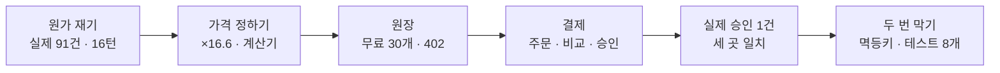
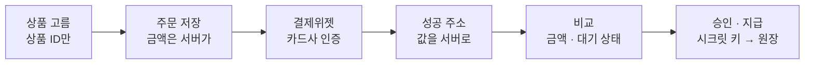

# N056 실습과제 제출보고서 — 메시지 한 건에 얼마가 들고, 그 돈은 안전하게 들어오는가?

> 버전 1.0 · 2026-11-04 · 대상 서비스 AI 친구 에이전트(friend-agent) · 근거 `실습\N056_실습_진행기록.md` 0~11절 · 실행 주체는 표에 사용자 / Claude로 적었다

**한눈에 보기**

**테스트 195 → 220개 통과(작업 브랜치 `n056-credits`, 커밋 3개, push 안 함) · 메시지 한 건 원가 평균 약 0.61원(실제 91건, 1,400원/달러 가정) · 실제 테스트 결제 1건 승인, 토스·주문·원장 세 곳 기록 일치(크레딧 30 → 130 → 129)**
  ↳ 크레딧 원장·결제위젯·멱등키를 붙였다. 실제 승인은 사용자가 본인 카드 앱으로 카드사 인증을 한 1건뿐이고, 같은 결제가 두 번 오는 경우와 금액 조작·남의 주문·승인 실패는 가짜 승인 응답 테스트로 확인했다. 교안에 없던 문제 둘(결제창을 닫으면 주문이 대기로 남음, 접속 로그에 결제 키 전체)을 실제로 겪고 고쳤다

- **문제** — 무료로 열어 둔 AI 친구 서비스는 메시지마다 LLM 비용이 나가는데 아무도 내지 않는다. 얼마가 드는지, 무료로 얼마까지 줄지, 넘으면 얼마를 받을지, 돈을 어떻게 안전하게 받을지가 정해져 있지 않았다.
- **원인** — 비용이 사용자 수가 아니라 **사용량**에 비례한다. 내 서비스 기준 하루 3,000개 계정은 보통 사용자 약 167명분을 쓴다 [추론]. 그리고 돈이 오가는 길(화면 → 서버 → 토스)은 브라우저가 보내는 값을 그대로 믿으면 금액 조작·중복 지급이 생긴다.
- **해결** — 원가를 Langfuse로 재고, 교안 계산기 식으로 무료 한도를 정한 뒤(가입 무료 30개·메시지당 1개), 크레딧을 **원장**으로 두고 서버에서만 차감했다. 결제는 주문을 먼저 저장 → 서버가 금액을 비교 → 시크릿 키로 승인 → 그 뒤에만 지급하고, 승인 요청에 **멱등키(주문 번호)**를 넣었다.
- **현재 판단 [추론]** — 로컬 + 시험용 Supabase + 토스 테스트 환경에서는 "쓴 만큼 낸다"가 작동한다. 그러나 게스트를 새로 만들어 무료분을 반복해 받는 것과 요청이 몰리는 것은 아직 못 막고, Cloud Run staging·production 서비스에는 오늘 코드와 결제 키를 올리지 않았다(DB 마이그레이션 0002·0003은 시험용 Supabase `friend-agent-staging`에 실행).

`근거 [확인] 54 · [추론] 13 · [미확인] 5 · 요구 8개 중 5개 완료·1개 일부·2개 하지 않음`

| 요구(교안 1장 학습목표 5개 + 6장 staging·확인 목록) | 상태 | 근거 숫자 |
|---|---|---|
| ① Langfuse로 메시지 한 건 원가를 재고 사용자 유형별 한 달 원가를 계산한다 | ✅ | 실제 91건 평균 0.000435달러·상위 10% 0.000519달러, 16턴 대화 1.42배, 유형별 약 365원·6,100원·6만 1,000원 |
| ② 두 모델의 원가와 답을 비교하고 가격과 무료 한도를 정한다 | ✅ | 10개 메시지 ×16.6, 사용자 판정 7:3, 계산기(내 원가) 무료 3개 +86,541원 → 상품 3개·가입 무료 30개 |
| ③ 크레딧을 원장으로 설계하고 서버에서만 차감한다 | ✅ | `credit_ledger`·DB 함수, 30 → 29 → 0 → 402, 브라우저 열쇠로 함수 401 |
| ④ 결제 흐름을 시퀀스로 설명하고 토스 테스트 결제로 구현한다 | ✅ | 실행 확인 1~6번, 실제 승인 1건(`DONE`·1,000원), 세 곳 기록 일치 |
| ⑤ 두 번 승인·금액 조작에도 크레딧이 잘못 지급되지 않음을 시험으로 확인한다 | ✅ | 결제 테스트 8개(교안 4가지 + 4), 일부러 깨면 4개·2개 실패, 브라우저 새로고침 토스 호출 0번 |
| ⑥ 확인 목록 7항목 점검 | 🔶 | 6항목 통과, '서버 로그에 paymentKey 전체가 없음'은 **처음 실패** → 접속 로그를 가려 통과(Cloud Run 앞단 로그는 못 가림) |
| ⑦ 토스페이먼츠 MCP 연결 | ⚪ | 이 세션에 연결하지 않았다. 대신 LLM Quick Reference·공식 샘플·`.md` 원문을 근거로 썼다 |
| ⑧ staging에 결제 키 연결 | ⚪ | 하지 않았다(코드 push·PR도 안 함) |

▸ 이 문서에 대해 (접기)
  - 작성일 2026-11-04. 숫자와 사건은 `실습\N056_실습_진행기록.md`에서만 가져왔고, 없는 것은 "기록 없음"이라 적었다.
  - 원자료(JSON)와 같은 조회를 다시 돌리는 확인 스크립트는 `실습\확인스크립트\`에 있다(키 값 없음).
  - **증거 화면은 폴더에 저장하지 않았다.** Supabase SQL Editor·결제위젯·카드사 창·충전 팝업 캡처는 사용자가 대화에서 보여 줬다(부록의 증거 화면 목록).
  - 원 단위는 모두 **1,400원/달러 가정**이다(오늘 고시 환율을 찾지 못해 사용자가 이 가정으로 진행하기로 했다).
  - 시간대: 화면·토스 승인 시각은 한국 시간, DB·로그 시각은 UTC다.
  - 가린 정보: API 키·결제 키(앞 4자만)·Supabase 프로젝트 주소·사용자 UUID(앞 8자만)·주문 번호(앞 10자만).
  - 환경: 저장소 가상환경(`.venv`), `langfuse` 5.1.0, 답 모델 gpt-4o-mini(비교 때만 gpt-4o), 시험용 Supabase `friend-agent-staging`, 토스페이먼츠 결제위젯 v2 + 문서용 테스트 키.

> 🏷️ 근거 표시 — [확인] 진행기록이 관찰하거나 실행한 출력으로 적은 것 · [추론] 기록에서 판단했거나 계산한 것 · [미확인] 이번에 확인하지 못했거나 하지 않은 것

> ❓ 시작 질문 — 아침에 "무료로 열어 둔 서비스에서 한 사람이 하루 300개를 보내면 무엇이 문제이고 무엇을 정해야 하나?"를 적었다. 끝에서(14절) 다시 읽는다.

## 1. 이 문서를 읽는 법

용어는 경영 비유로 바꿔 읽는다. 큰 틀은 **선불 충전 카드를 파는 가게의 회계**다. 원재료비를 알고, 판촉(무료분)을 얼마나 줄지 정하고, 충전·사용 내역을 장부에 쌓고, 카드 매출은 발주서와 대조한 뒤에만 인정한다.

| 용어 | 쉬운 말 | 경영으로 말하면 (단, 어긋나는 곳) |
|---|---|---|
| 메시지 한 건 원가 | 메시지 하나에 드는 LLM 호출 요금의 합 | 커피 한 잔의 원재료비 (단, 대화가 길수록 한 잔 값이 오른다) |
| 무료 한도 | 처음 온 사람에게 거저 주는 양 | 신규 고객 판촉 (단, 계정을 새로 만들면 또 받을 수 있다) |
| 크레딧 원장 | 늘고 준 기록을 한 줄씩 쌓는 표, 잔액은 그 합 | 분개장 (단, 같은 거래가 두 번 들어오지 않게 참조 번호를 유일하게 둔다) |
| 402 | 결제가 필요하다는 응답 | "선불 잔액이 없습니다" 안내 |
| 결제 인증 · 승인 | 사용자가 카드사 확인을 마침 · 서버가 확정을 요청해 받음 | 손님이 카드를 내민 것 · 카드사 승인 문자 |
| 금액 비교 | 돌아온 금액을 서버가 저장한 주문 금액과 맞춰 봄 | 세금계산서를 발주서와 대조 |
| 세 곳 기록 | 토스 결제·우리 주문·원장 | 카드사 정산·판매 전표·포인트 장부 대사 |
| 멱등키 | 같은 주문이면 늘 같은 값을 승인 요청에 붙임 | 중복 지급을 막는 결재 번호 (단, 번호를 요청마다 새로 매기면 아무것도 못 막는다) |
| 세 겹 장치 | 주문 상태·원장 참조·멱등키 | 내부통제 3선(현업 확인·시스템 통제·거래처 통제) |

그림 색 규칙: 이 문서의 그림 색은 단계를 구분할 뿐 성공·실패를 뜻하지 않는다. 비유는 읽기 쉽게 하려는 것이고, 근거는 각 절의 `[확인]` 표시를 본다.

▼ 그림 1 · 오늘의 큰 흐름 — 먼저 원가와 가격을 정하고, 장부를 만든 뒤, 돈이 들어오는 길과 두 번 들어오지 않게 하는 장치를 붙였다

<!-- flow: 그림 1. 오늘의 흐름. 앞 셋은 숫자로 정하는 일, 뒤 셋은 돈의 길을 만드는 일이다. | 원가 재기/실제 91건 · 16턴/1 ; 가격 정하기/×16.6 · 계산기/2 ; 원장/30개 · 402/3 ; 결제/주문 · 비교 · 승인/4 ; 실제 승인/세 곳 일치/1 ; 두 번 막기/멱등키 · 테스트 8개/2 -->


```text
원가 재기 → 가격·무료 한도 → 크레딧 원장 → 결제(주문·비교·승인) → 실제 승인 1건 → 두 번 막기(멱등키)
```
<!-- /flow -->

읽는 법: 앞 두 칸은 코드를 고치지 않고 숫자로 정한 일이다. 세 번째 칸부터 코드를 바꿨고(커밋 3개), 다섯 번째 칸은 사용자가 직접 결제해 확인한 일이다.

## 2. 시작 전에 무엇을 맞췄나? (교안 2장 "시작 상태")

이 절의 목적: 어떤 코드에서 출발했는지, 키를 어떻게 보호했는지 남긴다.

| 한 일 | 결과 | 누가 | 한계 |
|---|---|---|---|
| 저장소·브랜치 | `n055-eval`(PR #42 열림, 머지 안 함)에서 작업 브랜치 `n056-credits`를 새로 땄다 [확인] | 사용자 결정·Claude | PR #42가 머지되기 전까지 N056 PR에 N055 커밋이 함께 보인다 |
| 테스트 기준선 | `pytest` **195 passed**(N055 최종과 같음) [확인] | Claude | — |
| 확인 명령 3개 | 가상환경 `import httpx` 정상, `STORAGE=supabase` 1, `LLM_PROVIDER=fake` 0 [확인] | 사용자 | PowerShell에 `grep`이 없어 `Select-String`으로 바꿔 줬다 |
| `.env` | **Claude는 열지 않았다**. 키는 앱이 읽은 설정의 접두사·길이로만 확인 [확인] | Claude | — |

**교재와 다르게 한 것**: 교안의 시작 상태 문서에 '원가와 결제' 전용 행은 없었다(템플릿 최신본도 같음). "그 뒤의 실습"(A~I)이 그대로 적용됐다 [확인].

> ▶ **한 줄 요약** — 최신 N055 코드에서 출발했고, 키는 열지 않고 지켰다.

## 3. 메시지 한 건에 실제로 얼마가 들었나? (교안 2장)

이 절의 목적: 교안의 1.5원이 아니라 내 서비스의 숫자를 얻는다.

| 한 일 | 결과 | 누가 | 한계 |
|---|---|---|---|
| Langfuse 비용 칸 | 가격표가 gpt-4o-mini를 알고 있어 **모델 정의 추가가 필요 없었다**(입력 0.15·출력 0.60달러/100만 토큰) [확인] | Claude | — |
| 최근 7일 실제 대화 | 91건(가짜 LLM 4건 제외): 평균 0.000435달러(약 0.61원), 중앙값 약 0.58원, 상위 10% 0.000519달러(약 0.73원), 최대 약 1.06원 [확인] | Claude | 환경 셋(default·local·staging)이 섞여 있다 |
| 16턴 대화 | 한 대화에서 실제로 16턴을 보냄(합계 약 10원). 첫 메시지 약 0.48원 → 10번째 이후 평균 약 0.68원(1.42배) [확인] | Claude | 대화 하나, 메시지 종류를 섞은 한 번의 표본 |
| 사용자 유형별 한 달 | 보통(20개) 약 365원 · 많이 씀(300개) 약 6,100원 · 악용(3,000개) 약 6만 1,000원 [추론] | Claude | 뒤의 둘은 10번째 이후 비용으로 계산 |

**교재와 다르게 나온 것**:
- 교안은 "대개 답 만들기 호출이 가장 비싸다"고 하지만 내 서비스는 **도구 선택이 비용의 42.2%**였다(답 만들기 34.4%·기억 정리 21.9%·요약 1.5%, 91건 중 67건에서 가장 비쌈) [확인]. 도구 설명 때문에 도구 선택 입력이 처음부터 약 1,000토큰이고 답이 짧기 때문이다(출력 평균 36토큰) [추론]. 긴 대화 뒤쪽에서는 답 만들기가 조금 더 비싸져 교안 설명에 가까워졌다.
- 교안은 호출을 세 번으로 적지만 91건 중 3건은 **네 번**이었다(대화가 쌓이면 요약 호출이 붙음) [확인].
- 답 만들기 입력은 519 → 11턴째 약 1,200토큰에서 멈췄다 — 교안의 "최근 10턴까지만 넣어 열 턴 남짓에서 멈춘다"와 같다 [확인].

> ▶ **한 줄 요약** — 내 서비스는 메시지 한 건 약 0.61원으로 교안 예시의 절반 아래지만, 한 사람이 많이 쓰면 비용이 그대로 늘어나는 구조는 같다.

## 4. 큰 모델로 바꾸면 얼마나 비싸고, 얼마나 나아지나? (교안 3장)

이 절의 목적: 모델 선택이 원가에 얼마나 큰 변수인지 숫자로 본다.

| 한 일 | 결과 | 누가 | 한계 |
|---|---|---|---|
| 모델 바꾸기 | `.env`를 고치지 않고 스크립트 안에서만 `LLM_MODEL`을 정해 바꿨다(앱이 이미 있는 환경변수를 덮지 않으므로) [확인] | Claude | 교안의 '서버 재시작'과 같은 효과 |
| 같은 메시지 10개 | gpt-4o-mini 합계 약 6.2원 · gpt-4o 약 103원, **×16.6**, 답 길이 45~46토큰으로 비슷 [확인] | Claude | 열 개를 눈으로 읽는 비교는 감을 잡는 정도(교안) |
| 답 나란히 읽기 | 큰 모델이 더 나음 **7개**(1·2·4·5·6·7·8번), 작은 모델 3개(3·9·10번) [확인] | 사용자 판정 | a/b를 '왼쪽 열 = mini'로 읽었다 |
| 차이가 큰 곳 | 4번 '이번 달에 쉬는 날': mini가 도구를 안 골라 "11월 11일 임시공휴일"을 **지어냄**(도구 선택 단계). 7번 약속: 두 모델 모두 알림을 맞게 저장했는데 **답이 그것과 어긋남**(답 만들기 단계) [확인] | Claude(트레이스) | 범위 밖이라 고치지 않고 평가 데이터 후보로 적음 |

**교재와 다르게 판단한 것**: 교안대로라면 차이가 많으니 '답 만들기에만 큰 모델'을 검토할 차례다. 그러나 4번처럼 도구 선택에서 갈린 실패는 그걸로 안 고쳐지고 [추론], 모든 호출을 gpt-4o로 바꾸면 메시지당 약 10.3원이라 크레딧 10원에 팔수록 손해다(5절). 모델은 바꾸지 않았다.

> ▶ **한 줄 요약** — 큰 모델은 10개 중 7개에서 나았지만 16.6배 비싸고, 실패의 일부는 모델이 아니라 단계 설계의 문제였다.

## 5. 무료로 얼마나 주면 적자가 나지 않나? (교안 3장 계산기)

이 절의 목적: 가격과 무료 한도를 내 원가로 정한다.

교안의 웹 계산기는 PDF에 없어 강의노트의 `[보충 검산]` 식을 코드로 옮겼다(`s4_pricing_calc.py`). 먼저 교안 원가 1.5원을 넣어 **−403,110원**이 나와 강의노트 검산과 같은지 확인한 뒤 [확인], 내 원가(상위 10%) 0.73원을 넣었다. 사용자 1,000명·하루 20개·전환율 5%·고정비 7만 5,000원은 **교안 기본값을 빌린 가정**이다.

| 경우 | 크레딧 1개 마진 | 한 달 손익 |
|---|---|---|
| 무료 하루 10개, 크레딧 10원 | 8.90원 | **−159,489원** |
| 가격 2배(20원) | 18.53원 | −15,099원 |
| 무료 5개 | 8.90원 | +16,246원 |
| 무료 3개 | 8.90원 | **+86,541원** |
| 모든 호출을 gpt-4o로(10.3원) | **−0.67원** | 무료 0개여도 −95,130원 |

- 손익이 0이 되는 하루 무료 한도는 내 원가에서 약 5.5개, 교안 원가에서 약 3개다(둘 다 전환율 5% 등 교안 가정) [추론]. 교안의 결론 — 가격 인상보다 무료 한도가 손익을 더 크게 바꾼다 — 이 내 숫자에서도 그대로였다.

**정한 값(사용자)**: 메시지 1개 = 크레딧 1개 · 상품표는 교안 예 3개(1,000원/100개 · 5,000원/550개 · 10,000원/1,200개) · **가입 때 무료 30개 한 번, 하루 무료 없음**(게스트를 새로 만들어도 계정당 원가 약 22원에서 멈춘다) [확인].

> ▶ **한 줄 요약** — 교안 가정(사용자 1,000명·전환율 5%)으로는 무료 한도를 하루 5.5개 아래로 두면 흑자, 그래서 '하루 무료' 대신 '가입 때 30개 한 번'으로 정했다.

## 6. 크레딧은 어떻게 늘고 줄게 했나? (교안 4장)

이 절의 목적: 잔액을 덮어쓰지 않는 장부를 만들고, 차감을 서버에만 둔다.

| 정한 것 | 값 | 누가 |
|---|---|---|
| 차감 시점 · 실패 시 | 받자마자 · 되돌리는 줄(`refund:chat:…`) | 사용자 |
| 크레딧 0일 때 | 402, "크레딧을 다 썼어요. 충전하면 바로 이어서 이야기할 수 있어요." | 사용자 |
| (교안에 없음) '내 데이터 삭제' 때 원장 | **남긴다** — 지우면 무료 30개를 다시 받고 산 크레딧도 사라진다 | 사용자 |
| (교안에 없음) 위기 표현 메시지 | 크레딧을 받지도 거절하지도 않는다 — 크레딧 0인 사람에게도 109 안내가 나가야 한다 | Claude 판단 |
| 동시 요청 | DB 함수 `spend_credit` 하나에 사용자별 잠금, 브라우저 역할의 실행 권한 회수 | Claude 판단 |

| 확인 | 결과 | 누가 |
|---|---|---|
| 테스트 | 9개 추가(잔액 1에 동시 10개면 1개만 통과 포함) → 204 passed. 402 거절을 일부러 끄면 해당 테스트 실패 [확인] | Claude |
| 마이그레이션 | 사용자가 SQL Editor에서 `0002_credits.sql` 실행 — "Success. No rows returned" [확인] | 사용자 |
| 권한 | 서버 열쇠로 함수 200 · 브라우저 열쇠로 함수 **401(42501)** · 원장 조회는 빈 목록 [확인] | Claude |
| 화면 | 메모리 확인 서버(무료 3개): 3 → 0 → 거절 문구·입력창 유지, 개발자 도구로 직접 불러도 402. 실제 환경(시험용 Supabase): '크레딧 30' → 메시지 뒤 29 → 서버 열쇠로 `adjust −29`를 쌓아 0 → 거절 문구, 같은 게스트의 로그인 토큰으로 직접 불러도 402 [확인] | Claude(내장 브라우저) |

**막혔던 일**: SQL을 클립보드로 복사하는 PowerShell 명령이 사용자 쪽에서 붙여 넣을 내용을 만들지 못해, SQL 전문을 대화창에 실어 복사하게 했다 [확인].

> ▶ **한 줄 요약** — 크레딧은 줄 단위 장부로 두고 서버만 뺀다. 결제가 안전 응답을 막지 않게 위기 표현은 따로 뺐다.

## 7. 교안의 테스트 키는 어디에 있었나? (교안 6장 "테스트 키 넣기")

이 절의 목적: 교안과 실제 문서가 다른 곳을 남긴다.

- 교안은 "결제위젯 연동 문서의 코드 예제에서 문서용 테스트 키를 찾으라"고 한다. 오늘 연동 문서는 로그인하지 않은 브라우저로 열어도 **`{WIDGET_CLIENT_KEY}` 같은 자리표시자만** 보였다(사용자 화면과 Claude 내장 브라우저 모두) [확인].
- 토스의 API 키 안내는 여전히 "신청 전에는 문서에 있는 테스트 키로" 하라고 한다 [확인]. 결국 **토스 공식 샘플 저장소** `tosspayments/tosspayments-sample`에서 결제위젯용 문서 키 한 세트를 찾았다 [확인].
- 사용자가 `.env`에 두 줄을 넣었고, Claude는 앱이 읽은 설정으로 **접두사만** 확인했다(`test_gck_`·`test_gsk_` 각 38자) [확인].
- 토스페이먼츠 MCP는 추가해도 이 세션에는 적용되지 않아 연결하지 않았고, 사용자가 준 AI 연동 안내에 따라 LLM Quick Reference·공식 샘플·문서 `.md` 원문을 근거로 썼다 [확인].

> ▶ **한 줄 요약** — 교안의 "문서에 공개된 테스트 키"는 지금 문서에서 사라져 있었고, 공식 샘플에서 찾았다.

## 8. 결제를 붙이고 실제로 승인까지 갔나? (교안 5·6장)

이 절의 목적: 시퀀스 1~9를 실제 코드와 실제 결제로 확인한다.

**만든 것**: 상품표 한 곳(`app/payments.py`) · `orders` 테이블(`0003_orders.sql`, 사용자가 실행) · 상품 ID만 받는 주문 저장 · 금액·상태를 비교한 뒤 시크릿 키로 승인 · 크레딧 안내 팝업 · 성공·실패 페이지 · 결제 테스트 7개 → 211 passed [확인].

▼ 그림 2 · 결제 흐름 — 브라우저를 거쳐 온 값은 고칠 수 있으므로, 서버가 자기 장부와 맞춰 본 뒤에만 승인한다

<!-- flow: 그림 2. 결제 흐름. 6번(금액·상태 비교)이 핵심이다. | 상품 고름/상품 ID만/1 ; 주문 저장/금액은 서버가/2 ; 결제위젯/카드사 인증/3 ; 성공 주소/값을 서버로/2 ; 비교/금액 · 대기 상태/4 ; 승인 · 지급/시크릿 키 → 원장/1 -->


```text
상품 고름 → 주문 저장(대기) → 결제위젯·카드사 인증 → 성공 주소 → [저장 금액 = amount? 대기?] → 승인 → 주문 완료 + 원장 +크레딧
```
<!-- /flow -->

읽는 법: 왼쪽 네 칸은 브라우저와 토스를 오가는 길이고, 다섯 번째 칸에서 서버가 2번 칸에 스스로 적어 둔 금액과 대조한다. 맞을 때만 마지막 칸으로 간다.

| 교안 실행 확인 | 결과 | 누가 |
|---|---|---|
| 1. 팝업 | 남은 크레딧·차감 규칙·상품 3개(1개 10·9.1·8.3원)·안내·게스트 경고 다섯 가지 [확인] | 사용자(크롬) |
| 2. 0일 때 거절과 팝업 | 거절 문구와 함께 팝업, 입력창 유지, 입력창 위 '크레딧 사기' 띠 [확인] | Claude(내장 브라우저) |
| 3. 결제위젯·주문 대기 | 팝업 안 결제위젯("테스트 환경이에요"), 결제 전에 `POST /api/orders` [확인] | 사용자 |
| 4. 끝까지 결제 | 우리카드(실제 WON카드 앱)·토스페이(실제 휴대폰·생년월일)·현대카드(앱카드·실제 PIN)는 개인정보·비밀번호라 멈춤 → 사용자가 **본인 카드 앱으로 카드사 인증을 해 1건 승인**, "100개를 충전했어요. 지금 잔액 130개예요." [확인] | 사용자 |
| 5. 세 곳 기록 | 토스 결제 조회 `DONE`·1,000원·카드·11:53:47 / orders `paid`·approved_at / 원장 `purchase +100`(참조 = 주문 번호), 합계 130 [확인] | Claude |
| 6. 충전한 크레딧으로 메시지 | 130 → **129**, 원장 `chat −1` [확인] | 사용자 |

**교재와 다르게 나온 것**:
- **결제창을 닫으면 실패 페이지로 오지 않았다.** 교안은 취소 → 실패 페이지 → 주문 실패를 기대하지만, PC 결제창을 닫자 결제위젯이 화면 안에서 "취소되었습니다" 오류만 돌려줘 **주문이 대기로 남았다** [확인]. 그때도 주문을 실패로 바꾸고 새 주문으로 다시 시작하게 고쳤고, 고친 뒤 `USER_CANCEL`로 실패 처리되는 것을 확인했다 [확인]. 고치기 전 주문 1개는 대기로 남겨 뒀다.
- 카드 없이도 승인 API 연결을 확인했다: 없는 결제 키로 승인을 요청하면 404 `NOT_FOUND_PAYMENT_SESSION`(열쇠 통과), 일부러 콜론을 뺀 인증 헤더는 401 `UNAUTHORIZED_KEY` [확인].
- **(Claude 실수)** 현대카드 화면에서 "문서용 테스트 키로는 실제 비밀번호나 앱 인증 없이 승인까지 가기 어렵다"고 좁게 말했다. 카드사 본인 확인은 테스트 환경에서도 실제로 이뤄지지만 그 뒤 승인은 가상이라, 본인 카드 앱으로 인증하면 승인을 볼 수 있었다. 사용자 질문("정상적으로 승인이 나는 것은 볼 수 없는 거야?")에 바로잡았다 [확인].

> ▶ **한 줄 요약** — 실제 결제 1건이 승인돼 세 곳 기록이 맞았고, 교안의 기대와 다른 '창 닫기' 동작을 실제로 겪고 고쳤다.

## 9. 확인 목록의 마지막 한 줄은 왜 처음에 실패했나? (교안 6장 확인 목록)

이 절의 목적: 검사 목록이 실제로 잡은 문제를 남긴다.

| 확인할 것 | 결과 |
|---|---|
| 상품표가 서버 한 곳 | `PRODUCTS` 한 곳, 화면 코드에 금액 없음 [확인] |
| 주문이 상품 ID만 받음 | 화면이 금액 100·크레딧 1,200을 덧붙여 보내도 1,000원/100개(테스트) [확인] |
| orders 칸·RLS | 마이그레이션·브라우저 열쇠로 빈 목록 [확인] |
| 주문 번호 무작위 | `ord_` + 32자 [확인] |
| 시크릿 키는 서버만 | `/api/config`에 `test_gsk` 없음(실제 서버·테스트) [확인] |
| 크레딧을 늘리는 곳 | 가입 지급·답 실패 되돌림·승인 성공 뒤 구매 세 곳뿐, 화면은 늘리지 않음 [확인] |
| 서버 로그에 시크릿 키·paymentKey 전체 없음 | 시크릿 키 0건. 그러나 **웹 서버 접속 로그에 성공 주소가 통째로 찍혀 paymentKey 전체가 남았다** [확인] → 앞 4자만 남기고 가리게 고침, 다시 확인 `paymentKey=tgen***` [확인] |

- 원인은 우리 코드의 로그가 아니라 uvicorn 접속 로그였다. 코드만 읽어서는 못 찾고, 교안대로 **실제 결제 뒤 로그를 검색**해서 찾았다 [확인].
- 한계: Cloud Run에 배포하면 앱 앞단(Google 프런트엔드)의 요청 로그가 주소 전체를 따로 남긴다. 이 필터로는 못 가린다 [미확인 — staging에 붙이지 않음].

> ▶ **한 줄 요약** — 확인 목록의 한 줄을 실제로 검색해 보니, 코드 밖의 접속 로그가 결제 키를 남기고 있었다.

## 10. 같은 결제가 두 번 오면? (교안 7장)

이 절의 목적: 새로고침·재시도·동시 요청에도 크레딧이 한 번만 들어가는지 확인한다.

| 한 일 | 결과 | 누가 |
|---|---|---|
| 멱등키를 보내는지 | 교안 예상대로 **보내지 않았다**(6장에서 일부러 남긴 자리) [확인] | Claude |
| 키 값 | **주문 번호 그대로** | 사용자 결정 |
| 구현 | 승인 요청 헤더 `Idempotency-Key`, 요청마다 order_id·키를 로그에, 409면 같은 키로 1초 뒤 다시(최대 3번), (교안에 없음) 완료 주문인데 원장 줄이 빠졌으면 새로고침 때 한 번만 채움 [확인] | Claude |
| 테스트 8개 | 교안 4가지(같은 요청 두 번·금액 조작·남의 주문·승인 실패 — 조작과 남의 주문은 가짜 승인 API 0번 호출) + 둘 다 '대기'를 읽은 동시 두 번(토스 호출 2번·실제 승인 1번·원장 1줄)·409·응답 없음·빠진 크레딧 → **220 passed** [확인] | Claude |
| 일부러 깨 보기 | 멱등키를 요청마다 새 값으로 → 4개 실패 · 주문 상태 확인을 끔 → 2개 실패(이때도 크레딧은 한 번) [확인] | Claude |
| 브라우저 새로고침 | "이미 충전된 결제예요(100개). 지금 잔액 129개예요." · 확인 요청 2번, **토스 호출 0번** · purchase 줄 1개 [확인] | 사용자 |

- 한계: 세 번째 겹(멱등키)을 실제 토스에 같은 키로 두 번 보내 본 것은 아니다. 새로고침은 첫 번째 겹에서 멈춘다. 멱등키는 가짜 승인 API 테스트까지가 근거다 [미확인].
- 이해 점검: 사용자는 "원장 참고 또는 멱등키가 막아 줄 것이다"라고 답했다(막는 장치 둘을 맞게 짚음, 질문의 뒷부분은 빠짐). '없었다면' 부분 — 원장 참조가 없으면 크레딧이 두 번, 멱등키가 없으면 두 번째 요청이 '이미 처리된 결제' 오류를 받아 돈은 빠졌는데 주문이 실패로 표시될 수 있다 — 은 보충했다 [추론].

> ▶ **한 줄 요약** — 세 겹이 겹쳐 있어 한 겹을 꺼도 크레딧은 한 번이었다. 실제 브라우저에서는 첫 겹이 토스까지 가기 전에 막았다.

## 11. 사고·문제 표

| 변경 | 결과 | 사용자에게 보였을 것 | 원인을 찾은 곳 | 처리 |
|---|---|---|---|---|
| 6장 결제창(취소 처리는 실패 페이지만) | PC 결제창을 닫으면 주문이 대기로 남음 | "취소되었습니다"만 뜨고 같은 결제 화면이 그대로 | 서버 로그에 `/api/payments/fail` 호출이 없음 | 화면이 오류를 받으면 주문을 실패로, 새 주문으로 다시 시작 |
| 6장 성공 주소 | 접속 로그에 paymentKey 전체 | (사용자에게는 안 보임, 로그를 보는 사람에게 보임) | 실제 결제 뒤 서버 로그 검색 | 앞 4자만 남기고 가림 |
| 7장 승인 함수 서명 변경 | 6장 테스트의 가짜 함수가 멱등키 인자를 못 받음 | — | 테스트 | 6장 테스트의 가짜 함수에 인자를 더하고 키가 주문 번호인지도 확인 |
| 화면 확인용 서버 설정 | 엉뚱한 서버(hallyu-researcher-demo)가 뜸 | — | 미리보기 도구가 작업 폴더의 다른 설정 파일을 읽음 | 바로 멈추고 맞는 설정 파일에 넣음 |
| 7장 새로고침 문구 | 새로고침할 때마다 "충전했어요"가 다시 떠 헷갈림 | 두 번 충전된 것처럼 보일 수 있음 | 사용자 시험 전에 Claude가 점검 | '이미 충전된 결제예요'로 바꿈(판단은 잔액·원장으로) |

## 12. 궁금했던 것

| 질문(사용자) | 답 |
|---|---|
| "열려 있는 이 에디터는 어떻게 해야 해?" | 앞서 실행한 SQL이 남아 있을 뿐이라 전부 지우고 새 SQL을 붙이거나 새 창을 열면 된다. 저장할 필요는 없다 |
| "내가 카드로 결제하면 되는 거야?"(우리카드가 실제 앱 결제로 막힌 뒤) | 카드로 해도 되지만 카드 번호가 필요 없는 토스페이·네이버페이를 먼저 권했고, 카드 비밀번호·실제 앱 로그인을 요구하면 멈추게 했다 |
| "정상적으로 승인이 나는 것은 볼 수 없는 거야?" | 볼 수 있다. 카드사 본인 확인은 실제로 이뤄지지만 그 뒤 승인은 가상이라 돈이 빠지지 않는다(토스 환경 가이드). 본인 카드 앱으로 인증해 1건 승인을 확인했다 |
| "이 화면에서 새로고침하면 되는 거야?" | 그 성공 주소에서 F5를 두세 번 누르면 7장 시험이 된다. 주소에 결제 키가 있어 실제 결제였다면 다른 곳에 붙이지 않는 편이 좋다 |

## 13. 내 서비스에 옮긴다면

아직 코드에 옮긴 것은 없다. 아래는 **계획**이고 해설서의 MSM·ASP 크레딧 수는 해설서가 덧붙인 예다.

| 교안 항목 | 내 서비스 | 판정 | 이유 |
|---|---|---|---|
| 작업 한 건 원가 재기(평균·비싼 쪽·길이별) | MSM(글 분석·웹소설 변환) | 적용 | 기능마다 입력 길이가 크게 달라 평균 하나로는 손해 위치를 모른다 [추론] |
| 메시지당 고정 차감 | MSM | 두지 않음 | 웹소설 변환처럼 작업마다 원가 차이가 크다. '기본 고정 + 비싼 기능만 더'가 맞다 [추론] |
| 크레딧 원장 + 서버 차감 | MSM·ASP | 적용 | 오늘 만든 구조를 그대로 쓸 수 있다 |
| 무료 한도 | ASP | 후순위 | 사용자 수·전환율이 아직 없어 계산기 가정만 있다 [미확인] |
| 비싼 AI 작업 자체의 멱등성 | MSM 웹소설 변환 | 적용 | 버튼 두 번이면 AI 비용·크레딧이 두 번(해설서 예). 작업 ID로 막는다 [추론] |
| 결제위젯 | 둘 다 | 후순위 | 전자결제 신청·환불 정책이 먼저다 |

## 14. 하지 않은 것 · 교재와 달라진 것

| 항목 | 하지 않은 이유 | 대가 |
|---|---|---|
| 토스페이먼츠 MCP 연결 | 추가해도 이 세션에 적용되지 않음 | 문서 `.md` 원문·공식 샘플을 직접 읽었다 |
| staging에 결제 키 연결·push·PR | 오늘은 로컬 + 시험용 Supabase까지 | Cloud Run 앞단 요청 로그의 결제 키 문제를 확인하지 못함 [미확인] |
| 실제 토스로 같은 멱등키 두 번 | 새로고침은 첫 겹에서 멈춤 | 세 번째 겹은 가짜 승인 API 테스트까지가 근거 [미확인] |
| 사진 읽기 추가 차감 | OCR 원가를 재지 않음 | 비싼 기능도 1개로 받는 상태 |
| 요청 속도 제한·하루 상한·계정 반복 생성 막기 | 교안 범위 밖 | 1장의 '다른 이용자 불편'은 유료화만으로 다 막히지 않는다 [추론] |
| 4번 지어냄·7번 약속 답 어긋남·"해줘"에 알림 안 만듦 | 원가·결제 범위 밖 | N055 평가 데이터셋 후보로만 적음 |
| 대기로 남은 주문 1개 정리 | 시험용 프로젝트, 승인 안 됨 | 기록으로 남김 |

## 15. 회고 — 시작 질문을 다시 읽으면

**1장의 답(사용자)**: 한 사람이 목적 외로 쓰거나 토큰·리소스를 다 써 버리면 서비스를 지속할 수 없다 → 로그인만 쓰게, 하루 개수 제한, 유료화.

**8장의 회고(사용자)**: "일정부분 무료체험분을 주고 나머지는 유료화함으로써 고객이용 편의성은 높이고 무분별한 사용으로 인한 다른 이용자 불편과 수익성 저하를 막을 수 있었습니다."

| 아침의 예상 | 실제 |
|---|---|
| 유료화하면 막힌다 | ✅ 쓴 만큼 낸다 — 메시지 1개 10원 안팎, 원가 약 0.7원 [추론] |
| 하루 개수를 제한한다 | △ 계산해 보니 하루 무료 5.5개를 넘으면 적자라, '가입 때 30개 한 번'으로 모양을 바꿨다 |
| 로그인 사용자만 쓰게 한다 | ✕ 아직 게스트도 쓴다 — 계정을 새로 만들면 무료 30개를 다시 받는다 |
| (예상 못 한 것) | 교안과 실제 문서·동작이 세 군데서 달랐고(테스트 키·창 닫기·카드사 인증), 확인 목록 한 줄이 코드 밖 로그의 결제 키를 잡았다 |

**일부러 안 한 것과 그 대가**: staging·production에 올리지 않았다. 그래서 돈의 길이 로컬에서는 맞다는 것까지만 말할 수 있고, 배포 환경의 로그·키 연결은 다음 일이다.

> 📌 **요약** — 원가표는 비용을 파악하고, 크레딧 한도는 비용을 통제하며, 결제는 서버가 대조한 뒤에만 인정한다. 오늘 그 뼈대가 내 서비스에서 실제 결제 1건으로 돌아갔고, 남은 것은 몰림과 계정 반복을 막는 일이다.

**가장 오래 막힌 곳**(사용자가 직접 씀): 결제 테스트를 하는데 막상 카드 값을 입력하려고 했더니 클로드가 막아서 몇 번 그만두고 다시 되풀이하는 장면이 많았다. 퍼실리테이터에게 물어서 결국 진행했고 결과는 좋았다.

- 대응하는 기록 [확인]: Claude가 카드사 창마다 "비밀번호·실제 앱 로그인을 요구하면 멈추라"고 안내했고(세 번 멈춤), 현대카드 화면에서 "승인까지 가기 어렵다"고 좁게 말했다. 테스트 환경에서는 카드사 인증 뒤 승인이 가상이라는 점을 처음부터 함께 말했으면 되풀이가 줄었을 것이다 [추론].

## 부록. 산출물 위치와 다시 돌려 보는 법

| 무엇 | 위치 |
|---|---|
| 진행기록(사실의 근거) | `강의정리\N056\실습\N056_실습_진행기록.md` |
| 확인 스크립트·원자료 | `강의정리\N056\실습\확인스크립트\` — `s1_cost_7days.py`(7일 원가)·`s2_long_conversation.py`(16턴)·`s3_compare_models.py`(두 모델)·`s4_pricing_calc.py`(계산기)·`s5_check_migration.py`(권한)·`s6_drain_test_guest.py`(잔액 0)·`s7_confirm_probe.py`(승인 API 연결)·`demo_server_*.py`(확인용 서버) |
| 코드 | `friend-agent` 브랜치 `n056-credits`: `67a1332`(원장)·`1bab1fc`(결제)·`899e1cd`(멱등키), push 안 함 |
| 강의노트 | `N056_원가를_계산하고_크레딧_결제_붙이기(credit-payment)` v1.1(v1.0은 `_판본_v1.0\`) |
| 함께 볼 문서 | `N056_오늘_학습정리` · `설명자료모음\N056_실습_설명자료` |

**증거 화면 목록(대화에서 사용자가 보여 줌, 폴더에 저장하지 않음)**: Supabase SQL Editor 결과 2장(0002·0003 "Success") · 크레딧 팝업 · 결제위젯 · 우리카드 앱 결제 창과 "결제정보가 없습니다" · 토스페이 휴대폰 번호 화면 · 취소 뒤 팝업 2장 · 현대카드 인증 선택 창 · "100개를 충전했어요. 지금 잔액 130개예요." · 메시지 뒤 '크레딧 129' · 새로고침 뒤 "이미 충전된 결제예요".

<p class="footer-note">N056 실습과제 제출보고서 v1.0 · 2026-11-04 · 근거 실습/N056_실습_진행기록.md</p>
