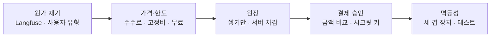
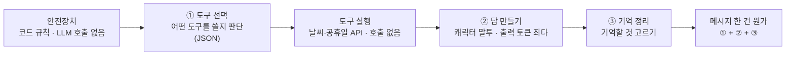
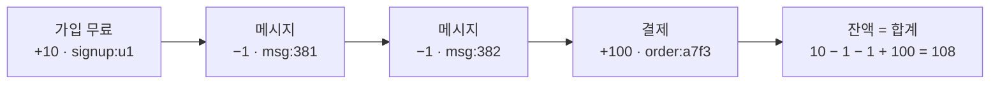
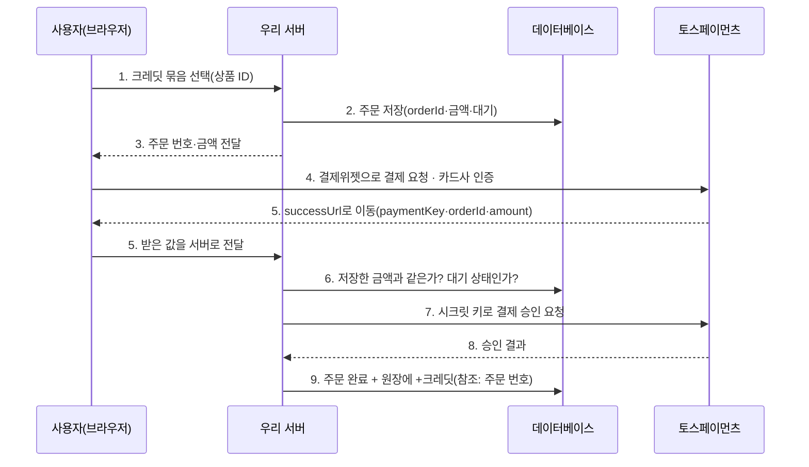
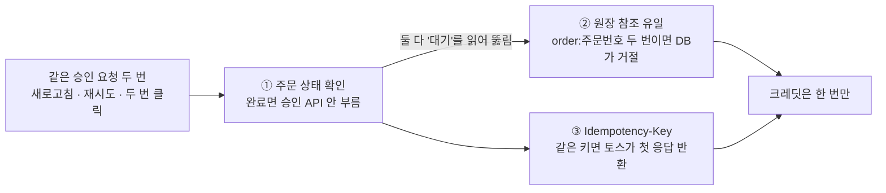
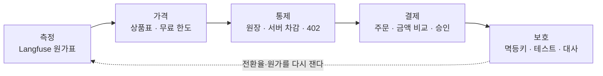

# N056 · 원가를 계산하고 크레딧 결제 붙이기

> 버전 1.1 · 2026-11-04 (학습서 27쪽 + 해설서 75쪽 통합 + **`[실습 결과]`** 덧붙임. friend-agent에 직접 해 본 결과를 장마다 덧붙였고, v1.0은 `_판본_v1.0/`에 그대로 보존. 근거는 `실습/N056_실습_진행기록.md`, 코드는 friend-agent 브랜치 `n056-credits` 커밋 3개)

## 목차

- [핵심 한 문장 요약](#핵심-한-문장-요약)
- [1. 무료로 열어 둔 서비스는 왜 위험한가? (원문 Ch01)](#1-무료로-열어-둔-서비스는-왜-위험한가-원문-ch01)
- [2. 메시지 한 건에 실제로 얼마가 드나? (원문 Ch02)](#2-메시지-한-건에-실제로-얼마가-드나-원문-ch02)
- [3. 모델·가격·무료 한도는 어떻게 정하나? (원문 Ch03)](#3-모델가격무료-한도는-어떻게-정하나-원문-ch03)
- [4. 크레딧은 왜 잔액 한 칸이 아니라 원장으로 두나? (원문 Ch04)](#4-크레딧은-왜-잔액-한-칸이-아니라-원장으로-두나-원문-ch04)
- [5. 결제는 언제 "끝났다"고 볼 수 있나? (원문 Ch05)](#5-결제는-언제-끝났다고-볼-수-있나-원문-ch05)
- [6. 테스트 결제는 어떻게 만들고 무엇을 확인하나? (원문 Ch06)](#6-테스트-결제는-어떻게-만들고-무엇을-확인하나-원문-ch06)
- [7. 같은 결제 요청이 두 번 오면 어떻게 막나? (원문 Ch07)](#7-같은-결제-요청이-두-번-오면-어떻게-막나-원문-ch07)
- [8. 오늘 배운 것은 무엇이고 아직 못 막는 것은 무엇인가? (원문 Ch08)](#8-오늘-배운-것은-무엇이고-아직-못-막는-것은-무엇인가-원문-ch08)
- [맺음말](#맺음말)
- [부록 A · 실전 코드·명령·프롬프트 모음](#부록-a--실전-코드명령프롬프트-모음)
- [부록 B · 트러블슈팅 표](#부록-b--트러블슈팅-표)
- [부록 C · AI 프롬프트 모음집](#부록-c--ai-프롬프트-모음집)
- [부록 D · 용어 사전](#부록-d--용어-사전)
- [부록 E · 개념 비교표 모음](#부록-e--개념-비교표-모음)
- [부록 F · 학습 로드맵](#부록-f--학습-로드맵)
- [부록 G · 복습 퀴즈](#부록-g--복습-퀴즈)

## 핵심 한 문장 요약

> 📌 **요약** — AI 서비스는 메시지 하나마다 **재료비(LLM 호출 비용)**가 나가므로, ① Langfuse 기록으로 메시지 한 건의 원가를 평균과 **비싼 쪽**까지 재고, ② 원가·결제 수수료·고정비·무료 한도로 크레딧 묶음 가격을 정하되 **한 달 손익을 가장 크게 바꾸는 것은 무료 한도**임을 계산으로 확인하며, ③ 크레딧을 잔액 한 칸이 아니라 **거래를 쌓는 원장**으로 두고 **서버에서만** 차감하고, ④ 결제는 브라우저가 "성공"이라고 알려 줄 때가 아니라 **서버가 저장한 금액과 비교한 뒤 시크릿 키로 승인을 받았을 때** 끝난 것으로 보며, ⑤ 같은 승인 요청이 두 번 와도 크레딧이 한 번만 들어가도록 **주문 상태 확인·원장 참조 유일·Idempotency-Key의 세 겹 장치**를 겹쳐 두고 테스트로 매번 확인한다.

> 🧪 **예제** — 한 줄 예: 메시지 한 건이 1.5원이면 보통 사용자(하루 20개)의 한 달 원가는 900원이라 신경 쓸 일이 아닌 것 같지만, 하루 300개를 보내는 사용자는 1만 3,500원, 자동화 악용 계정(하루 3,000개)은 13만 5,000원을 쓴다. 크레딧 1개를 10원에 팔아 개당 8원 넘게 남아도, 사용자 1,000명 중 5%만 사면 무료 사용자 950명의 원가(월 42만 7,500원) 때문에 **전체로는 한 달 40만 원 넘게 적자**다. 가격을 두 배로 올리는 것보다 무료 한도를 하루 10개에서 3개로 줄이는 쪽이 손익을 더 크게 바꾼다.

> 🧪 **예제** — `[실습 결과]` 한 줄 요약: friend-agent에 크레딧과 결제를 실제로 붙였다. 내 서비스의 메시지 한 건 원가는 최근 7일 실제 91건 평균 약 0.61원(상위 10% 약 0.73원, 1,400원/달러 가정)으로 교안 예시 1.5원의 절반 아래였지만, 하루 3,000개 계정이 보통 사용자 약 167명분을 쓰는 구조는 같았다. 같은 원가로 교안 계산기 식을 돌려도 가격 2배(약 −1.5만 원)보다 무료 한도 10→3개(약 +8.7만 원)가 손익을 더 크게 바꿨다(사용자 수·전환율·고정비는 교안 기본값을 빌린 가정). 크레딧 원장(가입 무료 30개·메시지당 1개·0이면 402), 토스페이먼츠 결제위젯 v2 테스트 결제, 멱등키(주문 번호)를 만들어 테스트 220개가 통과했고, 사용자가 본인 카드 앱으로 카드사 인증을 한 1건이 실제로 승인돼 토스·주문·원장 세 곳의 기록이 맞았다(30 → 130 → 메시지 뒤 129). 교안과 달랐던 것 셋(연동 문서에 문서용 테스트 키가 없어 공식 샘플 저장소에서 찾음, 카드사 본인 확인은 테스트 환경에서도 실제, PC 결제창을 닫으면 실패 페이지로 오지 않아 주문이 대기로 남음)과 확인 목록이 잡은 문제 하나(웹 서버 접속 로그에 결제 키 전체)가 있었고, 창 닫기와 접속 로그 둘을 고쳤다.

### 한눈에

- **무엇을 하나** — N046~N055에서 키운 AI 친구 에이전트 서비스(friend-agent)에 **돈의 흐름**을 붙인다. 지금까지 사용자가 보내는 메시지의 LLM 비용은 아무도 내지 않았다.
- **어떻게 배우나** — 내 서비스의 Langfuse 기록으로 원가를 재고, 계산기로 가격과 무료 한도를 정한 뒤, 크레딧 원장과 **토스페이먼츠 결제위젯 v2 테스트 결제**를 실제 결제 흐름과 똑같이 만든다(테스트 키라 실제 돈은 빠지지 않는다).
- **순서** — 원가 재기 → 가격·무료 한도 정하기 → 원장으로 크레딧 관리 → 결제 승인 흐름 → 중복 결제 막기(멱등성) → 테스트로 확인.
- **오늘의 교훈** — 좋은 답을 만드는 것만으로는 서비스가 지속되지 않는다. **원가를 알고, 사용량을 통제하고, 안전하게 돈을 받는 구조**가 있어야 AI 서비스가 사업이 된다.

### 비유 대응표

| 용어 | 쉬운 말 | 비유 |
|---|---|---|
| 원가 (cost) | 서비스를 제공하는 데 드는 돈 | 음식 한 그릇을 팔 때 들어가는 재료비 — AI 서비스는 메시지 하나마다 AI 사용료라는 재료비가 든다(해설서) |
| 변동비 / 고정비 | 사용량에 따라 느는 돈 / 사용량과 상관없이 매달 나가는 돈 | `[보충 비유]` 식당의 식자재비 / 월세 |
| 토큰 (token) | AI가 읽고 쓰는 글자 조각, 요금의 단위 | AI가 읽는 글자 조각과 생성하는 글자 조각(해설서) |
| 원가 구조 전체 | 원가 → 무료 한도 → 충전 → 과다 사용 | 휴대전화 데이터 요금제 — 1MB 사용료·매월 무료 데이터·데이터 추가 구매·데이터를 지나치게 많이 쓰는 고객(해설서) |
| 작은 모델 / 큰 모델 | 싸고 빠른 모델 / 비싸고 성능 좋은 모델 | 연비 좋은 소형차 / 성능과 승차감이 좋은 고급차 — 가까운 거리에 비싼 차가 꼭 필요하지는 않다(해설서) |
| 크레딧 (credit) | 미리 사 두고 메시지마다 1개씩 쓰는 이용권 | 카페의 선불 충전 카드(해설서) |
| 무료 한도 | 처음 온 사용자에게 무료로 주는 양 | 신규 고객에게 주는 무료 커피(해설서) |
| 원장 (ledger) | 크레딧이 늘고 준 기록을 한 줄씩 쌓기만 하는 테이블 | 은행 통장 — 잔액 숫자 하나만이 아니라 입금·출금·이체 내역이 모두 남는다(해설서) |
| 참조 (reference) | 원장 한 줄이 "무엇 때문인지"를 가리키는 유일한 이름 | 은행의 거래 고유번호(해설서) |
| 보상 거래 | 잘못된 줄을 지우지 않고 되돌리는 줄을 새로 쌓는 것 | 은행의 거래 취소(해설서) / `[보충 비유]` 회계의 역분개 |
| PG (결제 대행사) | 상점과 카드사 사이에서 결제를 대신 처리하는 회사 | 온라인 상점과 카드사 사이에서 결제를 중개하는 금융 전문 대리인(해설서) |
| 결제 인증 / 결제 승인 | 사용자가 카드사 확인을 마친 것 / 우리 서버가 "확정해 달라"고 요청해 승인받은 것 | 식당에서 손님이 카드와 신분을 확인받은 상태 / 식당이 카드사에 결제 확정을 요청해 승인받은 상태(해설서) |
| 클라이언트 키 / 시크릿 키 | 화면에 넣는 공개 키 / 서버에만 두는 비밀 키 | 결제 창을 열 수 있는 출입증 / 실제 돈을 움직일 수 있는 관리자 열쇠(해설서) |
| .env / .env.example | 실제 키를 넣는 파일 / 어떤 키가 필요한지 이름만 적은 파일 | 실제 열쇠를 보관하는 금고 / 금고에 필요한 열쇠 목록(해설서) |
| MCP | 코딩 에이전트가 외부 공식 문서를 직접 찾아 읽게 하는 연결 | 외부 전문가와 연결하는 통로, 공식 문서는 전문가가 참고하는 최신 업무 매뉴얼(해설서) |
| 서버 검증 | 금액과 승인을 서버가 직접 확인하는 것 | 돈이 실제로 들어왔는지 확인하는 직원(해설서) |
| 대사 (reconciliation) | 서로 다른 곳의 기록을 맞춰 보는 일 | 은행 통장과 회사 장부, 실제 매출 내역을 비교하는 것(해설서) |
| 멱등성 (idempotency) | 같은 요청을 여러 번 받아도 한 번 받은 것과 결과가 같은 성질 | 엘리베이터 1층 버튼 — 한 번 누르든 세 번 누르든 1층으로 간다(해설서) |

> 💡 **팁** — 비유의 한계: 카페 선불 카드와 은행 통장은 **사람이 창구에서 한 번씩** 처리하지만, 서비스에서는 같은 요청이 **거의 동시에 두 번** 들어오고 네트워크가 중간에 끊긴다. 그래서 "기록을 잘 남긴다"만으로는 모자라고, 두 요청이 같은 잔액이나 같은 주문을 **동시에 읽는 경우**까지 막는 장치(원장 참조 유일, 멱등키, 원자적 처리)가 따로 필요하다. 4장과 7장이 그 이야기다.

> 💡 **팁** — 문서에서 "학습서"(27쪽)는 실습 교안, "해설서"(75쪽)는 같은 교안을 쉽게 풀어 쓴 책이다. 두 책은 챕터 01~08이 1:1로 대응하고, 해설서는 장마다 "목적 → 개념 → 비유 → 내 프로젝트 적용 → 핵심 정리 → 퀴즈 해설 → 한 문장"으로 다시 쓴다. 학습서에는 명령·수치·표·요청 틀이 있고 비유는 거의 없으며, 해설서에는 음식점·카페 선불 카드·통장·엘리베이터 같은 비유와 퀴즈 정답이 있다. 그래서 이 노트는 **비유·쉬운 설명·정답은 해설서, 명령·수치·표·요청 틀은 학습서 원문**을 따랐다. `[보충]`·`[보충 비유]`·`[보충 검산]`·`[추가]`라고 표시한 것만 이 노트에서 덧붙인 것이다.

> ⚠️ **주의** — PDF를 정리하면서 바로잡거나 알아 둘 것. ① 학습서 본문의 "섹션 N"은 **챕터 N**이다(이 노트의 N장). ② 학습서의 웹 전용 **인터랙티브 요소 3개**(가격·손익 계산기, 결제 시퀀스 다이어그램, 세 겹 장치 시뮬레이터)는 PDF에 텍스트도 그림도 남지 않았다. 계산기는 본문 문장의 결과로 기본값을 거꾸로 맞춰 3장에 `[보충 검산]`으로 실었고, 시퀀스는 본문의 "그림을 따라 읽기" 문단과 해설서의 9단계 표로 5장에 다시 그렸다. ③ 학습서 객관식 3개에는 정답 표시가 없어 해설서의 정답·풀이를 합쳤다(부록 G). ④ 해설서의 MSM·ASP 적용 예(기능별 차감 크레딧 수, 원장 예시 +1,000 → 1,480 등)는 **원 강의의 수치가 아니라 해설서가 덧붙인 예**라서 8장에 모아 따로 표시했다. ⑤ 해설서 p54의 영상 편집 뉴스 링크(redsharknews)는 강의와 무관하게 잘못 들어간 것이라 뺐다. ⑥ "2026년 11월 기준"이 붙은 수치(OpenAI 단가, 토스페이먼츠 수수료 3.4%+부가세, Supabase Pro 월 25달러, Langfuse Core 월 29달러, 멱등키 15일)는 바뀔 수 있으니 도입 전에 최신 문서로 확인한다. ⑦ 학습서는 "서버 API 두 개"라고 쓰지만 표에는 API가 세 개(products·orders·confirm) 있다(6장).

> 🧪 **예제** — **원문끼리 표기가 다른 곳**이 있다. 원장 참조 접두사가 본문은 `order:주문번호`·`signup:사용자ID`, 학습서 그림은 `msg:381`·`order:a7f3`, 실제 화면 캡처는 `chat:…`·`payment:fa_…`이다. 가입 무료 크레딧도 학습서 표는 빈칸, 그림은 +10, 캡처는 20, 해설서는 +100이다. 주문 테이블도 본문은 `orders`인데 캡처의 테이블 목록에는 `payment_orders`가 보인다. **이름은 서비스마다 정하는 것**이고 중요한 것은 "참조가 유일하다"는 성질이므로, 이 노트는 본문 표기(`order:`, `signup:`, `orders`)로 통일했다.

---

## 1. 무료로 열어 둔 서비스는 왜 위험한가? (원문 Ch01)

### 1-1. 오늘의 상황

학습서 도입은 이렇게 시작한다.

> AI 친구 에이전트 서비스에서 사용자가 메시지를 하나 보낼 때마다 LLM API 비용이 나갑니다. 사용자가 늘수록 비용도 늘고, 지금은 그 비용을 아무도 내지 않습니다. 메시지 한 건에 실제로 얼마가 드는지, 무료로 얼마까지 줄 수 있는지, 넘어선 사용자에게는 얼마를 받아야 하는지, 그리고 돈을 받는 흐름은 어떻게 만들어야 안전한지를 오늘 차례로 정합니다. (학습서 p1)

해설서는 이것을 **결정해야 할 네 가지**로 바꿔 말한다.

1. 메시지 한 건을 처리하는 데 실제 얼마가 드는가?
2. 사용자에게 어느 정도까지 무료로 제공할 것인가?
3. 무료 한도를 초과하면 얼마를 받을 것인가?
4. 결제와 크레딧 지급을 어떻게 안전하게 처리할 것인가?

즉, AI 서비스의 **원가 계산 → 가격 결정 → 크레딧 설계 → 결제 시스템 구축**으로 이어지는 사업화 과정이다.

### 1-2. 학습목표 5개

1. Langfuse 기록으로 메시지 한 건의 원가를 재고, 사용자 유형별 한 달 원가를 계산할 수 있다.
2. 같은 메시지로 두 모델의 원가와 답을 비교하고, 원가, 결제 수수료, 고정비로 크레딧 묶음 가격과 무료 한도를 정할 수 있다.
3. 크레딧을 잔액 하나가 아니라 원장(거래 기록)으로 설계하고, 서버에서만 차감되게 구현할 수 있다.
4. 결제 요청, 금액 검사, 서버 승인, 크레딧 지급으로 이어지는 결제 흐름을 시퀀스 다이어그램으로 설명하고 토스페이먼츠 테스트 결제로 구현할 수 있다.
5. 같은 결제가 두 번 승인되거나 금액이 바뀐 요청이 들어와도 크레딧이 잘못 지급되지 않는 것을 시험으로 확인할 수 있다.

### 1-3. 카페 선불 충전 시스템으로 보면 오늘 만드는 것은 무엇인가?

해설서는 오늘 강의 전체를 **카페의 선불 충전 시스템**에 빗댄다.

| 오늘 만드는 것 | 카페에서는 |
|---|---|
| AI API 원가 계산 | 커피 한 잔의 원재료비 계산 |
| 무료 한도 | 신규 고객에게 제공하는 무료 커피 |
| 크레딧 판매 | 선불 충전 카드 판매 |
| 크레딧 원장 | 고객별 충전 및 사용 내역 |
| 토스페이먼츠 | 카드 결제 시스템 |
| 서버 검증 | 돈이 실제로 들어왔는지 확인하는 직원 |

> 💡 **팁** — 해설서의 한 줄: "아무리 커피를 잘 만들어도 원가를 모르면 장사를 지속할 수 없습니다. AI 서비스도 마찬가지입니다." `[보충 비유]` 경영 언어로는 오늘이 **제품을 만든 뒤 처음으로 손익계산서를 그려 보는 날**이다. 매출(크레딧 판매)·매출원가(LLM 호출)·판관비(서버·관측 도구·PG 계약)·판촉비(무료 한도)가 다 나온다.

### 1-4. 오늘의 흐름은 어떻게 이어지나?

<!-- flow: 그림 1. 오늘의 흐름. 원가를 알아야 가격을 정하고, 크레딧을 원장으로 두어야 결제로 늘릴 수 있으며, 결제는 중복을 막아야 끝난다. | 원가 재기/Langfuse · 사용자 유형/1 ; 가격·한도/수수료 · 고정비 · 무료/2 ; 원장/쌓기만 · 서버 차감/3 ; 결제 승인/금액 비교 · 시크릿 키/4 ; 멱등성/세 겹 장치 · 테스트/1 -->


```text
[원가 재기] → [가격·무료 한도] → [크레딧 원장] → [결제 승인] → [멱등성·테스트]
   2장            3장               4장           5·6장          7장
```
<!-- /flow -->

읽는 법: 왼쪽 칸이 정해져야 오른쪽 칸을 정할 수 있다. 원가를 모르면 가격의 바닥을 모르고, 크레딧이 원장에 없으면 결제로 늘릴 곳이 없으며, 결제 흐름이 있어도 같은 요청이 두 번 오면 크레딧이 두 배가 되므로 마지막 칸까지 가야 끝난다.

### 1-5. 시작 질문

> 🧪 **예제** — **[시작 질문]** 에이전트 서비스를 무료로 열어 두었더니 사용자 한 명이 하루에 메시지 300개를 보냅니다. 이 사용자 때문에 생기는 문제와, 막으려면 무엇을 정해야 하는지 떠오르는 대로 적어 보세요. (학습서 p1, 300자)

원문에는 이 질문의 모범 답안이 없다. 8장의 회고 질문이 "이 답을 다시 읽고 오늘 만든 것이 어디까지 막는지" 묻는 짝이라, 모범 답안은 8장과 부록 G에 실었다. `[보충]` 이 시점에 떠올릴 만한 답: 비용이 사용자 수가 아니라 **사용량**에 비례해 한 사람이 보통 사용자 열댓 명분을 쓴다 / 막으려면 메시지 한 건의 원가, 무료로 줄 양(한도), 넘었을 때 받을 값, 결제가 안전하게 들어오는 흐름을 정해야 한다.

> 🧪 **예제** — `[실습 결과]` 1장 시작 질문에 사용자는 "한 사용자가 우선 목적에 맞지 않게 300개의 메시지를 개인적인 용도로 사용할 수 있고, 설사 사이트 목적에 맞게 하더라도 다른 사용자가 서비스 받을 수 없을 정도로 토큰이나 리소스를 다 사용해버리면 서비스를 지속적으로 운영할 수 없다. 로그인 사용자만 이용하게 하거나 사용자당 1일 이용갯수를 제한하거나 유료화하는 방안이 있다"고 적었다. 오늘 만든 것과 맞춰 보면 유료화는 만들었고, 하루 제한은 '가입 때 무료 30개 한 번'으로 모양을 바꿨으며, 로그인만 쓰게 하는 것은 아직 남았다(8장).

▶ 한 줄 요약: 무료로 열어 둔 AI 서비스는 **많이 쓰는 한 사람이 비용을 폭발시키는** 구조라서, 원가 → 가격 → 원장 → 결제 → 멱등성 순서로 돈의 흐름을 설계해야 한다.

---

## 2. 메시지 한 건에 실제로 얼마가 드나? (원문 Ch02)

### 2-1. 실습을 시작하려면 무엇이 맞춰져 있어야 하나?

크레딧과 결제는 내 컴퓨터에서 먼저 만들고 시험하므로, 저장소를 내 컴퓨터에서 실행할 수 있고 그 실행이 Supabase 시험용 프로젝트를 쓰면 된다. 앞 실습을 이어서 하고 있다면 확인 명령만 실행하고 넘어가고, 빠진 상태가 있으면 템플릿의 실습별 시작 상태 문서(`docs/start-states.md`)에서 "없으면" 칸을 위에서부터 차례로 실행한다. 처음부터 모두 맞추면 한두 시간이 걸린다.

| 필요한 상태 | 확인할 것 | 없으면 |
|---|---|---|
| 템플릿으로 만든 내 저장소, 가상환경, 내 컴퓨터에서 실행 | `uvicorn app.main:app --reload` 로 화면이 열림 | A의 3번, 저장소 README의 로컬 실행 준비 |
| `.env` 의 Supabase 연결(저장소와 익명 로그인) | 화면 왼쪽 아래에 "게스트로 사용 중" | `docs/supabase.md` 1단계, `.env` 에 다섯 값 |
| 실제 LLM 키(`LLM_PROVIDER` 가 fake 가 아님) | 답이 "(가짜 응답)"으로 시작하지 않음 | `.env` 의 `LLM_PROVIDER`, `LLM_API_KEY` |
| Langfuse 계측(트레이스에 비용이 보임) | Langfuse 트레이스 목록에 비용 칸이 채워짐 | 없으면 2-5의 추정 방법으로 대신함 |

```bash
# 직접 실행할 명령: 시작 상태 확인
python -c "import httpx"
grep -c "^STORAGE=supabase" .env
grep -c "^LLM_PROVIDER=fake" .env
```

> ⚠️ **주의** — `LLM_PROVIDER=fake`가 설정되어 있으면 실제 AI 모델을 호출하지 않는다. 가짜 모델은 개발과 테스트에는 유용하지만 **실제 원가를 측정할 수는 없다**(해설서). `[보충]` 위 명령의 기대 출력은 원문에 없는데, 뜻으로 보면 두 번째가 `1`(Supabase 사용), 세 번째가 `0`(가짜 LLM 아님)이어야 한다.

### 2-2. 원가는 무엇이고 메시지 한 건에는 무엇이 들어가나?

> 원가(cost)는 서비스를 제공하는 데 드는 돈이고, 사용량에 따라 늘어나는 변동비(variable cost)와 사용량과 상관없이 매달 나가는 고정비(fixed cost)로 나눠 봅니다. 에이전트 서비스의 변동비는 대부분 LLM API 비용이고, 서버, 데이터베이스, 관측 도구, 결제 대행 계약에 드는 돈은 지금 규모에서는 고정비에 가깝습니다. (학습서 p3)

| 구분 | 의미 | AI 서비스 사례 |
|---|---|---|
| 변동비 | 사용량에 따라 증가 | LLM API 호출 비용 |
| 고정비 | 사용량과 관계없이 발생하는 비용 | 서버, 데이터베이스, 관측 도구 등의 운영비 |

메시지 한 건을 처리할 때 에이전트는 LLM을 **한 번만 부르지 않는다.** 어떤 도구를 쓸지 고를 때, 캐릭터 말투로 답을 만들 때, 기억할 것을 고를 때 각각 부른다. LLM 제공사는 호출마다 입력 토큰과 출력 토큰의 수에 단가를 곱해 요금을 매기므로, **메시지 한 건의 원가는 이 호출들의 요금을 더한 값**이다.

학습서 p3의 그림("메시지 한 건에 LLM 호출이 여러 번 들어간다")은 한 턴의 단계를 이렇게 보여 준다.

<!-- flow: 그림 2. 메시지 한 건(트레이스 하나) 안의 단계. LLM을 부르는 곳은 ①②③ 세 곳이고, 원가는 세 호출의 요금을 더한 값이다. | 안전장치/코드 규칙 · 호출 없음/1 ; ① 도구 선택/어떤 도구를 쓸지 (JSON)/2 ; 도구 실행/날씨·공휴일 API · 호출 없음/1 ; ② 답 만들기/캐릭터 말투 · 출력 최다/3 ; ③ 기억 정리/기억할 것 고르기/2 ; 메시지 원가/① + ② + ③/4 -->


```text
안전장치 → ①도구 선택 → 도구 실행 → ②답 만들기 → ③기억 정리
 (호출X)     (LLM)        (호출X)       (LLM)          (LLM)
                                                         ↓
                  메시지 한 건 원가 = ① + ② + ③ (Langfuse 트레이스 총비용)
호출 하나의 비용 = 입력 토큰 × 입력 단가 + 출력 토큰 × 출력 단가
```
<!-- /flow -->

읽는 법: 상자 여섯 개 가운데 돈이 나가는 곳은 ①②③뿐이다. 입력에는 캐릭터 설정, 기억, 지난 대화, 도구 결과가 **모두** 들어가고, 출력 단가는 보통 입력 단가보다 몇 배 비싸서 답이 긴 ② 답 만들기가 대개 가장 비싸다.

해설서는 이를 식으로 쓴다.

```text
메시지 원가 = 도구 선택 비용 + 답변 생성 비용 + 기억 정리 비용
호출 비용  = (입력 토큰 / 1,000,000) × 입력 단가 + (출력 토큰 / 1,000,000) × 출력 단가
```

> 🧪 **예제** — `[보충 계산]` 해설서는 "입력 토큰 10,000개, 출력 토큰 2,000개"를 예로 들고 계산은 하지 않았다. gpt-4o-mini 단가(입력 0.15달러, 출력 0.60달러 / 100만 토큰)로 하면 10,000 ÷ 1,000,000 × 0.15 + 2,000 ÷ 1,000,000 × 0.60 = 0.0015 + 0.0012 = **0.0027달러**, 환율 1,400원으로 가정하면 약 **3.8원**이다. 해설서의 다른 예: "사업계획서를 작성해 주세요" 한 건이 요청 분석 → 시장 조사 → 내용 작성 → 결과 검토의 **4번 호출**이면 그 4번의 비용 합이 메시지 한 건의 원가다.

### 2-3. 같은 "안녕"인데 왜 원가가 다른가?

> 그래서 같은 "안녕"이라도 대화가 쌓인 사용자의 메시지가 더 비쌉니다. 템플릿은 지난 대화를 최근 10턴까지만 넣으므로, 원가는 대화 열 턴 남짓까지 늘다가 그 뒤로는 요약과 기억 메모가 길어지는 만큼만 조금씩 늘어납니다. 원가를 평균 하나로만 보면 이런 차이를 놓치므로, 평균과 함께 비싼 쪽(상위 10% 정도)의 값과 대화 첫 메시지와 열 번째 이후 메시지의 차이도 봅니다. (학습서 p3)

해설서의 예: 첫 번째 "안녕?", 두 번째 "오늘 날씨가 좋네.", 세 번째 "어제 무슨 일이 있었는지 기억해?", 열 번째 "아까 이야기한 내 고민을 다시 정리해 줘." — 뒤로 갈수록 AI가 읽어야 할 지난 대화가 늘어 **입력 토큰**이 커진다.

### 2-4. Langfuse에서 원가는 어떻게 읽나?

Langfuse는 **generation 관찰 단위**에 기록된 모델 이름과 토큰 수로 비용을 계산한다. 모델 이름이 Langfuse의 가격표에 있으면 비용이 바로 나오고, 없으면 비용 칸이 비어 있다. 비어 있다면 Langfuse 프로젝트 설정의 **모델 정의(Models)**에 내 모델의 이름과 토큰 단가를 직접 추가한다(단가는 제공사 가격 페이지에서). 가짜 LLM으로 보낸 메시지는 토큰과 비용이 0이므로, 원가를 읽으려면 실제 LLM으로 **한 대화 안에서 15턴 넘게** 이어지는 대화를 하나 이상 보내 둔다.

| Langfuse 항목 | 확인할 내용 |
|---|---|
| Model | 어떤 AI 모델을 사용했는가? |
| Input Tokens | AI가 읽은 토큰 수 |
| Output Tokens | AI가 생성한 토큰 수 |
| Cost | 해당 호출에 발생한 비용 |
| Trace | 하나의 요청(메시지 한 건)에서 발생한 전체 작업 |
| Generation | 실제 LLM 호출 단위 — 메시지 한 건에서 세 번 불렀다면 Trace 하나 안에 Generation 세 개 |

**직접 확인할 곳: Langfuse에서 원가 표 채우기** (학습서 p4)

1. Langfuse > Tracing > Traces 에서 기간을 최근 7일로 두고, 에이전트 서비스의 대화 트레이스만 보이게 거릅니다(트레이스 이름이나 environment로).
2. 트레이스 몇 개를 열어 도구 선택, 답 만들기, 기억 정리 generation마다 모델, 입력·출력 토큰, 비용이 찍혀 있는지 봅니다. 비어 있으면 위의 모델 정의를 먼저 추가합니다.
3. 트레이스 목록의 비용 칸으로 메시지 한 건의 평균 비용과 가장 비싼 쪽 몇 건의 비용을 읽어 아래 표에 적습니다.
4. 15턴 넘게 이어진 대화의 트레이스를 시간순으로 놓고, 첫 메시지와 열 번째 이후 메시지의 비용과 입력 토큰을 비교합니다. 세션 화면(Sessions)이 있으면 대화 하나를 열어 보고, 없으면 사용자로 거른 트레이스 목록을 씁니다.

| 항목 | 내 서비스의 값 | 읽은 곳 |
|---|---|---|
| 지금 쓰는 모델 | | generation의 모델 이름 |
| 메시지 한 건 평균 비용 | | 트레이스 비용 평균 |
| 비싼 쪽 메시지 비용(상위 10%) | | 비용 순으로 정렬한 트레이스 |
| 가장 비싼 단계 | | generation별 비용 |
| 대화 첫 메시지 비용 | | 긴 대화의 첫 트레이스 |
| 열 번째 이후 메시지 비용 | | 긴 대화의 뒤쪽 트레이스 |

> 💡 **팁** — LLM 제공사 요금은 보통 **달러**로 매겨지므로 원 단위로 바꿔 두고, **환율은 계산한 날의 값을 함께** 적는다. 메시지 한 건 원가는 모델에 따라 몇십 배까지 달라지므로 표에 적은 값이 **어느 모델에서 잰 값인지**도 남긴다.

### 2-5. Langfuse 기록이 없으면 어떻게 추정하나?

> 아직 계측하지 않았다면 LLM 제공사의 사용량 화면으로 추정합니다. 실제 LLM으로 메시지를 정확히 20개 보낸 뒤, 제공사 콘솔의 사용량(Usage) 화면에서 그 시간대의 입력·출력 토큰 수와 요금을 읽고 20으로 나눕니다. 다른 사람이 같은 키를 쓰고 있으면 섞이므로, 혼자 쓰는 키로 조용한 시간대에 합니다. 이 방법으로는 단계별 비용과 대화 길이에 따른 차이는 알 수 없고, 평균 하나만 얻습니다. (학습서 p4)

### 2-6. 사용자 유형별 한 달 원가는 얼마인가?

AI 친구 서비스에는 하루에 몇 마디만 나누는 사용자와 몇 시간씩 대화하는 사용자가 함께 있고, 자동화 프로그램으로 메시지를 쉬지 않고 보내는 계정도 생길 수 있다. 한 달 원가는 **메시지 한 건 원가 × 하루 메시지 × 30**이다. 학습서 표는 원가 칸이 빈칸이고, 해설서가 메시지 한 건 1.5원으로 채웠다.

| 사용자 유형 | 하루 메시지(가정) | 월간 메시지 | 한 달 원가(1.5원 기준) |
|---|---|---|---|
| 보통 사용자 | 20 | 600 | 900원 |
| 많이 쓰는 사용자 | 300 | 9,000 | 1만 3,500원 |
| 자동화 악용 계정 | 3,000 | 90,000 | 13만 5,000원 |

> 작은 모델을 쓰고 있다면 메시지 한 건의 원가는 몇 원이 안 되는 값으로 나오고, 대개 답 만들기 호출이 가장 비쌉니다. 메시지 한 건이 1.5원이라면 보통 사용자의 한 달 원가는 900원이라 신경 쓸 일이 아닌 것처럼 보이지만, 하루 300개를 보내는 사용자는 한 달에 1만 3,500원, 악용 계정 하나는 13만 원 넘게 씁니다. 원가가 사용자 수가 아니라 사용량에 비례하기 때문에, 가격과 한도는 평균 사용자가 아니라 사용량의 분포를 보고 정합니다. (학습서 p5)

> ⚠️ **주의** — 많이 쓰는 사용자와 악용 계정은 대화가 길게 이어지므로, 메시지 한 건 원가에는 평균보다 **열 번째 이후 메시지의 비용**을 넣는 편이 실제에 가깝다. 해설서의 말로 "한 명의 사용자 때문에 보통 사용자 **150명분**의 원가가 발생하는 것"이다(135,000 ÷ 900 = 150). 해설서는 같은 이야기를 휴대전화 데이터 요금제로 빗댄다 — 통신사가 모든 고객에게 무제한 데이터를 무료로 주면 사업을 유지하기 어렵듯, 적절한 무료 사용량을 주되 추가 사용량에는 요금을 받아야 한다.

> 🧪 **예제** — `[실습 결과]` 시작 상태는 맞았다(가상환경 `import httpx` 정상, `STORAGE=supabase` 1, `LLM_PROVIDER=fake` 0 — PowerShell에는 `grep`이 없어 `Select-String`으로 바꿔 실행, `.env`는 Claude가 열지 않음). Langfuse 가격표가 gpt-4o-mini를 알고 있어 **모델 정의를 추가할 필요가 없었다**(입력 0.15·출력 0.60달러/100만 토큰, 교안과 같음). 최근 7일 실제 91건: 평균 0.000435달러(약 0.61원), 중앙값 약 0.58원, 상위 10% 약 0.73원, 최대 약 1.06원(1,400원/달러 가정). **가장 비싼 단계가 교안과 달랐다** — 교안은 대개 답 만들기라 하지만 내 서비스는 도구 선택이 비용의 42.2%(답 만들기 34.4%·기억 정리 21.9%)였다. 도구 설명 때문에 도구 선택 입력이 처음부터 약 1,000토큰이고 답은 짧기(출력 평균 36토큰) 때문이다. 또 91건 중 3건은 호출이 4번이었다(대화가 쌓이면 요약 호출이 붙음). 한 대화에서 16턴을 보내 보니 답 만들기 입력이 519 → 11턴째 약 1,200토큰에서 멈췄고(최근 10턴), 메시지 비용은 첫 메시지 약 0.48원 → 10번째 이후 평균 약 0.68원(1.42배)이었다. 사용자 유형별 한 달 원가: 보통 약 365원·많이 씀 약 6,100원·악용 약 6만 1,000원(뒤의 둘은 10번째 이후 비용으로).

▶ 한 줄 요약: 메시지 한 건의 원가는 **그 안의 LLM 호출 요금을 더한 값**이고, 평균 하나가 아니라 **비싼 쪽과 대화 길이에 따른 차이**까지 읽어야 많이 쓰는 사용자에게서 손해를 보지 않는다.

---

## 3. 모델·가격·무료 한도는 어떻게 정하나? (원문 Ch03)

### 3-1. 모델을 바꾸면 원가는 얼마나 달라지나?

OpenAI 단가(2026년 11월 기준, 100만 토큰당 달러)는 다음과 같다.

| 모델 | 입력 | 출력 |
|---|---|---|
| gpt-4o-mini (템플릿의 openai 기본값) | 0.15 | 0.60 |
| gpt-4.1 | 2.00 | 8.00 |
| gpt-4o | 2.50 | 10.00 |

gpt-4o의 단가는 gpt-4o-mini의 **열여섯 배쯤**(2.50 ÷ 0.15 ≈ 16.7)이다. 다른 제공사도 작은 모델과 큰 모델의 단가가 열 배 넘게 차이 나는 경우가 흔하므로, 내가 쓰는 제공사의 가격 페이지에서 지금 모델과 한 단계 큰 모델의 단가를 찾아 둔다.

> 💡 **팁** — 해설서의 자동차 비유: 작은 모델은 **연비가 좋은 소형 자동차**, 큰 모델은 **성능과 승차감이 좋은 고급 자동차**다. 가까운 거리를 갈 때는 소형차로 충분하고, 장거리나 높은 성능이 필요할 때 고급차가 유리하다. AI도 단순한 인사에는 저렴한 모델을, 복잡한 추론이나 상담에는 성능이 높은 모델을 쓰는 것이 효율적이다.

### 3-2. 같은 메시지로 두 모델을 어떻게 비교하나?

**직접 확인할 곳: 같은 메시지로 두 모델 비교하기** (학습서 p6)

1. 보낼 메시지 10개를 메모장에 적어 둡니다. 인사, 날씨나 공휴일 묻기, 고민 털어놓기, 약속 잡기처럼 서비스에 자주 오는 종류를 섞고, 앞 메시지를 이어 받는 메시지도 두세 개 넣습니다.
2. 지금 모델로 브라우저의 시크릿 창을 열어 새 게스트로 10개를 순서대로 보냅니다.
3. `.env` 의 `LLM_MODEL` 에 한 단계 큰 모델 이름을 적고 서버를 껐다가 다시 켭니다. `--reload` 는 코드 변경만 다시 읽고 `.env` 변경은 다시 읽지 않습니다.
4. 새 시크릿 창에서 새 게스트로 같은 10개를 같은 순서로 보냅니다. 큰 모델로 10개를 보내도 비용은 대개 몇십 원 안쪽입니다.
5. Langfuse 트레이스 목록을 두 게스트 사용자로 각각 걸러 비용 합계와 평균을 적고, 같은 메시지에 대한 두 답을 나란히 읽어 어느 쪽이 나은지 고릅니다.
6. 비교가 끝나면 `LLM_MODEL` 을 원래 값으로 되돌리고 서버를 다시 켭니다.

| 항목 | 지금 모델 | 큰 모델 |
|---|---|---|
| 모델 이름 | | |
| 메시지 10개 비용 합계 | | |
| 메시지 한 건 평균 | | |
| 답이 더 나았던 메시지 수(10개 중) | | |
| 차이가 컸던 메시지의 종류 | | |

비용은 대개 **단가 차이와 비슷한 배수**로 벌어진다(모델마다 답 길이가 달라 정확히 같은 배수는 아니다). 가벼운 인사나 맞장구에서는 두 답을 가르기 어렵고, **고민 상담처럼 앞뒤 맥락을 이어야 하는 메시지**에서 차이가 드러나는 경우가 많다. 차이가 드러난 메시지가 적다면 작은 모델을 그대로 쓰고, 많다면 모든 호출을 바꾸는 대신 **답 만들기 호출에만** 큰 모델을 쓰는 방법을 검토한다.

> ⚠️ **주의** — 열 개를 눈으로 읽은 비교는 **감을 잡는 정도**다. 실제로 모델을 바꾸기 전에는 N055에서 만든 **평가 데이터셋으로 실험**해 확인한다.

### 3-3. 원가를 줄이는 방법은 무엇이 있고 무엇을 대가로 내나?

원가가 절반이 되면 같은 가격에 무료 한도를 두 배로 줄 수 있다.

| 방법 | 하는 일 | 대가 |
|---|---|---|
| 단계마다 모델 나눠 쓰기 | 도구 선택, 기억 정리처럼 형식이 정해진 일은 작은 모델에 맡기고, 답 만들기에만 큰 모델을 씀 | 작은 모델이 판단을 틀릴 수 있으므로 평가 데이터로 바꾸기 전후를 비교해야 함 |
| 프롬프트 캐싱 | 매번 똑같이 앞에 들어가는 지시문과 캐릭터 설정을 제공사가 캐시해 두면 그 부분의 입력 단가가 낮아짐 | 제공사마다 조건(최소 길이, 유지 시간)이 다르고, 앞부분이 매번 바뀌면 효과가 없음 |
| 출력 토큰 상한 | 답의 최대 길이를 정함 | 너무 짧으면 답이 중간에 끊김 |
| 지난 대화 줄이기 | 입력에 넣는 지난 대화를 최근 10턴보다 줄이고 나머지는 요약으로 넣음 | 조금 전에 한 이야기를 기억하지 못할 수 있음 |
| 기억 정리 빈도 | 매 메시지가 아니라 몇 메시지마다 한 번 정리 | 기억이 늦게 반영됨 |

> 📌 **요약** — 어느 방법이든 답의 품질이 함께 바뀔 수 있다. 비용이 줄었다는 숫자만 보고 바꾸지 말고, 평가 데이터로 품질이 유지되는지 확인한 뒤에 바꾼다. 해설서의 말로 "비용 절감은 단순히 AI 모델을 저렴한 것으로 교체하는 것이 아니라, 서비스 품질을 유지하면서 불필요한 AI 호출과 토큰 사용을 줄이는 작업"이다.

### 3-4. 크레딧은 무엇 단위로 빼나?

차감 단위는 대화 세션 하나가 아니라 **사용자가 보낸 메시지 하나**다. 세션마다 받으면 한 세션 안에서 메시지를 끝없이 보낼 수 있어서 원가와 맞지 않는다.

| 방식 | 사용자 입장 | 운영자 입장 |
|---|---|---|
| 메시지당 고정(예: 1개) | 메시지 하나에 얼마인지 바로 앎 | 메시지마다 원가가 달라도 평균으로 감수함 |
| 쓴 토큰만큼(원가에 비례) | 보내기 전에는 얼마가 빠질지 모름 | 원가와 정확히 맞고, 답이 끝난 뒤 계산해 차감함 |
| 기본은 고정, 비싼 기능만 더 | 대부분 1개, 예외만 알면 됨 | 원가 차이가 큰 기능만 따로 받음 |

> 토큰만큼 받으면 사용자가 길게 털어놓을수록 크레딧이 더 빠져서 짧게 말하게 되는데, 친구처럼 대화하는 서비스에서는 바라지 않는 행동입니다. 그래서 오늘은 메시지 하나에 크레딧 1개로 시작합니다. 일정표 사진을 읽는 기능( /api/ocr )처럼 이미지가 들어가 입력 토큰이 크게 느는 기능이나, 사용자가 큰 모델을 고를 수 있게 하는 경우에는 그 기능에만 크레딧을 더 받는 방식을 검토합니다. (학습서 p8)

에이전트 서비스는 지난 대화를 최근 10턴까지만 넣기 때문에 긴 대화의 메시지도 원가가 일정 수준에서 멈추고, 그래서 메시지당 고정으로 받아도 원가에서 크게 벗어나지 않는다.

### 3-5. 가격은 무엇으로 정하나? (재료 4가지)

LLM 서비스는 월정액보다 **쓴 만큼 내는 방식**이 원가 구조와 잘 맞는다(원가가 사용량에 비례하므로). 오늘은 크레딧 방식을 쓴다 — 사용자는 크레딧 묶음을 미리 사 두고, 메시지 하나를 보낼 때마다 크레딧 1개가 줄며, 크레딧이 없으면 메시지를 보낼 수 없다.

| 재료 | 원문 내용 |
|---|---|
| ① 메시지 한 건의 원가 | 평균보다 **비싼 쪽에 가까운 값**으로 잡아야 많이 쓰는 사용자에게서 손해가 나지 않는다 |
| ② 결제 수수료 | 토스페이먼츠 일반 등급 카드 결제 수수료는 결제 금액의 **3.4%**, 부가세 10% 별도라 **3.74%**(2026년 11월 공시 요금 기준, 매출 규모와 계약 조건에 따라 다름). 1,000원을 받으면 약 37.4원 |
| ③ 고정비 | 무료 범위를 넘으면 Supabase Pro 월 25달러부터, Langfuse Core 월 29달러부터. 토스페이먼츠 가입비 22만 원, 연관리비 11만 원. 사용자가 적을수록 한 사람이 메워야 하는 몫이 커짐 |
| ④ 마진 | 무료 사용자의 원가와 고정비를 메우고 남길 몫 |

### 3-6. 원가가 1~2원인데 왜 크레딧을 묶음으로 파나?

> 메시지 한 건 원가가 1~2원이면 수수료를 더해도 크레딧 1개는 몇 원이면 원가를 넘습니다. 그런데 몇 원짜리를 한 번씩 결제하게 할 수는 없습니다. 결제할 때마다 사용자가 카드 인증을 거쳐야 하고, 계좌이체처럼 건당 최저 수수료가 있는 결제 수단도 있기 때문입니다(토스페이먼츠 계좌이체는 2.0%, 건당 최저 200원). 그래서 크레딧은 1,000원에 100개처럼 묶음으로 팝니다. (학습서 p8–9)

원가가 정하는 것은 **가격이 내려갈 수 있는 바닥까지**다. 크레딧 100개를 1,000원에 팔든 3,000원에 팔든 원가는 넉넉히 메우므로, 실제 가격은 **사용자가 그 대화에 얼마를 낼 마음이 있는지와 비슷한 서비스가 얼마를 받는지**로 정한다. 원가가 손익을 크게 움직이는 곳은 **무료 한도**다. 무료 사용자의 원가는 전부 운영자가 내고 무료 사용자는 보통 유료 사용자보다 훨씬 많아서, 무료로 하루 몇 개를 주느냐가 한 달 손익을 가장 크게 바꾼다.

> ⚠️ **주의** — 무료 한도는 **계정마다** 걸리므로, 게스트 계정을 계속 새로 만들면 무료 크레딧을 반복해서 받을 수 있다. 해설서는 대책으로 계정별 무료 크레딧 지급 제한, 익명 계정의 반복 생성 방지, 비정상적인 메시지 전송 패턴 감지, 일정 시간 동안의 요청 횟수 제한을 든다. 무료 한도는 처음 온 사용자가 서비스를 충분히 경험할 만큼은 주되, **한도를 넘는 사용자가 생길 만큼만** 준다 — 무료 한도 안에서 다 해결되면 아무도 크레딧을 사지 않는다.

### 3-7. 상품표는 어떻게 만드나?

상품표는 상품 ID, 금액, 지급할 크레딧 수를 한 줄씩 적은 표이고, 6장에서 서버 코드에 그대로 넣는다. 아래는 크레딧 1개를 10원 안팎으로 잡은 예다.

| 상품 ID | 금액 | 크레딧 | 크레딧 1개 가격 |
|---|---|---|---|
| credits_100 | 1,000원 | 100 | 10원 |
| credits_550 | 5,000원 | 550 | 약 9.1원 |
| credits_1200 | 10,000원 | 1,200 | 약 8.3원 |

- **가장 작은 묶음**은 보통 사용자가 며칠 쓸 만큼으로 잡는다. 하루 20개를 보내는 사용자에게 100개는 닷새 분량이다. 너무 작으면 결제를 자주 해야 하고, 너무 크면 처음 사기가 부담스럽다.
- 큰 묶음에 보너스 크레딧을 얹으면 미리 받는 돈이 늘지만 크레딧 1개 가격이 내려가므로, **가장 큰 묶음의 크레딧 1개 가격이 비싼 쪽 메시지 원가와 수수료를 넘는지** 확인한다. 큰 모델을 쓰는 메시지에도 크레딧 1개만 받는다면 이 확인이 가장 먼저 깨진다.
- 묶음은 처음에는 두세 개로 시작하는 편이 화면과 결제 흐름을 시험하기 쉽다.
- 사지 않은 크레딧을 환불할지, 크레딧에 유효기간을 둘지는 전자상거래 관련 법과 결제 대행사 약관을 확인해야 하므로, 실제로 판매하기 전에 따로 정한다.

> ⚠️ **주의** — 결제할 때 화면은 **상품 ID만** 서버로 보내고, 금액과 크레딧 수는 서버가 상품표에서 찾는다. 화면이 금액이나 크레딧 수를 보내게 만들면 사용자가 요청을 고쳐 **100원에 크레딧 1,200개**를 사는 주문을 만들 수 있다. 해설서의 말로 "핵심은 가격과 지급 크레딧의 결정권을 서버가 갖는 것"이다.

### 3-8. 크레딧 1개로는 남는데 왜 전체로는 적자인가?

학습서의 계산기에 메시지 한 건 원가, 사용자 수, 하루 메시지 수, 무료 한도, 유료 전환율(무료 사용자 가운데 크레딧을 사는 사람의 비율), 크레딧 가격, 월 고정비를 넣고 바꿔 본다. 결과는 원문 문장으로 남아 있다.

> 계산기의 기본값에서는 크레딧 1개를 팔 때마다 8원 넘게 남지만, 사용자 1,000명 전체로는 한 달에 40만 원 넘게 손해가 납니다. 유료 사용자 50명이 남기는 돈이 10만 원이 조금 안 되는데, 무료 사용자 950명의 원가만 42만 원이 넘고 여기에 고정비가 더해지기 때문입니다. 크레딧 가격을 두 배로 올리면 유료 사용자 50명의 몫만 늘어 손해가 30만 원 가까이 남고, 무료 한도를 하루 10개에서 3개로 줄이면 무료 사용자의 원가가 줄고 유료 사용자가 사는 크레딧이 늘어 손익이 거의 맞춰집니다. (학습서 p10)

계산기의 기본값은 PDF에 남지 않았다. 문장의 숫자로 거꾸로 맞춰 보면 아래 값에서 모든 문장이 맞아떨어진다.

| 항목 | `[보충 검산]` 맞춰 본 기본값과 계산 | 원문 문장 |
|---|---|---|
| 가정 | 원가 1.5원, 사용자 1,000명, 하루 20개, 무료 하루 10개(무료 사용자는 한도까지 씀), 전환율 5%, 크레딧 10원, 수수료 3.74%, 월 고정비 약 7만 5,000원(Supabase 25달러 + Langfuse 29달러 ≈ 54달러) | — |
| 크레딧 1개 마진 | 10 − 1.5 − 0.374 = 8.126원 | "8원 넘게 남지만" |
| 유료 50명이 남기는 돈 | 1인당 (20 − 10) × 30 = 300개 구매 → 15,000개 × 8.126 = 121,890원, 여기서 유료 사용자의 무료분 원가 50 × 10 × 30 × 1.5 = 22,500원을 빼면 99,390원 | "10만 원이 조금 안 되는데" |
| 무료 950명 원가 | 950 × 10 × 30 × 1.5 = 427,500원 | "42만 원이 넘고" |
| 한 달 손익 | 99,390 − 427,500 − 75,000 ≈ −403,000원 | "40만 원 넘게 손해" |
| 크레딧 가격 두 배(20원) | 마진 17.752원 × 15,000 − 22,500 = 243,780 → −427,500 − 75,000 ≈ −258,700원 | "30만 원 가까이 남고" |
| 무료 한도 3개 | 1인당 17 × 30 = 510개 → 25,500개 × 8.126 − 6,750 = 200,463 / 무료 원가 950 × 3 × 30 × 1.5 = 128,250 → ≈ −2,800원 | "거의 맞춰집니다" |

> 📌 **요약** — 유료 고객이 50명이면 크레딧 가격을 두 배로 올려도 영향을 받는 고객은 50명뿐이지만, 무료 고객 950명의 원가는 그대로 발생한다(해설서). 그래서 **가격 인상보다 무료 한도 조정이 손익을 더 크게 바꾼다.** 해설서는 이것을 단위경제성(Unit Economics)과 전체 손익을 함께 봐야 하는 이유라고 부른다 — ① 가격을 올리면 유료 고객 한 명당 매출이 늘고 ② 무료 한도를 줄이면 무료 고객 원가가 줄며 ③ 유료 전환율이 높아지면 무료 고객의 원가를 감당할 여력이 커진다.

> ⚠️ **주의** — 다만 무료 한도를 줄이면 서비스를 충분히 써 보기 전에 떠나는 사람이 늘어 **전환율이 떨어질 수 있고**, 전환율은 운영자가 정할 수 없고 **실제로 재 봐야 아는 값**이다. 그래서 처음에는 무료 한도를 작게 잡고, 전환율을 잰 뒤에 늘려 간다.

### 3-9. 정할 것 표

| 정할 것 | 내 서비스의 값 | 근거 |
|---|---|---|
| 차감 단위(메시지 1건 = 크레딧 몇 개) | | |
| 크레딧을 더 받는 기능(있다면) | | 2장의 원가 차이 |
| 상품표(상품 ID, 금액, 크레딧) | | 원가 바닥, 비슷한 서비스의 가격 |
| 처음 받는 무료 크레딧 | | |
| 하루 무료 메시지(있다면) | | |

> 🧪 **예제** — `[실습 결과]` 같은 메시지 10개를 gpt-4o-mini와 gpt-4o로 보냈다(`.env`를 고치지 않고 스크립트 안에서만 `LLM_MODEL`을 바꿈 — 앱이 이미 있는 환경변수를 덮지 않으므로). 비용 10개 합계 약 6.2원 대 약 103원, **×16.6**(단가 차이와 거의 같음, 답 길이는 45~46토큰으로 비슷). 사용자가 답을 나란히 읽고 **큰 모델이 7개, 작은 모델이 3개** 나았다고 골랐다. 트레이스로 보니 4번 '이번 달에 쉬는 날'은 작은 모델이 도구를 안 골라 '11월 11일 임시공휴일'을 **지어냈고**(도구 선택 단계), 7번 약속은 두 모델 모두 알림을 맞게 저장했는데 답이 그것과 어긋났다(답 만들기 단계). 교안대로 하면 '답 만들기에만 큰 모델'을 검토할 차례지만 4번처럼 도구 선택에서 갈린 실패는 그걸로 안 고쳐지고, 모든 호출을 gpt-4o로 바꾸면 메시지당 약 10.3원이라 크레딧 10원에 **팔수록 손해**(개당 −0.67원)다. 내 원가 0.73원(1,400원/달러 가정)으로 계산기 식을 돌리면(사용자 1,000명·하루 20개·전환율 5%·고정비 7만 5,000원은 교안 기본값을 빌린 가정) 기본 −159,489원, 가격 2배 −15,099원, 무료 5개 +16,246원, 무료 3개 +86,541원, 손익 0이 되는 하루 무료 약 5.5개(교안 원가 1.5원에서는 약 3개). 정한 값(사용자): 메시지 1개 = 크레딧 1개, 상품표는 교안 예 3개, **가입 때 무료 30개 한 번·하루 무료 없음**.

▶ 한 줄 요약: 원가는 **가격의 바닥**만 정하고, 한 달 손익을 가장 크게 바꾸는 것은 **무료 한도와 전환율**이므로 무료 한도는 전환율을 잴 때까지 작게 잡는다.

---

## 4. 크레딧은 왜 잔액 한 칸이 아니라 원장으로 두나? (원문 Ch04)

### 4-1. 잔액 칸 하나로 두면 무엇이 문제인가?

> 크레딧을 사용자 테이블의 잔액 칸 하나로 두고 메시지마다 1씩 빼는 방법이 가장 쉬워 보입니다. 하지만 잔액이 이상해졌을 때 왜 그렇게 됐는지 알 수 없고, 두 요청이 같은 잔액을 동시에 읽고 고치면 한쪽의 변경이 사라집니다. 돈과 관련된 숫자는 보통 원장(ledger)으로 관리합니다. 원장은 크레딧이 늘고 준 기록을 한 줄씩 쌓기만 하는 테이블이고, 잔액은 그 사용자의 기록을 모두 더한 값입니다. (학습서 p11)

학습서 p11의 그림("잔액을 고치지 않고 거래를 쌓는다")은 왼쪽에 잔액 칸 하나만 둘 때 `balance = 7 → 6 → 106`이 되면 **왜 106이 됐는지 모르고**(충전이 두 번 들어갔는지, 차감이 빠졌는지 추적할 근거가 없음), 두 요청이 같은 잔액을 읽고 각자 덮어쓰면 **하나가 사라진다**고 보여 준다. 오른쪽은 원장으로 쌓을 때의 모습이다.

| 사용자 | 변화량 | 이유 | 참조 |
|---|---|---|---|
| u1 | +10 | 가입 무료 | signup:u1 |
| u1 | −1 | 메시지 | msg:381 |
| u1 | −1 | 메시지 | msg:382 |
| u1 | +100 | 결제 | order:a7f3 |

<!-- flow: 그림 3. 원장은 줄을 쌓기만 하고, 잔액은 그 줄들의 합이다. 참조 칸이 유일하면 같은 결제나 메시지가 두 번 기록되지 않는다. | 가입 무료/+10 · signup:u1/1 ; 메시지/−1 · msg:381/2 ; 메시지/−1 · msg:382/2 ; 결제/+100 · order:a7f3/3 ; 잔액/10 − 1 − 1 + 100 = 108/4 -->


```text
잔액 칸 하나:  7 → 6 → 106   (왜 106인지 모름 · 동시에 고치면 하나가 사라짐)

원장:  +10(signup:u1)  −1(msg:381)  −1(msg:382)  +100(order:a7f3)
                         잔액 = 10 − 1 − 1 + 100 = 108
```
<!-- /flow -->

읽는 법: 잔액은 **저장하는 값이 아니라 계산하는 값**이다. 잔액이 이상하면 원장을 시간순으로 읽어 어느 줄에서 틀어졌는지 찾을 수 있다.

> 💡 **팁** — 해설서의 은행 통장 비유: 통장에 100만 원이 남아 있다고 은행이 잔액 숫자 하나만 관리하는 것은 아니다. 입금 = 크레딧 충전, 출금 = 메시지 사용, 잔액 = 남은 크레딧, 거래 내역 = 크레딧 원장, 거래 고유번호 = 참조 문자열, 거래 취소 = 보상 거래. "은행에서 거래 내역을 삭제하지 않는 것처럼 AI 서비스에서도 원장 기록을 계속 보존해야" 한다. `[보충 비유]` 경영 언어로는 **분개장**이다. 시산표의 잔액이 이상하면 분개장을 거슬러 읽는다.

### 4-2. 원장 한 줄에는 무엇을 적고, 잘못되면 어떻게 고치나?

| 필드 | 의미 | 예시 |
|---|---|---|
| user_id | 누구의 거래인가? | user_001 |
| 변화량 | 크레딧이 얼마나 변했는가? | −1, +100 |
| 이유 | 왜 변했는가? | message, signup |
| 참조 | 어떤 작업과 관련 있는가? | signup:user_001, order:주문번호 |
| 만든 시각 | 언제 발생했는가? | 2026-11-04 |

**참조 칸을 유일하게**(고유 제약조건, Unique Constraint) 두면 같은 결제로 크레딧이 두 번 들어가거나 같은 메시지로 두 번 빠지는 일을 **데이터베이스가 막아 준다.** 이 성질은 7장의 중복 결제 막기에서 그대로 쓴다. 기록을 고치거나 지우지 않고 쌓기만 하므로, 잘못 차감했다면 그 줄을 지우는 대신 **되돌리는 줄(+1)**을 새로 쌓는다. 해설서는 이것을 정정 거래 또는 **보상 거래**라고 부른다 — 메시지 차감 −1, 차감 취소 +1, 최종 변화량 0이고, 잘못된 거래가 있었다는 사실과 바로잡은 기록이 **모두** 남는다.

### 4-3. 구현하기 전에 무엇을 정하나?

> 코딩 에이전트는 정해 준 구조대로 코드를 쓰고, 아래 질문의 답을 대신 정해 주지 않습니다. 표를 먼저 채운 뒤 요청합니다. (학습서 p12)

| 질문 | 고를 수 있는 것 | 내가 정한 것 |
|---|---|---|
| 언제 차감하나 | 메시지를 받자마자 / 답을 다 만든 뒤 | |
| 답을 만들다 실패하면 | 차감하지 않음 / 차감한 뒤 되돌리는 줄을 쌓음 | |
| 크레딧이 0이면 | 상태 코드는 402(Payment Required). 사용자에게 보여 줄 문구는 직접 정함 | 402, 문구: |
| 처음 온 사용자 | 가입할 때 무료 크레딧 몇 개를 원장에 쌓나 | |
| 어디서 차감하나 | 서버(`/api/chat`)에서만. 화면은 잔액을 보여 주기만 함 | 서버 |
| 잔액을 보는 API | `GET /api/credits` 처럼 잔액과 최근 기록을 돌려줌 | |

차감 시점은 둘 다 장단이 있다(해설서 표).

| 방식 | 장점 | 단점 |
|---|---|---|
| 메시지를 받자마자 차감 | 동시에 여러 요청을 보내 잔액보다 많이 쓰는 것을 막기 쉬움 | 답변 생성 실패 시 보상 처리(되돌리는 줄) 필요 |
| 답변 생성 후 차감 | 실패한 요청에 돈을 받지 않기 쉬움 | 동시 요청에서 초과 사용 방지 필요 |

어느 쪽이든 **고른 이유를 표에 적어 둔다.**

### 4-4. 왜 차감은 반드시 서버에서 하고, 왜 402인가?

> 차감은 반드시 서버에서 합니다. 화면 코드에서 크레딧을 확인하거나 빼면, 사용자가 브라우저 개발자 도구로 그 코드를 건너뛰고 /api/chat 을 바로 부를 수 있습니다. (학습서 p12)

크레딧 부족 응답에는 결제가 필요하다는 뜻의 표준 상태 코드 **402**를 쓴다.

| 상태 코드 | 의미 | 크레딧 부족에 쓰면 |
|---|---|---|
| 200 | 정상 처리 | 오류 문구를 담아도 화면이 **거절된 줄 모름** |
| 401 | 인증(로그인) 필요 | 화면이 **로그인을 다시 시킴** |
| 402 | 결제 필요 (Payment Required) | **적합** — 화면이 `error` 값을 읽어 크레딧 안내를 띄움 |
| 500 | 서버 내부 오류 | 모니터링이 **장애로 잡음** |

해설서가 든 402 응답 본문 예(문구는 해설서가 지은 예이고 학습서는 빈칸으로 둔다):

```json
{
  "error": "insufficient_credits",
  "message": "크레딧이 부족합니다. 충전 후 이용해 주세요.",
  "balance": 0
}
```

### 4-5. 처음 온 사용자의 무료 크레딧과 동시 요청은 어떻게 다루나?

> 처음 온 사용자의 무료 크레딧은 /api/me 처럼 로그인한 사용자가 처음 부르는 API에서 "원장에 signup 참조가 없으면 쌓는다"로 처리하면 됩니다. 참조가 유일하므로 두 번 불러도 한 번만 쌓입니다. 잔액은 원장의 변화량 합계입니다. Supabase 저장소에서 합계를 구하는 방법은 PostgREST의 집계나 데이터베이스 함수(RPC)가 있는데, 에이전트에게 공식 문서 근거와 함께 고르게 합니다. (학습서 p13)

> ⚠️ **주의** — 동시에 보낸 요청 두 개가 같은 잔액 1을 보고 **둘 다 통과**할 수 있다. 해설서의 시나리오: 요청 A와 B가 모두 "잔액 1 확인 → 1 차감 → 잔액 0 저장"으로 진행하면 두 메시지가 모두 처리된다. 차감을 **데이터베이스 함수 하나로 묶어** 그 안에서 잔액 확인과 기록 추가를 함께 하면(원자적 처리) "최초 잔액 1 / 요청 A −1 기록 성공 / 요청 B 잔액 부족으로 거절 / 최종 잔액 0"이 된다. 해설서는 "원장에 고유 제약조건을 두는 것만으로 모든 동시성 문제가 해결되지는 않는다"고 못 박는다. 원자적이라는 말은 "잔액 확인과 차감을 하나의 작업처럼 처리해 중간에 다른 요청이 끼어들지 못하게 데이터베이스가 보호하는 것"이다.

### 4-6. 만든 뒤 무엇을 확인하나?

**직접 확인할 곳: 크레딧 구현 확인** (학습서 p12–13)

1. Supabase SQL Editor 에서 새 마이그레이션 파일의 내용을 실행하고, Table Editor 에 credit_ledger 가 생겼는지, RLS가 켜져 있는지 봅니다.
2. `pytest -q` 로 기존 테스트와 새 테스트가 모두 통과하는지 봅니다.
3. 내 컴퓨터에서 실행하고 새 브라우저(시크릿 창)로 열어, 화면에 처음 받은 무료 크레딧 수가 보이는지 봅니다.
4. 메시지를 하나 보내고 표시가 1 줄었는지, credit_ledger 에 −1 줄이 생겼는지 봅니다.
5. Table Editor 에서 내 사용자의 기록을 더해 잔액이 0이 되게 −줄을 직접 하나 넣은 뒤 메시지를 보내, 정한 문구로 거절되는지 봅니다.

메시지를 보낼 때마다 원장에 한 줄씩 쌓이고, 화면의 숫자는 그 합계다. 거절은 서버에서 일어나므로 화면의 표시를 지우거나 개발자 도구로 요청을 직접 보내도 크레딧 없이는 답을 받을 수 없다. **다만 지금은 크레딧이 줄기만 하고 늘릴 방법이 없다** — 그것이 5장의 결제다.

> 🧪 **예제** — **더 해보기** (학습서 p14) ① 일정표 사진 읽기(`/api/ocr`)에 크레딧을 더 받기: Langfuse에서 사진 한 장을 읽는 호출의 비용을 메시지 한 건 원가와 비교해 몇 배인지 보고 차감 개수를 정한 뒤, `/api/ocr`에도 원장 차감을 넣는다. 참조는 메시지와 겹치지 않게 **다른 접두사**를 쓴다. 성공하면 원장에 이유가 다른 −줄이 쌓이고 잔액이 모자라면 사진 읽기도 거절된다. ② 차감 개수를 상품표처럼 **서버 설정 한곳**으로 빼기: 모델이나 원가가 바뀌었을 때 한 줄만 고치면 된다. 해설서의 예(지은 예): `CREDIT_COSTS = {"chat": 1, "ocr": 5, "webnovel": 10, "webtoon_script": 15}`.

> 🧪 **예제** — `[실습 결과]` 정한 것(사용자): 받자마자 차감, 실패하면 되돌리는 줄, 402 문구 "크레딧을 다 썼어요. 충전하면 바로 이어서 이야기할 수 있어요.", 그리고 교안에 없는 **'내 데이터 삭제' 때 원장은 남김**(지우면 signup 참조가 사라져 무료 30개를 다시 받고 산 크레딧도 사라진다). 구현 중 더한 판단: **위기 표현 메시지는 크레딧을 받지도 거절하지도 않는다**(크레딧 0인 사람에게도 109 안내가 나가야 한다), 차감을 DB 함수 `spend_credit` 하나로 묶고 사용자별 잠금을 걸었으며, 그 함수의 실행 권한을 브라우저 역할에서 회수했다. 확인: 테스트 9개(잔액 1에 동시 10개면 1개만 통과 포함) → 204 passed, 시험용 Supabase에서 서버 열쇠는 함수 200·브라우저 열쇠는 401(42501)·원장 조회는 빈 목록, 메모리 확인 서버(무료 3개)에서 3 → 0 → 거절 문구·입력창 유지, 개발자 도구로 직접 불러도 402. 실제 환경(시험용 Supabase)에서는 '크레딧 30' → 메시지 뒤 29 → 서버 열쇠로 `adjust −29`를 쌓아 0 → 거절 문구, 같은 게스트의 로그인 토큰으로 직접 불러도 402. 커밋 `67a1332`.

▶ 한 줄 요약: 크레딧은 **덮어쓰지 않고 쌓는 원장**으로 두고 참조를 유일하게 하며, 차감과 거절(402)은 **서버에서만** 한다.

---

## 5. 결제는 언제 "끝났다"고 볼 수 있나? (원문 Ch05)

### 5-1. 왜 결제 대행사(PG)를 쓰나?

카드 결제를 직접 처리하려면 카드사마다 계약하고 카드 정보를 안전하게 다루는 보안 인증을 받아야 한다. 그래서 대부분의 서비스는 **결제 대행사(PG, payment gateway)**를 쓴다. 오늘은 **토스페이먼츠의 결제위젯**을 쓴다 — 결제 수단을 고르고 카드사 인증을 받는 화면을 토스페이먼츠가 대신 띄워 주므로, **우리 서버는 카드 번호를 한 번도 보지 않는다.**

| 참여자 | 역할 (해설서) |
|---|---|
| 사용자 | 카드나 간편결제로 결제 |
| 우리 서비스 | 어떤 상품을 얼마에 판매할지 결정 |
| PG사 | 결제창 제공, 카드 인증 및 승인 처리 |
| 카드사 | 실제 결제 가능 여부 확인 및 결제 처리 |

### 5-2. 결제 인증과 결제 승인은 무엇이 다른가?

> 결제는 두 단계로 나뉩니다. 사용자가 결제창에서 카드사 인증을 마치는 것이 결제 인증이고, 그 결과를 받은 우리 서버가 토스페이먼츠 API에 "이 결제를 확정해 달라"고 요청하는 것이 결제 승인입니다. 승인 요청이 성공해야 비로소 돈이 빠져나가고 결제가 끝납니다. 인증만 하고 승인하지 않은 결제는 일정 시간이 지나면 사라집니다. (학습서 p14)

> 💡 **팁** — 해설서의 식당 비유: **결제 인증**은 손님이 카드와 신분을 확인받은 상태, **결제 승인**은 식당이 카드사에 실제 결제를 확정해 달라고 요청하고 승인받은 상태다. "카드 인증을 마쳤다고 해서 돈이 실제로 결제되었다고 판단하면 안 됩니다." `[보충]` NHN KCP(거래등록 → 결제승인 → 거래취소)와 KG이니시스(결제요청 → 인증결과 → 승인요청 → 승인결과)도 같은 두 단계 구조다(학습서 참고 자료).

### 5-3. 결제 흐름 1~9단계는 어떻게 이어지나?

학습서의 시퀀스 다이어그램은 웹 전용이라 PDF에 남지 않았다. 아래는 본문의 "그림을 따라 읽기" 문단과 해설서의 9단계 표로 다시 그린 것이다.

<!-- flow: 그림 4. 결제 흐름 1~9. 핵심은 6번 — 서버가 브라우저가 보낸 금액을 믿지 않고 저장해 둔 주문과 비교한다. | 1–3 주문 저장/상품 ID → 금액·대기/1 ; 4 결제 요청/결제위젯 · 카드 인증/2 ; 5 successUrl/paymentKey·orderId·amount/2 ; 6 서버 검증/저장 금액과 같나 · 대기인가/4 ; 7–8 승인/시크릿 키 → 토스페이먼츠/3 ; 9 지급/주문 완료 · 원장 +크레딧/1 -->


```text
사용자 ─1 상품 선택→ 서버 ─2 주문 저장(대기)→ DB
서버 ─3 주문 번호·금액→ 사용자 ─4 결제위젯·카드 인증→ 토스페이먼츠
토스페이먼츠 ─5 successUrl?paymentKey&orderId&amount→ 사용자 → 서버
서버: 6 [저장 금액 == amount] 그리고 [상태 == 대기] ?  아니면 여기서 멈춤
서버 ─7 시크릿 키로 승인 요청→ 토스페이먼츠 ─8 승인 결과→ 서버
서버 ─9 주문 완료 + 원장 +크레딧→ DB
```
<!-- /flow -->

> 1~3번에서 사용자가 크레딧 묶음을 고르면 서버는 결제를 시작하기 전에 주문을 데이터베이스에 저장합니다. 주문에는 주문 번호(orderId), 금액, 상태(대기)를 적습니다. 4번에서 브라우저는 결제위젯으로 결제를 요청하고, 카드사 인증이 끝나면 5번에서 토스페이먼츠가 브라우저를 우리가 정해 둔 성공 주소(successUrl)로 보냅니다. 이 주소의 쿼리에 결제 키(paymentKey), 주문 번호, 금액(amount)이 붙어 옵니다.
>
> 핵심은 6번입니다. 5번의 주소는 브라우저의 주소창에 그대로 보이므로, 사용자가 amount=1000 을 amount=100 으로 바꿔서 서버에 보낼 수도 있습니다. 그래서 서버는 받은 금액을 그대로 믿지 않고, 2번에서 저장해 둔 주문의 금액과 같은지, 주문이 아직 대기 상태인지 먼저 확인합니다. 둘 다 맞을 때만 7번에서 시크릿 키로 결제 승인 API를 부르고, 8번에서 승인이 성공하면 9번에서 주문을 완료로 바꾸고 원장에 크레딧을 쌓습니다. (학습서 p15)

읽는 법: 브라우저(사용자)를 거쳐 오는 값은 **전부 고칠 수 있는 값**이다. 그래서 서버는 2번에 스스로 적어 둔 값과 6번에서 맞춰 본 뒤에야 7번으로 간다. 해설서의 예: 주문 ORDER-001·크레딧 550개·5,000원·대기 → successUrl이 `amount=5000`이면 승인 진행, `amount=100`이면 **승인 요청 중단**, 이미 완료된 주문이면 **중복 처리 방지**.

### 5-4. 결제에서 지킬 것 다섯 가지는 무엇인가?

| 지킬 것 | 이유 |
|---|---|
| 주문을 먼저 서버에 저장 | 승인할 때 비교할 기준 금액이 있어야 함 |
| successUrl의 금액을 저장한 금액과 비교 | 브라우저가 주소를 바꿀 수 있음 |
| 승인은 서버가 시크릿 키로 | 시크릿 키가 화면 코드에 있으면 누구나 그 키로 결제를 승인하거나 취소할 수 있음 |
| 크레딧은 승인 성공 뒤에만 | successUrl로 이동했다는 것만으로는 돈이 들어온 것이 아님 |
| 같은 주문은 한 번만 처리 | 새로고침이나 네트워크 재시도로 승인 요청이 두 번 올 수 있음(7장) |

### 5-5. 클라이언트 키와 시크릿 키는 어떻게 다르게 다루나?

| 구분 | 클라이언트 키 | 시크릿 키 |
|---|---|---|
| 사용 위치 | 브라우저 화면 | 서버 |
| 사용 목적 | 결제위젯 실행 | 결제 승인 API 호출(돈이 움직임) |
| 공개 여부 | 드러나도 됨 | 절대 공개 금지 |
| 보관 위치 | 화면 코드(서버가 넘겨줌) | 내 컴퓨터는 `.env`, 배포한 서비스는 Secret Manager |
| 비유(해설서) | 결제 창을 열 수 있는 **출입증** | 실제 돈을 움직일 수 있는 **관리자 열쇠** |

### 5-6. PG사는 어떻게 고르나?

| 상황 | 고르는 곳 | 대가 |
|---|---|---|
| 국내 일반 온라인 결제(오늘) | 토스페이먼츠 같은 PG사 — 결제위젯, API 연동 | — (해설서가 더한 행) |
| PG사를 여럿 쓰거나 나중에 바꿀 수 있어야 함 | 포트원 같은 결제 연동 플랫폼. 한 번 연동하면 콘솔 설정으로 PG사를 바꾸거나 결제 수단별로 나눔 | PG사 계약은 따로 해야 하고 연동 계층이 하나 늘어남 |
| 해외 사용자에게 달러로 팔고 나라별 세금 처리를 맡기고 싶음 | Paddle 같은 MoR(merchant of record). 대행사가 판매 주체가 되어 세금 신고와 영수증을 처리 | 건당 고정 수수료가 있어 작은 묶음에 불리함 |
| 휴대폰 앱 안에서 크레딧을 팖 | 스토어 결제(Google Play 결제, Apple 인앱 결제). 디지털 상품은 스토어 정책상 스토어 결제를 써야 함 | 수수료가 PG사보다 큼 |

> 📌 **요약** — 어느 곳을 고르든 **주문을 서버에 저장하고, 결제 뒤 서버가 금액을 확인하고, 승인이 확인된 뒤에만 한 번 크레딧을 지급하는 구조는 같다.** 달라지는 것은 수수료 구조이고, 건당 고정 수수료가 있는 곳을 쓰면 3장에서 정한 가장 작은 묶음을 키워야 수수료가 결제액에서 차지하는 몫이 줄어든다.

> 🧪 **예제** — `[실습 결과]` 5장 객관식(successUrl에서 바로 `/api/credits/add`를 부르는 설계의 문제)에 사용자는 1번(인증과 승인은 다르다)을 골라 맞혔다. 해설서의 두 번째 이유 — 화면이 지급 API를 부를 수 있으면 결제 없이 그 API를 직접 불러 크레딧을 늘릴 수 있다 — 는 보충으로 남겼고, 6장에서 크레딧을 늘리는 코드를 서버의 승인 처리 한 곳에만 두었다.

▶ 한 줄 요약: 결제는 successUrl이 열린 순간이 아니라 **서버가 저장한 금액과 맞춰 본 뒤 시크릿 키로 승인을 받은 순간** 끝나고, 크레딧은 그 뒤에만 준다.

---

## 6. 테스트 결제는 어떻게 만들고 무엇을 확인하나? (원문 Ch06)

### 6-1. 어떤 테스트 키를 쓰나?

결제위젯에 쓰는 **내 상점의 연동 키**(클라이언트 키는 `test_gck`, 시크릿 키는 `test_gsk`로 시작)는 토스페이먼츠에 전자결제를 신청하고 승인을 받은 뒤에야 개발자센터에서 확인할 수 있다. 개발자센터에 가입만 해서는 결제위젯용 키를 받을 수 없으므로, 오늘은 **결제위젯 연동 문서의 코드 예제에 공개된 문서용 테스트 키**를 쓴다. 테스트 키로 한 결제는 승인이 가상으로 이루어져 **실제로 돈이 빠져나가지 않는다.**

| 구분 | 일반 테스트 키(내 테스트 상점) | 문서용 테스트 키(오늘) |
|---|---|---|
| 발급 | 전자결제 신청·승인 뒤 내 테스트 상점 | 공식 문서에 공개 |
| 결제 결과 확인 | 개발자센터에서 확인 가능 | **개발자센터 결제 내역과 로그에 남지 않음** → 우리 서버가 받은 승인 응답과 `orders` 테이블로 확인 |
| 시크릿 키 | 비공개 | 문서에 공개 |
| 실제 결제 | 테스트 결제 | 테스트 결제 |

> ⚠️ **주의** — 문서용 시크릿 키는 지금은 지켜야 할 값이 아니지만, 전자결제 계약 뒤 **내 키로 바꾸면 같은 자리의 값이 결제를 승인하고 취소하는 자격증명**이 된다. 그래서 오늘도 시크릿 키를 실제 시크릿과 똑같이 `.env`와 Secret Manager로만 다루고, 나중에 키를 바꿀 때 **코드는 그대로 두고 값만 바꾸면** 되게 만든다.

**테스트 키 넣기** (학습서 p17–18)

1. 토스페이먼츠 결제위젯 연동 문서의 코드 예제에서 문서용 테스트 키를 찾습니다. `test_gck` 로 시작하는 클라이언트 키와 `test_gsk` 로 시작하는 시크릿 키를 **같은 문서에서 한 세트로** 가져옵니다. 세트가 아닌 두 키를 섞으면 `INVALID_API_KEY` 오류가 납니다.
2. 편집기로 저장소의 `.env` 를 열어 `TOSS_CLIENT_KEY`, `TOSS_SECRET_KEY` 두 줄을 추가하고 값을 직접 붙여 넣습니다.
3. `.env.example` 에는 같은 이름을 값 없이 추가해, 다른 사람도 어떤 값이 필요한지 알게 합니다.
4. `git status` 로 `.env` 가 커밋 대상에 없는지 봅니다.

클라이언트 키는 화면으로 보내도 되는 값이므로 서버가 화면에 넘겨주게 하고(`/api/config` 같은 설정 API), 시크릿 키는 서버만 읽는다. 해설서의 비유로 `.env`는 **실제 열쇠를 보관하는 금고**, `.env.example`은 **금고에 어떤 열쇠가 필요한지 적어 놓은 목록**이다.

### 6-2. 토스페이먼츠 MCP는 왜 연결하나?

결제위젯 스크립트 주소, 함수 이름, 승인 API의 인증 방식처럼 토스페이먼츠에 맞춰야 하는 세부는 버전마다 바뀌고, **코딩 에이전트가 기억하는 내용은 옛 버전(v1)과 섞여 있을 수 있다.** 토스페이먼츠는 코딩 에이전트가 공식 문서를 직접 찾아 읽게 하는 MCP 서버(`tosspayments-integration-guide`)를 제공한다. 연결하면 에이전트가 결제위젯 v2 문서를 기본으로 찾아 근거로 쓰므로, 교안에서는 이런 세부를 외우거나 요청에 적지 않는다.

```bash
# 직접 실행할 명령: 토스페이먼츠 MCP 추가 (Claude Code)
# Node.js 가 설치되어 있어야 합니다(npx 로 실행). 저장소 루트에서
claude mcp add tosspayments-integration-guide -- npx -y @tosspayments/integration-guide-mcp@latest
```

추가한 뒤 Claude Code를 다시 열고 `/mcp`로 `tosspayments-integration-guide`가 연결됨으로 보이는지 확인한다. 다른 코딩 에이전트를 쓴다면 토스페이먼츠의 AI 연동 안내 페이지에 도구별 설정 방법이 있고, MCP를 쓸 수 없는 도구라면 [llms.txt](https://docs.tosspayments.com/llms.txt) 주소(`docs.tosspayments.com/llms.txt`)를 요청에 함께 붙여 넣는다. 에이전트가 MCP를 알아서 쓰지 않을 때도 있으므로 **요청마다 "토스페이먼츠 MCP로"라고 적고, 답에 어떤 문서를 근거로 썼는지 적게** 한다.

| 구분 | MCP가 알려 주는 것 | 우리가 결정해야 하는 것 |
|---|---|---|
| 결제위젯 | 실행 방법, SDK, 함수 | 어떤 화면에 배치할지 |
| 결제 승인 | API 주소, 인증 방식 | 승인 전 어떤 조건을 검사할지 |
| 결제 오류 | 오류 코드와 대응 방법 | 사용자에게 어떤 안내를 할지 |
| 크레딧 | PG 연동 규칙 | 상품별 크레딧 수량 |
| 주문 | 결제 관련 기술 규칙 | 주문 DB 구조와 상태 관리 |

> 💡 **팁** — MCP가 알려 주는 것은 **토스페이먼츠 쪽의 규칙뿐**이다. 상품표를 어디에 둘지, 언제 크레딧을 지급할지, 금액을 무엇과 비교할지는 우리 서비스의 구조라서 MCP 문서에 없고 에이전트도 대신 정해 주지 않는다. 해설서의 비유로 코딩 에이전트는 개발자, MCP는 **외부 전문가와 연결하는 통로**, 토스페이먼츠 공식 문서는 **전문가가 참고하는 최신 업무 매뉴얼**이다. `[보충 비유]` 외부 회계법인에 세법 해석은 물어도, 우리 회사의 가격 정책은 우리가 정하는 것과 같다.

### 6-3. 결제는 어떤 부품으로 만드나?

결제는 화면, 서버 API, 데이터베이스 테이블 하나로 만든다. 화면은 지금의 웹 화면(`static/index.html`)에 **크레딧 안내 팝업** 하나와 결제위젯이 뜨는 영역, **성공 페이지와 실패 페이지** 두 개만 더한다.

| 구성 요소 | 하는 일 |
|---|---|
| `GET /api/products` | 상품표를 돌려줌. 화면은 이 목록으로 상품을 보여 주고, 상품표를 화면 코드에 따로 적지 않음 |
| `orders` 테이블 | 주문 번호(유일), 사용자, 상품 ID, 금액, 지급할 크레딧, 상태(대기·완료·실패), paymentKey, 승인 시각, 만든 시각 |
| `POST /api/orders` | 화면이 보낸 상품 ID로 상품표에서 금액과 크레딧을 찾아 주문을 대기 상태로 저장하고 주문 번호와 금액을 돌려줌(화면이 보낸 금액을 쓰지 않음) |
| 크레딧 안내 팝업 | 남은 크레딧, 차감 규칙, 상품 목록을 보여 주고 상품을 고르면 결제로 넘어감 |
| 결제 화면 | 클라이언트 키로 결제위젯을 띄우고, 주문 번호와 금액으로 결제 요청. successUrl과 failUrl을 지정 |
| 성공 페이지 | 주소의 paymentKey, orderId, amount를 서버로 보냄. **크레딧을 직접 늘리지 않음** |
| `POST /api/payments/confirm` | 주문 금액과 상태 확인 → 토스페이먼츠 결제 승인 API 호출 → 성공하면 주문 완료와 원장 +주문의 크레딧 수(참조: 주문 번호) |
| 실패 페이지 | 주소의 오류 코드와 문구를 보여 주고 주문을 실패로 바꿈 |

표의 각 칸이 하는 일은 **우리가 정한 구조**이고, 에이전트가 스펙을 물어 오면 이 표가 답의 근거가 된다. 결제위젯을 띄우는 코드, 승인 API의 주소와 인증 헤더처럼 토스페이먼츠에 맞춰야 하는 부분은 에이전트가 MCP로 찾아 채운다.

### 6-4. 크레딧 안내 팝업에는 무엇을 보여 주나?

결제 흐름이 아무리 안전해도, 사용자가 크레딧이 왜 줄었는지, 다 쓰면 어떻게 되는지, 어디서 사는지를 모르면 결제까지 오지 않는다. 그래서 결제위젯을 띄우기 전에 크레딧을 안내하고 상품을 고르는 팝업(모달)을 하나 둔다.

| 언제 여나 | 화면이 하는 일 |
|---|---|
| 사용자가 남은 크레딧 표시나 크레딧 사기 버튼을 누를 때 | 팝업을 엶 |
| `/api/chat` 이 크레딧 부족(402, `error` 가 `insufficient_credits`)으로 거절할 때 | 거절 문구와 함께 팝업을 열고, **보내려던 메시지는 입력창에 남겨 둠** |
| 잔액이 적을 때(예: 10개 이하) | 팝업을 바로 열지 않고 입력창 위에 "크레딧이 얼마 남지 않았어요" 띠와 사기 버튼을 보여 줌 |

팝업에는 다섯 가지를 보여 준다 — ① 남은 크레딧 ② 차감 규칙(메시지 1개에 크레딧 1개, 더 받는 기능이 있다면 그 기능과 개수) ③ `GET /api/products`로 받은 상품 목록(금액, 크레딧 수, 크레딧 1개 가격) ④ 결제하기 전에 무엇을 얼마에 사는지와 환불 기준을 적은 안내 문구(환불 정책이 정해지기 전까지 자리만) ⑤ 게스트로 쓰는 중이라면 **브라우저 데이터를 지우면 산 크레딧에 다시 접근할 수 없다**는 경고. 남은 크레딧과 상품 목록은 모두 서버가 준 값을 그대로 보여 주고, 화면에서 계산하거나 따로 적어 두지 않는다.

> 💡 **팁** — 새 페이지를 만들지 않고 대화 화면 위에 띄우는 이유: 크레딧이 떨어져 거절된 메시지를 **입력창에 그대로 둔 채** 충전하고 다시 보낼 수 있다. `[보충]` 결제 직전 이탈을 줄이는 작은 장치다.

### 6-5. 에이전트에게 어떻게 맡기고 무엇으로 점검하나?

요청은 짧게 쓰고(부록 A-5), 구조는 에이전트와 대화하면서 확정한다. 에이전트가 상품표, 주문에 저장할 값, 팝업 문구, 승인 전에 검사할 것 같은 질문을 정리해 오면 6-3의 구조 표, 6-4의 팝업 설계, 5장의 시퀀스, 3장의 상품표를 근거로 답한다. 에이전트가 모든 것을 묻지는 않으므로 질문 목록을 받으면 아래 항목이 다 들어 있는지 먼저 보고, 코드가 만들어진 뒤에도 같은 목록으로 하나씩 점검한다. 에이전트에게 물어 확인하는 항목은 **설명만 듣지 말고 해당 파일과 줄을 함께** 받는다.

| 확인할 것 | 어디서 보나 |
|---|---|
| 상품표가 서버 코드 한 곳에 있고 `GET /api/products` 로 내려옴 | 브라우저에서 `/api/products` 를 열어 3장의 상품표와 같은지 봄 |
| `POST /api/orders` 가 상품 ID만 받고, 금액과 크레딧 수는 서버가 상품표에서 찾음 | 에이전트에게 화면이 보낸 금액을 쓰는 코드가 있는지 묻기 |
| `orders` 테이블에 주문 번호(유일), 사용자, 상품 ID, 금액, 크레딧 수, 상태, paymentKey, approved_at 칸이 있고 RLS가 켜져 있음 | Supabase SQL Editor에서 마이그레이션을 실행한 뒤 Table Editor |
| 주문 번호가 추측할 수 없는 무작위 값 | `orders` 에 쌓인 주문 번호 두세 개를 비교 |
| 시크릿 키는 `.env` 의 `TOSS_SECRET_KEY` 에서만 읽고, 화면과 `/api/config` 에 없음 | 브라우저에서 `/api/config` 를 열어 `test_gsk` 가 없는지 봄 |
| 크레딧을 늘리는 코드가 서버의 승인 처리 한 곳뿐이고, 성공 페이지는 받은 값을 서버로 보내기만 함 | 에이전트에게 크레딧을 늘리는 코드 위치를 모두 묻기 |
| 서버 로그에 시크릿 키와 paymentKey 전체가 없음 | 결제한 뒤 서버 터미널 로그에서 `test_gsk` 와 paymentKey 를 검색 |

### 6-6. 실행해서 무엇을 확인하나?

**직접 확인할 곳: 실행 확인** (학습서 p21)

1. 내 컴퓨터에서 실행하고 크레딧 표시를 눌러 팝업에 남은 크레딧, 차감 규칙, 상품 목록이 보이는지 봅니다. 게스트로 연 화면이면 크레딧 보존 경고도 보여야 합니다.
2. 4장에서처럼 잔액을 0으로 만든 뒤 메시지를 보내, 거절 문구와 함께 팝업이 열리고 보내려던 메시지가 입력창에 남아 있는지 봅니다.
3. 팝업에서 상품을 고르면 결제위젯이 뜨는지, `orders` 에 고른 상품 ID, 금액, 크레딧 수가 담긴 대기 상태 줄이 생기는지 봅니다.
4. 테스트 카드로 결제를 끝까지 진행해 성공 페이지에 충전된 크레딧과 잔액이 보이는지 봅니다.
5. `orders` 의 그 주문이 완료 상태이고 paymentKey와 approved_at 이 채워졌는지, credit_ledger 에 `order:주문번호` 참조로 + 줄이 생겼는지 봅니다. 문서용 테스트 키로 한 결제는 개발자센터 결제 내역에 남지 않으므로, **approved_at 이 토스페이먼츠가 승인했다는 기록**입니다.
6. 충전한 크레딧으로, 입력창에 남아 있던 메시지를 다시 보내 잔액이 줄어드는지 봅니다.

학습서 p22의 화면 그림 두 장은 이렇게 생겼다. ① 내 컴퓨터(localhost:8080)에서 연 "하루친구" 화면 위에 크레딧 안내 팝업에서 고른 "크레딧 1,200개 10,000원" 결제위젯이 떠 있고, 위젯에는 "테스트 환경이에요. 실제로 결제되지 않아요."라는 띠와 결제 수단(신용·체크카드, 간편결제 등), 왼쪽 아래에는 "게스트로 사용 중"이 보인다. ② Supabase Table Editor의 `credit_ledger`에 가입 무료 크레딧, 메시지 차감, 결제 충전 줄이 차례로 쌓여 있다(칼럼 `id`, `user_id`, `delta`, `reason`, `ref`, `created_at`).

> ⚠️ **주의** — **결제위젯이 뜨지 않을 때**: 개발자센터에 로그인한 채 연동 문서를 보면 예제 키가 내 체험 상점의 **API 개별 연동 키(`test_ck`)**로 바뀌는데, 이 키로는 결제위젯을 띄울 수 없다. `test_gck`로 시작하는 결제위젯 키인지 확인한다. 그래도 안 되면 브라우저 콘솔의 오류 문구를 그대로 복사하고, 오류 코드와 SDK 버전(v2)을 적어 에이전트에게 토스페이먼츠 MCP로 원인을 찾게 한다. 원문에는 "테스트 카드로 결제를 끝까지 진행"이라는 말만 있고 **테스트 카드 번호는 두 문서 어디에도 없다** — 결제위젯 테스트 환경의 안내를 따른다.

### 6-7. 결제 한 번은 어디에 남고, 어긋나면 어떻게 아나?

결제 한 번이 끝나면 같은 사실이 **세 곳**에 남는다 — 토스페이먼츠의 결제 기록, 우리 `orders`의 완료 주문, `credit_ledger`의 + 줄. 세 곳의 금액과 주문 번호가 서로 맞아야 정상이고, 하나라도 다르면 어디서 끊겼는지 찾을 단서가 된다.

| 확인 장소 | 정상 기록(5,000원으로 550개를 산 경우, 해설서) |
|---|---|
| PG사(토스페이먼츠) | 5,000원 승인 성공 — 오늘은 문서용 키라 개발자센터 대신 `approved_at`으로 |
| `orders` | 해당 주문 완료, 금액 5,000원 |
| `credit_ledger` | `order:주문번호`, +550 |

예를 들어 토스페이먼츠에는 완료인데 우리 주문은 대기라면 **승인 뒤 기록하다 실패한 것**이다. 실제 서비스는 이런 어긋남을 매일 맞춰 보는 **대사(reconciliation)** 작업을 따로 둔다. 해설서가 든 어긋남 세 가지: PG 결제는 성공했는데 `orders`는 대기 / `orders`는 완료인데 원장에 지급 기록이 없음 / 크레딧이 두 번 지급됨. 해설서의 비유로 대사는 **은행 통장과 회사 장부, 실제 매출 내역을 서로 비교하는 것**이다.

> 🧪 **예제** — `[보충 비유]` 경영 언어로는 **카드 매출 대사**다. 카드사 정산 내역(PG), 판매 전표(orders), 고객 포인트 원장(credit_ledger)을 날마다 맞춰 보고, 하나가 비면 그 건을 미결 목록에 올린다.

### 6-8. staging에는 어떻게 붙이나?

내 컴퓨터에서 확인했으면 staging에도 붙여 본다. 시크릿 키는 Secret Manager에 `toss-secret-staging` 같은 이름으로 넣고 런타임 서비스 계정에 **그 시크릿 하나만** 읽게 한 뒤(최소 권한), 서비스에 시크릿 이름으로 연결한다. 클라이언트 키는 일반 환경변수로 넣는다. successUrl과 failUrl은 staging 주소로 바뀌므로 **화면 코드가 지금 열린 주소를 기준으로** 만들게 되어 있는지 확인한다. 테스트 키를 쓰는 동안에는 staging에서도 실제 돈이 빠지지 않는다.

| 환경 | 시크릿 키 보관 | 클라이언트 키 보관 |
|---|---|---|
| 내 컴퓨터 | `.env` | 환경변수 또는 `.env` |
| staging | Google Secret Manager | 일반 환경변수 |
| production (해설서가 더한 행) | Google Secret Manager | 일반 환경변수 |

> 🧪 **예제** — `[실습 결과]` **교안과 달랐던 것 셋.** ① 오늘(2026-11-04) 연동 문서에는 문서용 테스트 키가 없고 `{WIDGET_CLIENT_KEY}` 같은 자리표시자만 보였다 — 토스 공식 샘플 저장소 `tosspayments/tosspayments-sample`에서 결제위젯용 문서 키 한 세트를 찾아 썼다. ② 우리카드는 실제 우리WON카드 앱을, 현대카드는 앱카드·실제 PIN을, 토스페이는 실제 휴대폰 번호·생년월일을 요구했다 — 카드사 본인 확인은 테스트 환경에서도 실제로 이뤄지고 그 뒤 승인만 가상이다. ③ PC 결제창을 닫으면 실패 페이지(failUrl)로 오지 않고 결제위젯이 화면 안에서 오류를 돌려줘 **주문이 대기로 남았다** — 그때도 주문을 실패로 바꾸고 새 주문으로 다시 시작하게 고쳤다(`USER_CANCEL` 확인). 실행 확인 1~6번: 팝업 다섯 가지, 0일 때 거절과 팝업, 결제위젯과 결제 전 주문 저장, 사용자가 본인 카드 앱으로 인증한 **1건이 실제 승인**, 세 곳 기록 일치(토스 결제 조회 `DONE`·1,000원 / orders paid·approved_at / 원장 `purchase +100`, 합계 130), 충전한 크레딧으로 메시지 → 129. 확인 목록 '서버 로그에 paymentKey 전체가 없음'은 처음에 **실패**했다 — 우리 코드의 로그가 아니라 웹 서버 접속 로그가 성공 주소를 통째로 남겼다. 앞 4자만 남기고 가리게 고쳤다(Cloud Run 앞단의 요청 로그는 앱 밖이라 못 가림). 카드 없이도 승인 API 연결을 확인했다: 없는 결제 키로 승인을 요청하면 404 `NOT_FOUND_PAYMENT_SESSION`(열쇠 통과), 콜론을 뺀 헤더는 401 `UNAUTHORIZED_KEY`. 커밋 `1bab1fc`.

▶ 한 줄 요약: 문서용 테스트 키와 토스페이먼츠 MCP로 토스 쪽 세부는 에이전트에게 맡기되, **상품표·주문·승인 조건 같은 우리 구조는 표로 정해 확인 목록으로 점검**하고, 결제 한 번이 세 곳에 똑같이 남았는지 본다.

---

## 7. 같은 결제 요청이 두 번 오면 어떻게 막나? (원문 Ch07)

### 7-1. 같은 요청은 왜 두 번 오나?

> 사용자가 성공 페이지를 새로고침하거나, 네트워크가 느려 브라우저가 요청을 다시 보내거나, 버튼을 두 번 누르면 같은 승인 요청이 서버에 두 번 옵니다. 두 번째 요청도 금액이 맞고 주문도 있으므로, 아무 장치가 없으면 크레딧이 두 번 들어갑니다. 같은 요청을 여러 번 받아도 결과가 한 번 받은 것과 같게 만드는 성질을 멱등성(idempotency)이라고 합니다. (학습서 p23–24)

같은 일이 **우리 서버와 토스페이먼츠 사이**에서도 일어난다. 서버가 승인 API를 불렀는데 응답이 오기 전에 연결이 끊기면, 서버는 승인이 됐는지 모른 채 같은 요청을 다시 보내야 한다(해설서: 승인 요청 전송 → 토스가 실제 승인 완료 → 응답 전달 중 네트워크 오류 → 우리 서버는 승인 여부를 모름 → 같은 요청 재전송).

| 요청 (해설서) | 멱등성이 없는 경우 | 멱등성이 있는 경우 |
|---|---|---|
| 최초 결제 승인 요청 | +550 | +550 |
| 같은 요청 2회차 | +550 | 변화 없음 |
| 같은 요청 3회차 | +550 | 변화 없음 |
| 최종 크레딧 증가 | **+1,650** | **+550** |

> 💡 **팁** — 해설서의 엘리베이터 비유: 1층 버튼을 한 번 누르든 세 번 누르든 엘리베이터가 1층으로 가는 결과는 같다. 반면 크레딧 지급 버튼을 세 번 눌렀을 때 크레딧이 세 배가 된다면 문제다. 해설서의 다른 예: AI 에이전트가 이메일 발송을 요청했는데 응답이 끊겨 다시 보내면 이메일이 **두 통** 갈 수 있다 — 외부 서비스 요청에도 멱등성을 적용하는 이유다.

### 7-2. 토스페이먼츠의 멱등키는 어떻게 동작하나?

> 승인 요청의 헤더에 Idempotency-Key 로 고유한 값을 넣어 보내면, 토스페이먼츠는 같은 키, 같은 API 키, 같은 주소로 온 두 번째 요청을 다시 처리하지 않고 첫 응답을 그대로 돌려줍니다. 멱등키는 300자 이하이고 처음 쓴 날부터 15일 동안 유효합니다(2026년 11월 토스페이먼츠 문서 기준). (학습서 p24)

> ⚠️ **주의** — 멱등키는 승인 API를 부르는 데 **꼭 필요한 값이 아니라서**, 6장처럼 짧게 요청하면 에이전트가 넣지 않고 지나가기 쉽다. 그래서 이 장은 지금 만든 승인 처리가 멱등키를 보내는지부터 확인한다(부록 A-7).

### 7-3. 세 겹 장치는 각각 무엇을 막나?

| 장치 | 막는 것 |
|---|---|
| ① 주문 상태 확인 (우리 서버) | 이미 완료된 주문이면 승인 API를 다시 부르지 않음 |
| ② 원장 참조 유일 (데이터베이스) | 같은 `order:주문번호` 로 + 줄을 두 번 쌓으려 하면 데이터베이스가 거절 |
| ③ 토스페이먼츠 Idempotency-Key (PG사) | 같은 키로 승인 API를 다시 부르면 토스페이먼츠가 다시 처리하지 않고 첫 응답을 돌려줌 |

<!-- flow: 그림 5. 세 겹 장치. 한 겹만으로도 대부분 막히지만, 두 요청이 거의 동시에 와서 둘 다 "대기"를 읽으면 첫 겹이 뚫리므로 겹쳐 둔다. | 같은 승인 요청/새로고침 · 재시도 · 두 번 클릭/1 ; ① 주문 상태/완료면 승인 안 부름/2 ; ② 원장 참조 유일/order: 두 번이면 거절/3 ; ③ Idempotency-Key/같은 키면 첫 응답/4 ; 결과/크레딧 한 번만/1 -->


```text
같은 승인 요청 ×2
   │
   ├─ ① 주문 상태 확인(서버) ── 이미 완료면 여기서 끝
   │        └ 둘 다 "대기"를 동시에 읽으면 뚫림 ↓
   ├─ ② 원장 참조 유일(DB) ──── order:주문번호 + 줄은 한 번만
   └─ ③ Idempotency-Key(토스) ─ 같은 키면 승인을 다시 하지 않음
                         ⇒ 돈도 한 번, 크레딧도 한 번
```
<!-- /flow -->

읽는 법: ①과 ②는 **우리 서버 안**의 장치이고, ③은 서버가 토스페이먼츠로 요청을 다시 보낼 때 **승인 자체가 두 번 일어나지 않게** 하는 장치다. ①이 뚫려도 ②가 크레딧을, ③이 돈을 지킨다. `[보충 비유]` 내부통제의 3선 방어와 같다 — 현업 확인(①), 시스템 통제(②), 외부 거래처 통제(③).

> ⚠️ **주의** — 해설서의 보충: 두 요청이 "주문 상태 확인 → 대기 확인"을 거의 같은 시점에 하면 ①은 둘 다 통과시킨다. 그래서 실제 서비스에서는 **원자적 상태 변경**(대기일 때만 처리 중으로 바꾸기: 대기 → 처리 중 → 완료)과 DB 트랜잭션까지 둔다. 또 PG사 승인은 외부 시스템에서 일어나므로 **DB 트랜잭션 하나로 PG사와 우리 DB를 함께 묶을 수는 없다** — 승인 결과를 복구하는 재시도와 대사 절차도 함께 설계해야 한다.

### 7-4. Idempotency-Key 값은 무엇으로 정하나?

> 요청을 보낼 때마다 새 무작위 값을 만들면, 다시 보낸 요청도 토스페이먼츠에는 새 요청으로 보여 멱등키가 아무것도 막지 못합니다. 같은 주문의 승인 요청이면 몇 번을 다시 보내도 같은 값이 가야 하므로, 주문을 만들 때 정해 둔 값을 씁니다. 섹션 6에서 주문 번호를 추측할 수 없는 무작위 값으로 만들었다면 주문 번호를 그대로 써도 되고, 따로 무작위 값을 만들어 주문에 저장해 두어도 됩니다. (학습서 p25)

| 구분 (해설서) | 잘못된 방법 | 올바른 방법 |
|---|---|---|
| 키 생성 시점 | 승인 요청 때마다 생성 | 주문 생성 시 결정 |
| 동일 주문 재요청 | 새로운 키 사용 | 기존 키 재사용 |
| 네트워크 오류 | 다른 키로 재시도 | 같은 키로 재시도 |
| 주문이 다른 경우 | 같은 키 재사용 | 주문별 고유 키 사용 |

- 첫 요청이 아직 처리 중일 때 같은 키로 다시 보내면 토스페이먼츠는 **409(`IDEMPOTENT_REQUEST_PROCESSING`)**를 돌려준다. 이 응답이면 잠시 뒤 **같은 키로** 다시 물어 결과를 받는다.
- 오류가 났다고 **키를 바꿔 다시 보내면 승인이 두 번 일어날 수 있어** 키는 바꾸지 않는다.
- 승인 API가 성공했는데 우리 데이터베이스에 기록하다 오류가 나면 **돈은 빠졌는데 크레딧이 없는** 상태가 된다. 이때도 같은 키로 다시 승인을 요청하면 첫 응답을 다시 받아 기록을 이어 갈 수 있고, 원장 참조가 유일해서 크레딧이 두 번 쌓이지 않는다.

**직접 확인할 곳: 멱등키 확인**

1. 에이전트가 알려 준 승인 코드의 파일과 줄을 열어, 승인 API 요청 헤더에 `Idempotency-Key` 가 들어가는지 봅니다.
2. 테스트 결제를 한 번 끝까지 진행하고, 서버 터미널 로그에 orderId 와 Idempotency-Key 값이 찍혔는지, 그 값이 정한 방식대로 만들어졌는지 봅니다.

### 7-5. 브라우저로 직접 확인할 수 있는 것과 없는 것은?

서버를 실행한 터미널을 옆에 띄워 두고, 승인 API를 부를 때 남긴 로그를 함께 본다.

| 상황 | 해 보는 방법 | 기대하는 결과 |
|---|---|---|
| 같은 승인 요청 두 번 | 결제를 끝낸 뒤 충전 완료 안내가 뜬 성공 페이지를 두세 번 새로고침 | 잔액이 처음 충전한 만큼에서 더 늘지 않고, `credit_ledger` 의 + 줄이 하나뿐임. 서버 로그에 승인 호출이 여러 번 찍혔다면 Idempotency-Key 값이 모두 같음 |
| 결제 취소 | 결제위젯에서 결제를 진행하다 취소 | 실패 페이지에 오류 문구, 주문은 실패, 원장 그대로 |

> 💡 **팁** — 새로고침하면 **충전 완료 안내가 다시 뜨는 것은 정상**일 수 있다. 판단은 화면 문구가 아니라 **잔액과 `credit_ledger`의 줄 수**로 한다. 안내와 함께 잔액도 늘었다면 중복 지급이다. 또 **금액을 바꾼 요청**과 **다른 사용자의 주문**은 브라우저로 재현하기 어렵다 — 성공 페이지가 열리자마자 원래 금액으로 승인을 끝내기 때문이다. 그래서 이 둘은 테스트(7-6)로 확인한다.

### 7-6. 결제 테스트는 무엇을 남기나?

승인 API를 가짜로 바꿔 끼운 테스트를 `tests/`에 추가한다(요청 틀은 부록 A-8).

| 테스트 상황 | 검증할 내용 |
|---|---|
| 같은 승인 요청 두 번 | 크레딧이 한 번만 지급되는가? |
| 금액을 바꾼 요청 | 주문이 완료되지 않고, **가짜 승인 API가 한 번도 불리지 않았는가?** |
| 다른 사용자의 주문 | 본인 소유가 아닌 주문을 승인할 수 없고, 가짜 승인 API가 불리지 않았는가? |
| 승인 실패 | 주문이 완료되지 않고 크레딧도 지급되지 않는가? |

```bash
# 저장소 루트, 가상환경을 켠 터미널에서
pytest -q
```

가짜 승인 API의 장점(해설서): 실제 결제 요청을 반복하지 않아도 되고, 테스트 비용이 없고, 매번 같은 결과를 얻으며, 결제 실패와 오류 상황을 자유롭게 재현할 수 있다. 가짜 응답의 모양은 토스페이먼츠 MCP로 결제 승인 문서를 찾아 **실제와 같게** 만든다.

> 📌 **요약** — 결제 테스트가 모두 통과하면, 새로고침이나 주소 조작이 있어도 크레딧은 **실제로 승인된 금액만큼 한 번만** 들어간다는 것을 매번 자동으로 확인할 수 있다. 하나라도 실패하면 그 상황이 실제로 일어났을 때 돈과 크레딧이 어긋난다는 뜻이므로 **배포 전에 반드시 고친다.** CI가 있다면 이 테스트도 PR마다 함께 돈다(N055의 평가 게이트와 같은 자리).

### 7-7. 이해 점검 질문

> 🧪 **예제** — **[이해 점검]** 같은 승인 요청이 거의 동시에 두 번 들어와서, 두 요청 모두 주문 상태를 "대기"로 읽었습니다. 이 경우 크레딧이 두 번 들어가지 않으려면 지금 구조의 어느 장치가 막아 주는지, 그리고 그 장치가 없었다면 어떤 일이 생겼을지 설명해 보세요. — 모범 답안은 부록 G 문제 6.

> 🧪 **예제** — `[실습 결과]` 교안 예상대로 6장 코드는 멱등키를 **보내지 않았다**(일부러 남겨 둔 자리). 사용자가 키 값을 **주문 번호 그대로**로 정했다. 승인 요청마다 order_id·멱등키를 로그에 남기고, 409면 같은 키로 1초 뒤 다시(최대 3번), 완료 주문인데 원장 줄이 빠졌으면 새로고침 때 한 번만 채우게 했다(교안에 없음). 테스트 8개(교안 4가지 + 둘 다 '대기'를 읽은 동시 두 번·409·응답 없음·빠진 크레딧) → 220 passed. 일부러 깨 보니 멱등키를 요청마다 새로 만들면 4개, 주문 상태 확인을 끄면 2개가 실패했다(이때도 크레딧은 ②·③ 덕에 한 번). 실제 브라우저에서 성공 화면을 새로고침하자 "이미 충전된 결제예요(100개). 지금 잔액 129개예요." — 서버에 확인 요청은 2번 왔지만 토스 호출은 0번(장치 ①에서 멈춤), 원장 purchase 줄 1개 그대로. ③을 실제 토스로 두 번 보내 본 것은 아니다(새로고침은 ①에서 멈춤). 이해 점검에 사용자는 "원장 참고 또는 멱등키가 막아 줄 것이다"라고 답했다(막는 장치 둘을 맞게 짚었고, 질문의 뒷부분 '없었다면'은 빠져 보충). 커밋 `899e1cd`.

▶ 한 줄 요약: 같은 요청은 반드시 두 번 온다고 보고, **주문 상태 확인·원장 참조 유일·주문마다 고정한 멱등키**를 겹쳐 둔 뒤, 브라우저로 못 보는 상황은 **가짜 승인 API 테스트**로 매번 확인한다.

---

## 8. 오늘 배운 것은 무엇이고 아직 못 막는 것은 무엇인가? (원문 Ch08)

### 8-1. 네 문단으로 정리하면?

학습서의 "오늘 배운 것"은 네 문장으로 시작한다.

| 한 문장 | 내용 |
|---|---|
| **원가는 사용량에 비례한다** | 메시지 한 건에는 LLM 호출이 여러 번 들어가고, 원가는 그 호출들의 토큰 비용을 더한 값이다. Langfuse로 평균과 비싼 쪽 원가, 대화 길이에 따른 차이를 읽었고, 많이 쓰는 사용자와 악용 계정은 보통 사용자의 **열 배에서 백 배 넘는** 원가를 만든다는 것을 계산했다 |
| **가격은 원가, 수수료, 고정비, 무료 한도로 정한다** | 원가가 작은 서비스에서 원가는 가격의 바닥만 정하고, 한 달 손익을 가장 크게 바꾸는 것은 **무료 한도와 전환율**이었다. 무료 한도는 전환율을 재기 전까지 작게 잡는다. 큰 모델로 바꾸면 원가가 단가 차이만큼 늘고, 원가를 줄이는 방법은 모두 품질과 맞바꾸므로 어느 쪽이든 평가로 확인한 뒤에 쓴다 |
| **크레딧은 원장으로, 차감은 서버에서** | 잔액을 덮어쓰지 않고 거래를 쌓았고, 참조를 유일하게 두어 같은 일이 두 번 기록되지 않게 했다 |
| **결제는 서버가 승인해야 끝난다** | 주문을 먼저 저장하고, successUrl의 금액을 저장한 금액과 비교하고, 시크릿 키로 승인한 뒤에만 크레딧을 지급했다. 승인 요청에는 같은 주문이면 같은 값이 가는 멱등키를 넣었고, 같은 요청 두 번·금액 조작·다른 사용자의 주문·승인 실패를 테스트로 막았다 |

<!-- flow: 그림 6. 오늘 만든 돈의 흐름 전체. 측정이 가격을, 가격이 원장과 결제를, 테스트가 그 전체를 지킨다. | 측정/Langfuse 원가표/1 ; 가격/상품표 · 무료 한도/2 ; 통제/원장 · 서버 차감 · 402/3 ; 결제/주문 · 비교 · 승인/4 ; 보호/멱등키 · 테스트 · 대사/1 -->


```text
[측정: 원가표] → [가격: 상품표·무료 한도] → [통제: 원장·서버 차감] → [결제: 비교·승인] → [보호: 멱등·테스트·대사]
      ↑                                                                                         │
      └──────────────────────── 전환율과 원가를 다시 재서 한도·가격을 고친다 ────────────────────┘
```
<!-- /flow -->

읽는 법: 오른쪽 끝에서 왼쪽 처음으로 돌아가는 화살표가 핵심이다. 전환율은 재 봐야 아는 값이라, 무료 한도와 가격은 한 번 정하고 끝나지 않고 **측정 → 조정**을 되풀이한다.

해설서는 일반 웹서비스와 AI 서비스의 차이를 이렇게 정리한다.

| 구분 | 일반적인 웹서비스 | AI 서비스 |
|---|---|---|
| 주요 비용 | 서버·DB·트래픽 | 서버·DB·**LLM 호출** |
| 사용량 증가 | 비용 증가가 상대적으로 완만할 수 있음 | AI 호출량에 따라 원가 증가 |
| 원가 관리 | 서버 자원 중심 | 토큰·호출 횟수·모델 중심 |
| 사용자 관리 | 접속·트래픽 관리 | 사용량·크레딧·비용 관리 |
| 수익성 관리 | 구독료·광고·판매 | 사용량에 따른 AI 원가까지 고려 |

### 8-2. 아직 못 막는 것은 무엇인가?

해설서의 회고 모범 답안이 정리한 한계와 다음 과제다.

| 아직 못 막는 것 | 다음에 더할 것 |
|---|---|
| 여러 계정을 만들어 무료 한도를 반복해서 쓰는 행위 | 계정별 지급 제한, 익명 계정 반복 생성 방지, 비정상 사용 패턴 탐지 |
| 자동화 프로그램을 이용한 대량 요청 | 사용자별 일일·월간 사용량 제한, 요청 속도 제한(Rate Limit), 동시 실행 작업 수 제한 |
| 긴 입력과 복잡한 작업으로 인한 예상 밖의 원가 증가 | 작업별 최대 토큰 제한, 비싼 기능만 크레딧 더 받기 |
| 승인은 됐는데 기록이 실패한 건 | 같은 멱등키로 재요청하는 복구 절차와 매일의 대사 |
| 환불·유효기간 정책 | 전자상거래 관련 법과 PG 약관 확인 뒤 결정(3장에서 미룸) |

> 📌 **요약** — 해설서의 결론: **원가표는 비용을 파악하고, 크레딧 한도는 비용을 통제하며, 결제 시스템은 정당한 과금과 중복 지급을 방지한다.** 여기에 비정상 사용 탐지와 요청 제한까지 결합해야 안정적인 AI 서비스 운영이 가능하다. 필요하면 사용량이 일정 수준을 넘었을 때 자동으로 요청을 차단하거나 관리자에게 알림을 보내는 기능도 둔다.

### 8-3. 해설서의 MSM·ASP 적용 예는 무엇인가? (해설서가 덧붙인 예)

> ⚠️ **주의** — 이 절의 기능 목록과 크레딧 수는 **원 강의에 없는 수치**다. 해설서가 필자의 두 프로젝트(MSM = My-Story-Maker 글쓰기 서비스, ASP = 사업 컨설팅 서비스)에 오늘의 틀을 대어 본 예라서, 실제로 쓰려면 2장처럼 Langfuse로 원가를 잰 뒤 다시 정해야 한다.

| 프로젝트 | 기능 | 원가 요인·모델 방향(해설서) | 차감 크레딧 예(해설서) |
|---|---|---|---|
| MSM | 글 분석 | 입력 글 길이 · 작은 모델 우선 | 1 |
| MSM | 문장 다듬기·수정 | 수정 횟수와 대화 기록 · 작은 모델 우선 | 1 |
| MSM | 글을 웹소설로 변환 | 입력 글과 생성 분량 · 품질 중심 모델 | 5~10 (장마다 다름, 긴 원고 전체는 10) |
| MSM | 웹툰 장면·대사(시나리오) 생성 | 생성 단계와 출력 길이 · 큰 모델 | 5~15 (장마다 다름) |
| ASP | 사업 아이디어 진단 | 작은 모델 | 10 |
| ASP | 경쟁사 분석 / 시장 분석 | 상황에 따라 큰 모델 | 20 / 30 |
| ASP | 사업계획서 작성 / 종합 컨설팅 보고서 | 큰 모델·품질 중심 | 100 / 150 |

> 🧪 **예제** — 해설서의 멱등성 적용 예: MSM에서 웹소설 변환 버튼을 눌렀는데 응답이 늦어 다시 누르면, 두 요청이 모두 실행될 때 **같은 웹소설이 두 번 생성되고, AI 비용이 두 번 나가고, 크레딧이 두 번 빠지고, 같은 결과물이 두 개 저장된다.** 작업 ID(예: `MSM-WEBNOVEL-001`, 사용자 user-001, 차감 5, 상태 processing)를 두고 같은 작업 ID로 요청이 다시 오면 새 작업을 만들지 않고 기존 작업의 진행 상태나 결과를 돌려준다. 결제만이 아니라 **비싼 AI 작업 자체**에도 멱등성이 필요하다는 점이 오늘 내용을 넘어서는 쓸모다.

### 8-4. 회고 질문

> 🧪 **예제** — **[회고]** 1장에서 하루 300개를 보내는 사용자 때문에 생기는 문제를 적었습니다. 그 답을 다시 읽고, 오늘 만든 원가표, 크레딧 한도, 결제 흐름이 그 문제를 어디까지 막는지, 아직 막지 못하는 것은 무엇인지 적어 보세요. — 모범 답안은 부록 G 문제 7.

> 🧪 **예제** — `[실습 결과]` 회고에 사용자는 "일정부분 무료체험분을 주고 나머지는 유료화함으로써 고객이용 편의성은 높이고 무분별한 사용으로 인한 다른 이용자 불편과 수익성 저하를 막을 수 있었습니다"라고 적었다. 1장의 세 제안과 맞추면 유료화 ✅·하루 제한은 가입 무료 30개로 △·로그인만 ✕. 아직 못 막는 것: 게스트를 새로 만들어 무료 30개를 반복해 받기, 요청 속도·하루 상한이 없어 몰릴 때 다른 사용자가 느려질 수 있음, 비싼 기능(사진 읽기) 추가 차감, 이상 사용 탐지, 환불 정책, Cloud Run 앞단 요청 로그의 결제 키.

▶ 한 줄 요약: 원가표·크레딧 한도·안전한 결제로 **비용을 재고, 통제하고, 정당하게 받는** 뼈대는 섰지만, 계정 반복 생성·대량 요청·예상 밖 원가는 사용량 제한과 이상 탐지로 더 막아야 한다.

---

## 맺음말

아침에는 "AI 친구가 잘 대답한다"까지가 서비스였다면, 이제는 그 대답 하나에 **얼마가 들고, 누가 내며, 돈이 어떻게 안전하게 들어오는지**까지 말할 수 있다. 메시지 한 건은 1.5원이라 대수롭지 않아 보이지만, 비용은 사용자 수가 아니라 사용량에 비례해 많이 쓰는 한 사람이 보통 사용자 150명분을 쓰고, 크레딧 1개로는 남아도 무료 사용자가 많으면 전체로는 적자가 난다. 그래서 가격을 올리기 전에 **무료 한도를 먼저 본다.**

돈이 오가는 숫자는 덮어쓰지 않는다. 크레딧은 원장에 쌓고, 차감은 서버에서만 하며, 결제는 브라우저가 "성공"이라고 말할 때가 아니라 **서버가 저장한 금액과 맞춰 본 뒤 승인받았을 때** 끝난다. 그리고 같은 요청은 반드시 두 번 온다고 보고 세 겹으로 막은 뒤, 그 막음이 정말 작동하는지 테스트로 매번 확인한다. 해설서의 말로 "AI 서비스의 성공은 좋은 답변을 만드는 것에서 끝나지 않으며, 사용자별 AI 원가를 측정하고 사용량을 통제하며 안전하게 과금할 수 있는 수익 구조를 만드는 데 달려 있다."

N054가 서비스에서 일어난 일을 **보는** 단계, N055가 그것이 나아졌는지 **재는** 단계였다면, N056은 그 서비스를 **계속 돌릴 수 있게 만드는** 단계다. 경영 언어로 하면 제품을 만든 뒤 처음으로 원가 계산서와 손익계산서를 그려 본 날이다.

> 🧪 **예제** — **[실습 결과]** 이 맺음말은 교안 기준으로 쓴 것이고, 실습으로 더해진 것이 둘 있다. 첫째, **문서와 실제가 달랐다.** 교안이 말하는 문서용 테스트 키는 연동 문서에서 사라졌고, 결제창을 닫으면 실패 페이지로 온다는 기대도 PC 결제창에서는 맞지 않았으며, 카드사의 본인 확인은 테스트 환경에서도 진짜였다. 둘째, **검사 목록이 실제로 잡았다.** '서버 로그에 결제 키 전체가 없을 것'이라는 한 줄을 실제 결제 뒤에 검색해 보니 우리 코드가 아닌 웹 서버 접속 로그가 결제 키를 통째로 남기고 있었다. 돈이 오가는 기능은 코드가 맞는지와 별개로, 실제 결제 한 번을 끝까지 해 보고 남은 흔적을 세 곳(PG·주문·원장)과 로그에서 맞춰 봐야 끝난다.

---

## 부록 A · 실전 코드·명령·프롬프트 모음

학습서의 요청 틀은 "짧게 쓰고, 빈칸은 직접 채우고, 토스페이먼츠 세부는 MCP로 맡긴다"는 원칙을 따른다.

### A-1. 명령: 시작 상태 확인

```bash
python -c "import httpx"
grep -c "^STORAGE=supabase" .env
grep -c "^LLM_PROVIDER=fake" .env
```

### A-2. 요청 틀: 시작 상태 확인을 에이전트에게 맡길 때

```text
docs/start-states.md 의 표를 보고, 이 저장소와 지금 gcloud 프로젝트가 '원가와 결제' 실습을 시작할 상태인지 확인해 줘.
확인 명령만 실행하고 아무것도 만들거나 바꾸지 마. 빠진 항목이 있으면 문서의 어느 항목(A~I)을 실행해야 하는지 알려 줘.
```

### A-3. 계산식: 원가·한 달 원가·손익

```text
호출 비용        = (입력 토큰 / 1,000,000) × 입력 단가 + (출력 토큰 / 1,000,000) × 출력 단가
메시지 한 건 원가 = 도구 선택 + 답 만들기 + 기억 정리   (Langfuse 트레이스 총비용)
한 달 원가        = 메시지 한 건 원가 × 하루 메시지 × 30
크레딧 1개 마진   = 크레딧 가격 − 메시지 원가 − 크레딧 가격 × 3.74%
무료 사용자 원가  = 무료 사용자 수 × 하루 무료 한도 × 30 × 메시지 원가
한 달 손익        = 유료 사용자 마진 합 − 유료 사용자의 무료분 원가 − 무료 사용자 원가 − 고정비
```

### A-4. 요청 틀: 크레딧 원장 (빈칸은 직접 채운다)

```text
크레딧 원장을 추가해 줘. 앱 구조와 기존 테이블은 바꾸지 마.
- 테이블: supabase/migrations/0002_credits.sql 에 credit_ledger (user_id, 변화량 정수, 이유, 참조 문자열, 만든 시각). 참조는 유일하게.
  RLS 를 켜고 공개 정책은 만들지 마(서버의 secret key 로만 읽고 씀).
- 저장소: app/store 의 메모리 저장소와 Supabase 저장소에 같은 이름의 함수로 잔액 조회, 기록 추가를 만들어 줘.
- 차감 시점: [메시지를 받자마자 / 답을 다 만든 뒤], 실패하면 [차감 안 함 / 되돌리는 줄]
- 크레딧이 0이면 /api/chat 이 402 로 거절. 본문은 {"error": "insufficient_credits", "message": "[문구]", "balance": 0}
- 처음 온 사용자에게 무료 크레딧 [  ]개 (참조: signup:사용자ID)
- GET /api/credits: 잔액과 최근 기록 10줄
- 화면: static/index.html 에 남은 크레딧을 보여 주는 표시 하나. 차감 계산은 화면에 넣지 마.
- 테스트: 가짜 LLM으로 메시지를 보내면 잔액이 1 줄고, 잔액 0 이면 거절되는 테스트를 tests/ 에 추가.
바꾸기 전에 어떤 파일을 왜 바꾸는지 먼저 설명해 줘.
```

### A-5. 요청 틀: 결제 기능 만들기

```text
토스페이먼츠 결제위젯 v2 로 크레딧을 사는 흐름을 만들어 줘.
토스페이먼츠 쪽 코드는 토스페이먼츠 MCP로 결제위젯 v2 연동 문서를 찾아 근거로 쓰고, 근거로 쓴 문서를 알려 줘.
결제 기능을 붙이기 위해 필요한 추가 스펙은 나한테 물어봐서 확정된 이후에 만들어 줘.
```

### A-6. 명령·요청 틀: MCP 추가와 staging 결제 키 연결

```bash
claude mcp add tosspayments-integration-guide -- npx -y @tosspayments/integration-guide-mcp@latest
```

```text
Secret Manager 시크릿 toss-secret-staging 은 내가 콘솔에서 만들었어. 값은 읽거나 출력하지 마.
friend-agent-runtime 서비스 계정에 이 시크릿 하나만 읽기 권한을 주고,
friend-agent-staging 서비스에 TOSS_SECRET_KEY 는 이 시크릿으로, TOSS_CLIENT_KEY 는 일반 환경변수로 연결하는 명령을 보여 줘.
클라이언트 키 값은 내가 직접 붙여 넣을게. 다른 설정은 바꾸지 마.
```

### A-7. 요청 틀: 멱등키 보내기

```text
결제 승인 API를 부를 때 Idempotency-Key 헤더를 보내고 있는지 확인해 줘. 근거는 토스페이먼츠 MCP로 멱등키 문서를 찾아 써 줘.
보내고 있지 않다면 같은 주문의 승인 요청에는 항상 같은 값이 가도록 추가해 줘. 값을 무엇으로 만들지는 나한테 물어보고 정해.
승인 API를 부를 때마다 orderId 와 Idempotency-Key 값을 서버 로그에 남겨 줘. 시크릿 키와 paymentKey 전체는 남기지 마.
```

### A-8. 요청 틀: 결제 테스트 만들기

```text
결제 승인 테스트를 tests/ 에 추가해 줘. 상황은 네 가지야: 같은 승인 요청 두 번, 금액을 바꾼 요청, 다른 사용자의 주문, 승인 실패.
금액을 바꾼 요청과 다른 사용자의 주문은 가짜 승인 API가 한 번도 불리지 않았는지도 확인해 줘.
실제 토스페이먼츠는 부르지 말고 승인 API 호출을 가짜로 바꿔 끼우고, 가짜 응답 모양은 토스페이먼츠 MCP로 결제 승인 문서를 찾아 실제와 같게 만들어 줘.
필요한 추가 스펙은 나한테 물어봐서 확정된 이후에 만들고, 기존 테스트는 바꾸지 마. 테스트마다 무엇을 확인하는지 한 줄씩 설명해 줘.
```

### A-9. `[보충]` 설정 파일 모양

```text
# .env  (커밋 금지 — 실제 값)
TOSS_CLIENT_KEY=test_gck_...
TOSS_SECRET_KEY=test_gsk_...

# .env.example  (커밋 — 이름만)
TOSS_CLIENT_KEY=
TOSS_SECRET_KEY=

# 원장 한 줄 예(해설서)
user_id: user-001 / amount: +550 / reason: purchase / reference: order:ORDER-001

# 승인 요청 헤더 예(해설서)
Idempotency-Key: ORDER-001
```

> ⚠️ **주의** — 해설서는 "잘못된 방식"으로 코드 안에 `TOSS_SECRET_KEY = "test_gsk_실제키값"`처럼 키를 적는 예를 든다. 키는 코드가 아니라 `.env`(배포는 Secret Manager)에서 읽고, 설정 API(`/api/config`)에는 클라이언트 키만 넣는다.

---

## 부록 B · 트러블슈팅 표

| 증상 | 원인 | 해결 |
|---|---|---|
| Langfuse 비용 칸이 비어 있다 | 모델 이름이 Langfuse 가격표에 없음 | 프로젝트 설정 > 모델 정의(Models)에 모델 이름과 토큰 단가 추가(단가는 제공사 가격 페이지) |
| 토큰과 비용이 0으로 나온다 | `LLM_PROVIDER=fake` | 실제 LLM 키로 바꾸고 한 대화에서 15턴 넘게 보냄 |
| 평균 원가로 가격을 정했더니 많이 쓰는 사용자에게서 손해 | 원가는 사용량·대화 길이에 비례하는데 평균이 분포를 가림 | 상위 10%와 열 번째 이후 메시지 원가로 계산 |
| 원가 숫자의 뜻을 나중에 모르겠다 | 모델·환율·측정일을 안 적음 | 표에 모델 이름, 계산한 날의 환율, 측정일을 함께 기록 |
| Usage 화면으로 추정한 값이 들쭉날쭉 | 다른 사람이 같은 키를 씀 | 혼자 쓰는 키로 조용한 시간대에 정확히 20개 보내고 20으로 나눔 |
| `.env`의 `LLM_MODEL`을 바꿨는데 모델이 그대로 | `--reload`는 코드만 다시 읽고 `.env`는 안 읽음 | 서버를 껐다 켬. 비교 뒤 원래 값으로 되돌리고 다시 켬 |
| 비용을 줄였더니 답이 나빠졌다 | 원가 절감 방법은 모두 품질과 맞바꿈 | 평가 데이터셋으로 바꾸기 전후를 비교한 뒤 바꿈 |
| 크레딧 1개로는 남는데 전체는 적자 | 무료 사용자 원가와 고정비를 유료 마진이 못 메움 | 무료 한도를 작게 잡고 전환율을 잰 뒤 늘림(가격 인상보다 효과 큼) |
| 무료 크레딧을 계속 받아 간다 | 무료 한도는 계정마다 걸리는데 게스트를 새로 만들 수 있음 | 계정별 지급 제한, 익명 계정 반복 생성 방지, 이상 패턴 감지, 요청 횟수 제한 |
| 큰 묶음을 팔수록 손해 | 보너스로 크레딧 1개 가격이 비싼 쪽 원가+수수료 아래로 | 가장 큰 묶음의 1개 가격을 비싼 쪽 원가+수수료와 비교 |
| 100원에 1,200개를 사는 주문이 생긴다 | 화면이 금액·크레딧 수를 서버로 보냄 | 화면은 상품 ID만, 금액·크레딧은 서버가 상품표에서 찾음 |
| 잔액이 이상한데 이유를 모른다 / 동시 요청에 변경이 사라진다 | 잔액 칸 하나를 덮어씀 | 원장에 쌓고 참조 유일. 동시성은 DB 함수(RPC)·트랜잭션으로 확인과 기록을 하나로 |
| 잘못 차감한 줄을 지우고 싶다 | 원장은 쌓기만 함 | 지우지 말고 되돌리는 줄(+1)을 쌓음(보상 거래) |
| 크레딧 없이도 `/api/chat`이 답한다 | 화면(JS)에서 확인·차감함 | 서버에서만 차감, 화면은 표시만 |
| 크레딧 부족인데 로그인 화면이 뜨거나 장애 경보가 울린다 | 401·500 또는 200에 오류 문구 | 402 + `error: insufficient_credits` |
| 가입 무료 크레딧이 두 번 쌓인다 | 참조 없이 쌓음 | `/api/me`에서 "signup 참조가 없으면 쌓기", 참조 유일 |
| successUrl이 열리자마자 크레딧이 늘어난다 | 인증과 승인을 혼동 | 서버가 시크릿 키로 승인 API를 부르고 성공 뒤에만 지급 |
| 주소의 `amount`를 고쳐 보낸다 | successUrl 쿼리는 사용자가 바꿀 수 있음 | 저장한 주문 금액·대기 상태와 비교(6번 단계), 다르면 승인 중단 |
| 시크릿 키가 노출됐다 | 화면 코드·저장소에 넣음 | `.env`/Secret Manager에만. `/api/config`와 서버 로그에서 `test_gsk`·paymentKey 검색 |
| `INVALID_API_KEY` | 세트가 아닌 두 키를 섞음 | 같은 문서에서 `test_gck`·`test_gsk`를 한 세트로 |
| 결제위젯이 뜨지 않는다 | 로그인한 채 문서를 보면 예제 키가 API 개별 연동 키(`test_ck`)로 바뀜 | `test_gck` 키 사용. 콘솔 오류 문구·오류 코드·SDK 버전(v2)을 적어 MCP로 원인 찾기 |
| 에이전트가 옛 버전(v1) 코드를 쓴다 | 에이전트의 기억이 옛 문서와 섞임 | 토스페이먼츠 MCP 연결, 요청마다 "토스페이먼츠 MCP로" + 근거 문서 적게. MCP 불가면 llms.txt |
| 개발자센터에 결제 내역이 없다 | 문서용 테스트 키는 내역·로그에 안 남음 | 승인 응답, `orders`, `approved_at`으로 확인 |
| 토스에는 완료인데 우리 주문은 대기 | 승인 뒤 기록하다 실패 | 같은 멱등키로 다시 승인 요청해 첫 응답으로 기록 이어 가기. 매일 대사 |
| staging에서 결제 뒤 로컬 주소로 간다 | successUrl/failUrl 하드코딩 | 지금 열린 주소 기준으로 만들기. 서비스 계정에는 시크릿 하나만 |
| 새로고침하면 크레딧이 두 번 들어간다 | 멱등 장치 없음 | 세 겹 장치(주문 상태·원장 참조 유일·Idempotency-Key) |
| 멱등키가 아무것도 못 막는다 | 요청마다 새 무작위 값 | 주문 만들 때 정한 값(무작위 주문 번호 또는 저장한 값) |
| 에이전트가 멱등키를 빠뜨린다 | 승인 API에 꼭 필요한 값이 아님 | 따로 확인 요청(부록 A-7) |
| 409 `IDEMPOTENT_REQUEST_PROCESSING` | 첫 요청이 아직 처리 중 | 잠시 뒤 **같은 키로** 다시 물음. 키를 바꾸면 승인이 두 번 될 수 있음 |
| 새로고침하면 충전 완료 안내가 다시 뜬다 | 화면 문구만 다시 그린 것일 수 있음 | 잔액과 `credit_ledger` 줄 수로 판단(잔액도 늘면 중복 지급) |
| 금액 조작·타인 주문을 브라우저로 재현 못 한다 | 성공 페이지가 원래 금액으로 바로 승인 | 가짜 승인 API pytest로 검증 + 가짜 API가 불리지 않았는지 확인 |
| 두 요청이 동시에 "대기"를 읽어 첫 겹이 뚫린다 | 상태 확인과 변경 사이에 끼어듦 | 원장 Unique + 멱등키로 겹쳐 막고, 대기→처리 중 원자적 전환·트랜잭션 |

---

## 부록 C · AI 프롬프트 모음집

### C-1. 원문에 있는 지시 문구

- "토스페이먼츠 MCP로 찾아 근거로 써 줘" — 요청마다 붙이고, 어떤 문서를 근거로 썼는지 적게 한다.
- "필요한 추가 스펙은 나한테 물어봐서 확정된 이후에 만들어 줘" — 우리 구조를 에이전트가 멋대로 정하지 않게 한다.
- "바꾸기 전에 어떤 파일을 왜 바꾸는지 먼저 설명해 줘" — 변경 범위를 먼저 확인한다.
- "값은 읽거나 출력하지 마" — 시크릿을 다루는 요청에 붙인다.
- 합계 방법(PostgREST 집계 / DB 함수)은 "공식 문서 근거와 함께 고르게" 한다.
- 승인 실패 재현은 "토스페이먼츠 MCP로 테스트 환경 에러 재현 방법을 찾아 근거로 쓰게" 한다.

### C-2. `[추가]` 상황별 프롬프트

| 상황 | 프롬프트 |
|---|---|
| 원가 표 채우기 | `Langfuse에서 최근 7일 대화 트레이스의 비용을 평균, 상위 10%, 대화 첫 메시지, 열 번째 이후 메시지로 나눠 표로 정리하는 방법을 알려 줘. 화면 이름은 지금 Langfuse 버전 기준으로 확인해 줘.` |
| 비싼 단계 찾기 | `아래 트레이스의 generation별 모델·입력 토큰·출력 토큰·비용을 보고, 메시지 한 건 원가에서 가장 큰 몫을 차지하는 단계와 줄일 수 있는 방법을 품질 위험과 함께 제안해 줘. 코드는 아직 고치지 마.` |
| 손익 계산 | `메시지 원가 [ ]원, 사용자 [ ]명, 하루 메시지 [ ]개, 무료 한도 하루 [ ]개, 전환율 [ ]%, 크레딧 [ ]원, 수수료 3.74%, 월 고정비 [ ]원일 때 한 달 손익을 계산해 줘. 무료 한도를 3·5·10개로, 크레딧 가격을 1배·2배로 바꾼 표도 만들고, 계산 가정을 먼저 적어 줘.` |
| 상품표 점검 | `아래 상품표에서 가장 큰 묶음의 크레딧 1개 가격이 비싼 쪽 메시지 원가 [ ]원과 결제 수수료를 넘는지 확인해 주고, 넘지 않으면 묶음 구성을 다시 제안해 줘.` |
| 차감이 서버에만 있는지 | `크레딧을 확인하거나 빼는 코드가 화면(static/) 쪽에 있는지 모두 찾아 파일과 줄로 알려 줘. 서버의 /api/chat 차감 코드 위치도 함께 알려 줘.` |
| 동시 요청 점검 | `잔액이 1일 때 /api/chat 요청 두 개가 동시에 오면 지금 코드에서 둘 다 통과할 수 있는지 설명해 줘. 통과한다면 잔액 확인과 기록 추가를 하나로 묶는 방법을 Supabase 공식 문서 근거와 함께 제안해 줘.` |
| 금액 비교 확인 | `POST /api/payments/confirm 에서 successUrl로 받은 amount를 저장한 주문 금액과 비교하는 코드와, 주문 상태가 대기인지 보는 코드의 파일과 줄을 알려 줘. 비교가 승인 API 호출보다 먼저인지도 확인해 줘.` |
| 대사 스크립트 | `orders 의 완료 주문과 credit_ledger 의 order: 참조 + 줄을 맞춰 보고, 한쪽에만 있는 주문 번호를 찾는 확인 스크립트를 만들어 줘. 읽기만 하고 아무것도 고치지 마.` |
| 로그 점검 | `서버 로그에 시크릿 키(test_gsk)나 paymentKey 전체가 찍히는 곳이 있는지 코드에서 모두 찾아 줘. 찍힌다면 앞 몇 글자만 남기도록 바꾸는 방법을 제안해 줘.` |
| 비싼 AI 작업의 멱등성 | `[기능 이름] 버튼을 두 번 누르면 작업이 두 번 실행되는지 확인해 줘. 같은 작업 ID로 다시 오면 기존 작업의 상태나 결과를 돌려주도록 바꾸는 설계를 먼저 설명해 줘.` |

---

## 부록 D · 용어 사전

### D-1. 영문 알파벳순

| 용어 | 쉬운 설명 |
|---|---|
| `amount` | successUrl에 붙어 오는 결제 금액. 사용자가 고칠 수 있으므로 저장한 금액과 비교한다 |
| `approved_at` | 주문의 승인 시각 칸. 문서용 테스트 키에서는 토스페이먼츠가 승인했다는 기록 대신 쓴다 |
| Atomic (원자적) | 잔액 확인과 차감을 하나의 작업처럼 처리해 중간에 다른 요청이 끼어들지 못하게 하는 것 |
| Client key (클라이언트 키) | 결제위젯을 띄울 때 화면 코드에 넣는 공개 키(`test_gck`로 시작) |
| Credit (크레딧) | 미리 사 두고 메시지마다 1개씩 쓰는 이용권 |
| `credit_ledger` | 크레딧 원장 테이블(user_id, 변화량, 이유, 참조, 만든 시각) |
| Fixed cost (고정비) | 사용량과 상관없이 매달 나가는 돈(서버·DB·관측 도구·PG 계약) |
| generation | Langfuse의 LLM 호출 단위 관찰. 모델·토큰·비용이 붙는다 |
| Idempotency (멱등성) | 같은 요청을 여러 번 받아도 한 번 받은 것과 결과가 같은 성질 |
| Idempotency-Key | 승인 요청 헤더에 넣는 고유 값. 같은 키면 토스페이먼츠가 첫 응답을 돌려준다(300자 이하, 15일 유효) |
| `IDEMPOTENT_REQUEST_PROCESSING` | 첫 요청이 아직 처리 중일 때 같은 키로 다시 보내면 오는 409 응답 |
| `insufficient_credits` | 크레딧 부족 402 응답의 `error` 값. 화면이 이것을 읽어 팝업을 연다 |
| `INVALID_API_KEY` | 세트가 아닌 클라이언트 키·시크릿 키를 섞었을 때 나는 오류 |
| Ledger (원장) | 크레딧이 늘고 준 기록을 한 줄씩 쌓기만 하는 테이블. 잔액은 그 합 |
| llms.txt | 코딩 에이전트에게 붙여 넣을 수 있는 토스페이먼츠 문서 요약 주소 |
| MCP (Model Context Protocol) | 코딩 에이전트가 외부 문서·도구를 직접 쓰게 하는 연결. 오늘은 `tosspayments-integration-guide` |
| MoR (Merchant of Record) | 대행사가 판매 주체가 되어 세금 신고와 영수증까지 처리하는 방식(예: Paddle) |
| `orderId` | 주문 번호. 추측할 수 없는 무작위 값으로 만들고 유일하게 둔다 |
| `orders` | 주문 테이블(주문 번호, 사용자, 상품 ID, 금액, 크레딧, 상태, paymentKey, approved_at, 만든 시각) |
| `paymentKey` | 토스페이먼츠가 결제마다 주는 결제 키. 로그에 전체를 남기지 않는다 |
| PG (Payment Gateway) | 결제 대행사. 상점과 카드사 사이에서 결제를 중개한다 |
| PostgREST / RPC | Supabase가 테이블을 API로 열어 주는 방식 / 데이터베이스 함수 호출 |
| Prompt caching | 매번 같은 앞부분(지시문·캐릭터 설정)을 제공사가 캐시해 입력 단가를 낮추는 것 |
| Reconciliation (대사) | PG 기록·주문·원장처럼 서로 다른 곳의 기록을 맞춰 보는 일 |
| Reference (참조) | 원장 한 줄이 무엇 때문인지 가리키는 유일한 이름(`signup:`, `chat:`, `order:`) |
| RLS (Row Level Security) | Supabase 테이블의 행 단위 접근 제한. 원장·주문은 켜고 공개 정책을 만들지 않는다 |
| Secret key (시크릿 키) | 결제 승인처럼 돈이 움직이는 API에 쓰는 비밀 키(`test_gsk`로 시작). 서버에만 둔다 |
| Secret Manager | 배포한 서비스의 시크릿 보관소(Google Cloud) |
| successUrl / failUrl | 결제 인증 뒤 토스페이먼츠가 브라우저를 보내는 성공·실패 주소 |
| `test_ck` | 체험 상점의 API 개별 연동 키. 결제위젯에는 쓸 수 없다 |
| `test_gck` / `test_gsk` | 결제위젯용 테스트 클라이언트 키 / 시크릿 키 |
| Token (토큰) | AI가 읽고 쓰는 글자 조각, 요금의 단위 |
| trace | 메시지 한 건을 처리하는 전체 과정의 기록 |
| Unique constraint (고유 제약조건) | 같은 값이 두 번 들어가지 못하게 데이터베이스가 막는 규칙 |
| Unit Economics (단위경제성) | 한 단위(크레딧 1개, 사용자 1명)에서 남는 돈. 전체 손익과 함께 봐야 한다 |
| Variable cost (변동비) | 사용량에 따라 느는 돈. AI 서비스는 대부분 LLM API 비용 |

### D-2. 한글 가나다순

| 용어 | 쉬운 설명 |
|---|---|
| 결제 승인 | 우리 서버가 토스페이먼츠에 "이 결제를 확정해 달라"고 요청해 성공한 것. 이때 돈이 빠져나간다 |
| 결제 인증 | 사용자가 결제창에서 카드사 확인을 마친 것. 승인하지 않으면 일정 시간 뒤 사라진다 |
| 결제위젯 | 결제 수단 선택과 카드사 인증 화면을 토스페이먼츠가 대신 띄워 주는 도구(v2) |
| 고정비 | 사용량과 상관없이 매달 나가는 돈 |
| 대사 | 서로 다른 곳의 기록을 맞춰 보는 일 |
| 멱등성 | 여러 번 받아도 결과가 한 번과 같은 성질 |
| 무료 한도 | 처음 온 사용자나 하루에 무료로 주는 크레딧 양. 한 달 손익을 가장 크게 바꾼다 |
| 문서용 테스트 키 | 결제위젯 연동 문서에 공개된 모두가 함께 쓰는 테스트 키. 개발자센터 내역에 안 남는다 |
| 변동비 | 사용량에 따라 느는 돈 |
| 보상 거래 | 잘못된 원장 줄을 지우지 않고 되돌리는 줄을 새로 쌓는 것 |
| 상품표 | 상품 ID·금액·크레딧 수를 적은 서버 쪽 표. 가격 결정권은 서버가 갖는다 |
| 세 겹 장치 | 주문 상태 확인·원장 참조 유일·Idempotency-Key |
| 원가 | 서비스를 제공하는 데 드는 돈. 메시지 한 건 원가는 그 안의 LLM 호출 요금 합 |
| 원장 | 거래를 한 줄씩 쌓기만 하는 기록. 잔액은 그 합 |
| 유료 전환율 | 무료 사용자 가운데 크레딧을 사는 사람의 비율. 운영자가 정할 수 없고 재 봐야 안다 |
| 차감 단위 | 크레딧을 빼는 단위. 오늘은 메시지 1개 = 크레딧 1개 |
| 참조 | 원장 한 줄의 원인을 가리키는 유일한 이름 |
| 크레딧 안내 팝업 | 남은 크레딧·차감 규칙·상품 목록·환불 안내·게스트 경고를 보여 주는 모달 |
| 402 Payment Required | "결제가 필요하다"는 표준 상태 코드. 크레딧 부족 응답에 쓴다 |

---

## 부록 E · 개념 비교표 모음

### E-1. 결제 인증 vs 결제 승인

| 구분 | 결제 인증 | 결제 승인 |
|---|---|---|
| 누가 | 사용자(결제창에서) | 우리 서버(시크릿 키로) |
| 무엇을 | 카드사 확인을 마침 | 토스페이먼츠 API에 확정을 요청 |
| 돈 | 아직 안 빠짐 | 빠져나감 |
| 끝나면 | successUrl로 이동 | 주문 완료 + 원장 +크레딧 |
| 비유(해설서) | 손님이 카드와 신분을 확인받음 | 식당이 카드사에 결제 확정을 받음 |

### E-2. 잔액 칸 하나 vs 원장

| 구분 | 잔액 칸 하나 | 원장 |
|---|---|---|
| 저장하는 것 | 현재 숫자 | 거래 한 줄씩 |
| 잔액 | 저장한 값 | 줄들의 합으로 계산 |
| 이상할 때 | 왜 그런지 모름 | 시간순으로 읽어 틀어진 줄을 찾음 |
| 중복 | 막을 장치 없음 | 참조 유일로 DB가 거절 |
| 잘못 뺐을 때 | 숫자를 고쳐 씀(흔적 없음) | 되돌리는 줄을 쌓음(흔적 남음) |

### E-3. 클라이언트 키 vs 시크릿 키 / 문서용 테스트 키 vs 내 상점 키

| 구분 | 클라이언트 키 | 시크릿 키 |
|---|---|---|
| 접두사(테스트) | `test_gck` | `test_gsk` |
| 위치 | 화면 | 서버(.env / Secret Manager) |
| 공개 | 드러나도 됨 | 절대 금지 |
| 하는 일 | 결제위젯 띄우기 | 결제 승인·취소 |

| 구분 | 문서용 테스트 키(오늘) | 내 상점 키(전자결제 승인 뒤) |
|---|---|---|
| 받는 법 | 연동 문서 코드 예제 | 개발자센터 |
| 결제 내역 | 개발자센터에 안 남음 | 개발자센터·결제 조회 API로 확인 |
| 시크릿 키 | 문서에 공개 | 비공개 — 결제 승인·취소 자격증명 |
| 바꿀 때 | — | 코드는 그대로, 값만 교체 |

### E-4. 차감 방식 세 가지

| 방식 | 사용자 입장 | 운영자 입장 | 맞는 경우 |
|---|---|---|---|
| 메시지당 고정 | 바로 앎 | 평균으로 감수 | 대화형 서비스(오늘) |
| 쓴 토큰만큼 | 보내기 전엔 모름, 짧게 말하게 됨 | 원가와 정확히 맞음 | 작업량 편차가 큰 도구형 서비스 `[보충]` |
| 기본 고정 + 비싼 기능만 더 | 예외만 알면 됨 | 원가 차이 큰 기능만 따로 | OCR·큰 모델 선택이 있을 때 |

### E-5. 크레딧 가격 인상 vs 무료 한도 축소

| 구분 | 크레딧 가격 2배 | 무료 한도 10 → 3개 |
|---|---|---|
| 영향 받는 사람 | 유료 50명 | 무료 950명 + 유료 50명(더 사게 됨) |
| 손익(`[보충 검산]` 계산기 예) | 약 −26만 원 ("30만 원 가까이" 적자) | 약 −0.3만 원 ("거의 맞춰짐") |
| 위험 | 비싸 보여 덜 삼 | 충분히 써 보기 전에 떠나 전환율이 떨어질 수 있음 |
| 원문 권고 | — | 처음엔 작게 잡고 전환율을 잰 뒤 늘림 |

### E-6. 세 겹 장치

| 장치 | 어디 | 막는 것 | 뚫리는 경우 |
|---|---|---|---|
| 주문 상태 확인 | 우리 서버 | 완료 주문의 재승인 | 두 요청이 동시에 "대기"를 읽음 |
| 원장 참조 유일 | 데이터베이스 | 같은 주문의 + 줄 두 번 | (돈이 두 번 빠지는 것은 못 막음) |
| Idempotency-Key | 토스페이먼츠 | 승인 자체가 두 번 | 요청마다 새 키를 만들 때 |

---

## 부록 F · 학습 로드맵

### F-1. 이 강의로 할 수 있게 된 것

- Langfuse 트레이스로 메시지 한 건 원가를 **평균·비싼 쪽·대화 길이별**로 읽고, 사용자 유형별 한 달 원가를 계산한다.
- 같은 메시지 10개로 두 모델의 비용과 답을 비교하고, 원가 절감 방법 다섯 가지를 품질 대가와 함께 고른다.
- 원가·수수료·고정비·무료 한도·전환율로 상품표와 무료 한도를 정하고, 손익이 무엇에 가장 민감한지 계산으로 설명한다.
- 크레딧을 **원장**으로 설계하고 서버에서만 차감하며, 크레딧 부족을 402로 돌려준다.
- 결제 흐름 1~9를 설명하고, 토스페이먼츠 결제위젯 v2 테스트 결제를 MCP를 근거로 에이전트와 함께 만든다.
- 세 겹 멱등 장치를 두고, 같은 요청 두 번·금액 조작·타인 주문·승인 실패를 테스트로 막는다.

### F-2. 다음에 배우면 좋을 것

| 주제 | 왜 | 출발점 |
|---|---|---|
| 사용량 제한(Rate Limit)·동시 실행 제한 | 자동화 악용 계정과 대량 요청을 막음 | 8-2의 표 |
| 이상 사용 탐지·알림 | 무료 한도 반복 수령, 갑작스런 원가 급증을 잡음 | N054 관측 + 오늘의 원장 |
| 원자적 차감(DB 함수)·트랜잭션 | 동시 요청 한 겹이 뚫리는 경우를 막음 | 4-5의 힌트 |
| 대사 자동화 | 승인 뒤 기록 실패를 매일 찾아 복구 | 6-7의 세 곳 기록 |
| 환불·취소·유효기간 정책 | 판매 전에 법·약관과 맞춰야 함 | 결제 취소 API, 전자상거래 관련 법 |
| 내 상점 키로 전환과 실제 정산 | 테스트에서 운영으로 | 전자결제 신청, 개발자센터 |
| 평가와 원가를 함께 보는 모델 선택 | 비용과 품질을 동시에 재야 바꿀 수 있음 | N055 데이터셋·실험 |

### F-3. 참고 자료

- [실습별 시작 상태 문서](https://github.com/88chacha/friend-agent-template/blob/main/docs/start-states.md)
- [Langfuse: Token and cost tracking](https://langfuse.com/docs/observability/features/token-and-cost-tracking) — 토큰·비용 계산 방식, 가격표에 없는 모델 정의
- [토스페이먼츠: 결제위젯 연동하기](https://docs.tosspayments.com/guides/v2/payment-widget/integration) — 위젯 → 결제 요청 → successUrl → 서버 승인
- [토스페이먼츠: 멱등키](https://docs.tosspayments.com/reference/using-api/idempotency-key) — Idempotency-Key 규칙
- [토스페이먼츠: AI로 결제 연동하기](https://docs.tosspayments.com/guides/v2/get-started/llms-guide) — MCP, llms.txt, LLM Quick Reference
- [토스페이먼츠: 결제 흐름 이해하기](https://docs.tosspayments.com/guides/v2/get-started/payment-flow) — 해설서 인용
- [토스페이먼츠 llms.txt](https://docs.tosspayments.com/llms.txt)
- [NHN KCP 개발자센터](https://developer.kcp.co.kr/guide/intro) — 거래등록 → 결제승인 → 거래취소, 같은 구조
- [KG이니시스: INIpay PRO 일반결제](https://manual.inicis.com/pay/pro.html) — 결제요청 → 인증결과 → 승인요청 → 승인결과
- [Langfuse Metrics 개요](https://langfuse.com/docs/metrics/overview) — 해설서 인용

---

## 부록 G · 복습 퀴즈

<details>
<summary>문제 1. (객관식) 메시지 한 건 원가가 1.5원인 서비스에서 크레딧 100개를 1,000원에 팔고, 무료로 하루 10개를 줍니다. 사용자 1,000명 가운데 5%만 크레딧을 사고, 한 달 손익이 적자입니다. 적자의 가장 큰 원인은?</summary>

① 무료 사용자 950명의 원가와 고정비를 유료 사용자 50명이 남기는 돈으로 메우지 못한다 ② 크레딧 1개 가격이 메시지 원가보다 낮아서 팔수록 손해다 ③ 결제 수수료 3.74%가 크레딧에서 남는 돈을 대부분 가져간다 ④ 원가가 사용자 수에 비례하므로 사용자가 1,000명이면 적자가 날 수밖에 없다

**정답: ①** 무료 사용자가 많으면 무료 사용자의 원가가 누적되어 유료 고객의 이익을 초과할 수 있다. ② 크레딧 1개는 10원이고 원가는 1.5원이라 개별 판매에서는 남는다. ③ 수수료는 고려해야 하지만 가장 큰 원인은 무료 사용자의 누적 원가다. ④ 사용자가 늘어도 가격·사용량·전환율에 따라 수익이 날 수 있다(해설서). 원가는 사용자 수가 아니라 **사용량**에 비례한다.

</details>

<details>
<summary>문제 2. (객관식) 크레딧 잔액을 화면 코드(JavaScript)에서 확인하고, 0이면 보내기 버튼을 막도록 만들었습니다. 가장 큰 문제는?</summary>

① 버튼이 회색이 되어 보기 좋지 않다 ② 사용자가 화면 코드를 건너뛰고 서버 API를 직접 부르면 크레딧 없이도 메시지를 보낼 수 있다 ③ 잔액 계산이 느려진다 ④ 원장을 쓸 수 없게 된다

**정답: ②** 브라우저는 사용자가 조작할 수 있으므로 서버에서 잔액을 확인하고 차감해야 한다. ①은 디자인 문제, ③은 핵심과 무관, ④ 화면에서 관리해도 원장을 쓸 수는 있지만 원장은 서버에서 관리해야 안전하다(해설서).

</details>

<details>
<summary>문제 3. (객관식) 결제 성공 페이지(successUrl)가 열리면 화면 코드가 바로 /api/credits/add 를 불러 크레딧을 100개 늘리게 만들었습니다. 이 설계의 문제로 가장 알맞은 것은?</summary>

① 성공 페이지가 열렸다는 것은 카드 인증이 끝났다는 뜻일 뿐 결제가 승인된 것이 아니고, 누구나 그 API를 직접 불러 크레딧을 늘릴 수 있다 ② 크레딧 100개는 너무 많다 ③ 성공 페이지는 서버가 아니라 토스페이먼츠가 보여 줘야 한다 ④ 결제 수수료가 두 번 나간다

**정답: ①** 이유는 두 가지다. successUrl이 열렸다는 것은 카드 **인증**이 끝났다는 뜻이지 **승인**이 완료됐다는 뜻이 아니고, 화면 코드에서 크레딧 지급 API를 부를 수 있다면 결제하지 않고도 그 API를 불러 크레딧을 늘릴 수 있다. 크레딧 지급은 반드시 서버가 PG사의 승인 성공을 확인한 다음 실행한다(해설서).

</details>

<details>
<summary>문제 4. [추가] (객관식) successUrl에 amount=100 이 붙어 왔는데 저장한 주문 금액은 1,000원입니다. 서버가 할 일은?</summary>

① 사용자가 보낸 값이니 100원으로 승인한다 ② 1,000원으로 고쳐서 승인한다 ③ 승인 API를 부르지 않고 멈춘다(주문은 완료하지 않고 크레딧도 주지 않는다) ④ 크레딧을 10개만 준다

**정답: ③** 6번 단계의 규칙: 금액이 같고 주문이 대기일 때만 승인을 진행하고, **금액이 다르면 승인 요청을 중단**한다. 테스트에서는 이때 가짜 승인 API가 **한 번도 불리지 않았는지**까지 확인한다.

</details>

<details>
<summary>문제 5. [추가] (객관식) Idempotency-Key 값을 정하는 방법으로 가장 알맞은 것은?</summary>

① 승인 요청을 보낼 때마다 새 무작위 값을 만든다 ② 주문을 만들 때 정해 둔 값(무작위 주문 번호 또는 주문에 저장한 무작위 값)을 같은 주문의 모든 승인 요청에 쓴다 ③ 사용자 ID를 쓴다 ④ 409가 오면 새 키로 바꿔 다시 보낸다

**정답: ②** 요청마다 새 값이면 다시 보낸 요청도 새 요청으로 보여 아무것도 막지 못한다(①). 사용자 ID는 주문이 달라도 같아서 다른 주문을 막아 버린다(③). 409는 첫 요청이 처리 중이라는 뜻이라 **같은 키로** 잠시 뒤 다시 묻는다 — 키를 바꾸면 승인이 두 번 일어날 수 있다(④).

</details>

<details>
<summary>문제 6. (주관식, 7장 이해 점검) 같은 승인 요청이 거의 동시에 두 번 들어와서, 두 요청 모두 주문 상태를 "대기"로 읽었습니다. 어느 장치가 막아 주고, 그 장치가 없었다면 어떤 일이 생겼을까요?</summary>

**모범 답안(해설서)**: 두 요청이 거의 동시에 들어오면 주문 상태 확인만으로는 중복 처리를 막을 수 없다. 두 요청 모두 주문 상태를 대기로 읽었기 때문이다. 이때 `credit_ledger`에 설정한 참조값의 Unique 제약조건이 같은 주문번호로 크레딧 지급 기록을 두 번 만드는 것을 막아 준다. 또한 토스페이먼츠의 Idempotency-Key는 같은 승인 요청이 반복되더라도 결제가 중복 처리되지 않도록 보호한다. 만약 원장 참조값의 유일성 장치가 없다면 두 요청이 각각 크레딧을 지급해 550개가 두 번 들어갈 수 있다. 실제 운영에서는 여기에 DB의 원자적 상태 변경과 트랜잭션까지 적용해 중복 처리를 방지해야 한다.

</details>

<details>
<summary>문제 7. (주관식, 8장 회고) 1장에서 하루 300개를 보내는 사용자 때문에 생기는 문제를 적었습니다. 오늘 만든 원가표, 크레딧 한도, 결제 흐름이 그 문제를 어디까지 막는지, 아직 막지 못하는 것은 무엇인지 적어 보세요.</summary>

**모범 답안(해설서, 줄임)**: 하루 300개를 보내는 사용자는 LLM 호출량과 토큰 사용량이 크게 늘어 원가가 급격히 오르고, 한 메시지에 여러 번의 호출이 있으면 메시지 개수로 예상한 것보다 더 커진다. 원가표와 Langfuse 분석으로 사용자별 평균 원가와 고비용 사용자를 파악하고, 크레딧 한도와 무료 사용량 제한으로 사용자가 쓸 수 있는 비용의 상한을 정하며, 서버 차감과 결제로 무제한 이용을 막는다. 원장과 멱등키는 같은 결제나 크레딧 지급의 중복을 막는다. 그러나 여러 계정으로 무료 한도를 반복해 쓰는 행위, 자동화 프로그램의 대량 요청, 긴 입력과 복잡한 작업으로 인한 예상 밖 원가 증가는 아직 못 막으므로 사용자별 일일·월간 사용량 제한, 요청 속도 제한, 동시 실행 작업 수 제한, 비정상 사용 패턴 탐지, 작업별 최대 토큰 제한이 더 필요하다. 원가표는 비용을 파악하고, 크레딧 한도는 비용을 통제하며, 결제 시스템은 정당한 과금과 중복 지급을 방지한다.

</details>

<details>
<summary>문제 8. [추가] (계산) 메시지 한 건 원가 1.5원일 때 하루 300개를 보내는 사용자의 한 달 원가와, 보통 사용자(하루 20개) 대비 배수는?</summary>

**정답: 1만 3,500원, 15배.** 1.5 × 300 × 30 = 13,500원이고 보통 사용자는 1.5 × 20 × 30 = 900원이다. 악용 계정(하루 3,000개)은 13만 5,000원으로 150배다 — 학습서가 "열 배에서 백 배 넘는"이라고 한 범위다.

</details>

<details>
<summary>문제 9. [추가] (객관식) 크레딧 부족일 때 /api/chat 이 돌려줄 상태 코드로 알맞은 것과 그 이유는?</summary>

① 200 + 오류 문구 ② 401 ③ 402 ④ 500

**정답: ③** 402(Payment Required)는 결제가 필요하다는 표준 코드라 화면이 `error: insufficient_credits`를 읽고 크레딧 안내 팝업을 연다. 200이면 화면이 거절된 줄 모르고, 401이면 로그인을 다시 시키며, 500이면 모니터링이 장애로 잡는다.

</details>

<details>
<summary>문제 10. [추가] (주관식) 원가가 메시지당 1~2원인데 크레딧을 1개씩 팔지 않고 1,000원에 100개처럼 묶음으로 파는 이유는?</summary>

**모범 답안**: 결제할 때마다 사용자가 카드 인증을 거쳐야 하고, 계좌이체처럼 건당 최저 수수료(토스페이먼츠 2.0%, 건당 최저 200원)가 있는 결제 수단도 있어서 몇 원짜리를 한 번씩 결제하게 할 수 없다. 가장 작은 묶음은 보통 사용자가 며칠 쓸 만큼(하루 20개면 100개가 닷새)으로 잡는다.

</details>

<details>
<summary>문제 11. [추가] (객관식) 문서용 테스트 키로 결제를 끝냈는데 토스페이먼츠 개발자센터 결제 내역에 아무것도 없습니다. 어떻게 해석하나요?</summary>

① 결제가 실패했다 ② 문서용 테스트 키는 모두가 함께 쓰는 키라 개발자센터 내역과 로그에 남지 않으므로, 승인 응답과 orders 의 approved_at 으로 확인한다 ③ 시크릿 키가 틀렸다 ④ MCP가 연결되지 않았다

**정답: ②** 오늘은 토스페이먼츠 쪽 기록 대신 우리 서버가 받은 승인 응답을 저장한 `approved_at`이 승인의 증거다. 내 상점 키를 받은 뒤에는 개발자센터 결제 내역이나 결제 조회 API로 직접 볼 수 있다.

</details>

<details>
<summary>문제 12. [추가] (주관식) 잘못 차감한 원장 줄을 지우지 않고 되돌리는 줄을 쌓는 이유는?</summary>

**모범 답안**: 원장은 기록을 고치거나 지우지 않고 쌓기만 하므로, 잘못된 거래가 있었다는 사실과 그것을 바로잡은 기록이 **모두** 남는다(보상 거래). 그래야 잔액이 이상할 때 시간순으로 읽어 어디서 틀어졌는지 찾을 수 있고, 대사할 때도 근거가 남는다. 은행이 거래 내역을 삭제하지 않고 취소 거래를 남기는 것과 같다.

</details>

<p class="footer-note">N056 · 원가를 계산하고 크레딧 결제 붙이기 — 학습서 + 해설서 통합 정리 v1.0 · 2026-11-04</p>
