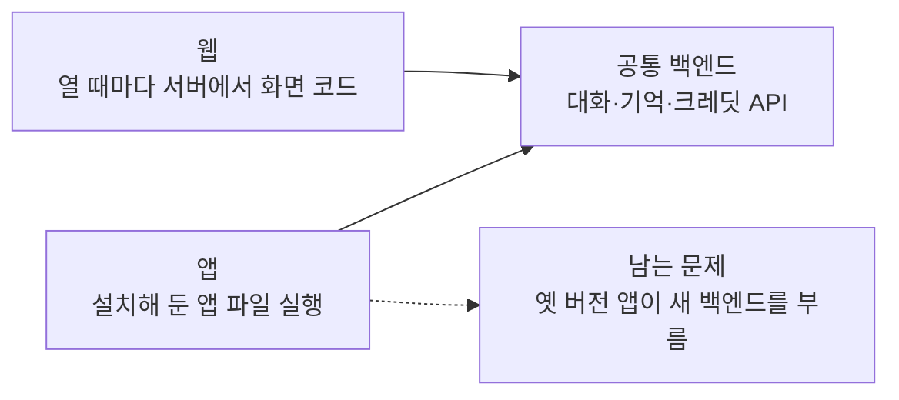
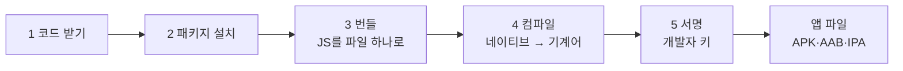
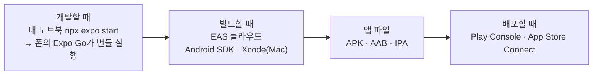
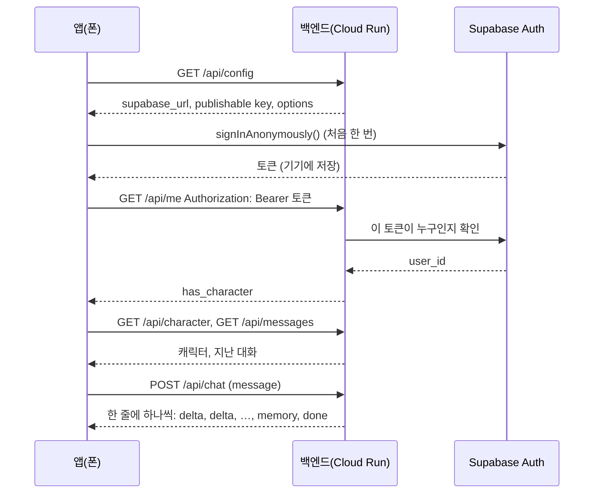
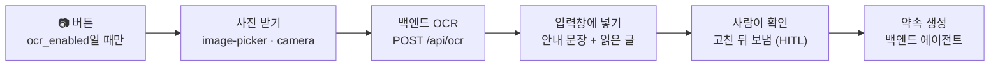
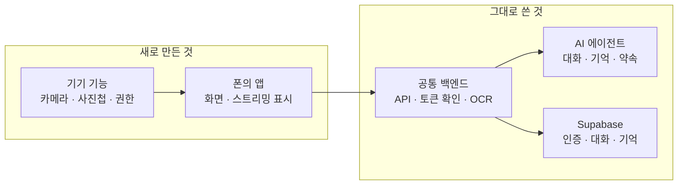

# N057 · Expo로 휴대폰 앱 만들기

> 버전 1.1 · 2026-11-05 (학습서 30쪽 + 해설서 77쪽 통합 정리 · 비개발자용 · 부록 A~G 포함 · 실습 결과 14곳 반영, v1.0은 `_판본_v1.0/`, 근거 `실습/N057_실습_진행기록.md`)

## 목차

- [핵심 한 문장 요약](#핵심-한-문장-요약)
- [1. 잘 돌아가는 웹 서비스를 왜 폰 앱으로 가져가나? (원문 Ch01)](#1-잘-돌아가는-웹-서비스를-왜-폰-앱으로-가져가나-원문-ch01)
- [2. 웹과 앱은 무엇이 다르고, 왜 iOS는 Mac이 필요한가? (원문 Ch02)](#2-웹과-앱은-무엇이-다르고-왜-ios는-mac이-필요한가-원문-ch02)
- [3. 휴대폰으로 가져가는 방법은 몇 가지이고, 무엇을 고르나? (원문 Ch03)](#3-휴대폰으로-가져가는-방법은-몇-가지이고-무엇을-고르나-원문-ch03)
- [4. Expo는 무엇을 대신해 주고, 무엇을 대가로 받나? (원문 Ch04)](#4-expo는-무엇을-대신해-주고-무엇을-대가로-받나-원문-ch04)
- [5. 실습을 시작하려면 무엇을 맞춰 두나? (원문 Ch05)](#5-실습을-시작하려면-무엇을-맞춰-두나-원문-ch05)
- [6. 앱과 백엔드는 어떻게 이어져 있나? (원문 Ch06)](#6-앱과-백엔드는-어떻게-이어져-있나-원문-ch06)
- [7. 내 폰에서 어떻게 띄우고, 안 되면 어디부터 보나? (원문 Ch07)](#7-내-폰에서-어떻게-띄우고-안-되면-어디부터-보나-원문-ch07)
- [8. 화면을 고치고 카메라를 붙일 때 무엇부터 정하나? (원문 Ch08)](#8-화면을-고치고-카메라를-붙일-때-무엇부터-정하나-원문-ch08)
- [9. 오늘 새로 만든 것과 그대로 쓴 것은 무엇인가? (원문 Ch09)](#9-오늘-새로-만든-것과-그대로-쓴-것은-무엇인가-원문-ch09)
- [맺음말](#맺음말)
- [부록 A · 실전 명령·코드·요청 모음](#부록-a--실전-명령코드요청-모음)
- [부록 B · 트러블슈팅 표](#부록-b--트러블슈팅-표)
- [부록 C · AI 프롬프트 모음집](#부록-c--ai-프롬프트-모음집)
- [부록 D · 용어 사전](#부록-d--용어-사전)
- [부록 E · 개념 비교표 모음](#부록-e--개념-비교표-모음)
- [부록 F · 학습 로드맵](#부록-f--학습-로드맵)
- [부록 G · 복습 퀴즈](#부록-g--복습-퀴즈)

## 핵심 한 문장 요약

> 📌 **요약** — 웹으로 잘 돌아가는 AI 친구 서비스를 폰 앱으로 가져갈 때 **새로 만드는 것은 화면(사용자 접점)뿐**이고 백엔드·데이터베이스·AI는 그대로 쓴다. ① 웹은 열 때마다 서버에서 화면 코드를 받지만 앱은 설치해 둔 파일을 실행하므로 **옛 버전 앱이 사용자 폰에 남고**, 그래서 백엔드 응답 모양을 함부로 바꾸지 않는다(하위 호환성). ② PWA·웹 래핑·네이티브·React Native+Expo 가운데, Windows 노트북 + 코딩 에이전트 + 이미 있는 백엔드라는 조건에서는 **내 컴퓨터에 Node.js만 두고 컴파일을 클라우드(EAS)에 맡기는 Expo**가 iOS까지 다룰 수 있는 방법이다. ③ 개발할 때는 네이티브 부분이 미리 컴파일된 **Expo Go**가 노트북의 번들을 받아 실행하므로 저장하면 폰 화면이 몇 초 안에 바뀌고, Expo Go에 없는 네이티브 기능만 **개발용 빌드**가 필요하며, 프로젝트와 Expo Go의 **SDK 버전(58)이 같아야** 열린다. ④ 앱은 **백엔드 주소 하나**로 시작해 설정을 받고 익명 로그인 토큰을 붙여 같은 API를 부르며 답을 스트리밍으로 받고, **비밀값은 앱에 넣지 않는다**. ⑤ 화면을 고칠 때는 **그 정보가 어디서 오는지 먼저 확인**한 뒤 에이전트에게 맡기고, 카메라로 찍은 일정표는 백엔드 OCR이 읽되 **보내기 전에 사람이 확인**하게 한다.

> 🧪 **예제** — 한 줄 예: 종이에 "11월 20일 오후 3시 치과"라고 크게 적고 앱의 📷 버튼으로 찍으면, 앱은 사진을 받아 권한을 묻고 백엔드 `/api/ocr`에 보내는 일까지만 한다. 글자를 읽는 일(OCR)과 약속을 만드는 일은 백엔드가 하고, 읽은 글은 바로 보내지 않고 입력창에 넣어 사람이 "2시"를 "3시"로 고친 뒤 보낸다. 그래서 나중에 OCR 엔진을 더 좋은 것으로 바꿔도 **앱은 다시 빌드할 필요가 없고**, 카메라 화면의 안내 문구를 바꿀 때만 앱을 고친다.

### 한눈에

- **무엇을 하나** — N046~N056에서 키운 AI 친구 에이전트 서비스(friend-agent)는 지금 웹 주소로만 쓸 수 있다. 오늘은 같은 백엔드를 그대로 쓰는 **휴대폰 앱**(friend-agent-mobile)을 Windows 노트북과 코딩 에이전트로 만들어 **내 폰에서 띄운다**.
- **어떻게 배우나** — 휴대폰으로 가져가는 네 가지 방법을 비교해 Expo를 고르고, 템플릿 저장소로 앱을 만들어 폰의 **Expo Go**로 QR 코드를 찍어 실행한 뒤, 답 아래 기억·약속 메모를 붙이고, **카메라로 찍은 일정표를 읽어 약속으로 만드는 기능**까지 더한다.
- **순서** — 웹과 앱의 차이 → 네 가지 방법과 선택 기준 → Expo의 구조 → 시작 상태 맞추기 → 템플릿 구조와 데이터 흐름 → 내 폰에서 띄우기 → 화면 고치기와 사진 기능 → 정리.
- **오늘의 교훈** — 좋은 모바일 앱은 모든 기능을 앱 안에 만드는 것이 아니라, **앱과 백엔드가 각자 잘하는 일을 나누도록** 설계하는 것이다. 코딩 에이전트가 코드를 써도 **무엇을 어디에 만들지 정하는 것은 사람**이다.

> ⚠️ **주의** — 오늘의 범위: 앱 파일을 **빌드해 다른 사람 폰에 설치하고 스토어 출시를 준비하는 일은 다음 단계**다(학습서 p1, "오늘은 빌드를 하지 않으므로" p15). 해설서 Ch02의 개발 전략에 "Android와 iOS 앱을 각각 빌드하고 배포합니다"가 들어 있지만, 그것은 전체 여정을 말한 것이고 오늘 실습은 **Expo Go로 내 폰에서 띄우는 데까지**다.

### 비유 대응표

| 용어 | 쉬운 말 | 비유 |
|---|---|---|
| 웹 서비스 / 앱 | 열 때마다 서버에서 화면을 받아 오는 것 / 폰에 설치해 두고 실행하는 프로그램 | 인터넷 서점에 접속해 매번 책을 가져오는 것 / 책을 한 번 사서 내 책장에 꽂아 두고 읽는 것(해설서) |
| 하위 호환성 | 새 백엔드가 옛 버전 앱도 계속 받아 주는 성질 | 새로운 시스템을 만들더라도 이전 버전 사용자들이 계속 이용할 수 있도록 배려하는 것(해설서) |
| 플랫폼 | 운영체제·개발 도구·스토어를 묶어 부르는 말(iOS, Android) | 자동차가 달리는 도로(해설서) |
| 운영체제(OS) | 화면·터치·카메라 같은 폰의 자원을 관리하는 기본 프로그램 | 스마트폰의 두뇌이자 관리자(해설서) |
| SDK | 플랫폼이 주는 개발용 라이브러리와 도구 묶음 | 설계도·부품 설명서·공구를 한곳에 모은 개발자용 도구 상자(해설서) |
| 네이티브 앱 | 운영체제가 기본으로 주는 언어·화면 요소·기능으로 만든 앱 | 도로에 맞춰 특별히 제작한 자동차(해설서) |
| 빌드 | 소스 코드를 설치 가능한 앱 파일로 만드는 과정 | 자동차의 설계도를 실제 자동차로 만드는 과정 / 요리 레시피를 실제 음식으로 완성하는 과정(해설서) |
| 네 가지 방법 | PWA / 웹 래핑 / 네이티브 / React Native+Expo | 음식점 바로가기 아이콘 / 포장 용기에 담아 새 상품처럼 판매 / iOS·Android에 맞춰 음식점을 각각 새로 / 하나의 주방에서 만든 음식을 두 종류의 그릇에 담기(해설서) |
| React Native / Expo | JavaScript로 네이티브 화면을 그리는 기술 / 그 앱을 만들고·빌드하고·배포하는 도구 묶음 | 자동차의 엔진과 차체 / 공구·설계도·조립 시설·시험 주행장을 한곳에 주는 종합 자동차 제작 시스템(해설서) |
| Expo Go | 네이티브 부분이 미리 컴파일된 개발용 앱 | 시험 운전 차량(해설서) |
| EAS (Expo Services) | 앱 파일을 클라우드에서 컴파일·서명해 주는 서비스 | 외부 제작 공장(해설서) |
| CNG (`app.json`) | 설정 한 파일로 네이티브 폴더를 그때그때 만들어 내는 방식 | 설계도에 필요한 내용만 적으면 건축 시스템이 벽과 배관을 만들어 줌(해설서) |
| SDK 버전 맞추기 | 프로젝트와 Expo Go가 같은 SDK를 써야 열림 | 같은 규격의 자동차 부품을 써야 조립이 되는 것(해설서) |
| 백엔드 / 앱 / DB | 주방 / 주문 단말기 / 장부 | 식당 주방 / 새로 만든 스마트폰 주문 앱 / 주문 내역과 고객 정보를 보관하는 장부 — 단말기가 바뀌어도 주방은 그대로(해설서) |
| 로그인 토큰 | 요청마다 붙이는 "나는 누구" 증표 | 일종의 신분증(해설서) |
| 스트리밍 | 답을 다 만든 뒤가 아니라 생성되는 대로 조금씩 보내는 것 | 수도꼭지에서 물이 조금씩 흘러나오는 것(해설서) |
| 콜드 스타트 | 쉬고 있던 서버 인스턴스가 깨어나는 시간 | 영업 전 닫아 둔 식당에 첫 손님이 왔을 때 주방을 준비하는 시간(해설서) |
| OCR | 사진 속 글자를 읽어 텍스트로 바꾸는 기술 | 사람이 직접 타이핑하지 않아도 컴퓨터가 대신 읽어 주는 것(해설서) |
| HITL | AI가 초안을 만들고 사람이 확인한 뒤 실행하는 구조 | 사람이 중간에 확인하는 구조(해설서) / `[보충 비유]` 결재 라인의 "검토 후 승인" |

> 💡 **팁** — 비유의 한계: "책을 사서 책장에 꽂아 둔다"는 비유는 **화면 코드**에만 맞다. 앱이라고 해서 서버가 필요 없는 것은 아니어서, 대화 내용·사용자 정보·크레딧은 여전히 백엔드에 있다(해설서 p8). 또 "단말기가 바뀌어도 주방은 그대로"라는 말도 반쯤만 맞다 — 주방(백엔드)은 그대로지만, 옛 단말기(업데이트 안 한 앱)가 계속 주문을 넣으므로 **주방이 주문서 양식을 마음대로 바꾸면 안 된다**. 2장의 하위 호환성이 그 이야기다.

> 💡 **팁** — 문서에서 "학습서"(30쪽)는 실습 교안, "해설서"(77쪽)는 같은 교안을 쉽게 풀어 쓴 책이다. 두 책은 챕터 01~09 제목이 1:1로 맞지만 **내용은 1:1이 아니다** — 해설서 Ch01은 강의 전체의 미리보기이고 Ch09는 전체 복습이며, 웹·앱이 다른 게스트가 되는 이야기는 두 책 모두 Ch06과 Ch07 두 곳에 나온다. 학습서에는 명령·수치·표·요청 문장이 있고, 해설서에는 책·자동차·식당·수도꼭지 같은 비유와 퀴즈 정답, 수강생 개인 프로젝트 적용 예가 있다. 그래서 이 노트는 **비유·쉬운 설명·정답은 해설서, 명령·수치·표·요청 문장은 학습서 원문**을 따랐다. `[보충]`·`[보충 비유]`·`[추가]`라고 표시한 것만 이 노트에서 덧붙인 것이다.

> ⚠️ **주의** — PDF를 정리하면서 바로잡거나 알아 둘 것. ① **웹과 앱이 대화를 공유하는가**: 해설서 Ch01(p3)은 "PC에서 나눈 대화를 스마트폰에서도 이어서 볼 수 있다"고 썼지만, 학습서 p17·p21과 해설서 자신의 Ch06·Ch07은 **익명 로그인에서는 브라우저와 폰이 서로 다른 게스트**라 대화가 보이지 않고, 같은 대화를 보려면 구글 로그인 같은 공통 로그인이 필요하다고 한다. 이 노트는 뒤쪽(백엔드는 같지만 익명 로그인 상태에서는 공유 안 됨)을 따랐다. ② **앱이 켜지는 순서**: 해설서 Ch01은 "로그인 → 설정"으로 썼지만 학습서와 해설서 Ch06은 **설정(`/api/config`) 먼저 → 익명 로그인** 순서다. 뒤쪽이 맞다. ③ 서버 푸시 알림은 학습서 표가 "Expo Go 안 됨(SDK 53부터)", 해설서 표가 "제한적"이다 — 학습서를 따랐다. ④ 해설서 Ch01의 일정표 흐름에는 **사람 확인 단계가 빠져 있고** 학습서에 없는 "장소 추출"이 들어 있다. 이 노트는 학습서(입력창에서 사람이 확인)를 따랐다. ⑤ 학습서의 비교표(p7)와 다이어그램 4개(p3·p5·p11·p17)는 **PDF에 그림으로만** 들어 있어, 그림을 직접 보고 이 노트에 표와 다이어그램으로 다시 그렸다. ⑥ "2026년 10·11월 기준" 수치(SDK 58, Expo Go 지원, Expo Services 이름 변경, React Native 문서 권장)는 바뀔 수 있으니 실습 전에 확인한다. **EAS 무료 플랜의 빌드 횟수·유료 가격·app.json 예시는 두 문서 모두에 없다.** ⑦ 해설서에 실린 웹 사진들(출처 캡션만 남은 것)은 저작권 때문에 옮기지 않았다.

> 🧪 **예제** — **원문끼리 표기가 다른 곳**: 학습서는 2026년 11월 기준 공식 이름이 **Expo Build / Expo Submit / Expo Update**로 바뀌었다고 쓰면서도 명령(`eas build`)·설정 파일(`eas.json`)에 맞춰 **EAS Build**라고 부르고, 해설서는 처음부터 EAS Build/Submit/Update로 쓴다. 빌드 단계도 학습서 그림은 5단계(코드→패키지→번들→컴파일→서명 후 앱 파일), 해설서 표는 6단계(6. 앱 파일 생성)다. Flutter도 학습서는 네이티브 방법에 넣고, 해설서는 "자체 렌더링 엔진이라 구조가 다르다"고 따로 구분한다. **뜻은 같으므로** 이 노트는 EAS Build로 통일하고 두 이름을 함께 적었다.

---

## 1. 잘 돌아가는 웹 서비스를 왜 폰 앱으로 가져가나? (원문 Ch01)

### 1-1. 오늘의 상황

학습서 도입은 이렇게 시작한다.

> 지금 AI 친구 에이전트 서비스는 웹 주소로만 쓸 수 있습니다. 친구처럼 매일 말을 거는 서비스라면 사용자는 브라우저를 열고 주소를 찾기보다 폰 홈 화면의 앱 아이콘을 누르고 싶어 합니다. 그런데 앱을 만들려면 Swift와 Kotlin을 따로 배우고, Android Studio와 Xcode를 설치하고, iOS 앱은 Mac에서만 빌드할 수 있다고 알려져 있습니다. Windows 노트북으로, 코딩 에이전트와 함께, 지금 있는 백엔드를 그대로 쓰는 앱을 만들 수는 없을까요. (학습서 p1)

해설서는 이것을 **출입구가 다르다**고 말한다 — 같은 AI 친구와 대화하더라도 웹에서는 크롬 브라우저로, 앱에서는 스마트폰에 설치된 AI 친구 아이콘을 눌러 들어온다. 두 출입구는 **같은 백엔드와 데이터베이스**를 쓸 수 있다.

```text
웹 서비스:  브라우저 → 웹 주소 → 서버
모바일 앱:  앱 아이콘 → 앱 실행 → 서버
공통점:     두 방식 모두 같은 백엔드와 데이터베이스를 사용할 수 있다
```

### 1-2. AI 개발자가 모바일을 알아야 하는 세 가지 이유 (해설서)

1. **서비스 접근성** — 매일 쓰는 서비스는 브라우저 주소보다 홈 화면 아이콘이 가깝다.
2. **스마트폰의 하드웨어 활용** — 카메라·사진첩·알림 같은 기능을 AI와 연결할 수 있다.
3. **기존 시스템의 재사용** — 백엔드를 다시 만들지 않으므로 개발 비용과 운영 복잡성이 줄어든다.

해설서의 한 줄: 모바일은 웹사이트를 작은 화면으로 옮기는 것이 아니라 **AI 서비스가 사용자의 일상 속으로 들어가는 접점**이다.

### 1-3. 학습목표 7개

1. 웹 서비스와 앱이 사용자에게 닿고 실행되는 방식의 차이를 말하고, 플랫폼, 네이티브, 빌드가 무엇인지 설명할 수 있다.
2. PWA, 웹 래핑, 네이티브, React Native와 Expo의 차이를 설치 부담, iOS 빌드, 기기 기능으로 비교하고 내 서비스에 맞는 방법을 고를 수 있다.
3. Expo가 개발, 빌드, 배포를 어떻게 나눠 처리하는지 설명하고, Expo Go와 개발용 빌드의 차이와 한계를 말할 수 있다.
4. 앱이 백엔드에서 설정을 받아 로그인하고 답을 스트리밍으로 받는 흐름을 시퀀스 다이어그램으로 읽을 수 있다.
5. 템플릿으로 만든 앱을 내 폰의 Expo Go로 실행하고, 연결이 안 될 때 원인을 찾아 해결할 수 있다.
6. 바꿀 화면의 구조를 먼저 정한 뒤 코딩 에이전트에게 구현을 맡기고, 저장하면 폰 화면이 바로 바뀌는 것을 확인할 수 있다.
7. 사진첩(`expo-image-picker`)과 앱 안 카메라 화면(`expo-camera`)으로 받은 사진을 백엔드 OCR로 읽어 약속으로 만드는 기능을 붙일 수 있다.

### 1-4. 오늘의 흐름은 어떻게 이어지나?

<!-- flow: 그림 1. 오늘의 흐름. 무엇을 고를지 정하고(2~4장), 내 폰에 띄우고(5~7장), 화면과 기기 기능을 붙인다(8장). | 웹 vs 앱/화면 코드가 오는 길/1 ; 네 가지 방법/Expo를 고른 이유/2 ; Expo 구조/Expo Go · EAS/3 ; 내 폰에 띄우기/템플릿 · .env · QR/4 ; 화면 고치기/데이터 출처 먼저/2 ; 사진 → 약속/OCR · 사람 확인/1 -->


```text
[웹 vs 앱] → [네 가지 방법] → [Expo 구조] → [내 폰에 띄우기] → [화면 고치기] → [사진 → 약속]
   2장          3장            4장          5·6·7장             8장            8장
```
<!-- /flow -->

읽는 법: 왼쪽 세 칸은 "왜 Expo인가"를 이해하는 개념 구간이고, 오른쪽 세 칸은 실제로 손을 움직이는 실습 구간이다. 오른쪽으로 갈수록 백엔드는 한 줄도 바꾸지 않고 **앱 화면만** 늘어난다는 점이 오늘의 뼈대다.

### 1-5. 시작 질문

> 🧪 **예제** — **[시작 질문]** 웹으로 잘 돌아가는 서비스를 휴대폰 앱으로 만든다고 할 때, 무엇이 새로 필요하고 무엇은 그대로 쓸 수 있을 것 같은지 적어 보세요. 화면, 서버, 데이터베이스, 로그인, 배포로 나눠 생각해 보면 됩니다. (학습서 p1, 300자)

원문에는 이 질문의 모범 답안이 없다. 9장의 회고 질문이 "이 답을 다시 읽고 실제로 새로 만든 것과 비교하라"는 짝이라, 모범 답안은 9장에 실었다. `[보충]` 이 시점에 떠올릴 만한 답: 화면은 새로(폰 화면), 서버·DB·AI는 그대로, 로그인은 같은 방식을 쓰되 기기마다 따로 로그인 상태가 생기고, 배포는 웹 배포가 아니라 앱 파일을 만들어 스토어에 올리는 새 절차가 필요하다.

▶ 한 줄 요약: 매일 말을 거는 AI 친구는 홈 화면 아이콘이 어울리고, 앱으로 가져갈 때 **새로 만드는 것은 출입구(화면)뿐**이라 백엔드를 그대로 쓰는 것이 오늘의 출발점이다.

---

## 2. 웹과 앱은 무엇이 다르고, 왜 iOS는 Mac이 필요한가? (원문 Ch02)

### 2-1. 웹은 매번 받아서 실행하고, 앱은 설치해 둔 파일을 실행한다

> 지금까지 만든 에이전트 서비스는 웹 서비스입니다. 사용자가 브라우저에 주소를 넣으면 브라우저가 서버에서 화면 코드(HTML, JavaScript)를 받아 그 자리에서 실행하고, 탭을 닫으면 그 코드는 사라집니다. 다음에 주소를 열면 서버에서 다시 받으므로, 서버에 새 버전을 배포하면 모든 사용자가 곧바로 새 화면을 봅니다. (학습서 p2)

앱은 폰에 설치해 두고 실행하는 프로그램이다. 앱 파일 안에는 화면 코드, 아이콘과 이미지, 앱 이름과 권한 같은 설정이 함께 들어 있고, 사용자는 스토어에서 이 파일을 한 번 내려받아 설치한다. 그래서 **화면을 고치면 앱 파일을 새로 만들어 스토어에 올리고 사용자가 업데이트해야** 바뀌며, 업데이트하지 않은 사용자의 폰에는 옛 버전이 계속 남는다.

<!-- flow: 그림 2. 웹과 앱이 화면 코드를 얻는 길. 화면 코드가 오는 길은 다르지만, 대화·기억·크레딧 같은 데이터는 둘 다 같은 백엔드 API에서 받는다. | 웹/주소를 열 때마다 서버에서 화면 코드/1 ; 앱/빌드한 앱 파일을 설치해 실행/3 ; 공통 백엔드/대화 · 기억 · 크레딧 API/4 ; 남는 문제/옛 버전 앱이 새 백엔드를 부름/2 -->


```text
웹 서비스 : 주소 → [서버에서 화면 코드 받기] → 브라우저에서 실행 → 탭 닫으면 사라짐
휴대폰 앱 : 스토어에서 한 번 설치 → [폰의 앱 파일 실행] → 업데이트 전까지 그 버전 그대로
                        둘 다 ↓
               [같은 백엔드 API : 대화 · 기억 · 크레딧]
```
<!-- /flow -->

읽는 법: 위 두 줄은 "화면 코드가 어디서 오는가"만 다르고, 아래 칸(백엔드)은 같다. 그래서 웹에서 앱으로 바꿔도 대화·기억·크레딧은 백엔드가 그대로 돌려주지만, **옛 버전 화면이 폰에 남는 문제**가 새로 생긴다.

해설서의 비유: 웹은 **인터넷 서점에 매번 접속해 책을 가져오는 방식**, 앱은 **책을 한 번 사서 내 책장에 보관하고 읽는 방식**이다.

### 2-2. 왜 백엔드 응답 모양을 함부로 바꾸면 안 되나? (하위 호환성)

> 웹은 화면과 서버를 함께 배포하면 끝나지만, 앱을 내놓은 뒤에는 옛 버전 화면이 새 백엔드를 부르는 상황이 생깁니다. 그래서 앱이 쓰는 백엔드 API의 응답 모양은 옛 앱이 읽지 못하게 함부로 바꾸지 않습니다. (학습서 p3)

해설서의 예:

| 누가 | 상태 | 결과 |
|---|---|---|
| A 사용자 | 최신 앱으로 업데이트 | 새 응답을 이해한다 |
| B 사용자 | 앱을 업데이트하지 않음 | 과거의 필드 이름을 찾으므로 **오류가 날 수 있다** |
| 서버 | 새로운 API 응답 형식으로 변경 | — |

이것을 **하위 호환성(Backward Compatibility)**이라고 한다 — 새로운 시스템을 만들더라도 이전 버전의 사용자들이 계속 이용할 수 있도록 배려하는 것.

> 💡 **팁** — `[보충 비유]` 경영 언어로는 **이미 나간 계약서 양식**과 같다. 거래처(옛 앱)가 옛 양식으로 주문서를 보내오는 한, 본사(백엔드)는 새 양식을 만들더라도 옛 양식을 계속 받아 줘야 한다. 필드 이름을 바꾸고 싶으면 옛 이름을 한동안 같이 보내 주고, 옛 앱이 충분히 사라진 뒤에 뺀다.

### 2-3. 운영체제와 플랫폼은 무엇인가?

휴대폰 앱은 폰의 운영체제(OS) 위에서 실행된다. 운영체제는 화면, 터치, 네트워크, 카메라 같은 폰의 자원을 관리하고 앱이 그 자원을 쓸 수 있도록 API를 열어 주는 기본 프로그램이다(해설서: **스마트폰의 두뇌이자 관리자**). 휴대폰 운영체제는 Apple의 iOS와 Google의 Android가 대부분을 차지하고, 운영체제와 그 위에서 앱을 만드는 도구, 앱을 내보내는 스토어를 묶어 **플랫폼**이라고 부른다.

| | iOS | Android |
|---|---|---|
| 기기 | iPhone, iPad. Apple만 만듦 | 삼성, Google 등 여러 제조사가 만듦 |
| 공식 언어 | Swift | Kotlin |
| 개발 도구 | Xcode. Mac에서만 실행됨 | Android Studio. Windows, Mac, Linux에서 실행됨 |
| 앱 파일 | IPA | APK(직접 설치용), AAB(스토어 제출용) |
| 스토어 | App Store | Google Play |
| 스토어 밖 설치 | 기본적으로 막혀 있음 | 사용자가 허용하면 APK를 직접 설치할 수 있음 |

(학습서 p3~4)

### 2-4. SDK·네이티브·웹뷰는 무엇인가?

- **SDK** — 플랫폼이나 프레임워크가 제공하는 개발용 라이브러리와 도구 묶음. 해설서: 자동차를 만드는 데 필요한 **설계도, 부품 설명서, 공구를 한곳에 모아 놓은 개발자용 도구 상자**.
- **네이티브** — 플랫폼이 기본으로 제공하는 언어, 화면 요소, 기능. 학습서의 예: iPhone 설정 앱의 켜고 끄는 스위치, 목록을 밀어 올릴 때의 스크롤, 글자를 입력할 때 올라오는 키보드는 iOS가 제공하는 네이티브 화면 요소다. 카메라 같은 기능은 사용자의 허락(권한)이 필요해서, 앱이 처음 카메라를 쓸 때 "카메라 접근을 허용하시겠습니까" 창이 뜬다.
- **웹뷰** — 앱 안에서 웹 페이지를 보여 주는 브라우저 창 부품.
- **React Native** — JavaScript로 코드를 쓰면 폰의 **네이티브 화면 요소로** 그려 주는 프레임워크. 웹뷰처럼 앱 안에 웹 페이지를 띄우는 것이 아니다.

| 구분 | 네이티브 화면 | 웹뷰 화면 |
|---|---|---|
| 화면 구성 | 운영체제의 기본 요소 | 웹 기술로 구성 |
| 실행 방식 | 앱 내부 코드 실행 | 앱 안의 브라우저에서 실행 |
| 느낌 | 스마트폰 앱에 자연스러움 | 웹사이트와 유사 |
| 기기 기능 | 운영체제 API 활용 | 별도 연결이 필요할 수 있음 |

(해설서 p10~11)

### 2-5. 빌드는 무엇이고, 무엇을 바꾸면 다시 해야 하나?

빌드는 소스 코드와 설정을 받아 폰이 설치할 수 있는 앱 파일로 바꾸는 과정이다. 해설서: **요리 레시피를 실제 음식으로 완성하는 과정**.

<!-- flow: 그림 3. 빌드 순서(학습서 p5 그림을 다시 그림). 3번은 JavaScript를 묶고, 4번은 네이티브 부분을 기계어로 바꾸고, 5번은 누가 만들었는지 표시한다. | 1 코드 받기/소스와 설정/1 ; 2 패키지 설치/npm install/1 ; 3 번들/JS를 파일 하나로/2 ; 4 컴파일/네이티브 → 기계어/3 ; 5 서명/개발자 키로 표시/4 ; 앱 파일/APK · AAB · IPA/2 -->


```text
[1 코드] → [2 패키지] → [3 번들] → [4 컴파일] → [5 서명] → [앱 파일 APK/AAB/IPA]
                         (JS 묶기)   (플랫폼 도구 필요)  (Apple 인증서 필요: iOS)
```
<!-- /flow -->

읽는 법: 3번까지는 어느 컴퓨터에서나 할 수 있지만, **4번 컴파일과 5번 서명은 플랫폼 회사가 내놓은 도구로만** 할 수 있다. 오른쪽 끝의 앱 파일이 사용자 수만큼의 폰에 설치되므로 **한 번 내보낸 앱 파일은 되돌릴 수 없다**.

> 그림의 3번 번들(bundle)은 내 JavaScript 코드를 실행에 필요한 파일 하나로 묶은 것이고, 4번 컴파일(compile)은 네이티브 부분의 코드를 기계가 실행하는 형태로 바꾸는 일입니다. 5번 서명은 개발자의 키로 누가 만든 파일인지 표시하는 일이라, 폰과 스토어는 서명을 보고 파일이 중간에 바뀌지 않았는지, 같은 개발자가 낸 새 버전인지 확인합니다. (학습서 p5)

학습서 그림의 아래쪽 칸은 **다시 빌드해야 하는 것과 아닌 것**을 나눈다.

| 다시 빌드해야 하는 것(앱 파일 안에 들어가는 것) | 다시 빌드하지 않아도 되는 것(바깥에 있는 것) |
|---|---|
| 화면 코드, 아이콘·이미지, 앱 이름, 권한, 네이티브 라이브러리 | 백엔드 코드, 데이터베이스, AI 모델·프롬프트, OCR 엔진 |

또 앱 파일마다 번호가 두 개 붙는다 — 사람에게 보이는 **버전**(예: 1.0.0 → 1.1.0)과 스토어가 순서를 구분하는 **빌드 번호**(Android versionCode, iOS buildNumber).

### 2-6. 왜 Android는 Windows에서 되고 iOS는 Mac이 필요한가?

> Android는 실제 빌드를 Android SDK와 Gradle이 하고 Android Studio는 그 도구를 쓰기 편하게 해 주는 편집기라서, SDK만 설치하면 Windows, Mac, Linux 어디서나 빌드할 수 있습니다. iOS는 SDK, 컴파일러, 서명 도구가 모두 Xcode에 묶여 있고 Xcode는 macOS에서만 돌며, iOS 서명에는 Apple이 발급한 인증서까지 필요해서 결국 어딘가에 Mac이 있어야 합니다. (학습서 p5)

| 구분 | Android | iOS |
|---|---|---|
| 빌드 도구 | Android SDK, Gradle | Xcode |
| Windows에서 빌드 | 가능 | 공식 로컬 빌드 불가 |
| Mac 필요 여부 | 불필요 | 필요 |
| 대안 | 로컬 빌드 | 클라우드 Mac 빌드 |

(해설서 p11~12) 오늘 쓰는 Expo도 이 단계를 건너뛰지는 않고, **미리 컴파일해 둔 앱과 클라우드 빌드 서버로 그 일을 내 노트북 밖으로 옮긴다**(4장).

### 2-7. 앱이 실행되는 동안에는 무엇이 다른가?

> 운영체제는 메모리가 부족하면 백그라운드의 앱을 예고 없이 종료합니다. 그래서 답을 받는 도중에 앱을 내리면 스트리밍이 끊길 수 있고, 다시 열었을 때 화면을 처음부터 그려야 할 수 있습니다. 앱을 꺼도 남아야 하는 로그인 정보 같은 값은 폰의 저장소에 두고, 대화 기록처럼 다른 기기에서도 보여야 하는 값은 백엔드에 둡니다. (학습서 p6)

| 데이터 | 저장 위치 | 이유 |
|---|---|---|
| 로그인 토큰 | 스마트폰 저장소 | 앱을 다시 열어도 로그인 유지 |
| 대화 기록 | 백엔드 데이터베이스 | 다른 기기에서도 확인 |
| 크레딧 | 백엔드 데이터베이스 | 사용자별 사용량 관리 |
| 화면 설정 | 스마트폰 또는 백엔드 | 필요에 따라 관리 |

(해설서 p12)

### 2-8. 웹에서 앱으로 넓힐 때 바뀌는 것과 그대로인 것

| 구성 요소 | 기존 웹 서비스 | 모바일 앱 |
|---|---|---|
| 사용자 화면 | 웹 화면 | React Native 화면 |
| 로그인 | 기존 로그인 API | 기존 로그인 API 재사용 가능 |
| AI 대화 | 기존 백엔드 | 기존 백엔드 재사용 |
| 대화 기록 | 기존 데이터베이스 | 기존 데이터베이스 재사용 |
| 크레딧 | 기존 백엔드 관리 | 기존 백엔드 관리 |
| 앱 실행 | 브라우저 | 스마트폰 설치 앱 |
| 업데이트 | 웹 배포 | 앱 재빌드 및 업데이트 |
| 카메라 | 브라우저 기능 | 네이티브 기능 연동 |

(해설서 p13) 해설서는 여기서 세 가지 관점을 정리한다 — 첫째 프런트엔드와 백엔드를 분리한다, 둘째 앱은 출시 뒤에도 **버전 관리**가 필요하다, 셋째 스마트폰 운영체제 기능을 이해한다.

> 🧪 **예제** — **[이해 점검, 학습서 p6]** 백엔드 API 응답의 필드 이름을 새 이름으로 바꾸고, 앱도 새 이름을 읽도록 고쳐 스토어에 새 버전을 올리려고 한다. 웹 화면만 있을 때는 없던 문제는? → **업데이트하지 않은 사용자의 폰에서는 옛 앱이 옛 필드 이름을 찾으므로 그 사용자의 화면이 깨진다.** (정답과 오답 풀이는 부록 G 문제 1)

▶ 한 줄 요약: 웹과 앱의 가장 큰 차이는 **화면 코드가 오는 길**이고, 앱은 옛 버전이 폰에 남으므로 백엔드를 공유하되 **응답 모양의 하위 호환성**을 지켜야 하며, iOS 빌드에 Mac이 필요한 이유는 컴파일·서명 도구가 Xcode에 묶여 있기 때문이다.

---

## 3. 휴대폰으로 가져가는 방법은 몇 가지이고, 무엇을 고르나? (원문 Ch03)

### 3-1. 네 가지 방법은 각각 무엇인가?

> PWA(Progressive Web App)는 웹 페이지에 설정 파일과 서비스 워커를 더해, 브라우저에서 "홈 화면에 추가"로 앱처럼 설치하게 하는 방식입니다. 따로 빌드하지 않으므로 가장 가볍지만, 스토어에 올라가지 않고 알림 같은 기기 기능은 브라우저가 허용하는 만큼만 씁니다. 웹 래핑(Capacitor 등)은 웹 페이지를 앱 껍데기에 넣어 스토어용 앱 파일로 만드는 방식입니다. 화면은 여전히 웹이고, 앱 파일을 만들려면 내 컴퓨터에 Android Studio와 Xcode가 있어야 합니다. (학습서 p7)

> 네이티브는 iOS는 Swift, Android는 Kotlin으로 각각 만들거나, Flutter처럼 한 코드로 두 플랫폼의 네이티브 앱을 만드는 방식입니다. 폰의 모든 기능을 쓸 수 있지만, 빌드 도구를 내 컴퓨터에 설치해야 하고 iOS 앱은 Mac에서만 빌드할 수 있습니다. React Native는 JavaScript로 코드를 쓰면 폰의 네이티브 화면 요소로 그려 주는 프레임워크이고, Expo는 React Native 앱을 만들고 빌드하고 배포하는 과정을 묶어 주는 도구 모음입니다. Expo는 앱 파일을 클라우드에서 빌드하므로, 내 컴퓨터에는 Node.js만 있으면 되고 Windows에서도 iOS 앱 파일을 만들 수 있습니다. (학습서 p7)

해설서의 음식점 비유:

| 방법 | 음식점으로 보면 |
|---|---|
| PWA | 기존 음식점을 그대로 이용하되 휴대폰 홈 화면에 바로가기 아이콘을 만드는 것 |
| 웹 래핑 | 기존 음식점을 포장 용기에 담아 새로운 상품처럼 판매하는 것 |
| 네이티브 | iOS와 Android에 맞춰 음식점을 각각 새로 만드는 것 |
| React Native + Expo | 하나의 주방에서 만든 음식을 서로 다른 두 종류의 그릇에 담아 제공하는 것 |

### 3-2. 다섯 기준으로 한 표에 놓으면?

학습서 p7의 비교표는 PDF에 그림으로만 들어 있어, 그림을 보고 옮겼다. 초록 칸은 "부담 없음·충분함", 빨간 칸은 "부담 큼·안 됨", 노란 칸은 "조건부"로 칠해져 있었다.

| | PWA | 웹 래핑 (Capacitor) | 네이티브 (Swift, Kotlin, Flutter) | React Native + Expo |
|---|---|---|---|---|
| 화면 | 웹 페이지 그대로 | 웹 페이지를 앱 껍데기에 넣음 | 폰 네이티브 화면 | 폰 네이티브 화면 (코드는 JavaScript) |
| 설치 | 브라우저에서 홈 화면에 추가 | 스토어 | 스토어 | 스토어 |
| 내 컴퓨터에 필요한 것 | 없음 | Android Studio, Xcode | Android Studio, Xcode (+ Flutter SDK) | Node.js만. 빌드는 EAS 클라우드 |
| Windows에서 iOS 빌드 | 해당 없음 | 불가 (Mac 필요) | 불가 (Mac 필요) | 가능 (EAS가 Mac 서버에서 빌드) |
| 기기 기능 (알림, 카메라) | 브라우저가 허용하는 만큼 (조건부) | 플러그인으로 | 전부 | 대부분. 일부는 개발용 빌드 필요 |

해설서는 같은 내용을 다른 항목으로 비교한다(해설서 p18~19).

| 비교 항목 | PWA | 웹 래핑 | 네이티브 | React Native + Expo |
|---|---|---|---|---|
| 화면 구성 | 웹 | 웹뷰 | 네이티브 | 네이티브 |
| 스토어 배포 | 일반적인 앱과 다름 | 가능 | 가능 | 가능 |
| 개발 코드 | 웹 | 웹 중심 | 플랫폼별 | JavaScript 중심 |
| Windows 개발 | 가능 | Android 가능 | Android 가능 | 가능 |
| iOS 빌드 | 불필요 | Mac 필요 | Mac 필요 | 클라우드 가능 |
| 기기 기능 | 제한적 | 플러그인 활용 | 폭넓게 활용 | 모듈로 활용 |
| 개발 부담 | 낮음 | 낮음~중간 | 높음 | 중간 |

> 💡 **팁** — 해설서는 Flutter를 따로 구분한다 — "Flutter는 자체 렌더링 엔진을 사용하므로 Swift와 Kotlin으로 각각 만드는 방식과는 기술 구조가 다릅니다." 학습서는 "한 코드로 두 플랫폼의 네이티브 앱"이라는 결과 쪽을 보고 네이티브에 넣었다. 오늘 고르는 데에는 차이가 없다 — 둘 다 **내 컴퓨터에 빌드 도구가 필요하고 iOS는 Mac이 필요하다**는 점이 같기 때문이다.

### 3-3. 어느 방법이 좋은가? — 상황마다 다르다

> 어느 방법이 좋은지는 상황마다 다릅니다. 스토어에 올리지 않아도 되고 웹 화면을 그대로 쓰고 싶다면 PWA가 가장 빠릅니다. 이미 잘 만든 웹 화면이 있고 Mac과 빌드 도구를 갖춘 팀이라면 웹 래핑도 해 볼 만합니다. 게임처럼 그래픽이 무겁거나 최신 OS 기능을 바로 써야 한다면 네이티브가 맞습니다. (학습서 p8)

| 이런 상황이면 | 이 방법 |
|---|---|
| 스토어 없이 웹 화면 그대로, 가장 빨리 | PWA |
| 잘 만든 웹 화면 + Mac과 빌드 도구를 갖춘 팀 | 웹 래핑 |
| 게임처럼 그래픽이 무겁거나 최신 OS 기능을 바로 써야 함 | 네이티브 |
| Windows 노트북 + 코딩 에이전트 + 백엔드가 이미 있음 + iOS까지 | React Native + Expo |

### 3-4. 이 과정은 왜 Expo인가?

> 이 과정의 조건은 세 가지입니다. 수강생 노트북은 대부분 Windows이고, 코딩 에이전트와 함께 만들며, 백엔드는 이미 있어서 앱은 화면만 새로 만들면 됩니다. 이 조건에서 iOS까지 다룰 수 있으면서 내 컴퓨터에 설치할 것이 가장 적은 방법이 Expo라서, 오늘은 Expo로 진행합니다. 다만 Expo도 앱 파일은 결국 컴파일해야 하므로, 그 일을 클라우드 서비스(EAS)에 맡긴다는 점과 무료 플랜의 빌드 횟수 제한은 감수합니다. (학습서 p8)

해설서는 두 가지를 덧붙인다.

- "다른 방법들이 잘못된 것은 아닙니다." 단순히 웹사이트를 폰에서 편하게 쓰는 것이 목적이면 PWA가 더 경제적일 수 있고, 카메라·사진첩·AI 대화·향후 알림까지 쓰려는 서비스라면 Expo가 더 적합하다.
- "모든 서비스를 처음부터 모바일 앱으로 만들 필요는 없습니다." 초기에는 PWA나 웹으로 **시장 반응을 확인**하고, 사용자가 스마트폰 기능을 적극적으로 쓰기 시작할 때 Expo 앱으로 넓히는 전략도 좋다.

> ⚠️ **주의** — React Native와 Expo가 모든 네이티브 기능을 자동으로 해결하는 것은 아니다. 추가 네이티브 모듈이나 설정이 필요할 수 있고, EAS 클라우드 빌드는 **무료 플랜에서도 제한**이 있다(해설서 p19). 무료 플랜의 정확한 횟수는 원문에 없으니 [Expo 요금 안내](https://expo.dev/pricing)에서 확인한다.

> 💡 **팁** — `[보충 비유]` 경영 언어로는 **사업 확장 단계별 채널 전략**이다. PWA는 기존 매장에 "모바일 주문" 링크를 붙인 테스트 마케팅, Expo는 직영 앱을 내는 본격 진출, 네이티브는 플랫폼별 전담 조직을 따로 꾸리는 대규모 투자다. 시장 검증 전에는 작은 투자부터 하라는 해설서의 조언과 같은 이야기다.

> 🧪 **예제** — **[이해 점검, 학습서 p8]** PWA와 웹 래핑은 둘 다 화면을 웹으로 그린다. 두 방법의 차이로 맞는 것은? → **웹 래핑은 스토어에 올릴 앱 파일을 만들기 때문에 내 컴퓨터에 Android Studio와 Xcode가 필요하다.** (부록 G 문제 2)

▶ 한 줄 요약: 네 방법은 **화면을 무엇으로 그리고 앱 파일을 어디서 만드느냐**가 다르며, Windows + 코딩 에이전트 + 백엔드 있음이라는 조건에서 iOS까지 가장 가볍게 다루는 방법이 Expo다(대가: 클라우드 빌드 의존과 무료 횟수 제한).

---

## 4. Expo는 무엇을 대신해 주고, 무엇을 대가로 받나? (원문 Ch04)

### 4-1. Expo는 무엇인가?

> Expo는 React Native로 Android와 iOS 앱을 만들 때 필요한 개발 도구, 기기 기능 라이브러리, 클라우드 서비스를 한데 묶은 오픈 소스 프레임워크입니다. React Native는 JavaScript 코드로 네이티브 화면을 그리는 일까지만 맡기 때문에, React Native만으로 앱을 만들면 화면 이동, 카메라 같은 기기 기능, 네이티브 프로젝트 설정, 빌드와 서명에 쓸 도구를 하나씩 골라 직접 맞춰야 합니다. Expo는 이 도구들을 서로 버전이 맞는 한 묶음으로 제공합니다. React Native 공식 문서도 새 앱은 Expo 같은 프레임워크로 시작하기를 권합니다(2026년 11월 기준). (학습서 p9)

해설서: React Native는 **자동차의 엔진과 차체**를 만드는 기술이고, Expo는 자동차를 만들 때 필요한 **공구, 설계도, 조립 시설, 시험 주행장을 한곳에 제공하는 종합 자동차 제작 시스템**이다.

### 4-2. Expo는 무엇으로 이루어져 있나?

| 구성 요소 | 하는 일 | 해설서 비유 |
|---|---|---|
| Expo CLI와 개발 서버 | `npx expo start`로 개발 서버를 띄운다. 개발 서버 안의 **Metro 번들러**가 TypeScript 코드를 JavaScript 번들로 묶어 폰에 보내고, 파일을 저장하면 바뀐 부분만 다시 보낸다. 터미널에 폰으로 접속할 QR 코드를 띄운다 | 작업 지시 도구 |
| Expo SDK | 카메라, 사진첩, 파일, 알림 같은 기기 기능을 Android와 iOS에서 같은 코드로 쓰게 해 주는 라이브러리 묶음. 예: `expo-camera`, `expo-image-picker` | 기능별 공구 상자 |
| Expo Router | app 폴더의 파일 하나를 화면 하나로 만드는 화면 이동 라이브러리 | 앱의 길 안내 |
| 앱 설정(app config) | 앱 이름, 아이콘, 패키지 이름, 권한 설명을 `app.json` 한 파일에 적는다 | 앱의 기본 설계서 |
| Expo Go | 개발 서버의 번들을 받아 실행하는 개발용 앱. 스토어에서 폰에 설치한다 | 시험 운전 차량 |
| Expo Services (EAS) | 클라우드 빌드(Expo Build), 스토어 제출(Expo Submit), JavaScript만 바꿔 보내는 업데이트(Expo Update). 무료·유료 플랜이 있고 빌드 설정은 `eas.json`에 적는다 | 외부 제작 공장 |

(학습서 p9, 해설서 p23) Expo SDK 라이브러리의 예로 해설서는 `expo-camera`(앱 안 카메라), `expo-image-picker`(사진첩에서 고르기), `expo-notifications`(알림), `expo-file-system`(파일 읽기·저장)을 든다.

> 💡 **팁** — 이름 주의: Expo Services는 EAS(Expo Application Services)라는 이름으로 오래 쓰였고, 2026년 11월 기준 공식 문서는 **Expo Build, Expo Update**처럼 Expo를 붙인 이름으로 바꿔 부른다. 명령(`eas build`)과 설정 파일(`eas.json`)은 이름이 그대로라서 교안과 이 노트는 **EAS Build**라고 부른다(학습서 p9).

### 4-3. Expo로 무엇이 줄어드나?

| 줄어드는 일 | React Native만으로 할 때 | Expo로 할 때 |
|---|---|---|
| 첫 화면 보기 | Android Studio와 Xcode를 설치하고 네이티브 프로젝트를 한 번 빌드 | 노트북에 Node.js, 폰에 Expo Go만 있으면 QR 코드를 찍는 것으로 첫 화면이 뜬다. iOS도 Mac 없이 확인 |
| 네이티브 설정 | `android/`·`ios/` 폴더를 저장소에 두고, 카메라 권한 하나도 `AndroidManifest.xml`과 `Info.plist`를 따로 고침 | 권한 설명을 `app.json`에 한 번 적으면 빌드할 때 Expo가 두 폴더를 새로 만든다(**CNG**) |
| 라이브러리 버전 맞추기 | 라이브러리마다 React Native 버전과 맞는지 하나씩 확인 | SDK 버전 하나가 조합을 정해 두고, `npx expo install`이 SDK에 맞는 버전을 골라 설치 |
| 서명 키 보관 | 키 파일을 노트북이나 저장소에 두고 관리 | EAS Build가 서명 키를 만들어 Expo 서버에 보관 |

(학습서 p9~10)

**CNG(Continuous Native Generation)** — 네이티브 폴더를 사람이 관리하지 않고, `app.json`을 읽어 그때그때 만들어 내는 방식이다. 폴더를 만드는 명령은 `npx expo prebuild`이고, 두 폴더는 언제든 다시 만들 수 있으므로 보통 저장소에 올리지 않고 직접 고치지도 않는다. 해설서의 비유: 일반 방식은 **집을 지을 때마다 벽돌과 배관을 직접 설계하고 관리**하고, Expo 방식은 **설계도에 필요한 내용을 적으면 건축 시스템이 벽과 배관을 만들어 준다**.

> 💡 **팁** — 학습서가 CNG의 장점으로 든 한 줄이 코딩 에이전트 시대에 특히 중요하다: "코딩 에이전트가 고칠 곳이 `app.json` 한 파일로 모이므로, 승인할 때 무엇이 바뀌는지 읽기도 쉬워집니다." 에이전트가 권한을 바꾸자고 하면 diff에서 `app.json` 한 곳만 보면 된다.

### 4-4. Expo를 쓰는 대가는 무엇인가?

> 이 편의에는 조건이 붙습니다. Expo Go에 들어 있지 않은 네이티브 기능을 쓰려면 개발용 빌드를 따로 만들어야 하고, 클라우드 빌드는 무료 플랜에서 한 달에 쓸 수 있는 횟수가 정해져 있습니다. 빌드 환경과 서명 키를 Expo라는 회사의 서비스에 맡긴다는 점도 고려해야 합니다. Expo Update로 스토어 심사 없이 바꿀 수 있는 것은 JavaScript 코드와 이미지 같은 네이티브가 아닌 부분뿐이라서, 네이티브 라이브러리를 더하거나 `app.json`의 권한을 바꾸면 앱 파일을 다시 빌드해 스토어에 올려야 합니다. (학습서 p10)

| 대가 | 뜻 |
|---|---|
| 개발용 빌드 | Expo Go에 없는 네이티브 기능은 따로 빌드한 앱이 필요 |
| 무료 빌드 횟수 | 클라우드 빌드는 무료 플랜에서 한 달 횟수가 정해져 있음(숫자는 원문에 없음) |
| 회사 의존 | 빌드 환경과 서명 키를 Expo 서비스에 맡김 |
| 업데이트 범위 | 스토어 심사 없이 바꿀 수 있는 것은 JavaScript·이미지뿐, 네이티브·권한은 다시 빌드 |

### 4-5. 컴파일이 필요한 부분은 어떻게 피하나? — Expo Go와 EAS Build

> Expo는 컴파일이 필요한 부분을 두 가지 방법으로 피합니다. 개발할 때는 Expo Go를 씁니다. Expo Go는 자주 쓰는 네이티브 부분을 미리 컴파일해 둔 앱이라서, 내 노트북의 개발 서버(`npx expo start`)가 만든 번들을 와이파이로 받아 바로 실행합니다. 코드를 고치고 저장하면 폰 화면이 몇 초 안에 바뀝니다. 다른 사람에게 줄 앱 파일을 만들 때는 EAS Build를 씁니다. 프로젝트를 Expo의 클라우드로 올리면, Android SDK가 깔린 서버와 Xcode가 깔린 Mac 서버가 컴파일하고 서명해 설치 링크를 돌려줍니다. 그래서 내 컴퓨터에는 Node.js만 있으면 됩니다. (학습서 p10)

<!-- flow: 그림 4. 개발·빌드·배포 세 단계(학습서 p11 그림을 다시 그림). 오늘은 왼쪽 칸(개발할 때)까지만 한다. | 개발할 때/노트북 번들 → Expo Go/2 ; 빌드할 때/EAS 클라우드가 컴파일 · 서명/3 ; 앱 파일/APK · AAB · IPA/1 ; 배포할 때/Play Console · App Store Connect/4 -->


```text
[개발할 때]                     [빌드할 때]                  [배포할 때]
내 노트북 npx expo start   →   EAS 클라우드(Linux·Mac)   →   Play Console / App Store Connect
      ↓ 와이파이                  컴파일 · 서명                 내부 테스트 · TestFlight
폰의 Expo Go가 번들 실행           ↓ 앱 파일(APK·AAB·IPA)        → 사용자 폰
필요한 것: Node.js, 폰의 Expo Go   필요한 것: Expo 계정          필요한 것: 스토어 개발자 계정
```
<!-- /flow -->

읽는 법: 세 칸 모두 "필요한 것"이 아래에 적혀 있다. 오늘은 **왼쪽 칸만** 하므로 Node.js와 폰의 Expo Go만 있으면 되고, 가운데·오른쪽 칸(EAS 빌드, 스토어 제출)은 다음 단계에서 Expo 계정과 스토어 개발자 계정을 갖춘 뒤 한다.

해설서의 정리: "Expo Go는 개발 중인 앱을 실행하는 도구이고, EAS Build는 다른 사람에게 설치시킬 수 있는 앱 파일을 만드는 도구입니다." 그리고 "이것이 Windows 노트북만으로 iOS 앱 개발을 진행할 수 있는 핵심 원리입니다."

### 4-6. Expo Go로는 어디까지 되고, 언제 개발용 빌드가 필요한가?

> Expo Go에는 미리 컴파일해 둔 네이티브 기능만 들어 있습니다. 그 밖의 네이티브 라이브러리를 쓰려면 내 앱 전용으로 네이티브 부분까지 컴파일한 개발용 빌드(development build)를 EAS로 만들어 폰에 설치해야 합니다. 개발용 빌드를 설치한 뒤에는 Expo Go와 똑같이 개발 서버에 연결해 저장하면 바로 바뀌는 흐름으로 일하고, 네이티브 라이브러리를 추가하거나 `app.json`의 권한을 바꿨을 때만 다시 빌드합니다. (학습서 p11)

| 쓰려는 기능 | Expo Go | 개발용 빌드 |
|---|---|---|
| 화면, 서버 호출, 로그인, 스트리밍 | 됨 | 됨 |
| 카메라 촬영, 사진첩에서 고르기 | 됨 | 됨 |
| 기기 안에서 예약하는 알림(로컬 알림) | 됨 | 됨 |
| 서버가 보내는 푸시 알림(Android) | 안 됨 (SDK 53부터) | 됨. Firebase 설정이 따로 필요 |
| 앱 안 결제, 카카오 로그인 같은 회사별 SDK | 안 됨 | 됨 |
| 홈 화면 위젯, 애플워치 앱 | 안 됨 | 네이티브 코드를 따로 써야 함 |

(학습서 p11) 오늘 만드는 대화 앱은 서버를 부르고 화면을 보여 주며 카메라와 사진첩을 쓰는 앱이라 **Expo Go로 충분하다**. 코딩 에이전트가 새 라이브러리를 설치하자고 하면 그 라이브러리가 Expo Go에서 도는지 먼저 확인하게 한다 — 템플릿의 작업 규칙(`AGENTS.md`)에 "패키지는 `npx expo install`로 설치하고, Expo 문서를 근거로 확인한다"고 적혀 있는 이유다.

> 📌 **요약** — 해설서 Q3 풀이의 핵심 한 줄: "기능 자체가 복잡한지 여부가 아니라 **필요한 네이티브 라이브러리가 Expo Go에 포함되어 있는지** 여부입니다." 카메라·로컬 알림·스트리밍은 복잡해 보여도 Expo Go에서 되고, 카카오 로그인은 단순해 보여도 별도 네이티브 SDK라 개발용 빌드가 필요하다.

### 4-7. SDK 버전은 왜 맞춰야 하나?

> Expo는 1년에 몇 번 새 SDK를 내고, 그때마다 바뀌는 API가 있습니다. 프로젝트가 쓰는 SDK 버전은 `package.json`의 `expo` 버전으로 정해지고, 폰의 Expo Go가 그 SDK를 지원해야 앱이 열립니다. 스토어의 Expo Go는 보통 최신 SDK 하나만 지원하므로, 프로젝트와 Expo Go의 SDK 버전이 같아야 실행됩니다. 오늘 실습할 내용은 SDK 58에 맞춰 준비했고, 2026년 10월 기준으로 Play 스토어와 App Store의 Expo Go 모두 SDK 58을 지원합니다. (학습서 p12)

새 SDK가 나오면 스토어의 Expo Go가 먼저 새 버전으로 올라가서 이전 SDK 프로젝트가 열리지 않을 수 있고, 반대로 App Store는 Apple 심사 때문에 Expo Go가 늦게 올라오거나 한동안 멈춰 있던 적도 있다. 그래서 실행 전에 **Expo Go 설정 화면의 SDK 버전**이 프로젝트와 같은지 먼저 본다. 해설서는 맞아야 할 것을 네 가지로 적는다 — 프로젝트의 Expo SDK 버전, React Native 버전, Expo SDK 라이브러리 버전, 폰에 설치된 Expo Go의 지원 버전. 비유: **같은 규격의 자동차 부품을 써야 조립이 된다**.

> 🧪 **예제** — **[이해 점검, 학습서 p12]** 오늘 만드는 앱에 아래 기능을 더하려 한다. Expo Go로는 확인할 수 없고 개발용 빌드가 있어야 하는 것은? ① 앱 안 카메라로 일정표 찍기 ② 내일 아침 8시 로컬 알림 예약 ③ 카카오 로그인 SDK로 로그인 ④ 답을 글자 단위로 스트리밍 → **③** (부록 G 문제 3)

▶ 한 줄 요약: Expo는 React Native 앱에 필요한 도구를 버전이 맞는 한 묶음으로 주고, 컴파일을 **개발 때는 미리 컴파일된 Expo Go로, 배포 때는 EAS 클라우드로** 노트북 밖으로 옮기며, 대가로 개발용 빌드·무료 횟수 제한·회사 의존·SDK 버전 맞추기를 감수한다.

---

## 5. 실습을 시작하려면 무엇을 맞춰 두나? (원문 Ch05)

### 5-1. 시작 상태 표

| 필요한 상태 | 확인할 것 | 없으면 |
|---|---|---|
| Node.js 22.13 이상 (LTS 24 권장) | 터미널에서 `node -v` | 아래 "Node.js 설치" |
| 폰과 Expo Go | 폰에 Expo Go 앱이 있고 설정 화면의 SDK가 58 | Android는 Play 스토어, iPhone은 App Store에서 설치 |
| 공개 주소로 열리는 백엔드 | 브라우저로 `<백엔드 주소>/health`를 열면 `{"status":"ok"}` | 강사의 시연용 백엔드 주소 |
| (백엔드가 Supabase 로그인을 쓴다면) 익명 로그인 켜짐 | 백엔드 웹 화면 왼쪽 아래에 "게스트로 사용 중" | **Supabase > Authentication > Sign In / Providers**에서 **Allow anonymous sign-ins** 켜고 저장 |
| GitHub 계정, Expo 계정 | github.com, expo.dev에 로그인됨 | 각 사이트에서 가입. Expo 계정은 무료 |

(학습서 p13) "내 백엔드가 없거나 망가졌다면 강사가 알려 주는 시연용 백엔드 주소로 시작해도 오늘 실습은 모두 할 수 있습니다."

> ⚠️ **주의** — 백엔드 주소는 **공개 주소**여야 한다. 해설서: "내 컴퓨터에서만 접근할 수 있는 localhost 주소는 외부 스마트폰에서 직접 접근할 수 없습니다." N049~N052에서 Cloud Run에 올린 staging 주소(`https://friend-agent-staging-…run.app`) 같은 것을 쓴다.

> 🧪 **예제** — **[N057 실습 결과]** 2026-11-05 실습에서는 교안의 공개 백엔드(staging·production)가 둘 다 500이었다. Cloud Run 로그에 "billing is disabled for this project" — 무료 체험이 끝나 결제가 꺼진 것으로 보였다. 결제를 켜는 대신 같은 백엔드를 **노트북에서 띄우고 폰을 같은 와이파이로** 붙였다(`EXPO_PUBLIC_API_URL=http://<노트북 주소>:8080`). 앱 구조("백엔드 주소 하나로 시작")는 그대로였다. 7장 원칙("앱부터 의심하지 말고 백엔드가 정상인지 먼저 본다")이 앱을 만들기도 전에 쓰였다.

### 5-2. Node.js·npm·npx는 무엇인가?

| 용어 | 뜻 |
|---|---|
| Node.js | JavaScript 실행 환경 |
| npm | JavaScript 패키지를 설치하고 관리하는 도구 |
| npx | 패키지에 포함된 명령을 실행하는 도구 |
| LTS | 장기간 안정적인 지원을 제공하는 버전 |

(해설서 p34) 해설서의 비유: **JavaScript는 자동차의 연료, Node.js는 연료를 실제로 쓸 수 있게 해 주는 엔진, Expo는 그 엔진을 활용해 자동차를 만드는 도구**다. Expo SDK 58은 Node.js 22.13 이상을 요구한다. 설치 명령은 부록 A-1에 있고, 설치한 뒤에는 **터미널을 새로 열어야** `node` 명령이 잡힌다.

> ⚠️ **주의** — Windows PowerShell에서 `npx`나 `npm`을 실행했을 때 "이 시스템에서 스크립트를 실행할 수 없으므로 npx.ps1 파일을 로드할 수 없습니다"가 나오면, PowerShell이 내려받은 스크립트 실행을 막고 있는 것이다. `Set-ExecutionPolicy -Scope CurrentUser RemoteSigned`를 한 번 실행하면 내 계정에서만 로컬 스크립트 실행을 허용한다. 정책을 바꾸기 싫다면 명령 이름을 `npx.cmd`, `npm.cmd`로 바꿔 실행해도 된다(학습서 p14).

### 5-3. 왜 앱은 백엔드와 다른 저장소에 두나?

앱 템플릿은 백엔드와 **별도 저장소**(friend-agent-mobile-template)다. 백엔드는 Python, 앱은 Node.js로 쓰는 언어와 도구가 달라서 저장소를 나눴다.

| 구분 | 기존 백엔드 | 신규 모바일 앱 |
|---|---|---|
| 저장소 | friend-agent | friend-agent-mobile |
| 주요 언어 | Python | JavaScript / TypeScript |
| 개발 환경 | Python 중심 | Node.js + Expo |
| 담당 기능 | AI 처리, 데이터, API | 스마트폰 화면, 사용자 입력 |

(해설서 p36) 비유: **백엔드는 식당 주방이고 모바일 앱은 고객이 쓰는 주문 단말기**다. 둘은 연결되지만 별도로 관리하는 것이 효율적이다.

GitHub에서 템플릿 저장소의 **Use this template > Create a new repository**로 내 계정에 공개 저장소를 만들고 내려받아 패키지를 설치한다. `gh` 명령 한 줄로도 된다(부록 A-2). 실행 전에 **저장소 이름과 공개 여부**를 본다.

### 5-4. AGENTS.md는 무엇이고 왜 먼저 훑어보나?

내려받은 폴더의 `README.md`와 `AGENTS.md`를 한 번 훑어본다. `AGENTS.md`는 이 저장소에서 **코딩 에이전트가 따르는 작업 규칙**이고, 위쪽은 이 과정에서 정한 규칙(구조, 비밀값, 빌드 확인), 아래쪽은 Expo가 템플릿에 기본으로 넣는 안내(SDK가 바뀌면 문서를 다시 보라는 내용)다. 해설서는 `AGENTS.md`에 들어갈 수 있는 내용으로 **폴더 구조, 패키지 설치 방법, 비밀정보 관리 원칙, 빌드 및 테스트 방법, 코딩 에이전트의 작업 범위**를 든다.

### 5-5. Expo 스킬은 왜 설치하나?

> 스킬(skill)은 코딩 에이전트가 특정 작업을 할 때 읽는 작업 안내서입니다. 에이전트는 요청과 관련된 스킬이 있으면 그 안내를 먼저 읽고 그대로 작업합니다. Expo 팀은 Expo Router 화면 구성, `npx expo install`로 SDK에 맞는 패키지 설치하기, SDK 업그레이드, 빌드와 스토어 제출 같은 작업을 Expo가 권하는 방식으로 하게 하는 공식 스킬을 공개해 두었습니다. 에이전트가 학습한 시점의 옛 Expo 사용법 대신 지금 SDK에 맞는 방식으로 코드를 쓰게 하려고 스킬을 설치합니다. (학습서 p15)

| 코딩 에이전트 | 설치 방법 |
|---|---|
| Claude Code | 공식 플러그인 마켓플레이스의 expo 플러그인. 앱 폴더에 **프로젝트 범위**로 설치하면 설정이 저장소의 `.claude/settings.json`에 기록되어 같은 저장소를 받은 사람의 에이전트도 같은 스킬을 쓴다(템플릿에 이미 켜는 설정이 들어 있음) |
| Codex | 공식 마켓플레이스의 플러그인 |
| Cursor, VS Code의 GitHub Copilot 등 | skills CLI. 어느 에이전트에 설치할지 묻고 앱 폴더 안에 `SKILL.md`를 넣어 둔다. 설치 뒤 에이전트를 다시 시작 |

Expo는 빌드 상태와 로그를 에이전트가 직접 조회하게 하는 **MCP 서버**(`https://mcp.expo.dev/mcp`)도 제공하지만, 오늘은 빌드를 하지 않으므로 스킬만 설치한다. 명령은 부록 A-3에 있다.

> 💡 **팁** — 해설서의 이 장 교훈: "AI에게 단순히 '앱을 만들어 줘'라고 요청하는 것보다" **환경**(어떤 언어·도구·버전), **구조**(백엔드와 프런트엔드를 어떻게 나눌지), **규칙**(AI가 어떤 문서와 원칙을 따를지) 세 가지를 먼저 준비하는 편이 좋다. 한 줄로: "좋은 AI 개발은 좋은 코드를 요청하는 것에서 시작하는 것이 아니라, AI가 올바른 코드를 만들 수 있는 환경과 규칙을 설계하는 것에서 시작합니다." `[보충 비유]` 신입 사원에게 일을 맡기기 전에 업무 매뉴얼(AGENTS.md)과 사내 표준 양식(스킬)을 먼저 건네는 것과 같다.

> 🧪 **예제** — **[N057 실습 결과]** 교안은 "설치가 끝나도 `.claude/settings.json`에 새로 바뀌는 내용은 없다"고 한다. 실제로는 `git status`에 이 파일이 수정됨으로 떴는데, 같은 블록이 파일 맨 위에서 맨 아래로 옮겨졌을 뿐이었다(키 순서만 바뀜). 내용 기준으로는 교안 말이 맞고, git은 순서 변경도 수정으로 보여 준다. 설치된 스킬은 24개였다.

### 5-6. 준비 5단계

1. **개발 환경** — Node.js 22.13 이상 설치, npm 확인
2. **스마트폰** — Expo Go 설치, SDK 58 지원 확인
3. **백엔드** — 공개 API 주소와 `/health` 확인, 필요하면 Supabase 익명 로그인 켜기
4. **앱 프로젝트** — GitHub 템플릿으로 저장소 만들기, `npm install`
5. **AI 개발 환경** — Expo 공식 스킬 설치, 에이전트에서 "설치된 Expo 스킬 목록을 보여 줘"로 확인

(해설서 p39)

▶ 한 줄 요약: 노트북에는 Node.js, 폰에는 SDK 58 Expo Go, 바깥에는 공개 주소로 열리는 백엔드를 맞추고, 앱은 백엔드와 **다른 저장소**로 만들되 에이전트가 따를 **규칙(AGENTS.md)과 전문 지식(Expo 스킬)**을 먼저 깔아 둔다.

---

## 6. 앱과 백엔드는 어떻게 이어져 있나? (원문 Ch06)

### 6-1. 앱은 화면만 가진다

> 앱은 화면만 가지고, 데이터와 판단은 모두 백엔드에 있습니다. 웹 화면이 하던 일을 폰 화면이 대신 하는 것이라, 백엔드 API는 하나도 바꾸지 않았습니다. (학습서 p15)

해설서의 식당 비유: 웹 화면은 **식당의 기존 주문 단말기**, 모바일 앱은 **새로 만든 스마트폰 주문 앱**, 백엔드는 **식당 주방**, 데이터베이스는 **주문 내역과 고객 정보를 보관하는 장부**다. 주문 단말기가 바뀌어도 주방의 조리 방식과 고객 정보 관리 시스템은 그대로 쓸 수 있다.

### 6-2. 템플릿의 파일은 각각 무엇을 하나?

| 파일 | 하는 일 |
|---|---|
| `src/app/_layout.tsx` | 앱 전체 틀. 로그인 상태를 모든 화면에 나눠 주고 화면을 쌓아 보여 줌 |
| `src/app/index.tsx` | 대화 화면. 캐릭터가 없으면 캐릭터 화면으로 보냄 |
| `src/app/character.tsx` | 캐릭터 화면 |
| `src/lib/api.ts` | 백엔드 주소, API 호출, 답 스트리밍 읽기 |
| `src/lib/session.tsx`, `src/lib/supabase.ts` | 앱이 켜질 때 설정 읽기와 익명 로그인 |
| `src/components/` | 여러 화면이 같이 쓰는 버튼, 불러오는 중과 오류 화면 |

(학습서 p16) 해설서는 폴더를 매장에 빗댄다 — `app`은 **매장과 각 공간**, `lib`은 **매장 운영 시스템**, `components`는 **공통 집기와 도구**.

`src/app/`은 Expo Router의 규칙을 따른다 — **이 폴더의 파일 하나가 화면 하나이고, 파일 이름이 화면 주소가 된다.** 예를 들어 `src/app/memories.tsx`를 만들면 `/memories` 화면이 생긴다.

### 6-3. 왜 화면 파일에서 fetch를 직접 부르지 않나?

화면 파일에서는 `fetch`를 직접 부르지 않고 `src/lib/api.ts`를 거치게 했다. **백엔드 주소와 로그인 토큰을 붙이는 일을 한곳에 모으기 위해서**다. 해설서: 모든 화면에서 백엔드 주소를 직접 입력하고 토큰을 붙인다면 주소가 바뀌거나 인증 방식이 바뀔 때 여러 파일을 고쳐야 하지만, `api.ts` 한곳에서 관리하면 그곳만 고치면 된다. 이런 구조를 **관심사의 분리(Separation of Concerns)**라고 한다 — 화면을 만드는 역할과 데이터를 가져오는 역할을 나누는 것.

```text
화면 A ─┐
화면 B ─┼─→ api.ts (백엔드 주소 + 로그인 토큰 + API 요청 관리) ─→ 기존 백엔드 API
화면 C ─┘
```

### 6-4. 앱이 켜질 때부터 답을 받을 때까지 무엇이 오가나?

학습서 p17의 시퀀스 다이어그램은 PDF에 그림으로만 들어 있어, 그림을 보고 다시 그렸다. 세로 점선이 각 참여자의 시간 축이고, **실선 화살표가 요청, 점선 화살표가 응답**이다.

<!-- flow: 그림 5. 앱이 켜질 때부터 답을 받을 때까지(학습서 p17 시퀀스를 단계로 펼침). 앱에 넣는 설정은 백엔드 주소 하나이고, 나머지는 백엔드에서 받아 오며, 모든 요청에 로그인 토큰을 붙인다. | ① 설정 받기/GET /api/config/1 ; ② 익명 로그인/Supabase Auth → 토큰/2 ; ③ 내가 누구인가/GET /api/me + 토큰/3 ; ④ 캐릭터·지난 대화/GET /api/character · messages/1 ; ⑤ 메시지 보내기/POST /api/chat/4 ; ⑥ 한 줄씩 흘러옴/delta … memory · done/2 -->


```text
 앱(폰)                         백엔드(Cloud Run)                 Supabase Auth
   │── GET /api/config ───────────→│                                   │
   │←‥ supabase_url, publishable key, options ‥│                       │
   │── signInAnonymously() (처음 한 번) ──────────────────────────────→│
   │←‥‥‥‥‥‥‥‥‥‥‥‥‥‥‥‥‥‥‥‥‥‥‥‥‥‥‥‥ 토큰 (기기에 저장) ‥‥‥‥‥‥‥‥‥‥‥‥‥‥‥‥│
   │── GET /api/me  Bearer 토큰 ───→│── 이 토큰이 누구인지 확인 ────────→│
   │                               │←‥‥‥‥‥‥‥‥‥‥‥‥‥‥‥‥‥‥‥‥‥ user_id ‥‥│
   │←‥ has_character ‥‥‥‥‥‥‥‥‥‥‥‥‥│                                   │
   │── GET /api/character, /api/messages →│                            │
   │←‥ 캐릭터, 지난 대화 ‥‥‥‥‥‥‥‥‥‥│                                   │
   │── POST /api/chat (message) ──→│                                   │
   │←‥ 한 줄에 하나씩: delta, delta, …, memory, done ‥│                │
 (── 실선 = 요청,  ‥ 점선 = 응답)
```
<!-- /flow -->

읽는 법: 맨 위 한 번(설정 받기)만 토큰 없이 부르고, 그 아래 모든 요청에는 Supabase에서 받은 토큰이 붙는다. 백엔드는 토큰을 직접 믿지 않고 **Supabase에 "이 토큰이 누구냐"고 물어** user_id를 얻은 뒤 그 사용자의 데이터만 돌려준다. 맨 아래 답은 한 번에 오지 않고 **한 줄에 이벤트 하나씩** 흘러오며, 앱은 받는 대로 글자를 이어 붙인다.

> 앱에 넣는 설정은 백엔드 주소(`EXPO_PUBLIC_API_URL`) 하나뿐입니다. 앱은 먼저 `/api/config`에서 Supabase 주소와 publishable key, 캐릭터 화면에 쓸 선택지를 받아 옵니다. 백엔드가 Supabase 로그인을 쓰면 앱은 익명 로그인으로 게스트 사용자를 만들고, 받은 토큰을 기기에 저장해 앱을 껐다 켜도 같은 게스트로 이어지게 합니다. 그 뒤 모든 요청에 이 토큰을 붙이고, 백엔드는 토큰이 누구인지 Supabase에 확인해 그 사용자의 데이터만 돌려줍니다. 웹 화면도 똑같이 동작하므로, 같은 사람이 웹과 앱을 쓰면 브라우저와 폰에서 각각 다른 게스트가 됩니다. (학습서 p16~17)

해설서는 토큰을 **일종의 신분증**이라고 부른다 — 백엔드는 이 신분증을 Supabase에 확인하고 해당 사용자의 데이터만 준다. 그리고 "익명 로그인을 사용하는 동안에는 웹과 앱의 사용자 데이터가 자동으로 하나로 합쳐지지 않습니다."

### 6-5. 답은 왜 조금씩 흘러오고, 앱은 어떻게 읽나? (스트리밍)

`/api/chat`의 답은 한 번에 오지 않고 **한 줄에 이벤트 하나(JSON)씩** 흘러온다. 해설서: 스트리밍은 **수도꼭지에서 물이 조금씩 흘러나오는 것**과 비슷하다 — 물을 다 모아 놓았다가 한꺼번에 붓는 것이 아니라 생성되는 대로 전달한다.

| 이벤트 | 의미 | 앱에서 하는 일 |
|---|---|---|
| `delta` | 답변 글자 조각 | 화면에 답변을 이어 붙임 |
| `reminder` | 도구가 약속을 만들었을 때의 정보 | 약속 정보 처리 |
| `memory` | 기억 정리 결과 | 사용자 기억 정보 처리 |
| `done` | 답변 완료 | 스트리밍 종료 처리 |

(학습서 p17, 해설서 p47) React Native의 기본 `fetch`는 이렇게 조금씩 오는 응답을 읽지 못해서, 템플릿은 Expo의 **`expo/fetch`**로 응답을 줄 단위로 읽어 글자를 이어 붙인다. 해설서: "AI 서비스에서는 답변의 정확성만큼 사용자에게 답변을 전달하는 속도와 경험도 중요하기 때문입니다."

### 6-6. 앱에 넣으면 안 되는 값은 무엇인가?

> `EXPO_PUBLIC_`으로 시작하는 환경변수는 빌드할 때 앱 파일 안에 그대로 들어갑니다. 앱 파일은 누구나 내려받아 열어 볼 수 있으므로, 이 값은 공개되는 값이라고 생각해야 합니다. 백엔드 주소와 Supabase publishable key는 원래 공개되어도 되는 값이라 괜찮지만, Supabase secret key나 LLM API 키를 앱에 넣으면 앱을 받은 누구나 그 키로 모든 사용자의 데이터를 읽거나 내 비용으로 LLM을 부를 수 있습니다. 비밀값은 지금처럼 백엔드에만 두고, 앱은 백엔드를 거쳐서만 씁니다. (학습서 p18)

| 어디에 | 무엇을 | 예 |
|---|---|---|
| 모바일 앱 (공개 가능) | 공개되어도 되는 값 | 백엔드 주소, Supabase publishable key |
| 백엔드 (비밀정보 보관) | 비밀값 | LLM API 키, Supabase secret key, DB 비밀번호 |

앱은 백엔드 API를 통해서만 기능을 쓰고, 백엔드가 비밀정보로 외부 서비스를 호출한다(해설서 p49).

> ⚠️ **주의** — 해설서의 덧붙임 두 가지. ① "단, 공개 키를 사용하더라도 실제 데이터 접근 권한은 인증과 데이터베이스 보안 정책으로 보호해야 합니다." — publishable key가 공개돼도 괜찮은 것은 Supabase의 행 단위 보안(RLS)과 로그인 토큰이 있기 때문이다. ② 이 원칙은 모바일 앱뿐 아니라 **웹 서비스, AI 에이전트, SaaS** 모두 같다. N056에서 결제 시크릿 키를 서버에만 둔 것과 같은 이야기다.

> 🧪 **예제** — **[이해 점검, 학습서 p18]** 앱의 `.env`에 `EXPO_PUBLIC_`으로 시작하는 이름으로 넣어도 되는 값은? ① Supabase secret key ② LLM API 키 ③ 백엔드 주소 ④ 데이터베이스 비밀번호 → **③** (부록 G 문제 4)

해설서는 이 장 끝에 기획자가 던질 세 질문을 남긴다 — 사용자가 직접 보고 조작하는 기능은 어디에서 구현할 것인가? 데이터와 AI 판단은 어디에서 처리할 것인가? 보안이 필요한 정보는 어디에 보관할 것인가?

▶ 한 줄 요약: 앱은 **백엔드 주소 하나**로 시작해 설정을 받고, 익명 로그인 토큰(신분증)을 모든 요청에 붙이며, 답은 `expo/fetch`로 한 줄씩 받아 이어 붙이고, **비밀값은 앱이 아니라 백엔드에만** 둔다.

---

## 7. 내 폰에서 어떻게 띄우고, 안 되면 어디부터 보나? (원문 Ch07)

### 7-1. 백엔드 주소를 넣는다

저장소 루트의 `.env.example`을 `.env`로 복사하고, `EXPO_PUBLIC_API_URL`에 백엔드 주소를 넣는다. **주소 끝에는 `/`를 붙이지 않는다.** 넣기 전에 브라우저로 `<백엔드 주소>/health`를 열어 `{"status":"ok"}`가 나오는지 먼저 본다 — 여기서 안 열리면 앱에서도 열리지 않는다. `.env`는 `.gitignore`에 들어 있어 커밋되지 않는다(학습서 p18). 명령은 부록 A-4.

해설서의 원칙: "앱에서 문제가 발생했을 때 **앱부터 의심하지 말고 백엔드가 정상적으로 작동하는지 먼저** 확인하는 것입니다."

### 7-2. 개발 서버를 켜고 QR 코드를 찍는다

`npx expo start`를 실행하면 개발 서버가 켜지고 터미널에 QR 코드가 나온다. Android 폰에서 Expo Go를 열고 **Scan QR code**로 이 코드를 찍으면, Expo Go가 노트북에서 번들을 받아 앱을 실행한다. **노트북과 폰은 같은 와이파이**에 있어야 한다. Windows에서 처음 실행하면 Node.js의 네트워크 접근을 허용할지 묻는 방화벽 창이 뜨는데, **개인 네트워크를 허용**해야 폰이 노트북에 붙는다(학습서 p19).

| 명령 | 언제 |
|---|---|
| `npx expo start` | 기본 개발 서버 실행 |
| `npx expo start --tunnel` | 같은 와이파이로 연결되지 않을 때(강의실 와이파이, 방화벽) |
| `npx expo start --clear` | `.env`를 바꿨는데 반영되지 않을 때(캐시 지우고 다시 시작) |

> 💡 **팁** — iPhone은 Expo Go 안에 QR 스캔 버튼이 따로 없을 수 있다 — `[보충]` iPhone은 기본 **카메라 앱**으로 QR 코드를 비추면 Expo Go로 열기 안내가 뜬다. 학습서·해설서는 Android 절차만 자세히 적었다.

### 7-3. 내 폰에서 무엇을 확인하나? (4가지)

1. Expo Go로 QR 코드를 찍으면 **진행 막대가 차오르며** 번들을 받은 뒤 앱이 열린다.
2. 처음 열면 **캐릭터 화면**이 나온다. 이름과 모습, 말투를 고르고 "저장하고 대화하기"를 누른다.
3. 대화 화면 위에 **아바타와 이름**이 보이는지, 메시지를 보내 답이 **글자 단위로 이어 나오는지** 본다.
4. Expo Go를 **완전히 닫았다가 다시 열어** 같은 대화가 이어지는지 본다.

(학습서 p19) 학습서 p20의 캡처에는 Android 폰의 Expo Go에서 "하루" 캐릭터가 날씨·공휴일 질문에 답하고 "내일 아침 8시에 물 마시게 알려줘"에 약속을 잡아 주는 대화 화면이 보인다. 해설서: "이 네 가지가 모두 정상적으로 작동한다면 앱과 백엔드의 기본 연결이 성공한 것입니다."

> 🧪 **예제** — **[N057 실습 결과]** 네 가지 모두 통과했다. 백엔드 로그가 `config → me → character → PUT character → messages → chat` 순서로 찍혀 6-4의 시퀀스와 같았다. 짧은 답에서는 스트리밍을 알아채기 어려워 긴 답("다섯 가지를 자세히")으로 다시 봤다 — "스트리밍이야. 확실해". Expo Go를 완전히 닫았다 열자 `/api/config`부터 다시 찍혔지만 같은 게스트·같은 대화였다. 노트북 백엔드라 콜드 스타트는 없었다.

### 7-4. 결과 해석 — 같은 백엔드, 다른 게스트

앱에서 저장한 캐릭터와 대화는 백엔드에 저장된다. 백엔드가 Supabase를 쓴다면 **Table Editor의 `messages` 테이블**에 방금 보낸 메시지가 쌓인 것을 볼 수 있다. 앱을 닫았다 열어도 대화가 이어지는 것은 앱이 익명 로그인 토큰을 기기에 저장해 두었다가 **같은 게스트로 다시 로그인**하기 때문이다.

> 그런데 같은 백엔드를 브라우저로 열면 앱에서 나눈 대화가 보이지 않습니다. 브라우저와 폰은 로그인 정보를 따로 저장하므로 각각 다른 게스트 사용자로 로그인하고, 백엔드는 모든 조회에 그 사용자의 ID 조건을 붙이기 때문입니다. 같은 사람이 웹과 앱에서 같은 대화를 보려면 구글 로그인처럼 기기와 상관없이 같은 사용자로 알아보는 방법이 필요합니다. (학습서 p21)

```text
 스마트폰 앱 ── 게스트 A ──┐                       ┌─ 게스트 A의 캐릭터·대화
                         ├─→ 같은 백엔드 ─→ Supabase ┤
 노트북 웹   ── 게스트 B ──┘  (user_id로 나눠 조회)    └─ 게스트 B의 캐릭터·대화
 → 같은 사람이어도 서로의 대화가 안 보인다. 구글 로그인이면 둘 다 같은 user_id가 된다.
```

해설서가 제안하는 확인 세 가지: 앱에서 보낸 메시지가 `messages` 테이블에 있는가? 그 메시지의 사용자 ID가 앱의 익명 사용자 ID와 같은가? 브라우저는 다른 사용자 ID로 조회하고 있는가? 그리고 결론: "이번 강의의 익명 로그인은 초기 테스트에는 적합하지만, 실제 서비스 출시 단계에서는 **계정 통합과 사용자 데이터 이전**까지 설계해야 합니다."

> 💡 **팁** — **첫 메시지의 답이 유독 늦다면** 쉬고 있던 백엔드 인스턴스가 켜지는 **콜드 스타트** 때문이고, 두 번째 메시지부터는 빨라진다(학습서 p21). Cloud Run 같은 서버리스 환경은 요청이 없으면 인스턴스를 줄이거나 끈다. 해설서 비유: **영업시간 전에 닫아 둔 식당에 첫 손님이 왔을 때 주방을 준비하는 시간**.

> ⚠️ **주의** — `--tunnel`로 붙였다면 요청이 외부 서버를 한 번 더 거쳐서 느리고, **터널 주소는 인터넷에 공개된다**. 같은 와이파이로 연결되면 기본 방식으로 돌아가는 편이 좋다(학습서 p21).

> 🧪 **예제** — **[N057 실습 결과]** 노트북 브라우저로 같은 백엔드를 열자 교안이 든 두 경우(앱 대화 / 캐릭터 만들기 화면)가 아니라 **세 번째 경우**가 나왔다 — 예전(N052~N056) 실습 때의 게스트(다른 캐릭터, 크레딧 30)로 다시 들어갔다. 브라우저가 그때 받은 게스트 토큰을 간직하고 있었기 때문이다. Supabase `messages` 표에서 폰의 메시지(124~131)와 브라우저를 연 순간의 인사(132)가 서로 다른 user_id(앞 8자 `9184e31a` / `02604922`)로 확인됐다.

### 7-5. 연결이 안 될 때는 어디부터 보나?

| 보이는 것 | 원인과 확인할 것 |
|---|---|
| QR 코드를 찍어도 계속 불러오다 실패 | 노트북과 폰이 같은 와이파이인지, Windows 방화벽에서 Node.js를 허용했는지. 강의실 와이파이는 기기끼리의 연결을 막는 경우가 많아 `npx expo start --tunnel`로 우회 |
| `--tunnel`에서 ngrok 관련 오류 | 터널은 외부 서비스(ngrok)를 쓴다. 안내에 따라 `@expo/ngrok`을 설치하고 다시 실행. 백신 프로그램이 막는 경우도 있음 |
| Expo Go가 "이 버전과 호환되지 않는 프로젝트"라고 함 | 프로젝트의 SDK(58)와 Expo Go가 지원하는 SDK가 다름. Play 스토어에서 Expo Go를 업데이트 |
| 앱에 "백엔드 주소가 비어 있습니다" | `.env`의 `EXPO_PUBLIC_API_URL`. 고친 뒤 `npx expo start --clear` |
| "익명 로그인 실패" | 백엔드가 쓰는 Supabase 프로젝트에서 Allow anonymous sign-ins가 켜져 있는지 |
| "/api/config 요청 실패" | 백엔드 주소가 맞는지, 브라우저로 `<주소>/health`가 열리는지 |

(학습서 p21) 해설서는 "오류가 발생했다고 무조건 코드를 수정하지 않는 것"을 강조하며 **원인 찾는 순서 다섯 단계**를 준다 — ① 백엔드가 정상인가 → ② `.env`에 올바른 주소인가 → ③ 노트북과 폰이 통신할 수 있는가 → ④ Supabase 익명 로그인이 가능한가 → ⑤ 앱에서 API 요청이 제대로 가는가. **바깥(백엔드)에서 안쪽(앱 코드)으로** 좁혀 간다.

> 🧪 **예제** — **[이해 점검, 학습서 p22]** 앱에서 캐릭터를 만들고 대화한 뒤 같은 백엔드를 노트북 브라우저로 열었더니 캐릭터 만들기 화면부터 나오고 대화도 없었다. 데이터가 사라지지 않았다는 것을 어떻게 확인하고, 왜 이렇게 보이는가? → Supabase Table Editor의 `messages` 테이블에서 앱의 메시지와 그 사용자 ID를 확인한다. 폰과 브라우저가 **서로 다른 익명 사용자**로 로그인했고 백엔드는 user_id로 조회하기 때문이다. (모범 답안 전문은 부록 G 문제 5)

▶ 한 줄 요약: `.env`에 백엔드 주소 하나를 넣고 `npx expo start` → QR로 폰에 띄우며, 안 되면 **백엔드 → 주소 → 네트워크 → 로그인 → 앱** 순서로 바깥부터 보고, 브라우저에서 대화가 안 보이는 것은 고장이 아니라 **다른 게스트**이기 때문이다.

---

> 🧪 **예제** — **[N057 실습 결과]** 실습에서 연결이 두 번 끊겼다. ① 앱을 열면 원만 계속 돌았고 ② 메시지를 보내자 멈춘 뒤 `ConnectException: Failed to connect to /<노트북 주소>:8080`이 떴다. ①에서는 노트북 쪽 개발 서버·앱 묶음이 정상이었고, 두 번 모두 **백엔드 로그에 폰 요청이 0건**이었다. ②의 원인은 노트북이 **저장된 다른 와이파이로 자동 전환**돼 주소가 바뀐 것이었다(같은 와이파이로 되돌려 해결, ①은 원인 미확인). 노트북 백엔드 방식에서는 표의 바깥쪽 확인에 "노트북의 현재 와이파이·주소가 `.env`와 같은가"를 더한다. 또 `npx expo start`를 홈 폴더에서 치면 "expo를 설치할까요?"가 뜬다 — 터미널이 앱 폴더에 있는지 먼저 본다.

## 8. 화면을 고치고 카메라를 붙일 때 무엇부터 정하나? (원문 Ch08)

### 8-1. 저장하면 폰 화면이 바로 바뀐다

개발 서버를 켜 둔 채 `src/app/index.tsx`에서 대화가 없을 때 보이는 문구 "첫 메시지를 보내 보세요."를 원하는 문장으로 바꾸고 저장하면 **몇 초 안에 폰 화면이 바뀐다**. 앱을 다시 빌드하거나 설치하지 않았는데 바뀌는 것은, Expo Go가 개발 서버에서 바뀐 번들을 다시 받아 화면을 새로 그리기 때문이다(학습서 p22).

```text
노트북에서 코드 수정 → 파일 저장 → Expo 개발 서버가 변경 감지 → 폰의 Expo Go가 새 번들 반영 → 화면 변경 확인
                                                      (앱 재설치 없이)
```

> 💡 **팁** — 일부러 괄호 하나를 지우고 저장해 보자. 폰에 **빨간 오류 화면**이 뜨고 어느 파일 몇째 줄이 잘못됐는지 나온다. 괄호를 되돌리면 사라진다. 코딩 에이전트가 고친 뒤 앱이 빨간 화면이 되면 **이 오류 문구를 그대로 에이전트에게 붙여 주는 것이 가장 빠른 해결 방법**이다(학습서 p22). 해설서: "오류를 추측해서 설명하는 것보다 실제 오류 메시지를 전달하는 편이 문제 해결에 유리합니다."

> 🧪 **예제** — **[N057 실습 결과]** 처음 바꾼 문구는 몇 초를 기다려도 폰에 나타나지 않았고, 개발자 메뉴의 **Reload**를 누른 뒤에야 바뀌었다(원인 미확인). 괄호를 일부러 지운 두 번째 시험에서는 `TransformError: SyntaxError`가 저절로 떴다. 또 이미 대화가 있으면 "첫 메시지를 보내 보세요."는 보이지 않으므로, 실습에서는 입력창 안내 문구를 바꿨다. 안내 문구에 질문 문장을 넣으면 입력된 글처럼 보여 혼란스러웠다(사용자 지적) — 안내 문구에는 무엇을 하는 칸인지만 쓴다.

### 8-2. 바꿀 화면의 구조를 먼저 정한다 — 데이터는 어디서 오나?

웹 화면은 답 아래에 "기억했어요", "약속 알림" 같은 작은 메모를 보여 주는데, 앱은 답 글자만 보여 준다. 코딩 에이전트는 시키는 대로 코드를 쓰지만 **어떤 데이터를 어디에 보여 줄지는 대신 정해 주지 않으므로** 구조를 먼저 정한다(학습서 p22).

| 바꿀 것 | 데이터는 어디서 오나 | 바꿀 파일 | 보여 줄 모양 |
|---|---|---|---|
| A. 답 아래 기억과 약속 메모 | `/api/chat` 스트리밍의 `memory` 이벤트(`added` 목록), `reminder` 이벤트(`summary`) | `src/lib/api.ts`(이벤트 타입), `src/app/index.tsx` | 답 말풍선 아래 회색 작은 글씨로 "🧠 기억했어요: …", "⏰ …" |
| B. 말풍선에 보낸 시각 | 지난 대화는 `/api/messages`의 `created_at`, 새 메시지는 보낸 순간의 시각 | `src/lib/api.ts`(`Message` 타입), `src/app/index.tsx` | 말풍선 아래 "오후 3:12" |
| C. 캐릭터 관심사 | 백엔드 캐릭터의 `interests`(최대 6개, 각 20자) | `src/app/character.tsx` | 입력 칸에 쉼표로 적으면 태그로 나뉨 |

(학습서 p23) **A는 모두 하고, B와 C는 사진 기능까지 마친 뒤 시간이 되면** 한다. 세 가지 모두 **백엔드는 바꾸지 않는다** — 필요한 데이터를 백엔드가 이미 보내고 있는지 먼저 확인한 것이 표의 두 번째 열이다. "앱에 필요한 데이터를 백엔드가 주지 않는다면, 앱에서 우회하지 말고 백엔드에 무엇이 필요한지부터 정합니다."

해설서는 이 표를 **기획자가 에이전트에게 맡기기 전에 할 네 가지 결정**으로 바꿔 말한다 — ① 어떤 정보를 보여 줄 것인가? ② 그 정보는 백엔드의 어디에서 가져올 것인가? ③ 어느 파일을 고쳐야 하는가? ④ 화면에는 어떤 모양으로 보여 줄 것인가? 예: 앱에 사용자의 생일을 보여 주고 싶은데 백엔드가 생일을 보내 주지 않는다면, **앱 코드만 계속 고쳐도 생일 정보를 만들어 낼 수는 없다**.

> 💡 **팁** — `[보충 비유]` 경영 언어로는 **보고서 양식을 바꾸기 전에 데이터 출처부터 확인하는 일**이다. 사장님이 "매출 보고서에 지역별 수치도 넣어 줘"라고 할 때 ERP에 지역 필드가 없으면 보고서 담당자가 아무리 양식을 고쳐도 숫자는 나오지 않는다. 그때는 양식이 아니라 ERP(백엔드)에 필드를 추가해 달라고 요청해야 한다.

### 8-3. A를 에이전트에게 맡기고 확인한다

표의 A 줄을 평소 말로 맡긴다(보여 줄 모양은 원하는 대로 바꿔도 된다).

> 🧪 **예제** — **[요청]** "대화 중에 나에 대한 걸 기억하거나 약속을 저장했을 때, 답 말풍선 아래에 회색 작은 글씨로 무엇을 기억했는지 같이 보여 주는 기능 만들어 줘." (학습서 p23)

학습서의 힌트: 백엔드 `app/agent.py`의 `run_turn`이 어떤 순서로 이벤트를 보내는지 먼저 읽는다. `memory` 이벤트는 답 글자(`delta`)가 다 온 뒤에 오므로, 메모를 붙일 말풍선은 **"지금 받고 있는 마지막 답"**이다. 지금 대화 화면에 `delta`를 마지막 말풍선에 이어 붙이는 함수가 있으니, **메시지 타입에 메모 목록을 하나 더하는** 구조를 생각한다.

확인 세 가지(학습서 p23):

1. "나 고양이 두 마리 키워"처럼 나에 대한 사실을 보낸다. 답 아래에 기억 메모(🧠 기억했어요: 고양이 두 마리를 키움)가 붙는지 본다.
2. "내일 아침 8시에 물 마시라고 알려 줘"를 보낸다. 답 아래에 약속 메모(⏰ 내일 오전 8시 물 마시기)가 붙는지 본다.
3. 앱을 닫았다 다시 열면 지난 대화에는 메모가 없다. 메모는 그 턴의 스트리밍 이벤트로만 오기 때문이다.

> 🧪 **예제** — **[N057 실습 결과]** 백엔드 `app/agent.py`를 읽어 보니 이벤트 순서는 `turn → tool → reminder → context → delta… → memory_start → memory → done`이었다. 교안 힌트는 "memory는 delta 뒤에 온다"만 말하지만 **reminder는 delta보다 먼저** 온다. 보내는 순간 빈 답 말풍선을 먼저 만들어 두므로 둘 다 마지막 말풍선에 붙이면 됐다. 세 가지 확인은 모두 예상대로였다("대화는 그대로인데, 회색 메모는 사라졌어"). **교안에 없는 문제**: Android에서 자판이 올라오면 입력창이 자판 밑에 깔렸다(사용자 발견). 템플릿이 Android에는 `KeyboardAvoidingView`의 behavior를 주지 않았기 때문이다. Expo 문서(Keyboard handling)대로 두 플랫폼 모두 `behavior="padding"`으로 고쳤다. 더 매끄러운 `react-native-keyboard-controller`는 Expo Go에 없어 쓰지 않았다(8-12의 판단).

### 8-4. 결과 해석 — 데이터가 어디서 오는지 알고 고친 화면

> 기억 메모는 나에 대한 사실을 말했을 때만 붙고, 인사나 질문에는 붙지 않습니다. 백엔드가 매 턴 기억을 정리하지만, 새로 기억할 것이 없으면 `added` 목록이 비어 있기 때문입니다. 지난 대화를 다시 불러왔을 때 메모가 없는 것도 같은 이유입니다. 메모는 저장된 메시지가 아니라 그 턴에 흘러온 이벤트라서, 지난 대화에도 보이게 하려면 백엔드가 메시지와 함께 메모를 저장하고 돌려줘야 합니다. 이렇게 화면에 보이는 정보마다 어디서 오는지를 알고 있으면, 무엇을 앱에서 고치고 무엇을 백엔드에 요청할지 나눌 수 있습니다. (학습서 p24)

> 🧪 **예제** — **[이해 점검, 학습서 p24]** A를 구현한 뒤 앱을 닫았다 열었더니 지난 대화의 기억 메모가 모두 사라졌다. 이유는? → **메모는 그 턴의 `/api/chat` 스트리밍 이벤트로만 오고, `/api/messages`가 돌려주는 지난 대화에는 들어 있지 않다.** (부록 G 문제 6)

### 8-5. 사진으로 약속 만들기 — 백엔드에 이미 무엇이 있나?

웹 화면에는 📷 버튼이 있어서 일정표나 안내문 사진을 올리면 백엔드가 사진 속 글자를 읽고 그 글로 약속을 만들게 할 수 있다. 사진 속 글자를 읽어 텍스트로 바꾸는 기술을 **OCR(optical character recognition)**이라고 한다(해설서: 사람이 직접 타이핑하지 않아도 컴퓨터가 대신 읽어 주는 기술). 휴대폰에서는 종이 일정표를 그 자리에서 찍는 일이 훨씬 자연스러워서 **앱으로 만든 이유가 가장 잘 드러나는 기능**이다. 백엔드는 이미 있으므로 이번에도 앱 화면만 만든다.

| 백엔드에 이미 있는 것 | 내용 |
|---|---|
| `POST /api/ocr` | 사진 파일을 multipart 폼의 `photo` 필드로 받아 글자를 읽고 `{"text": "읽은 글"}`을 돌려줌. 로그인 토큰 필요 |
| `/api/config`의 `ocr_enabled` | 백엔드에서 OCR이 켜져 있는지(`OCR_ENABLED=true`). 꺼져 있으면 `/api/ocr`은 404 |
| 웹 화면의 처리 | 읽은 글 앞에 "사진에서 읽은 글이야. 여기 있는 일정 중에 알려 줘야 할 게 있으면 약속으로 저장해 줘."를 붙여 입력창에 넣고, 사용자가 확인한 뒤 보냄 |

(학습서 p25) 먼저 브라우저로 내 백엔드의 `/api/config`를 열어 `ocr_enabled`가 `true`인지 본다. `false`라면 OCR 프로그램(tesseract)이 들어간 이미지로 배포했는지와 `OCR_ENABLED` 환경변수를 확인하고, 바로 고칠 수 없으면 강사의 시연용 주소로 진행한다. 해설서: "백엔드 기능이 꺼져 있다면 앱 화면만 수정해서는 해결할 수 없습니다."

### 8-6. 사진은 어떤 라이브러리로 받나?

| 라이브러리 | 하는 일 | 쓰는 곳 |
|---|---|---|
| `expo-image-picker` | 폰의 사진첩을 띄워 사진 한 장을 받아 옴 | 이미 찍어 둔 일정표 사진, 화면 캡처 |
| `expo-camera` | 앱 화면 안에 카메라 미리보기를 직접 그리고 촬영 | 종이 일정표를 그 자리에서 찍을 때. 촬영 화면에 "글자가 화면 안에 들어오게 찍어 주세요" 같은 안내를 넣을 수 있음 |

(학습서 p25) 둘 다 Expo Go에 들어 있고(SDK 58 기준) 오늘은 둘을 함께 써서 사용자가 고르게 한다. 두 라이브러리 모두 네이티브 기능이라 **사용자의 권한**이 필요하다. Expo Go에서는 권한 창에 **Expo Go의 이름과 문구**가 뜨고, `app.json`에 적은 내 앱의 권한 설명은 **빌드한 앱에서만** 보인다. `expo-camera`의 미리보기는 **실제 폰에서만** 보이고 에뮬레이터·시뮬레이터에서는 나오지 않는다. 해설서의 역할 구분: **카메라는 사진을 확보하고, OCR은 사진 속 문자를 읽고, AI는 읽은 정보를 이해해 일정 형태로 정리한다.**

### 8-7. 구현할 구조

| 구성 요소 | 하는 일 |
|---|---|
| 📷 버튼 (대화 화면 입력창 옆) | `ocr_enabled`가 `true`일 때만 보임. 누르면 "사진첩에서 고르기"와 "카메라로 찍기" 중 하나를 고름 |
| 사진첩에서 고르기 | `expo-image-picker`로 사진 한 장을 고름 |
| 카메라 화면 (`src/app/camera.tsx`) | `expo-camera` 미리보기, 촬영 버튼, 닫기 버튼, 찍는 법 안내. 찍은 사진을 대화 화면으로 넘김 |
| OCR 호출 (`src/lib/api.ts`) | 사진을 `photo` 필드에 담아 `/api/ocr`로 보내고, 로그인 토큰을 붙임 |
| 읽은 글 처리 | 웹 화면과 같은 안내 문장을 붙여 입력창에 넣음. **바로 보내지 않고** 사용자가 확인하고 고친 뒤 보냄 |
| 권한을 거부했을 때 | 앱이 멈추지 않고, 설정에서 권한을 켜는 방법을 안내 |

(학습서 p25~26)

<!-- flow: 그림 6. 사진으로 약속 만들기. 앱은 사진을 받고 권한을 묻고 보내는 일까지, 글자 읽기와 약속 만들기는 백엔드. 가운데 사람 확인 단계가 잘못 읽은 날짜를 막는다. | 📷 버튼/ocr_enabled일 때만/1 ; 사진 받기/image-picker · camera/2 ; 백엔드 OCR/POST /api/ocr · photo/3 ; 입력창에 넣기/안내 문장 + 읽은 글/2 ; 사람이 확인/고친 뒤 보냄 (HITL)/4 ; 약속 생성/백엔드 에이전트/1 -->


```text
[📷 버튼] → [사진 받기] → [백엔드 OCR] → [입력창에 넣기] → [사람이 확인·수정] → [약속 생성]
 ─────── 앱이 하는 일 ───────   ─ 백엔드 ─   ───── 앱 ─────    ★ HITL ★          ─ 백엔드 ─
```
<!-- /flow -->

읽는 법: 앱이 맡는 칸은 사진을 받는 앞쪽과 입력창에 넣는 가운데뿐이고, 글자 읽기와 약속 만들기는 백엔드가 한다. **별표 칸(사람 확인)**이 빠지면 OCR이 "3시"를 "8시"로 잘못 읽었을 때 틀린 약속이 그대로 저장된다.

> 🧪 **예제** — **[요청]** "일정표를 카메라로 찍거나 사진첩에서 골라서, 사진 속 글자를 읽어 입력창에 넣어 주는 기능 만들어 줘. 글자 읽기는 백엔드의 /api/ocr 을 쓰면 돼." (학습서 p26) 해설서: 중요한 것은 단순히 "사진 기능을 만들어 줘"가 아니라 **기존 백엔드 API와 앱의 역할을 명확히 알려 주는 것**이다. 에이전트가 만드는 방법을 물어 오면 위의 구조 표를 근거로 답한다.

> 🧪 **예제** — **[N057 실습 결과]** SDK 58 + Expo Go에서 사진 올리기가 세 번 막혔다. ① 전역 `fetch`가 `expo/fetch`로 바뀌어 있어 `{ uri, name, type }` 꼴의 사진 꾸러미에 "Unsupported FormDataPart implementation" ② `expo-file-system`의 파일로 담자 "FileSystemFile.bytes … missing 'READ' permission" ③ `XMLHttpRequest`로 바꾸자 사진첩은 성공했지만 **카메라만** "네트워크 오류"였고 백엔드엔 요청이 오지 않았다. 마지막에는 업로드가 아니라 **찍은 사진 주소를 넘기는 방법**을 바꿨다 — 화면 이동 주소(params) 대신 앱 안의 작은 보관함으로 넘기자 됐다(params에서 주소가 정확히 어떻게 바뀌었는지는 확인하지 않았다). 한 경로만 실패하면 함수보다 두 경로의 차이를 먼저 본다.

### 8-8. 왜 읽은 글을 바로 보내지 않나? (HITL)

> 읽은 글을 바로 보내지 않는 데는 이유가 있습니다. OCR은 손글씨, 기울어진 사진, 흐린 글자를 잘못 읽기 쉽고, 잘못 읽은 날짜로 약속이 저장되면 사용자는 틀린 시각에 알림을 받습니다. 사람이 한 번 확인하는 단계를 두면 이런 오류를 보내기 전에 고칠 수 있습니다. (학습서 p26)

해설서는 이것을 **HITL(Human-in-the-Loop)**, 즉 사람이 중간에 확인하는 구조라고 부른다 — AI가 초안을 만들고 사람이 검토한 다음 최종 실행한다. OCR이 잘못 읽기 쉬운 경우: 손글씨가 흘려 쓰인 경우, 사진이 기울어진 경우, 조명이 어두운 경우, 글자가 작거나 흐릿한 경우. `[보충]` 앞선 실습에서 에이전트의 위험한 행동 앞에 사람의 승인을 둔 것과 같은 원리다.

### 8-9. 실행해서 확인한다 (5단계)

1. 종이에 "11월 20일 오후 3시 치과"처럼 날짜와 시각이 있는 일정을 크게 적는다.
2. 📷 버튼에서 카메라로 찍기를 고르고, 카메라 권한을 허용한 뒤 종이를 찍는다. 입력창에 **안내 문장과 읽은 글**이 들어오는지 본다.
3. 읽은 글이 틀렸으면 입력창에서 고친 뒤 보낸다. 답 아래에 A에서 만든 **약속 메모**가 붙는지 본다.
4. 이번에는 사진첩에서 고르기로 일정표 사진이나 화면 캡처를 골라 같은 흐름이 되는지 본다.
5. 폰 설정에서 Expo Go의 카메라 권한을 끈 뒤 다시 카메라로 찍기를 눌러, **앱이 멈추지 않고** 정한 안내가 보이는지 본다. 확인한 뒤 권한을 다시 켠다.

(학습서 p26) 학습서 p27의 캡처에는 Expo Go의 카메라 화면으로 종이 일정을 찍은 뒤 읽은 글이 대화 입력창에 들어온 모습이 보인다.

> 🧪 **예제** — **[N057 실습 결과]** 다섯 단계 모두 통과했다(카메라 → 입력창 / 저절로 보내지 않음 / 고쳐 보내면 약속 메모 "11월 7일(토) 10:30" / 사진첩 / 권한을 꺼도 멈추지 않고 안내 화면). 단, 세 번째는 아래 8-11의 백엔드 수정 뒤에야 맞는 날짜가 나왔다.

### 8-10. OCR이 실패하면 상태 코드부터 본다

| 오류 | 원인 | 해결 방향 |
|---|---|---|
| 404, "사진 글자 읽기가 꺼져 있습니다" | 백엔드 OCR 기능이 꺼져 있음 | `ocr_enabled`, `OCR_ENABLED` 확인 |
| 401 | 로그인 토큰이 전달되지 않음 | 인증 헤더 확인 |
| 400대, 사진이 없다는 내용 | 사진이 `photo` 필드로 가지 않음 | 공통 헤더의 JSON용 `Content-Type`이 OCR 요청에도 붙었는지 확인 |
| 오류 없이 엉뚱한 글 | 코드가 아니라 사진 문제일 때가 많음 | 밝은 곳에서 글자가 화면을 가득 채우게 다시 찍기 |

(학습서 p28, 해설서 p68)

> ⚠️ **주의** — 400 오류의 함정: 템플릿의 공통 헤더에는 JSON용 `Content-Type`이 들어 있다. 사진을 보내는 multipart 폼은 **경계 문자열이 들어간 `Content-Type`을 요청이 직접 만들어야** 해서, 이 헤더를 손으로 지정하면 백엔드가 사진을 찾지 못한다(학습서 p28). 해설서: `FormData`를 쓸 때는 `Content-Type`을 직접 지정하지 않고 요청 환경이 경계값을 포함해 설정하게 둔다 — "텍스트를 보내는 API와 사진을 보내는 API가 데이터 전달 방식에서 다르다는 중요한 사례입니다."

> 🧪 **예제** — **[N057 실습 결과]** 오류 없이 엉뚱한 글이 돌아온 경우를 사진 종류별로 비교했다(엔진 tesseract `kor+eng`). 손글씨는 거의 못 읽음(숫자 11만 맞음) · 종이 인쇄물은 정확 · 노트북 화면을 폰으로 찍은 사진은 깨짐 · **같은 화면의 캡처**를 같은 엔진·설정으로 읽히면 세 줄 모두 정확. 엔진이 아니라 사진이 결과를 갈랐다 — 교안의 "사진 문제일 때가 많다"를 실제 비교로 확인한 셈이다(사진 종류마다 한 장씩).

### 8-11. 결과 해석 — 기기 기능과 백엔드의 역할 나누기

> 또박또박 크게 쓴 글씨는 대체로 읽히지만, 손글씨가 흘려 쓰였거나 사진이 기울면 날짜나 시각 숫자가 틀리게 읽힙니다. 그래도 약속이 맞게 저장되는 것은 사람이 입력창에서 한 번 고쳤기 때문입니다. 이 기능에서 앱이 맡은 일은 사진을 받고 권한을 묻고 사진을 보내는 것까지이고, 글자를 읽는 일과 약속을 만드는 일은 백엔드가 합니다. 그래서 OCR 엔진을 더 좋은 것으로 바꾸거나 약속을 만드는 방식을 고쳐도 앱은 다시 빌드할 필요가 없고, 카메라 화면이나 권한 문구를 바꿀 때만 앱을 고칩니다. (학습서 p28)

| 누가 | 하는 일 |
|---|---|
| 스마트폰 | 사진 촬영과 선택 |
| 앱 | 사진 전달, OCR 결과 표시, 사용자 확인 |
| 백엔드 | OCR 처리와 약속 생성 |
| AI | 읽은 내용의 의미를 이해하고 약속 처리 |

(해설서 p71) 해설서의 교훈: "AI 코딩 에이전트에게 코드를 맡기는 능력보다, **무엇을 앱에서 구현하고 무엇을 백엔드에 맡길지** 정확하게 설계하는 능력이 더 중요하다."

> 🧪 **예제** — **[이해 점검, 학습서 p28]** 사진으로 약속 만들기를 붙인 뒤 다음 변경 가운데 **앱 코드를 고쳐야 하는 것**은? ① OCR 엔진을 더 정확한 것으로 ② 읽은 글로 약속을 만드는 방식 ③ 카메라 화면의 찍는 법 안내 문구 ④ 백엔드에서 OCR 끄기 → **③** (부록 G 문제 7)

> 🧪 **예제** — **[N057 실습 결과]** 이 역할 나누기가 실제로 작동했다. 폰으로 써 보며 찾은 백엔드 규칙의 빈칸 세 개("11월 7일"을 못 읽음, "저장해 줘"를 부탁으로 모름, 일정 질문에 조회를 안 함)를 고쳤지만(시험 220 → 248개) API 모양은 그대로라 앱은 다시 빌드하지 않았다. 자세한 경위와 "말이 아니라 메모·로그가 증거"인 사례는 `N057_실습과제_제출보고서` 8·9절.

### 8-12. 코딩 에이전트와 일할 때 볼 것

> 에이전트가 새 패키지를 설치하자고 하면, `npx expo install`로 설치하는지(Expo SDK에 맞는 버전을 고름)와 그 패키지가 Expo Go에서 도는지 확인합니다. 네이티브 코드가 들어 있는 패키지라면 개발용 빌드가 필요해져 오늘 흐름에서 벗어납니다. 작업이 끝나면 `npx tsc --noEmit`(타입 검사)과 `npx expo-doctor`(의존성과 설정 검사)를 돌려 오류가 없는지 봅니다. 두 명령 모두 템플릿의 작업 규칙에 적혀 있어서, 에이전트도 마치기 전에 스스로 돌립니다. (학습서 p29)

| 확인할 것 | 왜 |
|---|---|
| 패키지를 `npx expo install`로 설치하나 | SDK에 맞는 버전을 고르게 하려고 |
| 그 패키지가 Expo Go에서 도나 | 네이티브 코드가 있으면 개발용 빌드가 필요해 오늘 흐름을 벗어남 |
| 끝나고 `npx tsc --noEmit` | 타입 검사 |
| 끝나고 `npx expo-doctor` | 의존성과 설정 검사 |

해설서: "에이전트가 작성한 코드를 무조건 신뢰해서는 안 됩니다." 그리고 "코딩 에이전트가 코드를 작성하더라도 **무엇을 만들지 결정하는 것은 사람의 역할**이라는 점입니다."

▶ 한 줄 요약: 저장하면 폰이 몇 초 안에 바뀌므로 고치기는 빠르지만, 고치기 전에 **그 정보가 어디서 오는지·어느 파일인지·어떤 모양인지**를 먼저 정하고, 카메라로 찍은 일정표는 앱이 사진만 보내고 백엔드가 읽되 **보내기 전에 사람이 확인**하게 한다.

---

## 9. 오늘 새로 만든 것과 그대로 쓴 것은 무엇인가? (원문 Ch09)

### 9-1. 오늘 배운 것 다섯 묶음

- **모바일 선택지** — PWA, 웹 래핑, 네이티브, React Native와 Expo는 화면을 그리는 방식과 앱 파일을 만드는 곳이 다르다. Windows 노트북이 많고 백엔드가 이미 있는 조건에서는, 내 컴퓨터에 Node.js만 두고 빌드를 클라우드에 맡기는 Expo가 iOS까지 다룰 수 있는 방법이었다.
- **Expo의 구조** — 내 코드는 JavaScript 번들로, 네이티브 부분은 Expo Go에 미리 컴파일되어 있고, 최종 앱 파일은 EAS가 클라우드에서 만든다. Expo Go에 없는 네이티브 기능은 개발용 빌드가 필요하고, 프로젝트와 Expo Go의 SDK 버전이 같아야 앱이 열린다.
- **앱과 백엔드** — 앱은 백엔드 주소 하나로 시작해 설정을 받고, 익명 로그인 토큰을 붙여 같은 API를 부르고, 답을 스트리밍으로 받는다. 비밀값은 앱에 넣지 않고 백엔드에만 둔다.
- **구조를 정하고 고치기** — 화면에 보일 정보가 어디서 오는지 먼저 확인하고, 바꿀 파일과 모양을 정한 뒤 코딩 에이전트에게 맡겼다. 저장하면 폰 화면이 바로 바뀌고, 오류가 나면 빨간 화면의 문구로 원인을 찾았다.
- **기기 기능 붙이기** — 사진첩과 앱 안 카메라 화면으로 받은 사진을 백엔드 OCR로 읽어 약속을 만들었다. 앱은 사진을 받고 권한을 묻고 보내는 일까지만 하고, 글자를 읽고 약속을 만드는 일은 백엔드에 두었으며, 잘못 읽은 글은 보내기 전에 사람이 고치게 했다.

(학습서 p29)

<!-- flow: 그림 7. 오늘 만든 것의 전체 구조. 새로 만든 것은 왼쪽 두 칸(폰 화면과 기기 기능)뿐이고, 오른쪽 세 칸은 그대로 썼다. | 폰의 앱/화면 · 스트리밍 표시/2 ; 기기 기능/카메라 · 사진첩 · 권한/2 ; 공통 백엔드/API · 토큰 확인 · OCR/3 ; AI 에이전트/대화 · 기억 · 약속/4 ; Supabase/인증 · 대화 · 기억/1 -->


```text
 ┌─ 새로 만든 것 ───────────────┐      ┌─ 그대로 쓴 것 ─────────────────────────────┐
 │ [폰의 앱]  ←  [기기 기능]     │ ───→ │ [공통 백엔드] → [AI 에이전트] , [Supabase] │
 │ 화면·스트리밍  카메라·사진첩   │      │ API·토큰·OCR    대화·기억·약속   인증·데이터 │
 └──────────────────────────────┘      └───────────────────────────────────────────┘
```
<!-- /flow -->

읽는 법: 선 하나(앱 → 백엔드 API)가 두 세계를 잇는다. 왼쪽을 아무리 새로 만들어도 오른쪽은 한 줄도 바뀌지 않았고, 그래서 **오른쪽을 고칠 때(OCR 엔진, 프롬프트)는 앱을 다시 빌드할 필요가 없다**.

> 🧪 **예제** — **[N057 실습 결과]** 그림 7은 "오른쪽은 한 줄도 바뀌지 않았다"고 하지만, 실습에서는 오른쪽(백엔드)을 세 번 고쳤다(8-11 예제). 다만 앱 때문에 생긴 문제가 아니라 원래 있던 빈칸을 폰으로 써 보다 찾은 것이고, 앱과 백엔드 사이의 약속(API 모양)은 그대로였다. "오른쪽을 고칠 때는 앱을 다시 빌드할 필요가 없다"는 그대로 맞았다.

### 9-2. 회고 — 시작 질문의 답과 비교하기

> 🧪 **예제** — **[회고, 학습서 p29~30]** 섹션 1에서 웹 서비스를 앱으로 만들 때 새로 필요한 것과 그대로 쓸 것을 나눠 적었습니다. 그 답을 다시 읽고, 오늘 실제로 새로 만든 것과 그대로 쓴 것을 비교해 적어 보세요.

해설서의 모범 답안: "처음에는 웹 서비스를 모바일 앱으로 전환하기 위해 화면, 실행 환경, 기기 기능 등을 새로 만들어야 한다고 생각했습니다. 반면 AI 판단, 사용자 데이터 관리, 대화 처리 등의 백엔드 기능은 기존 것을 그대로 활용할 수 있다고 판단했습니다. 실제 개발에서도 이 방향대로 진행했습니다."

| 구분 | 새로 만든 것 | 그대로 사용한 것 |
|---|---|---|
| 사용자 화면 | React Native 기반 모바일 화면 | 기존 웹 화면과 디자인·기능 참고 |
| 개발 환경 | Expo 프로젝트와 Expo Go 실행 환경 | 기존 백엔드 개발 환경 |
| 로그인 | 모바일 앱의 Supabase 익명 로그인 연결 | 기존 Supabase 인증 및 데이터 관리 기반 |
| 대화 기능 | 모바일 대화 화면과 스트리밍 표시 | 기존 `/api/chat` |
| 캐릭터 기능 | 모바일 캐릭터 선택 화면 | 기존 캐릭터 데이터와 API |
| 약속 기능 | 모바일에서 약속 메모 표시 | 기존 백엔드 약속 생성 기능 |
| 사진 기능 | 카메라·사진첩 연동 | 기존 `/api/ocr` 및 OCR 처리 |
| 보안 | 모바일 환경변수 관리 | 백엔드의 비밀정보 관리 |

"결론적으로 새롭게 만든 것은 **모바일이라는 사용자 접점**이고, 기존에 잘 작동하던 백엔드의 데이터와 AI 기능은 최대한 재사용했습니다."

> 🧪 **예제** — **[N057 실습 결과]** **사용자의 실제 회고(원문)**: "아침 생각 대부분은 맞았다. 내가 대답 못한 것도 알게 되었다. 실제 내가 생각한 것이라 스마트 폰에서 직접 눈으로 확인하는 것과는 차이가 있다. 개발은 이런 세세한 것까지 생각해서 제대로 검증하고 고쳐야 더 완벽한 서비스르 제공할 수 있다." 아침 답의 두 가지(화면은 폰에 맞게 새로, 중요한 정보는 서버·DB에)는 맞았고, 답에 없던 것 — 기기마다 다른 손님, 노트북 주소가 바뀌면 앱이 길을 잃음 — 을 실습에서 채웠다.

### 9-3. 반드시 구분할 세 가지

| 이름 | 무엇 | 언제 |
|---|---|---|
| Expo Go | 개발 중 앱을 스마트폰에서 실행하는 도구 | 오늘처럼 개발하며 확인할 때 |
| 개발용 빌드 | Expo Go에 없는 네이티브 기능을 포함해 테스트하는 앱 | 카카오 로그인·서버 푸시처럼 별도 네이티브가 필요할 때 |
| EAS Build | 실제 설치·배포할 앱 파일을 클라우드에서 만드는 서비스 | 다른 사람 폰에 설치하거나 스토어에 낼 때 |

(해설서 p73)

### 9-4. 기획자가 던질 세 질문

해설서는 마지막에 새 서비스를 만들 때마다 던질 질문을 남긴다 — **무엇을 새로 만들 것인가?**(사용자 화면, 입력 방식, 기기 기능) **무엇을 재사용할 것인가?**(백엔드 API, AI 엔진, 데이터베이스) **어떤 역할을 분리할 것인가?**(사용자 인터페이스, 데이터 처리, AI 판단, 보안). 그리고 1인 창업을 준비하는 수강생에게: "새로운 서비스를 만들 때마다 AI 엔진과 데이터베이스를 처음부터 개발할 필요는 없습니다."

### 9-5. 해설서의 개인 프로젝트 적용 예 (해설서가 덧붙인 예)

해설서에만 있는 내용이다. 원 강의의 실습이 아니라 해설서가 수강생 프로젝트에 맞춰 덧붙인 예라서 따로 모았다.

| 프로젝트 | 모바일로 하면 좋은 것 | 추천 방식 | OCR·카메라 활용 예 |
|---|---|---|---|
| AI 친구 에이전트 | 매일 대화하고 알림을 받는 개인 AI 친구 | React Native + Expo | 일정표 사진 → 약속 |
| MSM (My-Story-Maker) | 스마트폰으로 일기·사진·음성을 입력해 자서전 제작 | React Native + Expo | 일기장이나 손글씨 메모를 촬영해 원본 이야기로 변환 |
| Travel Creator | 여행 중 사진 촬영, 일정 입력, 여행 기록 자동화 | React Native + Expo | 항공권·호텔 예약 확인서 사진에서 일정과 예약 정보 추출 |
| ASP AI 컨설팅 | 고객이 스마트폰으로 자료를 촬영하고 AI 진단 요청 | 간단한 진단은 PWA, 현장 자료 촬영은 Expo | 명함, 회의자료, 현장 점검표를 촬영해 상담 자료로 변환 |
| AI 학습 도우미 | 강의 자료를 촬영해 요약하고 학습 기록 저장 | 열람 중심이면 PWA도 적합 | 강의 자료 촬영 → 요약 |

(해설서 p5, p19~20, p70) 해설서: "특히 MSM과 Travel Creator는 모바일 앱의 활용 가치가 큽니다."

> 💡 **팁** — 이 표의 판단 기준은 3장과 같다: **카메라·음성·알림처럼 폰의 기능이 핵심이면 Expo, 읽고 보는 것이 중심이면 PWA로 먼저 시장 반응을 본다.** MSM이라면 "할머니가 손글씨 일기장을 찍어 올리는" 장면이 바로 오늘 배운 OCR + 사람 확인 구조다.

▶ 한 줄 요약: 오늘 새로 만든 것은 **모바일이라는 사용자 접점**(화면·카메라·사진첩)뿐이고, 백엔드·AI·데이터는 그대로 썼으며, 앞으로도 새 서비스마다 "무엇을 새로·무엇을 재사용·어떤 역할을 분리"를 먼저 묻는다.

---

## 맺음말

> 📌 **요약** — 다시 한 문장으로: 웹으로 잘 돌아가는 AI 서비스를 폰으로 가져갈 때 **새로 만드는 것은 화면과 기기 기능이라는 출입구뿐**이다. 옛 버전 앱이 폰에 남으므로 백엔드 응답의 **하위 호환성**을 지키고, Windows + 코딩 에이전트 + 백엔드 있음이라는 조건에서는 **Expo**(개발은 미리 컴파일된 Expo Go, 배포는 EAS 클라우드)로 iOS까지 다루며, 앱에는 **백엔드 주소 하나**만 넣고 비밀값은 백엔드에 두고, 화면을 고치기 전에 **데이터가 어디서 오는지** 먼저 정하고, AI가 읽은 결과는 **사람이 확인한 뒤** 실행한다.

해설서의 마지막 교훈: "좋은 AI 서비스 개발자는 모든 것을 새로 만드는 사람이 아니라, **이미 가진 기술과 기능을 연결해** 더 많은 사용자에게 새로운 경험을 제공하는 사람입니다." N046부터 쌓아 온 백엔드(에이전트·기억·약속·크레딧·배포)가 오늘 처음으로 **두 번째 출입구**를 얻었다. 다음 단계는 그 출입구를 다른 사람 폰에 설치하는 일 — EAS Build로 앱 파일을 만들고, 구글 로그인으로 웹과 앱의 사용자를 하나로 합치는 일이다.

---

## 부록 A · 실전 명령·코드·요청 모음

> 💡 **팁** — 이 부록의 명령은 모두 학습서·해설서 원문 그대로다. `[보충]` 표시가 있는 것만 이 노트에서 덧붙였다. 명령은 **앱 폴더(friend-agent-mobile)** 에서 실행한다 — 백엔드 폴더(friend-agent)가 아니다.

### A-1. Node.js 설치와 확인 (학습서 p13~14)

```bash
# Windows PowerShell (winget 이 있는 Windows 10, 11)
winget install OpenJS.NodeJS.LTS
# macOS (Homebrew 를 쓴다면)
brew install node
# 새 터미널에서 확인
node -v
npm -v
```

`node -v`가 22.13보다 낮거나 명령을 찾지 못하면 설치한다. 설치한 뒤에는 **터미널을 새로 열어야** 잡힌다. PowerShell에서 `npx.ps1을 로드할 수 없습니다`가 나오면:

```powershell
Set-ExecutionPolicy -Scope CurrentUser RemoteSigned
# 또는 정책을 바꾸지 않고
npx.cmd expo start
```

### A-2. 템플릿으로 저장소 만들고 내려받기 (학습서 p14)

```bash
# 내 계정에 friend-agent-mobile 저장소를 만들고 바로 내려받는다
gh repo create friend-agent-mobile --template 88chacha/friend-agent-mobile-template --public --clone
cd friend-agent-mobile
# 패키지 설치 (처음 한 번, 몇 분 걸림)
npm install
```

| 옵션 | 뜻 |
|---|---|
| `gh repo create` | GitHub 저장소 생성 |
| `--template` | 복사할 원본 템플릿 지정 |
| `--public` | 공개 저장소로 생성 |
| `--clone` | 생성한 저장소를 내 컴퓨터로 내려받기 |
| `cd` | 해당 프로젝트 폴더로 이동 |
| `npm install` | `package.json`에 기록된 패키지를 내 컴퓨터에 설치 |

(해설서 p36~37) 해설서 비유: `npm install`은 새 컴퓨터에 프로그램을 설치할 때 **필요한 부품을 한꺼번에 준비하는 것**이다.

### A-3. Expo 스킬 설치 (앱 폴더에서, 학습서 p15)

```bash
# Claude Code: 앱 폴더에 프로젝트 범위로 플러그인을 설치한다
claude plugin install expo@claude-plugins-official --scope project
# Claude Code 안에서는 이렇게 실행하고, 설치 범위는 프로젝트를 고른다
/plugin install expo@claude-plugins-official
# Codex: 공식 마켓플레이스의 플러그인으로 설치한다
codex plugin add expo@openai-curated
# 그 밖의 코딩 에이전트(Cursor, VS Code의 GitHub Copilot 등): skills CLI 로 설치한다
npx skills@latest add expo/skills --skill '*'
```

`--scope project`는 내 컴퓨터 전체가 아니라 **현재 앱 프로젝트에** 설치한다는 뜻이다(해설서 p38).

### A-4. 백엔드 주소 넣기 (학습서 p19)

```bash
# macOS, Linux
cp .env.example .env
# Windows PowerShell
Copy-Item .env.example .env
# 편집기로 .env 를 열어 한 줄을 바꾼다
# EXPO_PUBLIC_API_URL=https://friend-agent-staging-xxxxxxxxxx-uc.a.run.app
```

넣기 전에 브라우저로 백엔드 상태를 확인한다(주소 끝에 `/`를 붙이지 않는다).

```text
<백엔드 주소>/health
→ {"status":"ok"}
```

### A-5. 개발 서버 켜기 (학습서 p19)

```bash
npx expo start
# 같은 와이파이로 연결되지 않을 때 (강의실 와이파이, 방화벽)
npx expo start --tunnel
# .env 를 바꿨는데 반영되지 않을 때 (캐시 지우고 다시 시작)
npx expo start --clear
```

### A-6. 패키지 설치와 마무리 검사 (학습서 p29, 해설서 p69~70)

```bash
# SDK에 맞는 버전으로 설치 (npm install 이 아니라 expo install)
npx expo install expo-camera
npx expo install expo-image-picker
# TypeScript 타입 검사
npx tsc --noEmit
# Expo 의존성과 설정 검사
npx expo-doctor
# (빌드할 때만) app.json 을 읽어 android/ ios/ 폴더를 만든다 — 오늘은 쓰지 않음
npx expo prebuild
```

> 🧪 **예제** — **[N057 실습 결과]** 마무리 검사에서 `npx tsc --noEmit`은 통과했고 `npx expo-doctor`는 20개 중 19개를 통과했다. 남은 1개는 템플릿을 받을 때부터 SDK 58이 기대하는 것보다 조금 옛 판이던 부품 6개(`expo` 58.0.21, `react-native` 0.88.0 등)였다. 잘 동작하는 상태를 먼저 커밋한 뒤 `npx expo install --fix`로 올리자 20/20. 올린 뒤에는 `npx expo start -c`로 개발 서버를 다시 켜고 대화·사진첩을 짧게 다시 확인했다.

### A-7. 템플릿 파일 구조 (해설서 p42~43)

```text
friend-agent-mobile/
└── src/
    ├── app/                ← 파일 하나 = 화면 하나 (Expo Router)
    │   ├── _layout.tsx     ← 앱 전체 틀, 로그인 상태 나눠 주기
    │   ├── index.tsx       ← 대화 화면 (주소 /)
    │   ├── character.tsx   ← 캐릭터 화면 (주소 /character)
    │   └── camera.tsx      ← [오늘 새로 만듦] 카메라 화면
    ├── lib/
    │   ├── api.ts          ← 백엔드 주소 · API 호출 · 스트리밍 읽기
    │   ├── session.tsx     ← 켜질 때 설정 읽기
    │   └── supabase.ts     ← 익명 로그인
    └── components/         ← 공통 버튼, 불러오는 중·오류 화면
```

### A-8. 백엔드가 돌려주는 값의 모양 (해설서 p65)

```json
// GET <백엔드 주소>/api/config 의 일부
{
  "ocr_enabled": true
}
```

```json
// POST /api/ocr  (multipart 폼, 필드 이름 photo, 로그인 토큰 필요) 의 응답
{
  "text": "11월 20일 오후 3시 치과"
}
```

### A-9. 스트리밍 응답을 읽는 모양 `[보충]`

원문에는 실제 코드가 없다. 템플릿 `src/lib/api.ts`가 하는 일을 이해하기 위한 **설명용 의사 코드**다(실제 코드는 템플릿을 연 뒤 에이전트에게 "api.ts의 스트리밍 읽는 부분을 설명해 줘"라고 묻는다).

```ts
// 설명용 의사 코드 — 실제 템플릿과 이름이 다를 수 있음
import { fetch } from "expo/fetch";          // 기본 fetch 는 조금씩 오는 응답을 못 읽음

const res = await fetch(`${API_URL}/api/chat`, {
  method: "POST",
  headers: { Authorization: `Bearer ${token}`, "Content-Type": "application/json" },
  body: JSON.stringify({ message }),
});
// 응답을 줄 단위로 읽는다: 한 줄 = 이벤트 하나(JSON)
for await (const line of readLines(res.body)) {
  const ev = JSON.parse(line);
  if (ev.type === "delta")    appendToLastBubble(ev.text);       // 글자 이어 붙이기
  if (ev.type === "memory")   addNoteToLastBubble("🧠", ev.added);  // A에서 새로 붙임
  if (ev.type === "reminder") addNoteToLastBubble("⏰", ev.summary);
  if (ev.type === "done")     finish();
}
```

> ⚠️ **주의** — `[보충]` 사진을 보내는 OCR 요청은 위와 달리 `FormData`에 `photo`를 담고 **`Content-Type`을 직접 지정하지 않는다**. 공통 헤더 함수가 JSON용 `Content-Type`을 늘 붙이게 되어 있으면 OCR 요청에서는 빼야 한다(부록 B, 8-10).

### A-10. 화면에 쓰이는 문구 모음 (원문)

| 어디 | 문구 |
|---|---|
| 대화가 없을 때 | 첫 메시지를 보내 보세요. |
| 캐릭터 화면 버튼 | 저장하고 대화하기 |
| 기억 메모 예 | 🧠 기억했어요: 고양이 두 마리를 키움 |
| 약속 메모 예 | ⏰ 내일 오전 8시 물 마시기 |
| 촬영 안내 예 | 글자가 화면 안에 들어오게 찍어 주세요 |
| OCR 결과 앞에 붙이는 문장 | 사진에서 읽은 글이야. 여기 있는 일정 중에 알려 줘야 할 게 있으면 약속으로 저장해 줘. |
| OCR 꺼짐 오류 | 사진 글자 읽기가 꺼져 있습니다 |
| 웹 화면 왼쪽 아래 | 게스트로 사용 중 |
| 앱 오류 | 백엔드 주소가 비어 있습니다 / 익명 로그인 실패 / /api/config 요청 실패 |

---

## 부록 B · 트러블슈팅 표

| 증상 | 원인 | 해결 |
|---|---|---|
| PowerShell에서 "npx.ps1 파일을 로드할 수 없습니다" | PowerShell이 내려받은 스크립트 실행을 막음 | `Set-ExecutionPolicy -Scope CurrentUser RemoteSigned` 한 번, 또는 `npx.cmd`·`npm.cmd`로 실행 |
| Node.js를 설치했는데 `node`를 못 찾음 | 설치 전에 연 터미널은 새 경로를 모름 | 터미널을 새로 연다 |
| `node -v`가 22.13보다 낮음 | Expo SDK 58은 Node.js 22.13 이상 필요 | nodejs.org의 LTS(24 권장) 설치 |
| QR 코드를 찍어도 계속 불러오다 실패 | 다른 와이파이, Windows 방화벽, 강의실 와이파이의 기기 간 연결 차단 | 같은 와이파이 확인, 방화벽 창에서 개인 네트워크 허용, `npx expo start --tunnel` |
| `--tunnel`에서 ngrok 관련 오류 | 터널은 외부 서비스(ngrok)를 씀 | 안내에 따라 `@expo/ngrok` 설치 후 다시 실행, 백신 프로그램 확인 |
| 터널로는 되는데 느림 | 요청이 외부 서버를 한 번 더 거침(주소도 공개됨) | 같은 와이파이로 되면 기본 방식으로 돌아가기 |
| Expo Go가 "이 버전과 호환되지 않는 프로젝트" / "버전이 맞지 않는다" | 프로젝트 SDK(58)와 Expo Go가 지원하는 SDK가 다름 | Expo Go 설정 화면의 SDK 확인 후 Play 스토어에서 업데이트 `[보충]` iPhone은 App Store 업데이트가 늦을 수 있어 Android 폰이나 강사 안내로 대체 |
| 앱에 "백엔드 주소가 비어 있습니다" / `.env`를 고쳤는데 그대로 | `.env`의 `EXPO_PUBLIC_API_URL`이 비었거나 개발 서버 캐시 때문에 반영 안 됨 | 값을 넣고 `npx expo start --clear` |
| "/api/config 요청 실패" | 백엔드 주소가 틀렸거나 백엔드가 죽음 | 브라우저로 `<주소>/health` → `{"status":"ok"}`, 주소 끝 `/` 제거, localhost가 아닌 공개 주소인지 |
| "익명 로그인 실패" | Supabase에서 익명 로그인이 꺼져 있음 | Supabase > Authentication > Sign In / Providers > Allow anonymous sign-ins 켜고 저장 |
| 첫 메시지의 답만 유독 늦음 | 콜드 스타트(쉬던 인스턴스가 켜짐) | 정상. 두 번째부터 빨라짐 |
| 브라우저로 열면 앱의 대화가 안 보임 | 폰과 브라우저가 서로 다른 익명 게스트 | 고장 아님. Table Editor `messages`에서 확인. 합치려면 구글 로그인 같은 공통 로그인 |
| 답을 받다가 다른 앱으로 갔더니 답이 끊김 | 운영체제가 백그라운드 앱을 종료하면 스트리밍이 끊김 | 정상 동작. 대화 기록은 백엔드에 있으므로 다시 열어 불러옴 |
| 코드를 고친 뒤 폰이 빨간 화면 | 문법 오류 등 | 빨간 화면의 문구(파일·줄)를 **그대로** 에이전트에게 붙여 준다 |
| 지난 대화나 인사에는 기억 메모가 없음 | 메모는 그 턴의 `/api/chat` 스트리밍 이벤트로만 오고(`/api/messages`에는 없음), 새로 기억할 것이 없으면 `added`가 빈 목록 | 정상. 지난 대화에도 남기려면 백엔드가 메시지와 함께 저장·반환해야 함 |
| 📷 버튼이 안 보임 | `ocr_enabled`가 `false` | 백엔드 `/api/config` 확인, tesseract 포함 이미지·`OCR_ENABLED` 확인, 안 되면 시연용 주소 |
| OCR 404 "사진 글자 읽기가 꺼져 있습니다" | 백엔드 OCR 꺼짐 | `OCR_ENABLED=true`로 배포 |
| OCR 401 | 요청에 로그인 토큰이 안 붙음 | `api.ts`의 OCR 호출에 인증 헤더 |
| OCR 400대, 사진이 없다는 내용 | 공통 헤더의 JSON용 `Content-Type`이 multipart 요청에 붙어 경계 문자열이 없음 | OCR 요청에서는 `Content-Type`을 지정하지 않는다 |
| 오류 없이 엉뚱한 글이 읽힘 | 손글씨·기울기·어두운 조명·작은 글자 | 밝은 곳에서 글자가 화면을 가득 채우게 다시 찍기, 입력창에서 사람이 고친다 |
| 권한 창에 내 앱 이름이 아니라 "Expo Go"가 뜸 | Expo Go에서는 Expo Go의 권한 문구가 뜸 | 정상. `app.json`의 권한 설명은 빌드한 앱에서만 보임 |
| 에뮬레이터에서 카메라 미리보기가 검음 | `expo-camera` 미리보기는 실제 폰에서만 | 실제 폰으로 확인 |
| 카메라 권한을 끄면 앱이 멈춤 | 권한 거부 처리 누락 | 거부했을 때 설정에서 켜는 방법을 안내하도록 고침 |
| 에이전트가 `npm install 패키지`로 설치함 | SDK에 맞지 않는 버전이 깔릴 수 있음 | `npx expo install 패키지`로 다시. AGENTS.md 규칙 확인 |
| 에이전트가 설치한 패키지가 Expo Go에서 안 돎 | 네이티브 코드가 든 패키지 → 개발용 빌드 필요 | 오늘 흐름에서 벗어나므로 Expo Go에서 되는 다른 방법을 찾게 한다 |
| 백엔드 필드 이름을 바꿨더니 일부 사용자 화면이 깨짐 | 업데이트 안 한 옛 앱이 옛 필드를 찾음(하위 호환성) | 옛 필드를 한동안 같이 보내고, 옛 앱이 사라진 뒤 뺀다 |

---

## 부록 C · AI 프롬프트 모음집

### C-1. 원문에 있는 요청 (학습서·해설서 그대로)

| 상황 | 요청 |
|---|---|
| 저장소 만들기 (학습서 p14) | 88chacha/friend-agent-mobile-template 템플릿으로 내 GitHub 계정에 friend-agent-mobile 공개 저장소를 만들고 내려받아 줘. 그다음 그 폴더에서 npm install 을 실행해 줘. 다른 파일은 바꾸지 마. |
| 스킬 확인 (학습서 p15) | 설치된 Expo 스킬 목록을 보여 줘. |
| A. 기억·약속 메모 (학습서 p23) | 대화 중에 나에 대한 걸 기억하거나 약속을 저장했을 때, 답 말풍선 아래에 회색 작은 글씨로 무엇을 기억했는지 같이 보여 주는 기능 만들어 줘. |
| 사진으로 약속 (학습서 p26) | 일정표를 카메라로 찍거나 사진첩에서 골라서, 사진 속 글자를 읽어 입력창에 넣어 주는 기능 만들어 줘. 글자 읽기는 백엔드의 /api/ocr 을 쓰면 돼. |
| OCR 결과 앞 안내 문장 (학습서 p25, 앱이 붙이는 문장) | 사진에서 읽은 글이야. 여기 있는 일정 중에 알려 줘야 할 게 있으면 약속으로 저장해 줘. |

> 💡 **팁** — 원문 요청들의 공통점: **무엇을 쓸지(백엔드 API 이름)는 알려 주고, 어떻게 짤지는 맡긴다.** "다른 파일은 바꾸지 마"처럼 범위를 막는 한 줄도 붙인다. 해설서: 단순히 "사진 기능을 만들어 줘"가 아니라 **기존 백엔드 API와 앱의 역할을 명확히** 알려 준다.

### C-2. 상황별 추가 요청 `[추가]`

| 상황 | 요청 |
|---|---|
| 처음 템플릿을 받았을 때 | 이 저장소의 AGENTS.md 와 README.md 를 읽고, 화면 파일·api.ts·session.tsx 가 각각 무슨 일을 하는지 비개발자도 알게 5줄로 설명해 줘. 코드는 바꾸지 마. |
| 데이터 흐름 이해 | 앱이 켜질 때부터 메시지 답을 받을 때까지 어떤 API를 어떤 순서로 부르는지, api.ts 와 session.tsx 를 근거로 순서대로 적어 줘. |
| B. 보낸 시각 | 말풍선 아래에 보낸 시각을 "오후 3:12"처럼 보여 줘. 지난 대화는 /api/messages 의 created_at 을 쓰고, 새 메시지는 보낸 순간의 시각을 써. 백엔드는 바꾸지 마. |
| C. 관심사 태그 | 캐릭터 화면에 관심사 입력 칸을 더해 줘. 쉼표로 적으면 태그로 나뉘고, 최대 6개·각 20자까지만 받아. 백엔드 캐릭터의 interests 필드를 써. |
| 새 패키지가 필요하다고 할 때 | 그 패키지가 Expo Go(SDK 58)에서 도는지 Expo 문서를 근거로 먼저 확인해 줘. 돈다면 npx expo install 로 설치하고, 안 돈다면 설치하지 말고 다른 방법을 제안해 줘. |
| 빨간 오류 화면 | 폰에 이 오류가 떴어. (빨간 화면 문구 그대로 붙임) 어느 파일 몇째 줄이 문제인지 찾고, 고친 뒤 npx tsc --noEmit 와 npx expo-doctor 결과를 보여 줘. |
| OCR 400 오류 | /api/ocr 이 400을 돌려주고 사진이 없다고 해. OCR 요청에 JSON용 Content-Type 헤더가 붙었는지 확인하고, multipart 요청에서는 Content-Type 을 직접 지정하지 않게 고쳐 줘. |
| 권한 거부 처리 | 카메라 권한을 거부했을 때 앱이 멈추지 않고 "설정 > Expo Go > 카메라를 켜 주세요" 같은 안내를 보여 주는지 확인하고, 없으면 만들어 줘. |
| 작업 마무리 | 끝내기 전에 npx tsc --noEmit 과 npx expo-doctor 를 돌리고, 바꾼 파일 목록과 각 파일에서 바꾼 점을 한 줄씩 적어 줘. |
| 백엔드가 데이터를 안 줄 때 | 이 화면에 생일을 보여 주고 싶은데, 백엔드가 생일을 돌려주는지 api.ts 와 백엔드 API를 근거로 확인해 줘. 안 준다면 앱에서 우회하지 말고, 백엔드에 무엇이 필요한지만 정리해 줘. |
| 하위 호환성 점검 | 백엔드의 이 응답 필드 이름을 바꾸려고 해. 이미 설치된 옛 버전 앱이 깨지지 않으려면 어떤 순서로 바꿔야 하는지 제안해 줘. |
| 다음 단계 준비 | 이 앱을 다른 사람 폰에 설치하려면 EAS Build 로 무엇을 해야 하는지, app.json 과 eas.json 에 무엇을 적어야 하는지 단계별로 알려 줘. 아직 실행하지는 마. |

---

## 부록 D · 용어 사전

### D-1. 영문 (알파벳순)

| 용어 | 뜻 |
|---|---|
| AAB | Android 스토어 제출용 앱 파일 |
| AGENTS.md | 저장소에서 코딩 에이전트가 따르는 작업 규칙 문서 |
| Android Studio | Android 앱 편집기. 실제 빌드는 Android SDK와 Gradle이 함 |
| APK | Android 직접 설치용 앱 파일 |
| app.json (app config) | 앱 이름, 아이콘, 패키지 이름, 권한 설명을 적는 Expo 설정 파일 |
| Backward Compatibility (하위 호환성) | 새 시스템이 이전 버전 사용자도 계속 받아 주는 성질 |
| Build (빌드) | 소스 코드를 설치 가능한 앱 파일로 만드는 과정 |
| Build number (빌드 번호) | 스토어가 앱 파일 순서를 구분하는 번호(Android versionCode, iOS buildNumber) |
| Bundle (번들) | JavaScript 코드를 실행에 필요한 파일 하나로 묶은 것 |
| Capacitor | 대표적인 웹 래핑 도구 |
| CLI | Command Line Interface. 명령줄 도구 |
| CNG | Continuous Native Generation. `app.json`을 읽어 네이티브 폴더를 그때그때 만드는 Expo의 방식 |
| Cold start (콜드 스타트) | 쉬던 서버 인스턴스가 깨어나는 시간 |
| Compile (컴파일) | 네이티브 코드를 기계가 실행하는 형태로 바꾸는 일 |
| delta / memory / reminder / done | `/api/chat` 스트리밍 이벤트: 답 글자 조각 / 기억 정리 결과 / 약속 생성 정보 / 끝 |
| Development build (개발용 빌드) | 내 앱 전용으로 네이티브 부분까지 컴파일한 개발용 앱 |
| EAS | Expo Application Services. 클라우드 빌드·제출·업데이트 서비스(2026년 11월부터 공식 이름은 Expo Build/Submit/Update) |
| eas.json | EAS 빌드 설정 파일 |
| Expo | React Native 앱의 개발 도구·기기 기능 라이브러리·클라우드 서비스를 묶은 오픈 소스 프레임워크 |
| Expo Go | 네이티브 부분을 미리 컴파일해 둔 개발용 앱. 개발 서버의 번들을 받아 실행 |
| Expo Router | app 폴더의 파일 하나를 화면 하나로 만드는 화면 이동 라이브러리 |
| Expo SDK | 카메라·사진첩·알림 같은 기기 기능을 두 플랫폼에서 같은 코드로 쓰게 하는 라이브러리 묶음. 버전 번호(오늘 58)가 조합을 정함 |
| expo-camera / expo-image-picker | 앱 안 카메라 화면 / 사진첩에서 사진 고르기 |
| expo/fetch | 조금씩 오는 스트리밍 응답을 줄 단위로 읽는 Expo의 fetch |
| expo-doctor | Expo 의존성과 설정 검사 명령 |
| EXPO_PUBLIC_ | 빌드 때 앱 파일에 그대로 들어가는(=공개되는) 환경변수 이름의 머리 |
| Flutter | 한 코드로 두 플랫폼 앱을 만드는 기술. 자체 렌더링 엔진 사용 |
| FormData / multipart | 파일과 데이터를 한 요청에 담아 보내는 방식. `Content-Type`(경계 문자열)을 요청이 직접 만든다 |
| Gradle | Android 빌드 도구 |
| HITL | Human-in-the-Loop. AI가 초안을 만들고 사람이 확인한 뒤 실행하는 구조 |
| IPA | iOS 앱 파일 |
| Kotlin / Swift | Android / iOS 공식 언어 |
| LTS | 장기간 안정적인 지원을 제공하는 버전 |
| MCP 서버 (Expo) | 빌드 상태와 로그를 에이전트가 직접 조회하게 하는 Expo의 연결(`https://mcp.expo.dev/mcp`). 오늘은 안 씀 |
| Metro | Expo 개발 서버 안의 번들러. TypeScript를 JavaScript 번들로 묶어 폰에 보냄 |
| Native (네이티브) | 플랫폼이 기본으로 제공하는 언어, 화면 요소, 기능 |
| Node.js / npm / npx | JavaScript 실행 환경 / 패키지 관리 도구 / 패키지 속 명령 실행 도구 |
| OCR | Optical Character Recognition. 사진 속 글자를 읽어 텍스트로 바꾸는 기술 |
| OS (운영체제) | 폰의 자원을 관리하고 앱에 API를 열어 주는 기본 프로그램 |
| Package name (패키지 이름) | 스토어와 폰이 앱을 구분하는 고유 이름. 예: kr.modu.harufriend |
| Platform (플랫폼) | 운영체제·개발 도구·스토어를 묶어 부르는 말 |
| publishable key | Supabase의 공개해도 되는 키(접근 권한은 인증·보안 정책이 지킴) |
| PWA | Progressive Web App. 웹 페이지를 "홈 화면에 추가"로 앱처럼 설치 |
| React Native | JavaScript로 쓰면 폰의 네이티브 화면 요소로 그려 주는 프레임워크 |
| SDK | 플랫폼이나 프레임워크가 제공하는 개발용 라이브러리와 도구 묶음 |
| secret key | 앱에 절대 넣으면 안 되는 비밀 키(Supabase secret key, LLM API 키 등) |
| Separation of Concerns (관심사의 분리) | 화면 만드는 역할과 데이터 가져오는 역할을 나누는 것 |
| Signing (서명) | 개발자 키로 누가 만든 파일인지 표시하는 일 |
| Skill (스킬) | 코딩 에이전트가 특정 작업을 할 때 읽는 작업 안내서 |
| Streaming (스트리밍) | 답을 생성되는 대로 조금씩 보내는 것 |
| tesseract | 백엔드가 쓰는 OCR 프로그램 |
| Token (토큰) | 요청마다 붙이는 로그인 증표 |
| Tunnel (터널) | 외부 서버(ngrok)를 거쳐 폰과 노트북을 잇는 방법 |
| Version (버전) | 사람에게 보이는 앱 번호(1.0.0 → 1.1.0) |
| Web wrapping (웹 래핑) | 웹 페이지를 앱 껍데기에 넣어 스토어용 앱 파일로 만드는 방식 |
| WebView (웹뷰) | 앱 안에서 웹 페이지를 보여 주는 브라우저 창 부품 |
| Xcode | iOS SDK·컴파일러·서명 도구가 묶인 Apple 개발 도구. macOS에서만 돎 |

### D-2. 한글 (가나다순)

| 용어 | 뜻 |
|---|---|
| 개발 서버 | `npx expo start`로 켜는, 번들을 만들어 폰에 보내는 노트북의 서버 |
| 개발용 빌드 | Expo Go에 없는 네이티브 기능을 포함해 테스트하는 내 앱 전용 개발 앱 |
| 게스트 사용자 | 익명 로그인으로 만들어진 사용자. 기기마다 따로 생김 |
| 관심사의 분리 | 화면과 데이터 가져오기 같은 역할을 나누는 설계 원칙 |
| 권한 | 카메라, 위치, 알림처럼 사용자가 허락해야 쓰는 기능 |
| 기억 메모 | 답 아래 "🧠 기억했어요: …" — `memory` 이벤트의 `added` |
| 네이티브 | 플랫폼이 기본으로 제공하는 언어, 화면 요소, 기능 |
| 무료 플랜 빌드 횟수 | EAS 클라우드 빌드를 무료로 한 달에 쓸 수 있는 횟수(숫자는 원문에 없음) |
| 백엔드 | 데이터·AI 판단·비밀값을 맡는 서버(오늘은 그대로 씀) |
| 번들 | JavaScript 코드를 실행에 필요한 파일 하나로 묶은 것 |
| 빌드 | 소스 코드를 설치 가능한 앱 파일로 만드는 과정 |
| 빨간 오류 화면 | 코드 오류 때 Expo Go가 보여 주는 화면. 파일·줄이 나옴 |
| 서명 | 개발자 키로 누가 만든 파일인지 표시하는 일 |
| 스킬 | 코딩 에이전트가 특정 작업 때 읽는 작업 안내서 |
| 스트리밍 | 답을 생성되는 대로 조금씩 보내는 것 |
| 약속 메모 | 답 아래 "⏰ …" — `reminder` 이벤트의 `summary` |
| 웹 래핑 | 웹 페이지를 앱 껍데기에 넣는 방식 |
| 웹뷰 | 앱 안의 브라우저 창 부품 |
| 운영체제 | 폰의 두뇌이자 관리자. iOS, Android |
| 익명 로그인 | 가입 없이 게스트 사용자를 만들어 토큰을 받는 로그인 |
| 컴파일 | 네이티브 코드를 기계가 실행하는 형태로 바꾸는 일 |
| 콜드 스타트 | 쉬던 인스턴스가 깨어나는 시간. 첫 요청만 느림 |
| 토큰 | 요청마다 붙이는 로그인 증표(신분증) |
| 패키지 이름 | 스토어와 폰이 앱을 구분하는 고유 이름 |
| 플랫폼 | 운영체제·개발 도구·스토어 묶음 |
| 하위 호환성 | 새 백엔드가 옛 버전 앱도 계속 받아 주는 성질 |

---

## 부록 E · 개념 비교표 모음

### E-1. 웹 서비스 vs 휴대폰 앱

| 구분 | 웹 서비스 | 휴대폰 앱 |
|---|---|---|
| 화면 코드가 오는 곳 | 주소를 열 때마다 서버에서 | 설치해 둔 앱 파일에서 |
| 새 화면 반영 | 서버에 배포하면 모든 사용자가 바로 | 앱 파일을 새로 만들어 스토어에 올리고 사용자가 업데이트해야 |
| 옛 버전 | 남지 않음 | 업데이트 안 한 사용자의 폰에 남음 → 하위 호환성 |
| 데이터 | 백엔드 API | 같은 백엔드 API |
| 실행 중 | 탭을 닫으면 사라짐 | 백그라운드에서 운영체제가 예고 없이 종료할 수 있음 |
| 기기 기능 | 브라우저가 허용하는 만큼 | 네이티브 기능(권한 필요) |

### E-2. Expo Go vs 개발용 빌드 vs EAS Build

| 구분 | Expo Go | 개발용 빌드 | EAS Build (배포용) |
|---|---|---|---|
| 무엇 | 미리 컴파일된 공용 개발 앱 | 내 앱 전용으로 컴파일한 개발 앱 | 다른 사람에게 줄 최종 앱 파일 |
| 어디서 구함 | 스토어에서 설치 | EAS로 만들어 설치 | EAS 클라우드가 만들어 설치 링크·스토어 파일 |
| 네이티브 기능 | 들어 있는 것만 | 내가 넣은 것 전부 | 내가 넣은 것 전부 |
| 저장하면 바로 바뀜 | 예 | 예(네이티브·권한 바꿀 때만 다시 빌드) | 아니오(JS·이미지는 Expo Update로) |
| 권한 창 문구 | Expo Go의 이름과 문구 | 내 앱의 `app.json` 문구 | 내 앱의 `app.json` 문구 |
| 오늘 | 씀 | 안 씀 | 안 씀(다음 단계) |

### E-3. 네 가지 방법

| | PWA | 웹 래핑 | 네이티브 | React Native + Expo |
|---|---|---|---|---|
| 화면 | 웹 | 웹뷰 | 네이티브 | 네이티브 |
| 스토어 | 안 올라감 | 올라감 | 올라감 | 올라감 |
| 내 컴퓨터 | 없음 | Android Studio, Xcode | Android Studio, Xcode | Node.js만 |
| Windows에서 iOS | 해당 없음 | 불가 | 불가 | 가능(클라우드) |
| 기기 기능 | 브라우저 허용분 | 플러그인 | 전부 | 대부분(일부 개발용 빌드) |
| 음식점 비유 | 바로가기 아이콘 | 포장 용기 | 음식점을 각각 새로 | 한 주방, 두 그릇 |
| 맞는 상황 | 스토어 없이 빠르게, 시장 검증 | Mac·도구 갖춘 팀 + 좋은 웹 화면 | 무거운 그래픽, 최신 OS 기능 | Windows + 에이전트 + 백엔드 있음 |

### E-4. 앱에서 고칠 것 vs 백엔드에서 고칠 것

| 바꾸려는 것 | 앱 고침? | 이유 |
|---|---|---|
| 카메라 화면의 찍는 법 안내 문구 | 필요 | 앱 화면에 보이는 내용 |
| 권한 설명 문구(`app.json`) | 필요 + 다시 빌드 | 앱 파일 안에 들어감 |
| 말풍선 아래 메모 모양 | 필요 | 화면 표시 |
| OCR 엔진을 더 정확한 것으로 | 불필요 | 백엔드에서 처리 |
| 읽은 글로 약속 만드는 방식 | 불필요 | 백엔드의 AI 처리 로직 |
| 백엔드에서 OCR 끄기 | 불필요 | 백엔드 설정 |
| 지난 대화에도 기억 메모 보이기 | 백엔드부터 | 백엔드가 메시지와 함께 메모를 저장·반환해야 함 |
| 웹과 앱의 대화 합치기 | 둘 다(로그인 방식) | 구글 로그인 같은 공통 로그인 필요 |

### E-5. 공개해도 되는 값 vs 비밀값

| 구분 | 공개해도 되는 값 (앱에 둬도 됨) | 비밀값 (백엔드에만) |
|---|---|---|
| 예 | 백엔드 주소, Supabase publishable key | Supabase secret key, LLM API 키, DB 비밀번호 |
| 앱에 넣으면 | 괜찮음(데이터는 인증·보안 정책이 지킴) | 앱을 받은 누구나 모든 사용자 데이터를 읽거나 내 비용으로 LLM 호출 |
| 이름 | `EXPO_PUBLIC_…` | 앱 `.env`에 두지 않음 |

### E-6. expo-image-picker vs expo-camera

| 구분 | expo-image-picker | expo-camera |
|---|---|---|
| 하는 일 | 사진첩을 띄워 한 장 받아 옴 | 앱 화면 안에 카메라 미리보기를 그리고 촬영 |
| 쓰는 곳 | 이미 찍은 일정표, 화면 캡처 | 종이 일정표를 그 자리에서 |
| 안내 넣기 | 어려움 | "글자가 화면 안에 들어오게 찍어 주세요" 가능 |
| 에뮬레이터 | 됨 | 미리보기 안 나옴(실제 폰만) |
| 오늘 만든 파일 | 대화 화면에서 바로 | `src/app/camera.tsx` |

---

## 부록 F · 학습 로드맵

### F-1. 이 강의로 할 수 있게 된 것

| 할 수 있게 된 것 | 확인 방법 |
|---|---|
| 웹과 앱이 화면 코드를 얻는 길의 차이와 하위 호환성을 설명한다 | 부록 G 문제 1 |
| 네 가지 방법을 비교해 내 서비스에 맞는 것을 고른다 | 부록 E-3로 내 프로젝트 하나를 판단해 보기 |
| Expo Go·개발용 빌드·EAS Build를 구분한다 | 부록 G 문제 3, 부록 E-2 |
| 앱이 켜질 때부터 답을 받을 때까지의 시퀀스를 읽는다 | 그림 5를 보지 않고 6단계 적어 보기 |
| 템플릿 앱을 내 폰의 Expo Go로 띄우고 연결 문제를 바깥부터 좁힌다 | 7-3의 네 가지 확인 |
| 데이터 출처를 먼저 확인하고 에이전트에게 화면 변경을 맡긴다 | A 메모 구현과 결과 해석 |
| 카메라·사진첩 → 백엔드 OCR → 사람 확인 → 약속 흐름을 붙인다 | 8-9의 다섯 단계 확인 |
| 앱에 넣어도 되는 값과 안 되는 값을 가른다 | 부록 G 문제 4 |

### F-2. 다음에 배우면 좋을 것

| 다음 주제 | 왜 | 시작점 |
|---|---|---|
| EAS Build로 앱 파일 만들기 | 다른 사람 폰에 설치하려면 필요(오늘 범위 밖) | `eas.json`, Expo 계정, 무료 플랜 빌드 횟수 확인 |
| 내부 테스트 배포(Play 내부 테스트, TestFlight) | 친구·동료에게 먼저 써 보게 하기 | Play Console, App Store Connect(스토어 개발자 계정 필요) |
| 구글 로그인 등 공통 로그인 | 웹과 앱의 대화를 하나로 합치기, 익명 계정 이전 | Supabase Auth의 소셜 로그인 + 익명 계정 연결 |
| 개발용 빌드 | 서버 푸시 알림, 카카오 로그인 같은 네이티브 SDK | EAS development build |
| 푸시 알림 | 약속 시각에 폰으로 알려 주기(AI 친구의 핵심) | `expo-notifications`(로컬 알림은 Expo Go에서 됨, 서버 푸시는 개발용 빌드 + Firebase) |
| Expo Update | 스토어 심사 없이 JavaScript·이미지 고치기 | 바꿀 수 있는 범위(네이티브·권한은 안 됨) 먼저 확인 |
| API 버전 관리 | 옛 앱이 남는 상황에서 백엔드를 안전하게 바꾸기 | 필드 추가는 자유, 이름 변경·삭제는 단계적으로 |
| 앱의 인앱 결제 | N056의 크레딧 결제를 앱에서 — 스토어 정책 확인 필요 | 앱 안 결제 SDK는 Expo Go 불가 → 개발용 빌드 |
| 내 프로젝트(MSM 등)에 카메라·음성 붙이기 | 해설서가 "활용 가치가 크다"고 꼽음 | 9-5의 표 |

> 💡 **팁** — 로드맵의 순서 제안 `[보충]`: ① 구글 로그인(웹·앱 사용자 합치기) → ② 개발용 빌드 + 푸시 알림(약속 알림이 실제로 울리게) → ③ EAS Build + 내부 테스트 배포 → ④ 스토어 출시. AI 친구 서비스는 "약속 시각에 알려 주는" 기능이 폰 앱의 존재 이유이므로 ②가 사용자 가치를 가장 크게 바꾼다.

---

## 부록 G · 복습 퀴즈

<details>
<summary>문제 1. (객관식) 백엔드 API 응답의 필드 이름을 새 이름으로 바꾸고, 앱도 새 이름을 읽도록 고쳐 스토어에 새 버전을 올리려고 합니다. 웹 화면만 있을 때는 없던 문제로 가장 알맞은 것은?</summary>

① 백엔드를 바꿀 때마다 앱도 스토어 심사를 다시 받아야 한다 ② 업데이트하지 않은 사용자의 폰에서는 옛 앱이 옛 필드 이름을 찾으므로, 그 사용자의 화면이 깨진다 ③ 앱은 백엔드 API를 부르지 않고 앱 파일 안의 데이터를 쓰므로 필드 이름이 상관없다 ④ 필드 이름을 바꾸면 앱의 서명이 달라져 설치가 막힌다

**정답: ②** 웹은 서버에 새 화면을 배포하면 다음 접속부터 새 코드가 적용되지만, 앱은 사용자의 스마트폰에 기존 코드가 남아 있다. 사용자가 업데이트하지 않으면 과거 버전의 코드로 새로운 백엔드에 접속하고, 새로운 API 응답을 이해하지 못하면 오류가 난다. 따라서 백엔드를 변경할 때는 기존 앱과의 호환성을 고려해야 한다(해설서). ① 백엔드는 앱 파일 밖에 있어 바꿔도 심사가 필요 없다. ③ 앱도 데이터는 백엔드 API에서 받는다. ④ 서명은 앱 파일에 붙는 것이라 백엔드 필드와 무관하다.

</details>

<details>
<summary>문제 2. (객관식) PWA와 웹 래핑(Capacitor 등)은 둘 다 화면을 웹으로 그립니다. 두 방법의 차이로 맞는 것은?</summary>

① PWA는 스토어에 올라가고, 웹 래핑은 브라우저의 홈 화면에 추가로만 설치한다 ② 웹 래핑은 스토어에 올릴 앱 파일을 만들기 때문에, 내 컴퓨터에 Android Studio와 Xcode가 필요하다 ③ 웹 래핑은 웹 화면을 네이티브 화면 요소로 바꿔 그린다 ④ PWA는 카메라와 알림을 포함해 폰의 모든 기능을 쓸 수 있다

**정답: ②** PWA는 웹사이트에 설정을 추가해 홈 화면에 설치하는 방식이고, 웹 래핑은 웹사이트를 앱 껍데기 안에 넣어 APK나 IPA 같은 앱 파일로 만든다. 따라서 웹 래핑은 플랫폼별 빌드 환경이 필요하다. ①은 두 방식의 설치·배포 설명이 반대로 되어 있고, ③ 웹 래핑은 웹 화면을 네이티브 화면으로 바꾸지 않으며, ④ PWA가 스마트폰의 모든 기능을 쓸 수 있는 것은 아니다(해설서).

</details>

<details>
<summary>문제 3. (객관식) 오늘 만드는 앱에 아래 기능을 더하려고 합니다. Expo Go로는 확인할 수 없고 개발용 빌드가 있어야 하는 것은?</summary>

① 앱 안 카메라 화면으로 일정표 찍기 ② 내일 아침 8시에 울리도록 기기 안에서 알림 예약하기 ③ 카카오 로그인 SDK로 로그인하기 ④ 답을 글자 단위로 스트리밍해 보여 주기

**정답: ③** 카카오 로그인 SDK는 Expo Go에 기본 포함된 네이티브 기능이 아니다. ① 카메라 촬영과 ② 로컬 알림 예약은 Expo Go에서 지원하고, ④ AI 답변 스트리밍은 일반적인 서버 통신과 화면 업데이트라 Expo Go에서 된다. 핵심은 기능 자체가 복잡한지가 아니라 **필요한 네이티브 라이브러리가 Expo Go에 들어 있는지**다(해설서).

</details>

<details>
<summary>문제 4. (객관식) 앱의 .env에 EXPO_PUBLIC_으로 시작하는 이름으로 넣어도 되는 값은?</summary>

① Supabase secret key ② LLM API 키 ③ 백엔드 주소 ④ 백엔드가 쓰는 데이터베이스 비밀번호

**정답: ③** `EXPO_PUBLIC_`으로 시작하는 값은 앱 파일에 포함되어 외부에 공개될 수 있다. 공개해도 되는 백엔드 주소는 넣을 수 있지만, Supabase secret key, LLM API 키, 데이터베이스 비밀번호는 넣으면 안 된다. 앱은 백엔드 주소를 통해 요청하고, 비밀정보를 쓰는 작업은 백엔드에서 처리한다(해설서).

</details>

<details>
<summary>문제 5. (주관식) 앱에서 캐릭터를 만들고 대화한 뒤, 같은 백엔드를 노트북 브라우저로 열었더니 캐릭터 만들기 화면부터 나오고 대화도 없었습니다. 데이터가 사라진 것이 아니라는 것을 어떻게 확인할 수 있는지, 왜 이렇게 보이는지 설명해 보세요.</summary>

**모범 답안**: 앱에서 나눈 대화가 사라진 것이 아니라, 스마트폰 앱과 노트북 브라우저가 서로 다른 익명 사용자로 로그인했기 때문이다. 데이터가 저장되었는지 확인하려면 Supabase의 Table Editor에서 `messages` 테이블을 열어 앱에서 보낸 메시지가 있는지 보고, 그 메시지의 사용자 ID가 앱의 게스트 계정에 연결되어 있는지 확인한다. 백엔드는 로그인한 사용자의 ID를 기준으로 데이터를 조회하므로, 브라우저에서 다른 게스트로 로그인하면 앱의 대화가 보이지 않는다. 두 기기에서 같은 대화를 이어 가려면 구글 로그인 같은 공통 인증 방식을 도입해 두 기기가 같은 사용자 ID로 인식되게 해야 한다(해설서).

</details>

<details>
<summary>문제 6. (객관식) A(답 아래 기억 메모)를 구현한 뒤 앱을 닫았다 다시 열었더니, 지난 대화의 답 아래에 있던 기억 메모가 모두 사라졌습니다. 이유로 가장 알맞은 것은?</summary>

① 앱을 닫을 때 백엔드가 그 기억을 지웠다 ② 메모는 그 턴의 /api/chat 스트리밍 이벤트로만 오고, /api/messages가 돌려주는 지난 대화에는 들어 있지 않다 ③ Expo Go를 다시 열면서 익명 로그인이 풀려 다른 게스트가 되었다 ④ 구현이 잘못되어 메모가 첫 번째 말풍선에만 붙었다

**정답: ②** memory 메모는 해당 대화 차례의 `/api/chat` 스트리밍 이벤트로만 전달되고, 과거 대화를 가져오는 `/api/messages`에는 포함되어 있지 않다. 앱이 기억을 삭제한 것이 아니라, 애초에 과거 메시지와 함께 메모를 저장하고 다시 전달하는 구조가 아니었던 것이다(해설서). ③이라면 지난 대화 자체가 안 보였을 것이다.

</details>

<details>
<summary>문제 7. (객관식) 사진으로 약속 만들기를 붙인 뒤 아래 변경을 하려고 합니다. 앱 코드를 고쳐야 하는 것은?</summary>

① OCR 엔진을 더 정확한 것으로 바꾸기 ② 읽은 글로 약속을 만드는 방식 고치기 ③ 카메라 화면의 찍는 법 안내 문구 바꾸기 ④ 백엔드에서 OCR 끄기

**정답: ③** 카메라 화면 안내 문구는 앱 화면에 보이는 내용이라 앱을 고친다. ① OCR 엔진 변경은 백엔드에서 처리, ② 약속 만드는 방식은 백엔드의 AI 처리 로직, ④ OCR 끄기는 백엔드 설정 변경이다. 핵심은 **어떤 기능을 바꾸느냐에 따라 앱을 고칠지 백엔드를 고칠지 구분하는 것**이다(해설서).

</details>

<details>
<summary>문제 8. (주관식, 회고) 섹션 1에서 웹 서비스를 앱으로 만들 때 새로 필요한 것과 그대로 쓸 것을 나눠 적었습니다. 그 답을 다시 읽고, 오늘 실제로 새로 만든 것과 그대로 쓴 것을 비교해 적어 보세요.</summary>

**모범 답안**: 처음에는 화면, 실행 환경, 기기 기능 등을 새로 만들어야 하고 AI 판단, 사용자 데이터 관리, 대화 처리 같은 백엔드 기능은 그대로 쓸 수 있다고 생각했고, 실제로도 그렇게 진행했다. 새로 만든 것은 React Native 모바일 화면, Expo 프로젝트와 Expo Go 실행 환경, 앱의 Supabase 익명 로그인 연결, 모바일 대화 화면과 스트리밍 표시, 캐릭터 선택 화면, 약속 메모 표시, 카메라·사진첩 연동, 모바일 환경변수 관리다. 그대로 쓴 것은 기존 백엔드 개발 환경, Supabase 인증과 데이터, `/api/chat`, 캐릭터 데이터와 API, 백엔드 약속 생성, `/api/ocr`과 OCR 처리, 백엔드의 비밀정보 관리다. 결론적으로 새로 만든 것은 **모바일이라는 사용자 접점**이고, 백엔드의 데이터와 AI 기능은 최대한 재사용했다(해설서, 표는 9-2).

</details>

<details>
<summary>문제 9. [추가] (객관식) Windows 노트북에서 iOS 앱 파일을 직접(로컬에서) 만들 수 없는 가장 근본적인 이유는?</summary>

① Swift가 Windows에서 실행되지 않아서 ② iOS의 SDK·컴파일러·서명 도구가 모두 Xcode에 묶여 있고 Xcode는 macOS에서만 돌며, 서명에 Apple 인증서까지 필요해서 ③ iPhone이 USB로 Windows에 연결되지 않아서 ④ App Store가 Windows에서 만든 파일을 거부해서

**정답: ②** 학습서 p5. 그래서 Expo는 컴파일·서명을 Xcode가 깔린 **클라우드의 Mac 서버**(EAS Build)로 옮긴다. Android는 Android SDK와 Gradle이 Windows에서도 돌아 로컬 빌드가 된다.

</details>

<details>
<summary>문제 10. [추가] (객관식) 앱 화면 파일에서 fetch를 직접 부르지 않고 src/lib/api.ts를 거치게 한 이유는?</summary>

① fetch가 앱에서는 동작하지 않아서 ② 백엔드 주소와 로그인 토큰을 붙이는 일을 한곳에 모아, 주소나 인증 방식이 바뀌면 한 파일만 고치려고 ③ 화면 파일이 너무 길어져서 ④ Expo Router가 화면 파일의 fetch를 막아서

**정답: ②** 학습서 p16, 해설서의 "관심사의 분리". 화면을 만드는 역할과 데이터를 가져오는 역할을 나누면 주소·인증이 바뀔 때 `api.ts`만 고치면 된다.

</details>

<details>
<summary>문제 11. [추가] (주관식) OCR이 읽은 글을 바로 보내지 않고 입력창에 넣어 사람이 확인하게 한 이유는? 이 구조를 무엇이라 부르나?</summary>

**모범 답안**: OCR은 손글씨, 기울어진 사진, 어두운 조명, 작거나 흐린 글자를 잘못 읽기 쉽고, 잘못 읽은 날짜로 약속이 저장되면 사용자는 틀린 시각에 알림을 받는다. 사람이 한 번 확인하는 단계를 두면 보내기 전에 고칠 수 있다. AI가 초안을 만들고 사람이 검토한 뒤 실행하는 이 구조를 **HITL(Human-in-the-Loop)**이라고 한다(학습서 p26, 해설서 p67).

</details>

<details>
<summary>문제 12. [추가] (객관식) 사진을 /api/ocr에 보냈더니 400 오류와 함께 "사진이 없다"는 응답이 왔습니다. 가장 먼저 확인할 것은?</summary>

① 백엔드에서 OCR이 꺼졌는지 ② 로그인 토큰이 붙었는지 ③ 공통 헤더의 JSON용 Content-Type이 OCR 요청에도 붙어, multipart 폼의 경계 문자열이 만들어지지 않았는지 ④ 사진이 흐린지

**정답: ③** OCR이 꺼졌으면 404(①), 토큰이 없으면 401(②), 흐린 사진은 오류 없이 엉뚱한 글이 온다(④). multipart 폼은 경계 문자열이 들어간 `Content-Type`을 요청이 직접 만들어야 하므로, 손으로 지정하면 백엔드가 `photo` 필드를 찾지 못한다(학습서 p28).

</details>

<details>
<summary>문제 13. [추가] (객관식) 스토어의 Expo Go를 업데이트했더니 어제까지 열리던 프로젝트가 "버전이 맞지 않는다"며 열리지 않습니다. 이유로 가장 알맞은 것은?</summary>

① 노트북의 Node.js 버전이 낮아서 ② 새 SDK가 나와 Expo Go가 새 SDK만 지원하게 되었고, 프로젝트는 이전 SDK라서 ③ .env의 백엔드 주소가 바뀌어서 ④ 와이파이가 달라져서

**정답: ②** 스토어의 Expo Go는 보통 최신 SDK 하나만 지원하므로, 프로젝트(`package.json`의 `expo` 버전)와 Expo Go의 SDK가 같아야 열린다(학습서 p12). 실행 전에 Expo Go 설정 화면의 SDK 버전을 먼저 본다.

</details>

<p class="footer-note">N057 · Expo로 휴대폰 앱 만들기 — 학습서 + 해설서 통합 정리 v1.0 · 2026-11-05</p>
