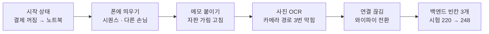

# N057 실습과제 제출보고서 — 웹으로 쓰던 하루친구를 폰 앱으로 가져가면 무엇이 새로 필요하고, 무엇이 드러나는가?

> 버전 1.0 · 2026-11-05 · 대상 서비스 AI 친구 에이전트(friend-agent)와 새 앱 friend-agent-mobile · 근거 `실습\N057_실습_진행기록.md` 0~11절 · 실행 주체는 표에 사용자 / Claude로 적었다

**한눈에 보기**

**교안 8-9 확인 5가지 모두 통과 · 앱 코드 커밋 2개(push 완료) · 폰으로 써 보다 찾은 백엔드 빈칸 3개를 고침(시험 220 → 248개 통과, 브랜치 `n057-date-fix`, push 완료·PR 없음) · 그동안 앱 재빌드 0회**
  ↳ 템플릿 앱을 내 폰(Android, Expo Go)에 띄우고, 답 아래 기억·약속 메모와 사진으로 약속 만들기(사진첩·앱 안 카메라 → 백엔드 OCR → 입력창에서 사람이 고친 뒤 보냄)를 붙였다. 교안에 없던 일 다섯 가지 — Android 자판이 입력창을 가림, 카메라 경로만 OCR 실패, 노트북 와이파이 전환으로 앱이 멈춤, 약속 날짜가 하루 앞당겨짐, 친구가 완료했다고 답했지만 아무것도 저장되지 않음 — 를 실제로 겪고 원인을 찾았다

- **문제** — 하루친구는 웹 주소로만 쓸 수 있었다. 폰 앱으로 만들 때 화면은 새로 만들어야 하지만, 백엔드·데이터베이스·로그인을 그대로 쓸 수 있는지, 폰에서만 생기는 문제는 무엇인지는 직접 띄워 봐야 알 수 있었다.
- **원인** — 앱은 화면 코드만 폰에 가지고 백엔드 주소 하나로 같은 API를 부른다. 그래서 앱 쪽 문제(자판·카메라 권한·사진 넘기기)와 백엔드 쪽 문제(날짜 규칙·안전장치)가 섞여 보인다. 그리고 AI 친구의 **말**과 서버가 실제로 한 **일**이 다를 수 있다.
- **해결** — 앱에는 자판 처리·메모·카메라 버튼·카메라 화면·권한 안내를 넣었다. 백엔드는 API 모양을 바꾸지 않고 안쪽 규칙 세 곳만 고쳤다(달력 날짜 읽기, "저장해 줘"를 부탁으로 인식, 일정을 물으면 반드시 조회). 고친 뒤 폰에서 다시 확인했다.
- **현재 판단 [추론]** — 노트북 백엔드 + 같은 와이파이 환경에서는 "웹과 같은 백엔드를 그대로 쓰는 폰 앱"이 작동한다. 그러나 Cloud Run 결제가 꺼져 있어 공개 주소(https)로는 시험하지 못했고, 앱 파일(EAS Build)은 만들지 않았다. 백엔드 수정은 브랜치에만 있고 staging·production에는 올리지 않았다.

`근거 [확인] 51 · [추론] 9 · [미확인] 3 · 요구 9개 중 7개 완료·1개 일부·1개 하지 않음`

| 요구(교안 1장 학습목표 7개 + 7-3·8-9 확인) | 상태 | 근거 |
|---|---|---|
| ① 웹과 앱의 차이, 플랫폼·네이티브·빌드 설명 | ✅ | 강의노트 v1.0(1~3장), 시작 질문 답 |
| ② 네 가지 방법 비교·선택 | ✅ | 강의노트 v1.0(3장). 실습은 교안대로 Expo |
| ③ Expo Go와 개발용 빌드의 차이·한계 | ✅ | 자판 라이브러리(`react-native-keyboard-controller`)는 Expo Go에 없어 쓰지 않음 [확인] |
| ④ 설정 → 로그인 → 스트리밍 시퀀스 읽기 | ✅ | 백엔드 로그가 교안 시퀀스 순서와 같음, 사용자 "스트리밍이야. 확실해" [확인] |
| ⑤ 내 폰 Expo Go로 실행, 연결 문제 해결 | ✅ | SDK 58.0.0 화면, 연결 끊김 2번 — 1번은 노트북 주소 변경으로 확인·해결, 1번은 다시 열어 풀림(원인 미확인) [확인] |
| ⑥ 구조를 먼저 정하고 에이전트에게 화면 변경 | ✅ | A 메모: 무엇·어디서·어느 파일·모양을 먼저 정함, 저장하면 반영(첫 1번은 Reload 필요) [확인] |
| ⑦ 사진첩·카메라 → 백엔드 OCR → 약속 | ✅ | 8-9 확인 5가지 통과, 약속 메모 "11월 7일(토) 10:30" [확인] |
| ⑧ 공개 주소(Cloud Run)로 앱 연결 | 🔶 | 결제가 꺼져 500 → 노트북 주소(http)로 대신함 [확인] |
| ⑨ EAS Build로 앱 파일 만들기 | ⚪ | 교안 범위 밖(오늘은 Expo Go까지) |

▸ 이 문서에 대해 (접기)
  - 작성일 2026-11-05. 숫자와 사건은 `실습\N057_실습_진행기록.md`에서만 가져왔고, 없는 것은 "기록 없음"이라 적었다.
  - **증거 화면은 폴더에 저장하지 않았다.** 사용자가 대화에서 보여 준 9장의 목록은 부록에 있다.
  - 가린 정보: 노트북 주소는 `<노트북 주소>`, 사용자 UUID는 앞 8자만, 키·프로젝트 번호는 적지 않았다. `.env`는 Claude가 열지 않았다(사용자가 직접 만듦).
  - 환경: Expo SDK 58(처음 `expo 58.0.21`·`react-native 0.88.0`, 끝에 `58.0.23`·`0.88.1`), Android 폰의 Expo Go, 백엔드는 노트북의 가상환경(`.venv`) + Windows용 tesseract(`kor+eng`), 답 모델 gpt-4o-mini, Supabase 익명 로그인.

> 🏷️ 근거 표시 — [확인] 진행기록이 관찰하거나 실행한 출력으로 적은 것 · [추론] 기록에서 판단한 것 · [미확인] 이번에 확인하지 못했거나 하지 않은 것

> ❓ 시작 질문 — 아침에 "웹 서비스를 폰 앱으로 만들면 무엇이 새로 필요하고 무엇을 그대로 쓸 수 있나?"를 적었다. 끝에서(13절) 다시 읽는다.

## 1. 이 문서를 읽는 법

큰 틀은 **본사(백엔드)는 그대로 두고 새 매장(폰 앱)을 여는 일**이다. 매장은 인테리어와 계산대(화면·카메라)를 새로 갖추지만, 고객 장부와 업무 규정은 본사에 있다.

| 용어 | 쉬운 말 | 경영으로 말하면 (단, 어긋나는 곳) |
|---|---|---|
| Expo Go | 개발 중인 앱을 폰에서 바로 띄워 보는 앱 | 개점 전 시범 매장 (단, 카메라 같은 기본 설비만 있고 특수 설비는 못 들인다) |
| 개발 서버(8081) · 백엔드(8080) | 화면 코드를 보내는 곳 · 데이터를 주는 곳 | 인테리어 업체 · 본사 (단, 둘 다 오늘은 노트북 한 대에 있었다) |
| 익명 로그인 · 게스트 | 가입 없이 폰에 저장된 열쇠로 들어오는 손님 | 회원 카드 없는 단골 (단, 기기가 바뀌면 다른 손님이 된다) |
| 스트리밍 | 답을 다 만든 뒤가 아니라 만드는 대로 보냄 | 요리가 나오는 대로 한 접시씩 내기 |
| OCR | 사진 속 글자를 읽어 글로 바꾸는 기술 | 서류 스캔 후 타자 (단, 손글씨·화면 사진은 잘 못 읽는다) |
| HITL | AI가 읽은 결과를 사람이 확인·수정한 뒤 실행 | 결재 전 담당자 검토 |
| 안전장치(guard) | 모델이 고른 것을 코드 규칙으로 다시 고치거나 빼는 곳 | 검토 담당자의 체크리스트 (단, 목록에 없는 표현은 틀리게 고친다) |
| 메모(기억·약속) | 서버가 실제로 기억·약속을 저장했을 때만 붙는 표시 | 결재 도장 — 말로 한 보고가 아니라 처리된 증거 |

그림 색 규칙: 그림 색은 단계를 구분할 뿐 성공·실패를 뜻하지 않는다.

▼ 그림 1 · 오늘의 큰 흐름 — 앞 셋은 교안대로 앱을 세운 일, 뒤 셋은 폰으로 써 보다 드러난 문제를 고친 일이다

<!-- flow: 그림 1. 오늘의 흐름. 앞 세 칸은 앱을 세우는 일, 뒤 세 칸은 실제 사용에서 드러난 문제를 푼 일이다. | 시작 상태/결제 꺼짐 → 노트북/1 ; 폰에 띄우기/시퀀스 · 다른 손님/2 ; 메모 붙이기/자판 가림 고침/3 ; 사진 OCR/카메라 경로 3번 막힘/4 ; 연결 끊김/와이파이 전환/2 ; 백엔드 빈칸 3개/220 → 248 시험/1 -->


```text
시작 상태(노트북 백엔드) → 폰에 띄우기 → 메모·자판 → 사진 OCR → 연결 끊김(와이파이) → 백엔드 빈칸 3개 고침
```
<!-- /flow -->

읽는 법: 앱 코드는 세 번째·네 번째 칸에서만 바뀌었다. 여섯 번째 칸은 백엔드 안쪽 규칙만 고쳤고 앱은 그대로였다.

## 2. 시작 전에 무엇을 맞췄나? (교안 5장 "시작 상태")

이 절의 목적: 교안과 다른 출발점을 남긴다.

| 한 일 | 결과 | 누가 | 한계 |
|---|---|---|---|
| Node·GitHub | Node v24.18.0, `gh` 로그인됨 [확인] | Claude | — |
| 공개 백엔드 | staging·production 모두 **500**. Cloud Run 로그 "billing is disabled for this project", 결제 계정 `open=False` [확인] | Claude | 무료 체험이 끝난 것으로 보임 [추론] |
| 선택 | ① 결제 켜기 ② **노트북에서 백엔드** ③ 강사 시연 주소 중 ② [확인] | 사용자 결정 | 노트북이 켜져 있고 같은 와이파이여야 함 |
| 노트북 백엔드 | Docker 대신 가상환경 + Windows tesseract로 8080에서 실행, `ocr_enabled: true` [확인] | Claude | Docker Desktop은 기본 위치가 아니어서 켜지 못함 |
| 앱 저장소 | 템플릿 `88chacha/friend-agent-mobile-template` → `JEON-DAEJIN/friend-agent-mobile`(공개) [확인] | 사용자 결정·Claude | — |
| Expo 스킬 | 프로젝트 범위로 설치(24개) [확인] | 사용자 승인·Claude | 이 세션은 강의정리 폴더에서 열려 스킬이 바로 읽히지 않음 |
| `.env` | 사용자가 직접 만들고 `EXPO_PUBLIC_API_URL=http://<노트북 주소>:8080` [확인] | 사용자 | Claude 권한 규칙이 `.env`를 막음 |

**교재와 다르게 한 것**: 교안은 `https://…run.app` 공개 주소를 쓴다. 오늘은 집 안 주소(http)였다. 앱의 구조("백엔드 주소 하나로 시작")는 같다 [확인]. 교안 p15는 Expo 스킬을 설치해도 `.claude/settings.json`이 바뀌지 않는다고 했는데, 실제로는 키 순서만 바뀌어 git에 수정으로 떠서 되돌렸다 [확인].

> ▶ **한 줄 요약** — 교안의 공개 백엔드가 결제 문제로 꺼져 있어, 같은 코드를 노트북에서 띄워 대신했다.

## 3. 내 폰에 띄우고, 같은 백엔드에서 다른 손님이 됐나? (교안 7장)

이 절의 목적: 교안 7-3 확인 네 가지와 7-4 "다른 게스트"를 실제로 본다.

| 교안 확인 | 결과 | 누가 |
|---|---|---|
| ① 캐릭터 저장하고 대화하기 | 됨. 로그 `config → me → character → PUT character → … → messages → chat×3`, 교안 시퀀스 순서와 같음 [확인] | 사용자·Claude |
| ② 대화 화면 위 아바타·이름 | 있음(강아지 하루) [확인] | 사용자 |
| ③ 답이 글자 단위로 | 짧은 답엔 "한 번에 나온 것 같다" → 긴 답으로 다시 보고 **"스트리밍이야. 확실해"** [확인] | 사용자 |
| ④ Expo Go 완전 종료 뒤 다시 열기 | "종료하기 전 화면 그대로". 로그에 `/api/config`부터 다시 찍힘 → 저장된 토큰으로 같은 손님 [확인] | 사용자·Claude |

**같은 백엔드, 다른 손님(교안 7-4)**: 노트북 브라우저로 같은 백엔드를 열자 **예전(N052~N056) 실습 때의 곰 하루와 크레딧 30**이 떴다. 교안이 예로 든 "앱 대화가 보임" 도, "캐릭터 만들기 화면"도 아닌 세 번째 경우였다. 브라우저가 예전에 받은 게스트 열쇠를 간직하고 있었기 때문이다 [확인].

| messages 표 | 사람(앞 8자) | 어디서 |
|---|---|---|
| 124~131 | `9184e31a` | 폰(강아지) (11:36~11:42) |
| 132 | `02604922` | 노트북 브라우저를 연 순간 곰 하루의 인사 (11:45) |

`characters` 표에는 캐릭터가 8개 있었고, 오늘 갱신된 행은 `9184e31a` 하나뿐이었다 [확인]. 데이터는 사라지지 않았고, 기기마다 저장된 열쇠가 달라 다른 사람이 됐다. 하나로 합치려면 공통 로그인이 필요하다 [추론].

> ▶ **한 줄 요약** — 같은 백엔드를 썼지만 폰과 브라우저는 서로 다른 손님이었다. 데이터베이스가 그 증거를 보여 줬다.

## 4. 저장하면 바로 바뀌었나? (교안 8-1)

| 시험 | 결과 |
|---|---|
| 입력창 안내 문구를 "오늘 같은 날 커피는 어떤 걸로 마실까?"로 바꿈 | **폰에 변화 없음.** 개발 서버는 `running`, 터미널엔 `Android Bundled … (1 module)`. 개발자 메뉴 **Reload** 뒤에 떴다 [확인] |
| 괄호 하나를 일부러 지움 | 폰에 `TransformError: SyntaxError`가 **저절로** 뜸, 터미널에 `Unexpected token, expected "," (66:104)` [확인] |

교안은 "몇 초 안에 폰 화면이 바뀐다"고 한다. 두 번째부터는 그대로였지만 첫 번째는 Reload가 필요했다. 원인은 확인하지 못했다 [미확인].

## 5. 답 아래 메모를 붙이다 폰에서만 보인 문제 (교안 8-2·8-3)

**구조를 먼저 정함**(사용자 "그대로 진행"): 무엇 = 새로 기억한 것·잡거나 취소한 약속 / 어디서 = 백엔드 `app/agent.py`의 이벤트 순서를 직접 읽음 / 어느 파일 = `api.ts`·`index.tsx` / 모양 = 답 아래 회색 작은 글씨 "기억했어요: …"(앞에 뇌 그림), "약속을 저장했습니다: …"(앞에 시계 그림) [확인].

- **교재와 다른 점**: 교안 힌트는 "memory는 delta 뒤에 온다"만 말한다. 코드를 읽어 보니 `reminder`는 오히려 delta보다 **먼저** 온다. 보내는 순간 빈 답 말풍선을 먼저 만들어 두므로 둘 다 마지막 말풍선에 붙이면 됐다 [확인].
- 확인: "나 고양이 두 마리 키워" → 기억 메모, "내일 아침 8시에 물 마시라고 알려 줘" → 약속 메모, 앱을 다시 열면 **"대화는 그대로인데, 회색 메모는 사라졌어"** — 메모는 그 턴의 이벤트로만 그려서 예상과 같다. 저장된 약속·기억은 표에 남아 있다 [확인].

| 폰에서 사용자가 찾은 문제 | 원인 | 고친 것 |
|---|---|---|
| "메시지를 입력하려고 누르면 입력 자판이 위로 올라오는데 화면은 따라오지 않아서 내가 타이핑하는 글자를 볼 수가 없어" | 템플릿이 Android에 `KeyboardAvoidingView` behavior를 주지 않음. Expo 문서: Android는 edge-to-edge라 창이 줄지 않는다 [확인] | 두 플랫폼 모두 `behavior="padding"` → **"둘 다 고쳐 졌어"** |
| 안내 문구가 이미 입력된 글처럼 계속 남아 보임 | 4절 실험에서 안내 문구에 질문 문장을 넣음 | "메시지 보내기"로 되돌림 |

자판 문제는 교안 확인 목록에 없다. 템플릿에도 같은 줄이 있어 강사님께 알릴 거리다 [확인].

> ▶ **한 줄 요약** — 메모는 교안대로 붙었고, 실제 폰에서 입력해 봐야만 드러나는 자판 문제를 사용자가 찾았다.

## 6. 사진으로 약속 만들기 — 카메라 경로만 세 번 막혔다 (교안 8-6~8-9)

**만든 것**(사용자 "이 설계대로 진행하자. 권한 설명도 넣어두자"): 카메라 버튼(백엔드 `ocr_enabled`일 때만) → "사진첩에서 고르기 / 카메라로 찍기" → 앱 안 카메라 화면(`camera.tsx`) → `POST /api/ocr` → 읽은 글을 안내 문장과 함께 **입력창에 넣고 보내지 않음**, `app.json`에 권한 설명 [확인].

| 시도 | 사진첩 | 카메라 | 원인 |
|---|---|---|---|
| 1. `fetch` + 사진 꾸러미 | — | "Unsupported FormDataPart implementation" | SDK 58은 `expo/fetch`가 전역 fetch라 옛 방식의 사진 꾸러미를 받지 않음 [확인] |
| 2. 파일을 직접 읽어 보냄 | — | "FileSystemFile.bytes … missing 'READ' permission" | Expo Go 안에서 JavaScript 파일 읽기가 막힘 [확인] |
| 3. `XMLHttpRequest` | **성공** | "네트워크 오류", 백엔드엔 **요청 0건** | 오류 문구의 "백엔드 주소·와이파이 확인"은 틀린 힌트였다 [확인] |
| 4. 찍은 사진 주소를 화면 이동 주소 대신 **앱 안 보관함**으로 넘김 | 성공 | **성공**, 인쇄물 "정확히 읽었어" | 두 경로의 차이는 사진 주소를 넘기는 방법이었다 [추론] |

**교안 8-9 확인 다섯 가지** [확인]: 카메라 → 입력창 ✅ · 저절로 보내지 않음 ✅ · 고쳐 보내면 약속 메모 ✅(9절 수정 뒤) · 사진첩 ✅ · 권한을 꺼도 앱이 멈추지 않고 안내 화면 ✅("확인했고, 카메라 권한을 다시 허용으로 돌렸어").

**OCR은 사진 종류에 따라 갈렸다** — 같은 엔진(tesseract `kor+eng`, `--psm 6`). 엔진과 앱은 정상이고 사진이 문제였다 [추론]:

| 사진 | 결과 |
|---|---|
| 손글씨 "11월7일 오전 10시30분 미용실예약" | `11 1% / OK 1 0A! 204 / AOA` — 숫자 11만 맞음 [확인] |
| 종이 인쇄물 | 정확 [확인] |
| 노트북 화면을 폰으로 찍음 | 깨짐(55·157글자) [확인] |
| 같은 화면의 캡처를 노트북에서 직접 읽힘 | "11월 7일 / 오전 10시 30분 / 미용실 예약" 세 줄 정확 [확인] |

> ▶ **한 줄 요약** — 사진첩은 되고 카메라만 안 될 때, 함수가 아니라 두 경로의 차이를 봐서 풀었다. OCR은 엔진보다 사진이 결과를 갈랐고, 그래서 입력창에서 사람이 고치는 설계(HITL)가 필요했다.

## 7. 앱이 멈췄을 때 — 범인은 노트북 와이파이였다 (교안 7장 연결 문제)

| 증상 | 확인한 것 | 원인 · 처리 |
|---|---|---|
| 하루친구를 열면 원만 계속 돎 | 개발 서버 `running`, 앱 묶음 약 6MB 정상, 폰 요청 0건 [확인] | 다시 열어 풀림. 원인은 확인 못 함, 아래와 같은 원인이었을 가능성 [추론] |
| "CONRAD SEOUL …" 글을 보내자 멈춤 → `ConnectException: Failed to connect to /<노트북 주소>:8080` | 백엔드에 `/api/chat` 0건, 노트북이 **저장된 다른 와이파이로 자동 전환**돼 주소가 바뀜 [확인] | 사용자 "둘다 … 연결했어" → 주소가 원래대로, 8080·8081 응답 |

노트북 백엔드 방식은 노트북 주소가 바뀌면 앱이 길을 잃는다. 클라우드의 고정 주소가 필요한 이유 하나를 직접 겪었다 [추론].

## 8. 약속 날짜가 하루 앞당겨졌다 — 백엔드 안전장치의 첫 번째 빈칸

| 단계 | 내용 |
|---|---|
| 사용자 발견 | "그런데 이건 서버 문제인지 / 나는 11월7일 오전1030분으로 예약했는데 / 아래 메모에는 11월6일로 약속을 예약했어" (메모: "11월 6일(금) 10:30에 '미용실 예약'") [확인] |
| 재현 | 같은 글을 백엔드 날짜 규칙에 넣자 `2026-11-06 10:30` [확인] |
| 원인 | 날짜 규칙이 "내일·금요일"만 알고 **"11월 7일"은 모름** → "오늘 10:30은 지났으니 내일" → 11/6. 안전장치(`fix_reminder_date`, N054)가 모델의 날짜를 이 틀린 날짜로 **덮어썼을 가능성이 크다** [추론] |
| 고침(사용자 승인) | 달력 날짜를 먼저 읽게 함(지난 날짜면 내년, 없는 날짜는 무시), 시험 9개 → 229개 통과 [확인] |

## 9. 완료했다는데 아무것도 저장되지 않았다 — 두 번째·세 번째 빈칸

**말은 증거가 아니었다.** 친구의 답과 서버가 실제로 한 일을 로그·데이터베이스로 맞춰 봤다.

| 보낸 말 | 친구의 말 | 서버가 한 일 | 원인 | 고침(사용자 승인) |
|---|---|---|---|---|
| "11월 7일 … 미용실 예약 알려 줘" | 완료했다고 답함 | `tools: []`, **저장 안 됨**, 메모 없음 [확인] | 같은 말로 실제 모델을 3번 돌리면 3번 다 맞게 고름 → 그때의 흔들림 [추론] | — |
| "새 약속 저장해 줘: 11월 7일 …" | (메모 없음) | `tools: []` [확인] | 모델은 맞게 골랐는데(재현 2/2) 안전장치의 부탁 낱말 목록에 **"저장해 줘"가 없어** 뺌 [확인] | 저장해 줘·등록해 줘·약속 잡아 줘 추가, "사진 저장했어"는 여전히 막음. 시험 9개 → 238개 |
| "일주일 내 나의 일정을 한번 알려줘" | 미용실 하나만 | `tools: []`, 저장된 **"물 마시기"(11/6 08:00)가 빠짐** [확인] | 조회 없이 대화 기억으로 답함. 실제 모델 **3번 모두** 조회 안 함 [확인] | 일정을 물으면 코드가 조회를 넣음, 시험 10개 → **248개** |

고친 뒤 폰에서: "약속을 저장했습니다: **11월 7일(토) 10:30**에 '미용실 예약'" · 일정 물음엔 **"예상한 답으로 왔어"**(두 약속 모두, 로그 `list_reminders`) [확인]. 세 수정 모두 API 모양을 바꾸지 않아 **앱은 한 번도 다시 빌드하지 않았다**(첫 두 수정은 Reload도 없이 반영) [확인].

> ▶ **한 줄 요약** — 시험 220개가 통과하던 백엔드도 폰으로 직접 써 보니 빈칸 세 개가 나왔다. 그 빈칸을 잡아낸 것은 답 아래 메모(서버가 실제로 한 일)와 로그였다.

## 10. 사고·문제 표

| 변경 | 결과 | 사용자에게 보였을 것 | 원인을 찾은 곳 | 처리 |
|---|---|---|---|---|
| 템플릿 그대로(Android) | 자판이 입력창을 가림 | 타이핑하는 글자가 안 보임 | 사용자 캡처 + Expo 문서 | `behavior="padding"` |
| 4절 안내 문구 실험 | 질문 문장이 입력된 글처럼 보임 | 지워지지 않는 글 | 사용자 | 원래 문구로 |
| 사진 올리기(카메라) | 세 가지 오류 | 사진을 찍어도 글이 안 들어옴 | 오류 원문 + 백엔드 요청 0건 | 사진 주소를 보관함으로 |
| 노트북 와이파이 자동 전환 | 앱이 멈춤·연결 실패 | 보내기 뒤 멈춘 화면 | 백엔드 요청 0건 + 노트북 주소 | 같은 와이파이로 되돌림 |
| 백엔드 날짜 규칙 | 11/7이 11/6으로 | 하루 전날 알림 | 사용자 + 규칙 재현 | 달력 날짜 읽기 |
| 백엔드 부탁 낱말 | "저장해 줘"에 약속 없음 | "완료" 같은 말, 메모 없음 | 로그 + 실제 모델 재현(전·후) | 낱말 추가 |
| 모델의 조회 누락 | 일정에서 한 건 빠짐 | 틀린 일정 목록 | 로그 + DB 대조 | 코드가 조회를 넣음 |
| 사용자가 홈 폴더에서 `expo start` | "expo@58.0.23 설치할까요?" | 설치 질문 | 터미널 프롬프트 경로 | 앱 폴더로 이동 |

## 11. 궁금했던 것

| 질문(사용자) | 답 |
|---|---|
| "안드로이프 폰에서 expo go를 열고 로그인부터 해야할까?" | Expo 계정 로그인은 빌드용이라 오늘은 필요 없다. 앱 안의 익명 로그인은 앱이 스스로 한다 |
| "하루 친구 sdk version: 58.0.0 이라고 떴어. continue를 누르면 될까?" | 그렇다. 앱 이름과 SDK가 맞는다는 화면이다 |
| "폰에 아무런 변화가 없는데. 지웠다 다시 열어야 하나? 계속 켜두고 화면을 지켜 보고 있었거든" | 지울 필요 없이 개발자 메뉴의 Reload로 됐다 |
| "이건 서버 문제인지?"(약속 날짜) | 서버 문제였다. 앱은 받은 메모를 그대로 보여 줬다 |
| "리로드 해야할까?"(백엔드 수정 뒤) | 필요 없다. 앱 코드는 그대로이고 다음 메시지부터 새 규칙이 쓰인다 |

## 12. 하지 않은 것 · 교재와 달라진 것

| 항목 | 하지 않은 이유 | 대가 |
|---|---|---|
| 공개 주소(Cloud Run)로 연결 | 결제가 꺼져 있음, 켜는 것은 사용자의 결정 | https·콜드 스타트 상황은 확인 못 함 [미확인] |
| EAS Build·스토어 | 교안 범위 밖 | 다른 사람 폰에 설치하는 길은 미확인 [미확인] |
| 백엔드 수정의 staging 반영(PR) | 브랜치가 N056 크레딧 브랜치에서 갈라져 결제 커밋 3개가 함께 들어감 → 나중에 결정 | 웹 서비스에는 아직 고친 규칙이 없음 [확인] |
| 지난 대화에도 메모 보이기 | 백엔드가 메모를 저장·반환해야 함 | 앱을 다시 열면 메모가 사라짐 |
| 손글씨에 강한 OCR | 백엔드 엔진 교체 일 | 손글씨는 거의 못 읽음 |
| 사용자 화면에 조회 표시 | 범위 밖 | 조회를 했는지 화면에서 알 수 없음 |
| 템플릿 버그 제보 | 아직 | 강사님께 알릴 거리로 남김 |

**교안 그림 7과 달랐던 점**: 교안은 "오른쪽(백엔드)은 한 줄도 바뀌지 않았다"고 한다. 오늘은 백엔드를 세 번 고쳤다. 다만 앱 때문에 생긴 문제가 아니라 **원래 있던 빈칸을 폰으로 써 보다 찾은 것**이고, API 모양은 그대로라 앱 재빌드는 없었다 [확인].

## 13. 회고 — 시작 질문을 다시 읽으면

**아침의 답(사용자)**: "화면은 PC가 아니라 스마트폰에 보기 좋은 것으로 최적화할 필요가 있고, 아무래도 앱으로 배포되는 만큼 중요한 정보는 서버나 데이터베이스에 보관해야 하는 것으로 알고 있다."

**회고(사용자)**: "아침 생각 대부분은 맞았다. 내가 대답 못한 것도 알게 되었다. 실제 내가 생각한 것이라 스마트 폰에서 직접 눈으로 확인하는 것과는 차이가 있다. 개발은 이런 세세한 것까지 생각해서 제대로 검증하고 고쳐야 더 완벽한 서비스르 제공할 수 있다."

| 아침의 예상 | 실제 |
|---|---|
| 화면은 스마트폰에 맞게 새로 | ✅ 자판 처리·메모·카메라 버튼·카메라 화면을 새로 만들었다 |
| 중요한 정보는 서버·DB에 | ✅ 앱을 다시 열어도, 부품을 통째로 바꿔도 대화는 그대로였다 |
| (답에 없던 것) 서버·로그인을 그대로 쓰나 | API 모양은 그대로, 그러나 기기마다 다른 손님이 됐다 |
| (답에 없던 것) 연결·배포 | 노트북 주소가 바뀌자 앱이 길을 잃었다 → 고정 주소가 필요한 이유 |
| (예상 못 한 것) | 시험이 다 통과하던 백엔드에서 폰으로 써 보며 빈칸 세 개, AI의 말과 실제 일이 다른 경우 세 번(로그로는 두 번 확인) |

> 📌 **요약** — 폰 앱으로 새로 만든 것은 화면과 기기 기능이라는 출입구뿐이었고, 백엔드는 API 모양을 그대로 둔 채 재사용했다. 그런데 출입구를 새로 열자 본사 업무 규정의 빈칸이 드러났다. 빈칸을 잡아낸 것은 AI의 말이 아니라 서버가 실제로 한 일을 보여 주는 메모와 로그였다.

## 부록. 산출물 위치와 증거 화면

| 무엇 | 위치 |
|---|---|
| 진행기록(사실의 근거) | `강의정리\N057\실습\N057_실습_진행기록.md` (0~11절) |
| 앱 코드 | `friend-agent-mobile` main: `d572682`(자판·메모·사진 OCR·권한), `83c9aef`(부품을 SDK 58에 맞게, expo-doctor 20/20), push 완료 |
| 백엔드 코드 | `friend-agent` 브랜치 `n057-date-fix`: `c6ec5de`(달력 날짜·"저장해 줘"), `d4afcfd`(일정 질문은 조회), 시험 248 통과, push 완료·PR 없음 |
| 강의노트 | `N057_Expo로_휴대폰_앱_만들기(expo-mobile-app)` v1.1(v1.0은 `_판본_v1.0\`) |
| 함께 볼 문서 | `N057_오늘_학습정리` · `설명자료모음\N057_실습_설명자료` |

**증거 화면 목록(대화에서 사용자가 보여 줌, 폴더에 저장하지 않음)**: Expo Go 개발자 메뉴(SDK 58.0.0·Fast Refresh·연결 주소) · 노트북 브라우저의 곰 하루(크레딧 30) · Supabase `characters` 8행 · `messages` 최신순(124~132) · 행 편집 창 2장(131·132번) · 자판이 입력창을 가린 폰 화면 · 메모장 캡처(OCR 대조용) · OCR 글을 보내고 "11월 6일(금)" 메모가 붙은 폰 화면.

<p class="footer-note">N057 실습과제 제출보고서 v1.0 · 2026-11-05 · 근거 실습/N057_실습_진행기록.md</p>
