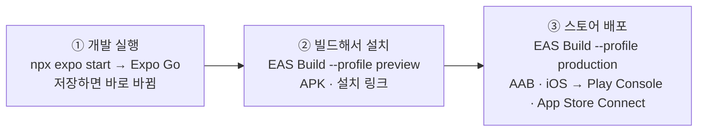
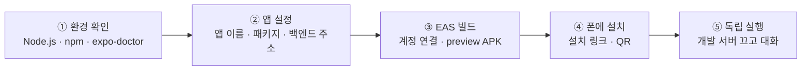
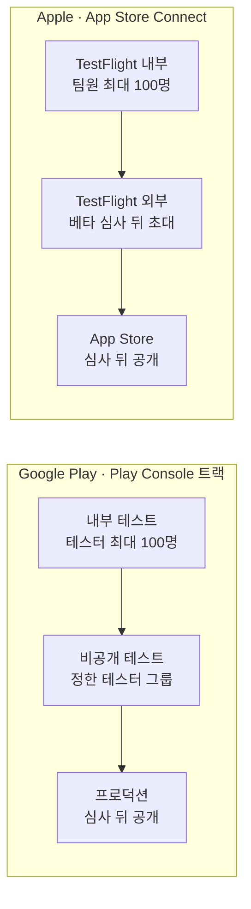

# N058 · Expo 앱 빌드하고 출시 준비하기

> 버전 1.1 · 2026-11-06 (학습서 19쪽 + 해설서 57쪽 통합 정리 · 비개발자용 · 부록 A~G 포함 · 실습 결과 반영: v1.0은 `_판본_v1.0/`)

## 목차

- [핵심 한 문장 요약](#핵심-한-문장-요약)
- [1. Expo Go로 잘 도는 앱을 왜 다시 '빌드'해야 하나? (원문 Ch01)](#1-expo-go로-잘-도는-앱을-왜-다시-빌드해야-하나-원문-ch01)
- [2. 앱 파일은 무엇이고, 빌드는 무엇을 하나? (원문 Ch02)](#2-앱-파일은-무엇이고-빌드는-무엇을-하나-원문-ch02)
- [3. 같은 코드가 폰에 들어가는 길은 몇 가지인가? (원문 Ch03)](#3-같은-코드가-폰에-들어가는-길은-몇-가지인가-원문-ch03)
- [4. 내 앱을 실제로 빌드해 폰에 설치하려면? (원문 Ch04)](#4-내-앱을-실제로-빌드해-폰에-설치하려면-원문-ch04)
- [5. 스토어에 올리려면 무엇을 더 준비하나? (원문 Ch05)](#5-스토어에-올리려면-무엇을-더-준비하나-원문-ch05)
- [6. 내 앱을 처음부터 만들어 빌드까지 가려면? (원문 Ch06)](#6-내-앱을-처음부터-만들어-빌드까지-가려면-원문-ch06)
- [7. 오늘 배운 것을 한 장으로 정리하면? (원문 Ch07)](#7-오늘-배운-것을-한-장으로-정리하면-원문-ch07)
- [맺음말](#맺음말)
- [부록 A · 실전 명령·설정·요청 모음](#부록-a--실전-명령설정요청-모음)
- [부록 B · 트러블슈팅 표](#부록-b--트러블슈팅-표)
- [부록 C · AI 프롬프트 모음집](#부록-c--ai-프롬프트-모음집)
- [부록 D · 용어 사전](#부록-d--용어-사전)
- [부록 E · 개념 비교표 모음](#부록-e--개념-비교표-모음)
- [부록 F · 학습 로드맵](#부록-f--학습-로드맵)
- [부록 G · 복습 퀴즈](#부록-g--복습-퀴즈)

## 핵심 한 문장 요약

> 📌 **요약** — Expo Go로 보던 앱은 **노트북의 개발 서버가 켜져 있을 때만** 내 폰에서 돈다. 다른 사람 폰에서 혼자 돌게 하려면 코드·이미지·설정을 **앱 파일 하나로 묶고 서명하는 빌드**가 필요하고, Expo는 이 일을 **EAS Build가 클라우드에서** 대신해 주므로 Windows 노트북에는 Node.js만 있으면 된다. ① 같은 코드가 폰에 들어가는 길은 **세 가지**다 — 개발 실행(Expo Go), 빌드해서 설치(`preview`, APK, 설치 링크), 스토어 배포(`production`, AAB·iOS, 개발자 계정). ② 빌드한 앱에는 **코드가 고정**되므로 화면을 고치면 다시 빌드해야 하고(해설서는 조건이 맞으면 EAS Update로도 된다고 덧붙인다), 서버의 프롬프트·백엔드·DB는 고쳐도 다시 빌드할 필요가 없다. ③ 빌드에 들어갈 값은 커밋하지 않는 `.env`가 아니라 **`eas.json` 프로필의 `env`**에 적고, 그 값은 앱 안에 그대로 들어가므로 **비밀값은 넣지 않는다**. ④ **패키지 이름과 서명 키**는 스토어가 앱을 알아보는 기준이라 한 번 정하면 바꾸기 어렵다. ⑤ 스토어는 앱이 돌아가는지만 보지 않고 **개인정보·데이터 삭제·AI 답 신고·AI 표시·앱 안 판매·연령 등급**을 심사하며, 테스트 단계의 앱은 **사람이 버튼을 눌러 넘기기 전에는 공개되지 않는다**.

> 🧪 **예제** — 한 줄 예: 스토어에 올린 AI 친구 앱에서 (가) 서버의 프롬프트를 바꿔 말투를 부드럽게 하고 (나) 전송 버튼 문구를 바꾸려 한다. (가)는 서버만 다시 배포하면 모든 사용자에게 바로 적용되고 앱은 그대로 둔다. (나)는 문구가 앱 파일 안의 번들에 들어 있으므로 **새로 빌드해 업데이트를 내야** 한다(학습서 p3 퀴즈, 정답 (나)만). 핵심은 고치려는 것이 **앱 파일 안에 있는지, 서버에 있는지**를 먼저 가르는 것이다.

> 🧪 **예제** — **실습 결과(2026-11-06, v1.1에서 더함)**: 내 앱(N057에서 만든 하루친구)을 `preview` 프로필로 빌드해 Android 폰에 설치했고, 설치한 앱에서 메시지를 보내 답이 왔으며 카메라 권한·글자 인식도 됐다. 교안에 없던 일은 세 가지였다. ① 시작 전에 **staging 백엔드가 결제 꺼짐으로 죽어 있어** 새 결제 계정을 연결하고 서비스를 새 리비전으로 깨웠다(4-2절). ② `build:configure`가 `app.json`에 **마이크 권한(`RECORD_AUDIO`)까지** 넣었다(4-4절). ③ 설치 앱의 권한 목록에 **마이크가 선언**돼 있었는데, 원인은 `expo-image-picker` 플러그인의 기본값이었다(4-6절). 사실은 `실습/N058_실습_진행기록.md`에 있고, 노트북 개발 서버를 끈 상태에서 한 시험이라는 확인과 새 게스트로 시작했다는 확인은 **받지 못했다**.

### 한눈에

- **무엇을 하나** — N057에서 Expo Go로 내 폰에 띄운 AI 친구 앱(friend-agent-mobile)을 **EAS Build로 앱 파일(APK)로 만들어** 폰에 설치하고, 노트북을 꺼도 앱이 도는지 확인한다. 이어서 스토어에 올리기 전에 무엇이 필요한지 점검표를 만들고, 후반부에는 **내가 만들고 싶던 작은 앱**을 새로 만들어 빌드·설치까지 간다.
- **어떻게 배우나** — 앱 파일과 빌드가 무엇인지 → 폰에 들어가는 세 경로 → `app.json`·`eas.json`을 고쳐 preview 빌드 → 설치해 노트북 없이 확인 → 스토어 배포 단계와 AI 앱 출시 점검표 → 내 앱으로 스테이지 0~4.
- **순서** — 빌드의 뜻 → 세 경로와 빌드 프로필 → 실습(설정·빌드·설치) → 스토어 배포와 출시 점검 → 내 앱 만들기 → 정리.
- **오늘의 교훈** — Expo Go에서 화면이 보이는 것과 **실제 설치 파일이 사용자 폰에서 제대로 도는 것**은 다른 단계다. 그리고 앱 파일이 만들어졌다고 출시가 끝나는 것이 아니라, **테스트·보안·개인정보·결제 정책**까지 준비해야 사용자에게 갈 수 있다.

> ⚠️ **주의** — 오늘의 범위: 실습의 기본 경로는 **① 개발 실행과 ② 빌드해서 설치(Android APK)**까지다. ③ 스토어 배포는 유료 개발자 계정이 있는 사람의 **선택 과제**이고(학습서 p4 그림), iPhone 수강생은 Expo Go로 확인하고 설치는 짝의 Android 폰으로 한다(학습서 p4·p7).

### 비유 대응표

| 용어 | 쉬운 말 | 비유 |
|---|---|---|
| Expo Go / 빌드한 앱 | 개발 서버에서 코드를 받아 실행하는 개발용 앱 / 코드가 안에 들어 있어 혼자 도는 앱 | 앱을 시험 운전하는 것 / 자동차를 완성해서 출고하는 것(해설서) |
| 빌드(build) | 소스 코드를 설치 가능한 앱 파일로 만드는 일 | 건축가의 설계도로 실제 건물을 짓는 것(해설서) |
| 컴파일 / 패키징 / 서명 | 기계가 실행할 형태로 바꾸기 / 하나의 파일로 묶기 / 만든 사람 인증 | 외국어를 한국어로 번역 / 제품을 상자에 포장 / 제품에 제조사 인증 도장 찍기(해설서) |
| EAS Build | 클라우드에서 앱 파일을 대신 만들어 주는 서비스 | 설계도를 보내면 완제품을 만들어 주는 전문 공장(해설서) |
| EAS Update | 이미 설치된 앱에 변경된 화면 코드를 보내는 방법 | `[보충 비유]` 이미 팔린 책에 붙이는 정오표 — 단, 책의 판형(네이티브 부분)이 같을 때만 |
| Expo Go / preview / production | 개발 실행 / 시험용 설치 파일 / 스토어 출시용 파일 | 운전 연습용 시뮬레이터 / 시험 운행용 완성 자동차 / 정식 판매용 자동차(해설서) |
| 서명 키 | 스토어가 "같은 개발자의 새 버전"인지 알아보는 열쇠 | 공식 도장 / 디지털 신분증 / 앱의 신분증(해설서) |
| 패키지 이름 | 스토어와 폰이 앱을 구분하는 고유 이름 | 앱의 주민등록번호(해설서) |
| `app.json` / `eas.json` | 앱 이름·패키지 이름·권한 설정 / 빌드 방식과 빌드용 값 | 자동차 모델명과 차대번호 / 생산 방식과 사양 설정(해설서) |
| APK / AAB | 폰에 직접 설치하는 파일 / 스토어에 내는 묶음 | 직접 인도받아 타 볼 수 있는 자동차 / 판매점에 공급하는 생산 패키지(해설서) |
| 개발자 계정 | 스토어에 앱을 올릴 자격 | 앱을 판매하거나 배포할 수 있는 공식 자격증 / 사업자 등록(해설서) |
| 테스트 트랙 → 심사 → 출시 | 소수에게 먼저 → 스토어 확인 → 모두에게 공개 | 직원·지인 시식 → 초청 고객 시식 → 위생·영업 기준 확인 → 영업 시작(해설서) |
| 폰 안 저장 / 서버 저장 | 앱 안에만 두는 데이터 / 인터넷 보관함에 두는 데이터 | 개인 수첩 / 인터넷에 연결된 공동 보관함(해설서) |

> 💡 **팁** — 비유의 한계: "완성차 출고" 비유는 **화면 코드**에만 맞다. 설치한 앱이 노트북 없이 도는 것은 화면 코드가 폰에 들어갔기 때문이지, **AI 백엔드까지 폰에 들어갔기 때문은 아니다**(해설서 p28). 그래서 백엔드 서버가 꺼지면 빌드한 앱도 대화를 못 한다. 또 "공장에 맡긴다"는 비유와 달리, EAS가 대신하는 것은 **컴파일과 서명**까지이고 Apple 개발자 계정·인증서 같은 iOS 배포 준비는 여전히 내 몫이다(해설서 p10).

> 💡 **팁** — 문서에서 "학습서"(19쪽)는 실습 교안, "해설서"(57쪽)는 같은 교안을 장별로 풀어 쓴 책이다. 두 책은 챕터 01~07 제목이 같지만, 서명 키·재빌드 여부·출시 점검표 같은 주제는 **여러 장에 반복**된다. 학습서에는 명령·수치·표·요청 문장이 있고, 해설서에는 공장·자동차·출판·음식점 비유와 퀴즈 정답이 있다. 그래서 이 노트는 **비유·쉬운 설명·정답은 해설서, 명령·수치·표·요청 문장은 학습서 원문**을 따랐다. `[보충]`·`[보충 비유]`·`[추가]`라고 표시한 것만 이 노트에서 덧붙인 것이다.

> ⚠️ **주의** — PDF를 정리하면서 바로잡거나 알아 둘 것. ① **빌드용 값을 어디에 적나**: 학습서 전체와 해설서 Ch03은 "`eas.json` 프로필의 `env`", 해설서 Ch02만 "EAS 환경변수 기능으로 별도 설정"이라고 쓴다. 둘 다 실제로 있는 방법이지만 **이 실습은 학습서(`eas.json`)를 따른다**. ② **EAS Update**: 학습서에는 한 번도 나오지 않고 "문구를 고치면 다시 빌드"로 단정한다. 해설서는 거의 모든 장에 "또는 호환되는 EAS Update"를 덧붙인다. 템플릿에 EAS Update가 설정돼 있다는 말은 두 책 모두에 없으므로, 이 노트는 **실습 기준은 "다시 빌드"**, EAS Update는 "조건이 맞으면 쓸 수 있는 다른 길"로 적었다. ③ 학습서 p10 그림 캡션은 "Finished, QR 코드가 보이는 모습"이지만 실제 화면은 **Succeeded**이고 QR 코드가 없으며, 다른 프로젝트(night-arcade)의 화면이고 빌드 시간이 **17분 49초**로 본문의 "10분 안팎"보다 길다. ④ Google Play 비공개 테스트 조건은 학습서 "12명 이상이 **14일 동안**", 해설서 "**14일 연속**"이다. 트랙도 학습서는 3단계(내부→비공개→프로덕션), 해설서는 공개 테스트를 더한 4단계다. ⑤ TestFlight 내부 테스터 "최대 100명"은 학습서 p13 그림에만 있다. ⑥ **개발자 계정 금액은 두 책 모두에 없다**("1회 등록비 / 해마다 회비"만). ⑦ 학습서 객관식 보기의 "○ ."는 2번 숫자가 빠진 렌더링 잡음이지 정답 표시가 아니다. ⑧ 학습서 p1~2의 탭 3개짜리 위젯과 p17의 캡처(`cap_D77_02…`)는 PDF에 들어 있지 않다. 학습서 그림 3장(p4·p10·p13)은 직접 보고 이 노트에 표와 다이어그램으로 다시 그렸다. ⑨ "2026년 10월 기준 월 30회" 같은 수치와 스토어 정책은 바뀔 수 있으니 실습·출시 전에 확인한다.

> 🧪 **예제** — **해설서에만 있어 학습서로 확인할 수 없는 것**: 버전 예시(1.0.1 / build 2), 새 프로젝트 폴더 이름 `my-first-app`, 로컬 알림 라이브러리 `expo-notifications`, 권한 문구를 정하는 플러그인 설정(`cameraPermission`·`photosPermission`), `app.config.js`로도 설정할 수 있다는 점, 재빌드 표의 "일반적으로" 등급. 이 노트는 이것들을 **해설서 표시를 붙여** 옮겼다. 해설서 각 장 끝의 "1인 창업가가 알아야 하는 이유"·"나의 프로젝트에 적용하기"(MSM·ASP 등)는 수강생 맞춤 해설이라 7-5절에 따로 모았다.

---

## 1. Expo Go로 잘 도는 앱을 왜 다시 '빌드'해야 하나? (원문 Ch01)

### 1-1. 오늘의 상황

N057에서 만든 AI 친구 앱은 Expo Go 안에서 돈다. 그런데 학습서는 이렇게 묻는다 — 이 앱은 **노트북이 켜져 있고 개발 서버가 돌 때만** 내 폰에서 움직인다. 친구에게 보내려면 어떻게 해야 할까? 앱 파일은 누가 어디서 만들고, 폰에는 어떻게 들어가며, 스토어에 올리려면 무엇이 필요한가?

오늘은 이 질문에 답하는 순서로 간다. EAS Build로 앱 파일을 만들어 내 폰에 설치하고, 스토어에 올리기 전에 무엇을 점검해야 하는지 보고, 후반부에는 내 앱을 직접 만들어 빌드까지 간다(학습서 p1).

해설서는 이 강의의 목적을 네 가지로 정리한다: **노트북이 꺼져도 실행**되는 앱, **친구에게 설치 파일로 전달**, **수정하면 새 버전 배포**, 최종적으로 **Google Play·App Store 출시**. 핵심 기술은 클라우드에서 앱을 빌드하는 **Expo EAS Build**다(EAS = Expo Application Services).

### 1-2. Expo Go와 실제 빌드 앱은 무엇이 다른가?

해설서의 비유: "Expo Go는 앱을 시험 운전하는 것이고, 실제 빌드 앱은 자동차를 완성해서 출고하는 것입니다."

| 구분 | Expo Go | 실제 빌드 앱 |
|---|---|---|
| 실행 방식 | Expo Go 안에서 실행 | 독립적인 앱으로 실행 |
| 노트북 | 개발 서버가 필요 | 앱 실행에 불필요 |
| 코드 수정 | 개발 서버에서 변경사항 반영 | 수정 후 새 빌드 또는 업데이트 필요 |
| 친구에게 전달 | 개발 환경 연결 필요 | 설치 파일 또는 스토어로 전달 |
| 출시 | 불가능 | 앱스토어 출시 가능 |

> 📌 **요약** — "Expo Go는 개발과 테스트를 위한 도구이고, 실제 빌드 앱은 사용자에게 배포하기 위한 제품입니다."(해설서)

### 1-3. EAS Build는 어떤 흐름으로 일하나?

해설서가 그린 흐름은 이렇다: 내 컴퓨터에서 개발 → 코드를 Expo 클라우드에 전달 → 클라우드가 빌드 → 앱 파일 다운로드 → 폰에 설치하거나 스토어에 제출. "마치 내가 설계도를 보내면 전문 공장에서 완제품을 만들어 주는 것과 같습니다."

해설서는 여기에 **빌드와 업데이트**를 구분해 덧붙인다.

- 네이티브 기능이나 앱 자체의 구성 변경 → 새로운 빌드가 필요할 수 있다.
- JavaScript 코드나 화면 구성 변경 → EAS Update를 쓰면 조건에 따라 앱 전체를 다시 설치하지 않고 업데이트할 수 있다.
- "즉, EAS Build는 앱을 만드는 공장이고 EAS Update는 이미 설치된 앱에 변경사항을 전달하는 방법이라고 이해하시면 됩니다."

> ⚠️ **주의** — EAS Update는 **학습서에는 나오지 않는다**. 오늘 실습에서 "문구를 고쳤는데 설치한 앱이 그대로다"를 보면, 학습서의 답은 "다시 빌드"다. EAS Update를 쓰려면 따로 설정해야 하고, 업데이트 대상 앱의 **네이티브 부분과 호환**되어야 한다(해설서 p11).

### 1-4. AI 친구 앱은 어떤 단계를 거쳐 사용자에게 가나?

| 단계 | 실제 작업 | 의미 |
|---|---|---|
| 1 | React Native + Expo 개발 | 앱 화면과 기능 제작 |
| 2 | Expo Go 테스트 | 개발 중인 앱 확인 |
| 3 | EAS Build 실행 | 클라우드에서 앱 파일 생성 |
| 4 | APK 설치 | 내 휴대폰에서 독립 실행 확인 |
| 5 | 기능 및 오류 점검 | 출시 전 품질 확인 |
| 6 | AAB 또는 iOS 배포 파일 준비 | 스토어 제출 준비 |
| 7 | 앱스토어 심사 및 출시 | 일반 사용자에게 서비스 제공 |

(해설서 p3) N057은 1~2단계까지 했고, 오늘 실습은 3~5단계, 6~7단계는 선택 과제와 점검표로 다룬다.

<!-- flow: 그림 1. 오늘의 흐름. 빌드가 무엇인지 알고(2장), 세 경로 가운데 '빌드해서 설치'를 직접 해 보고(3~4장), 스토어로 가는 길을 점검한 뒤(5장), 내 앱으로 처음부터 다시 간다(6장). | 앱 파일과 빌드/컴파일 · 패키징 · 서명/1 ; 세 경로/Expo Go · preview · production/2 ; 빌드와 설치/app.json · eas.json · APK/3 ; 스토어 준비/트랙 · 출시 점검표/4 ; 내 앱 만들기/스테이지 0~4/2 -->


```text
[앱 파일과 빌드] → [세 경로] → [빌드와 설치] → [스토어 준비] → [내 앱 만들기]
      2장            3장          4장(실습)         5장             6장(직접 해 보기)
```
<!-- /flow -->

### 1-5. 앱이 '돌아가는 것'과 서비스가 '작동하는 것'은 다르다

해설서는 "앱이 정상적으로 실행되는 것과 서비스가 정상적으로 작동하는 것은 다르다"며 AI 친구 앱에서 확인할 것을 꼽는다.

- AI 서버와 정상적으로 통신하는가?
- 로그인과 사용자 인증이 정상 작동하는가?
- 대화 내용이 저장되는가?
- 네트워크가 끊겼을 때 오류 처리가 되는가?
- API 키와 비밀번호가 앱에 노출되지 않는가?

출시 전에 준비할 것도 앱 파일만이 아니다(해설서 p4).

| 준비 항목 | 주요 내용 |
|---|---|
| 앱 기본정보 | 앱 이름, 설명, 버전 |
| 앱 아이콘 | 스마트폰에 표시되는 이미지 |
| 스플래시 화면 | 앱 실행 시 처음 보이는 화면 |
| 개인정보 처리방침 | 개인정보 수집 및 이용 안내 |
| 권한 설정 | 카메라, 마이크, 위치 등 |
| 테스트 | 기기별 기능 및 오류 확인 |
| 개발자 계정 | Google Play 및 Apple Developer |
| 스토어 등록자료 | 스크린샷, 설명, 카테고리 등 |

> ⚠️ **주의** — "앱을 만들었다고 자동으로 스토어에 등록되는 것은 아닙니다. 개발자 계정, 서명, 심사 및 개인정보 관련 준비가 별도로 필요합니다."(해설서)

해설서의 출판 비유가 전체 그림을 잘 보여 준다.

| 앱 개발 | 책 출판 |
|---|---|
| 소스코드 작성 | 원고 작성 |
| Expo Go 테스트 | 교정 및 시범 독자 검토 |
| EAS Build | 인쇄 및 제본 |
| APK 설치 | 완성된 책 확인 |
| 앱스토어 등록 | 서점 입점 |
| 앱 업데이트 | 개정판 출판 |

"아무리 좋은 원고라도 책으로 인쇄하고 서점에 입점하지 않으면 독자가 읽을 수 없습니다. 앱도 마찬가지입니다."

### 1-6. 시작 질문

> 🧪 **예제** — **[시작 질문]** "지금 Expo Go로 실행하는 앱과 스토어에서 받은 앱은 무엇이 다를까요? 노트북을 껐을 때, 코드를 고쳤을 때, 친구에게 보내고 싶을 때로 나눠 떠올리는 대로 적어 보세요."(학습서 p1) — 7장에서 오늘 직접 본 것과 비교한다. 해설서의 답은 부록 G 문제 1에 있다.

▶ 한 줄 요약: Expo Go는 **시험 운전**이고, 친구 폰에서 혼자 도는 앱을 만들려면 **빌드(완성차 출고)**가 필요하며, 그 뒤에도 스토어 출시까지는 계정·심사·개인정보 준비가 따로 있다.

---

## 2. 앱 파일은 무엇이고, 빌드는 무엇을 하나? (원문 Ch02)

### 2-1. 웹은 매번 받아 오고, 앱은 파일을 설치해 둔다

웹은 주소를 열 때마다 서버에서 화면 코드를 받아 온다. 앱은 화면 코드·이미지·앱 이름·권한 설정을 **앱 파일 하나에 담아 설치해 두고** 실행한다. 소스 코드를 이 앱 파일로 바꾸는 과정을 **빌드(build)**라고 하고, 빌드를 하지 않으면 폰에 설치할 수 없다(학습서 p1).

해설서의 비유: "빌드는 쉽게 말해 사람이 작성한 설계도를 컴퓨터가 실행할 수 있는 완제품으로 만드는 과정입니다. 예를 들어 건축가가 작성한 설계도만으로 사람이 건물에 들어가 살 수는 없습니다. 실제 건물을 지어야 합니다."

### 2-2. 빌드가 꼭 필요한 이유 세 가지

학습서가 드는 이유는 세 가지다. ① 폰의 CPU는 사람이 쓴 코드를 바로 돌리지 못한다 — **컴파일**이 필요하다. ② 운영체제는 정해진 형식의 앱 파일만 설치한다 — **패키징**이 필요하다. ③ 개발자 키로 만든 **서명(signing)**이 없으면 설치를 거부한다. 폰과 스토어는 서명으로 "누가 만든 앱인지, 같은 개발자의 새 버전인지"를 확인한다.

| 과정 | 의미 | 쉬운 비유 |
|---|---|---|
| 컴파일(Compile) | 사람이 작성한 코드를 기계가 실행할 수 있는 형태로 변환 | 외국어를 한국어로 번역 |
| 패키징(Packaging) | 코드, 이미지, 설정 등을 하나의 앱 파일로 묶음 | 제품을 상자에 포장 |
| 서명(Signing) | 개발자가 만든 앱임을 인증 | 제품에 제조사 인증 도장 찍기 |

> 📌 **요약** — "스마트폰은 개발자가 작성한 소스 코드를 그대로 받아 실행하는 것이 아니라, 운영체제가 요구하는 형식과 인증 조건을 충족한 앱 파일을 설치합니다."(해설서)

### 2-3. 네이티브 앱은 어떻게 빌드하나? — iOS와 Android

네이티브로 만들면 Android는 Gradle과 Android SDK가 Kotlin 코드를 컴파일해 APK나 AAB로 묶고 **내가 만든 서명 키**로 서명한다. Windows·Mac·Linux 어디서나 된다. iOS는 Xcode가 Swift 코드를 컴파일해 IPA로 묶고 **Apple이 발급한 인증서**로 서명하는데, **Xcode는 Mac에서만** 돈다. 그래서 네이티브로는 같은 앱을 두 번 만들고 두 번 빌드한다(학습서 p2).

| | iOS | Android |
|---|---|---|
| 앱 파일 | IPA | APK(직접 설치용), AAB(스토어 제출용) |
| 컴파일하는 도구 | Xcode. Mac에서만 실행됨 | Gradle과 Android SDK. Windows, Mac, Linux에서 실행됨 |
| 서명 | Apple이 발급한 인증서와 프로비저닝 프로필 | 개발자가 만든 서명 키(keystore) |
| 스토어 밖 설치 | 기본적으로 막혀 있음 | 사용자가 허용하면 APK를 직접 설치할 수 있음 |

해설서의 설명: "APK: 앱을 직접 설치할 수 있는 패키지입니다. / AAB: 구글 플레이스토어에 제출하는 앱 묶음입니다. 스토어가 기기에 맞는 설치 파일을 생성합니다." "아이폰은 안드로이드와 달리 설치 및 배포에 애플의 서명과 인증 절차가 필요합니다."

### 2-4. Expo는 빌드를 어떻게 대신하나?

Expo 앱은 두 부분으로 되어 있다 — **내 코드**(TypeScript)와 **네이티브 부분**(화면 그리기, 카메라·알림 같은 기기 기능). 내 코드는 JavaScript로 실행되므로 컴파일하지 않고 **Metro**가 번들(bundle) 하나로 묶는다. Expo Go는 Expo 팀이 자주 쓰는 네이티브 기능을 미리 빌드해 스토어에 올려 둔 앱이라, 노트북은 번들만 보내면 된다(학습서 p2).

남에게 줄 앱 파일은 **EAS Build**가 만든다. `app.json`을 보고 `android/`·`ios/` 폴더를 새로 만든 뒤, Linux 서버와 Mac 서버에서 컴파일하고 Expo 계정에 보관한 키로 서명한다. 그래서 노트북에는 Node.js만 있으면 되고, **Windows 노트북으로도 iOS 앱 파일을 만들 수 있다**.

| 구분 | 처리 방식 | 역할 |
|---|---|---|
| TypeScript 코드 | Metro | JavaScript 번들로 묶음 |
| 네이티브 코드 | EAS Build | Android / iOS용으로 컴파일 |
| 개발 테스트 | Expo Go | 미리 만들어진 네이티브 앱에 내 코드를 연결 |
| 실제 앱 제작 | EAS Build | 독립적으로 설치할 앱 파일 생성 |

"즉, Metro는 코드 묶기, EAS Build는 앱 완제품 만들기입니다."(해설서)

> ⚠️ **주의** — "다만 Apple 개발자 계정과 인증서 등 iOS 배포에 필요한 준비까지 없어지는 것은 아닙니다."(해설서 p10) Mac 없이 iOS **파일**은 만들 수 있지만, iPhone에 **설치**하거나 App Store에 **올리려면** 유료 Apple 개발자 계정이 필요하다(3-2절).

### 2-5. 클라우드 빌드에 `.env`가 안 들어가는 이유, 그리고 실패했을 때

EAS 클라우드 서버는 **저장소에 있는 파일만** 받는다. 커밋하지 않은 `.env`의 값은 빌드에 들어가지 않는다(자세한 것은 3-4절). 빌드가 실패하면 **빌드 로그에서 멈춘 단계**부터 본다 — 패키지 설치 단계에서 멈췄으면 `package.json`의 버전 충돌을, 네이티브 컴파일 단계에서 멈췄으면 네이티브 라이브러리나 `app.json` 설정을 의심한다(학습서 p2).

| 실패 위치 | 의심할 원인 | 확인할 것 |
|---|---|---|
| 패키지 설치 | 라이브러리 충돌 | package.json |
| 네이티브 컴파일 | 네이티브 라이브러리 오류 | 라이브러리 버전 |
| 앱 설정 | 설정 오류 | app.json |
| 환경변수 | 필요한 값 누락 | EAS 환경변수 설정 |
| 서명 | 인증서 및 키 문제 | Expo 계정의 인증 정보 |

(해설서 p11~12)

### 2-6. 앱 파일에 붙는 번호 두 개

학습서 원문: "앱 파일에는 번호가 두 개 붙습니다. 하나는 사용자에게 보이는 버전(`app.json`의 `version`, 예: 1.0.0)이고, 다른 하나는 스토어가 파일을 구분하는 빌드 번호(Android `versionCode`, iOS `buildNumber`)입니다. 스토어는 이미 올린 빌드 번호와 같거나 작은 파일을 받지 않으므로, 스토어에 올릴 때마다 빌드 번호가 커져야 합니다."

| 시점 | version(사용자에게 보임) | build(스토어가 구분) |
|---|---|---|
| 최초 출시 | 1.0.0 | 1 |
| 첫 번째 업데이트 | 1.0.1 | 2 |
| 두 번째 업데이트 | 1.1.0 | 3 |

(해설서 예시) 템플릿의 `production` 프로필은 빌드할 때마다 이 빌드 번호를 **자동으로 올린다**(3-3절).

> 💡 **팁** — `[보충 비유]` 책으로 치면 version은 표지의 "개정 2판"이고, build는 출판사가 인쇄할 때마다 매기는 **쇄 번호**다. 서점(스토어)은 이미 들어온 쇄보다 작거나 같은 번호의 책은 받지 않는다.

### 2-7. 웹과 앱은 업데이트가 어떻게 다른가?

웹은 배포하면 모두 새 버전을 쓰지만, 앱은 사용자가 업데이트해야 바뀌고 **옛 버전이 폰에 남는다**. 그래서 백엔드 API 응답 모양을 함부로 바꾸지 않는다(N057의 하위 호환성). 반대로 학습서 원문: "백엔드 코드, 데이터베이스, 서버의 프롬프트처럼 앱 파일 밖에 있는 것은 고쳐도 다시 빌드할 필요가 없습니다."

| 구분 | 웹서비스 | 모바일 앱 |
|---|---|---|
| 업데이트 | 서버에 배포하면 반영 | 사용자가 앱을 업데이트해야 반영 |
| 사용자 환경 | 일반적으로 최신 화면 사용 | 구버전 앱이 계속 남을 수 있음 |
| 백엔드 변경 | API 호환성 관리 필요 | 구버전 앱과의 호환성 관리가 특히 중요 |
| 화면 변경 | 서버 배포로 반영 | 새 빌드 또는 EAS Update 필요 |

### 2-8. 무엇을 고치면 다시 빌드해야 하나?

| 수정 항목 | 재빌드 필요 여부 |
|---|---|
| 서버의 AI 프롬프트 변경 | 불필요 |
| 백엔드 서버 코드 변경 | 불필요 |
| 데이터베이스 변경 | 일반적으로 불필요 |
| 앱 화면 문구 변경 | 일반적으로 필요 |
| 앱 아이콘 변경 | 필요 |
| 네이티브 기능 추가 | 필요 |
| 네이티브 라이브러리 변경 | 일반적으로 필요 |

해설서 p11: "앱 화면 문구처럼 JavaScript 번들에 포함되는 변경은 EAS Update를 통해 다시 빌드하지 않고 배포할 수도 있습니다. 단, 업데이트 대상 앱의 네이티브 런타임과 호환되어야 합니다. … 핵심 원칙은 앱 파일 안에 들어 있는 것을 수정하는지, 서버에 있는 것을 수정하는지 구분하는 것입니다."

> 💡 **팁** — `[보충]` 이 표가 AI 서비스에 주는 실무 교훈: **자주 바뀔 것은 서버에 둔다**. 말투·프롬프트·안내 문구처럼 자주 다듬을 것을 백엔드에서 내려받게 하면 앱 업데이트 없이 바로 적용된다(N057의 OCR도 같은 이유).

▶ 한 줄 요약: 빌드는 **컴파일·패키징·서명**이고, Expo는 이를 **EAS 클라우드**가 대신하며, 다시 빌드할지는 **고치는 것이 앱 파일 안이냐 서버냐**로 가른다.

---

## 3. 같은 코드가 폰에 들어가는 길은 몇 가지인가? (원문 Ch03)

### 3-1. 세 경로 — 개발 실행, 빌드해서 설치, 스토어 배포

학습서 p4 그림은 같은 코드가 폰에 들어가는 길을 셋으로 나눈다. "같은 코드라도 어디서 어떻게 실행하느냐에 따라 누가 받을 수 있는지와 코드를 고쳤을 때 반영되는 방식이 다릅니다."

읽는 법: 왼쪽에서 오른쪽으로 갈수록 **받을 수 있는 사람이 넓어지고**, 그 대신 **코드를 고쳤을 때 반영이 느려진다**. 위 두 칸(①②)이 오늘 실습, 맨 오른쪽(③)은 선택 과제다.

<!-- flow: 그림 2. 같은 코드가 폰에 들어가는 세 경로(학습서 p4 그림을 다시 그림). 오른쪽으로 갈수록 받는 사람은 넓어지고, 코드를 고쳤을 때 반영은 느려진다. | ① 개발 실행/npx expo start → Expo Go/1 ; ② 빌드해서 설치/preview → APK · 설치 링크/2 ; ③ 스토어 배포/production → AAB · iOS/3 ; 받는 사람/내 폰 → 링크 받은 사람 → 모든 사용자/4 -->


```text
① 개발 실행   : 내 노트북 npx expo start ─(와이파이/tunnel)→ 내 폰의 Expo Go   "저장하면 바로 바뀜"
                받는 사람: 개발 서버에 연결한 내 폰. 노트북을 끄면 앱도 멈춤
② 빌드해서 설치: EAS Build --profile preview → APK ─(설치 링크, QR 코드)→ 링크를 연 Android 폰
                받는 사람: 링크를 받은 사람. 코드는 앱 안에 고정되어 고치면 다시 빌드
③ 스토어 배포 : EAS Build --profile production → AAB, iOS 파일 ─(개발자 계정)→ Play Console, App Store Connect
                받는 사람: 등록한 테스터, 심사를 통과하면 모든 사용자. 개발자 계정이 필요
```
<!-- /flow -->

- **① 개발 실행** — Expo Go는 네이티브 부분을 미리 컴파일해 스토어에 올린 앱이라, 개발 서버가 번들만 보내면 실행되고 **저장하는 즉시 바뀐다**. 대신 개발 서버가 꺼지면 앱도 멈추고, 같은 와이파이나 tunnel로 연결된 **내 폰에서만** 열린다.
- **② 빌드해서 설치** — 남이 받으려면 빌드가 필요하다. EAS Build가 클라우드에서 APK를 만들고 **설치 링크**를 준다. 스토어를 거치지 않으므로 **개발자 계정이 필요 없고**, 링크를 받은 Android 폰이면 누구나 설치할 수 있다.
- **③ 스토어 배포** — 스토어용 파일(AAB, iOS 파일)을 만들어 올리는 일을 **제출(submit)**이라고 한다. EAS Submit이나 스토어 웹 화면으로 올린다. 해설서: "Build는 앱 파일을 만드는 것이고, Submit은 만들어진 앱 파일을 스토어에 제출하는 것입니다."

| 구분 | 자동차 비유 | 실제 의미 |
|---|---|---|
| Expo Go | 운전 연습용 시뮬레이터 | 개발 중인 앱을 즉시 확인 |
| Preview Build | 시험 운행용 완성 자동차 | 실제 설치 가능한 앱 파일 |
| Production Build | 정식 판매용 자동차 | 앱스토어에 출시할 앱 |

### 3-2. iPhone은 왜 경로 ②가 어렵나?

iPhone은 **스토어 밖 설치가 막혀 있어**, 경로 ②로 설치하려면 유료 Apple 개발자 계정에 그 iPhone을 **미리 등록**해야 한다. 그래서 실습에서 iPhone 수강생은 ① Expo Go로 확인하고, ②는 Android 폰을 가진 사람과 짝을 지어 하며, ③은 개발자 계정이 있는 사람의 선택 과제로 한다(학습서 p4). Mac과 Xcode가 있으면 케이블로 연결해 설치하는 방법도 있다(4-7절).

### 3-3. 빌드 프로필 — `eas.json`의 preview와 production

빌드 방식은 `eas.json`의 **프로필**로 정한다. 모바일 템플릿에는 프로필이 두 개 있다(학습서 p5).

| 프로필 | 만드는 파일 | 쓰는 곳 |
|---|---|---|
| preview | Android APK, 내부 배포(internal distribution) | 설치 링크로 내 폰이나 팀원 폰에 바로 설치 |
| production | Android AAB, iOS 스토어용 파일. 빌드할 때마다 버전 번호를 자동으로 올림 | 스토어에 제출 |

해설서의 예: "Preview: 친구 5명에게 앱을 보내서 테스트합니다. / Production: 테스트 결과를 반영한 앱을 앱스토어에 출시합니다. 즉, Preview는 제품 검증 단계이고 Production은 정식 출시 단계입니다."

> 💡 **팁** — `[보충 비유]` 경영 언어로 바꾸면 preview는 **파일럿(시범 운영)**, production은 **정식 런칭**이다. 파일럿 결과를 보고 런칭을 결정하듯, preview로 소수에게 먼저 써 보게 한 뒤 production을 만든다.

### 3-4. 서명 키 — 왜 시크릿처럼 지키나?

스토어는 **처음 올린 파일의 서명 키를 기억**하고, 같은 키로 서명한 파일만 그 앱의 새 버전으로 받는다. 키를 잃어버리면 업데이트를 낼 수 없고, 키가 남에게 넘어가면 남이 내 앱인 척할 수 있다. 그래서 서명 키는 시크릿처럼 다룬다(학습서 p5).

EAS는 첫 빌드 때 키를 만들어 **Expo 계정에 보관**하고, 빌드할 때마다 꺼내 쓴다. 그래서 키 파일이 노트북이나 저장소에 생기지 않는다. 학습서 원문: "저장소의 `.gitignore`에도 키 파일 형식(`*.jks`, `*.p12`, `*.p8`)을 막아 두었습니다."

해설서는 이것을 "중요한 문서에 찍는 공식 도장", "디지털 신분증", "앱의 신분증"에 비유하고 지킬 것을 정리한다.

- 서명 키는 비밀번호처럼 보호해야 합니다.
- GitHub 저장소에 올리면 안 됩니다.
- `.gitignore`에 키 파일을 제외하도록 설정합니다.
- 키를 분실하거나 유출하지 않도록 관리해야 합니다.

> 💡 **팁** — `[보충 비유]` 서명 키는 회사의 **법인 인감**과 같다. 인감을 잃으면 계약서(업데이트)를 낼 수 없고, 남의 손에 넘어가면 회사 이름으로 엉뚱한 계약이 나간다. 그래서 인감은 금고(Expo 계정)에 두고, 직원(노트북·저장소)이 사본을 들고 다니지 않게 한다.

### 3-5. 빌드에 들어갈 값 — `.env`가 아니라 `eas.json`에

개발할 때는 `.env`의 `EXPO_PUBLIC_API_URL`(백엔드 주소)을 개발 서버가 앱에 넣어 준다. 그런데 `.env`는 커밋하지 않는 파일이라 **빌드할 때 Expo 클라우드로 올라가지 않는다**. 그래서 빌드에 쓸 값은 `eas.json`의 프로필마다 `env`에 따로 적는다. 학습서 원문: "이 값을 빠뜨리면 빌드는 성공하지만, 설치한 앱을 열었을 때 "백엔드 주소가 비어 있습니다"가 뜹니다."

해설서가 개념적으로 보여 준 두 곳은 이렇다(전체 `eas.json`이 아니라 해당 부분만).

```text
# .env (개발 서버용, 커밋하지 않음)
EXPO_PUBLIC_API_URL=https://my-api.example.com
```

```json
{
  "build": {
    "preview": {
      "env": {
        "EXPO_PUBLIC_API_URL": "https://my-api.example.com"
      }
    }
  }
}
```

해설서: "개발 서버에서는 정상 실행됩니다. EAS Build도 성공할 수 있습니다. 하지만 설치한 앱에서는 백엔드 주소를 찾지 못해 오류가 발생합니다. 즉, 빌드 성공과 앱의 정상 작동은 서로 다른 문제입니다."

`EXPO_PUBLIC_`으로 시작하는 값은 **앱 파일 안에 그대로 들어가** 누구나 꺼내 볼 수 있다. 그래서 공개돼도 되는 값만 넣고, LLM API 키나 Supabase secret key 같은 시크릿은 넣지 않는다. 학습서 원문: "앱이 쓰는 Supabase 주소와 publishable key는 백엔드 `/api/config`에서 받아 오도록 템플릿을 만들어 두었습니다."

| 정보 | 앱에 포함해도 되는가? |
|---|---|
| 백엔드 API 주소 | 가능 |
| Supabase 프로젝트 URL | 가능 |
| Supabase publishable key | 공개 사용을 전제로 보안 규칙을 적용하면 가능 |
| LLM API Secret Key | 절대 넣으면 안 됨 |
| Supabase Secret Key | 절대 넣으면 안 됨 |
| 서버 비밀번호 | 절대 넣으면 안 됨 |

(해설서 p18) 해설서의 예: "OpenAI API 키를 모바일 앱에 직접 넣으면 앱을 분석하는 사람이 키를 추출해 사용할 수 있습니다." 안전한 구조는 ① 모바일 앱이 백엔드 서버에 요청하고 ② 백엔드 서버가 AI API를 호출하고 ③ AI가 응답을 생성하면 ④ 백엔드 서버가 결과를 앱에 전달하는 것이다. "API 키는 백엔드 서버에서만 관리하는 것이 원칙입니다."

> ⚠️ **주의** — 표의 "Supabase publishable key 가능"은 해설서의 **일반론**이다. 이 실습의 템플릿은 publishable key도 앱에 넣지 않고 백엔드 `/api/config`에서 받아 온다(학습서). 템플릿을 따를 때는 `eas.json`의 `env`에 **백엔드 주소 하나만** 있으면 된다.

### 3-6. 앱 이름과 패키지 이름

`app.json`의 `name`은 홈 화면에 보이는 앱 이름이다. `android.package`와 `ios.bundleIdentifier`는 스토어와 폰이 앱을 구분하는 이름으로, 보통 `kr.회사이름.앱이름`처럼 **도메인을 뒤집어** 짓는다. 같은 패키지 이름의 앱은 한 폰에 하나만 설치되므로, 템플릿의 `com.example.harufriend`를 그대로 두면 남의 앱과 부딪힌다. 학습서 원문: "스토어에 한 번 올린 패키지 이름은 바꿀 수 없고, 바꾸면 완전히 다른 앱이 됩니다."

| 구분 | 설정 위치 | 역할 |
|---|---|---|
| 앱 이름 | `app.json`의 `name` | 스마트폰 화면에 표시되는 이름 |
| 패키지 이름 | `android.package` | Android에서 앱을 구별하는 고유 식별자 |
| 번들 ID | `ios.bundleIdentifier` | iOS에서 앱을 구별하는 고유 식별자 |

```json
{
  "expo": {
    "name": "AI 친구",
    "android": {
      "package": "kr.asp.aifriend"
    },
    "ios": {
      "bundleIdentifier": "kr.asp.aifriend"
    }
  }
}
```

(해설서 p19 예시) 해설서는 패키지 이름을 "앱의 주민등록번호"에 비유한다 — 이름(`name`)은 바꿔도 되지만 주민등록번호는 못 바꾼다.

### 3-7. Expo Go로 안 되는 것 — 개발용 빌드

Expo Go에는 **자주 쓰는 네이티브 기능만** 들어 있다. Expo Go에 없는 네이티브 라이브러리(앱 안 결제, 일부 로그인 SDK 등)를 쓰거나 Android에서 서버 푸시 알림을 받으려면 **개발용 빌드(development build)**가 필요하다. 개발용 빌드는 내 앱 전용으로 네이티브 부분까지 다시 컴파일한 실행 앱이다. 한 번 설치하면 Expo Go처럼 개발 서버에서 코드를 받아 바로 바뀌지만, 네이티브 라이브러리를 더하거나 `app.json`의 권한을 바꿀 때마다 다시 빌드해야 한다(학습서 p5~6).

| 바꾼 것 | Expo Go | 개발용 빌드 | preview 빌드 |
|---|---|---|---|
| 화면, 문구, 동작(JavaScript) | 저장하면 반영 | 저장하면 반영 | 다시 빌드 |
| 네이티브 라이브러리, 권한 | Expo Go에 있는 것만 | 다시 빌드 | 다시 빌드 |
| 노트북 없이 실행 | 안 됨 | 안 됨 | 됨 |

(학습서 p6) 해설서는 같은 표에서 preview의 화면 변경을 "새 빌드 또는 호환되는 업데이트 필요", 개발용 빌드의 노트북 없이 실행을 "기본 개발 서버 연결은 필요"로 적었다. 뜻은 같다.

> 💡 **팁** — `[보충 비유]` 개발용 빌드는 **우리 회사 전용으로 맞춘 시험 차량**이다. 공용 시뮬레이터(Expo Go)에는 없는 장비(결제·특수 로그인)를 달아 볼 수 있지만, 장비를 바꿀 때마다 차를 다시 조립해야 한다.

### 3-8. SDK 버전이 안 맞으면

오늘은 Expo Go와 preview 빌드만 쓴다. Expo Go는 보통 **최신 Expo SDK 하나만** 지원하므로, 프로젝트의 SDK(`package.json`의 `expo`)가 폰의 Expo Go와 맞지 않으면 앱이 열리지 않는다. 그때는 SDK를 올리거나 강사에게 버전을 확인한다(학습서 p6).

```text
npx expo install expo@latest --fix
```

해설서가 정리한 실습 순서: Expo Go 실행 → `app.json` 이름·패키지 확인 → `eas.json` 프로필 확인 → preview에 백엔드 주소 → EAS Build → APK 링크 → 설치·실행 확인. 핵심은 "앱 파일이 만들어졌다는 사실보다 설치한 앱이 실제 백엔드와 정상적으로 통신하는지"다.

▶ 한 줄 요약: 같은 코드라도 **Expo Go(내 폰) → preview APK(링크 받은 사람) → production(스토어)**으로 갈수록 받는 사람이 넓어지고, 빌드용 값은 **`eas.json`의 `env`**에, 서명 키는 **Expo 계정**에, 패키지 이름은 **처음부터 내 것으로** 정한다.

---

## 4. 내 앱을 실제로 빌드해 폰에 설치하려면? (원문 Ch04)

### 4-1. 전체 과정 다섯 단계

모바일 템플릿은 **friend-agent-mobile-template** 저장소에서 "Use this template"으로 내 저장소를 만든 뒤 내려받는다. 백엔드 주소는 내가 배포한 에이전트 서비스의 **staging 주소**를 쓰고, 없으면 강사가 주는 시연용 주소를 쓴다. 실습은 Android 폰 기준이다(학습서 p7).

읽는 법: 다섯 칸을 차례로 넘어가며, **마지막 칸(노트북 없이 대화)**이 오늘의 클리어 조건이다. 빌드 자체(3칸)는 성공해도 5칸에서 실패할 수 있다(3-5절).

<!-- flow: 그림 3. 시작 상태에서 독립 실행까지 다섯 단계(해설서 p23~24). 빌드가 성공해도 마지막 칸에서 실패할 수 있으므로, 클리어 조건은 '노트북을 끄고 대화가 되는가'다. | ① 환경 확인/Node.js · npm · expo-doctor/1 ; ② 앱 설정/앱 이름 · 패키지 · 백엔드 주소/2 ; ③ EAS 빌드/계정 연결 · preview APK/3 ; ④ 폰에 설치/설치 링크 · QR · 허용/2 ; ⑤ 독립 실행/개발 서버 끄고 대화/4 -->


```text
[① 환경 확인] → [② 앱 설정] → [③ EAS 빌드] → [④ 폰에 설치] → [⑤ 독립 실행 확인]
 node -v         app.json        login           링크/QR          개발 서버 OFF
 expo-doctor     eas.json        build:configure  "출처 모름" 허용  캐릭터 → 대화
                                 build --profile preview
```
<!-- /flow -->

### 4-2. 시작 상태 확인

| 필요한 상태 | 확인할 것 | 없으면 |
|---|---|---|
| Node.js 20 이상 | `node -v` | nodejs.org에서 LTS 버전 설치 |
| 모바일 템플릿으로 만든 내 저장소와 패키지 | 저장소 폴더에 `node_modules`가 있음 | Use this template → 내려받기 → `npm install` |
| `.env`의 백엔드 주소 | 브라우저로 `<백엔드 주소>/health`가 열림 | `.env.example`을 `.env`로 복사해 주소 넣기 |
| Expo Go로 실행되는 앱 | `npx expo start` 뒤 폰에서 캐릭터 화면이나 대화 화면이 보임 | 모바일 템플릿 README의 "내 폰에서 실행하기" |
| Expo 계정(무료) | expo.dev에 로그인됨 | expo.dev에서 가입. 백엔드 저장소와 같은 GitHub 계정으로 가입하면 관리가 편함 |

(학습서 p7) 확인 명령은 세 줄이다.

```bash
node -v
npm -v
npx expo-doctor
```

에이전트에게 맡길 때는 **확인만 하고 아무것도 바꾸지 말라**고 범위를 정한다(학습서 p8, 부록 C-1의 요청 1). `.env`의 값은 출력하지 말라는 조건도 함께 붙인다.

> ⚠️ **주의** — `[보충]` 학습서 p7의 표는 "Node.js 20 이상"이라고 쓰지만, N057 실습 기록에는 Expo SDK 58이 **Node.js 22.13 이상**을 요구했다(N057 부록 B). N057을 마친 노트북이면 이미 맞춰져 있다. 새 노트북이면 LTS 최신판을 설치한다.

> 🧪 **예제** — **실습 결과**: Node v24.18.0·npm 11.16.0으로 맞아 있었다. 막힌 곳은 표의 "브라우저로 `<백엔드 주소>/health`가 열림" 칸이었다 — staging이 **500**이었다. Cloud Run 로그에 `billing is disabled for this project`가 있었고, 결제 계정이 닫혀 있었다(무료 체험 종료로 보임). 사용자가 콘솔에서 **새 결제 계정**을 만들고(카드 정보는 직접 입력), 프로젝트를 새 계정에 연결하자 `billingEnabled`가 true가 됐다. 그런데도 약 15분 동안 `/health`가 503·429였고(로그: "사용 가능한 인스턴스를 기다리다 중단됨"), 서비스에 라벨 하나만 더해 **새 리비전을 배포**하자 바로 200이 됐다. 결제를 켜고도 서비스가 안 깨어나면 새 리비전 배포를 해 본다. 같은 옛 결제 계정을 쓰던 다른 두 프로젝트는 새 계정으로 옮기지 않고 그대로 남겼다.

### 4-3. 앱 이름·패키지 이름·빌드 설정값 정하기

앱 이름은 폰에서 알아볼 수 있게(예: **하루친구 지수**), 패키지 이름은 다른 수강생과 겹치지 않게 별칭을 넣는다(예: `kr.study.harufriend.jisu` — 영문 소문자·숫자·점만). 빌드용 백엔드 주소는 `.env`와 같은 주소다(학습서 p8).

학습서가 편집기에서 직접 고치는 순서:

1. `app.json`의 `name`을 내 앱 이름으로 바꿉니다.
2. `app.json`의 `android.package`와 `ios.bundleIdentifier`를 내 패키지 이름으로 바꿉니다. 두 값은 같게 둡니다.
3. `eas.json`의 `preview`와 `production` 프로필 `env`에 있는 `EXPO_PUBLIC_API_URL`을 내 백엔드 주소로 바꿉니다. 끝에 `/`를 붙이지 않습니다.
4. `npx expo start`로 Expo Go에서 다시 열어 앱이 그대로 도는지 확인합니다. `app.json`을 바꾼 뒤에는 개발 서버를 껐다 켭니다.

```json
{
  "expo": {
    "name": "하루친구 지수",
    "android": {
      "package": "kr.study.harufriend.jisu"
    },
    "ios": {
      "bundleIdentifier": "kr.study.harufriend.jisu"
    }
  }
}
```

(해설서 p24~25) 에이전트에게 맡길 수도 있다(부록 C-1의 요청 2). 학습서 원문: "실행 전에 바뀌는 줄이 이 다섯 값뿐인지 봅니다. 패키지 이름은 스토어에 올리면 바꿀 수 없으므로, 에이전트가 임의로 짓지 않고 내가 정한 값이 들어갔는지 확인합니다."

> 💡 **팁** — "다섯 값"은 `name`, `android.package`, `ios.bundleIdentifier`, `preview`의 `EXPO_PUBLIC_API_URL`, `production`의 `EXPO_PUBLIC_API_URL`이다. 해설서는 preview에는 **테스트용(staging) 백엔드**, production에는 **운영 백엔드** 주소가 들어가야 한다고 덧붙인다(4-8절).

> 🧪 **예제** — **실습 결과**: 앱 이름은 사용자가 "대진이의 하루친구"로, 패키지 이름은 Claude가 `kr.study.harufriend.djeon`(GitHub 아이디에서 딴 별칭)으로 추천했다. `git diff --stat`로 바뀐 줄이 **다섯 값뿐**(app.json 6줄·eas.json 4줄)임을 확인했고, 빌드 전에 `npx tsc --noEmit`(오류 없음)과 `npx expo-doctor`(20/20)를 돌렸다. preview에는 staging 주소, production에는 운영 주소를 넣었다. 운영 주소가 실제로 응답하는지는 **호출하지 않았다**.

### 4-4. Expo 계정에 연결하고 빌드하기

`eas`는 설치하지 않고 `npx eas-cli@latest`로 그때그때 최신판을 쓴다. `login`으로 로그인하고, `build:configure`로 저장소를 내 Expo 계정의 프로젝트에 연결한다 — 이때 `app.json`에 프로젝트 ID가 들어가고, 이미 있는 `eas.json`을 그대로 쓴다. 플랫폼을 물으면 Android 또는 모두를 고른다(학습서 p8).

```bash
npx eas-cli@latest login
npx eas-cli@latest build:configure
# 클라우드에서 Android APK를 만든다. 처음이면 서명 키를 만들지 묻는다 → Yes
npx eas-cli@latest build --profile preview --platform android
```

(학습서 p9) 지킬 것 세 가지:

- **로그인은 내가 직접** — 브라우저나 터미널에서 직접 하고, 비밀번호를 에이전트 대화에 붙여 넣지 않는다.
- **빌드 승인 전에 확인** — 프로필이 `preview`, 플랫폼이 `android`인지 본다.
- **검사를 먼저** — 학습서 원문: "무료 플랜은 월 빌드 횟수가 정해져 있어서(2026년 10월 기준 월 30회, 낮은 우선순위 대기열), 타입 검사나 설정 검사에서 걸러질 실수로 빌드 한 번을 쓰지 않게 검사를 먼저 돌립니다." `npx tsc --noEmit`은 타입 오류를, `npx expo-doctor`는 설정·의존성을 검사한다(해설서 p28, "실제 한도와 대기열은 변경될 수 있습니다").

> 💡 **팁** — `[보충 비유]` 월 30회는 **월 인쇄 예산**과 같다. 교정(타입·설정 검사)을 안 보고 인쇄소에 넘기면 오탈자 하나 때문에 인쇄 한 번을 날린다. 그래서 인쇄 전에 교정부터 본다.

> 🧪 **예제** — **실습 결과**: ① 가입 화면에서 사용자 이름(영문·숫자·하이픈, 앞뒤 하이픈 불가)을 정했고 "조직 만들기" 화면은 건너뛰어 **개인 계정**으로 썼다(`DJ-Jeon`). ② `login`은 이메일·비밀번호를 터미널에 묻지 않고 **브라우저 로그인**이었다. 대기 중에는 터미널이 입력을 받지 않아 "입력할 수가 없다"는 말이 나왔는데, 터미널이 아니라 브라우저에서 허용 화면(Redirects to localhost)을 승인해야 했다. ③ `build:configure`는 프로젝트를 만들어 연결했고(`@dj-jeon/friend-agent-mobile`, 플랫폼 Android), 노트가 말한 프로젝트 ID 말고도 **`android.permissions`에 `CAMERA`와 `RECORD_AUDIO`를 넣었다**. 이 앱은 마이크를 일부러 막아 두었기 때문에 그 배열을 지웠다. 설정을 만드는 명령도 **끝난 뒤 `git diff`로 무엇이 바뀌었는지 본다**.

### 4-5. 빌드는 어떻게 진행되고, 끝나면 무엇이 보이나?

명령은 프로젝트를 Expo 서버로 올리고, 대기열에 넣고, **빌드 페이지 주소**를 보여 준다. 학습서 원문: "무료 플랜은 대기열이 길어서 시작하기까지 몇 분에서 수십 분이 걸릴 수 있고, 시작한 뒤에도 10분 안팎이 걸립니다." 터미널을 닫아도 서버에서 계속된다. 끝나면 터미널과 빌드 페이지에 **설치 링크와 QR 코드**가 나온다. 서명 키를 만들었다면 빌드 페이지의 Credentials에 Android 서명 키가 **Expo 계정 보관**으로 나온다 — 이때 노트북에 키 파일이 생기지 않았는지도 확인한다(학습서 p9).

학습서 p10 그림(expo.dev > 내 프로젝트 > Builds)에 실제로 보이는 값:

| 항목 | 화면에 보이는 값 |
|---|---|
| 빌드 종류 | Android internal distribution build |
| Profile / Environment | preview / preview |
| SDK version | 58.0.0 |
| Version | 1.0.0 (1) |
| Build artifact | APK (Install, Open with Orbit 버튼) |
| Status | Succeeded |
| Wait time / Queue time | 2s / 4s |
| Build time / Total time | 17m 49s / 17m 56s |
| Availability | 8 days |

> ⚠️ **주의** — 그림 캡션은 "Finished로 끝나고 Install 버튼과 QR 코드가 보이는 모습"이지만 화면에는 **Succeeded**라고 나오고 QR 코드는 보이지 않는다. 또 이 화면은 템플릿 앱이 아니라 다른 프로젝트(night-arcade)의 빌드다. 빌드 시간 17분 49초는 본문의 "10분 안팎"보다 길다 — **대기와 빌드를 합쳐 30분 가까이 잡아 두는 편이 안전하다**. Availability 8 days는 설치 파일을 받을 수 있는 기간으로 보인다(`[보충]`, 원문에 설명 없음).

> 🧪 **예제** — **실습 결과**: 서명 키 질문(`Generate a new Android Keystore?`)에 Yes를 답했고, 로컬에 `keytool`이 없다는 메시지가 나왔지만 키를 **클라우드에서** 만들어 Expo가 보관했다. 같은 출력에서 `preview` 프로필 `env`의 `EXPO_PUBLIC_API_URL`이 읽혔고, "EAS에 등록된 환경변수 없음"은 문제가 아니었다. 업로드는 1.1 MB·1초, 결과는 `finished`·SDK 58.0.0·버전 1.0.0(코드 1)·APK이고 **19분 8초**(10:38 → 10:57)가 걸렸다. 학습서 그림의 17분 49초와 비슷해 "30분 가까이 잡아 두라"는 주의가 맞았다. 이 빌드로 무료 월 빌드 1회를 썼다.

### 4-6. 폰에 설치하고 노트북 없이 확인하기

학습서가 정한 순서(p10):

1. 폰으로 설치 링크를 열거나 QR 코드를 찍어 APK를 내려받습니다.
2. "출처를 알 수 없는 앱" 설치를 허용할지 물으면 이번만 허용합니다. Play 프로텍트가 "인식하지 못하는 앱"이라고 경고하면 내용을 읽고 그래도 설치를 고릅니다. 스토어를 거치지 않은 앱이라 나오는 경고입니다.
3. 홈 화면에 내가 정한 앱 이름으로 앱이 생겼는지 보고, 노트북의 개발 서버를 끈 상태에서 앱을 엽니다.
4. 캐릭터를 만들고 메시지를 보내 답이 오는지 봅니다.

**결과 해석 — 노트북 없이 도는 앱.** 개발 서버를 꺼도 앱이 열리고 대화가 된다. 코드가 앱 파일에 **번들로 들어 있고**, 앱이 **직접 백엔드로** 요청하기 때문이다. 해설서: "노트북을 꺼도 앱이 작동하는 이유는 화면 코드가 휴대폰에 들어갔기 때문이지, AI 백엔드까지 휴대폰에 들어갔기 때문은 아닙니다."

**처음 열면 캐릭터 화면부터 나온다.** Expo Go에서 만든 캐릭터와 대화가 보이지 않는다. 설치한 앱은 Expo Go와 **저장 공간이 따로**라서 새 게스트 사용자로 로그인했기 때문이다. 학습서 원문: "데이터가 사라진 것이 아니라 다른 사용자가 된 것입니다." 해설서의 비유: "같은 휴대폰에 카카오톡과 다른 메신저 앱이 있다고 생각해 보시면 됩니다. 서로 다른 앱의 내부 저장 공간은 자동으로 공유되지 않습니다."

**문구를 고치면?** Expo Go는 즉시 바뀌지만 설치한 앱은 그대로다. 다시 빌드해야 하고, 그때마다 빌드 횟수를 1회 쓴다.

> 🧪 **예제** — **실습 결과**: 폰 카메라로 QR을 찍어 설치했다. 빌드가 끝나자 터미널이 `Install and run the Android build on an emulator? (Y/n)`에서 멈췄는데, 실제 폰에 설치했으므로 **n**(또는 Ctrl+C)으로 끝내면 되고 빌드에는 영향이 없다. 설치 앱에서 "안녕 폰에 앱을 설치하고 처음으로 써봐"를 보내자 "안녕! 앱 처음 써보는 거구나. 어떤 기능이 궁금해?"가 왔고(사용자 보고), 카메라 찍기는 권한을 요구한 뒤 사진 속 글씨를 인식했다. 권한 목록은 **허용됨: 카메라 / 앱이 계속 작동하도록 허용됨: 근처 기기 / 허용되지 않음: 마이크**였다. 마이크가 선언된 원인은 `expo-image-picker` 플러그인이 `microphonePermission`을 `false`로 두지 않으면 `RECORD_AUDIO`를 기본으로 넣기 때문이었다(플러그인 코드로 확인). 고치려면 설정 한 줄과 **재빌드**가 필요해 이번에는 기록만 했다. 확인하지 못한 것: 개발 서버를 끈 상태였는지, 처음 열 때 새 게스트(캐릭터 화면부터)였는지, 홈 화면 앱 이름.

해설서의 자동차 생산 비유로 이 장 전체를 다시 보면:

| 앱 개발 개념 | 자동차 생산 비유 |
|---|---|
| 소스 코드 | 자동차 설계도 |
| Node.js·npm | 생산 설비와 부품 |
| app.json | 자동차 모델명과 차대번호 |
| eas.json | 생산 방식과 사양 설정 |
| EAS Build | 자동차 공장 |
| 서명 키 | 제조사 인증 |
| APK | 직접 인도받아 타 볼 수 있는 자동차 |
| AAB | 판매점에 공급하는 생산 패키지 |
| 휴대폰 설치 | 자동차를 실제로 인도받아 운행 |

"설계도만 가지고는 자동차를 운전할 수 없습니다. … 마찬가지로 Expo Go에서 화면이 보이는 것과 실제 앱 설치 파일을 만드는 것은 서로 다른 단계입니다."

### 4-7. iPhone에서 빌드한 앱 실행하기 (선택, Mac과 Xcode가 있을 때)

iPhone은 스토어 밖 앱 파일 설치가 안 되므로, Mac에 Xcode를 설치하고 iPhone을 케이블로 연결해 **내 Mac에서 빌드해 설치**한다. `npx expo run:ios --device`가 Xcode 빌드와 설치를 함께 한다. 학습서 원문: "무료 Apple 계정으로도 설치할 수 있지만 그렇게 설치한 앱은 7일 뒤에 열리지 않아 다시 설치해야 하고, iPhone 설정에서 개발자 모드를 켜야 합니다."

```bash
# iPhone을 케이블로 연결하고, 처음이면 iPhone에서 '이 컴퓨터를 신뢰' 를 누른다
npx expo run:ios --device
# 개발 서버 없이도 열리는 앱으로 설치할 때 (번들을 앱 안에 넣는다)
npx expo run:ios --device --configuration Release
```

(학습서 p11) `run:ios`의 기본은 개발용 구성(Debug)이라 설치한 앱이 노트북의 개발 서버에서 코드를 받는다. 노트북 없이 확인하려면 `--configuration Release`로 번들을 앱 안에 넣는다. 이 명령이 만드는 `ios/` 폴더는 `app.json`으로 언제든 다시 만들 수 있으므로 **커밋하지도 직접 고치지도 않는다**.

### 4-8. 스토어에 올리는 빌드 (개발자 계정이 있을 때)

Google Play는 새 앱을 APK가 아니라 **AAB(Android App Bundle)로만** 받는다. AAB는 스토어가 기기별 APK로 나눠 내려보내는 형식이라 **폰에 바로 설치할 수 없다**. 그래서 스토어용은 `production` 프로필로 만든다 — Android AAB, iOS App Store 제출 파일, 빌드마다 빌드 번호 자동 증가(학습서 p11~12).

```bash
# Google Play에 올릴 AAB
npx eas-cli@latest build --profile production --platform android
# App Store에 올릴 iOS 빌드 (유료 Apple 개발자 계정 필요)
npx eas-cli@latest build --profile production --platform ios
```

> ⚠️ **주의** — production 빌드에는 `eas.json` **production 프로필 `env`의 백엔드 주소**가 들어간다. 스토어용이면 staging이 아니라 **운영(production) 백엔드 주소**여야 한다. 실행 전에 프로필 이름과 주소를 함께 확인한다(학습서 p12).

### 4-9. 코딩 에이전트로 빌드 상태 보기

에이전트는 로그인된 EAS CLI의 `npx eas-cli@latest build:list`와 `build:view`로 빌드 목록·상태·설치 링크·로그 위치를 조회할 수 있다. 앱 폴더에 Expo 공식 스킬이 있으면 빌드 설정과 오류 대응 안내를 읽어 실패 단계를 더 정확히 짚는다. 학습서 원문: "조회 명령은 빌드를 새로 시작하지 않아 빌드 횟수를 쓰지 않습니다."

```bash
# Expo 스킬 설치 (앱 폴더에서, 없을 때만)
# Claude Code
claude plugin install expo@claude-plugins-official --scope project
# 그 밖의 코딩 에이전트
npx skills@latest add expo/skills --skill '*'
```

(학습서 p12) 에이전트에게 빌드 상태를 물을 때는 **"빌드는 새로 시작하지 마"**를 붙인다(부록 C-1의 요청 4).

### 4-10. 이 장의 세 원칙 (해설서)

해설서 p30은 실습에서 얻을 원칙 세 가지를 정리한다. ① **개발 환경과 실제 서비스 환경은 다르다** — 실기기에서 테스트한다. ② **앱과 백엔드를 나눈다** — AI 모델 호출과 비밀 API 키는 백엔드에 둔다. ③ **테스트용(staging)과 운영용(production) 서버를 구분한다**.

▶ 한 줄 요약: 검사(`tsc`·`expo-doctor`) → `app.json`·`eas.json`의 **다섯 값** → `login`·`build:configure`·`build --profile preview` → 설치 → **개발 서버를 끄고 대화**까지가 오늘의 클리어이며, 처음 열면 새 게스트로 시작하는 것은 고장이 아니다.

---

## 5. 스토어에 올리려면 무엇을 더 준비하나? (원문 Ch05)

### 5-1. 개발자 계정에서 출시까지

Google Play 개발자 계정은 **등록비를 한 번**, Apple 개발자 계정은 **해마다 회비**를 낸다(금액은 두 책 모두에 없다). 순서는 계정 → 앱 만들기 → production 빌드 업로드 → 테스트 단계 → 공개다. 학습서 원문: "테스트 단계에 올린 앱은 저절로 공개되지 않습니다. 다음 단계로 넘기는 버튼을 사람이 누르고, 필요한 심사를 통과해야 넘어갑니다."

| 구분 | Google Play | Apple App Store |
|---|---|---|
| 개발자 계정 | Google Play 개발자 계정 | Apple Developer Program |
| 등록 비용 | 최초 1회 등록비 | 매년 연회비 |
| 앱 등록 관리 | Play Console | App Store Connect |
| 테스트 도구 | 내부·비공개 테스트 등 | TestFlight |
| 출시 심사 | Google Play 심사 | Apple App Review |

(해설서 p33) "개발자 계정은 앱을 판매하거나 배포할 수 있는 공식 자격증과 비슷합니다."

읽는 법: 두 줄 모두 왼쪽에서 오른쪽으로 **받는 사람이 넓어지고**, 칸과 칸 사이마다 **사람이 버튼을 누르거나 심사를 통과해야** 넘어간다. 자동으로 넘어가는 칸은 없다.

<!-- flow: 그림 4. 스토어의 테스트에서 출시까지(학습서 p13 그림을 다시 그림). 칸과 칸 사이는 사람이 넘기고, 필요한 심사를 통과해야 한다. | Play 내부 테스트/테스터 최대 100명 · 참여 링크/1 ; Play 비공개 테스트/정한 테스터 그룹 · 12명 14일/2 ; Play 프로덕션/심사 뒤 검색에 나옴/4 ; TestFlight 내부/팀원 최대 100명/1 ; TestFlight 외부/베타 심사 뒤 초대 링크/2 ; App Store/심사 뒤 공개/4 -->


```text
Google Play : [내부 테스트 (최대 100명, 참여 링크)] ─사람이 넘김→ [비공개 테스트 (정한 그룹)] ─12명·14일→ [프로덕션 (심사 뒤 공개)]
Apple       : [TestFlight 내부 (팀원 최대 100명)] ─사람이 넘김→ [TestFlight 외부 (베타 심사)] ─심사→ [App Store (공개)]
공통 주의   : 패키지 이름·번들 ID는 한 번 올리면 못 바꿈 / 빌드를 올린 앱은 콘솔에서 안 지워지는 경우가 많음
```
<!-- /flow -->

### 5-2. Google Play는 어떤 단계를 거치나?

**내부 테스트**는 등록한 테스터(**최대 100명**)만 참여 링크로 받는 단계로, 처음 실제 스토어 경로로 설치해 보기에 알맞다. 앱의 **첫 파일은 Play Console 웹에서 직접** 올린다. EAS Submit으로 자동 업로드하려면 Google 서비스 계정 키 파일(JSON)이 필요한데, 유출되면 그 계정으로 무엇이든 할 수 있어 이 과정에서는 만들지 않는다(학습서 p14).

학습서 원문: "2023년 11월 이후 만든 개인 개발자 계정은 테스터 12명 이상이 14일 동안 비공개 테스트를 해야 프로덕션 출시를 신청할 수 있으므로, 하루 이틀 안에 정식 출시까지 가는 것은 어렵습니다."

| 단계 | 의미 | 주요 대상 |
|---|---|---|
| 내부 테스트 | 소수의 등록된 테스터에게 배포 | 개발자와 팀원 |
| 비공개 테스트 | 초대된 테스터를 대상으로 테스트 | 초기 사용자 그룹 |
| 공개 테스트 | 조건에 따라 더 넓은 사용자에게 테스트 제공 | 일반 참여자 |
| 프로덕션 | 정식 출시 | 일반 사용자 |

(해설서 p33, 학습서에는 공개 테스트 단계가 없다. 해설서는 비공개 테스트 조건을 "14일 연속"이라고 쓴다.)

> 💡 **팁** — `[보충]` 1인 개발자에게 "12명 · 14일"은 **일정과 인맥**의 문제다. 출시 날짜를 정하기 전에 테스터 12명을 누구로 할지(가족·지인·수강생), 그 14일을 언제로 할지를 먼저 잡는다. 기술보다 이것이 출시 일정을 정한다.

### 5-3. Apple은 어떤 단계를 거치나?

**TestFlight**에서 팀원은 내부 테스터로 바로 받고(최대 100명, 학습서 p13 그림), 외부 테스터는 **베타 심사**를 거쳐 초대 링크로 받는다. 유료 Apple 개발자 계정이 있어야 시작할 수 있다. 해설서의 예: 가족·지인에게 TestFlight로 배포해 대화가 자연스러운지, 오류가 없는지 확인한다.

> ⚠️ **주의** — 두 스토어 공통: 패키지 이름과 번들 ID는 **한 번 올리면 바꿀 수 없고**, 빌드를 올린 앱은 **콘솔에서 지워지지 않고 남는 경우가 많다**. 그래서 연습이라도 이름을 제대로 정해 올리고, 끝나면 테스트 트랙을 일시중지하고 테스터를 지워 정리한다(학습서 p14).

### 5-4. AI 서비스 앱은 스토어에서 무엇을 더 심사받나?

스토어는 앱이 돌아가는지만 보지 않는다. **사용자 데이터를 어떻게 다루는지**와 **앱 안에서 무엇을 파는지**를 심사하고, AI 앱은 **AI가 만든 콘텐츠를 어떻게 다루는지**가 더해진다(학습서 p14).

| 항목 | 스토어가 보는 것 | 에이전트 서비스 앱에서 |
|---|---|---|
| 개인정보처리방침 | 어떤 데이터를 모으고 어디에 보내는지 적은 공개 주소 | 대화, 캐릭터, 기억과 약속을 저장하고, 대화를 외부 LLM API로 보낸다는 것을 적어야 함. 아직 없음 |
| 데이터 안전 항목(Google Play), 개인정보 항목(Apple) | 수집하는 데이터 종류와 제3자 전송 여부를 스토어 양식에 답함 | 외부 LLM API로 보내는 대화도 제3자 전송에 해당함 |
| 계정과 데이터 삭제 | 앱 안에서 계정과 데이터를 지울 수 있는지 | 백엔드에 내 데이터 전체 삭제 API(`DELETE /api/data`)가 있지만 앱 화면에는 버튼이 없음 |
| AI 생성 콘텐츠 신고 | 사용자가 부적절한 AI 답을 신고할 수 있는지 | 답마다 신고 버튼이 필요함. 아직 앱에 없음 |
| AI임을 밝히기 | 사람인 척하지 않는지 | 캐릭터가 사람이라고 주장하지 않고, 화면에 AI 캐릭터임을 표시함 |
| 앱 안 판매 | 디지털 상품을 앱 안에서 팔면 스토어 결제를 써야 함 | AI 크레딧을 앱 안에서 팔면 스토어 결제 정책이 적용됨. 결제는 웹에서 하고 앱에서는 사용만 하는 구조로 나누는 경우가 많음 |
| 연령 등급 | 내용에 맞는 등급 설문 | 대화형 AI는 사용자가 만든 내용과 AI 답이 섞이므로 설문에 그대로 답함 |

(학습서 p14~15) "아직 없음"은 출시 전에 채울 일이다. 정책은 자주 바뀌므로 올릴 때 **Google Play 정책 센터와 Apple App Review 지침 최신본**을 다시 확인한다(부록 F의 참고 자료).

### 5-5. 항목마다 실제로 무엇을 뜻하나? (해설서)

**개인정보처리방침**이 알려 줄 것은 다섯 가지다 — 수집하는 데이터, 저장 위치, 외부 전달 여부, 사용 목적, 삭제 가능 여부. AI 친구 서비스의 데이터는 이렇게 흘러간다.

| 데이터 | 용도 | 저장·처리 위치 |
|---|---|---|
| 사용자 대화 | AI 응답 및 대화 기록 | 내 백엔드, 데이터베이스 |
| 캐릭터 정보 | 사용자별 캐릭터 관리 | 백엔드, Supabase 등 |
| 사용자 기억 | 이전 대화 맥락 유지 | 백엔드, 데이터베이스 |
| AI 응답 요청 | AI 답변 생성 | 외부 LLM 제공사 |
| 계정 정보 | 사용자 식별 | 인증 시스템 |

(해설서 p35) **데이터 안전**의 예: 사용자가 "오늘 회사에서 있었던 일을 이야기하고 싶어."라고 입력하면, "이 대화는 내 백엔드로 전달되고, 다시 외부 LLM 제공사로 전달될 수 있습니다. 사용자는 앱에만 이야기했다고 생각할 수 있지만 실제로는 여러 시스템이 데이터를 처리할 수 있습니다."

**삭제**: `DELETE /api/data`는 있지만 앱 버튼이 없다. 해설서: "백엔드 기능이 있다고 해서 사용자 관점에서 삭제 기능이 완성된 것은 아닙니다." 필요한 것은 삭제 메뉴 → 삭제 전 확인 → 요청 처리 → 결과 안내의 흐름이다.

**AI 답 신고**: 해설서가 그린 화면은 AI 친구의 답("오늘은 조금 힘든 하루였겠네요. 어떤 일이 있었는지 이야기해 주셔도 괜찮아요.") 아래 "AI가 생성한 답변" 표시와 "신고하기" 버튼이다. "신고 기능은 버튼만 만드는 것으로 끝나지 않습니다. 신고 내용을 저장하고, 운영자가 확인하며, 필요한 조치를 할 수 있는 관리 체계도 필요합니다."

**앱 안 판매**: 예를 들어 사용자가 1,000 크레딧을 사면 AI와 더 많이 대화할 수 있는 구조다. 해설서가 권하는 구조는 **웹 서비스에서 크레딧 구매·결제**, **모바일 앱에서는 산 크레딧 사용**, **같은 계정과 백엔드에서 잔액 관리**다(N056에서 만든 크레딧 구조와 같다).

> ⚠️ **주의** — "웹에서 구매하고 앱에서 사용하는 구조라고 해서 모든 경우에 자동으로 정책을 피할 수 있는 것은 아닙니다. 앱에서 외부 결제를 안내하거나 연결하는 방식에도 플랫폼별 제한과 예외가 있으므로 실제 출시 시점의 Google Play 및 Apple 정책을 확인해야 합니다."(해설서 p37)

해설서의 음식점 창업 비유로 다시 보면:

| 앱 출시 | 음식점 창업 |
|---|---|
| 개발자 계정 | 영업을 위한 사업자 등록 |
| 앱 등록 | 음식점 개업 신고 |
| Production 빌드 | 판매할 음식 준비 |
| 내부 테스트 | 직원과 지인의 시식 |
| 비공개 테스트 | 초청 고객 시식 |
| 스토어 심사 | 위생 및 영업 기준 확인 |
| 정식 출시 | 일반 고객에게 영업 시작 |
| 개인정보처리방침 | 고객 정보 관리 안내 |
| 데이터 삭제 기능 | 고객 정보 폐기 절차 |
| AI 답변 신고 | 고객 불만 접수 창구 |

"음식을 만들었다고 바로 음식점을 운영할 수 있는 것은 아닙니다. 위생, 안전, 고객 응대, 결제 등의 준비가 필요합니다."

### 5-6. 실습 — 내 앱의 출시 준비 점검표 만들기

학습서가 정한 순서(p15):

1. 저장소에 `docs/store-readiness.md`를 만들고 위 표의 항목을 옮깁니다.
2. "내 앱에서" 칸을 지금 내 앱 기준으로 채웁니다. 있으면 어느 화면에 있는지, 없으면 무엇을 만들어야 하는지 적습니다.
3. 앱이 모으는 데이터를 하나씩 적고, 각각이 어디(내 백엔드, Supabase, LLM 제공사)로 가는지 옆에 적습니다.
4. 후반부 직접 해 보기에서 이 표의 빈칸 하나를 채우는 일을 골라도 됩니다.

해설서가 채운 예시:

| 항목 | 현재 상태 | 보완할 사항 |
|---|---|---|
| 개인정보처리방침 | 없음 | 공개 URL과 문서 작성 |
| 데이터 안전 신고 | 미작성 | 데이터 수집·전송 경로 조사 |
| 계정 및 데이터 삭제 | API만 있음 | 앱에 삭제 메뉴 추가 |
| AI 콘텐츠 신고 | 없음 | 메시지별 신고 버튼 추가 |
| AI 표시 | 있음 | 화면별 표시 확인 |
| 결제 정책 | 미구현 | 크레딧 구매 구조 결정 |
| 연령 등급 | 미작성 | 실제 서비스 내용에 맞춰 설문 작성 |

(해설서 p38~39가 채운 예시) 앱이 보내는 데이터는 에이전트에게 찾게 할 수 있다(부록 C-1의 요청 5). 학습서 원문: "에이전트가 만든 표는 출발점입니다." 백엔드 안에서 데이터가 어디로 가는지는 앱 코드만으로 알 수 없으므로, 에이전트가 "모른다"고 적은 칸은 **백엔드 저장소의 코드와 문서를 보고 내가 직접** 채운다.

해설서가 꼽은 다음 실무 과제 세 가지: ① 사용자 계정 및 데이터 삭제 기능을 앱 화면과 연결하기 ② AI 답변별 신고 기능과 운영자 확인 체계 만들기 ③ 개인정보처리방침과 데이터 전송 경로 정리하기.

> 🧪 **예제** — **실습 결과**: `friend-agent-mobile/docs/store-readiness.md`에 7개 항목을 앱·백엔드 코드를 읽어 채웠다. 해설서의 예시와 달랐던 점: **삭제**(`DELETE /api/data`)와 **AI 신고**(`POST /api/report`, `/api/feedback`)는 "없음"이 아니라 **백엔드에 API는 있고 앱 화면에만 없음**이었다. 앱 소스에는 "AI" 표시 문구가 없었고, 결제는 백엔드에 토스페이먼츠 크레딧 구조(N056)가 있었다. 데이터 경로에서 해설서 표에 없던 것은 **대화 원문이 관측 도구(Langfuse)로도 간다**는 점(이메일·카드·전화번호 패턴은 가림)이었다. 확인하지 못한 것: 시스템 프롬프트의 사람 사칭 금지, 사진 서버 저장 여부, 삭제가 게스트 계정까지 지우는지. 해설서처럼 "에이전트가 만든 표는 출발점"이었고, 모르는 칸은 백엔드 코드를 보고 직접 채웠다.

> 💡 **팁** — `[보충 비유]` 이 점검표는 매장의 **오픈 전 인허가 체크리스트**다 — 인테리어(앱 화면)가 좋아도 허가·환불 규정이 없으면 문을 못 연다.

▶ 한 줄 요약: 스토어 출시는 **계정 → production 빌드 → 테스트 트랙(사람이 넘김) → 심사 → 공개**이고, AI 앱은 **개인정보·데이터 안전·삭제·AI 신고·AI 표시·앱 안 판매·연령 등급** 7항목을 `docs/store-readiness.md`에 "있음/없음"으로 채워 빈칸부터 메운다.

---

## 6. 내 앱을 처음부터 만들어 빌드까지 가려면? (원문 Ch06)

### 6-1. 직접 해 보기 — 무엇을 만드나?

템플릿 앱 다음은 **내가 만들고 싶던 앱**을 Expo로 새로 만들어 끝까지 가는 것이다. 예: 산책 기록, 냉장고 유통기한 메모, 영수증 가계부처럼 **기기 기능 하나를 쓰는 작은 앱**. 코드는 에이전트에게 맡겨도 **화면 목록과 데이터 출처 같은 구조는 내가 먼저** 정한다. 학습서 원문: "힌트는 접혀 있으니 20분쯤 혼자 찾아본 뒤에 엽니다."(학습서 p16)

해설서: "코딩은 AI 코딩 에이전트에게 맡길 수 있습니다. 하지만 무엇을 만들고 어떻게 작동할지 결정하는 일은 개발자의 몫입니다." 코딩 전에 정할 것은 문제·화면·데이터 출처·저장 위치·기기 기능·설치 파일에서도 동작하는지다.

### 6-2. 스테이지 0~4

| 스테이지 | 할 일 | 클리어 확인 |
|---|---|---|
| 0. 앱 계획 | 아래 표를 내 앱으로 채워 `docs/app-plan.md`에 둠 | 표만 보여 주고 옆 사람에게 1분 안에 설명함 |
| 1. 화면 만들기 | `npx create-expo-app@latest`로 새 프로젝트를 만들고 표의 화면을 만듦 | Expo Go에서 모든 화면을 오가고, `npx tsc --noEmit`과 `npx expo-doctor`가 오류 없이 끝남 |
| 2. 기기 기능 하나 | 카메라, 위치, 로컬 알림 가운데 하나를 붙임 | 정한 때에 권한 창이 뜨고, 거부해도 앱이 멈추지 않음 |
| 3. 빌드와 설치 | preview 프로필로 Android 빌드 | 노트북의 개발 서버를 끈 상태에서 설치한 앱이 Expo Go에서와 같이 돎 |
| 4. 출시 준비 점검표 | 섹션 5의 `docs/store-readiness.md`를 내 앱으로 채움 | 모든 항목에 있음 또는 없음이 적혀 있고, 빈칸 하나를 실제로 채움 |

(학습서 p16~17) 빌드는 무료 플랜의 월 횟수를 쓰므로 **스테이지 1~2는 Expo Go로만** 하고, 빌드는 **스테이지 3에서 한 번** 한다. iPhone만 있으면 스테이지 2까지 Expo Go로 하고, 스테이지 3은 짝의 Android 폰에 설치 링크를 보내 설치한다.

해설서의 가게 비유:

| 앱 개발 단계 | 가게 창업 비유 |
|---|---|
| 앱 계획 | 어떤 가게를 열지 결정 |
| 화면 설계 | 매장 내부 구조와 메뉴판 설계 |
| 기기 기능 | 계산대·카메라·호출벨 설치 |
| 데이터 저장 | 고객 주문과 매출 기록 관리 |
| Expo Go 테스트 | 가게를 열기 전 시범 운영 |
| Preview Build | 실제 매장 개점 |
| 출시 준비 점검 | 안전·위생·영업 준비 확인 |

### 6-3. 스테이지 0 — 앱 계획 표

| 정할 것 | 예: 산책 기록 앱 |
|---|---|
| 앱이 하는 일 한 문장 | 산책한 날의 사진과 장소를 남기고 목록으로 다시 본다 |
| 화면 목록 | 기록 목록, 새 기록, 기록 보기 |
| 데이터가 오는 곳과 저장 | 폰 안 저장소(`@react-native-async-storage/async-storage`). 서버 없음. 앱을 지우면 기록도 사라짐 |
| 기기 기능과 Expo Go 지원 | 카메라(`expo-image-picker`), 위치(`expo-location`). 둘 다 Expo Go에서 됨 |

(학습서 p17) 학습서 원문: "데이터를 어디에 둘지가 가장 큰 결정입니다." 폰 안에 저장하면 서버가 필요 없지만 앱을 지우거나 폰을 바꾸면 사라지고, 서버에 저장하면 백엔드가 필요하다. **하루 안에 끝내려면 화면은 3개 이하**, 데이터는 폰 안 저장이나 이미 있는 백엔드로 한다. Expo Go 지원 여부는 라이브러리 문서 위쪽의 **"Included in Expo Go"** 표시로 확인한다.

해설서의 비유: "쉽게 말하면 휴대폰 내부 저장은 개인 수첩이고, 서버 저장은 인터넷에 연결된 공동 보관함입니다."

| 구분 | 휴대폰 내부 저장 | 서버 저장 |
|---|---|---|
| 서버 필요 | 아니요 | 예 |
| 인터넷 필요 | 기본 저장·조회는 불필요 | 일반적으로 필요 |
| 다른 기기에서 사용 | 어려움 | 가능 |
| 앱 삭제 시 데이터 | 함께 사라질 수 있음 | 서버에 남을 수 있음 |
| 개발 난이도 | 상대적으로 낮음 | 상대적으로 높음 |

| 기능 | Expo 라이브러리 | 활용 예 |
|---|---|---|
| 카메라·사진 | `expo-image-picker` | 영수증 촬영, 산책 사진 |
| 위치 | `expo-location` | 산책 장소, 여행 위치 |
| 로컬 알림 | `expo-notifications` | 약속 알림, 유통기한 알림 |

(해설서 p44, `expo-notifications`라는 이름은 해설서에만 있다.)

### 6-4. 스테이지 1·2 — 화면과 기기 기능

해설서가 적은 스테이지 1 명령:

```bash
npx create-expo-app@latest my-first-app
cd my-first-app
npm install
npx expo start
```

반드시 확인해야 하는 검사:

```bash
npx tsc --noEmit
npx expo-doctor
```

"두 검사 모두 오류 없이 끝나야 다음 단계로 진행합니다."(해설서 p45)

스테이지 2의 핵심은 **권한을 거부해도 앱이 멈추지 않는 것**이다. 해설서의 흐름: 새 산책 기록 화면 → 사진 촬영 또는 선택 버튼 → 카메라 권한 요청 → 허용하면 사진 촬영 진행 / **거부하면 사진 없이 기록 진행**. "사용자가 권한을 거부해도 앱 전체가 멈추면 안 됩니다. … 이것을 예외 상황을 고려한 앱 설계라고 합니다."

학습서의 힌트(화면과 기기 기능, 원문): "새 프로젝트에 모바일 템플릿의 `AGENTS.md`와 `.claude/settings.json`을 복사해 두면 같은 작업 규칙으로 에이전트를 쓸 수 있습니다. 화면이 안 보이면 파일이 `src/app/` 아래에 있는지, 탭 화면을 바꿨다면 `src/app/(tabs)/_layout.tsx`에도 등록되어 있는지 봅니다. 권한을 한 번 거부하면 운영체제가 같은 창을 다시 띄우지 않는 경우가 있어서, 거부한 사용자에게는 폰 설정에서 권한을 켜는 방법을 안내합니다. 알림은 앱이 예약하는 로컬 알림만 Expo Go에서 되고, 서버가 보내는 푸시는 Android의 Expo Go에서 빠졌습니다."

### 6-5. 스테이지 3 — 빌드와 설치

```bash
npx eas-cli@latest build --profile preview --platform android
```

해설서가 꼽은 성공 조건: Expo Go 화면이 설치한 앱에도 보이고, 고른 기기 기능이 동작하고, 개발 서버를 끈 뒤에도 실행되고, 데이터를 저장하고 다시 볼 수 있다. "가장 중요한 성공 기준: 노트북을 닫고 개발 서버를 꺼도 휴대폰에 설치한 앱이 독립적으로 실행되어야 합니다."

학습서의 힌트(빌드, 원문): "새 프로젝트에는 `eas.json`이 없으므로 `npx eas-cli@latest build:configure`가 만들어 줍니다. 만들어진 preview 프로필이 Android를 APK로 만드는지(`"android": { "buildType": "apk" }`)와, 앱이 쓰는 `EXPO_PUBLIC_` 값이 프로필의 `env`에 있는지 확인합니다. 빌드가 실패하면 빌드 로그에서 처음 실패한 단계를 보고, 코딩 에이전트에게 "npx eas-cli@latest 로 가장 최근 빌드가 왜 실패했는지 로그로 설명해 줘"라고 물어볼 수도 있습니다. 같은 오류로 두 번 빌드하지 않게, 고친 뒤 `npx expo-doctor`를 먼저 돌립니다."

> ⚠️ **주의** — 템플릿과 달리 **새 프로젝트에는 `eas.json`이 없다**. `build:configure`가 만든 preview 프로필에 `"buildType": "apk"`가 없으면 AAB가 나와 폰에 바로 설치할 수 없다(4-8절). 빌드 전에 이 한 줄부터 본다.

### 6-6. 스테이지 4 — 점검표와 권한 문구

5장의 점검표 7항목을 **내 앱으로** 다시 채운다. 해설서: "각 항목에 반드시 있음 또는 없음을 적습니다. 그리고 비어 있는 항목 중 하나를 실제로 개발하거나 보완합니다."

여기서 학습서의 이해 점검 질문이 나온다 — Expo Go에서 본 카메라 권한 창과 빌드한 앱의 권한 창은 **앱 이름과 설명 문구가 다르다**. 왜일까? 해설서의 답: "Expo Go는 Expo Go라는 개발용 앱의 설정을 사용하지만, 독립 설치 앱은 내가 만든 앱의 설정을 사용하기 때문입니다. 카메라나 위치 등의 권한 설명 문구는 앱의 설정 파일인 `app.json` 또는 `app.config.js`에서 설정합니다."

```json
{
  "expo": {
    "plugins": [
      [
        "expo-image-picker",
        {
          "cameraPermission": "산책 기록에 사용할 사진을 촬영하기 위해 카메라 접근 권한이 필요합니다.",
          "photosPermission": "산책 기록에 사진을 첨부하기 위해 사진 접근 권한이 필요합니다."
        }
      ]
    ]
  }
}
```

(해설서 p48~49 예시) 지킬 것: 권한을 왜 허용해야 하는지 **구체적으로** 설명하고, 실제 기능과 관련된 권한만 요청하며, 권한 설명을 바꾸면 **네이티브 설정이 바뀌므로 새 빌드가 필요하다**.

> 💡 **팁** — `[보충]` 권한 문구는 스토어 심사에서도 본다. "앱 기능 향상을 위해" 같은 막연한 문구보다 "산책 기록에 사진을 첨부하기 위해"처럼 **어떤 화면의 어떤 기능**인지 적는 편이 사용자에게도 심사에도 낫다.

### 6-7. 서로 보여 주기

학습서 원문: "옆 사람과 짝을 지어 5분씩 내 앱을 보여 줍니다. 노트북을 닫은 상태에서 설치한 앱을 열고(iPhone이라면 Expo Go나 짝의 Android 폰으로), 화면을 하나씩 넘기며 앱 계획 표와 맞는지 봅니다. 듣는 사람은 "이 화면의 데이터는 어디서 오는가"와 "코드를 고치면 설치한 앱에 반영하려면 무엇을 해야 하는가"를 물어봅니다. 보여 주기 전에 앱 코드와 `eas.json`에 시크릿이 없는지, `.env`와 서명 키 파일이 저장소에 없는지 한 번 더 봅니다."

회고 질문은 "오늘 가장 오래 막힌 곳을 하나 골라, 무엇을 보고 막힌 줄 알았는지, 원인을 어디서 찾았는지, 어떻게 풀었는지"다(부록 G 문제 9). 해설서: "이 문제는 정답을 맞히는 퀴즈가 아니라 문제 해결 과정을 돌아보는 질문입니다."

해설서의 교훈: "AI가 코드를 대신 작성해 줄 수는 있지만, 무엇을 만들고 어떻게 작동해야 하는지를 결정하는 것은 나의 역할입니다."

▶ 한 줄 요약: 내 앱은 **계획 표(화면·데이터 위치·기기 기능) → Expo Go로 화면과 기능 → 빌드는 한 번 → 점검표**로 가고, 권한을 거부해도 멈추지 않게, 권한 문구는 `app.json`에 **내 앱 기준으로** 적는다.

---

## 7. 오늘 배운 것을 한 장으로 정리하면? (원문 Ch07)

### 7-1. 학습서의 네 묶음

- **개발 실행, 빌드, 제출** — Expo Go는 개발 서버에서 코드를 받아 바로 바뀌지만 내 폰에서만 열린다. EAS Build는 클라우드에서 앱 파일을 만들어 링크로 나눠 주고, 스토어는 개발자 계정으로 올려 테스트와 심사를 거친다. 학습서 원문: "빌드한 앱에는 코드가 고정되므로 고치면 다시 빌드해야 하고, 빌드에 들어갈 값은 `.env`가 아니라 `eas.json`에 적습니다."
- **한 번 정하면 바꾸기 어려운 것** — 패키지 이름과 서명 키. 스토어가 앱을 알아보는 기준이다. 서명 키는 EAS가 보관해 내 컴퓨터와 저장소에 남기지 않는다.
- **출시 준비** — 스토어는 개인정보처리방침, 데이터 안전 항목, 계정과 데이터 삭제, AI 생성 콘텐츠 신고, 앱 안 판매를 심사한다. 테스트 단계의 앱은 사람이 넘기고 심사를 통과하기 전에는 공개되지 않는다.
- **내 앱 만들기** — 화면 목록과 데이터가 오는 곳을 먼저 정하고 구현은 에이전트에게 맡기며, 기기 기능 하나를 붙여 빌드·설치까지 간다.

### 7-2. 세 단계의 핵심 차이

| 구분 | Expo Go | EAS Build | 스토어 배포 |
|---|---|---|---|
| 목적 | 개발·테스트 | 설치 파일 제작 | 일반 사용자에게 공개 |
| 코드 제공 | 개발 서버 | 앱 내부 번들 | 앱 내부 번들 |
| 노트북 개발 서버 | 필요 | 불필요 | 불필요 |
| 수정 반영 | 빠르게 반영 | 재빌드 또는 EAS Update | 업데이트 배포 필요 |
| 사용 대상 | 개발자 | 테스터·팀원 | 일반 사용자 |

(해설서 p52) 해설서의 자동차 생산과 판매 비유:

| 모바일 앱 | 자동차 |
|---|---|
| Expo Go | 설계 중 시제품을 시험 운전 |
| 소스 코드 | 자동차 설계도 |
| EAS Build | 자동차 공장에서 완제품 생산 |
| APK | 직접 인도받아 운전할 자동차 |
| 서명 키 | 제조사 인증 |
| 스토어 심사 | 판매 전 안전·품질 검사 |
| 앱스토어 출시 | 일반 고객에게 판매 시작 |
| 앱 업데이트 | 자동차 개선 모델 출시 |

"시제품이 정상적으로 움직인다고 완제품도 반드시 정상이라는 보장은 없습니다."

### 7-3. 회고 — 시작 질문의 답과 비교하기

1장의 시작 질문에 적은 답을 다시 읽고, 오늘 직접 본 것(노트북 없이 열린 앱, 고친 코드가 반영되지 않은 설치 앱, 새 게스트로 시작한 앱, 스토어 배포 단계)과 비교한다(학습서 p19).

| 항목 | 처음에 이해했던 내용 | 직접 경험해서 확인한 내용 |
|---|---|---|
| 앱 실행 | Expo Go는 개발 서버가 필요함 | 설치 앱은 노트북 없이 실행됨 |
| 코드 수정 | Expo Go는 수정 사항이 바로 반영됨 | 설치 앱은 기존 코드가 유지됨 |
| 데이터 저장 | 앱마다 데이터가 다를 수 있음 | Expo Go와 설치 앱이 별도 저장 공간을 사용해 새 게스트로 시작함 |
| 배포 | 앱 파일을 만들면 배포 가능 | 스토어 등록, 테스트, 심사, 승인 절차가 필요함 |
| 앱 업데이트 | 코드를 수정하면 앱이 바뀜 | 재빌드 또는 호환되는 EAS Update 등 별도 배포가 필요함 |

(해설서 p56) 해설서의 300자 예시는 부록 G 문제 10에 있다.

### 7-4. 해설서의 마지막 정리

해설서 p57: "Expo Go로 개발한 앱을 EAS Build로 독립 실행 가능한 설치 파일로 만들고, 실제 사용자에게 배포하려면 테스트·보안·개인정보·결제 정책까지 준비해야 한다는 것이 이번 모바일 앱 과정의 핵심입니다." 그리고 전체 순서를 이렇게 적는다: 문제 정의 → 앱 기획 → 화면 설계 → 데이터 설계 → AI 코딩 에이전트 활용 → 테스트 → 빌드 → 배포 → 운영. "코딩은 이 과정 중 하나일 뿐입니다."

### 7-5. 해설서의 개인 프로젝트 적용 예 (해설서가 덧붙인 예)

해설서는 각 장 끝에 "1인 창업가가 알아야 하는 이유"와 "나의 프로젝트에 적용하기"를 붙였다. 강의 원문(학습서)에는 없는, 수강생 맞춤 해설이다. 요지만 모으면:

- **비용** — Mac 없이 EAS로 iOS 파일까지 만들 수 있어 장비 비용이 줄지만, iOS 배포에는 Apple 계정이 여전히 필요하다.
- **검증 순서** — APK(preview)로 **소수의 초기 고객에게 먼저** 써 보게 해 검증한 뒤 스토어로 간다.
- **나누는 기준** — 화면은 앱에, AI 로직·프롬프트·비밀 키는 백엔드에.
- **프로젝트 매핑** — AI 친구(대화 화면 ↔ AI 응답·기억), MSM(일기·사진·음성 입력 ↔ 글 분석·말투 보존·자서전/웹소설 생성), ASP 컨설팅(고객·프로젝트 관리 ↔ 분석·보고서), Travel Creator(일정·사진 기록 ↔ 일정 추천).
- **MSM 미니 앱 "나의 하루 기록하기"** — 화면은 기록 목록 / 새 기록(오늘의 이야기와 사진 입력) / 기록 상세. 처음에는 휴대폰 내부 저장과 사진 선택으로 시작하고, 이후 Supabase와 AI 백엔드를 붙여 말투를 유지한 이야기로 바꾼다. MSM·ASP는 개인정보·삭제·결제 정책까지 함께 설계해야 한다.

> 💡 **팁** — 6장 직접 해 보기의 주제를 고르지 못했다면 해설서의 **"나의 하루 기록하기"**가 스테이지 0~4에 그대로 맞는다 — 화면 3개, 폰 안 저장, 기기 기능 하나(사진).

▶ 한 줄 요약: **개발 실행(Expo Go) · 빌드(EAS, 코드 고정, 값은 `eas.json`) · 제출(계정·테스트·심사)**을 구분하고, 패키지 이름과 서명 키는 처음에 제대로 정하며, 출시는 앱 파일이 아니라 **점검표가 채워졌을 때** 가능하다.

---

## 맺음말

> 📌 **요약** — 다시 한 문장으로: Expo Go로 보던 앱을 다른 사람 폰에서 혼자 돌게 하려면 **빌드**가 필요하고, Expo는 그것을 **EAS 클라우드**가 대신해 Windows 노트북에서도 앱 파일을 만든다. 같은 코드는 **개발 실행 · 빌드해서 설치 · 스토어 배포** 세 길로 폰에 들어가며, 빌드한 앱에는 코드가 고정되므로 **고치는 것이 앱 안이냐 서버냐**를 먼저 가르고, 빌드용 값은 **`eas.json`**에, 비밀값은 **백엔드**에, 서명 키는 **Expo 계정**에 둔다. 출시는 앱 파일로 끝나지 않고 **개인정보·삭제·AI 신고·결제 정책** 점검표를 채우고, 테스트 트랙을 **사람이 넘겨야** 이루어진다.

N046부터 쌓아 온 백엔드는 N057에서 두 번째 출입구(폰 앱)를 얻었고, 오늘 그 출입구가 **내 노트북을 떠나** 다른 사람 폰에 설치되는 파일이 되었다. 해설서의 말처럼 "코딩은 이 과정 중 하나일 뿐"이다. 다음 단계는 점검표의 빈칸 — 앱 안 데이터 삭제 버튼, 답마다 신고 버튼, 개인정보처리방침 — 을 실제로 채우는 일이고, 그것이 끝나야 비로소 스토어 문 앞에 설 수 있다.

---

## 부록 A · 실전 명령·설정·요청 모음

명령은 모두 **모바일 저장소 폴더에서** 실행한다. 학습서 원문 그대로이고, `[보충]` 표시만 이 노트에서 덧붙였다.

### A-1. 시작 상태 확인 (학습서 p7)

```bash
node -v
npm -v
npx expo-doctor
```

### A-2. 빌드 전 검사 (학습서 p9, 해설서 p28·p45)

```bash
npx tsc --noEmit      # 타입 오류 검사
npx expo-doctor       # 설정·의존성 검사
```

### A-3. 앱 이름·패키지 이름 (`app.json`, 해설서 p24~25)

```json
{
  "expo": {
    "name": "하루친구 지수",
    "android": {
      "package": "kr.study.harufriend.jisu"
    },
    "ios": {
      "bundleIdentifier": "kr.study.harufriend.jisu"
    }
  }
}
```

### A-4. 빌드용 백엔드 주소 (`eas.json`의 프로필 `env`, 해설서 p17)

```json
{
  "build": {
    "preview": {
      "env": {
        "EXPO_PUBLIC_API_URL": "https://my-api.example.com"
      }
    }
  }
}
```

`production` 프로필에도 같은 자리에 **운영 백엔드 주소**를 넣는다. 주소 끝에 `/`를 붙이지 않는다(학습서 p8).

### A-5. Expo 계정 연결과 Android preview 빌드 (학습서 p9)

```bash
npx eas-cli@latest login
npx eas-cli@latest build:configure
# 클라우드에서 Android APK를 만든다. 처음이면 서명 키를 만들지 묻는다 → Yes
npx eas-cli@latest build --profile preview --platform android
```

### A-6. 새 프로젝트의 preview 프로필이 APK를 만들게 하기 (학습서 p18 힌트)

```json
"android": { "buildType": "apk" }
```

### A-7. 스토어에 올릴 빌드 (개발자 계정이 있을 때, 학습서 p11)

```bash
# Google Play에 올릴 AAB
npx eas-cli@latest build --profile production --platform android
# App Store에 올릴 iOS 빌드 (유료 Apple 개발자 계정 필요)
npx eas-cli@latest build --profile production --platform ios
```

### A-8. Mac에서 연결한 iPhone에 설치하기 (선택, 학습서 p11)

```bash
# iPhone을 케이블로 연결하고, 처음이면 iPhone에서 '이 컴퓨터를 신뢰' 를 누른다
npx expo run:ios --device
# 개발 서버 없이도 열리는 앱으로 설치할 때 (번들을 앱 안에 넣는다)
npx expo run:ios --device --configuration Release
```

### A-9. 빌드 상태 조회와 Expo 스킬 설치 (학습서 p12)

```bash
# 빌드 목록·상태 조회 (빌드 횟수를 쓰지 않음)
npx eas-cli@latest build:list
npx eas-cli@latest build:view
# Expo 스킬 설치 (앱 폴더에서, 없을 때만) - Claude Code
claude plugin install expo@claude-plugins-official --scope project
# 그 밖의 코딩 에이전트
npx skills@latest add expo/skills --skill '*'
```

### A-10. SDK 버전 맞추기 (학습서 p6)

```bash
npx expo install expo@latest --fix
```

### A-11. 새 프로젝트 만들기 (스테이지 1, 해설서 p45)

```bash
npx create-expo-app@latest my-first-app
cd my-first-app
npm install
npx expo start
```

### A-12. 권한 설명 문구 (`app.json`의 플러그인, 해설서 p48~49)

```json
{
  "expo": {
    "plugins": [
      [
        "expo-image-picker",
        {
          "cameraPermission": "산책 기록에 사용할 사진을 촬영하기 위해 카메라 접근 권한이 필요합니다.",
          "photosPermission": "산책 기록에 사진을 첨부하기 위해 사진 접근 권한이 필요합니다."
        }
      ]
    ]
  }
}
```

### A-13. `docs/store-readiness.md` 뼈대 `[보충]`

학습서 p14~15의 표를 옮겨 "내 앱에서" 칸을 채울 수 있게 만든 뼈대다.

```text
# 출시 준비 점검표 (내 앱 이름)

| 항목 | 스토어가 보는 것 | 내 앱에서 (있음/없음 + 어느 화면 / 만들 것) |
|---|---|---|
| 개인정보처리방침 | 어떤 데이터를 모으고 어디에 보내는지 적은 공개 주소 | |
| 데이터 안전(Google Play) / 개인정보(Apple) | 수집 데이터 종류와 제3자 전송 여부 | |
| 계정과 데이터 삭제 | 앱 안에서 계정과 데이터를 지울 수 있는지 | |
| AI 생성 콘텐츠 신고 | 부적절한 AI 답을 신고할 수 있는지 | |
| AI임을 밝히기 | 사람인 척하지 않는지 | |
| 앱 안 판매 | 디지털 상품을 앱 안에서 팔면 스토어 결제 | |
| 연령 등급 | 내용에 맞는 등급 설문 | |

## 앱이 모으는 데이터와 가는 곳
| 데이터 | 받는 화면 | 보내는 곳(API 경로) | 그 뒤 저장·전달 (내 백엔드 / Supabase / LLM 제공사) |
|---|---|---|---|
```

### A-14. `docs/app-plan.md` 뼈대 (스테이지 0, 학습서 p17) `[보충]`

```text
# 앱 계획 (내 앱 이름)

| 정할 것 | 내 앱 |
|---|---|
| 앱이 하는 일 한 문장 | |
| 화면 목록 (3개 이하) | |
| 데이터가 오는 곳과 저장 (폰 안 / 이미 있는 백엔드) | |
| 기기 기능과 Expo Go 지원 ("Included in Expo Go" 확인) | |
```

### A-15. 빌드 전후 확인 목록 `[보충]`

학습서 곳곳의 확인 문장을 빌드 한 번의 순서로 모은 것이다.

| 시점 | 확인할 것 | 근거 |
|---|---|---|
| 빌드 전 | `tsc --noEmit`·`expo-doctor`가 오류 없음 | 학습서 p9 |
| 빌드 전 | `app.json`의 이름·패키지 이름이 **내가 정한 값** | 학습서 p8 |
| 빌드 전 | `eas.json` 해당 프로필 `env`에 백엔드 주소(끝에 `/` 없음) | 학습서 p8 |
| 빌드 전 | 프로필(`preview`/`production`)과 플랫폼(`android`/`ios`) | 학습서 p9·p12 |
| 빌드 전 | 앱 코드·`eas.json`에 시크릿 없음, `.env`·키 파일이 저장소에 없음 | 학습서 p18 |
| 빌드 후 | Credentials에 서명 키가 Expo 계정 보관, 노트북에 키 파일 없음 | 학습서 p9 |
| 설치 후 | 개발 서버를 끄고 캐릭터 만들기 → 대화 | 학습서 p10 |

---

## 부록 B · 트러블슈팅 표

| 증상 | 원인 | 해결 |
|---|---|---|
| 노트북을 끄면 Expo Go의 앱이 멈춤 | Expo Go는 개발 서버에서 번들을 받아 실행함 | 정상이다. 혼자 도는 앱이 필요하면 preview 빌드로 설치 |
| Expo Go에서 프로젝트가 열리지 않음(버전 불일치) | 프로젝트 SDK와 폰의 Expo Go SDK가 다름 | `npx expo install expo@latest --fix`로 SDK를 올리거나 강사에게 버전 확인 |
| 빌드는 성공했는데 설치한 앱에 "백엔드 주소가 비어 있습니다" | `.env`는 커밋하지 않아 클라우드 빌드에 안 들어감 | `eas.json`의 해당 프로필 `env`에 `EXPO_PUBLIC_API_URL`을 넣고 다시 빌드 |
| 빌드가 패키지 설치 단계에서 실패 | 라이브러리 버전 충돌 | `package.json`의 버전 확인, 고친 뒤 `expo-doctor` 먼저 |
| 빌드가 네이티브 컴파일 단계에서 실패 | 네이티브 라이브러리 오류나 `app.json` 설정 | 라이브러리 버전·`app.json` 확인, 에이전트에게 로그의 실패 단계 설명 요청(빌드는 새로 시작하지 않게) |
| 빌드가 서명 단계에서 실패 | 인증서·키 문제 | 빌드 페이지 Credentials와 Expo 계정의 인증 정보 확인 |
| 대기열에서 몇십 분째 시작하지 않음 | 무료 플랜은 낮은 우선순위 대기열 | 터미널을 닫아도 서버에서 계속되므로 기다린다. 빌드 페이지에서 상태 확인 |
| 같은 오류로 빌드 횟수를 두 번 씀 | 고친 뒤 검사 없이 다시 빌드 | 빌드 전에 `tsc --noEmit`과 `expo-doctor`를 먼저(무료 월 30회, 2026년 10월 기준) |
| 폰에서 "출처를 알 수 없는 앱"·Play 프로텍트 경고 | 스토어를 거치지 않은 앱 | 내용을 읽고 이번만 허용, 그래도 설치 |
| 설치한 앱을 열었더니 Expo Go에서 만든 캐릭터·대화가 없음 | 앱마다 저장 공간이 따로라 새 게스트로 로그인 | 정상이다. 데이터가 사라진 것이 아니라 다른 사용자가 된 것 |
| 문구를 고쳤는데 설치한 앱은 그대로 | 빌드한 앱에는 빌드 당시 코드가 번들로 고정 | 다시 빌드(또는 설정해 두었다면 호환되는 EAS Update) |
| 친구 폰에 같은 패키지 이름의 앱이 이미 있다며 충돌 | 템플릿의 `com.example.harufriend`를 그대로 씀 | 별칭을 넣은 내 패키지 이름으로 바꾸고 다시 빌드 |
| production 빌드 앱이 staging 데이터를 보여 줌 | production 프로필 `env`에 staging 주소가 들어감 | 프로필 이름과 주소를 함께 확인, 운영 주소로 바꿔 다시 빌드 |
| AAB 파일을 폰에 설치할 수 없음 | AAB는 스토어가 기기별 APK로 나누는 형식 | 직접 설치는 preview(APK), AAB는 Play Console에 올림 |
| 새 프로젝트 preview 빌드가 APK가 아님 | `build:configure`가 만든 프로필에 `buildType` 없음 | preview 프로필에 `"android": { "buildType": "apk" }` |
| 새로 만든 화면이 안 보임 | 파일 위치나 탭 등록 누락 | `src/app/` 아래인지, 탭이면 `src/app/(tabs)/_layout.tsx`에 등록됐는지 |
| 권한을 거부한 뒤 다시 눌러도 권한 창이 안 뜸 | 운영체제가 같은 창을 다시 띄우지 않음 | 폰 설정에서 권한을 켜는 방법을 안내하고, 권한 없이도 앱이 계속 돌게 |
| 빌드한 앱의 권한 창 문구가 Expo Go와 다름 | Expo Go는 자기 설정, 설치 앱은 내 앱 설정을 씀 | `app.json` 플러그인 설정에 내 앱의 권한 문구를 적고 다시 빌드 |
| Expo Go에서 서버 푸시 알림이 안 옴 | 서버 푸시는 Android의 Expo Go에서 빠짐 | 로컬 알림만 Expo Go로, 서버 푸시는 개발용 빌드 |
| iPhone에 직접 설치한 앱이 일주일 뒤 안 열림 | 무료 Apple 계정으로 설치한 앱은 7일 뒤 만료 | 다시 설치하거나 유료 개발자 계정 |
| `run:ios`로 설치한 앱이 노트북 없이 안 열림 | 기본 구성(Debug)은 개발 서버에서 코드를 받음 | `--configuration Release`로 설치 |
| 빌드 전 `/health`가 500 (Cloud Run 로그 "billing is disabled") `[실습 추가]` | 결제 계정이 닫힘(무료 체험 종료) | 새 결제 계정 연결. 그래도 503·429면 서비스에 새 리비전을 배포해 깨운다 |
| 터미널이 멈춘 듯함: `login` 뒤 입력 불가, 빌드 끝에 "에뮬레이터에 설치할까요?" `[실습 추가]` | 브라우저 로그인 대기 / 빌드 뒤 자동 질문 | 주소를 같은 PC 브라우저에서 열어 허용(안 되면 Ctrl+C 후 재실행). 질문은 n |
| 쓰지 않는 마이크 권한이 들어옴 `[실습 추가]` | `build:configure`가 `permissions`를 더함 / `expo-image-picker` 플러그인 기본값 | 실행 뒤 `git diff` 확인, 배열 삭제, 플러그인에 `"microphonePermission": false` 후 재빌드 |
| 프로덕션 출시 신청이 막힘(Google Play) | 2023년 11월 이후 개인 계정은 테스터 12명 이상·14일 비공개 테스트 필요 | 테스터와 기간을 먼저 확보 |
| 테스트 트랙에 올렸는데 공개되지 않음 | 다음 단계는 사람이 넘기고 심사를 통과해야 함 | 정상이다. 콘솔에서 다음 단계로 넘기고 심사 대기 |

---

## 부록 C · AI 프롬프트 모음집

### C-1. 원문에 있는 요청 (학습서 그대로)

**요청 1. 시작 상태 확인** (학습서 p8)

> 이 저장소가 Expo 앱을 빌드할 수 있는 상태인지 확인해 줘. node 와 npm 버전, package.json 의 expo 버전, .env 에 EXPO_PUBLIC_API_URL 이 있는지(값은 출력하지 마), npx expo-doctor 결과를 보여 줘. 확인 명령만 실행하고 아무것도 설치하거나 바꾸지 마.

**요청 2. 앱 이름, 패키지 이름, 빌드 설정값** (학습서 p8)

> app.json 의 name 을 [앱 이름], android.package 와 ios.bundleIdentifier 를 [패키지 이름] 으로 바꿔 줘. eas.json 의 preview 와 production 프로필 env 의 EXPO_PUBLIC_API_URL 을 [백엔드 주소] 로 바꿔 줘. 다른 줄은 바꾸지 말고, 바꾸기 전과 후를 나란히 보여 줘.

**요청 3. Android preview 빌드** (학습서 p9)

> 이 저장소를 내 Expo 계정 프로젝트로 연결하고(build:configure), preview 프로필로 Android 빌드를 시작해 줘. eas 는 npx eas-cli@latest 로 실행해 줘. 빌드 전에 npx tsc --noEmit 과 npx expo-doctor 를 먼저 돌려서 문제가 없을 때만 빌드해 줘. 서명 키를 만들지 물으면 EAS가 만들어 보관하는 쪽으로 진행하고, 키 파일을 내 컴퓨터에 내려받지 마.

**요청 4. 빌드 상태와 로그 확인** (학습서 p12)

> npx eas-cli@latest 로 내 Expo 계정에서 가장 최근 Android 빌드의 상태, 걸린 시간, 설치 링크를 알려 줘. 실패했다면 로그에서 실패한 단계와 원인이 되는 줄을 찾아 설명해 줘. 다시 빌드하기 전에 무엇을 고칠지 먼저 알려 주고, 빌드는 새로 시작하지 마.

**요청 5. 앱이 보내는 데이터 찾기** (학습서 p15)

> 이 앱 코드와 src/lib/api.ts 를 읽고, 앱이 사용자에게서 받아 어디로 보내는 데이터를 모두 표로 정리해 줘. 열은 데이터, 받는 화면, 보내는 곳(API 경로), 그 뒤 백엔드에서 어디에 저장되거나 전달되는지(모르면 모른다고)로 해 줘. 코드는 바꾸지 마.

**요청 6. 빌드 실패 이유** (학습서 p18 힌트)

> npx eas-cli@latest 로 가장 최근 빌드가 왜 실패했는지 로그로 설명해 줘.

> 💡 **팁** — 원문 요청들의 공통 구조: ① **무엇을** 할지 ② **어떤 도구로**(`npx eas-cli@latest`) ③ **하지 말 것**(설치·변경 금지, 값 출력 금지, 키 내려받기 금지, 빌드 새로 시작 금지) ④ **보여 줄 것**(전후 비교, 표). 특히 ③이 빌드 횟수와 비밀값을 지킨다.

### C-2. 상황별 추가 요청 `[추가]`

**요청 7. 새 프로젝트를 빌드할 수 있게 준비** (스테이지 3 전)

> 이 새 Expo 프로젝트에 eas.json 이 있는지 보고, 없으면 npx eas-cli@latest build:configure 로 만들어 줘. preview 프로필이 Android를 APK로 만드는지("buildType": "apk"), 앱 코드가 쓰는 EXPO_PUBLIC_ 값이 모두 preview 프로필 env 에 있는지 확인해서 빠진 것만 표로 보여 줘. 빌드는 시작하지 마.

**요청 8. 다시 빌드가 필요한지 판단**

> 지난 빌드 이후 바뀐 파일 목록을 git 으로 보여 주고, 각 변경이 (가) 앱 파일 안의 JavaScript (나) 네이티브 설정·권한·라이브러리 (다) 서버 쪽 중 어디에 해당하는지 표로 나눠 줘. 설치한 앱에 반영하려면 다시 빌드가 필요한지 결론을 한 줄로 알려 주고, 아무것도 실행하지 마.

**요청 9. 시크릿 점검** (서로 보여 주기 전)

> 이 저장소의 앱 코드, app.json, eas.json 에서 API 키·secret key·비밀번호처럼 보이는 값을 찾아 파일과 줄 번호만 알려 줘(값은 출력하지 마). .env 와 *.jks, *.p12, *.p8 파일이 git 에 추적되고 있는지도 확인해 줘. 아무것도 고치지 마.

**요청 10. 권한 문구 점검**

> 이 앱이 쓰는 기기 기능(카메라, 사진, 위치, 알림)을 코드에서 찾아 목록으로 보여 주고, 각 기능의 권한 설명 문구가 app.json 플러그인 설정에 있는지 확인해 줘. 없거나 막연한 문구는 "어떤 화면의 어떤 기능 때문에 필요한지"가 드러나는 한국어 문구 초안을 제안만 하고, 파일은 바꾸지 마.

**요청 11. 출시 점검표 채우기**

> docs/store-readiness.md 의 7개 항목마다 이 앱(과 백엔드 저장소 [경로])의 현재 상태를 있음/없음으로 채우고, 있으면 어느 화면·어느 API인지, 없으면 만들어야 할 것을 한 줄로 적어 줘. 확실하지 않은 칸은 "확인 필요"로 남기고 추측하지 마.

**요청 12. 삭제 버튼 붙이기** (점검표 빈칸 하나 채우기)

> 백엔드의 DELETE /api/data 를 부르는 "내 데이터 모두 지우기" 메뉴를 설정 화면에 추가해 줘. 누르면 확인 창을 먼저 띄우고, 성공하면 결과를 안내한 뒤 처음 화면으로 돌아가게 해 줘. API 호출은 src/lib/api.ts 에 함수로 두고, 화면 파일에서 fetch 를 직접 부르지 마. 바꿀 파일 목록을 먼저 보여 주고 내가 확인한 뒤 고쳐 줘.

**요청 13. 답마다 신고 버튼** (점검표 빈칸 하나 채우기)

> 대화 화면의 AI 답 아래에 "AI가 생성한 답변" 표시와 "신고하기" 버튼을 붙이고 싶어. 백엔드에 신고를 받는 API가 있는지 먼저 확인해서 알려 줘. 없으면 앱과 백엔드에 각각 무엇을 만들어야 하는지(신고 저장, 운영자 확인 방법) 계획만 표로 보여 주고, 코드는 아직 바꾸지 마.

---

## 부록 D · 용어 사전

### D-1. 영문 (알파벳순)

| 용어 | 뜻 |
|---|---|
| AAB (Android App Bundle) | Google Play에 제출하는 앱 묶음. 스토어가 기기에 맞는 APK로 나눠 내려보내므로 폰에 바로 설치할 수 없다 |
| APK | Android 폰에 직접 설치하는 앱 파일. preview 빌드가 만든다 |
| App Store Connect | Apple의 앱 등록·관리 웹 화면. TestFlight와 심사 제출을 여기서 한다 |
| `app.json` | 앱 이름·패키지 이름·권한 문구 같은 앱 설정 파일. 해설서는 `app.config.js`로도 설정할 수 있다고 한다 |
| Build (빌드) | 소스 코드를 설치 가능한 앱 파일로 만드는 과정. 컴파일·패키징·서명 |
| Build number (빌드 번호) | 스토어가 파일을 구분하는 번호(Android `versionCode`, iOS `buildNumber`). 올릴 때마다 커져야 한다 |
| `build:configure` | 저장소를 내 Expo 계정 프로젝트에 연결하는 EAS 명령. `app.json`에 프로젝트 ID가 들어간다 |
| `build:list` / `build:view` | 빌드 목록과 한 빌드의 상태를 조회하는 EAS 명령. 빌드 횟수를 쓰지 않는다 |
| Bundle (번들) | Metro가 JavaScript 코드를 하나로 묶은 파일. 빌드한 앱 안에 고정된다 |
| Bundle ID (`ios.bundleIdentifier`) | iOS에서 앱을 구별하는 고유 이름 |
| Compile (컴파일) | 사람이 쓴 코드를 기계가 실행할 수 있는 형태로 바꾸는 일 |
| Credentials | 빌드 페이지에서 서명 키·인증서가 어디에 보관됐는지 보여 주는 곳 |
| Development build (개발용 빌드) | 내 앱 전용으로 네이티브까지 컴파일한 실행 앱. Expo Go에 없는 네이티브 기능이 필요할 때 |
| EAS (Expo Application Services) | Expo의 클라우드 서비스 묶음 — Build, Submit, Update |
| EAS Build | 클라우드에서 앱 파일을 컴파일·서명해 주는 서비스 |
| EAS Submit | 만든 앱 파일을 스토어에 제출하는 서비스. 이 과정에서는 쓰지 않음(서비스 계정 키 필요) |
| EAS Update | 이미 설치된 앱에 JavaScript 변경을 보내는 방법. 네이티브와 호환될 때만. 학습서에는 없음 |
| `eas.json` | 빌드 프로필(preview·production)과 빌드용 값(`env`)을 적는 파일 |
| `eas-cli` | EAS 명령줄 도구. 설치하지 않고 `npx eas-cli@latest`로 쓴다 |
| `EXPO_PUBLIC_` | 앱 파일 안에 그대로 들어가는 값의 이름 앞붙이. 누구나 꺼내 볼 수 있으므로 공개돼도 되는 값만 |
| `expo-doctor` | Expo 프로젝트의 설정·의존성을 검사하는 명령 |
| Expo Go | Expo가 네이티브 부분을 미리 빌드해 스토어에 올린 개발용 앱. 개발 서버에서 번들을 받는다 |
| Gradle | Android 앱을 컴파일·패키징하는 도구 |
| Internal distribution (내부 배포) | 스토어를 거치지 않고 설치 링크로 나눠 주는 방식. preview 프로필 |
| IPA | iOS 앱 파일 |
| keystore | Android 서명 키 파일(`*.jks` 등) |
| Metro | Expo/React Native의 JavaScript 번들러 |
| Package name (`android.package`) | Android에서 앱을 구별하는 고유 이름. 도메인을 뒤집어 짓는다. 한 번 올리면 못 바꾼다 |
| Packaging (패키징) | 코드·이미지·설정을 하나의 앱 파일로 묶는 일 |
| Play Console | Google Play의 앱 등록·관리 웹 화면. 트랙을 관리한다 |
| Play Protect | Android의 보안 검사. 스토어 밖 앱에 "인식하지 못하는 앱" 경고를 띄운다 |
| preview (프로필) | Android APK·내부 배포를 만드는 빌드 프로필 |
| production (프로필) | Android AAB·iOS 스토어 파일을 만들고 빌드 번호를 자동으로 올리는 프로필 |
| Provisioning profile | iOS에서 어떤 기기·앱에 설치할 수 있는지 정한 Apple 발급 파일 |
| Release configuration | 번들을 앱 안에 넣어 개발 서버 없이 도는 iOS 빌드 구성(`--configuration Release`) |
| SDK | 플랫폼·Expo가 주는 개발 도구 묶음. 프로젝트와 Expo Go의 SDK가 같아야 열린다 |
| Signing (서명) | 개발자 키로 "누가 만든 앱인지" 표시하는 일 |
| `store-readiness.md` | 출시 준비 점검표 문서(학습서가 정한 이름) |
| Submit (제출) | 만든 앱 파일을 스토어에 올리는 일 |
| TestFlight | Apple의 베타 테스트 도구. 내부 테스터(팀원)와 외부 테스터(베타 심사 후) |
| Track (트랙) | Google Play의 배포 단계 — 내부 테스트, 비공개 테스트, (공개 테스트), 프로덕션 |
| `tsc --noEmit` | 파일을 만들지 않고 TypeScript 타입 오류만 검사하는 명령 |
| version | `app.json`의 사용자에게 보이는 버전(예: 1.0.0) |
| Xcode | iOS 앱을 컴파일하는 Apple 도구. Mac에서만 돈다 |

### D-2. 한글 (가나다순)

| 용어 | 뜻 |
|---|---|
| 개발 실행 | Expo Go가 노트북의 개발 서버에서 코드를 받아 실행하는 경로(경로 ①) |
| 개발자 계정 | 스토어에 앱을 올릴 자격. Google Play는 1회 등록비, Apple은 연회비 |
| 개인정보처리방침 | 어떤 데이터를 모으고 어디에 보내는지 적은 공개 주소 |
| 내부 테스트 | 등록한 테스터(최대 100명)만 참여 링크로 받는 Google Play 단계 |
| 데이터 안전 항목 | Google Play 양식에 수집 데이터와 제3자 전송 여부를 답하는 곳(Apple은 개인정보 항목) |
| 독립 실행 | 개발 서버 없이 설치한 앱이 혼자 도는 것. 오늘 실습의 클리어 조건 |
| 비공개 테스트 | 정한 테스터 그룹에게 배포하는 Google Play 단계. 개인 계정은 12명 이상·14일 필요 |
| 빌드 프로필 | `eas.json`에 정한 빌드 방식 묶음(preview, production) |
| 빌드 횟수 | EAS 무료 플랜의 월 한도(2026년 10월 기준 월 30회, 낮은 우선순위 대기열) |
| 서명 키 | 스토어가 같은 개발자의 새 버전인지 알아보는 열쇠. EAS가 Expo 계정에 보관 |
| 설치 링크 | preview 빌드가 끝나면 나오는 APK 내려받기 주소(QR 코드 포함) |
| 스토어 배포 | production 파일을 개발자 계정으로 올려 테스트·심사를 거쳐 공개하는 경로(경로 ③) |
| 앱 안 판매 | 앱 안에서 디지털 상품을 파는 것. 스토어 결제 정책이 적용된다 |
| 앱 파일 | 코드·이미지·앱 이름·권한 설정을 하나로 묶어 설치하는 파일(APK, AAB, IPA) |
| 연령 등급 | 앱 내용에 맞춰 답하는 스토어 등급 설문 |
| 운영 백엔드 | 실제 사용자가 쓰는 백엔드(production). staging과 구분 |
| 재빌드 | 앱 파일 안의 것을 바꿨을 때 다시 빌드하는 것 |
| 출처를 알 수 없는 앱 | 스토어 밖에서 받은 앱을 설치할 때 Android가 묻는 허용 항목 |
| 폰 안 저장 | 앱 안에만 데이터를 두는 방식(AsyncStorage). 서버는 없지만 앱을 지우면 사라짐 |
| 하위 호환성 | 새 백엔드가 옛 버전 앱도 계속 받아 주는 성질(N057 2-2절) |

---

## 부록 E · 개념 비교표 모음

### E-1. Expo Go vs 개발용 빌드 vs preview 빌드 vs production 빌드

| 구분 | Expo Go | 개발용 빌드 | preview 빌드 | production 빌드 |
|---|---|---|---|---|
| 코드는 어디서 | 개발 서버 | 개발 서버 | 앱 안 번들 | 앱 안 번들 |
| 노트북 없이 | 안 됨 | 안 됨 | 됨 | 됨 |
| 화면·문구 수정 | 저장하면 반영 | 저장하면 반영 | 다시 빌드 | 다시 빌드 + 스토어 업데이트 |
| 네이티브 라이브러리·권한 | Expo Go에 있는 것만 | 다시 빌드 | 다시 빌드 | 다시 빌드 |
| 파일 | 없음(스토어 앱) | 내 앱 전용 실행 앱 | APK | AAB, iOS 파일 |
| 받는 사람 | 내 폰 | 개발자 | 링크 받은 Android 폰 | 테스터 → 모든 사용자 |
| 개발자 계정 | 불필요 | (iPhone은 필요) | 불필요(Android) | 필요 |

(학습서 p6 표에 production 열을 `[보충]`해 합친 것)

### E-2. APK vs AAB vs IPA

| 구분 | APK | AAB | IPA |
|---|---|---|---|
| 플랫폼 | Android | Android | iOS |
| 쓰는 곳 | 폰에 직접 설치·테스트 | Google Play 제출 | iPhone 설치·배포 |
| 폰에 바로 설치 | 됨(출처 모름 허용) | 안 됨 | 기본적으로 막힘 |
| 만드는 프로필 | preview | production | production(iOS) |
| 서명 | 개발자 서명 키 | 개발자 서명 키 | Apple 인증서·프로비저닝 |

### E-3. 다시 빌드해야 하는 것 vs 안 해도 되는 것

| 다시 빌드 필요 (앱 파일 안) | 다시 빌드 불필요 (앱 파일 밖) |
|---|---|
| 앱 화면 문구·동작(JavaScript) — 해설서: 호환되는 EAS Update로도 가능 | 서버의 AI 프롬프트 |
| 앱 아이콘, 앱 이름 | 백엔드 서버 코드 |
| 네이티브 기능·라이브러리 | 데이터베이스(일반적으로) |
| 권한 설명 문구 | 백엔드가 내려주는 설정(`/api/config`) |
| `eas.json`의 `env` 값(백엔드 주소) | 백엔드 쪽 OCR·에이전트 로직 |

### E-4. `.env` vs `eas.json`의 `env`

| 구분 | `.env` | `eas.json` 프로필 `env` |
|---|---|---|
| 언제 쓰나 | 개발 서버로 실행할 때 | 클라우드 빌드할 때 |
| 커밋 | 하지 않음 | 함(저장소 파일) |
| 클라우드 빌드에 들어감 | 안 들어감 | 들어감 |
| 프로필별로 다르게 | 안 됨 | preview(staging) · production(운영) |
| 넣어도 되는 값 | 공개 가능한 값만(`EXPO_PUBLIC_`) | 공개 가능한 값만 — 앱 파일 안에 그대로 들어감 |

### E-5. 앱 이름 vs 패키지 이름 vs 서명 키

| 구분 | 앱 이름(`name`) | 패키지 이름·번들 ID | 서명 키 |
|---|---|---|---|
| 누가 보나 | 사용자(홈 화면) | 스토어와 폰 | 스토어와 폰 |
| 바꿀 수 있나 | 바꿀 수 있음 | 한 번 올리면 못 바꿈 | 잃으면 업데이트 불가 |
| 어디에 두나 | `app.json` | `app.json` | Expo 계정(EAS 보관) |
| 비유 | 간판 | 주민등록번호 | 공식 도장·신분증 |

### E-6. 폰 안 저장 vs 서버 저장

| 구분 | 폰 안 저장 | 서버 저장 |
|---|---|---|
| 비유 | 개인 수첩 | 인터넷에 연결된 공동 보관함 |
| 서버 필요 | 아니요 | 예 |
| 다른 기기에서 | 어려움 | 가능 |
| 앱 삭제·폰 교체 시 | 사라짐 | 남음 |
| 하루 실습에 | 알맞음 | 이미 있는 백엔드가 있을 때 |
| 출시 점검표 부담 | 작음(외부 전송 없음) | 큼(개인정보·삭제·제3자 전송) |

### E-7. Google Play vs Apple

| 구분 | Google Play | Apple |
|---|---|---|
| 계정 비용 | 최초 1회 등록비 | 매년 연회비 |
| 관리 화면 | Play Console | App Store Connect |
| 첫 테스트 | 내부 테스트(최대 100명) | TestFlight 내부(팀원, 최대 100명) |
| 넓은 테스트 | 비공개 테스트(개인 계정은 12명·14일) | TestFlight 외부(베타 심사) |
| 스토어 밖 설치 | 사용자가 허용하면 APK 설치 | 기본적으로 막힘(기기 등록 필요) |
| Mac 필요 | 아니요 | 빌드는 EAS로 대신, 직접 설치는 Mac·Xcode |

---

## 부록 F · 학습 로드맵

### F-1. 이 강의로 할 수 있게 된 것

- Expo Go로 보던 앱을 **EAS Build로 APK를 만들어** 내 폰과 다른 사람 폰에 설치한다.
- 빌드가 컴파일·패키징·서명이라는 것과, 무엇을 고치면 **다시 빌드해야 하는지** 가른다.
- `app.json`(앱 이름·패키지 이름·권한 문구)과 `eas.json`(프로필·빌드용 값)을 직접 고친다.
- 빌드용 값과 비밀값, 서명 키를 **어디에 두어야 하는지** 안다.
- 빌드 로그에서 **멈춘 단계**를 보고 원인을 좁히고, 빌드 횟수를 아끼는 순서(검사 먼저)로 일한다.
- 스토어 배포 단계(트랙·TestFlight·심사)와 **AI 앱 출시 점검표 7항목**을 내 앱에 맞춰 채운다.
- 내가 만들고 싶던 작은 앱을 **계획 표 → 화면 → 기기 기능 → 빌드 → 점검표** 순서로 끝까지 만든다.

### F-2. 다음에 배우면 좋을 것

| 다음 주제 | 왜 필요한가 | 오늘과의 연결 |
|---|---|---|
| EAS Update 설정 | 문구 하나 고칠 때마다 빌드 횟수를 쓰지 않으려면 | 2-8절의 "호환되는 EAS Update" |
| 개발용 빌드 | 앱 안 결제·구글 로그인·서버 푸시처럼 Expo Go에 없는 기능 | 3-7절 |
| 공통 로그인(구글 로그인) | 웹·Expo Go·설치 앱이 서로 다른 게스트가 되는 문제 해결 | 4-6절의 "다른 사용자가 된 것" |
| 앱 안 데이터 삭제·신고 기능 | 출시 점검표의 빈칸 | 5-6절, 부록 C 요청 12·13 |
| 개인정보처리방침 작성 | 스토어 제출의 필수 조건 | 5-5절의 데이터 흐름 표 |
| EAS Submit과 서비스 계정 키 관리 | 스토어 업로드 자동화 | 5-2절(이번엔 만들지 않음) |
| 스토어 결제 정책과 웹 결제 연결 | 크레딧 판매 구조 | 5-5절, N056 크레딧 |
| 오프라인 대응·오류 화면 | 네트워크가 끊겼을 때 | 1-5절의 확인 항목 |

### F-3. 참고 자료

- [Expo: EAS Build](https://docs.expo.dev/build/introduction/) — 클라우드 빌드가 무엇을 하고 어떤 파일을 만드는지
- [Expo: Internal distribution](https://docs.expo.dev/build/internal-distribution/) — preview처럼 설치 링크로 나눠 주는 내부 배포, iPhone 기기 등록 조건
- [Expo: Development builds](https://docs.expo.dev/develop/development-builds/introduction/) — Expo Go와 개발용 빌드 차이
- [friend-agent-mobile-template](https://github.com/88chacha/friend-agent-mobile-template) — 실습용 모바일 템플릿
- [Google Play Console: 앱 테스트 설정](https://support.google.com/googleplay/android-developer/answer/9845334) — 내부·비공개·프로덕션 트랙 차이, 테스터 등록
- [Google Play 정책 센터](https://play.google.com/about/developer-content-policy/) — 데이터 안전, AI 생성 콘텐츠, 결제 정책
- [App Review 지침](https://developer.apple.com/kr/app-store/review/guidelines/) — 앱 안 결제 3.1, 사용자 생성 콘텐츠 1.2
- [Expo: Submit to app stores](https://docs.expo.dev/submit/introduction/) — EAS Submit 흐름과 계정 조건
- [Expo: Create a project](https://docs.expo.dev/get-started/create-a-project/) — 새 프로젝트 만들기
- [Expo: Notifications](https://docs.expo.dev/versions/latest/sdk/notifications/) — 로컬 알림 예약·권한, Expo Go 지원 범위
- [Expo: Troubleshooting build errors](https://docs.expo.dev/build-reference/troubleshooting/) — 빌드 실패 시 로그 읽는 순서
- [Expo Go vs Development Builds](https://expo.dev/blog/expo-go-vs-development-builds) — 해설서가 인용한 Expo 블로그

---

## 부록 G · 복습 퀴즈

<details>
<summary>문제 1. [시작 질문] (주관식) 지금 Expo Go로 실행하는 앱과 스토어에서 받은 앱은 무엇이 다를까요? 노트북을 껐을 때, 코드를 고쳤을 때, 친구에게 보내고 싶을 때로 나눠 적어 보세요.</summary>

**모범 답안**(해설서 p6): ① 노트북을 껐을 때 — Expo Go는 개발 서버가 종료되면 개발 중인 앱을 실행할 수 없지만, 빌드된 앱은 독립적으로 실행할 수 있다. ② 코드를 고쳤을 때 — Expo Go는 개발 서버를 통해 변경사항을 바로 확인할 수 있지만, 설치된 앱은 새로운 빌드나 EAS Update 등 적절한 배포 절차가 필요하다. ③ 친구에게 보내고 싶을 때 — Expo Go는 개발 환경 연결이 필요하지만, 빌드된 앱은 APK 등의 설치 파일이나 앱스토어를 통해 전달할 수 있다. 한 문장으로: "Expo Go는 개발자가 앱을 시험해 보는 도구이고, EAS Build로 만든 앱은 노트북과 독립적으로 작동하며 실제 사용자에게 배포할 수 있는 제품입니다."

</details>

<details>
<summary>문제 2. (객관식) 스토어에 올린 AI 친구 앱에서 (가) 서버에 있는 에이전트의 프롬프트를 바꿔 말투를 부드럽게 하고, (나) 앱 화면의 전송 버튼 문구를 바꾸려 합니다. 앱을 다시 빌드해야 하는 것은?</summary>

① (가)와 (나) 모두 ② (가)만 ③ (나)만 ④ 둘 다 다시 빌드하지 않아도 된다

**정답: ③** (가) 서버의 프롬프트는 백엔드에서 관리하므로 서버에 반영하면 되고 앱을 다시 빌드할 필요가 없다. (나) 앱 화면 문구는 앱의 JavaScript 코드에 포함되어 있으므로 새로운 앱 빌드 또는 호환되는 EAS Update가 필요하다. 해설서는 "엄밀하게 말하면 (나)는 반드시 재빌드해야 하는 것은 아니지만, 업데이트 배포는 필요합니다"라고 덧붙인다(학습서 p3, 해설서 p13~14).

</details>

<details>
<summary>문제 3. (객관식) preview 빌드로 APK를 만들어 폰에 설치했는데, 앱을 열자 "백엔드 주소가 비어 있습니다"가 떴습니다. Expo Go로 실행할 때는 잘 됐습니다. 가장 먼저 확인할 곳은?</summary>

① 폰의 와이파이 설정 ② `eas.json`의 `preview` 프로필 `env`에 `EXPO_PUBLIC_API_URL`이 내 백엔드 주소로 들어 있는지 ③ `.gitignore`에서 `.env`를 지웠는지 ④ Expo Go의 SDK 버전

**정답: ②** Expo Go는 로컬의 `.env` 값을 읽지만 EAS 클라우드 빌드는 로컬 `.env`를 가져가지 않는다. ①은 주소 자체가 전달되지 않은 상황이라 와이파이 문제가 아니고, ③ `.env`를 커밋에서 빼는 것은 정상적인 보안 관리이며, ④ SDK 문제라면 실행·호환성 오류가 난다(학습서 p6, 해설서 p22).

</details>

<details>
<summary>문제 4. (객관식) 버튼 문구 하나를 고친 뒤 Expo Go에서는 바로 바뀌었는데, 폰에 설치한 앱은 그대로입니다. 가장 알맞은 설명은?</summary>

① 설치한 앱이 백엔드에서 화면을 받아 오는데 백엔드를 다시 배포하지 않았다 ② 설치한 앱에는 빌드할 때의 코드가 번들로 들어 있어서, 바꾼 코드를 반영하려면 다시 빌드해야 한다 ③ Expo Go의 캐시가 설치한 앱에 남아 있다 ④ 앱 이름이 Expo Go와 달라서 개발 서버에 연결되지 않았다

**정답: ②** "설치된 앱은 기존 코드가 들어 있는 별도의 실행 파일입니다. 따라서 변경된 화면 코드를 반영하려면 새로 빌드하거나, 네이티브 호환 범위 내에서 EAS Update를 사용해야 합니다."(해설서 p31~32) 앱은 화면 코드를 백엔드에서 받지 않고(①), Expo Go 캐시가 설치 앱에 남지 않으며(③), 앱 이름과 개발 서버 연결은 무관하다(④).

</details>

<details>
<summary>문제 5. (객관식) 에이전트 서비스 앱에서 AI 크레딧을 팔고 싶습니다. 스토어 결제 정책을 지키는 구조로 가장 알맞은 것은?</summary>

① 앱 안에 웹 결제 페이지를 띄워 크레딧을 판다 ② 크레딧 구매는 웹 서비스에서 하고, 앱에서는 같은 계정의 크레딧을 사용만 하게 한다 ③ 앱 안에서 팔되 스토어 심사 때만 결제 버튼을 숨긴다 ④ 크레딧이라고 부르지 않고 후원이라고 부른다

**정답: ②** ①은 외부 결제 유도 정책에 저촉될 수 있고, ③ 심사 때만 숨기는 것은 정책 준수가 아니며, ④ 이름을 바꾼다고 결제 정책이 달라지지 않는다. "단, 2번도 플랫폼별 외부 결제 관련 정책을 확인한 뒤 구체적인 구현 방식을 결정해야 합니다."(학습서 p15~16, 해설서 p41)

</details>

<details>
<summary>문제 6. [추가] (객관식) 연습 삼아 패키지 이름을 com.example.harufriend 그대로 두고 Google Play 내부 테스트에 올렸습니다. 나중에 정식 이름으로 바꾸려면?</summary>

① `app.json`의 `android.package`만 바꿔 다시 올리면 같은 앱의 새 버전이 된다 ② 스토어에 한 번 올린 패키지 이름은 바꿀 수 없으므로, 새 이름으로 올리면 완전히 다른 앱이 된다 ③ 서명 키를 바꾸면 패키지 이름도 바꿀 수 있다 ④ 빌드 번호를 올리면 된다

**정답: ②** "스토어에 한 번 올린 패키지 이름은 바꿀 수 없고, 바꾸면 완전히 다른 앱이 됩니다."(학습서 p5) 그리고 빌드를 올린 앱은 콘솔에서 지워지지 않고 남는 경우가 많다(학습서 p14). 그래서 연습이라도 이름을 제대로 정해 올린다.

</details>

<details>
<summary>문제 7. [추가] (객관식) production 프로필로 만든 Android 파일을 친구 폰에 보내 설치하려 했더니 설치가 되지 않습니다. 이유는?</summary>

① production 빌드는 서명이 없어서 ② production 프로필은 AAB를 만드는데, AAB는 스토어가 기기별 APK로 나누는 형식이라 폰에 바로 설치할 수 없어서 ③ 친구 폰의 Expo Go SDK가 달라서 ④ 빌드 번호가 자동으로 올라가서

**정답: ②** 직접 설치는 preview(APK), 스토어 제출은 production(AAB)이다(학습서 p5·p11). production도 서명은 되어 있고(①), 설치 앱은 Expo Go와 무관하며(③), 빌드 번호는 스토어용 구분 번호다(④).

</details>

<details>
<summary>문제 8. [이해 점검] (주관식) Expo Go에서 카메라 권한 창을 확인했는데, 빌드해서 설치한 내 앱에서는 권한 창의 앱 이름과 설명 문구가 다르게 떴습니다. 왜 다르게 보이는지, 출시 전에 이 문구를 어디서 정하고 무엇을 적어야 하는지 설명해 보세요.</summary>

**모범 답안**(해설서 p48~49, 300자 예시): "Expo Go는 Expo Go 자체의 권한 설정을 사용하지만, 독립 설치 앱은 내가 만든 앱의 설정을 사용하기 때문에 문구가 다릅니다. 권한 설명은 app.json의 플러그인 설정에서 정합니다. 카메라나 사진 접근이 왜 필요한지 실제 기능과 연결해 구체적으로 설명하고, 문구를 변경하면 새 빌드로 반영해야 합니다." 설정 모양은 부록 A-12.

</details>

<details>
<summary>문제 9. [직접 해 보기 회고] (주관식) 오늘 가장 오래 막힌 곳을 하나 골라, 무엇을 보고 막힌 줄 알았는지, 원인을 어디서 찾았는지, 어떻게 풀었는지 순서대로 적어 보세요.</summary>

**가이드**(해설서 p49~50): 정답을 맞히는 문제가 아니라 문제 해결 과정을 돌아보는 질문이다. 순서는 ① 무엇에서 막혔는가 ② 처음에는 왜 문제가 생겼다고 생각했는가 ③ 어떤 로그나 문서를 확인했는가 ④ 실제 원인은 무엇이었는가 ⑤ 어떻게 해결했는가. 작성 예시: "Expo Go에서는 정상 작동했지만 설치 앱에서 카메라 권한 문구가 다르게 표시되었습니다. 처음에는 앱 코드의 문제라고 생각했지만 Expo 설정 문서를 확인해 권한 설명이 앱별 네이티브 설정에서 관리된다는 사실을 알았습니다. app.json의 권한 문구를 수정하고 새로 빌드해 해결했습니다." 실제 실습에서 겪은 문제로 쓴다.

</details>

<details>
<summary>문제 10. [회고] (주관식) 1장에서 적은 시작 질문의 답을 다시 읽고, 오늘 직접 본 것(노트북 없이 열린 앱, 고친 코드가 반영되지 않은 설치 앱, 새 게스트로 시작한 앱, 스토어 배포 단계)과 비교해 맞았던 것과 새로 알게 된 것을 적어 보세요.</summary>

**모범 답안**(해설서 p56, 300자 예시): "처음에는 Expo Go와 설치 앱의 차이가 개발 서버 연결 여부와 코드 반영 속도라고 이해했습니다. 직접 실습해 보니 설치한 앱은 노트북의 개발 서버를 꺼도 실행되고, 코드를 수정해도 기존 앱에는 반영되지 않는다는 것을 확인했습니다. 또한 Expo Go와 설치 앱은 저장 공간이 달라 새 게스트로 시작했습니다. 스토어 배포도 파일 업로드로 끝나는 것이 아니라 테스트와 심사를 거쳐야 한다는 점을 새롭게 배웠습니다." 비교표는 7-3절.

</details>

<details>
<summary>문제 11. [추가] (객관식) 서명 키를 노트북에 내려받아 두었다가 노트북을 잃어버렸고, Expo 계정에도 키가 없습니다. 이미 스토어에 올린 앱에 무슨 일이 생기나?</summary>

① 아무 일도 없다 — 새 키로 서명하면 된다 ② 스토어는 처음 올린 파일의 서명 키를 기억하므로, 같은 키로 서명한 업데이트를 낼 수 없게 된다 ③ 패키지 이름만 바꾸면 된다 ④ 빌드 번호를 크게 올리면 된다

**정답: ②** 스토어는 같은 키로 서명한 파일만 새 버전으로 받는다. 키를 잃으면 업데이트를 낼 수 없고, 남에게 넘어가면 남이 내 앱인 척할 수 있다(학습서 p5). 그래서 EAS가 키를 Expo 계정에 보관하고 노트북·저장소에 남기지 않게 한다. ③ 패키지 이름을 바꾸면 다른 앱이 된다.

</details>

<details>
<summary>문제 12. [추가] (객관식) 설치한 앱을 처음 열었더니 Expo Go에서 만든 캐릭터와 대화가 없고 캐릭터 만들기 화면부터 나왔습니다. 가장 알맞은 설명은?</summary>

① 빌드할 때 데이터베이스가 지워졌다 ② `eas.json`에 백엔드 주소가 잘못 들어갔다 ③ 설치한 앱은 Expo Go와 저장 공간이 달라 새 게스트 사용자로 로그인했다 ④ 서명 키가 달라서 데이터를 못 읽는다

**정답: ③** "데이터가 사라진 것이 아니라 다른 사용자가 된 것입니다."(학습서 p10) 서로 다른 앱의 내부 저장 공간은 자동으로 공유되지 않는다(해설서). 같은 데이터를 보려면 공통 로그인이 필요하다(부록 F-2). 주소가 잘못됐다면 대화 자체가 안 된다(②).

</details>

<details>
<summary>문제 13. [추가] (주관식) 2023년 11월 이후 만든 개인 Google Play 개발자 계정으로 이번 주 안에 정식 출시하겠다는 계획이 왜 어려운가? 출시 일정을 잡을 때 무엇부터 정해야 하나?</summary>

**모범 답안**: 2023년 11월 이후 만든 개인 개발자 계정은 **테스터 12명 이상이 14일 동안 비공개 테스트**를 해야 프로덕션 출시를 신청할 수 있다(학습서 p14, 해설서는 "14일 연속"). 그 뒤에도 심사를 통과해야 하고, 테스트 단계에서 다음 단계로는 사람이 직접 넘긴다. 그래서 일정은 ① 테스터 12명을 누구로 할지 ② 14일 테스트를 언제 시작할지 ③ 출시 점검표(개인정보처리방침·데이터 안전·삭제·신고 등)를 그 전에 채울 수 있는지부터 정한다.

</details>

<p class="footer-note">N058 · Expo 앱 빌드하고 출시 준비하기 — 학습서 + 해설서 통합 정리 v1.0 · 2026-11-05</p>
