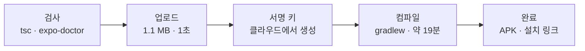

# N058 실습과제 제출보고서 — 노트북 없이 도는 앱을 만들려면 무엇이 필요하고, 출시 전에는 무엇이 비어 있는가?

> 버전 1.0 · 2026-11-06 · 대상 앱 friend-agent-mobile(하루친구)과 staging 백엔드 · 근거 `실습\N058_실습_진행기록.md` 1~8절 · 근거 표시는 [확인](명령 출력·파일로 본 것) · [사용자 보고](폰에서 사용자가 말해 준 것) · [추론] · [미확인]

**한눈에 보기**

**Android preview APK 빌드 성공(19분 8초, 빌드 1회) · 설치한 앱에서 대화 답이 옴 · 카메라 권한·글자 인식 동작 · 출시 준비 점검표 7항목 작성 · 쓰지 않는 마이크 권한 선언 1건 발견(고치지 않고 기록)**
  ↳ 시작 전에 staging 백엔드가 결제 꺼짐으로 죽어 있어, 새 결제 계정을 연결하고 서비스를 새 리비전으로 깨운 뒤 시작했다

- **문제** — Expo Go로 보던 앱은 노트북의 개발 서버가 켜져 있어야 돈다. 남의 폰에서 혼자 돌게 하려면 앱 파일을 만들어 설치해야 하고, 스토어에 올리려면 앱이 돌아가는 것 말고도 갖출 것이 많다.
- **원인** — 앱 파일에는 코드가 빌드 시점에 고정되고, 백엔드 주소는 `.env`가 아니라 `eas.json`의 프로필 `env`로 넣는다. 또 설정을 만드는 도구와 라이브러리 플러그인이 **내가 쓰지 않는 권한을 기본값으로 넣을 수 있다**.
- **해결** — 앱 이름·패키지 이름·백엔드 주소 5곳을 바꾸고 `tsc`·`expo-doctor`로 검사한 뒤 한 번 빌드했다. 설치 앱은 staging 백엔드와 직접 통신했다. 도구가 넣은 마이크 권한 배열은 지웠다.
- **현재 판단 [추론]** — 이 앱은 "노트북 없이 대화"의 기술적 조건은 채웠다. 다만 스토어 출시 기준으로는 개인정보처리방침·삭제 버튼·AI 신고 버튼·AI 표시가 비어 있다(백엔드 API는 일부 있고 앱 화면이 없다).

`근거 [확인] 22 · [사용자 보고] 4 · [추론] 2 · [미확인] 8 (본문 1~8절의 표시를 센 값) · 요구 7개 중 3개 완료·2개 일부·2개 하지 않음`

| 요구(교안 챕터 04·05·06) | 상태 | 근거 |
|---|---|---|
| ① 앱 이름·패키지 이름·백엔드 주소 설정 | ✅ | 다섯 값만 바뀜(`git diff --stat` app.json 6줄·eas.json 4줄) [확인] |
| ② 빌드 전 `tsc`·`expo-doctor` | ✅ | 오류 없음, 20/20 [확인] |
| ③ Expo 계정 연결 후 preview APK 빌드 | ✅ | `eas build:list` finished·SDK 58.0.0·APK [확인] |
| ④ 폰에 설치하고 노트북 없이 대화 | 🔶 | 설치 앱에서 답이 옴 [사용자 보고]. 개발 서버를 끈 상태였는지는 [미확인] |
| ⑤ 출시 준비 점검표 + 빈칸 하나 채우기 | 🔶 | 7항목 작성 [확인]. "빈칸 하나를 실제로 채우기"(예: 삭제 버튼)는 하지 않음 |
| ⑥ 내 앱을 처음부터 만들어 빌드(6장 스테이지 0~4) | ⚪ | 하지 않음(N057 앱으로 대신) |
| ⑦ 스토어 배포(production, 개발자 계정) | ⚪ | 선택 과제, 하지 않음 |

▸ 이 문서에 대해 (접기)
  - 숫자와 사건은 `실습\N058_실습_진행기록.md`에서만 가져왔고, 없는 것은 "기록 없음"이라 적었다.
  - **증거 화면(스크린샷)은 폴더에 저장하지 않았다.** 사용자가 대화에서 보여 준 화면은 결제 계정 3장, Expo 가입(사용자 이름)·조직 만들기·로그인 허용·대시보드 4장, 모두 7장이다.
  - 가린 정보: 결제 계정 번호·프로젝트 번호·이메일·EAS 프로젝트 ID는 적지 않았다. `.env`는 열지 않았다(권한 규칙이 막음).
  - 환경: Node v24.18.0·npm 11.16.0, Expo SDK 58, Android 폰(기종 기록 없음), 백엔드 staging(Cloud Run, gpt-4o-mini 기본), eas-cli 27.5.0.

> 🏷️ 근거 표시 — [확인] · [사용자 보고] · [추론] · [미확인] (위 머리말 참고)

> ❓ 시작 질문 — 아침에 적는 시작 질문은 이번에 기록하지 않았다. 노트 7-3절의 회고 칸은 비어 있다.

## 1. 시작 전에 무엇이 막혀 있었나? (교안 4-2절 "시작 상태")

| 한 일 | 결과 | 누가 | 한계 |
|---|---|---|---|
| `node -v`·`npm -v` | v24.18.0 · 11.16.0 [확인] | Claude | — |
| 앱 저장소 상태 | N057 앱, `node_modules` 있음, 이름·패키지·주소는 템플릿 기본값 [확인] | Claude | — |
| staging `/health` | **500**, `/version` 503. 로그 "billing is disabled for this project", 결제 계정 `OPEN: False` [확인] | Claude | 무료 체험 종료로 보임 [추론] |
| 결제 계정 | 콘솔에 열린 계정이 없어 새 계정 추가(카드 정보는 사용자가 직접), 프로젝트를 새 계정에 연결(`gcloud billing projects link`, 사용자 승인) → `billingEnabled: true` [확인] | 사용자·Claude | 옛 계정에 연결돼 있던 다른 두 프로젝트는 옮기지 않았다 |
| 서비스 깨우기 | 결제 연결 뒤에도 약 15분 503·429(로그 "사용 가능한 인스턴스를 기다리다 중단됨") → 라벨만 바꿔 새 리비전 배포 → `/health` 200 [확인] | Claude(승인 후) | 결제 반영이 늦었는지 서비스가 못 깨어났는지는 가르지 못함 [미확인] |

> ▶ **한 줄 요약** — 교안은 "내 백엔드의 /health가 열린다"를 전제로 시작하지만, 실제로는 결제가 꺼져 백엔드가 죽어 있었고, 그것을 살리는 데 가장 많은 시간이 들었다.

## 2. 설정은 무엇을 바꿨나? (교안 4-3절)

| 파일 | 바꾼 곳 | 값 |
|---|---|---|
| `app.json` | `name` | "대진이의 하루친구"(사용자 정함) |
| `app.json` | `android.package`·`ios.bundleIdentifier` | `kr.study.harufriend.djeon`(Claude 추천, 둘이 같음) |
| `eas.json` | `preview` env `EXPO_PUBLIC_API_URL` | staging 주소, 끝에 `/` 없음 |
| `eas.json` | `production` env `EXPO_PUBLIC_API_URL` | 운영 주소 [미확인: 응답 여부는 호출하지 않음] |

- 바뀐 줄이 이 다섯 값뿐인지 `git diff`로 확인했다 [확인].
- 패키지 이름은 스토어에 올린 뒤 바꿀 수 없으므로 에이전트가 짓지 않고 사람이 정한 값을 넣게 했다(교안 원칙).

## 3. Expo 계정 연결에서 무엇이 달랐나? (교안 4-4절)

| 교안 | 실제 |
|---|---|
| `login` — 계정에 로그인 | 가입 중 사용자 이름을 정함(`DJ-Jeon`), 조직 만들기 화면은 **건너뜀**. 로그인은 **브라우저 로그인**이었고, 대기 중 터미널이 입력을 안 받아 "입력할 수가 없다"는 질문이 나옴 → 브라우저의 허용 화면(Redirects to localhost)을 승인하자 `Logged in` [확인] |
| `build:configure` — 프로젝트 ID가 들어감 | 프로젝트 `@dj-jeon/friend-agent-mobile` 생성·연결, 플랫폼 Android. 그런데 `app.json`에 **`android.permissions`(`CAMERA`·`RECORD_AUDIO`)와 `extra.router`도 더해짐** [확인] |
| (교안에 없음) | 이 앱은 카메라 플러그인에 `microphonePermission: false`를 걸어 마이크를 일부러 막았으므로 `permissions` 배열을 지웠다. `tsc`·`expo-doctor` 다시 통과 [확인] |

> ▶ **한 줄 요약** — 설정을 만들어 주는 명령은 **끝난 뒤 `git diff`로 무엇을 더했는지 본다**. 이번에는 쓰지 않는 마이크 권한이 들어와 있었다.

## 4. 빌드는 어떻게 흘렀나? (교안 4-4·4-5절)

▼ 그림 1 · 빌드의 큰 흐름 — 앞 둘은 사람이 한 일, 뒤 셋은 EAS 서버가 한 일이다

<!-- flow: 그림 1. 빌드의 흐름. 앞 두 칸은 로컬에서, 뒤 세 칸은 EAS 클라우드에서 일어난다. | 검사/tsc · expo-doctor/1 ; 업로드/1.1 MB · 1초/2 ; 서명 키/클라우드에서 생성/3 ; 컴파일/gradlew · 약 19분/4 ; 완료/APK · 설치 링크/1 -->


```text
검사 → 업로드 → 서명 키 생성(Yes) → gradlew 컴파일 → finished(APK)
```
<!-- /flow -->

읽는 법: 사용자가 직접 `build --profile preview --platform android`를 실행했고(서명 키 질문에 대화형으로 답해야 해서), 질문은 **서명 키를 새로 만들까** 하나였다.

| 관찰 | 뜻 |
|---|---|
| `Environment variables loaded from the "preview" build profile "env" configuration: EXPO_PUBLIC_API_URL` | 빌드 주소는 `eas.json`에서 읽힘 [확인] |
| `No environment variables … on EAS` | EAS 웹에 따로 등록한 값이 없다는 뜻, 문제 아님 [확인] |
| `Initialized versionCode with 1` | 첫 빌드라 번호를 만듦 [확인] |
| `Detected that you do not have keytool installed locally` → `Generating keystore in the cloud` | 서명 키는 클라우드에서 만들고 Expo가 보관, 노트북에 파일 없음 [확인] |
| `eas build:list` | finished · Android · preview · internal · SDK 58.0.0 · 1.0.0(코드 1) · 10:38:07 → 10:57:15(**19분 8초**) [확인] |

- 무료 플랜 월 빌드 횟수를 **1회** 썼다. 이 빌드는 커밋하지 않은 설정 변경을 포함해 올라간 것으로 보인다(결과의 커밋 표시는 83c9aef 그대로) [추론].

## 5. 설치한 앱은 노트북 없이 돌았나? (교안 4-6절)

| 확인 | 결과 | 근거 |
|---|---|---|
| 폰 카메라로 QR → 설치 | 설치함 | [사용자 보고] |
| 터미널이 "에뮬레이터에 설치할까요? (Y/n)"에서 멈춤 | n 또는 Ctrl+C로 끝냄, 빌드·앱에 영향 없음 | [확인] |
| 메시지 "안녕 폰에 앱을 설치하고 처음으로 써봐" | "안녕! 앱 처음 써보는 거구나. 어떤 기능이 궁금해?" | [사용자 보고] |
| 카메라 찍기 | 권한을 요구함, 찍은 사진의 글씨를 인식함 | [사용자 보고] |
| 앱 권한 목록 | 허용됨: 카메라 / 앱이 계속 작동하도록 허용됨: 근처 기기 / **허용되지 않음: 마이크** | [사용자 보고] |
| 개발 서버를 끈 상태에서 한 시험인지 | 질문했으나 답을 받지 못함. 이 세션에서는 개발 서버를 켠 적이 없음 | [미확인] |
| 처음 열었을 때 새 게스트(캐릭터 화면부터)였는지 | 확인 못 함 | [미확인] |
| 홈 화면 앱 이름 | 확인 못 함 | [미확인] |

**마이크가 선언된 이유(코드로 확인)**: `expo-image-picker` 플러그인은 `microphonePermission`이 `false`가 아니면 `android.permission.RECORD_AUDIO`를 넣는다. `app.json`에는 카메라 플러그인에만 `false`가 있었다. 즉 3절의 `permissions` 배열과 **별개의 원인**이었다 [확인]. 사용자가 허용하지 않으면 동작하지 않으나, 쓰지 않는 선언은 스토어 데이터 안전 신고와 어긋난다. 고치려면 설정 한 줄과 재빌드(빌드 1회)가 필요해 이번에는 **고치지 않고 점검표에 기록**했다(사용자 선택). "근처 기기" 권한의 출처는 조사하지 않았다 [미확인].

> ▶ **한 줄 요약** — 설치 앱이 백엔드와 직접 통신한다는 것은 확인했다. 그러나 "노트북을 껐을 때"라는 조건은 사용자 답을 받지 못해 확정하지 못했다.

## 6. 출시 준비 점검표는 무엇이 비어 있었나? (교안 5-6절)

`friend-agent-mobile/docs/store-readiness.md`에 7개 항목과 데이터 경로를 코드를 읽어 채웠다.

| 항목 | 상태 | 근거 |
|---|---|---|
| 개인정보처리방침 | 없음 | 백엔드 docs·static·README에서 못 찾음 [확인] |
| 데이터 안전 신고 | 없음 | 아래 데이터 경로가 근거 |
| 계정·데이터 삭제 | **API만 있음** | `DELETE /api/data`·`/api/memories`·`/api/reminders/{id}` 있음, 앱 화면 버튼 없음 [확인] |
| AI 콘텐츠 신고 | **API만 있음** | `POST /api/report`(사유 300자)·`/api/feedback` 있음, 앱 화면 없음 [확인] |
| AI임을 밝히기 | 없음(확인 필요) | 앱 소스에서 "AI" 표시 문구를 못 찾음 [확인]. 시스템 프롬프트는 안 봄 [미확인] |
| 앱 안 판매 | 미결정 | 백엔드에 토스페이먼츠 크레딧 결제(N056)가 있음 [확인] |
| 연령 등급 | 없음 | 설문 미작성 |

**앱이 모으는 데이터와 가는 곳**: 대화는 내 백엔드·DB와 외부 LLM 제공사로, **대화 원문은 관측 도구(Langfuse)에도** 간다(이메일·카드·전화번호 패턴은 가림). 사진은 `/api/ocr`로 내 백엔드에 가고 글자 읽기는 코드상 백엔드의 tesseract가 한다(사진 저장 여부는 [미확인]). 로그인 정보는 기기 저장소에 남는다 [확인].

> ▶ **한 줄 요약** — 해설서의 예시표는 삭제·신고를 "없음"이라 적지만 이 앱은 **백엔드엔 있고 앱 화면에만 없었다**. 그래서 다음 일은 새 기능이 아니라 화면 연결이다.

## 7. 지금 상태와 다음 일

| 항목 | 상태 |
|---|---|
| 새로 생긴 것 | GCP 새 결제 계정 · Expo 계정 `dj-jeon`과 EAS 프로젝트 · 클라우드에 보관된 서명 키 · staging의 새 리비전(라벨 `wake`) |
| 커밋 안 한 것 | `friend-agent-mobile`의 `app.json`·`eas.json`·`docs/store-readiness.md`, 이 폴더의 새 문서 |
| 하지 않은 것 | 6장 스테이지 0~4, production 빌드·스토어, iPhone, 에이전트로 빌드 조회, EAS Update, 마이크 선언 제거와 재빌드 |

이어 한다면:
1. 설정 화면에 데이터 삭제 버튼을 연결한다(백엔드 API는 이미 있음).
2. 답마다 "AI가 만든 답" 표시와 신고 버튼을 붙이고, 신고를 누가 확인할지 정한다.
3. 개인정보처리방침 문서와 공개 URL을 만든다.
4. 이미지 피커 플러그인에 `"microphonePermission": false`를 넣고 재빌드한다.
5. 새 결제 계정에 예산 알림을 건다(걸었는지 기록 없음 [미확인]).

## 8. 시작 질문에 다시 답하면

(이번 실습에는 아침에 적은 시작 질문 기록이 없다.) 실습 뒤에 말할 수 있는 것: **"Expo Go에서 도는 것"과 "설치한 앱이 도는 것"은 다른 단계이고, 둘 사이에는 코드 고정·주소 주입·권한 설정·서명이라는 네 가지 관문이 있다.** 그리고 출시 전에 비어 있는 것은 앱의 기능보다 **사용자 보호 장치(삭제·신고·표시·방침)의 화면**이었다.
