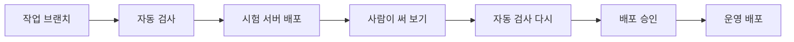

# N049 실습 설명자료 — 자동 배포 앞에 "걸러 내는 장치" 세우기(CI·staging·품질 게이트)

> 오늘 진행한 N049 강의와 실습(AI 친구 에이전트에 자동 테스트·시험 서버·승인 절차 붙이기)을 논리적으로 상세히 풀어 정리한 문서. 강의의 취지, 실습이 검증하려는 것, 실제로 한 작업과 겪은 일, 향후 적용법, 동료에게 설명하는 법 순으로 구성했다.
>
> 💡 **읽는 법**: 이 문서는 코드를 몰라도 끝까지 읽을 수 있게 썼다. 어려운 용어가 나오면 그 자리에서 바로 비유로 풀어준다. "개발자용"이라고 표시된 부분은 건너뛰어도 전체 줄거리를 이해하는 데 지장 없다. 숫자와 사건은 실제 실습에서 확인한 것만 적었다.

## 미리 보는 용어 5개

이 문서에 계속 나오는 용어 5개를 먼저 한 번에 익히고 시작하면 편하다. 나중에 본문에서 다시 만나면 아래 비유를 떠올리면 된다.

| 용어 | 무엇을 하는가 | 비유 |
|---|---|---|
| **CI (자동 검사)** | 코드를 합칠 때마다 정해 둔 테스트를 기계가 자동으로 돌린다 | 제품을 출고하기 전에 검수 부서가 같은 체크리스트로 매번 자동 검사하는 것 |
| **페이크 LLM (모의 응답)** | 실제 AI 대신 정해진 규칙으로만 답하는 테스트용 AI | 모의고사 채점에 쓰는 "정답이 정해진 연습 상대" — 매번 같은 답이라 맞고 틀림을 가릴 수 있다 |
| **staging (시험 서버)** | 사용자에게 내보내기 전에 같은 코드를 먼저 올려 써 보는 별도 서버 | 신제품을 매장에 깔기 전에 사내에서 하는 시연회·파일럿 |
| **브랜치 보호 (결재 규정)** | 정해진 절차를 거치지 않으면 중요한 코드를 바꿀 수 없게 막는 규칙 | 전결권자도 결재 라인을 거쳐야 하도록 만든 규정 — 대표라도 예외 없음 |
| **품질 게이트 (검문소)** | 기준을 통과해야 다음 단계로 넘어가게 하는 지점 | 공장 라인의 검문소 — 불합격 제품은 다음 공정으로 못 넘어간다 |

---

## 목차
1. [이 수업(N049)의 취지 — 왜 지금 이 주제인가](#1)
2. [실습이 알아보고자 한 것 — 무엇을 "확인"하려는 실습인가](#2)
3. [우리가 실제로 한 작업과 겪은 일 (순서대로)](#3)
4. [앞으로 내 프로젝트에 어떻게 적용하면 되는가](#4)
5. [동료에게 어떻게 설명하면 되는가](#5)
6. [용어 사전](#6)

---

## 1. 이 수업(N049)의 취지 — 왜 지금 이 주제인가 {#1}

지난 시간(N048)에 "main에 합치기만 하면 몇 분 뒤 서비스가 새 버전으로 바뀌는" 자동 배포를 만들었습니다. 편하고 빠릅니다. 그런데 이 장치는 한 가지를 하지 않습니다. **그 코드가 맞는지는 확인하지 않습니다.** 합쳐진 코드를 그대로 사용자에게 내보낼 뿐입니다.

수업의 장면은 이렇습니다. 사용자가 "내일 아침 8시에 알려 줘"라고 부탁했는데, 앱은 멀쩡히 켜지고 대답도 자연스러운데, 실제로는 약속이 **오후 5시**로 저장됩니다. 9시간이 어긋난 겁니다. 자동 배포는 이 변경을 있는 그대로 내보냅니다. 서비스가 "켜지는지"는 자동 배포가 지켜 주지만, 결과가 "맞는지"는 아무도 지켜 주지 않는 상태입니다.

이 문제의 막을 지점은 여럿입니다. 강의의 시작 질문과 해설서의 답을 정리하면 다음과 같습니다.

| 막을 수 있는 지점 | 누가·무엇이 |
|---|---|
| 자동 테스트(CI) | 기계가 저장된 시각이 맞는지 매번 검사 |
| 코드 리뷰 | 다른 사람이 시간 처리 부분을 읽고 확인 |
| 시험 서버(staging) | 실제 사용자에게 나가기 전에 먼저 써 보며 확인 |
| 배포 승인 | 사람이 마지막으로 "내보내도 되나" 결정 |
| 모니터링·알림 | 나간 뒤에라도 이상을 빨리 감지 |

오늘 수업은 이 중 **자동 테스트, 시험 서버, 배포 승인, 그리고 이 셋을 우회하지 못하게 하는 결재 규정(브랜치 보호)**을 직접 만듭니다. 모니터링은 오늘 만들지 않는 지점으로 남습니다.

## 2. 실습이 알아보고자 한 것 — 무엇을 "확인"하려는 실습인가 {#2}

강의는 이 장치들을 만들고 나서, 일부러 망가뜨린 변경 네 개를 올려 봅니다. 목적은 **"어떤 장치가 어떤 문제를 잡고, 어떤 문제는 놓치는지"를 눈으로 확인하는 것**입니다.

> ⚠️ **오늘 강의가 가장 강조한 함정**: "로컬(내 컴퓨터)에서 통과했다고 서버에서도 통과하는 것은 아니다."

시간대 버그가 대표입니다. 내 컴퓨터는 한국 시간으로 돌아서, 시간대 정보가 빠진 시각이 우연히 맞게 읽힙니다. 그런데 서버와 자동 검사 장치는 세계 표준시(UTC)로 돌아서, 같은 코드가 9시간 늦은 시각을 저장합니다. 마치 "본사에서는 잘 맞던 시계가 해외 지사에서는 9시간 틀리는" 상황입니다. 그래서 검사는 **서버와 같은 환경에서** 돌려야 합니다.

또 하나의 질문은 이것입니다. **자동 검사가 모든 것을 잡는가?** 강의는 아니라고 답하고, 그 증거로 네 번째 변경(보내기 버튼이 사라진 변경)을 보여 줍니다. 이 변경은 모든 자동 검사를 통과합니다. 검사가 화면 모양을 보지 않기 때문입니다. 그래서 자동 검사(기계)와 시험 서버(사람)는 대체 관계가 아니라 **보완 관계**입니다. 이 실습은 그것을 몸으로 확인하는 시간입니다.

## 3. 우리가 실제로 한 작업과 겪은 일 (순서대로) {#3}

### 3-1. 테스트를 직접 만들고, 일부러 깨뜨려 보기

처음 로컬에서 테스트 10개를 돌려 `10 passed`를 확인했습니다. 여기에 "내일 아침 8시 → 한국 시간 08:00으로 저장되는가"를 확인하는 테스트를 하나 더해 `11 passed`가 됐습니다.

그다음이 중요합니다. 테스트가 제 역할을 하는지 보려고, 시간대 정보를 빼는 한 줄짜리 변경을 일부러 넣었습니다. 결과는 **여전히 `11 passed`**였습니다. 내 컴퓨터가 한국 시간이라 버그가 숨은 겁니다. 이 변경이 서버와 같은 환경에서만 드러난다는 점이 뒤의 자동 검사로 이어집니다.

> 🧪 **예제**: 기존에 있던 테스트는 "저장된 시각에 시간대 정보가 붙어 있는가"만 봤습니다. 정보가 없으면 컴퓨터가 알아서 자기 시간대를 붙여 주기 때문에, 시각이 틀려도 조건은 맞았습니다. 새 테스트는 "사용자에게 08:00으로 보이는가"를 직접 확인합니다. 형식을 보는 검사보다 **사용자가 보는 결과를 보는 검사**가 버그를 더 잘 잡습니다.

### 3-2. 자동 검사(CI)를 붙였더니 첫 실행이 실패했다

자동 검사 설정 파일을 넣고 첫 실행을 했더니 **실패**했습니다. 오류는 "`app`이라는 모듈을 찾을 수 없다"였습니다. 원인은 간단하지만 놓치기 쉬웠습니다. 검사 장치가 `pytest`라는 명령만 칠 때는 프로젝트 폴더를 읽는 경로에 넣지 않습니다. 저는 로컬에서 `python -m pytest`로 돌렸는데, 이 방식은 현재 폴더를 넣어 줘서 문제가 가려졌습니다. 로컬에서도 `pytest`만 치자 같은 오류가 재현됐습니다.

강의는 설정 파일의 내용을 바꾸지 말라고 했기 때문에, 설정 파일은 그대로 두고 프로젝트 폴더에 `pytest.ini`라는 작은 설정 파일 하나를 더해 해결했습니다. 교훈은 하나입니다. **교안의 명령은 교안 그대로 먼저 실행해 봐야 한다.** 제가 방식을 바꿔 돌린 탓에 문제가 첫 자동 검사에서야 드러났습니다.

이어서 시간대 변경을 이번에는 자동 검사에 올렸습니다. 로컬에서는 통과했던 변경이 검사에서는 **실패**했습니다. 로그에는 "08:00이어야 하는데 17:00으로 저장됐다"가 그대로 찍혔습니다. 9시간 차이, 한국과 UTC의 차이입니다. 이때 머지(합치기) 버튼은 **여전히 눌렀습니다.** 자동 검사는 실패를 "알려 줄" 뿐 "막지"는 못한다는 것을 확인했습니다.

### 3-3. 시험 서버(staging)를 만들었지만 키를 분리하지 못했다

시험 서버를 만들려면 원래 시험 전용 AI 키와 낮은 사용 한도를 따로 만드는 게 교과서입니다. 그런데 제가 쓰던 키는 **수업에서 받은 키**였습니다. OpenAI 화면을 확인하니 제 계정은 무료 체험에 크레딧 0달러였고, 그 키는 제 계정 것이 아니었습니다. 그래서 키를 새로 만들 수 없었습니다.

대신 기존 키 값을 화면에 띄우지 않고 별도의 보관함(시크릿)으로 복사했습니다. 이름과 읽기 권한은 시험 서버 전용으로 분리했습니다. 한계는 분명합니다. **이름은 분리했지만 키와 사용 한도는 운영과 공유합니다.** 이 한계는 보고서에 그대로 적었습니다. 복사한 값이 원본과 같은지는 값을 보지 않고 지문(해시) 비교로 확인했습니다.

### 3-4. 승인자 설정이 막혔다 — 저장소가 비공개였기 때문

운영 서버에 "승인자를 두어 승인 전까지 배포를 멈추게" 하는 설정을 하려는데, GitHub이 거절했습니다. 이유는 "이 요금제에서는 지원하지 않는다"였습니다. 저장소가 **비공개**였기 때문입니다. 승인자와 결재 규정(브랜치 보호)은 비공개 저장소에서는 유료 기능입니다. 교재가 "공개 저장소에서는 무료"라고 한 이유가 이것입니다.

저는 저장소를 공개로 바꾸기로 했습니다. 공개는 되돌리기 어려운 일이라 먼저 점검했습니다. 저장소 전체와 커밋 기록 25개를 검색해 AI 키·개인키·토큰 같은 패턴이 **0건**이고, 비밀 설정 파일(`.env`)이 한 번도 올라간 적이 없음을 확인했습니다. 전환은 제가 직접 했습니다. 전환 직후 한 번은 여전히 비공개로 보였고, 다시 확인하자 공개로 반영돼 있었습니다.

### 3-5. 시험 서버 먼저, 운영 서버는 승인 후에

환경을 나눈 새 배포 설정을 올리자, 시험 서버만 새 코드(커밋 `d69c08b`)로 바뀌고 운영 서버는 이전 코드(`187a4bf`) 그대로였습니다. 이것이 환경 분리의 핵심입니다. 같은 코드가 설정(서버 이름, 키, 화면 배너)만 다르게 실행됩니다. 시험 서버 화면에만 "테스트 환경" 배너가 보였습니다.

그다음 시험 서버의 코드를 운영(main)으로 올리는 변경을 합쳤더니, 배포가 **승인 대기**에서 멈췄습니다. 승인 버튼은 에이전트가 아니라 제가 직접 눌렀습니다. 그런데 처음 누른 승인은 **반영되지 않았습니다.** 실행이 10분 넘게 대기 상태였고, 확인하니 승인 대기 목록에 운영이 그대로 남아 있었습니다. 다시 눌렀더니 배포가 시작됐습니다. 결과로 운영 서버가 새 코드로 바뀌었고, 화면 상태 표시 `env`가 `local`에서 `production`으로 바뀌었으며 배너는 없었습니다.

### 3-6. 결재 규정을 걸었더니 직접 올리기가 거절됐다

`main`과 `staging`에 규정을 걸었습니다. 반드시 PR(변경 요청서)을 거쳐야 하고, 자동 검사 `test`를 통과해야 하며, 관리자인 나에게도 적용한다는 내용입니다. 확인을 위해 `main`에 직접 올려 봤더니 이렇게 거절됐습니다.

```
Protected branch update failed for refs/heads/main.
- Changes must be made through a pull request.
- Required status check "test" is expected.
```

같은 실패 변경이 이전에는 "머지 가능(UNSTABLE)"이었는데, 규정을 건 뒤에는 "머지 차단(BLOCKED)"이 됐습니다. 대표(관리자)에게도 규정이 적용되는지를 `enforce_admins`라는 설정으로 확인했습니다.

### 3-7. 일부러 망가뜨린 변경 네 개 — 누가 잡았나

| 변경 | 자동 검사 | 합치기 | 잡은 곳 |
|---|---|---|---|
| A. 위기 표현("죽고 싶")을 "정확히 같을 때만" 위기로 판정 | 실패 — 안전 안내(109)가 안 나감 | 차단 | 자동 검사 |
| B. 날씨 키워드를 "날씨 알려"로 좁힘 | 실패 — 날씨 도구가 하나도 선택 안 됨 | 차단 | 자동 검사 |
| C. 약속 시각에서 시간대 정보를 뺌 | 실패 — 08:00 기대, 17:00 저장 | 차단 | 자동 검사(서버 환경에서만) |
| D. 보내기 버튼 숨김 | **통과** | 가능 | **시험 서버에서 사람이** |

A와 B는 환경과 무관한 실패라서 로컬에서 테스트를 돌렸어도 잡혔습니다. **C만 서버 환경에서만 보였습니다.** D는 모든 자동 검사를 통과했습니다. 합친 뒤 시험 서버를 열어 보니 입력창 옆 버튼이 사라져 있었습니다. 운영으로 보내지 않고 되돌림 변경(Revert PR)을 올려 합쳤고, 버튼이 돌아왔습니다. 시험 서버가 없었다면 이 변경은 사용자가 먼저 발견했을 겁니다.

> ⚠️ **알아 둘 점**: 변경 D를 되돌릴 때 "합치기 기록"을 되돌리는 것이라 `git revert`에 `-m 1`이라는 옵션이 필요했습니다. 합치기 기록은 부모가 둘이라, 어느 쪽을 기준으로 되돌릴지 알려 줘야 하기 때문입니다.

### 3-8. 기본 과제 — 예시 하나를 테스트로

"이번 주 금요일에 자격증 시험 있어"처럼 일정만 말하고 알려 달라는 부탁은 하지 않은 경우에는 **약속을 저장하지 않아야** 합니다. 이 규칙을 테스트로 옮겼습니다. 확인 방법은 이전과 같았습니다. 로컬 `12 passed`, 규칙을 일부러 깨뜨리면 실패, 되돌리면 통과, 자동 검사도 통과했습니다.



## 4. 앞으로 내 프로젝트에 어떻게 적용하면 되는가 {#4}

### 누구나 알아야 할 원칙

- **자동 배포를 만들었다면 반드시 "걸러 내는 장치"를 함께 세우세요.** 자동 배포는 빠르게 내보낼 뿐 맞는지는 확인하지 않습니다. 속도를 얻은 만큼 검문소가 필요합니다.
- **"내 컴퓨터에서 됐다"를 믿지 마세요.** 환경이 다르면 같은 일이 다른 결과를 냅니다(시간대처럼). 검사는 실제 서버와 같은 조건에서 돌리세요.
- **검사를 만들었다면 "일부러 깨뜨려 보세요."** 지키려는 것을 망가뜨렸을 때 검사가 실제로 실패하는지 봐야 그 검사를 믿을 수 있습니다. 통과하는 것만으로는 아무것도 증명되지 않습니다.
- **기계가 보는 것과 사람이 볼 것을 나누세요.** 정답이 있는 것(시각, 안전 안내, 도구 선택)은 기계가, 화면·말투·실제 AI의 답은 사람이 시험 서버에서 봅니다. 서로 대체하지 못합니다.
- **승인은 사람이 직접 누르세요.** 승인을 자동화하거나 에이전트에게 맡기면 마지막 검문소가 사라집니다. 승인 전에는 시험 서버에서 확인한 코드와 같은지 보세요.
- **시작하기 전에 점검하세요.** 요금제(비공개 저장소의 승인·보호 기능), 키의 출처(남이 준 키로는 한도를 못 건다), 교재와 템플릿의 차이를 먼저 확인하면 중간에 막히지 않습니다.

### 개발자용 체크리스트 (코드를 직접 짤 때만 해당)

- 교안의 `pytest -q`는 그대로 실행하고, 루트에 `pytest.ini`(`pythonpath = .`, `testpaths = tests`)가 필요한지 확인한다. `python -m pytest`로만 돌리지 않는다.
- 테스트는 사용자가 보는 값을 `assert`하고, 지킬 동작을 일부러 깨뜨려 실패를 확인한 뒤 `git restore`로 되돌린다.
- 상태 체크를 필수로 걸기 전에 CI를 한 번은 돌려 `test`가 목록에 나오게 한다. PR 필수와 필수 체크를 함께 걸고 `enforce_admins: true`를 둔다.
- staging 시크릿은 `gcloud secrets add-iam-policy-binding`으로 시크릿 하나에만 읽기 권한을 준다(`projects` 단위 금지). 값을 복사할 때는 출력 없이 파이프로 옮기고 해시로 확인한다.
- 머지 커밋을 되돌릴 때는 `git revert -m 1`, PR 상태는 `mergeStateStatus`(`CLEAN`·`UNSTABLE`·`BLOCKED`)로 구분한다. 승인 반영은 `pending_deployments`가 비는지로 확인한다.

## 5. 동료에게 어떻게 설명하면 되는가 {#5}

**한 줄 엘리베이터 피치**:
> "자동 배포는 코드를 빨리 내보낼 뿐 맞는지는 안 봐요. 그래서 자동 검사, 시험 서버, 승인 절차를 줄줄이 세워서 '틀린 코드가 사용자한테 닿기 전에' 세 번 걸러지게 만들었어요. 일부러 틀린 코드 네 개를 올려 봤더니 세 개는 자동 검사가 잡고, 하나는 화면을 사람이 열어 봐야만 보였어요."

**좀 더 풀어서 설명할 때 순서**:
1. "자동 배포를 만들었더니 코드가 합쳐지는 순간 바로 사용자에게 나가요. 그런데 그 코드가 맞는지는 아무도 안 봐요." (문제의식)
2. "약속을 '내일 8시'로 부탁했는데 '오후 5시'로 저장돼도 앱은 멀쩡히 켜져요. 이게 제일 위험해요." (구체적 사고)
3. "그래서 세 겹으로 걸렀어요. 기계가 매번 검사하는 자동 검사, 사람이 먼저 써 보는 시험 서버, 마지막에 사람이 누르는 승인." (해법)
4. "제일 재밌었던 건 시간대예요. 제 컴퓨터에서는 통과하는데 서버에서만 9시간 틀렸어요. 로컬 시계와 서버 시계가 다르기 때문이에요. 그래서 검사를 서버랑 같은 환경에서 돌리는 거예요." (핵심 원리)
5. "또 하나, 보내기 버튼이 사라진 변경은 자동 검사를 다 통과했어요. 검사가 화면을 안 보니까요. 시험 서버를 열어 본 사람만 알아챘어요." (한계와 보완)
6. "마지막으로 이런 장치들을 우회 못 하게 결재 규정을 걸었어요. 관리자인 저도 규정대로 해야 하고, 규정 없이 직접 올리면 거절돼요." (우회 방지)
7. "솔직하게 말하면 한계도 있었어요. 수업 키를 써서 시험 서버 전용 키와 한도는 못 나눴고, 승인 기능 때문에 저장소를 공개로 바꿔야 했어요." (한계 공개)

이 순서로 말하면 "왜 필요한지 → 무엇을 만들었는지 → 실제로 뭘 겪었는지 → 한계가 무엇인지"가 자연스럽게 이어져서, 기술을 모르는 동료에게도 설득력 있게 전달됩니다.

**예상 질문과 답**:

| 질문 | 답 |
|---|---|
| 자동 검사가 있으면 시험 서버는 필요 없지 않나요? | 자동 검사는 적어 둔 것만 봅니다. 버튼 사라짐처럼 적지 않은 문제는 사람이 써 봐야 보입니다 |
| 왜 AI를 진짜로 안 부르고 테스트하나요? | 비용이 들고, 느리고, 같은 질문에도 답이 달라서 맞고 틀림을 정할 수 없어서입니다. 답의 품질은 시험 서버에서 사람이 봅니다 |
| 혼자 하는데 승인이 꼭 필요한가요? | 혼자여도 "내보내기 직전에 한 번 멈추는" 습관이 사고를 막습니다. 승인 전에는 시험 서버에서 본 코드와 같은지 확인합니다 |
| 이런 장치를 처음부터 다 만들어야 하나요? | 자동 검사 하나부터 시작해도 됩니다. 다만 검사는 서버와 같은 환경에서 돌리고, 일부러 깨뜨려 확인하세요 |

## 6. 용어 사전 {#6}

| 용어 | 쉬운 설명 |
|---|---|
| CI | 코드를 합칠 때마다 정해 둔 테스트를 자동으로 돌리는 방식 |
| 페이크 LLM | 정해진 규칙으로만 답하는 테스트용 AI |
| 테스트 케이스 | 입력과 기대 동작을 한 쌍으로 적은 것 |
| 회귀 | 한 곳을 고치다 예전에 잘 되던 다른 기능이 깨지는 것 |
| staging | 사용자에게 내보내기 전에 같은 코드를 먼저 올려 써 보는 시험 서버 |
| production | 실제 사용자가 쓰는 운영 서버 |
| 품질 게이트 | 기준을 통과해야 다음 단계로 넘어가게 하는 지점 |
| 브랜치 보호 | 정해진 절차를 거쳐야만 중요한 코드를 바꿀 수 있게 하는 규칙 |
| 상태 체크 | PR 화면에 표시되는 자동 검사 결과. 필수로 지정하지 않으면 머지를 막지 못함 |
| PR (Pull Request) | 내 변경을 합쳐 달라고 요청하는 절차 |
| 머지 | 변경을 본 코드에 합치는 것 |
| Revert | 이미 합친 변경을 취소하는 새 변경을 만드는 것(과거 기록은 지우지 않음) |
| 시크릿 | API 키처럼 밖에 드러나면 안 되는 값을 담는 보관함 |
| 최소 권한 | 필요한 대상에 필요한 권한만 주는 원칙 |
| UTC | 세계 표준시. 한국 시간보다 9시간 느리며 서버와 자동 검사 장치의 기본 시간대 |
| `enforce_admins` | 결재 규정을 저장소 관리자에게도 적용하는 설정 |
