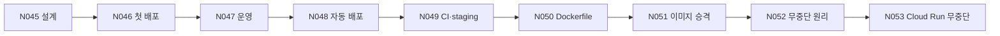

# N045~N053 9부 서비스화·배포·운영 정리

> 버전 1.0 · 2026-10-30 · 근거: `강의정리/N045~N053` 강의노트·제출보고서·실습 진행기록, `종합정리/N001-N049_학습흐름_종합보고서`(N045~N049 부분)

## 목차

## 1. 한 장 요약

> 📌 **요약** — 9부 아홉 강의는 **AI 기능 하나를 "남이 쓰는 서비스"로 바꾸는 과정**입니다. 같은 서비스(AI 친구 에이전트 `friend-agent`)를 설계(N045) → 첫 배포(N046) → 운영(N047) → 자동 배포(N048) → 품질 게이트(N049) → 실행 환경 고정(N050) → 이미지 승격(N051) → 무중단 원리(N052) → Cloud Run 무중단(N053) 순서로 키웠습니다. 앞 강의가 남긴 한계를 다음 강의가 받아서 푸는 사슬이 49개 강의 중 가장 선명한 구간입니다.

아홉 강의를 관통하는 한 문장은 이것입니다.

**"성공했다"는 표시와 "사용자가 아무 문제 없이 썼다"는 사실은 다르다.** 상태 코드 200, 배포 성공, CI 통과, 전환 성공이 뜬 순간에도 사용자 쪽에서는 답이 잘리고(N047), 시각이 9시간 어긋나고(N048), 기능이 500을 내고(N050), 대화가 사라지고(N052), 요청이 503으로 끊겼습니다(N053). 9부는 그 차이를 하나씩 **숫자로 확인하고 장치로 막는** 과정이었습니다.

| 구간 | 강의 | 핵심 질문 | 대표 장치 |
|---|---|---|---|
| 내보내기 | N045~N047 | 어떻게 설계해서 세상에 공개하고, 공개한 뒤 무엇을 지켜보나? | PRD, Cloud Run 리비전·롤백, Secret Manager, 타임아웃·인스턴스 설정, 로그 |
| 자동화와 게이트 | N048~N049 | 사람이 손으로 하던 배포를 어떻게 자동화하고, 잘못된 변경을 어떻게 걸러 내나? | GitHub Actions + WIF, pytest CI, 브랜치 보호, staging, 배포 승인 |
| 같은 것을 보내기 | N050~N051 | 확인한 것과 배포한 것이 정말 같은가? | Dockerfile, `.dockerignore`, 커밋 SHA 태그, 다이제스트 승격 |
| 끊기지 않게 | N052~N053 | 새 버전으로 바꾸는 동안 사용자는 끊기지 않는가? | 블루그린·카나리, 외부 DB(Supabase), `/health` 프로브, 0% 배포·스모크 테스트, 원클릭 롤백 |

## 2. 사슬 — 한계에서 다음 강의로

<!-- flow: 그림 1. 9부의 사슬. 각 강의가 남긴 한계를 다음 강의가 받는다. | N045 설계/PRD·아키텍처/1 ; N046 첫 배포/Cloud Run·시크릿/2 ; N047 운영/타임아웃·로그/2 ; N048 자동 배포/Actions·WIF/3 ; N049 게이트/CI·staging·승인/3 ; N050 실행 환경/Dockerfile/4 ; N051 승격/한 번 빌드/4 ; N052 무중단 원리/블루그린·DB/1 ; N053 Cloud Run 무중단/프로브·롤백/1 -->


```text
N045 설계 → N046 첫 배포 → N047 운영 → N048 자동 배포 → N049 CI·staging → N050 Dockerfile → N051 이미지 승격 → N052 무중단 원리 → N053 Cloud Run 무중단
```
<!-- /flow -->

| 강의 (실습일) | 한 일 | 드러난 한계 | 다음 강의가 한 일 |
|---|---|---|---|
| **N045** 서비스 설계 (10-19) | ASP에 PRD·시퀀스·아키텍처·데이터 모델을 코드 없이 설계. PD 인터뷰 4문항으로 "1차 사용자는 작가가 아니라 PD" 발견 | 배포·키·비용·장애는 아직 없음 | N046: 실제로 배포 |
| **N046** 첫 배포 (10-20) | Cloud Run에 공개. 배포 한 줄 뒤 5단계(빌드→이미지→리비전→인스턴스→URL) 확인, 리비전·롤백·50:50 분할, 키 없이 배포해 로그로 원인 찾기, Secret Manager 연결 | 공개 주소가 내 LLM 키로 요금 소비, 메모리 저장은 배포 때 소멸 | N047: 응답 시간·비용·로그 |
| **N047** 운영 (10-20~21) | 타임아웃 3초에서 답이 잘렸는데 상태 코드 200. 콜드 스타트, 최대 인스턴스 2 × 동시성 80, 로그 3종, 부하 테스트 | 배포는 여전히 사람이 `gcloud`로 수동 | N048: 배포 자동화 |
| **N048** 자동 배포 (10-22) | GitHub Actions + WIF로 키 파일 0개 자동 배포. 사고 2건 재현 | 환경변수 오류는 막았지만 **시간대 버그는 배포 성공과 함께 통과** | N049: 걸러 내는 장치 |
| **N049** CI·staging (10-23) | pytest `11 passed`, 브랜치 보호, staging, 배포 승인의 세 겹 게이트. 시간대 버그가 `TZ=UTC pytest`에서 실패로 잡힘 | 서버의 운영체제 프로그램은 테스트가 못 봄 | N050: 실행 환경을 코드로 |
| **N050** Dockerfile (10-26) | 로컬에서 되던 사진 읽기(OCR)가 staging에서 500 → Dockerfile에 설치 줄 → 네 곳 같은 결과 | 같은 Dockerfile도 빌드할 때마다 이미지 ID가 다름 | N051: 한 번만 빌드 |
| **N051** 이미지 승격 (10-27) | Actions에서 이미지를 한 번 만들어 커밋 SHA 태그, staging에서 확인한 다이제스트를 그대로 production에 승격 | 이미지를 바꿔 끼우는 순간 사용자가 끊기는지는 모름 | N052: 무중단 원리 |
| **N052** 무중단 원리 (10-28) | 로컬 Docker에 blue·green + Nginx. 전환 실패 0건인데 메모리 대화는 사라짐 → Supabase로 옮겨 유지 | 손으로 Nginx 설정을 고치는 방식, 클라우드 아님 | N053: Cloud Run에서 자동으로 |
| **N053** Cloud Run 무중단 (10-29) | `/health` 프로브, 0% 배포·태그 URL·스모크 테스트, 블루그린·카나리·트래픽 고정, 머지 한 번 배포, 원클릭 롤백 | 알림, 카나리 자동 승격, 스키마 변경 배포는 미착수 | (다음) 알림·자동 승격·스키마 변경, 내 앱에 적용 |

```text
 코드 변경 ─▶ PR ─▶ [CI] pytest ─▶ [보호] 통과해야 머지 ─▶ Actions가 이미지 1번 빌드(SHA 태그)
    N049          N049                 N049                     N050·N051
 ─▶ staging 0% 배포 ─▶ 태그 URL 스모크 테스트 ─▶ 전환 ─▶ [승인] ─▶ production에 같은 다이제스트 승격 ─▶ 문제 시 원클릭 롤백
        N053                 N053               N053     N049              N051                              N053
```

> 💡 **팁** — 9부가 끝난 시점의 배포 흐름입니다. N048 맺음말의 "빠르게 내보내는 장치"(자동 배포) 위에 N049~N053이 "걸러 내는 장치"와 "끊기지 않게 하는 장치"를 차례로 얹었습니다.

## 3. 강의별 핵심

### N045 AI 기능을 서비스로 설계하기

- **배운 것:** 사용 맥락 → 처리 방식과 오류 대응 → 코드 없이 검증 → 시퀀스·아키텍처·데이터 모델 → PRD 순서로 설계한다. 순서를 건너뛰면 처음부터 다시 만들게 된다.
- **직접 한 것:** ASP(AI Story Partner)에 적용. PD 인터뷰와 데스크 리서치 2건으로 1차 사용자가 PD임을 발견, 7개 평가 기준 시스템 프롬프트로 기성 AI 도구 프로토타입 시험, PRD 7항목 완성.
- **남는 것:** 코드보다 먼저 "누가 쓰는가"를 확인해야 한다.

### N046 AI 서비스 인 프로덕션

- **배운 것:** Cloud Run 배포 한 줄 뒤에는 빌드·이미지·리비전·인스턴스·URL 다섯 단계가 있다. 배포마다 리비전이 생기므로 롤백은 트래픽을 되돌리는 일이다. 키는 코드가 아니라 Secret Manager에 둔다.
- **직접 한 것:** 첫 배포 403(빌드 계정 역할 하나로 해결), 리비전 롤백·50:50 분할, 키 없이 배포한 리비전의 컨테이너 로그에서 `LLM_API_KEY` 누락 확인 후 시크릿 연결.
- **남는 것:** 실패 원인은 화면이 아니라 로그에 있다.

### N047 Cloud Run에서 AI 서비스 운영하기

- **배운 것:** 타임아웃·인스턴스 수·동시성·콜드 스타트·로그가 운영의 기본 손잡이다.
- **직접 한 것:** 평소 4.1초 걸리는 요청에 타임아웃 3초를 걸자 **답이 문장 중간에서 잘렸는데 상태 코드는 200**. 쉬었다 오면 첫 요청이 느린 것은 LLM이 아니라 콜드 스타트(404도 7.8초). 부하 테스트에서 동시성 1일 때 최대 인스턴스 3이든 20이든 똑같이 50건 중 15건만 성공 → **최대 인스턴스 숫자보다 순간 스케일업 속도가 먼저 병목**(교안에 없던 발견).
- **남는 것:** 최대 인스턴스는 비용 상한이 아니고, 상태 코드만 보는 모니터링은 품질 문제를 못 잡는다.

### N048 GitHub Actions로 자동 배포하기

- **배운 것:** WIF(워크로드 아이덴티티 연동)로 키 파일 없이 GitHub이 Google Cloud에 배포한다. 권한은 최소로.
- **직접 한 것:** 서비스 계정 2개·풀·공급자·저장소 변수 4개를 키 파일 0개로 구성. 저장소 문서에 없던 "빌드 계정을 대신 행동할 권한" 함정을 발견해 해결. 사고 재현 2건: 환경변수 이름 오류는 **배포 실패, 이전 리비전이 계속 응답**, 시간대 오류는 **배포 성공, 08:00 약속이 17:00으로 저장**.
- **남는 것:** 자동 배포는 "켜지는지"만 확인한다.

### N049 CI 테스트와 staging 환경 만들기

- **배운 것:** CI(자동 테스트), 브랜치 보호(통과해야 머지), staging(사람이 먼저 써 봄), 배포 승인의 세 겹 게이트.
- **직접 한 것:** 시간대 버그가 `TZ=UTC pytest`에서 17:00 실패로 잡힘. 브랜치 보호가 없으면 CI가 빨간불이어도 머지가 된다는 것을 확인 — **CI는 알려 줄 뿐 막지는 못한다.** 비공개 저장소에서는 승인자·보호가 유료라 저장소를 공개로 전환.
- **남는 것:** 테스트는 화면·말투·실제 LLM 답은 못 잡는다.

### N050 Dockerfile로 실행 환경 정하기

- **배운 것:** 코드가 같아도 서버에 운영체제 프로그램이 없으면 기능이 안 된다. `pip`가 아니라 Dockerfile에 적어 실행 환경을 직접 정한다.
- **직접 한 것:** 로컬에서 되던 OCR이 staging에서 500(서버에 tesseract 없음, Cloud Run 로그로 확인) → Dockerfile에 설치 줄 → 같은 사진이 로컬·로컬 컨테이너·staging·production **네 곳 모두 200·153글자·같은 결과 해시**. `.dockerignore`가 하위 폴더에 안 먹어 이미지에 `.pyc` 17개가 들어간 것을 발견해 수정. PDF 읽기(poppler)는 staging에 가기 전 **로컬 컨테이너에서 먼저** 잡음.
- **남는 것:** 같은 Dockerfile을 두 번 빌드하면 패키지는 같아도 이미지 ID가 다르다.

### N051 한 번 만든 이미지로 배포하기

- **배운 것:** "확인한 것을 배포했다"고 말하려면 이미지를 한 번만 만들고, 그 다이제스트를 그대로 옮겨야(승격) 한다.
- **직접 한 것:** 승격 전에는 staging·production이 각자 빌드해 다이제스트가 달랐다. Actions가 커밋 SHA 태그로 한 번 빌드 → production이 staging 리비전의 다이제스트를 읽어 그대로 배포 → 두 환경 모두 `sha256:d339e5d333ec…`. main 배포 시간 1분 26초 → 46초, 장애 대응 훈련 세 질문 5분 이내 → 3분. Artifact Registry가 2,217.9MB(무료 0.5GB 초과)라 정리 정책을 드라이런으로 검.
- **남는 것:** 승인 버튼을 누르기 전에 다이제스트를 확인해야 한다.

### N052 로드밸런서로 무중단 배포 구성하기

- **배운 것:** 서버 두 벌(blue·green) 앞에 로드밸런서를 두고 설정만 바꿔 전환·롤백한다. 그러나 사용자 데이터가 서버 메모리에 있으면 전환이 곧 데이터 소멸이다.
- **직접 한 것:** 전환·롤백 341건 실패 0건, 가중치 3:1에서 75%·25%. 서버 하나를 멈추자 기본값에서는 13건 실패(Nginx가 알아채는 데 약 38초, 교안은 60초), 연결 대기 1초로 바꾸자 0건. 그런데 메모리 저장에서는 **전환하자 대화 0개** → Supabase로 옮기자 전환·재시작 뒤에도 대화 3개 유지.
- **남는 것:** 전환 성공은 곧 무중단이 아니다.

### N053 Cloud Run으로 무중단 배포하기

- **배운 것:** 새 버전을 올리는 일과 사용자에게 보내는 일을 나누고(0% 배포), 보내기 전에 검증하고(태그 URL 스모크 테스트), 문제가 생기면 바로 되돌린다(원클릭 롤백). 준비 여부는 스타트업 프로브로 정한다.
- **직접 한 것:** 준비가 늦은 버전을 기본 프로브로 배포하자 **배포 명령은 성공인데 요청 54건이 503**, `/health` 프로브로 바꾸자 0건(대신 배포 27초 → 약 84초). 롤백 직후 4건 실패(콜드 스타트 추정). `deploy.yml`에 0% 배포 → 스모크 테스트 → 전환을 넣고, 일부러 망가진 버전을 머지하자 스모크 테스트가 전환을 막아 요청 735건 실패 0건.
- **남는 것:** 배포 성공은 "사용자가 오류를 안 봤다"는 증거가 아니다. 롤백은 배포보다 약하다.

## 4. 숫자로 남은 실측 교훈

| 강의 | 실측 사실 | 교훈 |
|---|---|---|
| N047 | 타임아웃 3초 → 답이 잘렸는데 상태 코드 200 | 상태 코드만으로는 품질을 못 본다 |
| N047 | 동시성 1이면 최대 인스턴스 3이든 20이든 50건 중 15건 성공 | 최대 숫자보다 스케일업 속도가 먼저 막힌다 |
| N048 | 시간대 버그: 배포 성공, 08:00 → 17:00 저장 | 자동 배포는 "켜지는지"만 본다 |
| N049 | `TZ=UTC pytest`에서 같은 버그가 실패로 잡힘 | 테스트 조건을 서버와 맞춰야 잡힌다 |
| N050 | 로컬 200 / staging 500 → Dockerfile 뒤 네 곳 200·153글자·같은 해시 | 실행 환경도 코드로 고정한다 |
| N050 | 같은 Dockerfile 두 번 빌드: 패키지 같음, 이미지 ID 다름 | 다시 빌드한 것은 같은 것이 아니다 |
| N051 | 승격 뒤 두 환경 다이제스트 `d339e5d333ec` 일치, 배포 1분 26초 → 46초 | 한 번 만들고 옮기면 더 빠르고 확실하다 |
| N052 | 전환 실패 0건인데 메모리 대화 0개 | 요청이 안 끊겨도 사용자 일은 끊길 수 있다 |
| N052 | 서버 정지 감지 기본 약 38초·실패 13건 → 연결 대기 1초·실패 0건 | 기본값은 내 서비스에 맞지 않을 수 있다 |
| N053 | 기본 프로브 503 54건 → `/health` 프로브 0건 | 사용자가 오류를 보는 것보다 배포가 늦는 편이 낫다 |
| N053 | 망가진 버전: CI 통과, 스모크 테스트에서 멈춤, 요청 735건 실패 0건 | 검증은 사용자에게 가기 전 새 버전을 봐야 한다 |

## 5. 9부를 관통하는 네 가지 원칙

| 원칙 | 9부에서 나타난 곳 |
|---|---|
| **성공 표시를 믿지 말고 사용자 쪽을 잰다** | N047 200인데 잘린 답, N048 성공한 배포의 시간대 버그, N052 전환 성공·대화 소멸, N053 배포 성공·503 |
| **되돌릴 수 있어야 안전하다** | N046 리비전 롤백, N048 revert, N049 staging, N053 원클릭 롤백(단, 롤백은 배포보다 약했다) |
| **권한과 승인은 설계의 일부다** | N046 Secret Manager, N048 WIF·최소 권한, N049 브랜치 보호·배포 승인, N053 시크릿 단위 읽기 권한 |
| **확인한 것과 보낸 것이 같아야 한다** | N049 staging에서 먼저 써 봄, N050 네 곳 같은 결과, N051 다이제스트 승격, N053 태그 URL 스모크 테스트 |

> 💡 **팁** — 28년 기획·경영에 빗대면, 9부는 **신규 매장 오픈 매뉴얼**과 같았습니다. 간판 불이 켜진 것(배포 성공)과 손님이 불편 없이 주문하고 나간 것(사용자 경험)은 다르고, 본점에서 검수한 레시피를 지점에 그대로 보내야 하고(승격), 교대 근무에서 인수인계 노트가 없으면 손님 주문이 사라지며(메모리 저장), 가오픈(0% 배포)과 철수 기준(롤백)은 오픈 전에 정해 둡니다.

## 6. 남은 숙제 (N053 시점)

1. **배포 알림**(성공·실패·롤백을 메신저로) — N047부터 계속 이월. N053 선택 과제로 나왔지만 하지 않음
2. **카나리 자동 승격** — 오류율·지연(p95)을 숫자로 보고 올릴지 되돌릴지 자동 판단
3. **스키마가 바뀌는 배포** — 확장 → 호환 코드 → 전환 → 정리 순서는 아직 이론
4. **롤백 직후 약한 구간** 줄이기(최소 인스턴스, 롤백 전 사전 호출 비교)
5. **환경별 서비스 계정 분리**, staging과 production이 같은 수업 키를 쓰는 문제
6. **비용 총량 통제** — 공개 서비스의 요청당 LLM 비용, Artifact Registry 2.2GB(정리 정책은 드라이런 상태)
7. **브라우저(UI) 자동 테스트**와 시간대·날짜 경계 테스트
8. **내 앱에 적용** — My-Story-Maker, 뉴스레터 에이전트, AI 컨설팅 서비스

> ⚠️ **주의** — 실습 자원 정리도 남아 있습니다. `friend-agent`(공개, 요청마다 키 비용)·`friend-agent-staging` 서비스, 공개 저장소 `JEON-DAEJIN/friend-agent`, Supabase `friend-agent-production`(무료 체험 2026-10-29 기준 6일 남음)을 둘지 정리할지 정해야 합니다.

## 7. 산출물 위치

| 강의 | 강의노트 | 제출보고서 | 그 밖 |
|---|---|---|---|
| N045 | `N045/N045_AI_기능을_서비스로_설계하기(service-design)` | `N045_실습과제_제출보고서` | 방법론 문서(`AI_기능을_서비스로_설계하는_법`) |
| N046·N047 | `N046/…(ai-in-production)`, `N047/…(cloud-run-operations)` | 각 폴더 | 방법론 문서(`Cloud_Run에_AI_서비스를_배포하고_운영하는_법`) |
| N048 | `N048/N048_GitHub_Actions_자동배포(cicd)` | `N048_실습과제_제출보고서` | 실습 모션 요약 mp4 |
| N049 | `N049/N049_CI테스트와_staging환경(ci-staging)` | 보고서 + 부록 상세기록 | 방법론 문서(`AI_서비스에_품질_게이트를_붙이는_법`) |
| N050 | `N050/N050_Dockerfile로_실행환경_정하기(dockerfile)` v1.1 | 보고서 + 부록 | 방법론 문서, 한눈에 흐름도 |
| N051 | `N051/N051_한_번_만든_이미지로_배포하기(image-deploy)` | 보고서 + 부록 | 노션용 본문, 흐름도 |
| N052 | `N052/N052_로드밸런서로_무중단_배포_구성하기(load-balancer)` v1.1 | `N052_실습과제_제출보고서` | 실습 진행기록, 원본 로그 24개 |
| N053 | `N053/N053_Cloud_Run으로_무중단_배포하기(cloud-run)` v1.1 | `N053_실습과제_제출보고서` | 오늘 학습정리, 실습 진행기록, 원본 로그 12개 |

- 비개발자용 실습 설명자료: `강의정리/설명자료모음/N0XX_실습_설명자료`
- 날마다 쓴 블로그 글: N045(10-19)부터 N053(10-29)까지 수업일지 9편이 `jeon-daejin.github.io/blog`에 게시되어 있습니다.

## 8. 자료 사용상의 주의

- N045~N049 부분은 `N001-N049_학습흐름_종합보고서` 4장을 바탕으로 했고, N050~N053은 이번에 각 강의 제출보고서에서 새로 정리했습니다.
- 숫자는 모두 실습 기록에 있는 값입니다. 기록이 "추정"이라 한 것(N053 롤백 직후 4건의 원인 등)은 여기서도 추정으로 적었습니다.
- 강의 사이의 연결 중 N045→N046, N046→N047, N048→N049는 강의 본문이 직접 다음 강의를 지목한 것이고, N049→N050부터는 각 실습이 앞 실습의 저장소·서비스를 이어 쓴 흐름으로 이었습니다.
